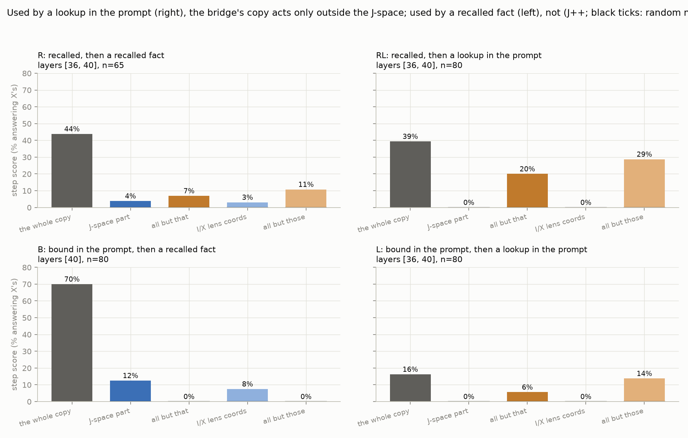

# Is the first hop outside the J-space?

Dan Orel & Zach Perlman · Qwen3.6-27B · 2026-10-16 · every number below is human-verified ([VERIFIED.md](VERIFIED.md))
unless marked *unverified*

## Question
In Claude, the bridge of a two-hop question ("the language spoken in the country where the Amazon River ends" →
*Brazil* → *Portuguese*) acts on the answer through the J-space (Gurnee et al. 2026). On open models the J-lens often
fails to show the bridge. Is the bridge acting outside the J-space there, or is the miss about how we read?

## What we found
1. **The miss is mostly where we read.** At the last word the lenses rank the bridge first far above a distractor
   (57% vs 5% of layers 32-48); most of the remaining misses are found at an earlier word (22/30). [A2-A3]
2. **A bridge recalled from memory acts through the J-space, as in Claude.** Swapping only its J-space part flips
   52% of answers (Claude 61%); the rest, with the J-space held fixed, 1% (Claude 6%). [B1]
3. **A variable looked up in the prompt does not.** In brew, a two-step lookup in a colour table, the step is carried
   outside the J-space: the lens can read it but not write it (1%), while a direction nearly orthogonal to the lens
   writes it (34%). [B2-B3]
4. **Readers report what is written into the vector, not what the model uses.** The verbalizers (oracle lens, NLA)
   name a direction the model ignores on 99% of items. [B4]

5. *Unverified (2026-10-19).* **B1's J-space part is the bridge's own word.** Without the two entities' own word
   directions (the bridge's and target's tokens and near-synonyms), the J-part flips 0-1% of answers instead of 52-54%,
   below a matched random control (14%), in raw text and in the chat format. B1 also replicates in the chat format
   (54% / 5% / 3%) once the probes are read inside the user turn. [Phase 2c, README]

*B1: swapping only the J-space part flips the answer, the remainder barely does; Claude's numbers are the black
dashed line.*

## Where the line falls (unverified lead)
| | used by a recalled fact | used by a lookup in the prompt |
|---|---|---|
| **recalled bridge** | J-space part acts (82% vs 3%) | rest acts (0% vs 20%) |
| **bound in the prompt** | J-space part acts (12.5% vs 0%) | rest acts (0% vs 6%) |

*Each cell is a family of 65-80 prompts. Every prompt first says where three people live, then asks one question;
only two things change. **Source**, where the bridge comes from: recalled from memory ("...the country where Lyon is
located" → France) or bound in the prompt ("Emma lives in Egypt. ... the country where Emma lives" → Egypt). **User**,
what turns the bridge into the answer: a recalled fact ("The capital of ..." → Paris) or a lookup in the prompt
("France's colour is gray. ... has the colour" → gray). In each cell, the J-space part vs the rest of a lens-free copy
on the same prompts: the share where each alone gives the new answer. The top-left cell shows B1's J-part swap vs its
control instead, since the copy's split there is inconclusive (4% vs 7%). Brew (B2, verified), a separate task with a
bound bridge used by a lookup, agrees with the bottom-right cell: J-space part 0%, rest 26-28%.*

What uses the variable decides, not where it comes from (but see the caveat below the figure).

*Unverified: which part of the lens-free copy acts in each family; the panels sit as the table's cells (the
letters in their titles are the families' names in the README). Used by a lookup (right column): the J-space part 0%,
the rest acts. Used by a recalled fact (left column): bottom-left, the J-space part acts (12% vs 0%); top-left, the
split is small both ways (4% vs 7%), so that cell of the table rests on B1's swap (82% vs 3%), not on this panel.*

**Caveat.** Here the user also fixes where the answer comes from: a recalled fact answers from memory, a lookup reads
the answer from the prompt. So "the user decides" could be "the answer's source decides". Sprint direction (a) splits
the two, e.g. a lookup uses the bridge but the answer is recalled ("Italy's animal is the elephant. ... the number of
legs of the animal of the country where Jack lives" → 4).

## Limits
- One model, one run; single-token bridges.
- Format: B1 and the table's families fed the chat model raw text. There it answers B1's questions as often as in its
  chat format (86%) but less surely, and the recalled family R for 76% (half of R fails the families' gate), against
  100% for every family in its chat format; brew ran in the chat format (*unverified*, exp20). Re-run in the chat
  format (*unverified*): B stays inside, RL is outside far more clearly (1% vs 79%), and four new families that split
  "what uses the bridge" from "where the answer comes from" support neither (none inside, README Phase 3), so the
  table's "the user decides" is not established.
- The reference set is 90 prompts (Claude's and ours), mostly places and people; the effects sit there.
- Effects are partial: the J-part swap flips about half of the answers, the bridge swap on the cue phrase 18%, the
  lens-free brew copy about a third.

## Sprint: pick one core direction
- **(a) Use vs answer source.** Split the two the caveat above confounds: a lookup uses the bridge but the answer is
  recalled, and the reverse.
- **(b) What the part outside the J-space is.** Does brew's code follow the table row (a pointer, like binding IDs) or the colour?
- **(c) A stronger reference.** Re-decompose against a stronger lens-free bridge direction (contrastive pairs or DAS).

Then generality: Gemma 4 31B (started), a balanced prompt set beyond places and people.

## Questions for Neel
1. Which story is worth sharpening: (2) recalled bridges act through the J-space as in Claude, (3-4) lookup variables
   live outside it and readers cannot tell used from written, or where the line falls (the table above)?
2. Is our lookup result new? A known mechanism could explain it: for facts stated in the prompt ("Emma lives in
   Egypt"), the model tags the pair with an abstract "binding ID", a label that points to where in the prompt the
   answer is, rather than carrying the word itself (Feng & Steinhardt 2023). A label is not a word, so a word lens
   would miss it. Is our result just this seen through the J-lens, or does it add something? Direction (b) would test
   it.
3. The lenses' Jacobian is averaged over WikiText, which is rich in countries, cities, languages and people, the
   bridges where our effects sit. Do you expect that to limit the lenses on other kinds of bridges, and would you
   re-estimate it on other text, or first check whether lens-free swaps also fail there?
