# bridge-jspace

**Does a two-hop lookup in an open model use the words the J-lens reads, or a route around them?** Five open models: Qwen3.6-27B, Qwen3-32B, Qwen3.5-9B, OLMo-3-7B (SFT, DPO, Instruct), Gemma 4 31B-it.

> **Status, 22 Oct: exploration.** Nothing on this page is in [VERIFIED.md](VERIFIED.md) yet except Zach's B1-B4. The numbers are an agent's recount of saved runs. The main Qwen3.6-27B runs rerun from a clean checkout reproduce row for row, which shows the pipeline is deterministic, not that the analysis is right.

[Dan's predictions vs results](jobs/predictions/) · [plan (Google Doc)](https://docs.google.com/document/d/1bqqdXePTUXQGlowVjk73sPfJkbV_tsu0RNNX-BiTYUc/edit?usp=drivesdk) · [run log](EXPERIMENTS.md) · [old README with every number](README_archive.md) · [how to run](DEVELOPER.md)

### The story in three claims

1. **Recall goes through the J-space; a lookup does not use the J-space part of its bridge.** The lens reads a stated bridge, but the lookup works without that part (Zach's measures and slide 2; Qwen3.6-27B).
2. **What the lookup uses instead is the same on five models:** a late attention read of the answer's statement by the last tokens (slide 3), and the choice of statement is set by an order label for the first two statements and by the bridge's identity for the rest (slide 4).
3. **Open, and the next test:** is that identity carried in a code the lens cannot write? In the one topic where the lens does write recall at the last tokens (chemical elements, layer 44: 38-49% of recalls), it moves almost no lookups of statements 3-5 to the bridge's statement while a patch does: 0 of 47 vs 14 of 47, and on a second, independent draw of scenes 2 of 201 vs 56 of 201. Six entities only (slide 5). If it holds more widely, a lens-based monitor would miss what drives lookups.

**Slides:** [0 The plan](#0-the-question-and-the-plan) · [Setup](#setup) · [1 Background](#1-background-recall-goes-through-the-j-space-a-lookup-goes-around-it) · [2 Where the bridge is read](#2-where-does-the-lookup-read-the-bridge) · [3 Attention knock-out](#3-attention-knock-out-the-lookup-reads-late-through-attention-from-the-last-tokens) · [4 Pointers](#4-pointers-what-the-last-tokens-carry) · [5 A code that writes the lookup](#5-a-code-that-writes-the-lookup-and-its-cosine-with-the-lens) · [6 Early writes](#6-early-writes-is-a-lens-push-the-same-as-editing-the-input-word) · [7 Longshots](#7-longshots-a-pointer-read-out-and-the-olmo-post-training-ladder) · [8 Across models](#8-across-models) · [9 Conclusions](#9-conclusions) · [10 Next](#10-next-steps) · [Appendix](#appendix)

---

## 0. The question and the plan

In a two-hop question the model first finds a **bridge**, then uses it to get the **answer**:

> "Which locker belongs to the animal known for oinking?" → bridge: *pig* → answer: *the pig's locker number*.

The **J-lens** (Gurnee et al. 2026, [Verbalizable Representations Form a Global Workspace](https://transformer-circuits.pub/2026/workspace/index.html)) reads hidden states as words; the part it reads is the **J-space**. In Claude the bridge acts through the J-space. On Qwen3.6-27B, Zach found that recall does, but a lookup in the prompt goes *around* it (slide 1). Dan's depth track asks **what the "around" route is**:

| Slide | Plan item | Answer so far | Models |
|---|---|---|---|
| 2 | Where does the lookup read the bridge: where it is stated, or at the question? | Where it is stated, from the last tokens, late. A stated bridge stays at its statement until ~2/3 of the depth; the lens-readable part of it is not what the lookup uses | 27B (all 5 for the read) |
| 3 | Attention knock-out: block the read. Does the lookup break while recall survives? | The lookup breaks down to guessing among the list's digits on all 5; recall stays (99-100% on the 3 models with a recall family), but that is by construction: its blocked statement is off its path | all 5 (recall: 3) |
| 4 | Pointers: lookback / binding-ID tests (swap the statement order) | The last tokens carry an **order label for the 1st and 2nd statement** and the **bridge's identity** for the rest; the label counts order in the list, not place in the text | all 5 |
| 5 | Fit a code that writes the lookup; its cosine with the lens | A fitted ~4-dim slot code moves 31-42% of lookups; its cosine with lens directions is at chance; the model does not need it. The lens push's 0% there has no positive control (the lens does not write recall at that layer either) | 27B (OLMo: does not write) |
| 6 | Is a hard early lens push the same as editing the input word? | **No**: the edit moves every kind of question (100%), the push only recalled bridges (73-84% vs 1-2%) | 27B |
| 7 | Longshots: a pointer read-out; the OLMo post-training ladder | A late head follows the output statement (near-tautological so far); SFT, DPO and Instruct look the same | 27B; OLMo |

---

## Setup

**Kinds of question**, named by *where the bridge comes from → where the answer comes from* (context: "Jack's pet is a cow. … The cow's locker is 5."):

| Name | Example | Bridge | Answer |
|---|---|---|---|
| prompt → prompt | Which locker belongs to Jack's pet? | stated | looked up |
| memory → prompt | Which locker belongs to the animal known for mooing? | recalled | looked up |
| prompt → memory | How many legs does Jack's pet have? | stated | recalled |
| memory → memory | How many legs does the animal known for mooing have? | recalled | recalled |

**Models.**

| Model | Layers | Architecture |
|---|---|---|
| Qwen3.6-27B | 64 | hybrid: 16 attention + 48 DeltaNet layers |
| Qwen3-32B | 64 | dense attention |
| Qwen3.5-9B | 32 | hybrid: 8 attention + 24 DeltaNet |
| OLMo-3-7B (SFT, DPO, Instruct) | 32 | attention, 3 of 4 layers sliding-window |
| Gemma 4 31B-it | 60 | attention, sliding + global |

**Method words.** *Patching*: copy hidden states from an **alt** prompt (another bridge) into the **org** prompt and see which answer comes out. *Lens push*: add the J-lens direction of another word. *Knock-out*: stop chosen tokens from attending to a statement. Each model is tested only on items it answers right unedited. All tests below are on generated scenes with fixed seeds ([datasets](#datasets)).

---

## 1. Background: recall goes through the J-space, a lookup goes around it

*Zach's measures, 20 Oct; partly verified (B1-B3).*

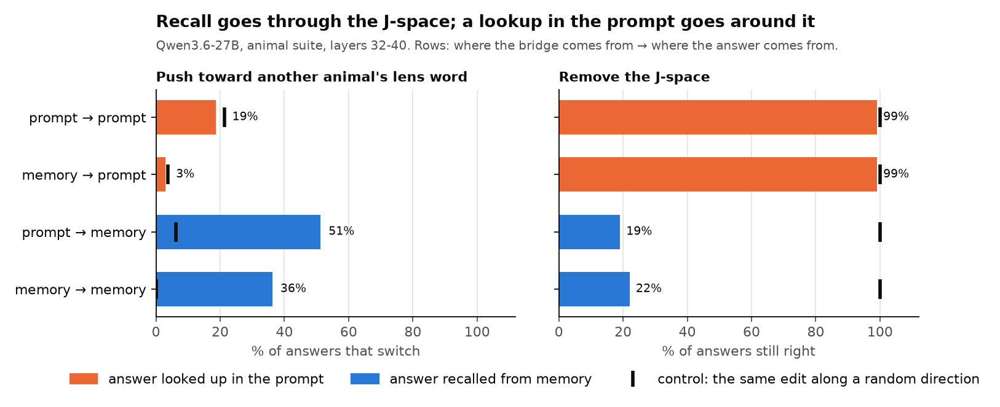

- Pushing a hidden state toward another animal's lens word switches **recalled** answers (36-51%), but lookups no more than a random push (3% vs 4%, 19% vs 21%).
- Removing the J-space breaks **recall** (19-22% still right) and leaves **lookups** (99%); a random subspace of the same size changes nothing.
- Qwen3.5-9B: the lens reads the bridge but cannot write it. Gemma 4 could not be tested with the old lens.

**So:** a lookup in the prompt does not need the J-space. What does it use?

---

## 2. Where does the lookup read the bridge?

> Plan: "Where the lookup reads the bridge: the positions where it's stated vs the question tokens."

**How.** Qwen3.6-27B, animal suite. (a) Copy the hidden states of one set of positions (the statements, the question, the last tokens) from a prompt with another bridge, layer by layer. (b) Swap the stated bridge (Jack's pet: cow → pig) and paste back only one part of the change it causes: the lens-readable part, or everything else.

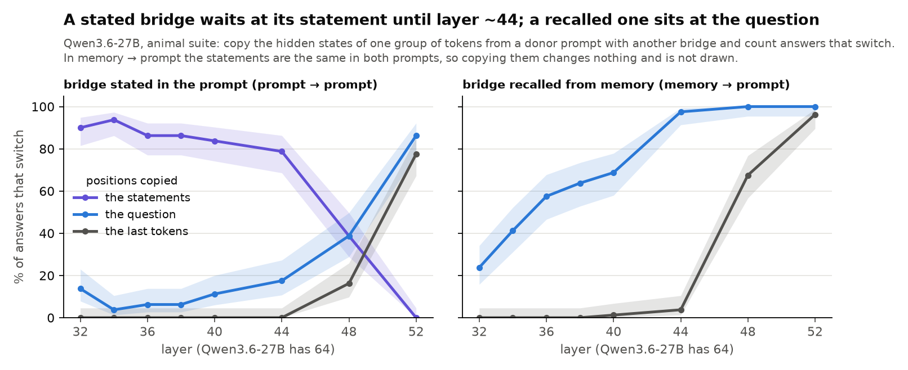

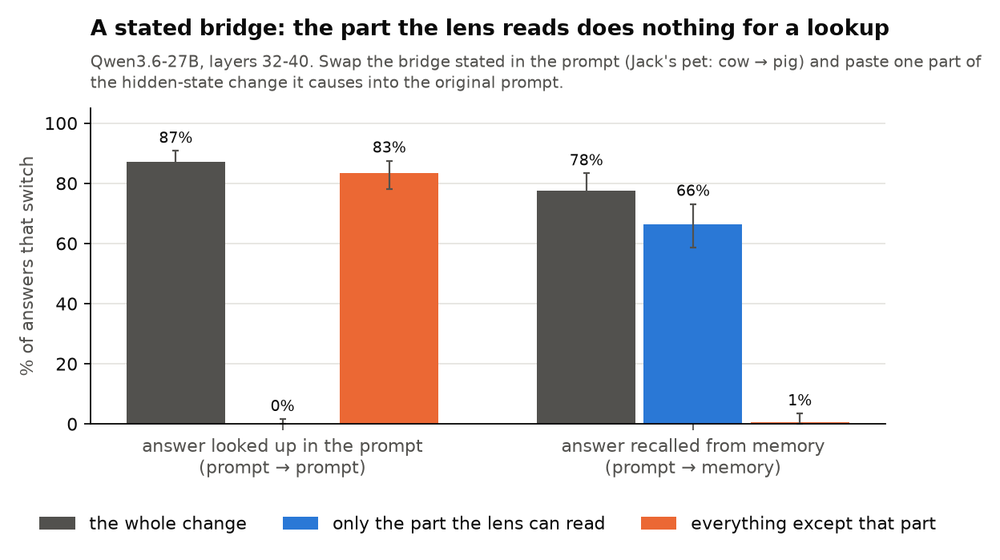

**Found.**
- A **stated** bridge stays at its statement: copying the statements switches 79-94% of answers at layers 32-44; the question and the last tokens carry it only from layer 48-52.
- A **recalled** bridge sits at the question (57-100% from layer 36) and reaches the last tokens at layer 48.
- Of a stated bridge's change, the **lens-readable part alone switches 0%** of lookups, everything else 83% (the whole change 87%). For a recall from the same stated bridge it is the reverse: the lens-readable part does the work (66%). The lens does name the stated bridge (its top word on 90% of items).
- On every model the last tokens must see the answer's statement (slide 3). Whether the **question's tokens** must see it too differs: hiding it from them leaves 90% and 98% right on Qwen3.6-27B and Gemma, but 61%, 32% and 14% on Qwen3.5-9B, Qwen3-32B and OLMo. Their wrong answers are then mostly **off the list** (Qwen3-32B 50%, OLMo 57%), not another statement's digit: the question's tokens take something else from the statement than the digit choice, perhaps the entity's name to resolve the bridge. Not a second read route yet; the test (block only the name or only the digit) is queued.

**So:** the lookup reads the bridge where it is stated, late, and not through the part of it the lens reads.

---

## 3. Attention knock-out: the lookup reads late, through attention, from the last tokens

> Plan: "Block question→statement attention. Does RL break while RR survives?"

**How.** Stop the last tokens from attending to the answer's statement in a set of layers; count answers still right and compare with guessing among the list's 5 digits (20%). Controls: block another statement; on hybrids, block the answer's statement in the DeltaNet layers instead; recall (memory → memory) where the model has one.

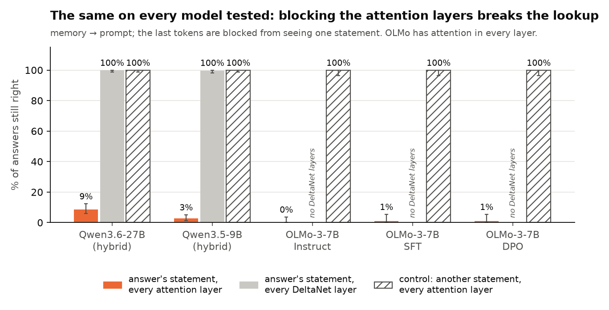

**Found.**
- The **lookup breaks on all five models**, down to guessing: 0-23% still right (Qwen3.6-27B 9%, Gemma 23%, the rest 0-3%), and 72-96% of the answers go to another digit of the list.
- Those wrong answers favour the **1st statement** and never the last. Against a uniform choice among each scene's 4 other statements: Qwen3.6-27B 128 / 56 / 35 / 25 / 19 on statements 1-5 (expected 59 / 51 / 51 / 51 / 51), Gemma 154 / 35 / 25 / 8 / 3 (expected 56 / 42 / 42 / 43 / 42); weaker on Qwen3-32B, Qwen3.5-9B and OLMo. A primacy bias without recency, like the order label of slide 4; the link is only suggestive (models may guess with a positional bias anyway, and there is no random-damage control yet).
- Blocking another statement: 100% right on every model. On the hybrids only the **attention** layers matter; blocking the DeltaNet layers changes nothing (100%).
- Recall stays right (Qwen3.6-27B 99%, Qwen3.5-9B 96%, Gemma 100%), but this is a control, not a finding: the blocked statement is off a recall's path. Qwen3-32B's run had no recall family and OLMo fails its recall gate.
- The read is spread over heads; no single head or layer is needed. Where it sits differs by model (slide 8).
- The same in 5 datasets on Qwen3.6-27B, including Python code and statements in other languages.

**So:** the "around" route ends in an ordinary attention read of the answer's statement by the last tokens.

---

## 4. Pointers: what the last tokens carry

> Plan: "Pointers: lookback / binding-ID tests (swap statement order)."

**How.** Two prompts list the same entities in a different order. We copy the alt prompt's last two tokens into the org prompt at one layer. Each possible answer is a different digit, so the answer shows which statement the copied tokens pointed to:

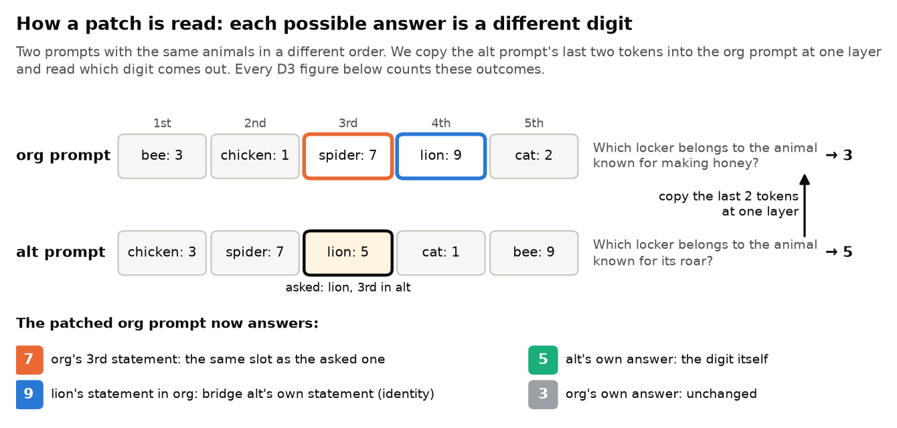

**4a. When.** On every model there is a short window, just before the digit itself reaches the last tokens, where the copy moves the answer to another statement:

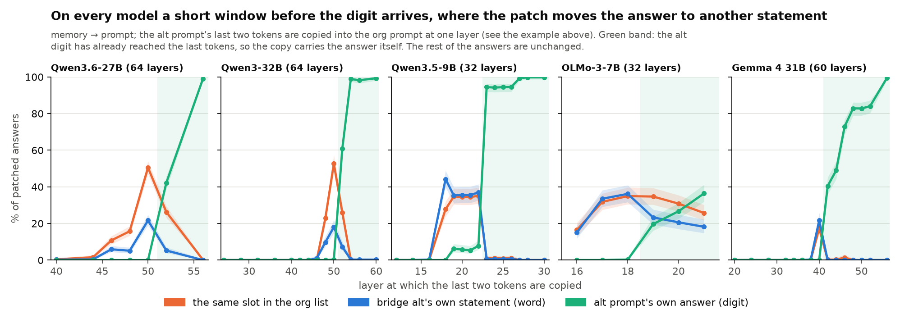

**4b. What.** Split by the place of the asked statement in the alt list (in the example: lion, 3rd), at each model's last layer before the digit arrives:

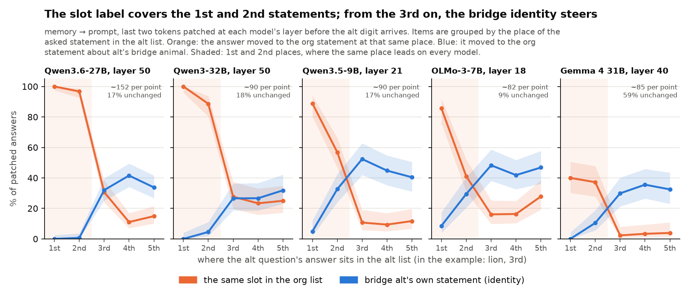

- When alt asks its **1st or 2nd** statement, the answer goes to the org's 1st or 2nd: Qwen3.6-27B 100% / 97%, Qwen3-32B 100% / 89%, Qwen3.5-9B 89% / 57%, OLMo 86% / 41%, Gemma 40% / 37% (100% / 78% of the answers that move).
- From the **3rd** on it follows the **bridge's identity** (the org statement about alt's animal) as often as or more than the slot: identity 27-52%, slot 2-31%. "Identity", not "word": whether it is the lens's word form is what slide 5's open test asks.
- The same in Python dicts and with the statements in French, Spanish and German (Qwen3.6-27B, layer 50): 1st / 2nd 96% / 90% in code and 100% / 83% across languages, then the identity (code 20-55% vs slot 6-37%; languages 37-45% vs 13-29%).
- The same with 8 statements (Qwen3.6-27B, Qwen3.5-9B, Gemma) and with colour words as answers (Qwen3.5-9B only: on the other two the colour words fail their control):

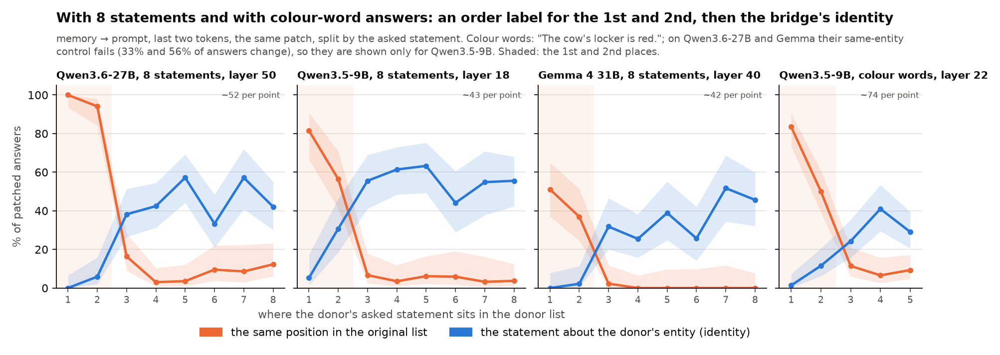

**4c. How the label counts.** The lists are built so that three ways of counting point to different statements, or an extra sentence moves every statement in the text or away from the question:

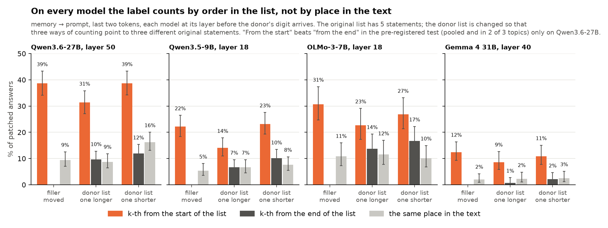

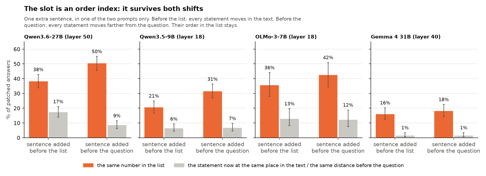

- The label follows the **order in the list**, not the place in the text, on all four models tested (Qwen3.6-27B 31-39% vs 9-16%, Qwen3.5-9B 14-23% vs 5-8%, OLMo 23-31% vs 10-12%, Gemma 9-12% vs 2-3%). "From the start" beats "from the end" only on Qwen3.6-27B.
- It survives an extra sentence before the list or before the question on all four (16-50% vs 1-17%). The guess that rotary position would make the distance to the question matter more did not hold on any of them. Statements twice as long change nothing.

**So:** which statement to read is given by an **order label for the first two statements** and by the **bridge's identity** for the rest. This matches lookback work (Gur-Arieh et al. 2026) in the middle of the list and differs at its end: they find a positional pointer for the last item too, we find none. New here: it holds when the bridge is recalled rather than named, in code and across languages, on five models.

**Caveats.** The 27B's layer 50 was chosen after the first runs (a second data seed reproduces it); the other models' layers follow a fixed rule (last layer where the alt digit's share is under 10%). Tests 4c pool all asked statements, so their signal comes mostly from the 1st and 2nd. On Gemma a random patch of the same size breaks 85% of answers (though never into a slot or word answer); colour words fail their control on Qwen3.6-27B and Gemma.

---

## 5. A code that writes the lookup, and its cosine with the lens

> Plan: "Fit a code that does write RL, and its cosine with the lens direction."

**How.** Fit a ~4-dimensional "slot" direction from the average last-token states of each slot; push the last tokens toward another slot by as much as a real patch changes them. Compare with the lens direction of the target's word.

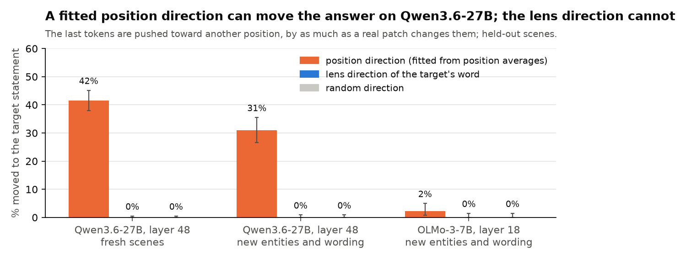

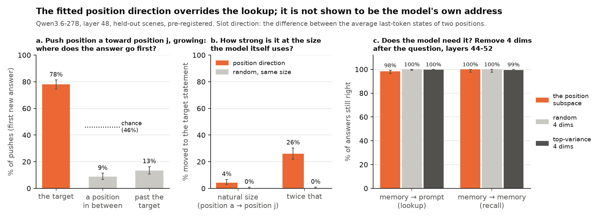

**Found.**
- On Qwen3.6-27B the slot code moves **31-42%** of lookups to the target statement; the lens direction and a random one move **0%**. On OLMo the same fit moves 2%.
- **The lens's 0% has no positive control here:** at this layer the lens push does not write recall either (memory → memory: 2 of 150 at 1x, 8 of 150 at 2x, while a patch moves 50 of 150). The one cell found so far where it does is chemical elements at layer 44 (recall: 19 of 50 at 1x, 22 of 50 at 2x). There, on lookups of statements 3-5, the lens moves 0 of 47 to the bridge's statement at either size and a patch 14 of 47; on a second, independent draw of scenes the same: recall 41 of 100 (lens 1x), lookups 2 of 201 (lens) vs 56 of 201 (patch). The C2 split, twice, on the same six entities.
- **Cosine with the lens**: the code's largest cosine with any entity's lens direction is 0.032, against 0.036 for random vectors; its J-space share is 7.1%, against 7.6% for a random vector. It lies outside the J-space.
- It is an **override, not the model's own address**: at its natural size it moves 4% (the pre-registered bar was 10%), at twice that 26%; it jumps straight to the target (78%), not through the slots in between; it writes the 1st and 2nd slots (65%, 39%) far better than the 3rd-5th (5-13%); removing it from the model leaves 98% of lookups right.

**So:** a code outside the J-space can steer the lookup, and it lines up with the order labels of slide 4, but the model does not depend on this fitted version.

---

## 6. Early writes: is a lens push the same as editing the input word?

> Plan: "The 27B's early writes: is a hard early lens push the same as editing the input word?"

**How.** Qwen3.6-27B, layer 20: push the words that name the bridge ("the animal known for mooing", "Jack's pet") toward another animal's lens word, or edit those words to name that animal ("the sheep").

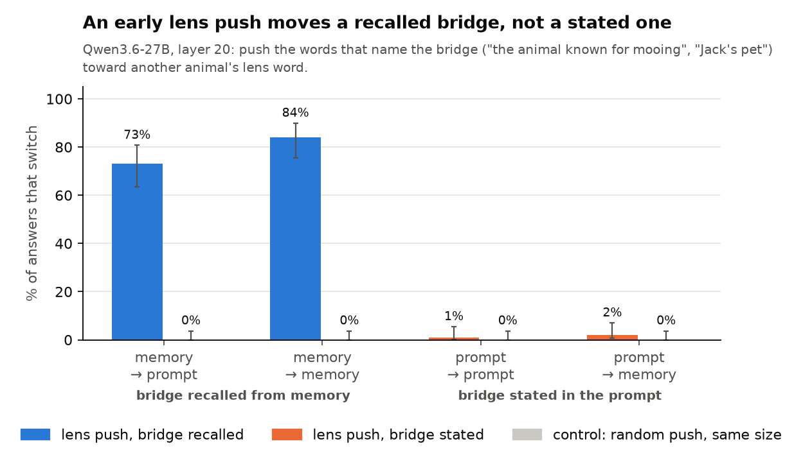

**Found.**
- Editing the input words switches **every** kind of question (100%).
- The lens push switches only questions whose bridge is **recalled** (73%, 84%), not those whose bridge is stated (1%, 2%); a random push 0%.
- Pre-registered verdict: the push "writes the intermediate", not "like an input-word edit".

**So:** an early lens push rewrites the recalled bridge, the thing the lens reads. A stated bridge is not carried in that form, consistent with slide 2.

---

## 7. Longshots: a pointer read-out, and the OLMo post-training ladder

> Plan: "The longshot: a pointer readout; the OLMo post-training ladder."

**Pointer read-out.** Without any patch, on Qwen3.6-27B's own wrong lookups, does a late attention head look at the statement the wrong answer came from?

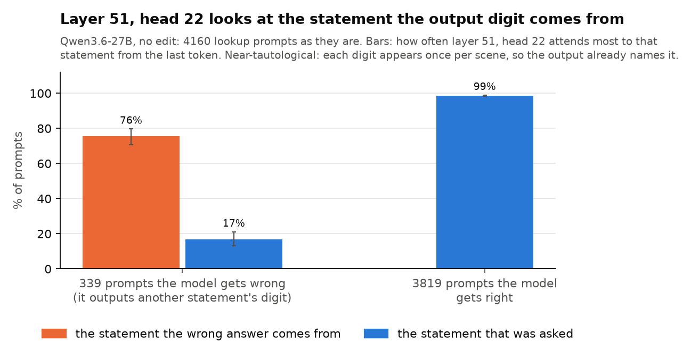

- On 339 wrong answers (of 4160 prompts) layer 51, head 22 looks most at the statement the wrong digit comes from 76% of the time, at the asked one 17%; on right answers it is on the asked statement 99%.
- **Near-tautological:** each digit appears once per scene, so the output already names that statement. It becomes a read-out only if it predicts the answer before the digit forms, or on scenes with a repeated digit. Not run yet.

**OLMo post-training ladder.** The same tests on three checkpoints of OLMo-3-7B:

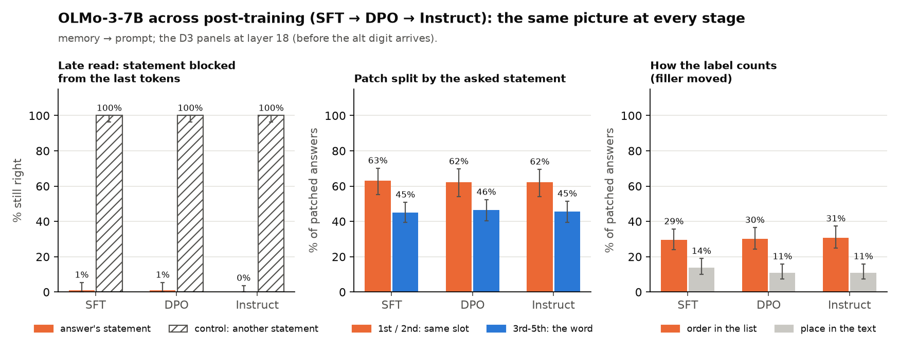

- SFT, DPO and Instruct give the same late read (0-1% still right), the same label / identity split, and the same order count. The base model is not tested, so this does not say whether post-training builds the route, only that SFT, DPO and Instruct do not change it.
- OLMo fails the recall gate (35-68% right), so it has no memory → memory control.

---

## 8. Across models

**Where the stages sit along the depth.** The window where the last tokens carry a label or the bridge's identity (orange), the layer block they must read the answer's statement in (grey; 8-16 layers wide, so it does not say whether the read comes before or after the orange window), and the layer where the digit itself arrives (green):

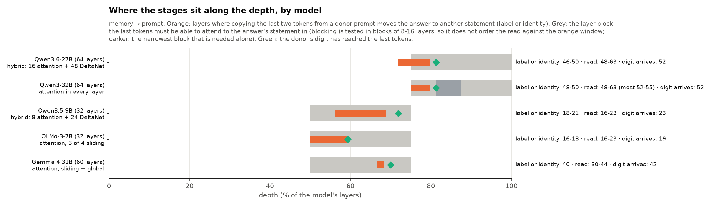

**What differs:**

| | Qwen3.6-27B | Qwen3-32B | Qwen3.5-9B | OLMo-3-7B | Gemma 4 31B |
|---|---|---|---|---|---|
| Architecture | hybrid | dense | hybrid | attention, sliding | sliding + global |
| Label → digit, % of depth | 72-81% | 75-81% | 56-72% | 50-59% | 67-70% |
| Lookup right, statement hidden from the last tokens (guessing: 20%) | 9% | 3% | 3% | 0% | 23% |
| … hidden from the question's tokens | 90% | 32% | 61% | 14% | 98% |
| 1st / 2nd statement label | 100% / 97% | 100% / 89% | 89% / 57% | 86% / 41% | 40% / 37% |
| 3rd-5th: the bridge identity steers | yes | ties the slot | yes | yes | yes |
| Order in the list, not place in the text | yes | – | yes | yes | yes |
| "From the start", not "from the end" | yes | – | pooled only | no | pooled only |
| Fitted slot code writes the lookup | yes (override) | – | – | no (2%) | – |
| Recall through the J-space (Zach) | yes | – | reads, cannot write | ran, not analysed | – |
| Random-patch control | clean | clean | clean | clean | breaks 85% |

– not tested. One seed per cell unless said.

**Common to all:** the late attention read; an order label for the first two statements and the bridge's identity for the rest; the label counts order in the list; a primacy bias when the read is blocked; DeltaNet layers play no part on the hybrids. **Differs:** how deep the stages sit (late on the two 64-layer Qwens, mid-depth on the others), how strong the "second" label is (strong on the larger Qwens), and whether the question's tokens must also see the statement (Qwen3-32B, OLMo, Qwen3.5-9B). Hybrid vs dense: Qwen3.6-27B and Qwen3-32B match on the label and the late read but differ on the question's tokens (90% vs 32% right). With five models, size, depth and architecture are confounded.

---

## 9. Conclusions

| # | Claim | How sure | Models |
|---|---|---|---|
| 1 | A lookup reads the answer's statement late, from the last tokens, through attention (blocked: down to guessing) | **High** | 5 of 5 |
| 2 | The lens reads a stated bridge, but the lookup does not use that part | **High**, one model, one topic | Qwen3.6-27B |
| 3 | Which statement: an order label for the 1st and 2nd, the bridge's identity for the rest | **High** in the data; one layer per model | 5 of 5 |
| 4 | The label counts order in the list, not place in the text | **Medium**: pooled over statements | 4 of 4 tested |
| 5 | An early lens push writes the recalled bridge; it is not an input edit | **Medium-high**, pre-registered | Qwen3.6-27B |
| 6 | The "around" route *is* an identity code outside the J-space | **Not shown**; one supporting cell (6 entities) | Qwen3.6-27B |

**Negative or inconclusive** (kept for the record, not part of the story):
- The fitted slot code overrides the lookup but is not the model's own address (4% at its natural size; removing it changes nothing); it does not write on OLMo.
- The late head 51/22 tracks the statement whose digit is output: near-tautological until tested on repeated digits.
- OLMo's SFT, DPO and Instruct look the same; without the base model this says nothing about where the route comes from.
- Colour-word answers fail their control on Qwen3.6-27B and Gemma; Gemma's random-patch control breaks 85% of answers.

**Not shown yet.** Claim 6 is the link between claims 2 and 3. A lens push that moves no lookups means something only where the same push does write recall (a positive control); at most layers and topics tested so far it writes neither, so the earlier "patch 44 of 256, lens 0" at layer 48 does not count. The one valid cell (elements, layer 44) supports claim 6; widening it to more entities and topics, and adding a supervised identity direction, is the next test. Scenes are simple (3-8 short statements, one-digit answers, the question right after the list), and patches move 30-50% of answers at most.

---

## 10. Next steps

| Step | Question | When |
|---|---|---|
| **Sharp C2, step a** (running): sweep layers 32-48 on five topics; select cells where the lens push writes recall (≥ 20%) and a patch moves recall, from recall rows alone; then read lookups of statements 3-5 with four outcomes: holds / refuted / not testable (the patch moves < 20% of lookups) / inconclusive | Is there a positive control beyond elements? An outside forecast: no new cells (the stated bridge reaches the last tokens only at ~48, where the lens no longer writes recall) | Thu 22 |
| **Name vs digit, v2** (queued): hide the name, the digit, the statement without its digit, or without its name, from the question's tokens and from the last tokens | What do the question's tokens take from the statement? The split spans guard against leaks through the statement's other tokens | Thu 22 |
| **D1 on three topics and on Qwen3-32B** (its lens from neuronpedia) | Claim 2 beyond one topic and one model; D1 has its positive control built in (the same vector a recall from the stated bridge uses) | Fri 23 |
| Sharp C2, step b: the identity direction, only if step a finds ≥ 12 entities; otherwise plan B: a topic recalled late at the last tokens (like elements), or D1 as C2's main evidence | Does an identity code the lens cannot write steer the lookup? (claim 6) | Fri 23 |
| Freeze claims 1, 3 and slide 2 (b); verify by hand with Zach into VERIFIED.md; sync on Zach's C1 for the other models | Process | Sat-Sun 24-25 |
| The late read in Zach's six formats (chat turn, table, document, JSON, Python, prose) | Claim 1 beyond toy scenes | Mon-Tue 26-27 |
| Write-up and slides | | Wed-Fri 28-30 |

Later, if time: the label with two lists in one prompt, a header before the list, or the question before the list (does it follow the list or the user turn?); the identity with each entity in a different language in org and alt (rules out a lexical match); a random-damage control for the primacy of wrong answers; the late head on scenes with a repeated digit.

---

## Appendix

### Datasets

All generated from templates with fixed seeds; examples are real items (random, seed 0). Sizes: [data/README.md](data/README.md).

**Animal suite** (Zach): pets and lockers, every kind of question. Slides 1, 2, 6.
```
Tara's pet is a pig. Jack's pet is a cow. Dan's pet is a chicken.
The cow's locker is 5. The pig's locker is 3. The chicken's locker is 7.
Which locker belongs to the animal known for oinking?                        → 3
```

**Locker lists**: five statements, an org and an alt prompt; each outcome of a patch is a different digit. Slides 3-5.
```
org: The bee's locker is 3. The chicken's locker is 1. The spider's locker is 7. The lion's locker is 9.
     The cat's locker is 2.  Which locker belongs to the animal known for making honey?        → 3
alt: The chicken's locker is 3. The spider's locker is 7. The lion's locker is 5. The cat's locker is 1.
     The bee's locker is 9.  Which locker belongs to the animal known for its roar?             → 5
after patching alt into org: 9 = the word (lion's statement in org), 7 = the same slot (3rd), 5 = alt's digit
```

**Many entities and wordings**: the same design on 85 entities in 3 topics (countries, animals, body parts), 9 wordings per topic, some entities and one wording held out. Slides 3-5, 7.
```
The file on Greece is kept in drawer 1. The file on China is kept in drawer 9. The file on Hungary is kept in
drawer 7. The file on Venezuela is kept in drawer 2. The file on Sweden is kept in drawer 6.
Which drawer holds the file on the country whose capital is Athens?          → 1
```

**Counting and shifts**: a filler line moves, the alt list gets one statement more or fewer, or an extra sentence goes before the list or the question; also 8-statement lists and colour-word answers. Slide 4.
```
org: The forehead chart is in folder 6. The skull chart is in folder 3. The wind picked up late in the evening.
     The tongue chart is in folder 5. The eye chart is in folder 9. The eyebrow chart is in folder 4.
alt: (the same charts reshuffled; the filler sentence is now 5th instead of 3rd)
```

**Python code** and **other languages**: the same lookup as a dict, and with statements in French, Spanish and German. Slide 3.
```
lockers = {"dog": 7, "owl": 9, "cat": 5, "bee": 8, "frog": 3}
What number does lockers store for the animal known for making honey?      → 8

Le cheval a le casier 5. El perro tiene la taquilla 6. Die Kuh hat den Spind 7. El pollo tiene la taquilla 8.
La souris a le casier 3.  Which locker belongs to the animal known for clucking?          → 8
```

### Where things are

| What | Code | Results |
|---|---|---|
| Slide 1 (Zach) | `scripts/suite_split.py`, `read_write.py`, `ablate_pilot.py` | `results/read_write/`, `ablate_pilot/` |
| Slide 2 | `scripts/statement_positions.py` | `results/statement_positions/` |
| Slide 3 | `scripts/attn_knockout.py` | `results/attn_knockout/` |
| Slide 4 | `scripts/pointer_v*.py`, `pointer_swap.py` | `results/pointer_swap/` |
| Slide 5 | `scripts/pointer_fit.py`, `pointer_mechanism.py` | `results/pointer_fit/`, `pointer_mechanism/` |
| Slide 6 | `scripts/early_push.py` | `results/early_push/` |
| Slide 7 | `scripts/d5a_natural_errors.py`, the slide 3-4 scripts | `results/d5a_natural_errors/` |
| All figures | `scripts/readme_figures.py` | `figures/readme_1021/` |
| Job queue, pre-registered specs | `scripts/jobq.py`, `jobs/` | `results/jobq/` |

Every run's spec in `jobs/` states its hypotheses, decision rule and controls before it runs.

<details>
<summary>Runs behind each slide</summary>

| Slide | Runs |
|---|---|
| 1 | `read_write/dose_v1`, `ablate_pilot/abl_rot_v1` |
| 2 | `statement_positions/d1_map_n80_v1`, `d1_parts_n80_v1`; question-token rows of the slide 3 runs |
| 3 | `attn_knockout/d2_v4_late_read`, `qwen3_32b_d2_v4_late_read_v2_r2`, `qwen35_9b_d2_v4_late_read_r2`, `olmo3_7b_{instruct,sft,dpo}_d2_v4_late_read_*`, `gemma4it_d2_v4_late_read_v3_r2` |
| 4a-b | `pointer_swap/d3v4_swap_topics`, `d3v4_seed2_swap_27b`, `qwen3_32b_d3v4_swap_r2`, `qwen35_9b_d3v4_swap_r2`, `olmo3_7b_instruct_d3v4_swap_fn`, `gemma4it_d3v4_swap_v2_r2`; 8 statements and colour words: `d3v5_swap_27b`, `qwen35_9b_d3v5_swap_r2`, `gemma4it_d3v5_swap_r2` |
| 4c | `pointer_swap/d3v4x_swap_main`, `qwen35_9b_d3v4x_swap_r2`, `olmo3_7b_instruct_d3v4x_swap`, `gemma4it_d3v4x_swap_r2`; shifts: `d3v6_swap_27b`, `qwen35_9b_d3v6_swap_r2`, `olmo3_7b_instruct_d3v6_swap`, `gemma4it_d3v6_swap_r2` |
| 5 | `pointer_fit/d3b_replicate_fresh_27b`, `d3v4_fit_main`, `olmo3_7b_instruct_d3b_fit_v2`; `pointer_mechanism/d3b_mechanism_27b` |
| 6 | `early_push/d4_push_wording_b_v1` (wording A: `d4_push_v1`) |
| 7 | `d5a_natural_errors/d5a_natural_errors_27b`; OLMo ladder: `olmo3_7b_{sft,dpo}_d3v4_swap`, `olmo3_7b_{sft,dpo}_d3v4x_swap` and the slide 3 OLMo runs |

Two D2 runs (Qwen3-32B, Gemma) were analysed locally: the box's figure stage hit an old plotting bug. On the 9B the v6 run also reported layers 20-22, where the alt digit had started to arrive; the spec excludes them.

</details>
