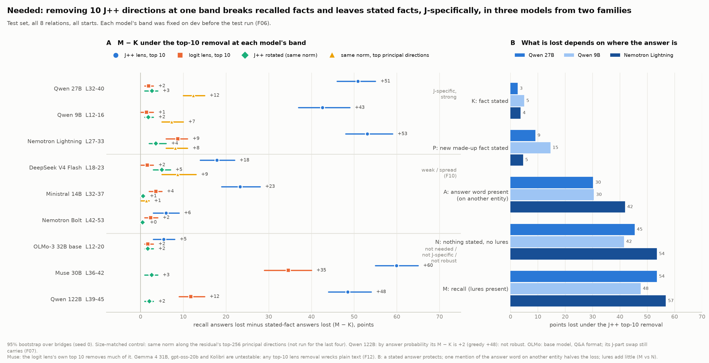
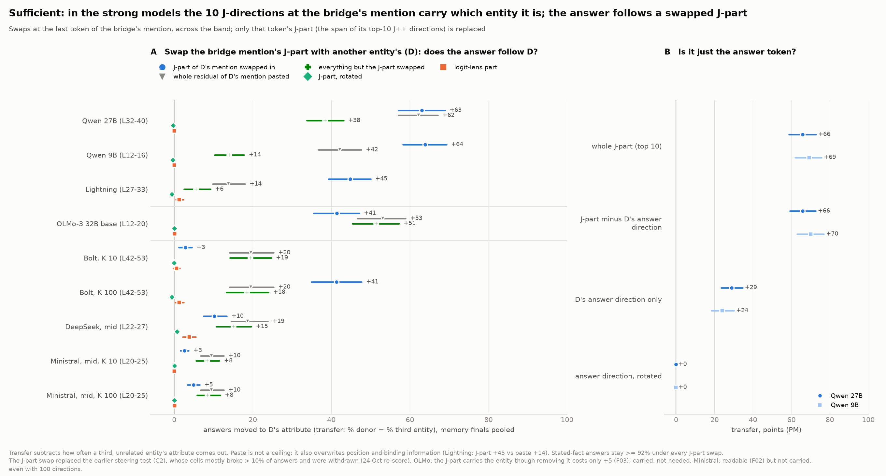

# Recall reads the lens; the lookup goes around it

Draft (27 Oct). Every number is unverified until the hand check on Thu 29 Oct.

*In a two-hop question, does the model use the part of the bridge entity that the J++ lens can read, and does that depend on whether the answer must come from memory or is in the prompt?*

## Reports

This page joins two reports, each built from its own run files.

- **Depth:** [The lookup goes around the lens](docs/depth/README.md). Dan: what a model reads from the bridge word, on four models. Built by `scripts/readme_build.py` from `docs/README.template.md`.
- **Breadth:** [Recall goes through the lens](docs/breadth/README.md). Zach: what a model needs from the bridge's mention, across models. Built by `scripts/report_breadth.py`.
- **Where things live:** code in `scripts/` and `src/`; raw runs in `results/`; figures in `figures/` and `docs/breadth/figures/`.
- **Working notes:** [DEVELOPER.md](DEVELOPER.md) has the layout and commands, [AGENTS.md](AGENTS.md) the rules for running experiments. The joint working notes are [docs/shared/joint_story_draft.md](docs/shared/joint_story_draft.md) (term map) and [docs/shared/gaps.md](docs/shared/gaps.md) (gaps and requests), with review records in [docs/shared/joint_review_notes.md](docs/shared/joint_review_notes.md).
- **Deadlines:** the experiments freeze Wed 28 Oct evening. <!-- src: STATUS.md | Experiments freeze Wed 28 Oct evening -->
- **Sources:** every number's source is in an HTML comment beside it; `tests/test_readme_sources.py` checks them.

## In one minute

- **Answers that must come from memory need the lens-readable part of the bridge; answers in the prompt do not.**
  - Both methods find this on the Qwen 9B and 27B; the knock-out alone finds it on Lightning.
  - Limits: the 27B misses our strict lookup bar; the 9B misses our clean design (0.23) and replication (0.12) <!-- src: figures/story/data.csv | x45m_before_gap_9b --> <!-- src: docs/split_by_order.md | only the asked pick (replication, fresh scenes) -->; our positive control failed.
- **Swapping that part moves the recall, not the in-context read.** Zach's J-part swap, fixed in advance on the 9B and 27B.
- **Our lookup uses an order pointer the lens cannot see**, on the 9B and Muse in simple scenes. Identity outside J++ is not shown to be specific, and about half of the route is unexplained.
- **The methods disagree on Muse and the 122B.**
  - On Muse, more than half of the knock-out's effect is shared with the logit lens, while our change-removal is J++-specific.
  - 45r (Q46.1) would test this at mid depth; it is not run.

## Setup

A two-hop question about a bridge entity ("the composer who wrote The Magic Flute"; "Iris's pick").

- **Two readers.** From memory: our **recall**, his **M final**. In the prompt (an **in-context read**): our **lookup** (a bound locker number), his **K final** (a stated fact).
- **Three tools.**
  - **Knock-out** (his): the top-10 J++ directions are removed at every token of a band. *Needed?* <!-- src: docs/breadth/README.md | project out the 10 directions the J++ lens reads most there -->
  - **Change-removal** (ours): the bridge token's change is added at one layer, minus its 25-direction J++ part. *Does the change travel through J++?* <!-- src: docs/depth/README.md | the 25 lens directions that best rebuild the change -->
  - **J-part swap** (his): the mention's top-10 J++ span is replaced by another entity's. *Sufficient?* <!-- src: docs/breadth/README.md | Replace the J-part (the span of the top-10 J++ directions) -->
- **Sites.**
  - Ours: one token at one layer: 9B L12, 27B L32, 122B L33, Muse L26 <!-- src: predictions/2026-10-26_dan.md | (9B L12, 27B L32, 122B L33, Muse L26) -->; Lightning L30 for 45s <!-- src: scripts/x45s.py | at L30 (the middle of Zach's pre-registered band L27-33 -->.
  - His: every token over a band: 9B L12-16, 27B L32-40, Lightning L27-33, Muse L36-42, 122B L39-45 <!-- src: docs/breadth/README.md | Qwen3.5-9B (L12-16); Qwen3.6-27B (L32-40); Nemotron 3.5 Lightning (L27-33); Muse Glimmer 30B (L36-42); Qwen3.5-122B (FP8) (L39-45) -->.
  - The layers overlap on the 9B and 27B, and L30 is inside Lightning's band.
- **Words.** **Entity code** = his J-part (inside J++; which entity). **Order pointer** = ours (4 directions outside J++; which locker sentence) <!-- src: docs/depth/README.md | four directions separating the positions -->.

## Claim 1. Answers that must come from memory need the lens-readable part; answers in the prompt do not

| | 9B | 27B | Lightning | 122B | Muse |
|---|---|---|---|---|---|
| Change-removal gap, recall − lookup <!-- src: figures/story/data.csv \| contrast_9b; contrast_27b; contrast_122b; contrast_muse --> | 0.53 [0.42, 0.61] | 0.60 [0.50, 0.69] | GAP -> 45s (Q46.2) | 0.32 [0.20, 0.43] | 0.85 [0.68, 0.98] |
| Knock-out M − K, points <!-- src: docs/breadth/data.csv \| ko.q9.mk; ko.q27.mk; ko.nl.mk; ko.q122.mk; ko.mu.mk --> | +42.6 [37, 49] | +50.9 [46, 55] | +53.1 [48, 59] | +48.5 [44, 54]° | +59.9 [55, 65]° |

° After the data: v2 was not pre-registered for these models. <!-- src: EXPERIMENTS.md | l.167; l.169 -->

**Source varied, question fixed (his).**
- M vs K is one question with the fact stated or not.
- Reporting a number, recalled minus read: +14.8 / +13.3 / +4.8 (9B / 27B / Lightning). <!-- src: docs/breadth/data.csv | mod.q9.numbers.paper10.MR-PR; mod.q27.numbers.paper10.MR-PR; mod.nl.numbers.paper10.MR-PR --> Computed by arithmetic: 0.0 / 0.0 / 0.0. <!-- src: docs/breadth/data.csv | mod.q9.numbers.paper10.AR-PR; mod.q27.numbers.paper10.AR-PR; mod.nl.numbers.paper10.AR-PR -->
- Three hops ending in a recall vs a read:
  - Lightning P→P→M +59.9 vs M→M→P −1.9 <!-- src: docs/breadth/data.csv | mod.nl.threehop.paper10.PPM-PPP; mod.nl.threehop.paper10.MMP-PPP -->;
  - the 27B reversed, +8.2 vs +20.5 <!-- src: docs/breadth/data.csv | mod.q27.threehop.paper10.PPM-PPP; mod.q27.threehop.paper10.MMP-PPP -->.

**Controls.**
- **Ours:** J++ vs same-size PCA, recall loss 0.37 / 0.61 vs 0.13 / 0.16 (9B / 27B). <!-- src: figures/story/data.csv | J++ part: recall extra loss; PCA directions (same size): recall extra loss --> Logit-difference gap 0.48 / 0.47. <!-- src: figures/story/data.csv | ld_gap_9b; ld_gap_27b -->
- **His** (9B / 27B / Lightning):
  - rotated +1.8 / +2.7 / +3.6 <!-- src: docs/breadth/data.csv | ko.q9.rot; ko.q27.rot; ko.nl.rot -->;
  - logit lens +1.4 / +1.9 / +8.7 <!-- src: docs/breadth/data.csv | ko.q9.u; ko.q27.u; ko.nl.u -->;
  - by probability +35.3 / +50.3 / +44.1 <!-- src: docs/breadth/data.csv | ko.q9.soft; ko.q27.soft; ko.nl.soft -->.
  - Lightning's probability reading was chosen after its grid.

**Limits.**
- Our reader and answer source are confounded <!-- src: docs/depth/README.md | reader and answer source (prompt vs memory) confounded -->; his tests vary only the source.
- The 27B's lookup loses 0.14 <!-- src: figures/story/data.csv | lk_excess_27b --> against the bar of 0.10, so X0 is "not confirmed" <!-- src: docs/x0_details.md | lookup excess ≤ 0.10 and recall J-dependence ≥ 0.30 -->.
- Our positive control failed: 0.15 against a bar of 0.20 <!-- src: docs/depth/README.md | chemical symbols, 27B 0.15, bar 0.20 -->.
- The clean design holds on 2 of 3. The 9B is at 0.23 <!-- src: figures/story/data.csv | x45m_before_gap_9b --> and its replication at 0.12 <!-- src: docs/split_by_order.md | only the asked pick (replication, fresh scenes) -->. Both sit in locker-first scenes, where 45p shows the recall reads the earlier mention's J++ part (0.25 for the 9B; after the data) <!-- src: figures/story/data.csv | x45p_d23_9b -->.

**Status.** Fixed in advance: our main test, and his knock-out on the 9B, 27B and Lightning. After the data: the knock-out on the 122B and Muse.

**Credence.**
- Medium-high on the 9B and 27B.
- Lightning: medium, knock-out only (GAP -> 45s). Caveats:
  - the recalled-number prediction failed: +4.8 [0, 11] against a bar of 10 <!-- src: docs/breadth/data.csv | mod.nl.numbers.paper10.MR-PR --> <!-- src: docs/breadth/README.md | recalled at least 10 above -->;
  - the lens is Zach's own fit;
  - the removal adds +1.67 nats of plain-text loss, against +0.30 rotated <!-- src: docs/claims_skeleton.md | +1.67 nats over L17-35 vs +0.30 rotated -->;
  - the clean rerun differs on 9 of 14075 rows <!-- src: docs/breadth/README.md | 9 of 14075 rows differ -->;
  - it has the highest logit-lens control, +8.7 <!-- src: docs/breadth/data.csv | ko.nl.u -->;
  - P→P→M is partly logit-lens: +32 on the natural set, +26 on the second seed <!-- src: docs/breadth/README.md | logit lens +32 on the natural set -->.

## Claim 2. Swapping that part moves the recall, not the in-context read

**His J-part swap**, fixed in advance on the 9B and 27B:
- Recall transfer +63.9 / +63.0. <!-- src: docs/breadth/data.csv | swap.q9.swap; swap.q27.swap -->
- In-context read kept: 27B PK 99.1%. <!-- src: EXPERIMENTS.md | l.166 --> The 9B's PK still moves +4.4 [2.0, 6.8]. <!-- src: EXPERIMENTS.md | l.165 -->
- A neutral one-sentence donor works as well: 1.10 / 1.09. <!-- src: docs/breadth/data.csv | ptr.q9.neutral; ptr.q27.neutral -->
- Lightning: transfer +44.8 <!-- src: docs/breadth/data.csv | swap.nl.swap -->, with in-context reads kept ≥ 98%. This is after the data and formally uninformative: the paste ceiling is +13.8, below 20. <!-- src: EXPERIMENTS.md | l.209 --> <!-- src: docs/prereg_replication_1022.md | l.1175-1176 -->

**The rest of the residual** (after the data; from his stored summaries, not in his report). Moving everything but the J-part moves the stated read:
- 27B: PK +24.6 [18.6, 31.0], TK +27.3 [20.2, 34.9] <!-- src: results/jswap/jswap_v2_v1/summary.json | PK/swap_comp; TK/swap_comp -->;
- 9B: PK +13.9 [7.8, 20.4], TK +1.7 [−11.1, 13.6] <!-- src: results/jswap/qwen35_9b_jswap_v2_v1/summary.json | PK/swap_comp; TK/swap_comp -->;
- Lightning: PK −0.4, TK +2.9 <!-- src: results/jswap/nem35l_jswap_v2_v1/summary.json | PK/swap_comp; TK/swap_comp -->.
- GAP -> Zach's confirmation.

**Context only (ours).**
- The routes test's whole change never makes the lookup answer the value: 0.00 on the 9B, 27B and Muse. <!-- src: figures/story/data.csv | another item moved, whole: value share -->
- But adding only the J++ part moves neither reader: recall 0.07 / 0.02 / 0.02 vs random 0.02 / 0.00 / 0.00 <!-- src: figures/story/data.csv | rtk_C2_keep_jpp_recall_follows_s_9b; rtk_C2_keep_jpp_recall_follows_s_27b; rtk_C2_keep_jpp_recall_follows_s_muse; rtk_C2_keep_jpp_rand_recall_follows_s_9b; rtk_C2_keep_jpp_rand_recall_follows_s_27b; rtk_C2_keep_jpp_rand_recall_follows_s_muse -->. So this is not reader evidence.

**Credence.** Medium-high on the 9B and 27B; Lightning is not counted. Change from Dan's outline: this claim rests on Zach's swap alone, fixed in advance only on the 9B and 27B; our routes test is context.

## Claim 3. Our lookup uses an order pointer the lens cannot see (9B, Muse)

**Evidence (ours only).**
- A probe reads the order pointer in 0.92-0.99 of scenes, against 0.53 from the layout alone. <!-- src: docs/depth/README.md | 0.92-0.99 of scenes (layout alone: 0.53) -->
- Removing its 4 directions cuts position answers to 0.08 / 0.27, against 0.54 / 0.55 for a random part (9B / Muse) <!-- src: figures/story/data.csv | another item moved, no_alf: position share; another item moved, no_alf_rand: position share -->. After the data; replicated in advance.
- A write at s = 2 sends the lookup to the target in 0.46 / 0.52 of writes. After the data. <!-- src: docs/x0_details.md | The pointer: removed, added alone, written -->
- **Cross-method evidence:** GAP -> Zach's confirmation of the complement-swap cells (claim 2; [gaps](docs/shared/gaps.md)). Once he confirms, the 27B's +24.6 vs +0.9 becomes the main evidence here. <!-- src: results/jswap/jswap_v2_v1/summary.json | PK/swap_comp; PK/swap -->

**Weak or open.**
- **27B:**
  - the order pointer added by itself gives position 0.09 <!-- src: figures/story/data.csv | another item moved, keep_alf: position share -->, and the refit gives 0.08 <!-- src: docs/x0_details.md | A refit pointer per format -->;
  - it costs both readers alike, 0.15 / 0.15 <!-- src: figures/story/data.csv | the sanity swap, lookup extra loss without the pointer; the sanity swap, recall extra loss without the pointer -->.
- **Formats:** it must be refit for each format. <!-- src: predictions/2026-10-26_dan.md | **Q42.1** -->
- **Lightning:** GAP -> no test planned (45s has no routes or order-pointer arms).
- **Identity outside J++ (low credence).**
  - It was specific on 0 of 3 models. <!-- src: predictions/2026-10-26_dan.md | **Q45.7** -->
  - Lookups still switching after removing J++, the order pointer and identity, vs with a wrong-pair direction in place of identity (9B / 27B / Muse):
    - all scenes (n 300): 0.07 / 0.18 / 0.52 vs 0.15 / 0.39 / 0.57 <!-- src: predictions/2026-10-26_dan.md | 0.07 / 0.18 of the lookups still switch, against 0.15 / 0.39 -->;
    - the size-matched subset, after the data: 0.06 / 0.18 / 0.54 vs 0.16 / 0.38 / 0.59 (n 241 / 226 / 237) <!-- src: predictions/2026-10-26_dan.md | Size check (Dan ~01:00 -->.
  - On the 27B, removing J++ cuts identity answers to 0.45, against 0.70 for a random part. <!-- src: figures/story/data.csv | (b) another item moved, no_jpp: identity share; (b) another item moved, no_jpp_rand: identity share -->
  - The recall loses 0.44 / 0.39 without the identity direction (27B / Muse). <!-- src: docs/depth/README.md | Recall's extra loss without identity (nothing else removed) -->

**Credence.** Medium for the order pointer (9B and Muse, simple scenes); low for identity outside J++.

## Where the methods disagree

- **Muse.**
  - Ours at L26 is J++-specific: recall loss 0.66 vs 0.01 with the logit lens [fixed in advance]. <!-- src: figures/story/data.csv | J++ part: recall extra loss; logit-lens directions: recall extra loss -->
  - His at L36-42: the logit lens gives +34.6 of +59.9 [after the data]. <!-- src: docs/breadth/data.csv | ko.mu.u; ko.mu.mk --> <!-- src: EXPERIMENTS.md | l.169 -->
  - His toy suite barely moved Muse (gap 7). <!-- src: EXPERIMENTS.md | l.87 -->
  - The two have never been run at the same depth: GAP -> 45r (Q46.1, not queued). <!-- src: predictions/2026-10-27_dan.md | **Q46.1** -->
- **The 122B.** Ours is not specific against same-size PCA directions (0.26 vs 0.21) <!-- src: figures/story/data.csv | J++ part: recall extra loss; PCA directions (same size): recall extra loss -->. His fails by probability (+1.7) <!-- src: docs/breadth/data.csv | ko.q122.soft -->. Neither track claims it.

## Methods lessons

- **Removal size, not the number of directions.**
  - Bolt's top 10 remove 5.6% of the residual, against 12.7-19.6% elsewhere. <!-- src: docs/breadth/data.csv | size.nb; size.q9; size.mi -->
  - At 100 directions a same-size PCA removal nearly matches J++: Bolt +24 vs +31 <!-- src: docs/breadth/README.md | Bolt is weak, not spread out -->, DeepSeek +26 vs +29 <!-- src: docs/breadth/README.md | DeepSeek is weak at every dose -->.
  - The 27B's 100-direction costs are not a shared finding. His are generic <!-- src: docs/breadth/README.md | More directions add damage that is not specific -->; ours are specific to the scene's own atoms <!-- src: figures/story/data.csv | main test: lookup extra loss without another scene's 100 directions -->.
- **Readable, carried, needed come apart.**
  - OLMo carries the entity (swap +41) without needing it (+5). <!-- src: docs/breadth/README.md | OLMo carries the entity (swap +41), but the knock-out costs only +5 -->
  - A probe's subspace carries +8.3, against +74.8 for J++. <!-- src: docs/breadth/data.csv | probe.q27.probe; probe.q27.swap -->
  - A probe reads our order pointer; the lens does not. <!-- src: docs/depth/README.md | A probe reads the pointer, the lens does not -->
- **Sufficiency by depth.**
  - His J-part swap, applied at every layer of his band (5 layers on the 9B, 9 on the 27B), moves the recall +63.9 / +63.0 <!-- src: docs/breadth/data.csv | swap.q9.swap; swap.q27.swap --> <!-- src: EXPERIMENTS.md | l.153 -->.
  - Our J++ part added at one layer moves neither reader: recall 0.07 / 0.02 / 0.02 vs random 0.02 / 0.00 / 0.00 <!-- src: figures/story/data.csv | rtk_C2_keep_jpp_recall_follows_s_9b; rtk_C2_keep_jpp_recall_follows_s_27b; rtk_C2_keep_jpp_recall_follows_s_muse; rtk_C2_keep_jpp_rand_recall_follows_s_9b; rtk_C2_keep_jpp_rand_recall_follows_s_27b; rtk_C2_keep_jpp_rand_recall_follows_s_muse -->.
  - So one layer can understate what a site carries. Zach's earlier copy-sweep support for this was withdrawn (stacked pastes overshot). <!-- src: EXPERIMENTS.md | l.78 -->

## What did not hold

- **Ours**, fixed in advance <!-- src: docs/depth/README.md | Failed when fixed in advance -->:
  - the 27B strict rule;
  - the 9B clean design and replication;
  - the positive control;
  - a route for the recall through the order pointer;
  - identity outside J++ as specific;
  - a second-vs-third order pointer;
  - the copied link outside the lens (27B);
  - a cause for the 27B's loss with more directions;
  - the order pointer's transfer (Q42.1);
  - writes at s = 1 <!-- src: predictions/2026-10-26_dan.md | **Q44.1** -->;
  - 45b (withdrawn).
- **His** <!-- src: docs/breadth/README.md | Failed when fixed in advance -->:
  - the 9B's second toy seed;
  - steering (withdrawn);
  - the plain J-lens;
  - the never-named bridge;
  - the 122B by probability;
  - Muse's logit-lens share;
  - Bolt, including its "distributed" reading;
  - OLMo;
  - the 27B's P→P→M;
  - the 9B's three-hop chains (unreadable);
  - Lightning's numbers, and its +47 not replicated <!-- src: docs/breadth/README.md | Lightning's v2 recall-keyed-by-a-recalled-number result -->;
  - the final-hop rule for numbers;
  - computation feeding a lookup (27B, Lightning);
  - H0 head-on.

## How we checked

- **Nothing is hand-checked yet.** The cross hand check is on Thu 29 Oct; the item lists are in [docs/shared/gaps.md](docs/shared/gaps.md).
- **Ours.**
  - An independent reimplementation reproduces the 9B main test on 20 of 20 items. <!-- src: docs/depth/README.md | 20 of 20 random items -->
  - [docs/handcheck_pack.md](docs/handcheck_pack.md) recounts 45m, 45q and 45p from the per-item files.
  - Our predictions score a mean Brier of 0.32, "worse than always answering 50%". <!-- src: docs/depth/README.md | mean Brier 0.32 over 121 answers, worse than always answering 50% -->
- **His.** The clean-checkout reruns are row-identical on the 27B and 9B (0 of 22325 rows differ on the 27B) <!-- src: docs/breadth/README.md | 0 of 22325 -->. [docs/verify_kit.md](docs/verify_kit.md) recomputes M − K.

## Open questions

- **Early mentions.** In both tracks a mention lowers the recall's dependence on the bridge site (9B / 27B / Muse):
  - ours (45p): 0.25 / 0.41 / 0.42 <!-- src: figures/story/data.csv | x45p_d23_9b; x45p_d23_27b; x45p_d23_muse -->;
  - his (RM − MM): +11.6 / +17.6 / +10.1 <!-- src: docs/breadth/data.csv | r.q9; r.q27; r.mu -->, where his "within 10" prediction failed <!-- src: EXPERIMENTS.md | l.170 -->.
  - There is no common unit, and the mechanisms differ. Lightning (+4.0) and the 122B (+1.7) do not show it <!-- src: docs/breadth/data.csv | r.nl; r.q122 -->.
- **Muse at mid depth:** GAP -> 45r (Q46.1).
- **Lightning:** GAP -> 45s (Q46.2-Q46.3; blocked on Zach's lens file).
- **Unexplained:** the other half of the lookup's route, and whether the order pointer exists in natural text. A refit is found on the 9B and Muse only. <!-- src: docs/x0_details.md | A refit pointer per format -->
