<!-- Generated by scripts/readme_build.py from docs/README.template.md and grid.csv; edit the template. -->
# When a model answers a two-step question, does it use the part of the in-between entity that a lens can read, and does that depend on what it does with that entity next?

**Answer.** Recalling a fact about the in-between entity from memory needs the lens-readable (J++) part of its representation far more than looking its answer up in the prompt does, on three Qwen models (at the default 25 J++ directions); in varied and natural scenes the gap shrinks on some models. The lookup instead uses information at that word the lens does not read, the item's identity or where its locker sentence is, never the locker value itself; a few directions that encode where the item was first mentioned matter to it on the 9B and the 122B, though their 'where' can point to the wrong sentence without hurting the lookup.

**Status.** Qwen3.5-9B, Qwen3.6-27B, Qwen3.5-122B-A10B. All numbers are unverified until hand-checked. 25 Oct 2026. Built at bf898993 from the run files.

## How to read this page

> "Iris picked the frog. The locker of the frog is 5. …" The in-between entity, the **bridge**, is *frog*.
> - **Lookup:** "Which locker belongs to Iris's pick?" (the answer is written in the prompt)
> - **Recall:** "How many legs does Iris's pick have?" (the answer comes from the model's memory)

**The one test used throughout.** We change the bridge (frog → tick) and, at one layer, take the change in the hidden state at the bridge word. We add the change back into the original prompt's forward pass at that word in three ways: whole, without its J++ part, or without a random part of the same size. Both questions (the two readers) read the same patched prompt, so any difference between them comes from the reader, not the change. The main test's swap has two people swap picks; later tests change only the asked person's pick. Brackets are 95% intervals from resampling the bridge items (10,000 resamples, seed 0).

- **J++ part:** J++ is a lens that reads a hidden state as words; each word has a direction. The J++ part is the combination of 25 such directions (by default) that best rebuilds the change; its share is its fraction of the change's squared length.
- **Extra loss:** a reader's answer switches when it gives the new bridge's answer. Extra loss = the share of the switches the whole change causes that are lost without the J++ part, minus the share lost without the random part.
- **Recall-lookup gap:** the recall's extra loss minus the lookup's.
- **Tags:** [fixed in advance] = the test, the layer and the pass bar were written down before any result; [after the data] = added after seeing results.

## 1. Recall needs the J++ part far more than lookup does [fixed in advance]

- **Hypothesis.** At the layer fixed in advance, recall needs the J++ part of the bridge change and lookup does not. It would be wrong if the lookup's extra loss were above 0.10 or if recall lost less than 0.30 of its switches without the J++ part (raw, not extra loss).
- **Experiment.** At one layer per model fixed in advance (9B layer 12, 27B layer 32, 122B layer 33), 200 scenes each, two people swap picks. The J++ part (25 directions) is removed, and as a control a random part of the same size. On the 122B, the same with only the asked person's pick changed, as a model held out from the later findings.
- **Result.** The recall-lookup gap is 0.53 [0.42, 0.61] on the 9B, 0.60 [0.50, 0.69] on the 27B and 0.32 [0.20, 0.43] on the 122B: without the J++ part, recall loses that much more of its answer switches than lookup does. The strict test passed on the 9B and the 122B and missed on the 27B, whose lookup lost 0.14 [0.08, 0.20] (bar 0.10); when only the asked pick changes (after the data), 0.05 [0.01, 0.09]. On the 122B with only the asked pick changed (fixed in advance): lookup −0.01 [−0.06, 0.04], recall 0.27 [0.16, 0.36], gap 0.28 [0.15, 0.39], the rule holds. In counts (27B, 200 scenes): recall switches 150 → 35 without the J++ part and 150 → 146 without the random part; lookup 86 → 71 and 86 → 83.

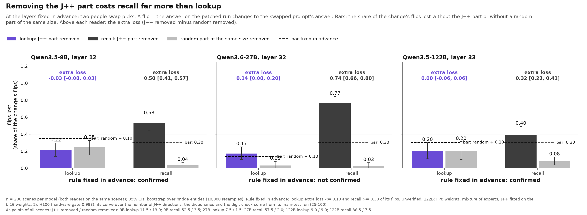
*Share of the change's flips each reader loses without the J++ part (colour) or a random part (grey). Compare each reader's J++ bar with its dashed bar fixed in advance.*

- **How to read it.** The lookup still uses the bridge (its answers switch with it); it just does not need the bridge's J++ part to do so. This does not say the lookup never needs J++: on the 27B it does at 100 J++ directions (finding 3's second figure) and on natural passages (finding 2). Main caveat: lookups were measured almost only in scenes where the locker sentence comes first (finding 4).

## 2. It holds beyond the simple scenes on most models, not on all [after the data; each test's pass bar fixed before its run]

- **Hypothesis.** The gap is not a quirk of one scene template or of the locker key matching the pick word. It would be wrong if, in varied scenes, the lookup's extra loss rose above 0.10 or the gap fell below 0.20; if on natural passages the gap fell to 0.10 or below; or if a translated locker key raised the lookup's extra loss by 0.20 or more.
- **Experiment.** Varied scenes: 7 topics, prose / JSON / tables, 3 difficulty levels; 1,635 scenes on the 27B, 1,010 on the 9B, 852 on the 122B (prose and tables, levels 0-1); only the asked pick changes. Natural passages: notes, e-mails, forum posts and news with real relations (countries, cities, languages, companies, people, animals), one passage for both questions; 154 of 358 scenes passed the swap rule (a one-token bridge). Locker key in another language: the locker statements name 8 animals in French, Spanish or German while the picks stay in English (about 400 scenes per form); 6 chemical elements named by symbol as a positive control.
- **Result.** Varied scenes: gap 0.47 [0.42, 0.53] (27B), 0.22 [0.14, 0.31] (9B), 0.15 [0.12, 0.18] (122B, mixed), with the lookup at 0.08 [0.06, 0.10], 0.01 [−0.01, 0.03] and −0.02 [−0.03, −0.00]. Natural passages: gap 0.44 [0.32, 0.58] on the 122B (holds; lookup −0.11 [−0.20, −0.03]) and 0.27 [0.13, 0.41] on the 27B (mixed: its lookup loses 0.32 [0.20, 0.45], its recall 0.59 [0.50, 0.67]); the 9B missed the gate fixed in advance (its unedited lookups were right in 0.78 of scenes, under 0.80). A translated key changes the lookup's extra loss by 0.01 [−0.01, 0.04] (27B), −0.02 [−0.05, −0.00] (9B) and −0.00 [−0.01, 0.00] (122B).

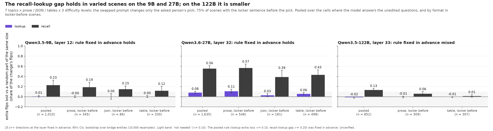 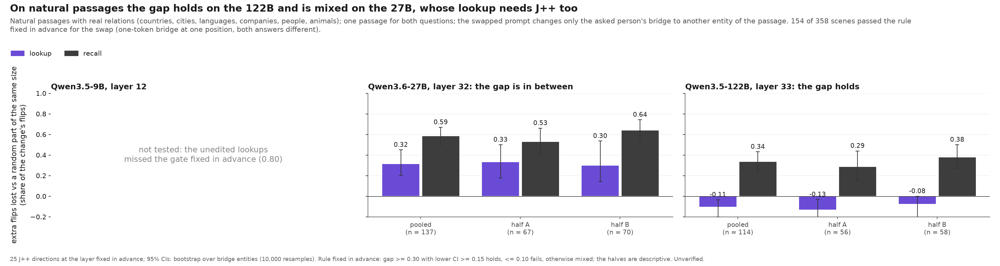 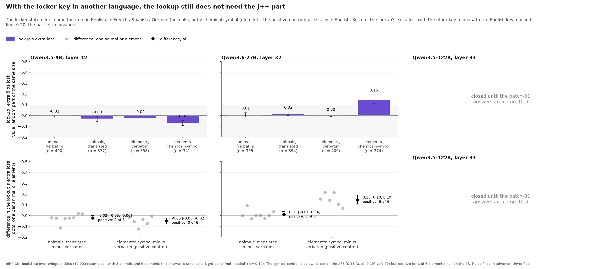
*Compare the purple (lookup) and dark (recall) bar in each group; in the right figure, each diamond with the dashed line at 0.20.*

- **How to read it.** In locker-first scenes the lookup does not need the J++ part at the pick word even without a word-for-word match (the model may have linked the translated name to its concept earlier, so this does not mean no concept is needed anywhere). The gap is not universal: on the 27B's natural passages the lookup needs J++ too, and on the 122B's varied scenes both readers need it little. Caveats: the positive control stayed below its bar (Limits); natural passages keep only one-token bridges.

## 3. On the 9B and 27B the J++ part is more than the layer's main directions; the recall can use either the word or the rest [after the data]

- **Hypothesis.** If J++ only picked out the layer's most common directions, those directions at the same share would cost recall as much as J++; if recall read only the bridge word itself, the word's directions alone would cost as much as J++.
- **Experiment.** Only the asked pick changes, 200 scenes per model. Removed in turn, each against a random part of its own share: the layer's main directions (top 2,000 principal directions, as many per scene as match that scene's J++ share); the bridge word's own J++ directions (the word and its spelling variants); J++ without the word's directions (fit after the word part is taken out). Also logit-lens directions, input embeddings and random directions at 25-200 directions.
- **Result.** Recall's extra loss, J++ / main directions at the same share / the word alone / J++ without the word's directions: 27B 0.61 [0.51, 0.69] / 0.16 [0.08, 0.23] / 0.16 / 0.20 [0.10, 0.29]; 9B 0.37 [0.29, 0.43] / 0.13 [0.06, 0.19] / 0.02 / 0.12 [0.06, 0.18]; 122B 0.26 [0.16, 0.36] / 0.21 [0.13, 0.30] / 0.14 [0.08, 0.20] / 0.04 [0.00, 0.08]. Logit-lens, input-embedding and random directions cost neither reader anything comparable, on all three models.

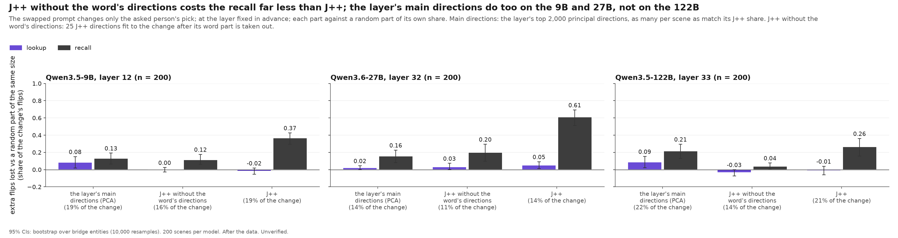 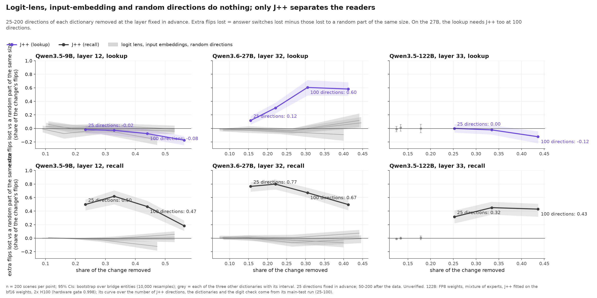
*Left: compare the dark (recall) bar of J++ with the other two parts, which take about the same share of the change. Right: compare the J++ lines with the grey bands.*

- **How to read it.** On all three models the word alone and J++ without the word's directions each cost the recall less than both together: super-additive, i.e. the recall reads the bridge from either part (descriptive). On the 122B the layer's main directions at the same share cost the recall almost as much as J++, so there J++ is not more than the layer's geometry. Caveat: after the data.

## 4. Lookups move mostly when the locker sentence comes first [after the data]

- **Hypothesis.** A change at the bridge word should switch the lookup's answer whatever the sentence order. It would be wrong if switching depended on whether the locker sentence comes before or after the pick.
- **Experiment.** The whole change, no part removed, in the main test's scenes, split by sentence order; about 100 scenes per group, all three models.
- **Result.** 76%-89% of lookups switch when the locker sentence comes before the pick, 9%-19% when it comes after.

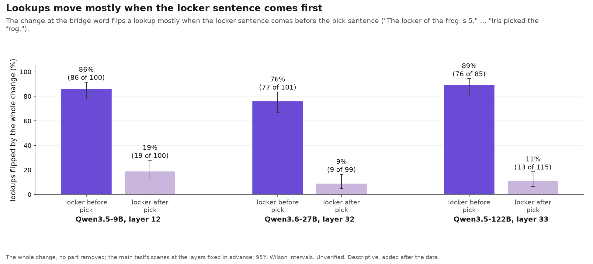
*Compare the dark purple bar (locker first) with the light one (locker after) for each model.*

- **How to read it.** In locker-after scenes the lookup rarely depends on the bridge word, so there is little to measure there; every lookup claim on this page describes locker-first scenes.

## 5. The bridge word holds a pointer to the item's first mention, outside the J++ part [after the data]

- **Hypothesis.** If the lookup goes through the bridge word, that word's state should say where the locker is. It would be wrong if a linear probe could not beat what the scene's layout alone predicts.
- **Experiment.** A linear probe at the bridge word, trained on 1,500 fresh locker-first scenes (tested on items it did not see), answers "which sentence holds this item's locker?". It is then read on swapped states, on parts of the change, with the locker key in another language, and in pairs where the new pick was already picked by another person earlier in the scene.
- **Result.** The probe is right in 0.99 (27B), 0.97 (9B) and 0.92 (122B) of scenes, against 0.53 for a guess from the layout. With translated keys: 0.99 [0.99, 1.00] (27B), 0.93 [0.90, 0.96] (9B), 0.90 [0.83, 0.94] (122B); trained on English keys and tested on translated ones: 0.94 [0.90, 0.97], 0.84 [0.79, 0.90], 0.85 [0.80, 0.91]. Of the change's component along the probe's directions, the J++ part holds 0.5% (27B) and 0.5% (122B). When another person's pick of the item comes first, the probe points at that pick sentence in 0.90 (9B), 0.56 (27B) and 0.96 (122B) of pairs, and the lookup still switches to the right locker (1.00, 1.00).

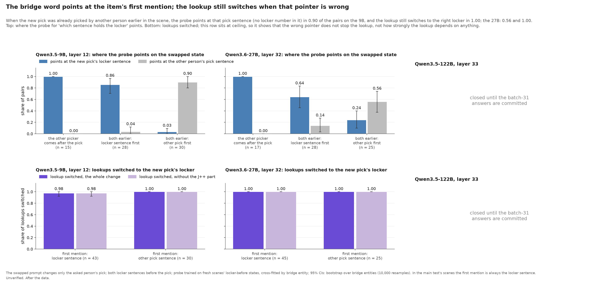 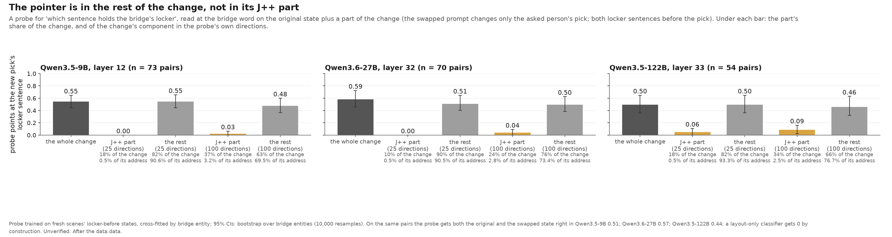
*Left, top: compare the grey bars (pointing at the other person's pick) with the blue ones (pointing at the new pick's locker). Right: compare the J++ part with the rest.*

- **How to read it.** The pointer is not lexical: it is a first-mention pointer at the entity level, which the lens does not read, on all three models. It does not show that the lookup reads this pointer: the lookup switches correctly even when the pointer points the wrong way (and switches in nearly every such pair whatever is removed).

## 6. Pointer directions outside the lens matter to the lookup on the 9B and 122B; the replication fixed in advance confirms this half on the 9B [after the data; replication fixed in advance]

- **Hypothesis.** If the lookup reads the pointer, removing the directions that encode it should cost the lookup and not the recall. It would be wrong if it cost both readers or neither.
- **Experiment.** The **pointer directions** are the 4 directions that separate the average state for each "which sentence holds the locker" answer on fresh scenes, after each layout's average is taken out. They are removed from a change where only the asked pick changes, against a random part of the same share, beside the J++ part and the layer's main directions at about the same share, on scenes where both locker sentences come first. Replication fixed in advance: 200 fresh scenes per model, the pointer directions not refit; it holds on the 9B only if both the J++ clause (recall at least 0.20, lookup at most 0.10) and the pointer clause (lookup at least 0.20, recall at most 0.10 or half the lookup's) hold.
- **Result.** Pointer directions, lookup / recall: 9B 0.49 [0.38, 0.59] / 0.12 [0.05, 0.21]; 122B 0.31 [0.20, 0.43] / 0.13 [0.02, 0.26]; 27B 0.14 [0.07, 0.22] / 0.16 [0.02, 0.31]. On the same scenes J++ costs the recall 0.06 [0.00, 0.12] (9B), 0.46 [0.34, 0.57] (27B) and 0.10 [0.02, 0.18] (122B). Replication on fresh scenes: on the 9B the pointer clause is met (lookup 0.47 [0.41, 0.53], recall 0.15 [0.10, 0.21]) and the J++ clause not met (recall 0.12 [0.06, 0.19]), so the rule does not hold; on the 27B the J++ clause is met (recall 0.37 [0.28, 0.46]) and the pointer clause not met (lookup 0.17 [0.12, 0.22]).

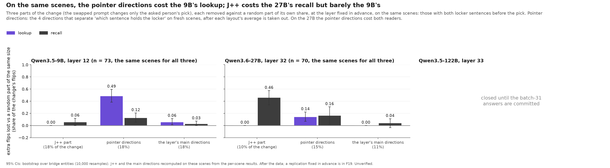 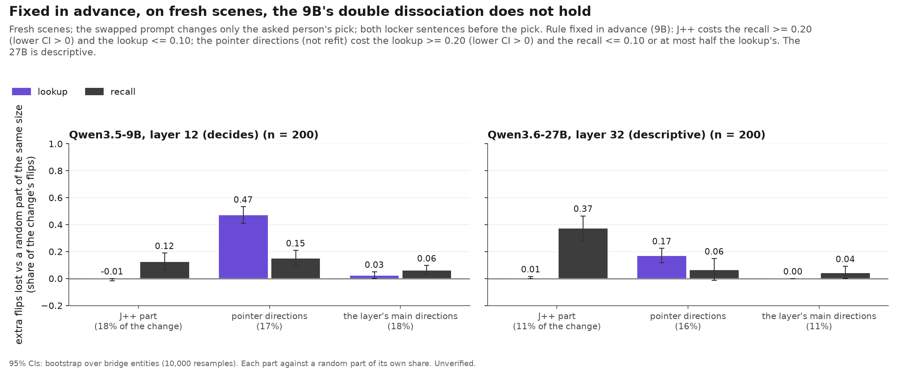
*Left: all three parts on the same scenes. Right: the replication on fresh scenes. Compare the purple (lookup) and dark (recall) bar across the three parts in each panel.*

- **How to read it.** The lookup needs the pointer directions on the 9B (replicated) and the 122B, much less on the 27B. On scenes where both locker sentences come first the 9B's recall barely needs J++, so the readers' dependence on different parts holds across scene sets, not within them. The 'where' these directions encode can point to the wrong sentence without hurting the lookup (finding 5), so the lookup reads something else from them (finding 7).

## 7. The lookup follows the bridge's identity or its locker sentence's position, never the new locker value [fixed in advance]

- **Hypothesis.** The change at the bridge word could carry the item's identity, where its locker sentence is, or the locker value. Taking the change from a swapped prompt where these point to different lockers, each route predicts a different answer; a route counts as used if its share is at least 0.20 (lower CI at least 0.10).
- **Experiment.** "The locker of the duck is 4. The locker of the rabbit is 3. The locker of the goose is 2. … Beth picked the goose." (lookup: 2). **Swap 1, the same item with its locker sentence moved:** in the swapped prompt the goose's locker sentence sits in the duck's slot with a new digit 8, so unchanged (same item) → 2, position → 4 (what that slot holds in the original), value → 8. **Swap 2, another item with its locker sentence moved:** Beth picks the rabbit, whose locker sentence sits in the duck's slot with a new digit 7, so identity → 3, position → 4, value → 7, original → 2. The change is read on the original prompt; 300 scenes per swap and model, 9B and 27B; arms as above plus without the pointer directions. A sanity swap reproduced the one-pick switch rate (0.99, 0.98).
- **Result.** Swap 1, whole change: 9B position 0.62 [0.56, 0.69], unchanged (same item) 0.36 [0.30, 0.43]; 27B unchanged (same item) 0.52 [0.46, 0.57], position 0.44 [0.39, 0.49]. Swap 2: 9B position 0.51 [0.46, 0.56], identity 0.48 [0.43, 0.53]; 27B identity 0.66 [0.60, 0.71], position 0.34 [0.28, 0.39]. The new digit (value): 0.00 [0.00, 0.00] and 0.00 [0.00, 0.00]. In swap 2, without the pointer directions the position route drops to 0.08 [0.05, 0.12] (9B) and 0.06 [0.03, 0.09] (27B), against 0.54 [0.49, 0.59] and 0.25 [0.19, 0.31] without a random part of their share. Without J++ the 27B's identity route drops to 0.45 [0.41, 0.49] (random: 0.70 [0.64, 0.76]).

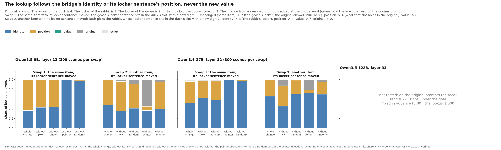
*Compare the blue (identity; in swap 1, unchanged: the same item) and orange (position) parts of each bar across the arms; there is no green (value) anywhere.*

- **How to read it.** The lookup reads at the bridge word which item it is and where that item's locker sentence is, then fetches the value from the prompt; it never takes the value from the patched state. The pointer directions carry the position route; on the 27B, J++ carries part of the identity route. Caveats: in swap 1 even a random part of the pointer directions' share removes the position route, so that swap's position effect is fragile; the 122B was not tested (on the original prompts its recall read 0.797 right, under the gate fixed in advance); the early-layer runs are pending.

## What did not hold

- **The lookup reads the locker number at the bridge word.** All digit tokens added to J++ leave the 27B lookup's extra loss unchanged (0.13 vs 0.14); the 10 digit directions alone give 0.00; the new digit is never the lookup's answer (finding 7).
- **The probe's own directions carry the lookup.** Removing them changes no lookup (0.00 [0.00, 0.00] on the 27B, 0.05 [0.00, 0.10] on the 9B, 0.00 [0.00, 0.00] on the 122B); they come from a probe fit on standardized states, a different set from the pointer directions.
- **The strict test on the 27B.** Its lookup lost 0.14 [0.08, 0.20] (bar 0.10), and at 100 J++ directions about as much as recall (0.60 vs 0.67).
- **The 9B's double dissociation, fixed in advance on fresh scenes.** Its J++ clause failed (recall 0.12 [0.06, 0.19]).
- **The gap everywhere.** Varied scenes on the 122B: 0.15 [0.12, 0.18] (mixed); natural passages on the 27B: 0.27 [0.13, 0.41] (mixed).

## Limits

- **Positive control.** Chemical symbols should make the lookup need J++ (bar 0.20): 27B 0.15 [0.10, 0.19], below the bar but positive for 6 of 6 elements; null on the 9B (−0.05 [−0.08, −0.02]) and the 122B (0.02 [−0.01, 0.07]).
- **The 122B** ran in FP8 weights, with J++ fitted on the bf16 weights, mostly at one layer. **One model family** (Qwen); natural passages keep only one-token bridges.
- **Prompts without the chat template** could not be tested: the models open a thinking block or answer in markdown.
- **When only the asked pick changes**, two people pick the same item; that is how the pairs in finding 5 arise.

## Next

| Step | What it tells us |
|---|---|
| J++ directions fitted to another scene's change, removed (queued; Dan's prediction first) | whether the recall's loss needs this change's own J++ directions or any 25 nearby ones |
| The routes at an early layer (running) | whether J++ carries more of the identity route where the lookup still needs it |
| Slides; after the sprint, distributed alignment search at the bridge word | how the lookup turns identity and position into the locker value |

## Figures

Figures in [figures/status_2026-10-25/](figures/status_2026-10-25/) (the 24 Oct folder stays as shared).

| Figure | Claim | Models | | Role |
|---|---|---|---|---|
| F1 | Removing the J++ part costs recall far more than lookup | 9B, 27B, 122B | fixed in advance | main |
| F13 (+F18) | The gap holds in varied scenes on the 9B and 27B, smaller on the 122B; natural passages: holds on the 122B, mixed on the 27B | 9B, 27B, 122B | rules fixed in advance | main |
| F14 | J++ without the word's directions costs the recall far less than J++; the main directions do too except on the 122B | 9B, 27B, 122B | after the data | main |
| F4 | Lookups move mostly when the locker sentence comes first | 9B, 27B, 122B | after the data | main |
| F9 | The bridge word points at the first mention; the lookup still switches when it is wrong | 9B, 27B, 122B | after the data | main |
| F15 (+F19, F20) | The pointer directions cost the lookup on the 9B and 122B; the lookup follows identity or position, never the value | 9B, 27B, 122B | after the data (F19, F20 fixed in advance) | main |
| F2, F3, F5-F8, F10, F16, F17 | depth; dictionaries; number of J++ directions; digits; probes; pointer outside J++; both swaps; translated keys; varied-scene parts | per figure | per figure | supplementary |
| F11, F12 | superseded by F14 (unequal shares) and F15 | 9B, 27B | after the data | superseded |

## Where the runs are

| Finding | Run folders (results/) | Spec | Predictions |
|---|---|---|---|
| 1 | x0_necessity/{qwen35_9b_x0_necessity, x0_necessity_27b_chat, qwen35_122b_x0_necessity_r2, *_single_r2, qwen35_122b_x0_single} | [X0.md](jobs/c3/X0.md), [x0_122b_b1.yaml](jobs/c3/x0_122b_b1.yaml) | batches 25, 26, 31 |
| 2 | x0b_generalize/*x0b_v2*; x5_natural/*; x4_alias/* | [X0b.md](jobs/c3/X0b.md), [x5_natural.yaml](jobs/c3/x5_natural.yaml), [X4.md](jobs/c3/X4.md) | batches 27, 29, 31 |
| 3 | x0_parts/{*x0_parts*, *pcaeq*, *x0b_parts*, qwen35_122b_x0_parts}; x0_necessity/*kmatch* | [x0_pcaeq_mmlf.yaml](jobs/c3/x0_pcaeq_mmlf.yaml), [x0_122b_b2.yaml](jobs/c3/x0_122b_b2.yaml) | batches 25, 28, 30, 31 |
| 4 | x0_necessity/* (cases and outcomes) | [X0.md](jobs/c3/X0.md) | — |
| 5 | x0_probe/*v4*; x0_amnesic/*/probe-patched-*; x4_alias/*probe*; x0_massmean/*/dup-nearest-* | [x0_probe_power.yaml](jobs/c3/x0_probe_power.yaml), [x0_122b_b3.yaml](jobs/c3/x0_122b_b3.yaml) | batches 27, 29, 31 |
| 6 | x0_massmean/{*massmean*, *_lf, *_grid}; x0_parts/*pcaeq*; x0_replicate/* | [x0_massmean.yaml](jobs/c3/x0_massmean.yaml), [x0_replicate.yaml](jobs/c3/x0_replicate.yaml) | batches 28, 31 |
| 7 | x6_routes/* | [x6_routes.yaml](jobs/c3/x6_routes.yaml) | batch 32 |

Internal names: X0 = the main test, X0b = varied scenes, X4 = the locker key in another language or as a symbol, X5 = natural passages, X6 = the routes, Alf = the pointer directions. [Detailed results](docs/x0_details.md) · [Dan's predictions and scores](predictions/2026-10-24_dan.md) · [calibration](predictions/README.md) · [earlier claims](CHANGELOG.md) · [Zach's breadth results](https://github.com/zach-perlman/bridge-jspace/tree/zach/v8-breadth-1021).

Prior work: the workspace paper (Gurnee et al. 2026); two-hop recall resolves its bridge early (Biran et al. 2024); mass-mean probing (Marks & Tegmark 2023); counterfactual routes (Gur-Arieh et al. 2025).
