# bridge-jspace

**Where things are:** this page = main results and open questions · full write-up of every experiment, and the
per-batch tables of Dan's depth track: [README_archive.md](README_archive.md) · run log: [EXPERIMENTS.md](EXPERIMENTS.md)
· human-checked results: [VERIFIED.md](VERIFIED.md) · status by Zach (20 Oct): [STATUS.md](STATUS.md) · plan:
[Google Doc](https://docs.google.com/document/d/1bqqdXePTUXQGlowVjk73sPfJkbV_tsu0RNNX-BiTYUc/edit?usp=drivesdk) ·
how to run, queue, figures: [DEVELOPER.md](DEVELOPER.md) · predictions vs results (Dan):
[jobs/predictions/](jobs/predictions/)

## The question
In a two-hop question the model first finds a **bridge** and then uses it to find the answer: "the language spoken in
the country where the Amazon River ends" → bridge *Brazil* → answer *Portuguese*. In Claude, the bridge acts on the
answer through the **J-space**, the part of the hidden state that the J-lens reads as words (Gurnee et al. 2026,
[Verbalizable Representations Form a Global Workspace](https://transformer-circuits.pub/2026/workspace/index.html)).
On open models (Qwen3.6-27B first): **what goes through the J-space, what goes around it, and what is the "around"
route?**

## Names used on this page
Each family of questions is named **"where the bridge comes from → where the answer comes from"**: *prompt* = stated
in the prompt, *memory* = recalled by the model; *named* = the entity is named in the question.
```
Jack's pet is a cow. Mia's pet is a dog. Tom's pet is a pig.
The cow's locker is 5. The dog's locker is 3. The pig's locker is 7.
```
| Name (old code) | Question | Bridge | Answer |
|---|---|---|---|
| prompt → prompt (BL) | Which locker belongs to Jack's pet? | cow, from the prompt | 5, from the prompt |
| prompt → memory (BR) | How many legs does Jack's pet have? | cow, from the prompt | 4, recalled |
| memory → prompt (RL) | Which locker belongs to the animal known for mooing? | cow, recalled | 5, from the prompt |
| memory → memory (RR) | How many legs does the animal known for mooing have? | cow, recalled | 4, recalled |
| named → prompt (DL) | Which locker belongs to the cow? | cow, named | 5, from the prompt |

Edits compare an **org prompt** with an **alt prompt** (the same prompt with another bridge): **bridge org** (cow) vs
**bridge alt** (dog), **answer org** (5) vs **answer alt** (3). The **lens-readable part** of a change is its piece
made of J-lens word directions; the rest is everything else. **Slot** = the position of a statement in the list.

## Main results

### Verified by a human ([VERIFIED.md](VERIFIED.md), Qwen3.6-27B)
| | Result |
|---|---|
| Lenses see the bridge (A1-A3) | At the last word the lenses rank the bridge first far more often than a same-kind distractor (57% vs 5% of layers 32-48); most remaining misses are found at an earlier word (22/30). |
| A recalled bridge acts through the J-space (B1) | Swapping only the lens-readable part of the bridge's direction switches 52% of answers (Claude 61%); the rest, with the J-space held fixed, 1% (Claude 6%). |
| A lookup in the prompt does not (B2-B3) | In brew (a two-step lookup in a colour table) the step is carried outside the J-space: the lens reads it but writing along its direction switches 1%; a direction nearly orthogonal to the lens (cosine 0.02) switches 34%. |
| Readers report what is written, not what is used (B4) | Two verbalizers (oracle lens, NLA) name a direction the model ignores on 99% of items. |

### Unverified: memory vs prompt (Zach, 20 Oct; animal suite, 27B)
Recall from memory goes through the J-space; a lookup in the prompt goes around it. Three measures agree:
- **Copy split:** the lens-readable part of the model's own bridge change carries 0.3-0.4× its fair share for lookups
  (memory → prompt, prompt → prompt) and 1.4-1.9× for recalls (random null 0.15-0.4).
- **Read vs write:** the lens reads the bridge of memory → prompt on 95% of items but pushing along it switches ≤ 3%;
  for memory → memory the push switches 36%.
- **Knock-out:** removing the J-space at layers 32/36/40 leaves lookups at 99% and drops recalls to 19-22%; random
  and size-matched controls stay at 98-100%. Also holds with JSON tool outputs and natural facts (TwoHopFact).
- **Generality is the gap:** the 122B shows read-without-write at every depth but a 4-6× weaker knock-out; the 9B is
  mostly untested; Gemma 4 31B-it is untestable (its lens cannot write even the positive control, and any J-space
  removal wrecks the model).


### Unverified: what is the "around" route? (Dan, 21 Oct; three batches on Qwen3.6-27B)
Every run pre-registered (hypotheses, decision rule, controls) before it ran; Dan wrote predictions before each result
was opened (scored: [2026-10-21](jobs/predictions/2026-10-21_dan.md), [2026-10-22](jobs/predictions/2026-10-22_dan.md));
headline numbers recounted from the raw rows. Intervals: 95%; "entity" = resampling the asked entities within each
topic, the honest interval when items of one entity are correlated. The per-batch tables are archived
([README_archive.md](README_archive.md#depth-track-nights-1-3-21-oct-the-per-batch-tables-as-they-stood-in-the-readme)).

| # | Claim | Best evidence | How broad | Strength |
|---|---|---|---|---|
| D1 | A bridge **stated** in the prompt is carried by the whole context at layers 28-44, and the lookup does not use its lens-readable part; the lens push does not write it | Pasting the whole context switches 87% (209/240); its lens-readable part alone 0/240 (0.10 of its fair share; random 0.07). The same part carries the bridge for a recall question (4.87×). Lens push no better than a random push at any size (16×: 25/240 vs 28/240) | animal suite only; n=80 per family; 1 wording | strong within the suite, untested elsewhere |
| D2 | For a lookup in the prompt, the **last tokens read the answer's statement late (layers 48-63), through attention**; DeltaNet layers are not needed; recall does not need the statement | Statement hidden from the last tokens in every attention layer: animal suite 7% still right, new locker scenes 11% (20/175), other language 2%; in every DeltaNet layer 99-100%; memory → memory ≥ 96% | 4 datasets, 3 topics, Python code, 3 languages; ~40 entities | **strongest**; one model, one chat template |
| D2 | **Other positions read it too.** A named entity's question words read its statement early (0-31); in code the line that first mentions the key (the `names` list, the first chain line, or `print` when the key is written there); for a recalled entity, the middle layers (32-47) back up | Named: question words + last tokens blocked at 0-31 → 1/175. Code: last tokens + `names` line blocked → 6.5% (13/200), the same as blocking every line after the dict; either alone 35-44%. Recalled: question words + last tokens at 32-47 → 45% (78/175), each alone 87-88% | locker scenes + code; 2 topics each | good (code pre-registered) |
| D2 | **No single "lookup head"**: the late read is redundant; one head's attention marks the bridge's statement | Blocking any one of the 96 late query heads (layers 51-63), any key/value group or any single late layer at the last tokens costs ≤ 4 points; all four late attention layers together leave 17.5% [11.8, 23.5] (35/200). A named entity's own name token reads its statement early: hidden from the name alone in the 8 early attention layers, 3% stay right, the same as hiding it from all the question words; no single early head or layer is needed. Unedited, layer 51 head 22 looks most at the asked statement from the last token in 100% of held-out scenes (196/196; chance 20%, the linear read-out 45%), but also on 95.5% of recall questions: it marks where the bridge is, not the lookup | pointer_v1, 22 entities | good for "redundant"; whether the head follows the pointer is D5a's test (**queued**) |
| D3 | At layers 48-50 the last tokens carry a **pointer to a statement slot**: patched into another prompt, the answer becomes the digit at the same slot, more often than bridge alt's own statement (the word) | **pointer_v4, pre-registered cell** (after the question, layers 44-52 together): slot 16% [12, 19] vs word 4% [2, 6], verdict "slot" pooled (450 items, 85 entities, 3 topics, 9 wordings each); per topic with every eligible scene (up to 297): the primary window gives "slot" in 1 of 3 topics (body parts; countries and animals "mixed": the alt answer already arrives at layer 52 inside the window), so the pre-registered "in >= 2 of 3 topics" fails; single layers: after the question, layer 48, slot in 2 of 3; last tokens, layer 50, slot in all 3 (48-52% vs 18-24%). **Strongest single layer** (last tokens, layer 50): slot 50% vs word 21%, in every topic (countries 64 vs 31 of 150, animals 82 vs 29, body parts 77 vs 35). Also code (47% vs 24%), another language (46%, as English 48%). Also in plain text without the chat template (last tokens, layer 50: slot 50% vs word 25%). Recall questions follow the word instead (82%, slot 0%) | 6 datasets, ~100 entities, code, 3 languages | **strong** pooled; small in the pre-registered window; 20-70% of patches change nothing and the word travels too |
| D3 | The slot is **counted from the start of the list**, partly a place in the text | Last tokens, layer 50: from the start 28% vs same place 15% vs from the end 9% (403 items; same with one statement more or fewer); order vs place 28% vs 16% (5 statements), 54% vs 25% (3). **The pre-registered cells** (after the question, layers 44-52 together) read "alt answer" or "mixed", not "start" or "order"; at layer 50 the word is about as frequent as the start-counted slot (27-32%) | 22 entities, 1 wording, 2 topics; single layers | **partly**: a single-layer result |
| D3 | From ~layer 52 the last tokens carry the **fetched digit itself**; a pointer to the digit's place is small | The alt answer travels 97-99% from layer 56, whether or not the org prompt contains it; at 48-50 a 7-10% extra pull when it does | 2 topics | good |
| D3b | A learned **~4-dimensional pointer direction steers the lookup** at layer 48 where a lens push of the same size does nothing; it means "the Nth statement" | Fresh scenes 43% (entity [36.6, 48.9]; animals 53%, elements 32%); **on 85 new entities / a held-out wording: 31% [27, 36]** (just under the pre-registered 30% bar: entity 28%, wording 31%, both 32%); lens push 0% everywhere; recall ≤ 2%. Order vs place: 31% vs 9%. Misses overshoot past the target (55% vs 32% by chance), like an ordered axis | 22 → 85 entities, 9 wordings | medium-strong for "steers"; weaker on new entities |
| D3b | The pointer is **hard to read**: a read-out from the last tokens names the asked statement less often than a push can use it | Nearest-class-mean, 400 scenes, cross-validated: 45% at layer 48, best 48% at layer 50 (chance 20%); pre-registered verdict "hardly readable" | 22 entities | medium |
| D3b | Where the lens reads the word but cannot write it (layers 32-40), does the pointer steer? | **Not decided.** Pointer 34% vs lens 13% (tokens after the cue); but the pointer also changed 16% of recall answers there (elements 31%, animals 2%), so the pre-registered control fails. Animals alone: 43% vs 7%, recall untouched. **The same run fires Zach's C2 kill test** (lens ≥ 3× random for a lookup-used bridge): elements, after the cue, layers 32-40, 1×: lens 30/150 vs random 2/150 (single layers 36 and 40: 42 and 41 of 150 vs 1); animals 10/150 vs 0. Likely the recall step is still running there in elements: on recall questions the lens writes 55/100 at the same cell (animals 24/100) | 22 entities | the "around = pointer" link is **not shown yet**; C2 needs an operational "in transit" (below) |
| D4 | The strong early lens push acts on **recalling the bridge**, not on the lookup | **Pre-registered replication** (wording B, 100 per family; layer 20, 8×, the subject phrase): memory → prompt 73% [64, 81], memory → memory 84% [76, 90] switch; prompt → prompt 1% [0, 5], prompt → memory 2% [1, 7]; random push 0/100 everywhere. Wording A (post hoc, 60 per family): 49/60, 57/60 vs 0/60. The split holds at single layers 20-28; at layer 16 (8×) or with all four layers pushed at once, stated-bridge families switch too (27-80%) | animal suite, 2 wordings, 100 + 60 per family | good (pre-registered on wording B); one dataset |

**The current picture** (a hypothesis, one model), layer by layer:

| Layers | What happens in a lookup in the prompt | Seen in |
|---|---|---|
| 0-24 | a bridge stated in the prompt sits in its own sentence ("Jack's pet is a cow.") | D1 |
| 0-31 | a *named* entity's words in the question read its statement; in code, the line that first mentions the key reads its dict entry | D2 |
| 16-28 | a recalled bridge is formed from the cue; an early lens push here changes which entity is recalled | D4 (post hoc) |
| 28-44 | a stated bridge is spread over the whole context; its lens-readable part does nothing for the lookup | D1 |
| 32-47 | for a recalled entity, the question words and the last tokens can read the statement as a backup | D2 |
| 44-50 | the last tokens carry a pointer: *the Nth statement, counted from the start* (~4 dimensions, unrelated to the lens's words); a push along it moves the lookup, a lens push does not. The word travels too, less often | D3, D3b |
| 48-63 | the last tokens read the pointed-at statement through attention (not DeltaNet), spread over many heads (no single head is needed); one head (layer 51, head 22) attends to the bridge's statement on every scene | D2 |
| 52-60 | the last tokens carry the fetched digit | D3 |

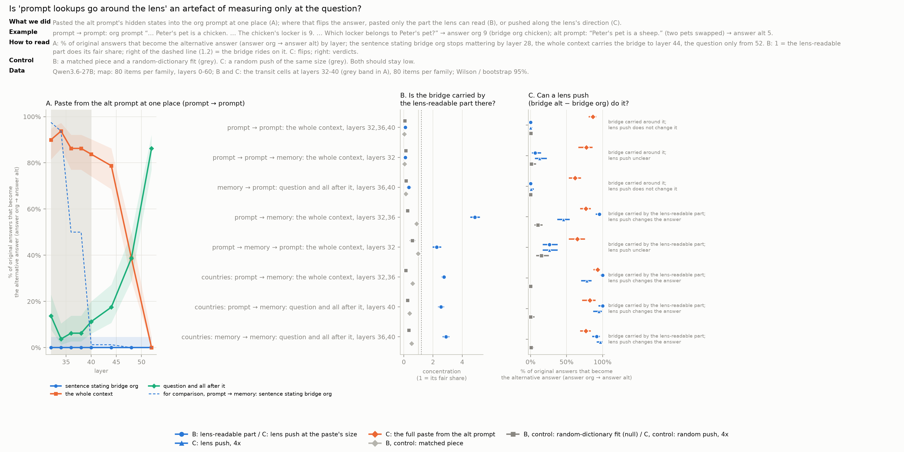
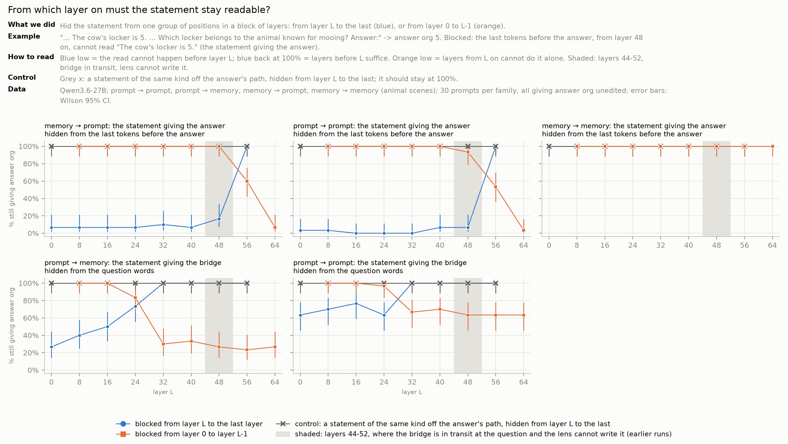
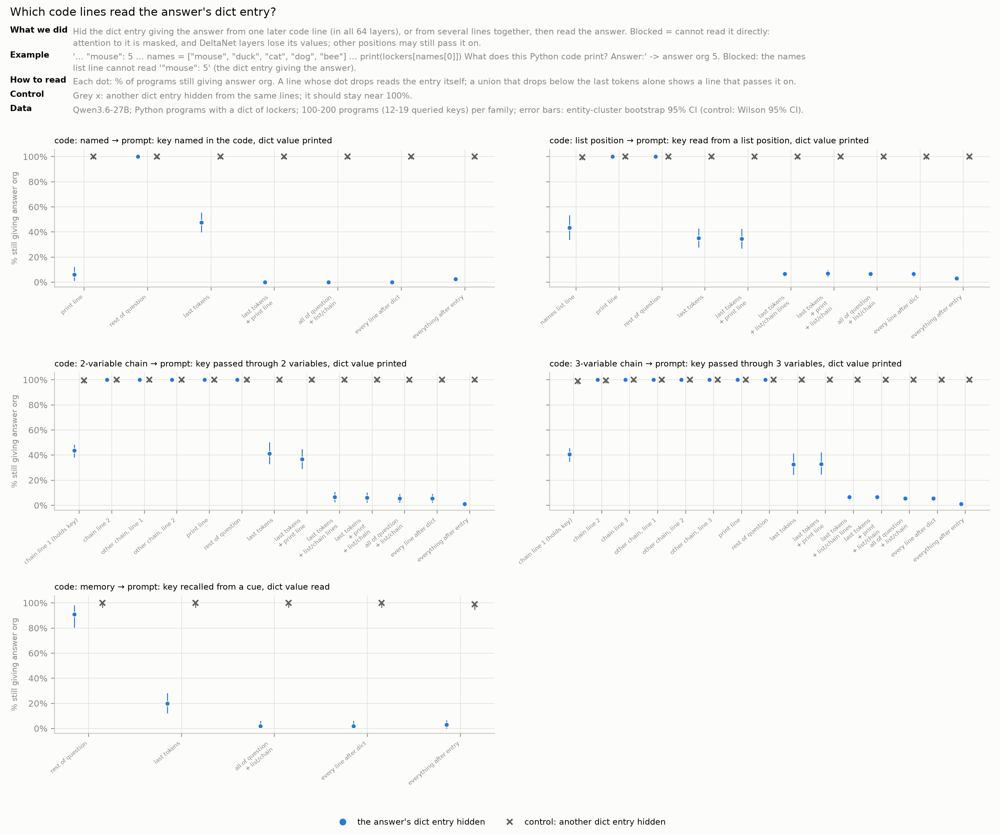
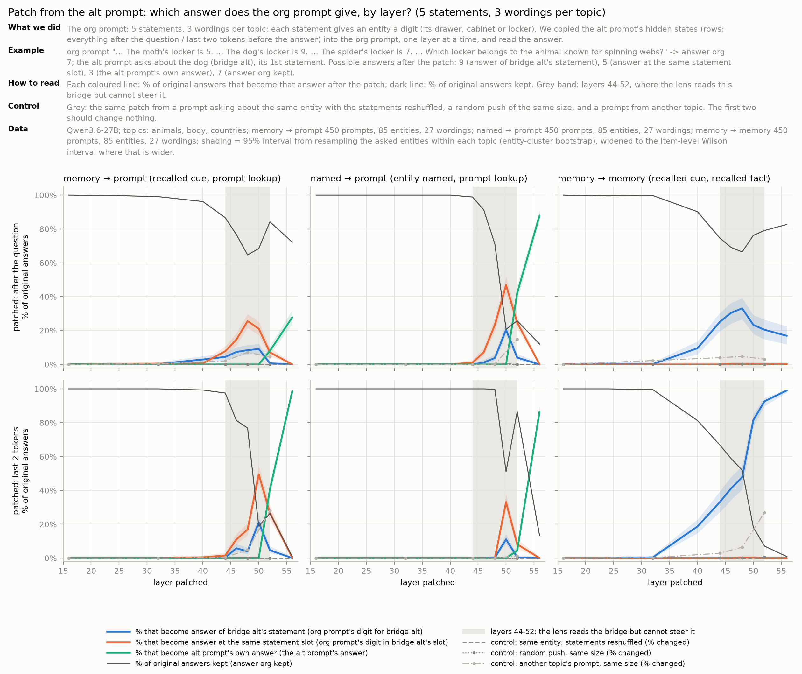
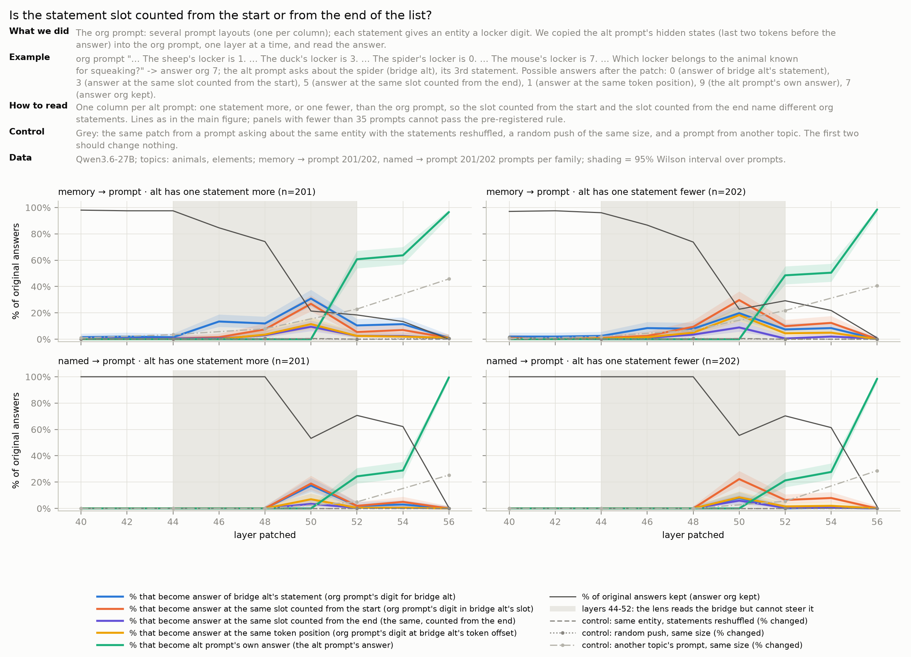
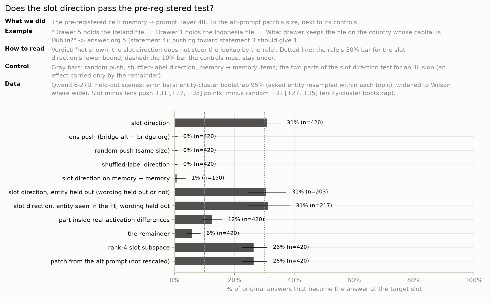
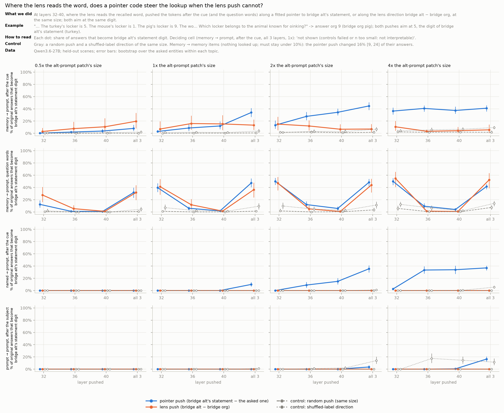
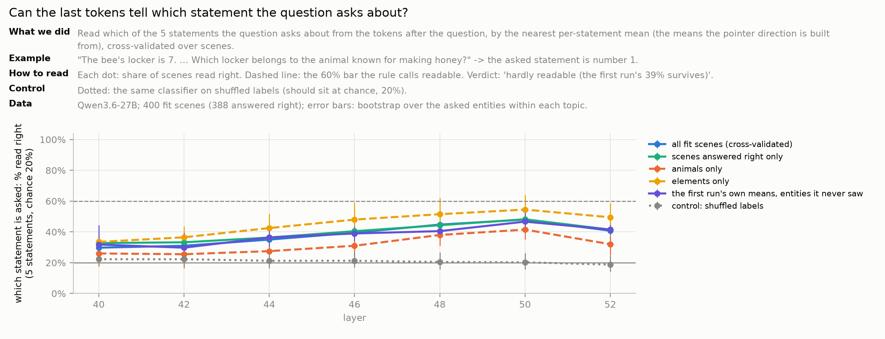
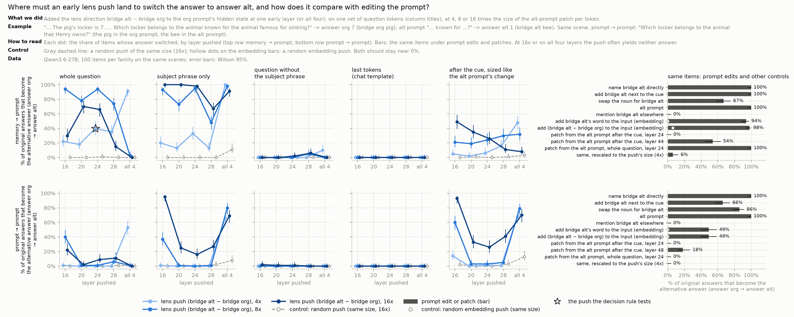
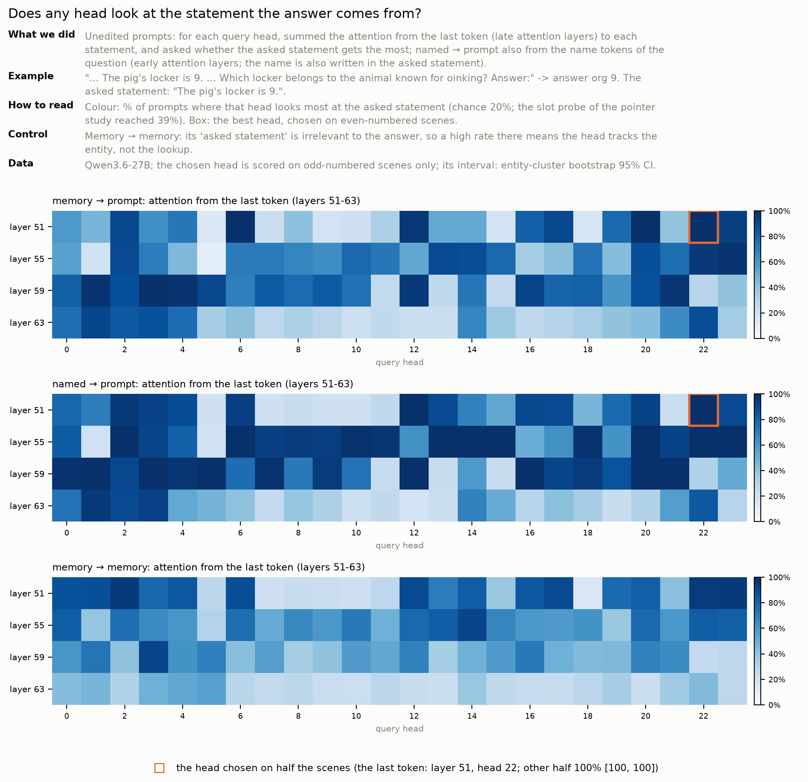
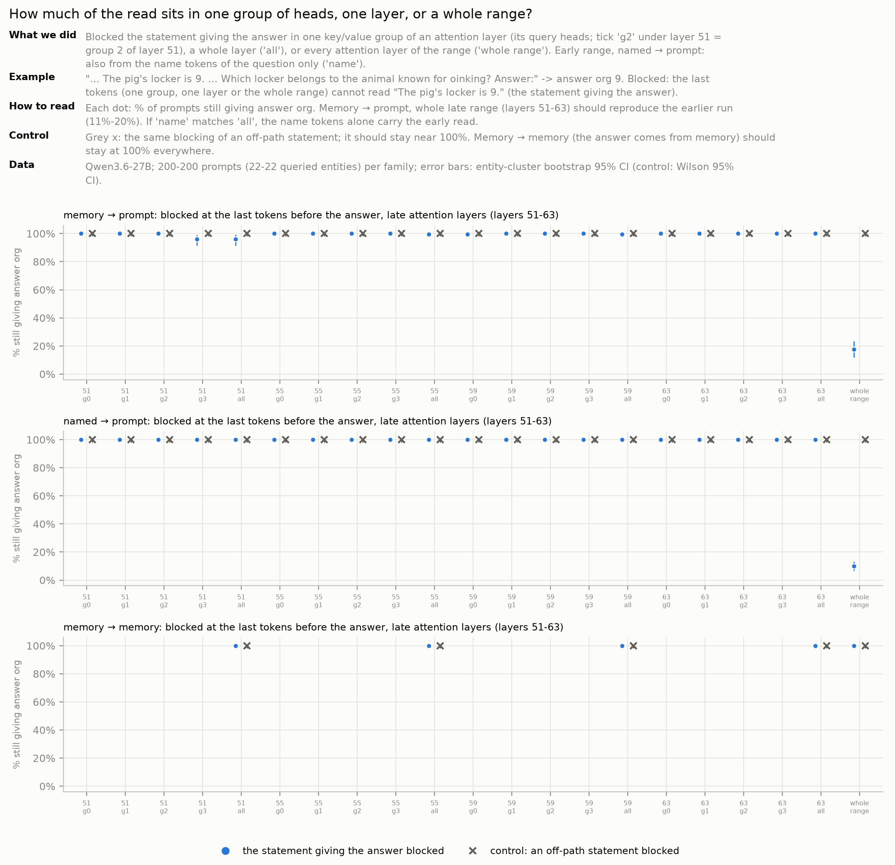

## Synthesis so far: two routes (Dan, 21 Oct, evening; UNVERIFIED, one model)

**The working hypothesis.** In Qwen3.6-27B a two-hop answer is built along one of two routes:
1. **Recall goes through the J-space.** A bridge recalled from a cue is formed at layers 16-28 as a word the lens
   both reads and can rewrite (D4: an early lens push switches recalled-bridge answers 73-84%, stated-bridge answers
   1-2%); removing the J-space breaks recall (Zach: 19-22% right) and the lens-readable part carries more than its
   share for recall (D1's positive control, Zach's copy split). This matches what Gurnee et al. report for Claude.
2. **A lookup in the prompt goes through an address, not the word.** Up to ~layer 40 the question words carry the
   recalled word; at 44-50 the last tokens carry an ordinal pointer ("the Nth statement, counted from the start",
   ~4 dimensions, unrelated to the lens's word directions); at 48-63 those tokens read the pointed-at statement
   through the full-attention layers, redundantly across heads. The lens reads the word on 95% of items but its push
   does not move the lookup; a push along the pointer does (31-43%).
3. **So "reading ≠ using" (C2) has a candidate explanation**: the lookup consumes an address, the lens shows the
   content. The early "writable" lookups were the recall step (D4), not a way around the lens.

**How sure (subjective, Dan's track; what would change it):**

| Statement | Confidence | Would change it |
|---|---|---|
| The late attention read (D2) holds on the 27B in this format | ~85% | the plain-text run (done, not opened yet) moving the read off the template tokens |
| A statement-slot pointer exists at 44-50 | ~70% | the per-topic run failing in ≥ 2 of 3 topics |
| The pointer counts statements (order), not text positions | ~60% | pointer_v4x on 85 entities (running) |
| "Around the lens" *is* the pointer | ~45% | the fair test on pointer_v4 with a pre-registered "in transit" (queued) |
| Something of this transfers to OLMo-3-7B | ~55% | the OLMo runs (queued; the chat-format gates fail for memory → prompt when judged by the reply, because OLMo names the entity instead of the drawer) |

**Known vs new.** Late retrieval from context by attention: Geva et al. 2023 (dissecting factual recall), retrieval
heads (Wu et al. 2024). Ordinal binding IDs: Feng & Steinhardt 2023, the ordering ID (Dai, Heinzerling & Inui 2024;
also "order, not position"), lookback (Prakash et al. 2025). New here, if it holds: (a) the link between that
literature and the J-space workspace, which explains why the lens reads but cannot steer; (b) the pointer forms for a
*recalled* entity that is not written in the question; (c) in a hybrid model the read runs only through the 16
full-attention layers; (d) the method (pre-registered rules, predictions written before each result). Honest weight:
(a) is the main contribution; the rest confirms known mechanisms on a new model.

**Why it may matter for AI safety.** Shown on one model:
- *Lens-based monitors see content, not provenance.* J-lens, oracle lens and NLA show what the model represents, not
  which part of the context it takes the answer from (B4, verified: verbalizers name a direction the model ignores on
  99% of items; C2: the lens reads the bridge the lookup does not depend on). An audit of the form "the lens shows X,
  so the model uses X" can be systematically wrong.
- *Removing a concept from the workspace leaves lookups in context intact* (Zach's knock-out: lookups 99%, recalls
  19-22%).

Hypotheses worth testing:
- *A provenance monitor*: the pointer read-out or the late head that marks the bridge's statement could say, before
  the answer is produced, which document, tool output or instruction it comes from, e.g. to flag answers drawn from an
  injected passage. The decisive test is D5a (does the head follow the pointer when the pointer is changed).
- *Limits of concept-level interventions*: steering or unlearning in the workspace may not touch the use of the same
  fact when it is supplied in context.
- *A bottleneck to monitor in hybrid models*: the in-context read goes through a few full-attention layers at the
  last tokens; redundancy across heads makes single-head ablations useless there.

## How general is it? An honest audit (21 Oct, evening)

**What every result shares** (the main threats to generality):
1. **One model**, Qwen3.6-27B, a hybrid of 16 attention and 48 DeltaNet layers. "Attention, not DeltaNet" and the
   layer bands (48-63, 44-50) may be specific to it.
2. **One prompt format** (now partly tested). All prompts used the chat template with an empty think block; the "last tokens" that read
   the statement are exactly these 12 template tokens (`<|im_end|> … <think></think> Answer:`, checked by hand). A raw
   prompt or another template may move the read.
3. **Synthetic scenes**: 3-5 short statements, one-token digit answers, the question right after the list.
4. **Moderate effect sizes**: patches and pushes move 25-50% of answers; 20-70% of patches change nothing.
5. **Recounted by an agent, not checked by a human** (on purpose during this exploration phase).

**C2 needs a definition of "in transit" fixed before the run.** Zach's kill test for C2 ("lens flips ≥ 3× random for
a lookup-used bridge, in the layers where the bridge is in transit, on a new setting") fires on pointer_v1's elements
at layers 32-40 (lens 30/150 vs random 2/150), where the lens also writes the recall question's bridge (55/100): the
bridge is still being recalled there, not yet only carried. Proposal: "in transit" = layers where the recall
question's bridge is no longer lens-writable (lens ≤ 2× random) but the alt-prompt copy still switches the lookup
(≥ 50%), per setting, measured before the C2 test. Without it, elements kill C2 as worded.

**Claims to avoid for now:** "the around route *is* the pointer" (not shown where the lens fails, layers 32-40);
"a second, pointer lens" (a read-out reaches 45-48%); "DeltaNet plays no role in lookups" (shown only for reading the
statement); "the slot always beats the word" (in two datasets the word is as frequent); anything about models other
than the 27B.

**Controls checked by hand** (random items, fixed seed; script in the session scratchpad):
- The blocked span is exactly the answer's statement ("The pig's locker is 9."); the off-path control is another
  statement of the same token length without the answer; for recall questions the "statement" is the bridge's own,
  by design (the answer is recalled). The random-span control crosses statement borders, and when the answer's
  statement is last the trailing-token control is a single newline: both weaker controls than the off-path one.
- Every predicted digit (word / slot / alt answer / kept) matches its role on all 2,380 checked items (pointer_v1,
  pointer_v4); the alt answer never appears in the org prompt; the same-entity control keeps the asked entity at the
  same slot with the same digit, so it is a "nothing should change" control, not a word-vs-slot control.
- In code, the "chain lines" destination includes the distractor chain (`g = "April"; w = g`), so it blocks more than
  the target chain.
- Elements (6 entities) drive two control failures (the recall control at layers 32-40, and the weak first D3b run):
  conclusions should rest on topics with ≥ 15 entities.

**Dataset formats needed for general conclusions** (what each would buy):

| Format | Tests | Status |
|---|---|---|
| ≥ 3 topics with ≥ 15 entities, recalled by different cues, 9 wordings, held-out entities and wordings | that the pointer is not a property of a few entities or one sentence frame | **done** (pointer_v4) for D3/D3b; not yet for D1, D2 |
| Non-digit answers (a word, a colour, a city; multi-token answers) | that the slot pointer is not a digit-copying trick | next |
| Longer lists (8-12 statements) and the asked statement anywhere | counting from the start beyond 5; how far the pointer reaches | next |
| Other prompt formats: no chat template (raw text), another template, a system prompt | whether "the last tokens" means the template tokens | next (cheap) |
| Statements inside natural carriers: an earlier chat turn, a table, JSON, a paragraph of a document | that the read and the pointer survive layout and distance | next (agree a schema with Zach's battery) |
| A passage that agrees or conflicts with memory (closed-book vs open-book) | which route a single item uses: D2's block as a per-item route detector, to split Zach's knock-out by route | next (with Zach) |
| A second model (OLMo-3-7B: full attention, 32 layers) and the post-training ladder | whether any of D1-D3b is Qwen-specific | designed (D5b) |

## Open questions and the plan

### Dan's track at a glance (Zach's plan, 20 Oct)
| Plan item (Zach's words) | Thread | Status | What is still open |
|---|---|---|---|
| Where the lookup reads the bridge: the positions where it's stated vs the question tokens | D1 | **Done** on the animal suite (n=80) | other datasets (code chains are a stated bridge: `x = "mouse"`); which pieces of the context carry it; layers 20-28 |
| Attention knock-out: block question → statement attention; does memory → prompt break while memory → memory survives? | D2 | **Done**, wider than planned (4 datasets, code lines, heads: no single reader) | the same grid on pointer_v4 (**queued**); raw-format prompts (**queued**); another model |
| Pointers: lookback / binding-ID tests (swap statement order) | D3 | **Done** for "a slot pointer" (pre-registered cell, pooled, 85 entities); **partly** for "order" and "from the start" (single layers; the pre-registered cells read "alt answer" or "mixed") | per-topic verdicts (**running**); why the word travels too; non-digit answers; longer lists |
| Fit a code that does write memory → prompt, and its cosine with the lens | D3b | **Partly**: steers on fresh scenes of 22 entities (43%, passes); on 85 new entities 31%, *not shown* by the rule (lower bound 27% < 30%); means "the Nth statement" (passes); cosine at random level | the fair test at 32-40 (control failed; C2 kill test fires on elements); other families; another model |
| The 27B's early writes: is a hard early lens push the same as editing the input word? | D4 | **Answered differently**: "injection vs writing" was not decidable, but the early push acts on recalling the bridge, not on the lookup (pre-registered on wording B: 73-84% vs 1-2%) | other datasets (pointer_v4); does the push re-route the pointer |
| The longshot: a pointer readout | D5a | **Designed** (below); linear read-out 45-48%, one head's attention 100% on unedited scenes | the decisive test: predict the patched slot answer, item by item |
| The longshot: the OLMo post-training ladder | D5b | **Designed** (below); weights fetched; the specs' raw/chat switch was not wired (**fixing**) | run after the fix |
| Shared: run log, cross-checks, freeze 2-3 claims (~26 Oct) | all | **Later, on purpose** (exploration phase) | when 2-3 claims look general |

### Batch 4 (21 Oct, evening): what is running or being built now
| Run | What looked unreliable | Hypothesis (prior) | Status |
|---|---|---|---|
| `d4_push_wording_b_v1` | D4's reading is post hoc, one wording, 60 items | the early push switches recalled-bridge families (≥ 40%) and not stated ones (≤ 10%) on wording B, 100 per family (0.6) | **done: holds** (73% / 84% vs 1% / 2%; random 0) |
| `d3v4_swap_topics` | "slot beats word" passed pooled only, no topic alone | the slot verdict holds in ≥ 2 of 3 topics with every eligible scene (0.45) | **done: fails** in the pre-registered window (1 of 3; the alt answer competes at layer 52); slot in all 3 topics at the last tokens, layer 50 |
| `d2_v4_late_read` | D2's strongest claim rests on 22 entities | late attention read (≤ 20% kept) and no DeltaNet role (≥ 90%) in each of 3 topics, 85 entities (0.7) | building |
| `d3b_fair_c2_v4` | the "around = pointer" link failed only on elements (6 entities) | pointer ≥ 30% and ≥ 20 points above the lens at 32-40 with the recall control ≤ 10%, in ≥ 2 of 3 topics (0.4) | building |
| raw-format D3 on pointer_v4 | the "last tokens" are the chat template's tokens | in raw text the slot still beats the word at the last tokens (0.6) | **done: holds** (last tokens, layer 50: slot 50% vs word 25%, as in chat 50% vs 21%; body parts fails the plain-text gate) |
| OLMo ladder (D5b) | the specs' raw / chat switch (`BJ_FORMAT`) was not read by the code: "raw" runs would have been chat runs | — (a bug) | **fixed** (fad7be3); competence gates **running**; lens stages need the OLMo lens port |
| C2 "in transit" (with `d3b_fair_c2_v4`) | Zach's C2 kill test fires on elements at 32-40, where the bridge is still being recalled | transit layers exist in ≥ 2 of 3 topics and C2 holds there (0.55) | **pointer_v1 done**: animals in transit at layer 48 only, C2 holds (lens 0%); elements have no transit layer (the recall bridge stays lens-writable, 28-43%, wherever the copy works), so C2 is *not testable* there, not killed; pointer_v4 **running** |
| order / from the start on pointer_v4 | "order" and "from the start" rest on single layers, 22 entities, 1 wording | with the primary cell pre-registered at the last tokens (layers 48, 50): order beats place (0.6), from the start beats from the end (0.55), pooled and in ≥ 2 of 3 topics | building |
| D1 in code | D1 rests on the animal suite only | a stated key (`x = "mouse"`) is carried around the lens too: its lens-readable part < its fair share while the paste switches ≥ 50% (0.6) | next |
| does head 51/22 follow the pointer? (D5a task b) | the head names the bridge's statement on unedited scenes, but also on recall questions | after a patch that moves the answer, the head looks at the statement the new answer comes from (≥ 60%) (0.5) | **done: partly** (58% [54, 62] on moved items, J-lens 18%; under the 60% bar; layer 59 head 21: 65%) |

### Next: tests that would make the claims general (in order)
| # | Test | Settles | Cost |
|---|---|---|---|
| G1 | **The same prompts without the chat template** (raw text ending in "Answer:") for D2's late read and D3's slot | whether "the last tokens" are template tokens or any final tokens | ~0.5 GPU-h, no new data |
| G2 | **The fair "around" test again on pointer_v4** (≥ 15 entities per topic) at layers 32-40, with the recall control per topic | whether the pointer steers where the lens reads but cannot write: the link between "around" and the pointer | ~1 GPU-h |
| G3 | **A second model**: D2, D3 and D3b on pointer_v4 in OLMo-3-7B Instruct (first rung of D5b) | whether the late attention read and the pointer are Qwen-specific | ~1.5 GPU-h, ports exist |
| G4 | **pointer_v5**: word answers (colours, cities), 3 / 5 / 8 / 12 statements, the asked statement anywhere | the pointer beyond digits and short lists; counting from the start on long lists | data ~1 h, runs ~1.5 GPU-h |
| G5 | **D1 beyond the suite**: the stated bridge in code (`x = "mouse"` then `lockers[x]`) and a stated-bridge family in pointer_v4 | whether "the lens-readable part of a stated bridge does nothing" is general | ~1 GPU-h |
| G6 | **D4 pre-registered** on pointer_v4: early lens push on recalled vs named vs stated entities | turns the post-hoc reading into a test | ~0.7 GPU-h |
| G7 | **Natural carriers** (chat turn, table, document) and **open-book vs closed-book** items, with Zach's battery schema | layout and distance; a per-item route detector for C1 | with Zach |

### D5. The longshot (design)

#### D5a. A pointer readout
**Question.** Can we read off, before the answer exists, *which statement the lookup will fetch*, a "pointer lens"
next to the J-lens, which reads the word but not the pointer?

**What we have.** Pushing along a ~4-dimensional pointer direction moves the lookup (31-43%); a nearest-mean read-out
names the asked statement only 45-48% of the time; misses of the push overshoot past the target (an ordered axis).
The heads job found one head (layer 51, head 22) whose attention from the last token falls most on the asked statement
in 100% of held-out unedited scenes, but also for recall questions: it locates the bridge's statement, so the open
question is whether it also follows the pointer when the pointer is changed (task b below).

**Three read-outs, one test bed.**
1. *Attention read-out*: the late lookup head(s) from `d2_lookup_heads`: which statement gets most attention from the
   last token. Head chosen on half the scenes, scored on the other half.
2. *Axis read-out*: project the last-token state at layers 44-50 onto the fitted 4-dimensional subspace and read the
   slot as a **number** (regression on 1..N) instead of 5 classes, since the pushes behave like an ordered axis.
3. *Nearest-mean read-out* (today's 45-48%), the baseline.

**Test bed.** pointer_v4 held-out entities and the held-out wording (85 entities, 3 topics); code and another language
as transfer sets. Two tasks: (a) on unedited prompts, name the asked statement; (b) on patched prompts (D3's alt
patch), predict *which* statement the patched prompt will answer from, item by item, compared with the J-lens's top
word on the same tokens.

**Pre-registered rule (proposed).** A read-out "works" iff on held-out entities *and* the held-out wording its
accuracy has an entity-level lower bound ≥ 60% on unedited prompts, and on patched prompts whose answer moved it
predicts the new statement ≥ 60% (chance ~25%) and beats the J-lens's word read by ≥ 20 points (paired lower bound
> 0). Controls: shuffled labels (chance), recall questions (no lookup: the read-out should not track the answer), a
random 4-dimensional subspace. **Batch-4 result for task (b):** after a patch that moves the answer, layer 51 head 22 looks at the new answer's statement on 58% [54, 62] of moved items (the J-lens's word: 18%), under the pre-registered 60% bar; layer 59 head 21 reaches 65% [61, 68]. If all three read-outs stay ≤ 50%, the result is "the pointer steers but is not
readable linearly or from one head", written as such.

**Cost.** One collect job on pointer_v4 (~0.5 GPU-h: residuals at 40-52 and late-head attention), then CPU.
Depends on `d2_lookup_heads` for read-out 1.

#### D5b. The OLMo-3-7B post-training ladder
**Question.** Do (i) the memory/prompt split (Zach's copy split, read vs write, knock-out) and (ii) the lookup
pointer (D2's late read, D3's slot, D3b's direction) exist **in the base model**, or appear with SFT / DPO / Instruct?
A second architecture too: OLMo-3-7B is full attention in all 32 layers.

**What exists.** Pins and verified lenses for base / SFT / DPO / Instruct (lens layers 0-30, step 3); 30 job specs in
`jobs/d5/` for the competence gate, the knock-out, the copy map and parts, and read/write dose, in raw and chat formats.

**Stages** (per checkpoint; base in raw format only, the others in both):
1. *Gates*: competence on the animal suite (existing specs) and on pointer_v4 (new, ~0.1 GPU-h each). A checkpoint
   that fails a family's gate is reported, not measured on it.
2. *Zach's three measures* (existing specs): copy split, read vs write, knock-out.
3. *Dan's measures on pointer_v4* (new specs): D2's late read (block the statement from the last tokens per layer
   band; full attention, so the band is found, not assumed), D3's slot vs word patch, D3b's pointer direction.

**Pre-registered rules (proposed).** Split present iff the lookup's lens-readable concentration < 1 and the recall's
> 1.2 with a knock-out contrast ≥ 30 points. Pointer present iff at some layer in the last third the slot answer's
entity-level lower bound is ≥ 20% and ≥ 10 points above the word, with the same-entity control ≤ 10%. The ladder
question is decided by base vs Instruct differences with entity-level intervals; layers reported as relative depth
(layer / 32 vs / 64) to compare with the 27B.

**Cost.** The 7B runs ~4× faster than the 27B: stages 1-3 ≈ 6-8 GPU-h in all, about 2 hours on the 4 GPUs. Risks: the
base model may fail chat-format gates (hence raw format); the lens quality per checkpoint (checked when ported).

### By thread (details)
Status: **running** = on the 4×A100 box now, **next** = designed, not built, **later** = after something else.
- **D1.** Next: the stated bridge in code and in pointer_v4 (G5); which pieces of the context hold it at layers
  28-44 (paste piece by piece; in-context tasks gather information on "anchor" tokens, Wang et al. 2023).
- **D2.** Running: which attention heads read the statement (`d2_lookup_heads`: late layers 51-63 at the last
  tokens; `d2_lookup_heads_early_mid`: early layers at a named entity's words, middle layers for a recalled one).
  Next: raw-format prompts (G1); another model (G3). Later: Qwen3-32B (full attention in every layer).
- **D3.** Next: why the word travels with the slot (patch the last 1 / 2 / all template tokens separately; item by
  item); non-digit answers and longer lists (G4); why a recalled entity misses its chemical symbol (52%) when a named
  one finds it (100%).
- **D3b.** Next: the fair test on pointer_v4 (G2); the direction on named → prompt and prompt → prompt (10% and 0% at
  32-40, not yet at 48).
- **D4.** Next: pre-registered replication (G6); does the early push re-route the pointer (patch the pushed run's last
  tokens into the org prompt).
- **Across threads.** Reporting standard: next to every number n items / k entities / t wordings, per topic;
  entity-level intervals first, fixed in the manifest before the run. Knock-out confounds (Zach): removing the
  J-space costs word answers ~35% even in a pure lookup.

## Data used in the depth track
All generated by us (templates + fixed seeds; the model must pass a competence gate on a cut before it is used).
Catalog with sizes: [data/README.md](data/README.md#depth-track-scenes-dan-21-oct-generated-seeded-each-with-a-check-and-a-verify-stage).

| Dataset | Example | What it separates | Used by |
|---|---|---|---|
| Animal suite (Zach, `data/suite_v1`) | "Jack's pet is a cow. … Which locker belongs to the animal known for mooing?" | the four families | D1, D2, D4 |
| `pointer_v1` | "The turkey's locker is 5. The mouse's locker is 1. The pig's locker is 9. … known for oinking?" → 9 | word vs slot vs digit; 16 animals, 6 elements | D2, D3, D3b |
| `pointer_v2` | … plus a filler sentence placed differently in org and alt | statement order vs place in the text | D3, D3b |
| `pointer_v3` | the alt has one statement more or fewer (fillers keep the length) | counted from the start vs from the end | D3 |
| `code_pointer_v1` | `lockers = {"bee": 7, …, "mouse": 5}`; `names = [...]`; `print(lockers[names[0]])` → 5 | named key, list position, variable chains, recalled key | D2, D3 |
| `alias_pointer_v1` | "El perro tiene la taquilla 8. Die Kuh hat den Spind 6. … known for barking?" → 8 | matching by meaning across languages / chemical symbols | D2, D3 |
| `pointer_v4` | "Drawer 1 holds the Greece file. … What drawer keeps the file on the country whose capital is Warsaw?" | 85 entities (36 countries, 34 animals, 15-16 body parts), 9 wordings per topic, held-out entities and wording | D3, D3b |

## Code and data (short map)
| What | Code | Data / results |
|---|---|---|
| Animal suite (all families), competence | `scripts/suite_v1.py` | `data/suite_v1*`, `results/suite_v1/` |
| Copy split, read/write, knock-out (Zach) | `scripts/suite_split.py`, `scripts/read_write.py`, `scripts/ablate_pilot.py` | `results/suite_split/`, `results/read_write/`, `results/ablate_pilot/` |
| D1 paste at one place | `scripts/statement_positions.py` | `results/statement_positions/` |
| D2 blocking reads (per layer band, per head, per code line) | `src/bridge_jspace/knockout.py`, `scripts/attn_knockout.py` | `results/attn_knockout/` |
| D3 word / slot / answer | `scripts/pointer_v1.py` … `pointer_v4.py`, `scripts/code_pointer_v1.py`, `scripts/alias_pointer_v1.py`, `scripts/pointer_swap.py` | `data/pointer_v*/`, `data/code_pointer_v1/`, `data/alias_pointer_v1/`, `results/pointer_swap/` and the gates under `results/<dataset>/` |
| D3b pointer direction, order vs place, fair test, read-out | `scripts/pointer_fit.py`, `scripts/pointer_order.py`, `scripts/pointer_fair.py`, `scripts/pointer_probe.py` | `results/pointer_fit/`, `results/pointer_order/`, `results/pointer_fair/`, `results/pointer_probe/` |
| D4 early push vs edits | `scripts/early_push.py` | `results/early_push/` |
| Entity-cluster intervals | `src/bridge_jspace/stats.py` (`cluster_bootstrap`) | |
| Job queue, job pages, plain names | `scripts/jobq.py`, `src/bridge_jspace/job_pages.py`, `jobs/`, `jobs/titles.yaml` | `results/jobq/` (ledger, draft run-log rows) |
| Figures used on this page | | `figures/overview_1020/`, `figures/depth_1021/`, `figures/depth_1022/` |
| Earlier experiments (exp01-exp23, part A readers) | `scripts/exp*` | see [README_archive.md](README_archive.md) |
