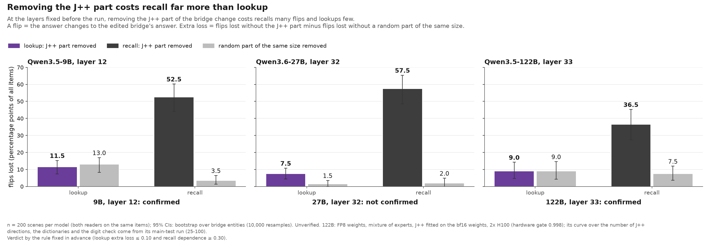
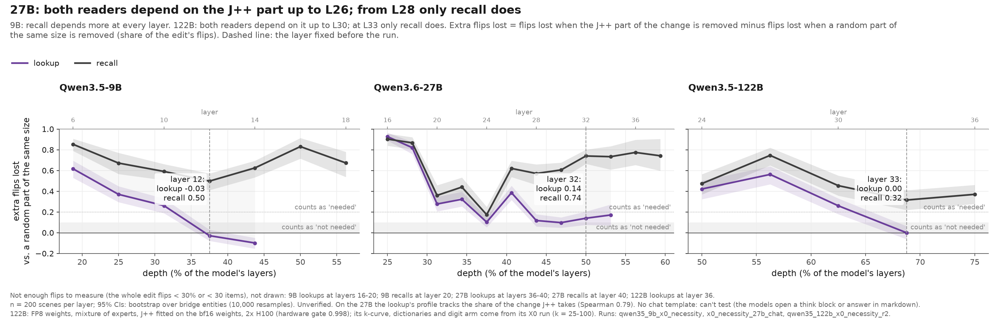
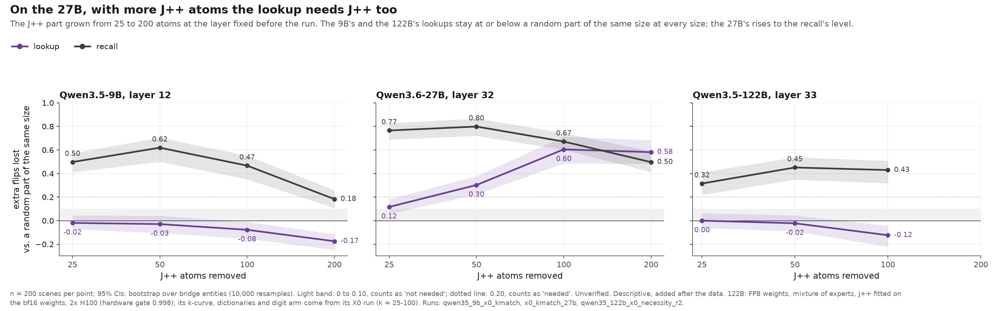
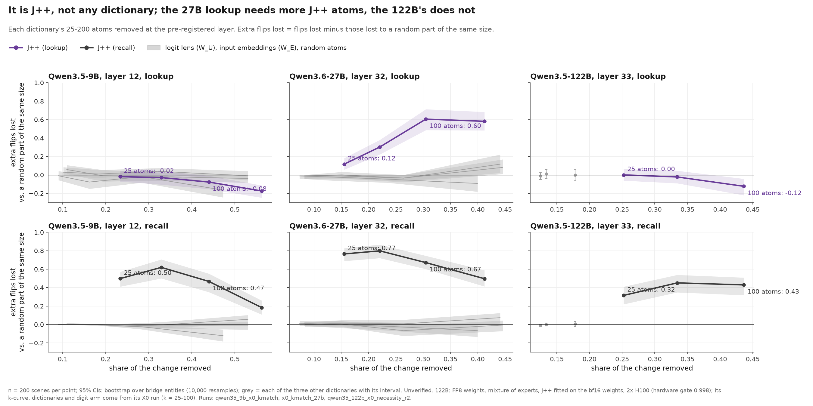
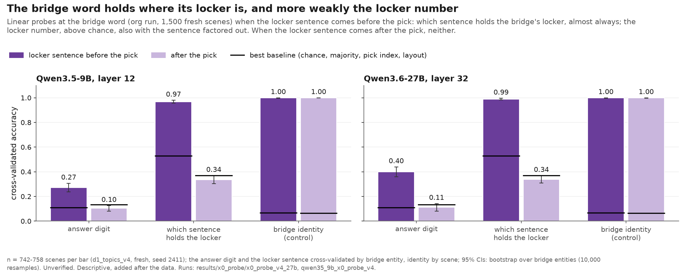
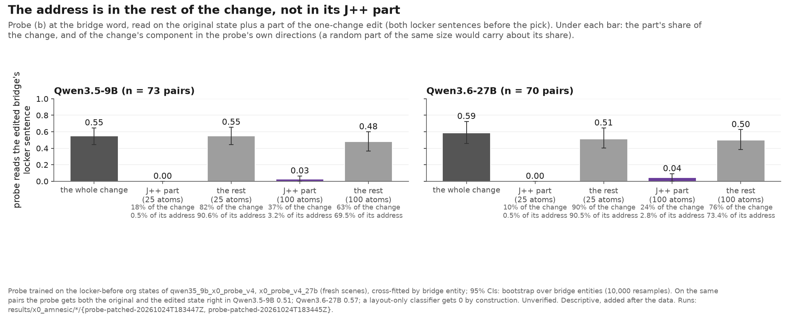
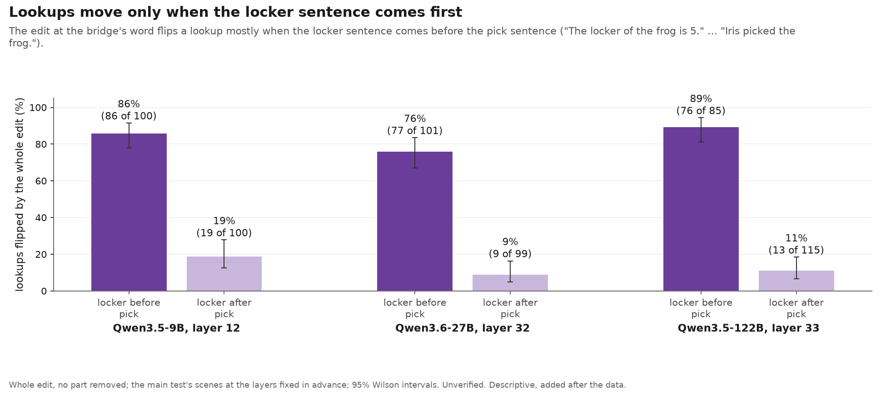

<!-- Generated by scripts/readme_build.py from docs/README.template.md and grid.csv; edit the template. -->
# bridge-jspace

**Question.** To answer a two-step question, a model first finds an entity in between (the **bridge**) and then uses it. A lens called **J++** reads hidden states as words. Does the model use the part of the bridge's representation that J++ can read, or does it reach the bridge another way? And does that depend on what the model does with the bridge next?

> **Example.** "Iris picked the frog. The locker of the frog is 5. …" The bridge is *frog*.
> - **Lookup:** "Which locker belongs to Iris's pick?" The answer is written in the prompt.
> - **Recall:** "How many legs does Iris's pick have?" The answer comes from the model's memory.

**Status (24 Oct 2026).**
- Models: Qwen3.5-9B, Qwen3.6-27B and Qwen3.5-122B-A10B (FP8 weights, mixture of experts, split over two H100s; its J++ was fitted on the bf16 weights; a hardware gate reproduced a 23 Oct cell first, 0.998 per-row agreement).
- All numbers are unverified (not yet hand-checked); the layers, the rule and Dan's predictions were fixed before any result was opened. Built at aea2f771 from the X0 run files. Full log: [jobs/c3/X0.md](jobs/c3/X0.md).

## Main findings

1. **Recall needs the J++ part of the change.** Removing the J++ part of a bridge change costs recalls 0.53 (9B), 0.77 (27B) and 0.40 (122B) of their answer flips. A random part of the same size costs 0.04, 0.03 and 0.08.
2. **It is specific to J++.** At the same size, the logit-lens directions, the input embeddings and random directions do nothing comparable, on all three models.
3. **Lookups need it much less.**
   - **9B:** not at any number of J++ atoms (extra loss −0.02 at 25 atoms to −0.17 at 200). The pre-registered test: **confirmed**.
   - **27B:** a little at 25 atoms, so the pre-registered test was **not confirmed**; at 100 atoms about as much as recall (0.60 vs 0.67). Added after the data: with an edit that changes only the asked pick, the 27B lookup's extra loss is 0.05 [0.01, 0.09] (9B: −0.02). At 100 atoms it is still 0.49.
   - **122B:** the pre-registered test at layer 33: **confirmed** (lookup 0.00 [−0.06, 0.06]; recalls lose 0.40 of their flips). At 100 atoms the lookup stays at −0.12. Up to layer 30 both readers need the J++ part.
4. **Not a missing digit.** Lookups flip mostly when the locker sentence comes *before* the pick sentence, so the lookup might read a locker number already attached to the bridge word, which our letter-only J++ dictionary cannot remove. The digit tokens are not the route: with every token allowed, digits included, the 27B lookup's extra loss is 0.13 (letters only: 0.14), and the 10 digit directions alone give 0.00 on all three models.
5. **The address and the value at the bridge word, outside the J++ part (descriptive, probes).** On 1,500 fresh scenes, where the locker sentence comes before the pick, both are linearly readable at the bridge word: which sentence holds the bridge's locker (0.99 on the 27B, 0.97 on the 9B; the layout alone gives 0.53) and the locker number (0.40 and 0.27, chance 0.11; 0.38 and 0.28 with the sentence factored out). On the one-change pairs the change of address follows the edit (both members right in 0.03 [0.00, 0.08] of the 27B's pairs; the layout alone gets none), and the readout follows the item's first mention in the context (in these scenes, the locker sentence), not the locker sentence as such, and it sits in the rest of the change, not in its J++ part: at 25 atoms the J++ part holds 10% of the change but 6.3% of its component along the probe's directions (27B). Removing the ridge probe's 4 address directions (1% of the change), or keeping only them, changes no lookup (0.00 [0.00, 0.00]): the probe's directions are not what the lookup reads.

## How we test it

- **Change the bridge.** Make a copy of the prompt where Iris picks a different animal (frog → tick). At one layer, take the difference between the two hidden states at the bridge word.
- **Paste the change back in three ways:** whole; without its J++ part (the 25 J++ directions that best describe it); without a random part of the same size.
- **Ask both questions on the same patched prompt.** The question comes after the patch, so both readers get the exact same edit. Any difference comes from the reader, not the edit.
- **Measure** how many answers flip to the new animal's answer. The key number is the **extra loss**: the flips lost without the J++ part, minus the flips lost without the random part, both as shares of the whole change's flips.

## Results at the pre-registered layer

| Model, layer | Lookup: extra loss | Recall: extra loss | Rule (pre-registered, two-change edit) | Recall minus lookup, C: two-change edit | C: one-change edit | J++ part's median share of the change's ‖Δ‖² |
|---|---|---|---|---|---|---|
| 9B, 12 | −0.03 [−0.08, 0.03] | 0.50 [0.41, 0.57] | **confirmed** | 0.53 [0.42, 0.61] | 0.39 [0.30, 0.46] | 0.23 |
| 27B, 32 | 0.14 [0.08, 0.20] | 0.74 [0.66, 0.80] | **not confirmed** | 0.60 [0.50, 0.69] | 0.56 [0.45, 0.65] | 0.16 |
| 122B, 33 | 0.00 [−0.06, 0.06] | 0.32 [0.22, 0.41] | **confirmed** | 0.32 [0.20, 0.43] | not run | 0.25 |

How to read this:
- The rule asked for a lookup extra loss of at most 0.10, and for recalls to lose at least 0.30 of their flips without the J++ part. The headline is C, the recall's extra loss minus the lookup's, under both edits; the categorical verdicts are the pre-registered ones (two-change edit).
- In answer counts (27B, 200 scenes): lookups go 86 → 71 without J++ and 86 → 83 without the random part; recalls go 150 → 35 and 150 → 146.
- Scope: almost all of the lookup's flips at the bridge word come from scenes where the locker sentence comes before the pick; the lookup results describe those scenes.
- 95% intervals come from resampling the bridge entities (40 on the 9B, 44 on the 27B, 40 on the 122B).

 

 

## What did not hold

- **"Past mid-depth, lookups don't use the J++ part of the change at all."** It holds on the 9B, and on the 122B from layer 33. On the 27B it holds only when the change is pasted across the whole context (lookups 84% → 87% without J++, recalls 77% → 36%). That repeats a 23 Oct result on fresh scenes, but at the bridge word alone it does not hold.
- **"The lookup reads the answer digit at the bridge word"** (stated before the check). Digit tokens change nothing (above), and the J++ readout at the bridge word ranks the lookup's answer digit first in 13% of items (27B; chance is 10%).
- **Prompts without the chat template.** Can't test: the models open a thinking block or answer in markdown. This says nothing about the question.

## Weak spots we know about

| Weak spot | Status |
|---|---|
| The J++ part is mostly not the bridge word: the bridge's own tokens are among its top 25 atoms in 28 of 40 items and carry 12% of it (27B, layer 32), so a "word form" is not shown; and "specific to J++" may only mean "aligned with the layer's geometry" | word only vs J++ without the word vs a PCA dictionary (next) |
| The lookup's route: an address at the bridge word (descriptive, probe), outside the J++ part; not J++ on the 9B and the 122B, not a digit on any model. The ridge probe's 4 directions are not what the lookup reads: removing them, or keeping only them, changes no lookup (0.00 [0.00, 0.00] on the 27B, 0.05 [0.00, 0.10] on the 9B) | mass-mean address and value subspaces (next); X4 |
| Lookup flips depend on sentence order: locker before pick 76%–89%, after 9%–19% | figure F4; X0b fixes the order by design |
| The two-change edit inflated the extra loss: on the same items, one change instead of two moves the recall's by −0.15 [−0.22, −0.08] (27B) and −0.13 [−0.19, −0.08] (9B), the 27B lookup's by −0.08 [−0.16, 0.00] | the one-change edit from X0b on (it makes two people pick the same item) |
| On the 27B, the lookup's drop with depth follows how much of the change J++ captures (Spearman 0.79) | stated beside the depth figure |
| Three models from one family, generated scenes only | X0b (running); natural-text sets planned |

## Next

| Step | What it tells us |
|---|---|
| Word only, J++ without the word, and a PCA dictionary (27B, 9B) | whether recall's loss is the bridge word, J++ beyond the word, or any direction the layer favours |
| X0b: 7 topics, 3 formats, 3 difficulty levels, one-change edit (running) | whether the contrast holds beyond one simple scene type, and whether the address forms in JSON and tables |
| X3 (natural passages) or X4 (the locker key written word for word, translated, or described); Dan decides | whether the contrast holds on natural text, or whether the address forms only when the key matches word for word |

## More

- [Detailed results](docs/x0_details.md): every layer, every dictionary and number of atoms, subsets, controls, simple explanations we ruled out.
- [Pre-registration and every change made after the data](jobs/c3/X0.md) · [Dan's predictions and scores](predictions/2026-10-24_dan.md).
- [Earlier claims and history](CHANGELOG.md) · [Zach's breadth results](https://github.com/zach-perlman/bridge-jspace/tree/zach/v8-breadth-1021).

Prior work: the workspace paper (Gurnee et al. 2026); two-hop recall resolves its bridge early (Biran et al. 2024).
