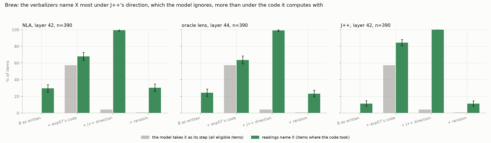
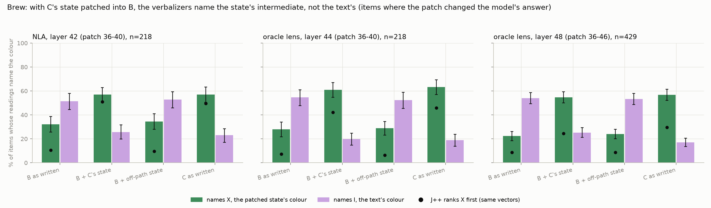
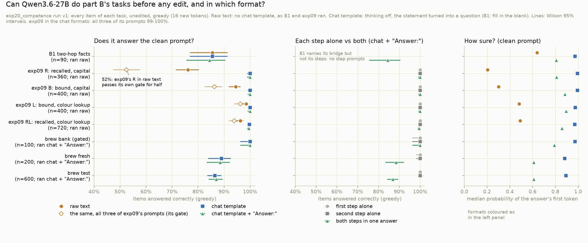
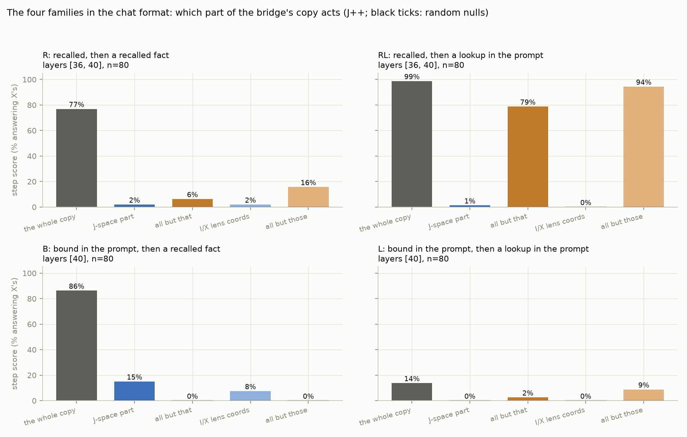
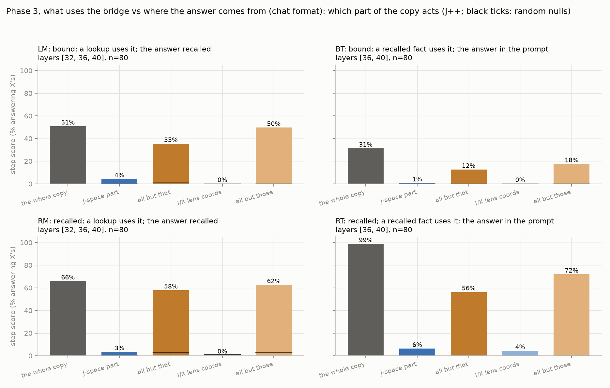
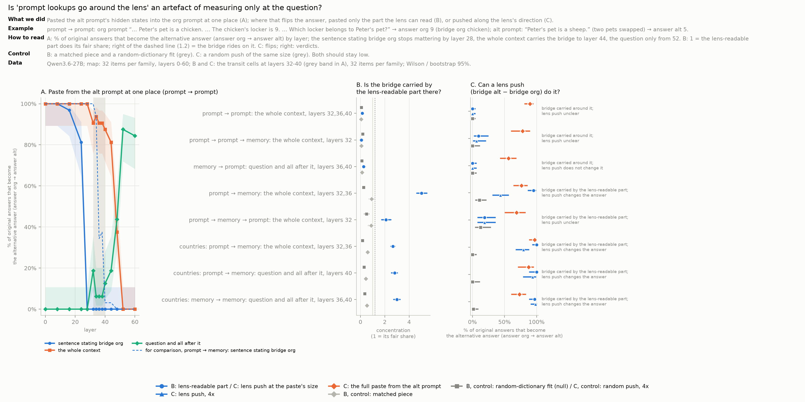
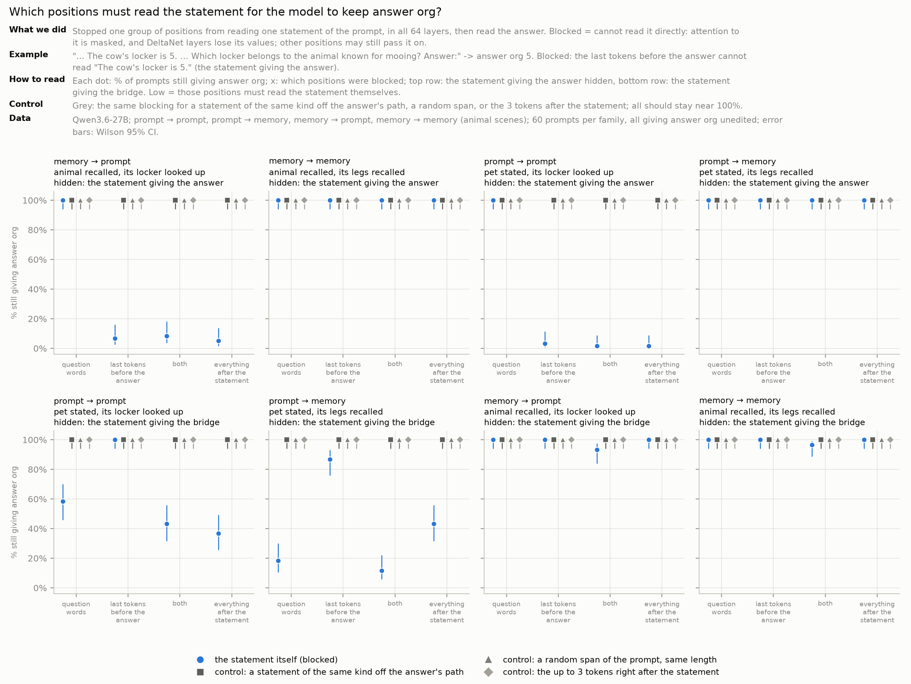
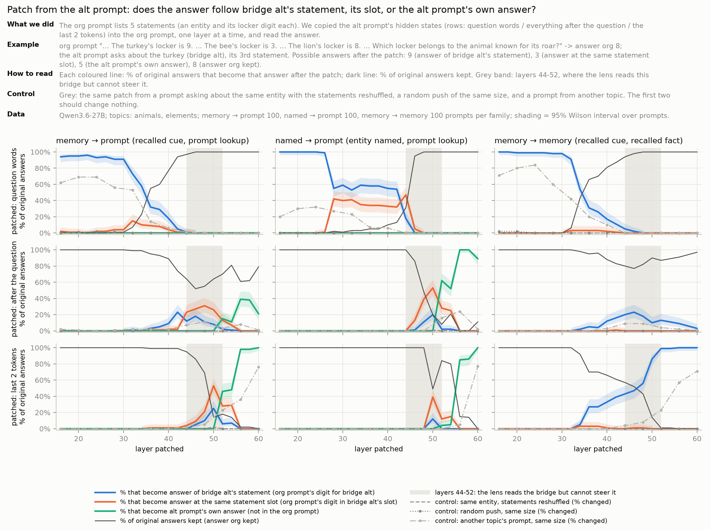
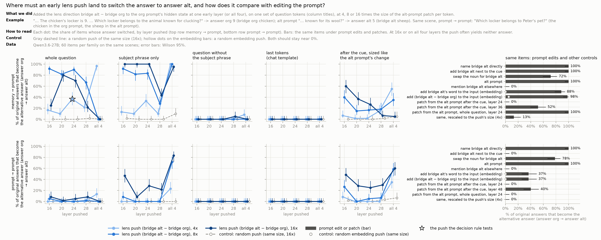

# bridge-jspace

**Latest status (20 Oct 2026):** [STATUS.md](STATUS.md) · plan: [Google Doc](https://docs.google.com/document/d/1bqqdXePTUXQGlowVjk73sPfJkbV_tsu0RNNX-BiTYUc/edit?usp=drivesdk) · run log: [EXPERIMENTS.md](EXPERIMENTS.md)
· **new (21 Oct, unverified):** [depth track D1-D4](#depth-track-d1-d4-2026-10-21-what-is-the-around-route) ·
family names used there: "where the bridge comes from → where the answer comes from" (RL = memory → prompt, BL =
prompt → prompt, ...)

**Question.** In a two-hop question ("the language spoken in the country where the Amazon River ends is ..."), the
model has to compute a bridge entity (Brazil) before it can answer (Portuguese). On Qwen3.6-27B and Gemma 4 31B the
J-lens often cannot read that bridge. Does the bridge still act on the answer through the J-space, or through a part
of the representation the J-lens cannot read?

**Reference result (Claude, Gurnee et al. 2026,
[Verbalizable Representations Form a Global Workspace](https://transformer-circuits.pub/2026/workspace/index.html)).**
Swapping the bridge's probe for another entity's flips the answer in 61% of items when only the J-space part of the
probe is swapped, 28% for the remainder, and 6% for the remainder when the J-space coordinates are clamped.

**Reading.** If on open models the remainder flips about as often as the J-space part and survives the clamp, the
bridge works outside the workspace. If the numbers look like Claude's, the J-lens misses on open models are a read-site
or tokenization artifact.

## Contents
| Section | The question it answers |
|---|---|
| [Setup](#setup-shared-by-all-experiments) | On which model, prompts and questions everything is measured, and how to read the figures |
| [Method, part A](#method-part-a-can-any-reader-see-the-bridge-exp10) | Which experiments ask "can any reader see the bridge?" |
| [Method, part B](#method-part-b-is-the-bridge-used-outside-the-j-space-exp01-09) | Which experiments ask "does the bridge act through the J-space?" |
| [Status](#status) | What we know so far, and where the final figures are |
| [exp10](#exp10_lens_sanity-does-the-lens-work-on-qwen-at-all) | Does a lens read two-hop bridges on Qwen at all? |
| [exp11](#exp11_bridge_vs_answer_by_layer-where-is-the-bridge-readable-and-where-the-answer) | At the last prompt token, at which layers are the bridge and the answer readable? |
| [exp12](#exp12_position_map-where-in-the-prompt-and-how-deep) | Where in the prompt, and from which layer, are they readable? |
| [exp14](#exp14_cue_answer_swaps-on-the-cue-phrase-is-it-the-bridge-or-already-the-answer) | On the cue phrase, does swapping the answer change it as often as swapping the bridge? |
| [exp15](#exp15_oracle_lens-where-the-lenses-miss-the-bridge-does-the-oracle-lens-name-it) | Where the J-lens and J++ miss the bridge, does a reader that puts the activation into words name it? |
| [exp16](#exp16_nla-does-a-second-verbalizer-the-nla-see-the-same) | Does a second verbalizer, the NLA, trained for another objective, see the same? |
| [exp18](#exp18_brew_verbalizers-on-brew-do-the-verbalizers-read-the-state-the-model-computes-with-they-read-the-colour-written-in-the-vector) | On brew, do the verbalizers report the intermediate the model computes with, a colour direction it ignores, or the text? |
| [exp20](#exp20_competence-parts-a-and-b-before-any-edit-can-the-model-do-the-tasks-and-in-which-format) | Before any edit, does the model do each task, and in which format: raw text, as B1 and exp09 ran, or its chat template? |
| [exp02](#exp02_swaps-part-b-does-the-bridge-act-through-the-j-space-and-where) | Does swapping the bridge's J-space part change the answer, and where in the prompt? |
| [exp03](#exp03_brew_swaps-part-b-an-in-context-two-step-lookup) | Do the same swaps work on a two-step lookup whose answer is read off the prompt? |
| [exp04](#exp04_brew_patch-part-b-where-brew-carries-its-intermediate-without-a-lens) | Where does that lookup carry its intermediate, found without a lens? |
| [exp06](#exp06_sigma_writes-part-b-read-with-the-lens-write-along-the-covariance) | Do edits shaped by the activation covariance (Σv) act more than the lens's own directions? |
| [exp07](#exp07_step_code-part-b-a-code-for-brews-intermediate-fit-on-other-items-writes-the-step-the-lenss-direction-does-not) | Does a code for brew's intermediate, fit on other items, write the step where the lens direction does not? |
| [exp08](#exp08_brew_read-part-b-the-lens-reads-brews-intermediate-at-a-few-positions-writing-along-its-direction-does-nothing) | Do the lenses read brew's intermediate where the step is carried? |
| [exp09](#exp09_bind_recall-part-b-which-bridges-leave-the-j-space-those-a-lookup-in-the-prompt-uses-recalled-or-bound) | Holding the question fixed, which bridges are carried outside the J-space, as brew's intermediate is? |
| [Lens robustness (part B, 2026-10-19)](#lens-robustness-part-b-2026-10-19-do-b1-b3-and-exp09-hold-with-a-second-j-fit) | Do B1-B3 and exp09's verdicts hold with a second J++ fit (chat-fitted)? |
| [Part B in the chat format (2026-10-19)](#part-b-in-the-chat-format-2026-10-19-b1-phase-2c-and-exp09-where-the-model-takes-the-prompt-as-a-question) | Do B1 and exp09 hold in the chat format, and is B1's J-part more than the entities' own words (Phase 2c)? |
| [exp21_contrastive (Phase 2a, part B)](#exp21_contrastive-phase-2a-part-b-bridge-directions-from-contrasts-on-exp09s-own-question) | Do bridge directions from contrasts on exp09's question move the bound bridge, and through which part (Phase 2a)? |
| [Phase 3 (part B, exp09 families LM, RM, BT, RT)](#phase-3-part-b-exp09-families-lm-rm-bt-rt-what-uses-the-bridge-or-where-the-answer-comes-from) | Does what uses the bridge, or where the answer comes from, put it outside the J-space (Phase 3)? |
| [exp22_brew_misses (part B, competence as data)](#exp22_brew_misses-part-b-competence-as-data-when-brews-composed-answer-is-wrong-is-the-intermediate-formed) | When brew's composed answer is wrong with each step right, is the intermediate formed? |
| [exp23_arith (part B, stretch)](#exp23_arith-part-b-stretch-an-intermediate-the-model-computes-by-arithmetic) | Is an intermediate computed by arithmetic carried in the J-space? |
| [Pitfalls](#pitfalls-found-so-far) | What went wrong along the way, and how each is handled |
| [Depth track (D1-D4, 2026-10-21)](#depth-track-d1-d4-2026-10-21-what-is-the-around-route) | What does a lookup in the prompt use instead of the lens-readable word, where and when? Names, results at a glance, methods and datasets compared, D1-D4 with figures, predictions vs results, what is not tested, next ideas |
| [Decisions](#decisions), [open decisions](#open-decisions-humans) | What was decided, and what is still for the humans to decide |
| [Next steps, part A](#next-steps-part-a), [part B](#next-steps-part-b) | What comes next |
| [DEVELOPER.md](DEVELOPER.md) | How to run, re-analyse and publish: layout, commands, GPU box, figures, examples |

## Setup (shared by all experiments)
- **Model.** Qwen3.6-27B (pinned revision, bf16). Qwen3.5-4B only in exp10's check that the lenses work.
- **Prompts.** The published prompts end in a space, which Qwen's tokenizer keeps as a lone `" "` token: after it
  the model answers far fewer questions (lens-eval: 21 of 93 vs 61 with the space removed) and a reader at the last
  token reads that space instead of the last word. Every experiment, part A and part B (from its v4), removes the
  trailing space. Runs on the prompts as published are kept only as a check and say so.
- **Which questions count.** The probe-swap set has 90 two-hop questions (bridge Brazil, answer Portuguese). A
  question counts as answered correctly when the model's greedy continuation contains the answer (exp13's
  criterion, used by part B from v4): 77 of the 90. exp10 instead uses the lens-eval multihop set: the 84 questions
  whose bridge is a single token, answered correctly or not.
- **Readers.** At a given layer and prompt position each reader scores every token of the vocabulary: the logit lens
  (the model's own unembedding; the baseline), the J-lens and J++ (two fits of the average-Jacobian lens).
- **"Ranked first among its candidates" (exp11, exp12).** For the bridge (Brazil) we ask whether the reader scores it
  above every other entity of the set: the **97 entities** are all distinct bridges and swap targets of the 90
  questions (70 bridges and 68 swap targets, overlapping), each a single Qwen token. For the answer (Portuguese) the
  candidates are the **112 answers**: all distinct answers and swap answers of the 90 questions that are a single
  token (120 in all; the 8 multi-token ones cannot be ranked, so 5 of the 77 questions drop out of the answer lines).
  Restricting the ranking to these pools asks "of the entities these questions are about, which one does the reader
  pick?", the same choice part B's swaps change; chance is 1 in 97 (about 1%). The full-vocabulary rank is used only
  for the comparison with the distractor.
- **Single-token words only.** Every headline number is on bridges that are one Qwen token: the probe-swap set's 97
  entities are each a single token (exp11-16), and exp10 keeps the 84 of 93 lens-eval questions whose bridge is one
  token. Answers are ranked only where they are a single token (72 of the 77 questions; the verbalizers' answer lines
  61, numbers left out). How the lenses and the verbalizers do on bridges spread over several tokens ("New Zealand",
  most numbers above 9) is not measured.
- **Control.** Each question has a same-category distractor (Mexico for Brazil, Spanish for Portuguese; part B's swap
  target). If the distractor came first as often as the bridge, the reader would be reading the category, not the
  entity.
- **Layers.** Summaries average over layers 32-48, fixed before exp11; layers 24-40, the band part B's main swaps use,
  are reported alongside. Both are part B's swap bands.
- **Positions (exp12)** are counted back from the last word of the prompt: 0 = the last word (usually "is"), -1 the
  word before ("located", "ends"), and so on; each position's label is its most common token.
- **Shading.** 95% intervals: a bootstrap over questions (10,000 resamples) for averages over layers or positions,
  Wilson for the share of questions at one layer.

## Method, part A: can any reader see the bridge? (exp10+)
1. `exp10_lens_sanity`: the lens works on this model. Sanity gate (known fact, HF parity, our readout == jlens's
   `apply`), then `lens-eval-multihop` pass@k for the J-lens and J++ against the logit lens, plus a bridge vs
   same-category distractor control. Debugged on Qwen3.5-0.8B (CPU), run on Qwen3.5-4B (same `qwen3_5` hybrid
   architecture as the target), then Qwen3.6-27B.
2. `exp11_bridge_vs_answer_by_layer`: on part B's questions and labels, at the last prompt token, at which layers each
   reader ranks the bridge (and, separately, the answer) first among its candidates.
3. `exp12_position_map`: the same readout at every prompt position x layer: where in the prompt, and how deep, each
   word is readable; the best position per reader, chosen on half the questions and checked on the other half.
4. `exp13_greedy_answers`: which questions the model answers correctly, judged on its greedy continuation (the
   criterion part B adopted in v4).
5. `exp14_cue_answer_swaps`: on the cue phrase, does swapping the answer's lens direction change the answer as often
   as swapping the bridge's?
6. `exp15_oracle_lens`: where the J-lens and J++ miss the bridge (or the answer), does the oracle lens (a LoRA on the
   model that puts one activation into words) name it; and after the bridge swap, does it name the swap target?
7. `exp16_nla`: the same with the NLA, a second 27B verbalizer (another training objective, built on the same model)
   trained on layer 42, compared with every reader at layer 42.
8. `exp18_brew_verbalizers`: exp17's reading-vs-solving question on brew, with the counterfactual's state patched in
   where exp04 found the step (v2), and with exp07's code against J++'s direction (v3); the oracle lens and the NLA
   against their own floor (B) and ceiling (C).

## Method, part B: is the bridge used outside the J-space? (exp01-09)
0. `exp20_competence`: before any edit, does the model do each task, in the format its runs use and in its chat
   format, as a whole and one step at a time (every item, unedited, greedy)? Every result below is read against it:
   the task's base rate, the share of items its gate keeps, and the format (Decisions, 2026-10-19).
1. `data/entity_prompts.json`: about 8 prompts per entity that imply the entity without naming it, for the 97
   entities in `data/probe_swap.json` (bridges and swap targets). Qwen keeps the ones it answers correctly.
2. Probe per entity and layer: mean final-token residual over its kept prompts minus the mean over all entities.
3. Decomposition per layer: non-negative OMP (k=25) over J-lens (or J++) token directions gives the J-space part; the
   remainder is the rest. From v4, both lenses decompose the same probes (`exp01_probes redecompose`).
4. Swaps on the 90 two-hop items, at every band layer and prompt position, under five conditions: raw J-lens vectors,
   full probe, J-space part, remainder, remainder with the J-space coordinates clamped. Each has a random-direction
   control of the same edit norm. Metric: rate at which the swap answer becomes the top word, with Wilson 95% CIs.
   From v4: prompts with the trailing space stripped, and eligibility and flips judged on the greedy continuation
   (exp13's criterion C), which makes 77 items eligible; swaps can be restricted to some prompt positions.
5. `exp03_brew_swaps`: the same swaps and graded steering along lens directions on an in-context two-step lookup
   (WorkspaceBench's brew bank), where the counterfactual answer is read straight off a table in the prompt.
6. `exp04_brew_patch`: lens-free activation patching of brew from a counterfactual table, by layer and prompt
   position (where the intermediate is carried), then the copy split into its J-space part and the rest, and the copy
   restricted to subsets of positions; bank and held-out fresh items.
7. `exp06_sigma_writes`: exp02's matched control with a covariance-shaped rest, and steering along Σ_λ v.
8. `exp07_step_code`, `exp08_brew_read`: a code for brew's intermediate fit on other items and written at exp04's
   window; and whether the lenses read the intermediate there (part A's top-1 protocol with a distractor).
9. `exp09_bind_recall`: the same question with its bridge recalled or bound in the prompt, and its second hop a
   recalled fact or a lookup in the prompt, through exp04's patching and exp02's probe swaps.

## Status
Draft, UNVERIFIED: nothing is in `VERIFIED.md` yet. The STATE block in `AGENTS.md` tracks what is in flight.
Final figures, numbers and examples per experiment: [results/README.md](results/README.md). Every part A number below
is recomputed from the raw run files by `uv run python scripts/verify_headlines.py`.

**Where things stand (2026-10-15).** On Qwen3.6-27B, for bridges that are a single token, the J-lens and J++ do read
the bridge, once read at the right place: on the last two words, one word before the end from about layer 23, 19
layers before the answer appears at the last word (exp12; -1 is not a better read site than the last word, Next
steps 5). It
acts on the answer from the cue phrase, the words that point to it, and does so apart from the answer's own direction
(exp14). Readers that put an activation into words, the oracle lens and the NLA, see the bridge and the answer a
little more often than the lenses at the same place and layer, including about a third to a half of the readings
where neither lens has the bridge first, and after a swap they name its target where it changes the answer (exp15,
exp16; exp18 shows they report what is written into the vector, so this is not yet evidence of use, Next steps 4).
Whether, on those lens-blind readings, they read the state or solve the question themselves is the open
question; the next experiment (exp17, Next steps) is designed to settle it and has not been run. Part B (exp01-04)
asks the original question with probe swaps; on brew, an in-context lookup, it finds the intermediate carried at four
positions after the start line at layers 36-50 outside the J-space: the lenses read it there at a few positions,
but writing along their direction does not take the step, while a code fit on other items does (exp04, exp07, exp08).
Across four families that hold the question's form fixed, what uses the bridge goes with the J-space, not where it
comes from: used by a recalled fact, a bridge bound in the prompt acts through its J-space part; used by a lookup in
the prompt, a bound or a recalled bridge acts through the rest, as brew's intermediate does (exp09).

**Recovery note (2026-10-19, evening).** The B200 box that ran everything from Oct 18 on became unreachable before
its commits were pushed. Branch `recovery-2026-10-19` restores the code and this write-up from the agent's working copies
(on top of the VPS clone with VERIFIED B1-B4). Missing until re-run or recovered from the old disk: every results folder
and figure from Oct 18 on (exp19 fits v4-v6, Phase 1, exp02/exp09 chat and own-word runs, exp21-23, Phase 3), except
`results/exp20_competence/v1` and the figures exp20 v1, exp09 v3_chat and v4_use_source; all cache/ files (probes, codes,
lenses). The numbers in the sections below are as recorded in the sprint's EXPERIMENTS.md and W&B; `verify_headlines.py`
cannot recompute them until the runs are back. `data/use_source.json` was regenerated from its seed and matches its pin.

**Overnight, 2026-10-19 (unverified; sections below).** In the chat format, with exp01's probes read inside the user
turn, B1 replicates (J-part 54%, remainder 5%, held 3%, matched 14%). Phase 2c narrows it: without the two entities' own
word atoms the J-part flips 0-1% in both formats, so B1's "J-space" is the bridge's own word directions. A second J++
fit gives the same verdicts (Phase 1). In exp09's chat re-run, B stays inside and RL is far outside (1% vs 79%); new
directions built from contrasts on B's own question move the bound bridge for the first time, through the part outside
the J-space (10-11%, small). Splitting "what uses the bridge" from "where the answer comes from" (Phase 3) supports
neither: no family with a lookup in the prompt comes out inside. On brew's composition misses the intermediate is
mostly formed (78% vs 82% of hits); an arithmetic intermediate barely moves under the copy.

**Task competence (2026-10-19, exp20, unverified).** Unedited, Qwen3.6-27B does every part B task in its chat
format: exp09's four families on 99.7-100% of items (all three of exp09's prompts 99-100%, each step alone 100%), brew's
steps 100% alone and 87-89% composed on ungated items, B1's 90 two-hop facts 86%. In the raw text B1 and exp09 ran on,
it answers less often and less surely: exp09's R 76%, and half of R's items pass exp09's gate; the median probability
of the answer is .20-.64 against .97-.99 in chat. So exp09's R column rests on the half of R the model answers in raw
text, and no part B result has yet been run in the format the model takes as a question (exp20 below).

**Final figures (Qwen3.6-27B).**
| Figure | What it shows |
|---|---|
| [exp12 `two_step.png`](figures/exp12_position_map/two_step.png) | **Headline.** Where in the prompt each word is read (left) and from which layer (right): the bridge one word before the end from layer 23, the answer at the last word from layer 44 |
| [exp12 `layers_at_positions_jlens.png`](figures/exp12_position_map/layers_at_positions_jlens.png) | The same, one line per position for the last four words: which positions carry the bridge, and the answer, at which layers |
| [exp12 `cue_phrase.png`](figures/exp12_position_map/cue_phrase.png) | On the cue phrase (the words that point to the bridge): the bridge is read there as often as at the read sites, and earlier; the answer only weakly |
| [exp12 `cue_phrase_lenses.png`](figures/exp12_position_map/cue_phrase_lenses.png) | J-lens vs J++ on the cue phrase: they read the same bridge; their swaps differ |
| [exp12 `by_offset.png`](figures/exp12_position_map/by_offset.png) | The "where in the prompt" panel for all three readers, logit lens included |
| [exp12 `position_layer.png`](figures/exp12_position_map/position_layer.png) | Reference heatmaps: every position x layer, all three readers |
| [exp14 `flip_rates_by_overlap.png`](figures/exp14_cue_answer_swaps/flip_rates_by_overlap.png) | On the cue phrase, swapping the answer changes it only where the swap also moves the bridge |
| [exp14 `flip_rates.png`](figures/exp14_cue_answer_swaps/flip_rates.png) | Bridge vs answer swaps on the cue phrase and at the last token, with random-direction controls |
| [exp14 `flip_rates_pinned.png`](figures/exp14_cue_answer_swaps/flip_rates_pinned.png) | The same swaps with the other pair held: on the cue phrase the bridge swap still works, the answer swap does not |
| [exp15 `readers_by_layer.png`](figures/exp15_oracle_lens/readers_by_layer.png) | J-lens, J++ and the oracle lens side by side on the same activations, layers 20-60: the oracle has the bridge a little more often, the answer much more often early on (with more false alarms) |
| [exp15 `oracle_vs_lenses.png`](figures/exp15_oracle_lens/oracle_vs_lenses.png) | The less the lenses see the word, the less often the oracle names it: about 85% where both rank it 1st, 20% where they have it 11th or lower; false alarms 4-8% |
| [exp15 `after_swap.png`](figures/exp15_oracle_lens/after_swap.png) | After the bridge swap, the oracle names the swap target where the model's answer changes (67%), rarely where it does not (10%) |
| [exp15 `by_layer.png`](figures/exp15_oracle_lens/by_layer.png) | By layer (20-60): the oracle names the lens-blind bridge at every layer; the swap's effect reaches the last words between layers 32 and 40 |
| [exp16 `methods_at_42.png`](figures/exp16_nla/methods_at_42.png) | Every reader at layer 42: the NLA and the oracle lens have the bridge and the answer more often than the J-lens and J++, at the same 3-9% false alarms |
| [exp16 `after_swap.png`](figures/exp16_nla/after_swap.png) | The NLA too names the swap target where the model's answer changes (59%), rarely where it does not (11%) |
| [exp16 `by_swap_label.png`](figures/exp16_nla/by_swap_label.png) | By part B's swap labels: where the J-space swap does not change the answer the lenses see the bridge less, the verbalizers as often |
| [exp18 `code_vs_lens.png`](figures/exp18_brew_verbalizers/v3/code_vs_lens.png) | On brew, a J++ direction the model ignores makes both verbalizers name X more often than the code the model computes with |
| [exp18 `state_vs_text.png`](figures/exp18_brew_verbalizers/v2/state_vs_text.png) | On brew, with the counterfactual's state patched in, both verbalizers name the state's intermediate, not the text's |
| [exp11 `pool_top1_by_layer.png`](figures/exp11_bridge_vs_answer_by_layer/pool_top1_by_layer.png) | Last token only: bridge and answer ranked first, by layer, three readers |
| [exp11 `advantage_by_layer.png`](figures/exp11_bridge_vs_answer_by_layer/advantage_by_layer.png) | Last token only: how many times higher than its distractor each word ranks |
| [exp10 `pass_at_10_by_model.png`](figures/exp10_lens_sanity/20261015-135537/pass_at_10_by_model.png) | Does each lens find the bridge at all (pass@10), 4B and 27B |
| [exp10 `pass_at_10_by_bridge_kind.png`](figures/exp10_lens_sanity/20261015-135537/pass_at_10_by_bridge_kind.png) | pass@10 by kind of bridge (27B), best layer anywhere and within 32-48: the logit lens's numbers come from the last layers |
| [exp10 `27b_by_layer.png`](figures/exp10_lens_sanity/20261015-135537/27b_by_layer.png) | Why the J-lens looks no better than the logit lens on pass@10 |

Worked examples with lens tables: `make examples-serve` opens [examples/index.html](examples/index.html) (exp10-12,
exp15, exp16); the exp12 page is also published at https://claude.ai/artifact/TXLZH6WxuxSQDhoK5YHTj9 (anyone with the
link can open it). Each page groups sampled questions by what the readers do with them; exp10's also by what the bridge
is: a number ('6', 'four'), a letter (a chemical symbol), or named in the prompt (`scripts/exp10_lens_sanity/examples.py`;
a bridge counts as found if any of its listed forms is). The exp10 page shows these groups from its next examples run.
The exp15 and exp16 pages show every question with the J-lens and J++ ranks next to the oracle lens's (exp15) or the
NLA's (exp16) words at each position and layer, before and after the bridge swap; the exp10-12 cards show both under
each question.

**What we know so far (Qwen3.6-27B, the 77 two-hop questions it answers correctly).**
1. The J-lens and J++ can read the bridge in the middle layers; the plain logit lens mostly only near the output
   (exp10, exp11). Over all layers the logit lens catches up, mostly on number bridges ('6', 'four') at layers 54-60;
   within layers 32-48 the lenses lead for every kind of bridge (exp10). The one lens-eval question that names its
   bridge in the prompt changes none of this (the earlier count of 5 such questions was a substring artifact).
2. The bridge is readable earlier than the answer, both in the prompt and in depth: one word before the end from about
   layer 23, while the answer appears only at the last word from about layer 44, 19 layers later [15, 27] (exp12).
   This compares two positions; -1 itself reads no better than the last word (Next steps 5).
3. Where the bridge is readable, part B's swaps tend to work: questions whose J-space swap flips the answer have the
   bridge ranked first more often (J-lens 73% vs 50%, J++ 70% vs 41% of layers 32-48), but the groups are small and
   the intervals overlap.
4. The original "J-lens cannot see the bridge" is mostly where and how we looked: of the 30 questions where it does not
   have the bridge first at the last word, 73% have it first at an earlier word (distractor, same search: 33%).
5. Where the bridge is readable is not where it is used. It reads about as well on the cue phrase (the words that
   point to it, "Amazon River ends") as one word before the end, and earlier on the cue phrase; but swapping it changes
   the answer on the cue phrase (part B: 31% with J++) and hardly at -1 (9%) (exp12, exp02).
6. The J-lens and J++ read the same bridge in the same questions (r = 0.92), yet swaps along J++'s directions change
   the answer more often (31% vs 19% on the cue phrase): J++'s advantage is in its directions, not in what it sees.
7. On the cue phrase, swapping the answer's direction changes the answer only where it also moves the bridge (0-1
   of about 35 questions otherwise), and less often than the bridge swap: no sign that the answer itself sits there.
   With the answer's coordinates held, the bridge swap on the cue phrase still changes the answer (18% of questions;
   24-28% where the two swaps overlap most), at the same edit size; held the other way round, the answer swap
   hardly does (1-6%). The cue phrase carries the bridge apart from the answer's direction. Whether it carries the
   answer too stays open: the held answer swap is weak even at the last token (17-26%), so its low rate on the cue
   phrase is not evidence of absence (exp14).
8. A reader that puts the activation into words, the oracle lens, sees a little more than the lenses at a given
   position and layer (exp15). Where neither the J-lens nor J++ ranks the bridge 1st it names it in 37% of readings
   (false alarms 4%), mostly where the lenses nearly have it (54% at 2nd-3rd, 22% at 11th or lower). Read at all 11
   layers both find the bridge somewhere in every question (the distractor in a third), so there it adds no question;
   at one layer it adds a few. After the bridge swap it names the swap target where the model's answer changes (67% vs
   10% where it does not), so the edit reaches the read position there (exp18: not yet evidence that the model uses
   it, Next steps 4); but it mostly writes the question out with the bridge filled in,
   so on the lens-blind readings it may be solving the question rather than reading the state, which only a cleaner
   test can tell.
9. A second verbalizer with another training objective, the NLA (exp16, layer 42), agrees: it names the bridge in
   46% of the readings where neither lens has it first (false alarms 10%), and the swap target where the swap changes
   the answer (59% vs 11%). At layer 42 both verbalizers have the bridge and the answer more often than either lens (bridge: NLA 75%,
   oracle 65-70%, lenses 62-65%; answer: 57%, 54-55%, 34-38%). Both are built on Qwen3.6-27B, so agreeing does not
   rule out that both solve the question; the NLA's own comments often do.
10. Three checks on the verbalizers. Our code gives the same texts as WorkspaceBench's reference code path, so the
    oracle's fragmentary format is its own. On the cue phrase they name the answer no more often than a lens ranks it
    first there (NLA 23% vs 30%, oracle 30% vs 27%): no sign of extra solving where the answer is not yet formed. Of
    the NLA's lens-blind namings, 63% are inside its quotation of the prompt with the bridge filled in (a hint of the
    state), 37% in its own comments (likely solving).
11. The verbalizers' edge over the lenses sits in the questions where part B's J-space swap does not change the
    answer (neither: +5 to +12 points; J-mediated: -1 to -9; difference -14 [-28, -1] and -14 [-26, -1]): there the
    lenses see the bridge less, the verbalizers as often. That is the pattern of a reader of a non-J-space part, and
    also of a reader that solves the question regardless; exp17 separates them (exp16).
12. On brew, both verbalizers report the colour written into the vector they read, like J++: they follow a patched
    state rather than the prompt's text (v2), but a J++ direction the model ignores (it takes X on 4% of items) makes
    them name X on 99% of items, more than exp07's code, which the model computes with (57%; NLA 68%, oracle 64%), and
    they name X as often where the code did not change the model's step (exp18 v3). Naming the bridge after a swap
    thus shows the swap wrote it into the vector, not that the model uses it; exp17 tests readings away from edits.


*The headline figure (exp12): left, where in the prompt the bridge (blue) and the answer (orange) are ranked first;
right, from which layer, the bridge at -1 and the answer at the last word, 19 layers apart. How to read it in detail:
under exp12 below.*

### exp10_lens_sanity: does the lens work on Qwen at all?
**What we measure.** We give the model a two-hop question, e.g. "The language spoken in the country where the Amazon
River ends is" (answer Portuguese, bridge Brazil). At the last prompt token we ask each *reader* for its ranked word
list at every layer, and count how often the bridge is in the top 10 at some layer (pass@10). Three readers: the
**logit lens** (simplest; the baseline), the **J-lens**, and **J++** (an improved J-lens).

**In short.**
- **Qwen3.5-4B:** the J-lens finds the bridge more often than the baseline (44% vs 25% of questions).
- **Qwen3.6-27B:** J++ clearly beats the baseline (77% vs 54%). The J-lens is only slightly ahead (58%), within the
  error bars.
- **Number bridges and the last layers are what hide the J-lens's lead.** On the 63 questions whose bridge is a word
  (Brazil, iron), the J-lens finds it in 67% against the logit lens's 52% (+14 points [+2, +27]) and J++ in 89%. On
  the 17 whose bridge is a number ('6', 'four', 'third'), the logit lens does better (65%) than the J-lens (41%) and
  J++ (53%), but only through the last layers: within layers 32-48 it finds 6% of the number bridges, the J-lens 18%
  and J++ 41%, and 3% / 30% / 59% of the word bridges. The 4 single-letter bridges (chemical symbols) no lens
  finds.
- **The bridge is often invisible at the last token.** On the 61 questions where 27B's top next token is the answer,
  J++ misses the bridge in 1 of 3 and the J-lens in 1 of 2. This is Zach's observation. The next experiments check
  other ways of reading it.


*How to read it: each bar is the share of the 84 questions whose bridge is in that reader's top 10 at its best layer,
read at the last prompt token; a bridge listed in several forms ('5', 'five') counts as found if any form is. Error
bars are 95% bootstrap intervals; grey is the baseline. On 27B, J++ (orange) is clearly above the logit lens; the
J-lens (blue) is within its error bars.*

**Why the J-lens looks no better than the baseline on 27B.** In the middle layers only the J-lens and J++ see the
bridge; near the output the logit lens catches up. pass@10 takes the *best* layer, so the late layers hide the
difference.


*How to read it: x is the layer, y the share of the 84 questions with the bridge in the reader's top 10 at that
layer. Inside layers 32-48 (grey) J++ has it for up to 35% of the questions, the J-lens up to 18%, the logit lens at
most 2%; only from about layer 55 does the logit lens join them.*


*How to read it: the bars of the first figure, split by what the bridge is (27B). Left, the best layer anywhere (as
pass@10): for word bridges both lenses are above the logit lens and J++ finds almost all; for number bridges the
logit lens is on top; letter bridges (n = 4) no lens finds. Right, the best layer only within layers 32-48: the logit
lens finds almost nothing of any kind, and both lenses lead for words and numbers alike. So the logit lens's numbers
come from the last layers (it finds them at layers 54-60), where the model is close to its output.*

<details><summary>Full numbers</summary>

pass@10 on the 84 questions with a single-token bridge, 95% percentile bootstrap CI over questions (n_boot=10000,
seed 0); a bridge listed in several forms counts as found if any form is in the top 10. Runs under
`results/exp10_lens_sanity/`, re-aggregated in each run's `analysis-20261015-1351*/`. All sanity checks pass on both
models (HF parity and our readout vs `jlens.apply`: max abs diff 0.0).

| Model | Top next token = answer | Logit lens | J-lens | J++ | J-lens - logit | J++ - logit | Run |
|---|---|---|---|---|---|---|---|
| Qwen3.5-4B | 50/93 | 0.25 [0.15, 0.35] | 0.44 [0.33, 0.55] | - | +0.19 [+0.10, +0.29] | - | `20261013-205057` |
| Qwen3.6-27B | 61/93 | 0.54 [0.43, 0.64] | 0.58 [0.48, 0.69] | 0.77 [0.68, 0.86] | +0.05 [-0.06, +0.17] | +0.24 [+0.13, +0.36] | `20261013-205936` |

- On the 61 questions where 27B's top next token is the answer: J++ 0.69 [0.57, 0.80], J-lens 0.51 [0.38, 0.64].
- By kind of bridge, 27B: words (n = 63) logit lens 0.52 [0.40, 0.65], J-lens 0.67 [0.56, 0.78], J++ 0.89 [0.81,
  0.95]; numbers (n = 17) 0.65 [0.41, 0.88], 0.41 [0.18, 0.65], 0.53 [0.29, 0.76]; letters (n = 4) 0.25, 0, 0. 4B,
  words: logit lens 0.32, J-lens 0.54; numbers 0.06, 0.18.
- One question names its bridge in the prompt ("the time of day ..." -> "day"); without it the headlines move by
  under a point (27B: J++ 0.77, J-lens 0.59, logit lens 0.54).
- With the paper's rule (each listed form scores its share of the question), 27B: J++ 0.75, J-lens 0.57, logit lens
  0.51 (`pass_at_k_fraction` in the same summaries).
- Check on the prompts as published (lone trailing space): the model answers 18/93 (4B) and 21/93 (27B); 27B logit
  lens 0.60, J-lens 0.62, J++ 0.87; 4B logit lens 0.40, J-lens 0.62 (runs `20261013-205029`, `-205736`).
- Controls (27B, rank at the last token): Brazil 0 vs distractor Mexico 57 (J-lens) / 45 (J++); Hungary 1 / 0 vs
  Poland 16 / 18. Figures: `uv run python -m scripts.exp10_lens_sanity.plot --summary`.
</details>

### exp11_bridge_vs_answer_by_layer: where is the bridge readable, and where the answer?
**What we measure.** Part B's 90 two-hop questions; the headline uses the 77 the model answers correctly (see
Setup). At the last prompt token, at every layer, we ask each reader: is the bridge (Brazil) ranked
first among the 97 entities of the set, and is the answer (Portuguese) ranked first among the 112 answers? The
same-category distractors (Mexico, Spanish) are the controls. Chance is about 1%.

**In short.**
- **J-lens and J++ read the bridge in the middle layers; the logit lens only near the output.** Averaged over
  layers 32-48 the bridge is ranked first in 57% of questions (J-lens), 56% (J++), 25% (logit lens); its distractor
  in 5%. This reproduces part B's `gate_debug` (0.55-0.70).
- **At the last token the bridge comes first, the answer later, but they overlap.** Half the questions have the
  bridge first by layer 35; the answer gets there by layer 44 (J-lens, 8 layers later [3, 16]) or 43 (J++, 8 [3, 20]).
  There is no clean hand-off: the bridge stays first until about layer 60, and per question the bridge settles first
  before the answer in only 52% [39, 64] of cases (J-lens).
- **Where the bridge is readable, it is also used.** On the questions where part B's J-space swap flips the answer,
  the bridge is first in 73% [58, 86] of layers 32-48 (J-lens, n=25) and 70% [59, 81] (J++, n=39); on those where no
  swap works, 50% [38, 62] (n=49) and 41% [29, 54] (n=37). Suggestive: the intervals overlap (J-lens) or nearly touch
  (J++). Each lens is split by its own swaps.


*How to read it: one panel per reader; x is the layer, y the share of the 77 questions in which the reader ranks the
word first among its candidates, at the last prompt token (shaded: 95% Wilson interval). Blue = bridge among the 97
entities, orange = answer among the 112 answers, grey = their distractors, dotted = chance. In the J-lens and J++
panels the blue line leaves the grey control from about layer 20 and stays above the orange one until layers 55-60:
the bridge is readable here, and ahead of the answer. The logit lens picks either word mostly after layer 50.*

**What this does not show.** A lens shows what can be read out at a layer, not when it was computed. And this is
one token: the first hop may happen earlier in the prompt (at "Amazon River ends"), which exp11 does not look at.
About 40% of questions do not have the bridge first at the last token; exp12 looks at the earlier tokens.

<details><summary>Full numbers</summary>

Run `20261015-100110` (Qwen3.6-27B, labels `exp02_swaps/main_v4_jlens`); its `summary.json` is
current; figures re-rendered in `analysis-20261015-125327/`. Eligible n=77 (answer columns: the 72 with a
single-token answer), layers 32-48, 95% percentile bootstrap CI over questions (n_boot=10000, seed 0).

| Reader | Bridge first | Answer first | Bridge's distractor first | Bridge above its distractor (full vocabulary) | Half the questions: bridge / answer (lag) |
|---|---|---|---|---|---|
| logit lens | 0.25 [0.18, 0.33] | 0.14 [0.09, 0.20] | 0.04 | 0.80 [0.73, 0.87] | L50 / L51 (1 [-2, 4]) |
| J-lens | 0.57 [0.48, 0.66] | 0.41 [0.32, 0.50] | 0.05 | 0.83 [0.76, 0.90] | L35 / L44 (8 [3, 16]) |
| J++ | 0.56 [0.46, 0.64] | 0.38 [0.29, 0.47] | 0.05 | 0.84 [0.78, 0.90] | L36 / L43 (8 [3, 20]) |


*How to read it: y is how many times higher than its same-category distractor the reader ranks the word in the full
vocabulary (log scale; 1x = no better). Line: the median question; shaded: the middle half. Within layers 32-48 the
median question has the bridge 4-24 times above its distractor with the J-lens and J++, 2-11 times with the logit
lens; the gaps pass 100x only near the output (from about layer 55).*

Bridge first, split by which questions part B's J-space swap flips (labels `exp02_swaps/main_v4_jlens` in run
`20261015-100110`, `main_v4_jpp` in run `20261015-100426`; the two runs' ranks are identical row for row, only the
split differs):

| Reader | Swaps by | Eligible | J-mediated (swap flips) | Neither (no swap flips) |
|---|---|---|---|---|
| J-lens | J-lens | 0.57 [0.48, 0.66] (n=77) | 0.73 [0.58, 0.86] (n=25) | 0.50 [0.38, 0.62] (n=49) |
| J++ | J++ | 0.56 [0.46, 0.64] (n=77) | 0.70 [0.59, 0.81] (n=39) | 0.41 [0.29, 0.54] (n=37) |
| J-lens | J++ | 0.57 [0.48, 0.66] | 0.73 [0.62, 0.83] | 0.41 [0.28, 0.55] |
| logit lens | J-lens | 0.25 [0.18, 0.33] | 0.28 [0.15, 0.42] | 0.25 [0.16, 0.35] |

- In layers 24-40, the band part B's main swaps use, the bridge is first in 44% [35, 53] of the questions (J-lens),
  45% [36, 53] (J++), 15% [10, 21] (logit lens); the answer in 28% (both lenses), 9% (logit lens); distractor 6-7%.
- The 22 questions whose published prompt ended in a space read worse even with the space removed (J-lens
  bridge 0.40 [0.23, 0.59] vs 0.64 [0.53, 0.74]; answer 0.29 vs 0.47).
- Earlier run, prompts as published with part B's earlier labels (`20261014-092835`, 67 eligible): the same picture
  (J-lens bridge 0.59, lag 8 [4, 18]); J-mediated 79% [66, 89] vs neither 49% [35, 62].
</details>

### exp12_position_map: where in the prompt, and how deep?
**What we measure.** The exp11 readout (is the word ranked first among its candidates?) at every token of the prompt,
not just the last. Prompts differ in length, so tokens are aligned by their distance from the last word: 0 is the
last word (usually "is"), -1 the word before it (e.g. "located", "ends"), and so on. The best position for each
reader is picked on a random half of the questions and checked on the other half, because the best of 15 positions
looks better than it is on the data that picked it; the same search for the distractor (Mexico) shows how high noise
alone gets.

**In short.**
- **The bridge is read best one word before the end; the answer only at the end.** J-lens: the bridge is first in 65%
  [54, 74] of layers 32-48 at position -1 (57% at the last word); the answer in 41% at the last word and at most 25%
  anywhere earlier. Both halves of the data pick -1 for the bridge (held out: 67%, 62%). Noise ceiling: 11%.
- **The bridge comes about 20 layers before the answer.** Read where each is strongest, half the questions have the
  bridge first by layer 23 and the answer by layer 44: 19 layers later [15, 27] (J++: 22 vs 43, 22 [17, 30]).
  Read at a single token (exp11) the two overlapped; this is the step that one token hides.
- **Most last-token misses are a read-site effect.** Of the 30 questions where the J-lens does not have the bridge
  first at the last word, 73% [57, 90] have it first at an earlier word (distractor, same search: 33% [17, 50]).
- **On the cue phrase the bridge is read as often as at the read sites, and earlier; the answer only weakly.** On the
  words that point to the bridge ("Amazon River ends"), where swapping the bridge changes the answer, an average cue
  token has the bridge first in 56% [48, 64] of layers 32-48 (J-lens), like one word before the end (65%) and the
  last word (57%); its distractor 7%. It rises there earlier: a quarter of the questions by layer 8, against layer 18
  at -1 (J++: 3 vs 8), though both reach half near layer 23. The answer is first at an average cue token in 17%
  [11, 23] (swap answer 2%), against 41% at the last word.
- **The J-lens and J++ read the same bridge; they differ in what their swaps do.** Per question their readings on the
  cue phrase correlate at r = 0.92. On the 9 questions whose cue-phrase swap flips the answer with J++ only, both
  read the bridge equally (67% and 67%). Where the swap flips, the bridge reads better (both lenses flip: 79%;
  neither: 48%).


*How to read it. Left: x is the position in the prompt, counted back from the last word; y is in what share of layers
32-48 the reader ranks the word first, averaged over the questions. The blue bridge line rises toward the end of the
prompt and peaks one word before it (-1): the bridge is there before the last word. The orange answer line stays at
the level of the grey control until the last two words. Right: x is the layer, y the share of questions with the word
ranked first, the bridge read at -1 and the answer at the last word; the dots mark the layer at which each reaches
half of the questions, the arrow the 19-layer lag. Thick: J-lens with 95% intervals; thin: J++.*


*How to read it: one line per prompt position (J-lens), y the share of questions with the word ranked first at each
layer. Bridge (left): one word before the end (thick) reaches half of the questions at layer 23, the two words before
it at layers 24-25, the last word only at layer 35; earlier words (grey, averaged) stay at or below 30%. Answer
(right): the last word (thick) reaches half of the questions at layer 44, the word before it at layer 55; the two
words before that stay at or below 25%, earlier words at or below 10%.*


*How to read it. Left: for each place in the prompt, in what share of layers 32-48 the J-lens ranks the word first,
averaged over the questions; each place counts as one position (an average token of the cue phrase or of the other
earlier words), so the bars compare like with like. Black ticks: the same share in layers 0-4, what the words' own
associations give ("Munich" already points to Germany at layer 0). Right: by layer, the bridge on the cue phrase
(solid blue) rises from about layer 5, before it does at -1 (dashed blue), and levels off near 60% while at -1 it
keeps rising; the answer on the cue phrase (solid orange) stays near 15-20%, while at the last word (dashed orange) it
climbs from layer 20 to over 80%.*


*How to read it. Left: two different measures, each for both lenses. "Reads the bridge": in what share of layers
32-48 the lens ranks the bridge first on the cue phrase (56% J-lens, 58% J++: the same). "Swapping it changes the
answer": in what share of questions exchanging the bridge's J-space part for the distractor's on the cue phrase,
built from that lens's directions, makes the model give the distractor's answer (19% J-lens, 31% J++). Right: each
dot is one question, the J-lens's reading against J++'s; the dots follow the diagonal (r = 0.92), so the two lenses
see the bridge in the same questions. J++'s stronger swaps therefore come from its directions, not from seeing the
bridge where the J-lens does not (on the 9 questions only J++'s swap flips, both read it at 67%).*

**What this does not show.** Positions are aligned by distance from the end, not by meaning: in the 46 prompts that
end in "is" the bridge peaks on the word before it (76% [64, 87]); in the 31 others it has no clear peak (46-59% over
positions -3..0). The ordering holds for the group of questions, not reliably for each one. A lens shows what is
readable, not what is computed. On the cue phrase, the best token per question (a search over about 5) reaches 80% for
the bridge but also 19% for its distractor, which is why the figures use an average token. The cue words' own
associations can be carried into the middle layers, so layers 0-4 bound them from below only. Whether the answer read
there is used is exp14's question (it finds no sign of it apart from the bridge).

<details><summary>Full numbers and checks</summary>

Run `20261015-100735` (Qwen3.6-27B, labels `exp02_swaps/main_v4_jlens`); its `summary.json` is
current; figures re-rendered in `analysis-20261015-125333-position-map/`, the cue phrase in
`analysis-20261015-132744-cue-phrase/` (`uv run python -m scripts.exp12_position_map.cue <run>`). Eligible n=77 (answer: 72); positions -14..0 analysed
(reached by at least half the questions; -11..0 by 76-77).

| Reader | Bridge: best position | Share of layers 32-48 [95% CI] | Held-out halves (position: share) | Answer: best position | Share | Distractor ceiling |
|---|---|---|---|---|---|---|
| logit lens | -1 | 0.37 [0.28, 0.46] | -1: 0.36, -3: 0.36 | 0 | 0.14 [0.09, 0.20] | 0.06 |
| J-lens | -1 | 0.65 [0.54, 0.74] | -1: 0.67, -1: 0.62 | 0 | 0.41 [0.32, 0.50] | 0.11 |
| J++ | -1 | 0.64 [0.54, 0.73] | -1: 0.67, -1: 0.61 | 0 | 0.38 [0.29, 0.47] | 0.11 |

- In layers 24-40 the bridge at -1 is first in 0.61 [0.50, 0.71] (J-lens) and 0.63 [0.53, 0.73] (J++) of the layers,
  almost as often as in 32-48: one word before the end it is readable from the early layers on.
- Depth (half the questions first, bridge at -1 vs answer at the last word): J-lens L23 vs L44, lag 19 [15, 27];
  J++ L22 vs L43, 22 [17, 30]; logit lens L40 vs L51, 11 [-4, 14].
- Same optimum on the balanced panel (the 76 questions that reach every position -11..0), so prompt length does not
  drive it.
- Read at position -1, the questions whose J-space swap flips the answer have the bridge first in 0.73 [0.56, 0.88]
  of layers 32-48, the others in 0.60 [0.47, 0.73] (J-lens, split by the J-lens swaps, n=25 / 49); J++ split by its own
  swaps (run `20261015-100947`): 0.75 [0.63, 0.86] vs 0.51 [0.36, 0.65] (n=39 / 37).
- Missed at the last word: J-lens 30 questions, bridge first earlier in 73% [57, 90] (distractor 33% [17, 50]);
  J++ 31, 77% [61, 90] (distractor 26% [13, 42]).
- Earlier run, prompts as published with part B's earlier labels (`20261014-095358`, 67 eligible): the same picture
  (J-lens bridge at -1: 0.66; lag 21 [16, 28]).


*Reference: every position x layer for all three readers, colour = share of questions with the word ranked first; the
box marks the best position over layers 32-48. The line figure above shows the J-lens rows that matter.*
</details>

### exp14_cue_answer_swaps: on the cue phrase, is it the bridge or already the answer?
**What we measure.** Swapping the bridge changes the answer when the swap edits the cue phrase ("Amazon River ends"),
and exp12 reads a little of the answer there too. If that phrase already held the answer (a shortcut: Amazon River ->
Portuguese), swapping the answer's direction there should change the answer as often as swapping the bridge's. Both
swaps exchange two words' coordinates along their lens vectors (J-lens or J++), as part B's lens-vector swap does:
the bridge pair (Brazil -> Mexico) or the answer pair (Portuguese -> Spanish), on the cue phrase at layers 24-40. The
answer swap's positive control is the same swap at the last token, where the answer is written (layers 24-40, and
40-56 where exp12 reads it). Every swap has a random direction of the same edit size. The decision rule
was fixed in the config before the run.

**In short.**
- **Both swaps change the answer on the cue phrase, the bridge's more often.** Bridge 30% [21, 41] of the questions
  (J++) / 22% [14, 33] (J-lens), answer 17% [10, 27] / 11% [6, 20], random directions 0%; bridge minus answer +14
  points [+3, +25] / +12 [+3, +22]. The answer swap's positive control works: at the last token, layers 40-56, it
  flips 40% / 39%. By the rule fixed before the run that is "both", so the overlap between the two swaps decides.
- **On the cue phrase the answer swap works only where it is also a bridge swap.** Split at the median overlap (the
  cosine between the bridge pair's and the answer pair's difference vectors): where the two swaps overlap little,
  the answer swap flips 0 of 35 questions (J++) / 1 of 36 (J-lens) on the cue phrase, the bridge swap 14% / 6%.
  Almost every answer-swap flip is a question whose answer is tied to its bridge in J-space (Spain -> Madrid,
  Japan -> Tokyo, Russia -> Russian; cosine 0.6-0.9). The lens data show no answer on the cue phrase apart from the
  bridge.
- **But the questions that separate the two are weak tests.** Where the overlap is low, the answer swap also rarely
  works at the last token (14%), and the bridge swap rarely on the cue phrase. Most swap effects live in the place
  questions, where bridge and answer cannot be pulled apart along their token directions.


*How to read it: one panel per lens; each pair of bars is the share of questions whose answer changes to the swap
target's, when the bridge (blue) or the answer (orange) is swapped at the given positions and layers; the grey bars
(right of each, mostly at 0%) are random directions of the same edit size. On the cue phrase blue is above orange; at
the last token, layers 24-40, neither works; at layers 40-56 both do, the answer more.*


*How to read it: the same swaps, for the 72 questions where both swaps are possible (single-token answers), split
in two halves of about 36: those whose bridge and answer swaps overlap little (left of each pair of groups) or much. On the cue phrase the orange bar is near 0 where the overlap is low: the answer swap only works where
it moves the bridge too.*

**What this does not show.** The median split was chosen after seeing the results. The swaps move only the two words'
token directions, so an answer held in other directions on the cue phrase would be missed. The answer swap's edits
are a little smaller than the bridge's (median 0.010 vs 0.012 of the residual norm, J++). One seed.

**Pinned run: the other pair held.** In the place questions the two swaps move nearly the same direction, so the
plain swaps cannot tell bridge from answer there. The pinned swaps exchange one pair's coordinates while the other
pair's stay at their clean values: what still works moves only what its pair does not share with the other. Run
`pinned.yaml` (the 72 questions where both swaps are possible); decision rule fixed in the config before the run.
- **On the cue phrase the bridge swap still works with the answer held; the answer swap with the bridge held hardly
  does.** Bridge swap, answer held: 18% [11, 28] of the questions with either lens; answer swap, bridge held: 6%
  [2, 13] (J-lens) / 1% [0, 7] (J++); random directions 0%. Difference +12 points [+3, +24] (J-lens) / +17 [+8, +26]
  (J++); in the half where the two swaps overlap most, where the plain swaps could not separate them, the held bridge
  swap flips 28% / 24% against 8% / 3%: +19 [0, +39] / +22 [+5, +38]. Holding a pair does not shrink the edit (the
  held swap's edit is 0.95-1.05 times the plain one's, median per question; none under 30%), so this is content, not
  dose. By the rule fixed before the run: "bridge". The cue phrase carries the bridge apart from the answer's
  direction.
- **Whether the cue phrase also carries the answer is not decided.** The held answer swap's positive control falls
  short: at the last token (layers 40-56) it flips 26% [18, 38] / 17% [10, 27] of questions, below the 30% the rule
  asked for, so its low rate on the cue phrase says nothing by itself.
- **Most questions move under neither held swap.** On the cue phrase 55 (J-lens) / 58 (J++) of 72 questions flip
  under neither; 13 only under the held bridge swap, 4 / 1 only under the held answer swap.
- Not in the rule, read afterwards: at the last token, holding the answer cuts the bridge swap from 29% / 28% to
  11% / 10%; there the bridge swap works mostly through the direction it shares with the answer.


*How to read it: as the first exp14 figure, with two more bars per group: the bridge swapped while the answer's
coordinates are held (dark blue, hatched) and the answer swapped while the bridge's are held (dark orange, hatched).
On the cue phrase the dark blue bar stays near the plain bridge swap and the dark orange one falls to near 0.*

<details><summary>Full numbers and checks</summary>

Run `results/exp14_cue_answer_swaps/20261015-111137` (Qwen3.6-27B, part B's model loader, prompts and scoring as part
B v4; the answer rows are the 72 questions with single-token answers); overlap split in
`analysis-20261015-134641-overlap/`. Checks: the eligible questions equal part B's v4 ones (77 of 77); the bridge
swaps reproduce part B's lens-vector swaps (`exp02_swaps/main_v4_*_pos-cue`, `_pos-last`) question by question:
J++ 154 of 154 outcomes (cue phrase 23/77 = 29.9% in both, last token 1/77), J-lens 152 of 154 (cue phrase 17/77 =
22.1% here vs 16/77 = 20.8%; last token 1/77 in both). The two J-lens differences are borderline greedy
continuations, likely bf16 differences between GPUs (part B ran on an H200, exp14 on an A100):
`city-state-Philadelphia` (real swap: "Pennsylvania" there, "Washington" here) and `etym-saturn-position` (random
direction: "5" there, "4 from the Sun" here).

| Swap, flip rate [95% Wilson CI] | J-lens bridge | J-lens answer | J++ bridge | J++ answer |
|---|---|---|---|---|
| cue phrase, layers 24-40 | 22% [14, 33] | 11% [6, 20] | 30% [21, 41] | 17% [10, 27] |
| last token, layers 24-40 | 1% [0, 7] | 1% [0, 7] | 1% [0, 7] | 4% [1, 12] |
| last token, layers 40-56 | 29% [20, 39] | 39% [28, 50] | 27% [19, 38] | 40% [30, 52] |
| random direction, any cell | 0% | 0% | 0% | 0% |

- Overlap (median over questions of the mean cosine over layers 24-40): 0.26 (J-lens), 0.28 (J++); up to 0.93-0.97.
  The share of the bridge swap's edit that lies in the answer pair's span: median 0.30.
- At the last token, layers 40-56, the bridge swap's 27-29% is also mostly overlap: 44-49% where it is high, 9-11%
  where it is low.

Pinned run `results/exp14_cue_answer_swaps/20261015-114825` (`pinned.yaml`; 72 questions with single-token answers),
analysis in `analysis-20261015-143152-pinned/`. Checks: the 1192 outcomes it shares with run 20261015-111137 (plain
swaps and their nulls) agree, all of them; eligible questions 77 of 77 as part B's.

| Flip rate [95% Wilson CI], 72 questions | J-lens bridge held-answer | J-lens answer held-bridge | J++ bridge held-answer | J++ answer held-bridge |
|---|---|---|---|---|
| cue phrase, layers 24-40 | 18% [11, 28] | 6% [2, 13] | 18% [11, 28] | 1% [0, 7] |
| cue phrase, high-overlap half (36 / 37) | 28% [16, 44] | 8% [3, 22] | 24% [13, 40] | 3% [0, 14] |
| last token, layers 40-56 | 11% [6, 20] | 26% [18, 38] | 10% [5, 19] | 17% [10, 27] |
| random direction, any cell | 0% | 0% | 0% | 0% |

- Plain minus held (paired bootstrap, same 72 questions): bridge on the cue phrase +6 [-1, +14] (J-lens) / +12 [+4,
  +21] (J++); answer on the cue phrase +6 [+1, +11] / +15 [+7, +24]; at the last token bridge +18 [+10, +26] / +18
  [+8, +28], answer +12 [+4, +22] / +24 [+14, +33].
- Held bridge minus held answer on the cue phrase, low-overlap half: +6 [-3, +17] / +11 [+3, +23].
</details>

### exp15_oracle_lens: where the lenses miss the bridge, does the oracle lens name it?
**What we measure.** The J-lens and J++ read one token direction at a time. Where neither ranks the bridge first, is it
absent from the activation, or held in a form no single token direction names? The oracle lens is a LoRA on
Qwen3.6-27B trained to put one residual vector into words (`neuronpedia/jacobian-lens`, `qwen3.6-27b/oracle`; its
published read contract: the vector replaces a marker token's embedding in a fixed prompt; trained on layers 20-60 in
steps of 4). It reads the 77 questions at the last word, -1 and the cue phrase's last token: in "...the country where
the Amazon River ends is" these are "is", "ends" and "River". One reading = the oracle's words for the activation at
one question, position and layer. Layers: 28, 36 and 44 first (the run the decision rule was fixed for, 693
readings), then the rest of the oracle's grid in two more runs with the same config (24/32/40/48 and 20/52/56/60):
2541 readings in all. Each reading is grouped by exp12's lens readings at the same question, position and layer: both
lenses rank the word first among its candidates, one does, or neither. A word counts as named if it appears in the
oracle's text (whole word, case and a plural ending ignored). Controls: the word's distractor (Mexico for Brazil),
other questions' bridges, the mean activation over questions read instead, and the activation after exp14's J++
bridge swap on the cue phrase (if the oracle re-solved the question instead of reading the activation's state, it
would keep naming Brazil). The decision rule was fixed in the config before the first run. Greedy decoding, 64 tokens.

**In short.**
- **The oracle is loaded and reads.** Before any reading, in every run, it named the answer of 6 of 6 short facts ("The
  capital of France is" -> Paris), a random vector named none of them, and switching the adapter off left the model's
  logits unchanged.
- **The run the rule was fixed for (layers 28/36/44): "the oracle reads the bridge where the lenses miss it, and
  follows the state the answer uses".** Where both lenses have the bridge first it names it in 82% of readings
  (distractor 4%); where neither does, in 37% (distractor 4.5%; +32 points [+22, +43], 250 readings of 59
  questions). After the bridge swap, on the 23 questions whose answer it changes, it names the swap target at layer 44
  in 67% [54, 80] of them (last word and -1; before the swap 4%); on the 54 whose answer stays, 10% [4, 18].
- **Side by side on the same activations (all 11 layers), the oracle has the bridge a little more often than either
  lens, and the answer much more often early on.** The bridge: J-lens / J++ / oracle 34% / 42% / 47% at layer 20,
  59% / 59% / 69% at 36, 82% / 78% / 82% at 60. The answer: 11% / 21% / 40% at layer 20, 26% / 25% / 49% at 36,
  65% / 63% / 67% at 60, but the oracle also names the answer's distractor more often (7-13% of readings, the lenses
  1-6%).
- **Where neither lens ranks the bridge first, the oracle names it in 37% of readings** (distractor 4%; +33
  [+25, +41]; 862 readings of 68 questions), at every layer (29-58%). Mostly where the lenses nearly have it: 54% when
  the better lens ranks it 2nd-3rd, 29% at 4th-10th, 22% [12, 33] at 11th or lower (215 readings, 38 questions). The
  answer: 34% vs its distractor's 8%.
- **The swap reaches the last words between layers 32 and 40.** After the swap, on the questions whose answer it
  changes, the oracle names the swap target at the last word or -1 in 2-7% of them at layers 20-32, 39% at 36, 67-74%
  at 40-48 and 83-89% at 52-60; on the questions whose answer stays, 0-13% up to layer 48, but 24-25% at 52-60, where
  it is less specific.


*How to read it: one line per reader on the same activations; y: the share of readings where the reader has the word
(J-lens, J++: rank it 1st among the candidates; oracle: name it), by layer. Dashed: the same reader has the word's
distractor instead, its own false-alarm baseline. The two criteria differ, so read each solid line against its own
dashed one.*


*How to read it (all 11 layers): left to right, readings where the lenses see the word less and less (both rank it
1st, one does, then neither, by how far down the better lens has it). Bars: how often the oracle names the bridge
(blue) or the answer (orange) there. Dashed lines: how often it names the word's distractor where the lenses miss the
word, its false-alarm baseline. The bars fall from about 85% to about 20%, and stay above the dashed lines.*


*How to read it: the share of questions whose oracle words name the swap target (e.g. Mexico) at the last word and -1,
layer 44. Left: before the swap, on the 23 questions whose answer the swap changes. Middle: after the swap, the same
questions. Right: after the swap, the 54 questions whose answer stays. If the oracle only re-solved the question from
the activation, the middle bar would stay as low as the left one.*


*How to read it: left, where neither lens ranks the bridge 1st, the share of readings naming it (blue) and its
distractor (grey dashed), by layer. Right, the swap target named after the swap, by layer; grey band: the layers the
swap edits.*

**Is the oracle an extra monitor where the lenses miss the bridge?** At one position and layer, partly; for a
question read at many layers, no, because both already find the bridge somewhere in every question.
- Per reading (2541): the lenses (either one ranking it 1st) and the oracle both have the bridge in 54%, only the
  lenses in 12%, only the oracle in 14%, neither in 20%. Where the lenses miss it, the oracle names the distractor in
  5%. The answer: both 32%, lenses only 11%, oracle only 21%, neither 36%; distractor 9%.
- Per question: across all 33 readings of a question (3 positions x 11 layers) both reach the ceiling: the lenses rank
  the bridge 1st somewhere in all 77 questions and the oracle names it somewhere in all 77 (the answer: 61 of 61),
  while the distractor is found somewhere in only 30 (lenses) and 24 (oracle). With one layer's 3 readings there is
  room to differ, and the verbalizers add a few questions at equal false alarms: the bridge in 73 vs 69 questions
  (oracle, layer 40; distractor 9 vs 12), 71 vs 71 (oracle, 44), 75 vs 71 (NLA, 42; distractor 10 vs 10); the answer
  in 58 vs 44 (NLA, 42; distractor 11 vs 10).
- What it adds is mostly a weaker version of the same signal (the lenses have the word 2nd-10th), not a different
  one: where the lenses have it 11th or lower it names the bridge in 22% of readings (38 questions), the case most open
  to re-solving (next point).

**How the oracle names the bridge.** It rarely lists the bridge as a concept: mostly it re-tells the question with the
bridge filled in ("The Vatican is located on the continent of" for "the smallest country"; no prompt names its
bridge). Each naming sorted by a rule fixed before counting: a bullet that is the bridge itself ("- Brazil",
"- 巴西 (Brazil)"), an answer phrase ("The answer is carbon", "(Answer: Brazil)"), or inside a sentence:

| Readings that name the bridge | bullet = the bridge | "the answer is ..." | inside a sentence |
|---|---|---|---|
| both lenses have the bridge 1st (1222) | 22% | 6% | 71% |
| neither lens has it 1st (345) | 8% | 5% | 87% |
| after the swap, the swap target, answer changed (241) | 33% | 0% | 67% |

So most of the 37% is the oracle writing out the question with the bridge resolved, and the text cannot say whether
the bridge came from the activation's state or from the oracle (the model itself) solving the question it reads off
the activation. The swap test says the state, but only on questions the lenses mostly see (5 of the 23 have lens-blind
readings at -1 or the last word in layers 36-44), and 17 of those 23 are one template ("the capital / continent /
currency / language of the country where X is"), with a country as the bridge. A fixed-seed sample of 30 lens-blind readings with their types is in
`mention_sample.json` for a human to check; the rule has known misses ("Swan Lake" counted as the bird).

Worked examples: [examples/exp15_oracle_lens/index.html](examples/exp15_oracle_lens/index.html): every question, with
the model's own answer before and after the swap, the lens ranks and the oracle's words in each row; filters by group
(lenses miss · oracle sees, lenses miss · oracle misses, lenses always see, swap changes the answer) and by layer. The
exp11 and exp12 pages show the same oracle words under each card ("Oracle lens (exp15)").

**What this does not show.**
- That the oracle reads the lens-blind bridge from the state rather than re-solving it (above).
- Its output format is its own, not our pipeline's: its bullets often open mid-sentence or with a Chinese token
  ("- , USA, was invented?", "- 奶牛 (cow)"), and WorkspaceBench's reference code path (peft's PeftModel, its
  sampling) gives the same texts on the same activations (`results/checks/reference_readers-20261015-145931.json`:
  greedy texts identical for their first 68-726 characters, then bf16 noise; sampled texts with one seed nearly
  identical; the same for the NLA). Sampling does not turn them into clean concept lists either.
- Layers other than 28/36/44 come from runs made after seeing the first; the decision rule applies to the first run
  only. The lens-blind readings differ from layer to layer, so the by-layer curves mix changing sets of readings.
- String matching: a bridge named only in another script (e.g. 巴西 for Brazil, without "(Brazil)") is missed, for
  the bridge and the distractor alike. One seed; positions pooled.
- Multi-token words: every bridge here is a single token (the probe-swap set's 97 entities); the answer lines use the
  61 questions whose answer is a single-token word (5 multi-token and 11 numeric answers left out).

<details><summary>Full numbers and checks</summary>

Runs (Qwen3.6-27B, part B's model loader, the 77 questions of part B's v4 labels, trailing space stripped; oracle
adapter pinned by sha256 in `pins.py`): `results/exp15_oracle_lens/20261015-123226` (layers 28/36/44, the decision
rule's run; analysis `analysis-20261015-160336/`), `20261015-134316` (24/32/40/48) and `20261015-140424`
(20/52/56/60); all three pooled in `20261015-140424/analysis-20261015-171154-combined/` (summary.json with the
monitoring split and the mention types, mention_sample.json, the README's figures). Checks, every run: the sanity gate
(`sanity.json`: 6 of 6 facts, random vector 0 of 6, base-logit drift 0.0; 496 LoRA modules, r 16, scale 2); the
swapped forward's top word equals exp14's for 77 of 77 questions.

| Readings (clean, 11 layers), by the lenses | readings / questions | bridge named | distractor named |
|---|---|---|---|
| both lenses have the bridge 1st | 1429 / 77 | 83% | 5% |
| one lens | 250 / 64 | 61% | 3% |
| neither lens | 862 / 68 | 37% | 4% |

Each question weighted equally. Another question's bridge is named in 0.1-0.4% of readings; the bridge from the mean
activation in 4%. The answer (61 questions whose answer is a single-token word; the 11 numeric answers are left out,
since the oracle's numbered bullets "2. ..." would count as naming them): both lenses 87% (distractor 12%), one lens
64% (7%), neither 34% (8%).
</details>

### exp16_nla: does a second verbalizer, the NLA, see the same?
**What we measure.** exp15 with another reader: the NLA (natural-language autoencoder), a separate 27B model trained
to describe layer-42 activations of Qwen3.6-27B (`ceselder/qwen3.6-27b-nla-rl`: `av_base` plus the GRPO adapter
`iter_000400`, WorkspaceBench's choice; its read contract: the vector added, norm-matched, after its block 1 at a
marker token; the explanation between `<explanation>` tags). It has its own weights and another training objective
than the oracle lens, but it is built on Qwen3.6-27B (`av_base` is the model fine-tuned) and so knows what the model
knows: the two can agree by solving the question the same way. Same 77 questions, positions, controls and scoring as exp15, at layer 42 only, the
NLA's one layer; 693 readings. Two phases on one GPU: Qwen3.6-27B captures every vector and unloads, then the NLA loads.
Greedy, 160 tokens. The decision rule (exp15's, at layer 42) was fixed in the config before the run.

**In short.**
- **The NLA is loaded and reads.** Before any reading it named the answer of 6 of 6 short facts from their layer-42
  activations, a random vector named none, and its logits are unchanged once the adapter is off again. Its output
  is in its trained format (2-3 short notes on what the text sets up), unlike the oracle's fragments.
- **By the rule fixed before the run: "the NLA reads the bridge where the lenses miss it, and follows the state the
  answer uses".** Where both lenses have the bridge first it names it in 91% of readings (distractor 2%); where
  neither does, in 46% (distractor 10%; +36 points [+20, +50], 76 readings of 46 questions). After the bridge swap,
  on the 23 questions whose answer it changes, it names the swap target at the last word or -1 in 59% [46, 72] of them
  (before the swap 4%); on the 54 whose answer stays, 11% [5, 18]. The answer, where neither lens has it first: 36%
  vs its distractor's 7%.
- **Every reader at layer 42: the two verbalizers agree, and both have the words more often than the lenses.** The
  bridge: J-lens 65%, J++ 62%, NLA 75%, the oracle lens 70% / 65% at its nearest layers 40 / 44; false alarms 3-5%
  for all. The answer: 38%, 34%, 57%, 54% / 55%; false alarms 4-9%. Where neither lens has the bridge first: NLA 46%,
  oracle 54% (40) / 38% (44).


*How to read it: one row per reader, at layer 42 (the oracle lens at 40 and 44, its trained layers nearest 42).
Filled dot: the share of readings where the reader has the word (a lens ranks it 1st; a verbalizer names it); hollow
dot: where it has the word's distractor instead, its false alarms. Right panel: the readings where neither lens ranks
the bridge 1st (the lenses are at 0% there by definition, so only the verbalizers are shown).*


*How to read it: as exp15's: the share of questions whose NLA explanation names the swap target at the last word and
-1, before and after the swap.*

**By part B's swap labels: is what the verbalizers add the part outside the J-space?** Part B labels each question
by which swap changes its answer: J-mediated (the bridge's J-space part; 25 questions with J-lens swaps) or neither
(no swap; 49; non-J has 1 question and both 2, too few). Where the J-space swap does not move the answer, the lenses
rank the bridge 1st less often (62% vs 75% of readings), while the verbalizers name it about as often as in the
J-mediated questions (oracle, layers 32-48: 67% vs 66%; NLA, 42: 76% vs 75%). Their edge over the lenses is in the
neither questions (+5 and +12 points) and not in the J-mediated ones (-9 and -1): a difference of -14 points
[-28, -1] (oracle) and -14 [-26, -1] (NLA); J++ labels give the same (-20, -19). On the lens-blind readings, too,
they name the bridge more in the neither questions (43-56% vs 23-39%). This is what a reader of a part the J-lens
cannot see would show, and was the question this project set out with; but the verbalizers' rate is flat across the
two groups and only the lenses' changes, which a reader that solves the question whatever the state holds would show
too. exp17 is what tells the two apart.


*How to read it: per verbalizer, the questions split by part B's label (J-lens swaps); grey: the share of readings
where the J-lens or J++ ranks the bridge 1st; colour: where the verbalizer names it, on the same readings. In the
title: the verbalizer's edge over the lenses, J-mediated minus neither, with its 95% CI.*

Worked examples: [examples/exp16_nla/index.html](examples/exp16_nla/index.html) (every question, the NLA's
explanations before and after the swap next to the lens ranks); the exp10-12 pages show them under each card ("NLA
(exp16, layer 42)"), next to the oracle lens's.

**Reading or solving, in the NLA's own words.** The NLA quotes the text it decodes from the activation and comments on
it, and its comments often solve the question outright: "The phrase 'the sport invented in the city of Springfield'
is a well-known reference to basketball", "a multi-step reasoning chain: identify Rome's country (Italy)" (the prompt
says Naples), and it invents context the prompt does not have ("Multiple Choice Question" headers, "The answer is
2"). Two cheap measures, with rules fixed before counting:
- *Quoted or commented.* No prompt contains its bridge, so a bridge inside the NLA's quotation of the prompt means it
  recalls the prompt with the bridge already filled in ("The fruit that ... the drink wine is made from" for "the
  alcoholic drink served at communion"), a hint that the bridge is in the state; a bridge only in its comments is more
  likely its own solving. Of its lens-blind namings, 63% are quoted and 37% comments (35 namings); where the lenses
  see the bridge, 54% / 46%; the swap target after the swap, 70% / 30%. The rule misfires on titles ("The Swan Lake"
  counted as quoting the bird): a fixed-seed sample of 30 is in `quote_sample.json` for a human check. (The oracle
  lens rarely quotes, 3%, so this split does not apply to it.)
- *A solving calibrator: the answer by position.* Where the lenses rarely have the answer, a reader naming it is most
  likely solving. On the cue phrase the readers name the answer no more often than a lens ranks it first there (NLA
  23% vs 30%; oracle, all layers, 30% vs 27%): no sign of extra solving there. At the last word they name it far more
  often (NLA 93% vs 62%; oracle 82% vs 59%), but that is where the model writes its answer, so they may be reading
  its next-token prediction rather than solving.

**What this does not show.** That the NLA reads the lens-blind bridge from the state: its texts show it solving, and
the quoted share is a hint, not a test. Agreement with the oracle lens does not rule out solving either (both know
the facts). Its false alarms are higher where the lenses miss the bridge (10% vs the oracle's 4-5%). The swap test
covers the same 23 questions, 17 of them one country template. One layer, so the lens-blind groups are small (46
questions, CI [+20, +50]). Greedy decoding; the reference reader samples. One seed.

<details><summary>Full numbers and checks</summary>

Run `results/exp16_nla/20261015-144540` (Qwen3.6-27B through part B's loader for the capture; the NLA pinned in
`pins.py`: repo revision and the adapter's sha256); analysis with exp15's tools in `analysis-20261015-171150/`; every
reader at layer 42 in `analysis-20261015-170413-compare/` (`scripts/exp16_nla/compare.py`, with exp15's runs
20261015-123226 and 20261015-134316 for the oracle at 44 and 40). Checks: the NLA's gate (`sanity.json`: 6 of 6
facts, random vector 0 of 6, logit drift 0.0, the adapter moves its logits by up to 6.6; 496 LoRA modules, rsLoRA
r 64, scale 2); the swapped forward's top word equals exp14's for 77 of 77 questions. A pilot on 3 questions
(`cache/smoke/`, not kept) ran before the full run.
</details>

### exp18_brew_verbalizers: on brew, do the verbalizers read the state the model computes with? They read the colour written in the vector
**What we measure.** exp17's question (do the oracle lens and the NLA read the state, or solve the question from text
they reconstruct?) on brew, where the two predict different words. In B the prompt makes S -> I -> A; copying the
counterfactual C's state (S -> X) into B at the four positions after the start line that carry the step (exp04's
`positions_window`), at layers 36-40 or 36-46, makes the model itself answer f(X) while the text still says I. A
reader that names X there reads the state; one that names I works from the text. The readers read downstream of the
patch: the NLA at layer 42 and the oracle lens at 44 after layers 36-40, the oracle at 48 after 36-46; at the newline
after "assistant" and at the last token. Floor: B as written; ceiling: C as written; control: B with the off-path
counterfactual O's state at the same positions and layers. Items: the bank, fresh and fit sets, 970 eligible as in
exp04; read on the items where the patch changed the model's answer, plus B and C on a fixed sample of 200. J++'s top
colour on the same vectors for comparison. The rule was fixed in the config before the run; both readers passed their
gates (exp15's and exp16's).

v2's vectors carried C's own context, so v3 edits B with directions that carry none, each at the norm of the copy
h_C - h_B at its layer and position (exp07's dose), at every position after the start line, layers 36-40: exp07's
code for the intermediate (E_I[X] - E_I[I], fit on other tables), which the model computes with; J++'s v_X - v_I,
which it ignores (exp07: 1% at one layer); and a random direction. Items: the bank, fresh, and 600 new held-out items
(`data/brew_test.json`; never the fit items, which the code is fit on), 680 eligible as in exp07; the NLA reads at 42,
the oracle lens at 44, at the same two positions. Reading the state the model computes with predicts X under the code
more than under J++'s direction; reading token directions, the reverse or equal.

**In short.**
- **The verbalizers report the colour direction written into the vector, whether or not the model computes with it
  (v3).** J++'s direction makes the model take X as its step on 4% of items (the code 57%, random 0.6%), yet on the
  390 items where the code took, it makes the NLA name X for 99% of items and the oracle lens for 99% (B as written:
  29% and 24%), against 68% and 64% under the code. [names X] - [names I] rises more under J++'s direction than under
  the code: code minus J++ direction -29 [-34, -24] points (NLA), -36 [-41, -31] (oracle). By the rule fixed before
  the run: "reads token directions" for both. Random direction: +0 to +1 points.
- **Their readings do not follow whether the model took the step.** Where the code edit did not change the model's
  step (a sample of 100), the NLA names X for 60% of items and the oracle for 61% (B as written: 14%, 15%), about as
  often as where it did (68%, 64%). Nor do they name f(X), the answer the code-edited model gives, more under the code
  than under J++'s direction (NLA 9% vs 12%).
- **J++ does the same**, more cleanly: X first under the code for 84% of items, under its own direction for 100%.
- **v2, with C's whole state patched in at four positions: the readers follow the vector, not the text.** On the 218 items where the early patch changed the answer (22% of 970; the
  off-path patch changed 3%), it moves the NLA's readings from B's toward C's: [names X] - [names I] rises by 50
  points [+42, +60], 95% of C's own difference from B; the oracle lens's at 44 by 68 [+59, +78] (95%), and at 48,
  after the late patch (429 items), by 61 [+54, +68] (86%). The off-path patch moves them 1-3 points (CIs around 0).
  Positive control, C vs B on the sample: +49 to +70 points.
- **In plain counts:** with C's state in B the NLA names X for 57% of items and I for 26%; B as written 32% and 51%;
  C as written 57% and 23%.
- **J++ reads the same states as well** (94-105% of C's difference at layers 42 and 44), so on brew the verbalizers do
  not see more than the lens at these positions; exp08 found J++ reads the intermediate there.
- **Where J++ does not rank X first in the patched state** (post hoc, per reading: 262-707 readings), the verbalizers
  still move toward X: +31 [+23, +38] points (NLA), +49 [+41, +57] and +41 [+36, +46] (oracle at 44 and 48); they
  name X in 32-36% of those readings against 16-20% on B as written.

For exp15-17: on brew the verbalizers neither solve from the prompt's text (v2) nor tell the state the model
computes with from a colour direction it ignores (v3): like J++, they report the colours written into the vector. So a
verbalizer naming the bridge after a swap shows that the swap wrote the bridge into the vector, not that the model
uses it; and a lens-blind reading can be a weaker token direction the lens ranks below first. Whether they ever see a
part the lens cannot read is still exp17's question, on unedited positions.



*How to read it (v3): one panel per reader, on the items where the code edit took. Grey: how often each edit makes the
model itself take X as its step (all 680 eligible items). Green: how often the readings name X. Under J++'s
direction (third group) the model almost never takes X, yet every reader names it; under the code (second) the model
takes X on 57% of items, and the readers name it less often.*



*How to read it: one panel per reader, on the items where the patch changed the model's answer. Dark: the share of
items whose readings name X, the patched state's intermediate; light: I, the one the text implies. Dots: how often J++
ranks X first among the 12 colours on the same vectors. With C's state patched in (second group) each reader looks
like C as written (fourth), not like B (first); the off-path patch (third) leaves B's picture.*

**What this does not show.** v2 alone: that the readers read the computed intermediate rather than re-solve the
puzzle from what the vector encodes (both read positions are among the patched ones, so the vectors carry C's own
context); v3 removes that. In v3 every edit is at the read positions too, and J++'s direction there is a direct, large
push along X's token direction (at the copy's norm; it loses A on 24% of items): any reader of the vector sees it.
So v3 shows the readers cannot tell a direction the model uses from one it ignores, not that they never read the
state; a reading downstream of edits elsewhere (exp17's design) is the test of that.
The readers recite the table's colours: even on C as written the NLA names I for 23% of items and a colour off the
path for 28%, so each reader is compared with its own floor and ceiling. The lens-blind
split was chosen after the run, and its intervals resample readings, not items. Brew's intermediate is a word of the
prompt. One seed; greedy decoding.

<details><summary>Full numbers and checks</summary>

v3: run `results/exp18_brew_verbalizers/20261015-230148` (`config_v3.yaml`, `experiment_v3.py`; eligible: 84 bank, 155
fresh, 441 test items), with `summary.json` (how often each edit takes the step and loses A; per reader, d under each
edit minus d clean, code minus J++'s direction, and the code's move on the sample where it did not take). exp07's code
was refit on the B200 (`cache/exp07/code.pt`, 885 fit items used; 883 on the earlier box). The manifest's git state is
"dirty" from README and check edits synced before they were committed; the experiment code is that of 1309f09.
Figure: `uv run python -m scripts.exp18_brew_verbalizers.plot <run> <new folder> --v3`.

v2: run `results/exp18_brew_verbalizers/20261015-205549` (`config_v2.yaml`; eligible: 84 bank, 155 fresh, 731 fit items),
with `summary.json` per cell (positive control, patched - B, C - B, off-path - B, recovered share, state colours
(X, f(X)) against the text's (I, A), with Chinese names counted for the oracle). v1, `20261015-192500` (`config.yaml`:
fresh items, layers 36-40, 28 items where the patch took) leaned the same way, but its rule (X 30 points above I within
the patched readings) is one C as written does not meet, as the readers recite colours; v2 replaces it. `20261015-
190206` is v1's first attempt, stopped before the NLA (not yet downloaded on the B200 box). Figure: `uv run python -m
scripts.exp18_brew_verbalizers.plot <run> <new folder>`. Headlines are recomputed by `scripts/verify_headlines.py`.
</details>

### exp20_competence (parts A and B): before any edit, can the model do the tasks, and in which format?
**What we measure.** Every part B result edits a model that is supposed to be doing a task, and part A reads the
bridge on B1's questions. Each run gates on the items the model gets right (exp02: the clean answer; exp04/07: brew's
answer; exp09: its clean, counterfactual and off-path prompts). That keeps each item right but hides the base rate: a
task done on half its items is partly guessed, and the gated half can be the easy or the shortcut half. Qwen3.6-27B
is a chat model; B1 and exp09 feed it raw text (no chat template), brew the chat template with thinking off and
"Answer:" prefilled. exp20 runs every item of every task unedited and greedy (16 new tokens) in three formats:
- *raw text*, as B1 and exp09 ran;
- *the chat template*, thinking off: the statement to complete becomes a question after the same context ("... What
  is the capital of the country where Lyon is located? Answer with a single word and nothing else."); B1, whose
  endings are too varied for a question ("is called a", "border with"), as a fill-in-the-blank;
- *the chat template with "Answer:" prefilled*, brew's format.

exp09's items also get their counterfactual and off-path prompts, and exp09's and brew's items each step alone: the
first ("<context> Lyon is located in" -> France; "<context> Emma lives in" -> Egypt; brew: "You stir the potion once."
-> the intermediate) and the second given the first ("<context> The capital of France is"; brew: once, starting from
the intermediate). Judged as the runs judge: exp13's judge for B1, otherwise the first word of the answer set in the
first line. B1 (90 items), brew bank (100, gated when it was built), fresh (200) and test (600), exp09 R (360), B
(400), L (400) and RL (720): 33,870 prompts.

**In short.**
- **In the chat format the model does every task, and surely.** exp09's families on the clean prompt: R 360/360, B
  400/400, L 400/400, RL 718/720; all three of exp09's prompts 99-100%; each step alone 100%; median probability of
  the answer's first token .97-.99. With "Answer:" prefilled: the same accuracy, probability .81-.90.
- **In raw text, as exp09 ran, R is often not answered at all.** R: 274/360 = 76% [71, 80] on the clean prompt,
  189/360 = 52% [47, 58] on all three of exp09's prompts; of the 125 token-aligned items exp09 uses, 65 pass its gate
  in raw text, 125 in chat. The misses are format, not wrong capitals: 61 of the 86 start a thinking turn of their
  own ("<think>\nHere's a thinking process", the text taken as a user's message), 25 write a multiple-choice list
  ("A. Moscow / B. Paris / ..."). B, L and RL fare better (clean 94%, 98%, 96%; gate 86%, 96%, 94%), but the answer
  is unsure even when greedy is right: median probability .20 (R) to .49 (RL).
- **Raw text does not reliably repeat a fact stated just before.** After "Emma lives in Egypt.", the raw "... Emma
  lives in" gives Egypt for 20% of B items and 2% of L's (it continues "the same country as Sam", "a teal house");
  "France's colour is" after "France's colour is gray." gives gray for 68-69% (L, RL). In chat all of these are 100%.
- **B1: the format changes the confidence, not the accuracy.** 77/90 = 86% [77, 91] in raw text and in chat (74
  items right in both); 10 of the 13 misses are the same items in both formats (mercury "solid" twice, "the United
  States" for "America", "gastric juice" for "acid", wrong numbers); median probability .64 raw, .97 chat.
- **Brew: each step is perfect, composing them is not.** On the ungated items, fresh 177/200 = 88% [83, 92] and test
  522/600 = 87% [84, 89] (chat + "Answer:", as brew ran; plain chat the same); each step alone 800/800. About half the
  misses answer the intermediate, as if the potion were stirred once. The bank was gated when built (100/100).

**What it means for the results.**
- B1 (exp02) and part A ran in raw text, where the model answers 86% of the 90 questions but less surely than in chat.
  74 of exp02's 77 eligible items are also answered in chat; whether the J-part effect holds there is untested.
- exp09's R items are the half of R the model answers in raw text; the other half fails on format. B, L and RL keep
  86-96% of theirs. The four-family table thus compares families gated at different rates, in a format the model does
  not take as a question; in chat every item passes.
- Brew (exp03-08, exp18) ran in the chat format, where its steps are perfect; its gate drops the 12% of items where
  composing them fails.



*How to read it: one row per task (n and the format its runs used under the name). Left: the share of items the
unedited model answers, per format, with Wilson 95% intervals; the hollow diamonds are exp09's gate (all three of its
prompts) in raw text. Middle: in the chat template with "Answer:", each step alone (gray) vs both in one answer
(green). Right: how sure, the median probability of the answer's first token.*

**What this does not show.** Greedy only, one run (the probability of the answer's first token stands in for
reliability; brew's bank was built with 10 samples at T=0.8). The chat questions reword the statements, so raw vs chat
is format and wording together. The step prompts are new wordings too: in raw text their low rates partly measure the
wording ("Emma lives in" invites "the same country as"). B1 has no step prompts. Thinking is off throughout, since
the tasks are meant to be done in one pass.

<details><summary>Full numbers and checks</summary>

Runs under `results/exp20_competence/`: `smoke_v1` (2 items per task; its first-step wording, "<context> The country
where Lyon is located is", drew raw continuations such as "the same as the country where Bob lives" and was
replaced), `smoke_v2` and `v1` (every item), each with its manifest written before the run; code
`scripts/exp20_competence.py`. The table is `v1/summary.md`. `python3 verification/b0_exp20.py` re-judges every
continuation without this repo's code (3 of 33,870 differ, all "drumsticks" for "sticks", which exp13's compound rule
accepts) and recomputes the table. Against the runs it underlies, in raw text: exp02 main_v4b200_jpp's 77 eligible
items are exactly exp20's 77 correct (76 under the script's simpler judge); exp09's gate agrees item by item on 121/125 R, 396/400
B, 400/400 L and 250/250 RL; exp04 patch_map_fresh's 25 clean misses and exp20's 23 share 22. Figure: `uv run python
scripts/exp20_figures.py <new folder>`. The run shared the GPU with another job (two models at once, against
AGENTS.md); generation is deterministic per process, so only time was shared.
</details>

### exp02_swaps (part B): does the bridge act through the J-space, and where?
**What we measure.** In "The capital of the country where Naples is located is" the model answers Rome through the
bridge Italy. We swap the bridge's representation for another entity's (Italy -> Spain) at layers 24-40 and count how
often the answer becomes the other entity's (Madrid). The swap uses one part of the bridge's probe at a time: its
J-space part, its remainder, or the remainder with the J-space coordinates held fixed. Each swap has a control: a
random direction of the same edit size. v4 runs the swaps with the J-lens and with J++ on the same probes, on the 77
questions the model answers correctly (stripped prompts, answers judged on the greedy continuation).


**In short.**
- **The bridge acts through the J-space.** Swapping only the J-space part flips 52% of answers with J++ and 35% with
  the J-lens; the remainder flips 8% / 12%, and 1% / 4% with the J-space held fixed. Controls flip at most 3%. Claude
  (Gurnee et al. 2026): 61% / 28% / 6%.
- **J++ closes most of the gap to Claude.** On identical probes, J++'s J-space part carries much more of the swap
  than the J-lens's (52% vs 35%), so the J-lens's smaller effect is largely the lens, not a route outside the
  workspace.
- **It is the lens's direction, not how much of the probe it carries.** Directions with the same cosine to each probe
  as its J-space part, but random otherwise, flip 14% (J++) / 10% (J-lens) against the J-space part's 52% / 35%
  (paired difference +38 [+27, +49] / +25 [+16, +34] pts), although their edits are three times larger. Within each
  lens, edit size does not predict which questions flip, and J++ flips more than the J-lens at every edit size.
- **The swap acts at the cue phrase, not where the bridge is read.** Swapped only at the words that name the bridge's
  cue ("Naples", "emperor defeated at Waterloo"; `data/cue_spans.json`), the J-space part flips 31% (J++) / 19%
  (J-lens); at the other earlier words ("The capital of the country where"), 1% / 1%; only at offset -1, where exp12
  reads the bridge best, 9% / 3%; only at the last token, 8% / 4%.
- **It works when the bridge is a place or a person.** J++: 88% of questions whose bridge is a country or place,
  86% for people (n=7), 25% for everything else (elements, organs, animals, dates). The J-lens matches J++ on places
  (85%) but not on people (14%).


**What this does not show.** The runs are exploratory, one seed, n=77. The control matches each layer's edit size,
not the total over layers (the real swap's later edits shrink, the control's do not), so it is stricter for flips and
overstates collateral damage. Positions are counted back from the last token, as in exp12, so offset -1 is a
different word in different prompts.

<details><summary>Full numbers and checks</summary>

Runs under `results/exp02_swaps/`: `gate_v4`, `main_v4_{jlens,jpp}` (layers 24-40, the gate's pick),
`main_v4_{jlens,jpp}_32-48` (part A's band, set by hand),
`main_v4_{jlens,jpp}_pos-{prev,last,last_two,earlier,cue,earlier_noncue}`.
Probes: `exp01_probes/v3_jpp` (v3's prompts rebuilt on the H200: 11 of 2673 filter decisions differ from v3) and
`v3_jlens` (the same probes, decomposed over the J-lens). Flip rate, Wilson 95% CI, n=77:

| Swap (all positions) | J-lens 24-40 | J++ 24-40 | J-lens 32-48 | J++ 32-48 |
|---|---|---|---|---|
| raw lens vectors | 40% [30, 51] | 49% [38, 60] | 48% [37, 59] | 55% [43, 65] |
| full probe | 27% [19, 38] | 27% [19, 38] | 25% [16, 35] | 25% [16, 35] |
| J-space part | 35% [25, 46] | 52% [41, 63] | 34% [24, 45] | 44% [34, 55] |
| remainder | 12% [6, 21] | 8% [4, 16] | 12% [6, 21] | 10% [5, 19] |
| remainder, J-space held | 4% [1, 11] | 1% [0, 7] | 1% [0, 7] | 3% [1, 9] |

| J-space part swapped only at | J-lens | J++ |
|---|---|---|
| the cue phrase (median 5 tokens) | 19% [12, 30] | 31% [22, 42] |
| the other earlier words (median 7 tokens) | 1% [0, 7] | 1% [0, 7] |
| the earlier words (both of the above) | 23% [15, 34] | 35% [25, 46] |
| offset -1 | 3% [1, 9] | 9% [4, 18] |
| offset 0 | 4% [1, 11] | 8% [4, 16] |
| offsets -1 and 0 | 10% [5, 19] | 17% [10, 27] |
| every position | 35% [25, 46] | 52% [41, 63] |

| Bridge is | n | J-lens | J++ |
|---|---|---|---|
| a country or place | 26 | 85% [66, 94] | 88% [71, 96] |
| a person | 7 | 14% [3, 51] | 86% [49, 97] |
| anything else | 44 | 9% [4, 21] | 25% [15, 39] |

- Paired bootstrap, J-space part minus remainder: J-lens +23 pts [+13, +35], J++ +44 [+32, +56] (layers 24-40).
- Matched-alignment control (`matched_v4_{jpp,jlens}`, layers 24-40; decision rule fixed in the manifests): per entity
  and layer, a unit direction with the J-space part's cosine to the probe, the rest random. Flips: J++ 14% [8, 24]
  (J-space part 52% [41, 63]), J-lens 10% [5, 19] (35% [25, 46]); random-direction nulls 0%. Median edit: 0.049 /
  0.044 of the norm vs the J-space part's 0.016 / 0.014. The J-space part's rates reproduce `main_v4` item for item.
- Edit size (`exp02_swaps/analysis/edit_size_v1/report.md`, from `main_v4` outcomes): the J-space part's edit is the
  smallest of the probe swaps (median 0.016 / 0.014 vs 0.074-0.090) and flips most; within a lens, a flipped
  question's edit is no larger than a kept one's (AUC 0.48 J++, 0.49 J-lens); J++'s edits are 21% larger per
  question, but J++ flips more in every edit-size quartile, and flips every question the J-lens flips (13 vs 0,
  exact McNemar p = 0.0002).
- The full probe uses no lens: its outcomes are identical item by item in the J-lens and J++ runs.
- Every run's report (`results/exp02_swaps/analysis/<run>/REPORT_auto.md`) lists edit sizes, collateral damage and
  the files to recompute from. Supplementary figures in `figures/exp02_swaps/v4b/` (`v4/` is the same set before
  the cue runs): `lens_comparison.png`,
  `positions.png`, `outcomes.png`, `dose.png`, `per_question.png`, `examples.png`, `by_bridge_type.png`.
</details>

### exp03_brew_swaps (part B): an in-context two-step lookup
**What we measure.** In brew the prompt gives a colour table and a start colour; the answer is two lookups away
(blue -> green -> black), so the counterfactual answer of any edit can be read off the table and no prior knowledge is
involved. 100 items from WorkspaceBench's `brew_intermediates` bank, gated on Qwen3.6-27B; 99 have a valid swap
target, 94 a valid alternative start. We swap and steer along the colours' J-lens and J++ vectors and read which
colour the model answers after the bank's "Answer:" prefill.

**In short.**
- **Swapping the start colour redirects the computation; swapping the intermediate does not.** exp02's coordinate swap
  as is moves no answer here, positive controls included (0-1% at every band). Amplified 3x at layers 8-24, swapping
  the start colour S for S' makes the model answer f(f(S')) for 61% [51, 70] of items with J++ (J-lens 17% [11, 26];
  random direction 0-1%), while swapping the intermediate I for X, at the same layers and strength, gives f(X) for 0%
  [0, 4] after the start line and 3% [1, 9] at every position (random direction 0%). With the positive control
  working, this is a null: where and how we edit, the intermediate is not carried along its lens direction (or is
  recomputed downstream of the edit).
- **Steering the start line redirects the whole computation, and replicates on fresh items.** Adding 3% of the
  residual norm along J++'s S' - S at the start line (layers 8-24), the model answers f(f(S')), both lookups from the
  new start, for 56% [46, 66] of the bank's items (J-lens 20%); one lookup, f(S'), for a further 19%; S' itself for
  5%. The layers and sizes were picked on these items, so the same steering was rerun on 200 fresh items in the bank's
  format (164 usable): 63% [55, 70] at 3% (J-lens 30% [24, 38]), random direction 0% [0, 2]. The effect needs about 2%
  of the norm, peaks at 3-5% and fades above (larger edits break the answer), is weaker at layers 16-32 and absent at
  36-52.
- **Steering after the start colour only ever makes the model say X.** Along X - I at the positions after the start
  line, the answer becomes X itself (100% at 20% of the norm, layers 36-52) and almost never f(X) (1 item of 99 at one
  setting, 0 at every other size, band and lens). There, where the J-lens reads the intermediate, its direction acts as a candidate answer, not as a step:
  consistent with WorkspaceBench's caveat that the brew intermediate is usually the model's runner-up answer.


**What this does not show.** That the model does not compute the intermediate serially: the intermediate swap is
tested at layers 8-24 only, and steering after the start line only produces an output; neither reaches an
intermediate held in another direction or at other layers. The amplified swaps' random directions edit more than the
real swaps (median 0.05-0.1 of the norm vs 0.02-0.03), since they are re-added at every layer while the real clamp
settles; that makes the nulls stronger, not weaker. Steering is not dose-matched to exp02's swaps (about 1% of the
norm). One seed, one model; S' and X are drawn per item with a fixed seed.

<details><summary>Full numbers and checks</summary>

Runs under `results/exp03_brew_swaps/`: `sweep` and `main` (intermediate swaps, all regimes), `followup` (positive
controls, swaps at 16-32 and 36-52, steering after the start), `start_steer` and `start_steer_low` (steering the start
line), `swap_amp` (start and intermediate swaps at 8-24, amplified 1x/3x/5x), `fresh_steer` (start-line steering on
`data/brew_fresh.json`, from `exp03_make_items.py`; decision rule fixed in its manifest). `swap_early` is `swap_amp`
with a bug: its amplification multiplied the edit at every layer, which compounded (edits of 1.4-3.9x the residual
norm), so its 3x and 5x rows are void. Our render puts the start line and the last token on the bank's labelled cells for every item
(`render_matches_bank` in `items.jsonl`). Figures: `figures/exp03_brew_swaps/v1/`, `v2_swaps/`, `v2_fresh/` (`exp03_figures.py`; categories are
read off each item's table, and an unchanged answer counts as "original" even where one lookup from S' lands on it).

| Start line steered along S' - S, layers 8-24, n=94 | 1% | 2% | 3% | 5% | 10% | 20% |
|---|---|---|---|---|---|---|
| J++: f(f(S')) | 0% | 40% | 56% [46, 66] | 48% [38, 58] | 27% | 14% |
| J-lens: f(f(S')) | 0% | 9% | 20% | 30% [21, 40] | 17% | 11% |
| random direction: answer changed | | | 0% | 0% | | 12% |
| fresh items (n=164), J++: f(f(S')) | | | 63% [55, 70] | 49% [42, 57] | | |
| fresh items, J-lens: f(f(S')) | | | 30% [24, 38] | 35% [28, 43] | | |
| fresh items, random direction: answer changed | | | 0% [0, 2] | 0% [0, 2] | | |

| Swaps at layers 8-24, predicted answer reached | 1x | 3x | 5x |
|---|---|---|---|
| start S -> S' (start line, n=94), J++ / J-lens | 0% / 0% | 61% / 17% | 51% / 32% |
| random direction | 0% / 0% | 1% / 0% | 3% / 2% |
| intermediate I -> X (after the start line, n=99), J++ / J-lens | 0% / 0% | 0% / 0% | 1% / 0% |
| intermediate I -> X (every position), J++ / J-lens | 0% / 0% | 3% / 1% | 3% / 0% |
| random direction (every position) | 0% / 0% | 0% / 2% | 18% / 5% |
</details>

### exp04_brew_patch (part B): where brew carries its intermediate, without a lens
**What we measure.** exp03's lens edits of the intermediate moved no answer. To see whether there is anything there to
edit, we copy activations from a counterfactual prompt into the original run, one layer and one group of positions at a
time, with no lens involved. In the counterfactual the start colour's rule gives exp03's X instead of I, and X's rule
gives a new colour c. If the copied positions carry X as the intermediate, the second lookup still reads the original
table and the answer becomes f(X); if they already carry the answer, it becomes c. A control copies from a prompt whose
two changed rules are off the path. 82 of exp03's 99 bank items are eligible (the model answers the original, the
counterfactual and the control correctly); every second layer.

**In short.**
- **The intermediate is carried after the start line, at layers 36-50.** Copying the positions after the start line
  (the question, the chat scaffolding, "Answer:") gives f(X) for 11% of items at layer 36, rising to 48% [37, 58] at
  layers 46-50; from layer 52 the same copy gives c (71%, then 93-99% from layer 56). The start line itself carries
  neither at any layer. The window fixed before the run (f(X) above c and above the control, Wilson intervals not
  overlapping) is layers 36-50 for the positions after the start line and 46 and 50 for the last token alone. The
  control changes at most 2% of answers anywhere.
- **The rules are read at layers 28-36.** Copying the two changed rule lines gives c up to layer 28 (87-100%) and the
  start colour's rule alone gives f(X) (78-89% to layer 24); both stop working by layers 36-40.
- **Lens edits in the same window write the answer, not the step.** exp03's steering along v_X - v_I at these positions
  and layers (36-52) made the model say X itself (33-100% of items) and never f(X) (0 of 99 at every size, both
  lenses), at sizes like the copy's (it changes 7-14% of the norm there). The intermediate is there to be edited, but
  not along the colour's lens direction.
- **The step is carried outside the J-space** (`parts_window`, decision rule fixed in its manifest). At the window,
  copying only a part of the difference δ = h_C - h_B: its projection onto the lens vectors of I and X gives f(X) at
  0% of window layers (0.2% of δ's variance), the rest 31%, the same as the whole copy (31%); its J-space part (a
  25-atom signed decomposition over the lens's vectors) gives 0%, the rest 26% (J++) / 24% (J-lens). Paired
  difference, rest minus part: +31 [+24, +38] and +26 [+20, +32] pts with J++, alike with the J-lens; every part's
  random-direction null 0%. The J-space part holds 8% of δ's variance, what it holds of a random direction (7%).
- **Both replicate on 154 held-out items** (`patch_map_fresh`, `parts_window_fresh`: exp03's fresh items, the same
  seeds and decision rules; the rule lines patched at layer 0 only, as positive controls). The same rule again puts
  the window after the start line at layers 36-50 (f(X) 10% at layer 36, 52% [44, 60] at layer 48; from layer 52 c,
  68%, then 88-100% from layer 56) and at 44-50 for the last token; the control changes at most 6% of answers (layer
  50). At that window the whole copy scores 31%; the I/X lens coordinates 0%, the rest 31% (+31 [+26, +36] pts with
  both lenses); the J-space part 0%, the rest 28% (J++, +28 [+24, +33]) and 26% (J-lens, +26 [+22, +31]); every null
  0%. The J-space part again holds about what it holds of a random direction (8% of δ's variance; chance 7%).
- **Before the step shows, the copy often stops the model at the first lookup.** At layers 36-46 the copy after the
  start line makes the model answer the original intermediate I (f(S), one lookup instead of two) for 20-29% of bank
  items and 27-43% of fresh items; at layers 48-50, where f(X) peaks, for 16% and 6-7%. Neither decision rule counts
  this; we saw it after the fact. It goes with the same part of δ as the step: on the fresh items the rest gives I in
  28-30% of item x layer cells at the window, the J-space part in 1-2%, the I/X lens coordinates in under 1%, the
  nulls in under 2%.
- **The step is read from 4 of the 21 positions: the ones where the lens reads I** (`positions_window`, run after
  exp08). Copying C's activations only at " the", the newline after "assistant", the "\n\n" after "</think>" and
  the final ":" gives f(X) at 33% of window layers (fresh; bank 31%), as much as all 21 (31%, 31%); the other 17
  give 0%, and O's copy at the 4 gives 0%. No single one does it alone: the newline after "assistant" 3%, the
  "\n\n" 0% (the last token alone peaked at 36% at layer 50 in the map).


**What this does not show.** Which direction carries the step, beyond "not the J-space": the copy replaces whole block
outputs at about 21 positions. 48-52% is the best single-layer copy, not a ceiling: information held at several layers
at once is missed by every single-layer copy. The J-space part is small (8% of δ's variance) and was not tried
amplified; it is a decomposition of the difference δ, not of each activation. Within each item set the window and the
parts test use the same items; the fresh map found the bank's window, so the fresh parts test also runs at a window
found on other items. One seed for c and the control's colours, the same in both sets. What the I answers mean is
open.

<details><summary>Full numbers and checks</summary>

Runs: `results/exp04_brew_patch/patch_map` (manifest written before the run; layers 0-62 in steps of 2, chosen by the
human) and `parts_window` (the window read from `patch_map`'s decision; its full copy reproduces `patch_map` in all
656 item x layer cells; variance shares in `fve.jsonl`). Per-layer rates of every role for each group, and the off-path control, are in `summary.md`; the first answer
token's log-probabilities in `figures/exp04_brew_patch/v1/patch_logp.png`. Eligibility: 13 items fail on the
counterfactual and 4 on the control prompt. 52 of the 82 items give f(X) at one window layer or more. Headlines are
recomputed by `scripts/verify_headlines.py`.

Fresh items: `patch_map_fresh` (manifest written before the run; after the start line and the last token at every
second layer, the two rule-line positive controls at layer 0, chosen by the human) and `parts_window_fresh` (its
manifest written from `patch_map_fresh`'s decision; its full copy reproduces the map in all 1232 item x layer cells).
Of the 200 fresh items, 154 are eligible: they are not gated, so 25 fail on the original prompt, 18 on the
counterfactual, 2 on the control, and 1 has no X. Positive controls at layer 0: the rule lines give c for 100% and the
start colour's rule gives f(X) for 92%, the control changes at most 1%. 97 of the 154 give f(X) at one window layer or
more. Figures: `figures/exp04_brew_patch/v3_fresh_map/` (the map figure draws I from this version on) and
`v4_fresh_parts/parts.png`.

Positions: `positions_window` (manifest written before the run; the human chose the run; bank and fresh items as
exp04): C's copy at subsets of the 21 positions after the start line, O's copy at the same positions as the control.
Its 'all' copy reproduces exp04's full copy item for item (1232/1232 fresh, 656/656 bank). The groups came from
exp08's readouts on the same items. Figure: `figures/exp04_brew_patch/v5_positions/`.
</details>

### exp06_sigma_writes (part B): read with the lens, write along the covariance?
**What we measure.** A lens vector is a gradient, roughly a whitened direction (Stein's lemma: Σ⁻¹ Cov(h, logit)). If
so, the edit that moves the lens's reading most naturally, in units of how activations vary, runs along Σv, not v.
Two tests, with Σ the covariance of block outputs over 100,156 WikiText-103 test positions (the lens's own kind of
text): (1) exp02's matched-alignment control again, with the matched direction's rest drawn from N(0, Σ) instead of
isotropically: does the J-part's lead come from how natural its direction is? (2) exp03's fresh-item steering of the
start colour (S to S', layers 8-24) along Σ_λ (v_S' - v_S), from λ = 1 (the lens's own direction) to λ = 0 (pure Σv),
at the same Euclidean size.

**In short.**
- **The J-part's lead in exp02 is not about how natural the matched direction is.** With the rest drawn from the
  covariance, the matched swaps flip 12% [6, 21] (J++) and 14% [8, 24] (J-lens) of 77 items, no more than the isotropic
  version (14% and 10%; difference -3 [-12, +6] and +4 [-4, +12] pts), against the J-part's 52% and 35% (J-part minus
  covariance-shaped: +40 [+27, +53] and +21 [+9, +32]). The covariance-shaped swaps move the activation about ten times
  as much as the J-part's (median 17% of the residual norm vs 1.6%) and keep the original answer for only 44% of items:
  bigger, more damaging edits, not more flips. By the manifest's rule, the gap is the lens's direction.
- **Writing along Σv is worse than writing along v.** At 3% of the residual norm, J++ steering gives f(f(S')) for 63%
  [55, 70] of 164 fresh items along the lens's own direction, 13% at λ = 0.5 and 3-4% at λ = 0.1 and 0 (-50 to -60
  pts); at 5%, 49% against 34%, 23% and 21%. The J-lens: 30% against 1% at 3%. Random directions: 0%. The
  covariance-shaped directions are far from the lens's (median cosine 0.29-0.44) and at 3% leave the original answer
  for 54-77% of items, against 7-18% along the lens's direction.


**What this does not show.** Σ is WikiText's covariance, not that of the two-hop or brew prompts. Sizes are Euclidean:
at a matched Mahalanobis size the covariance-shaped edits would be larger. The steering is at the start line, where
the lens's own direction already works; at exp04's window, where it does not, exp07 tries Σ-shaped and fitted
directions.

<details><summary>Full numbers and checks</summary>

Run: `results/exp06_sigma_writes/sigma_v1` (manifest written before the run, with the decision rules; the human chose
the run). Its J-part and isotropic rows reproduce exp02's `matched_v4` item for item (77/77 per lens), and λ = 1
reproduces exp03's `fresh_steer` for 162-164 of 164 items. The covariance-shaped condition's random null flips 4% [1,
11] (the others 0-1%), with edits as large as the condition's. Figure: `uv run python scripts/exp06_figures.py <new
folder> sigma_v1`. Headlines are recomputed by `scripts/verify_headlines.py`.
</details>

### exp07_step_code (part B): a code for brew's intermediate, fit on other items, writes the step; the lens's direction does not
**What we measure.** exp04's "outside the J-space" rests on splitting the copy δ, which carries everything that differs
between the two prompts; its J-space part held only chance-level variance, so the split could have missed a small
J-space component of the intermediate. Here the intermediate gets its own direction, as exp01's probe gave the bridge
one for exp02: on 883 new brew items the model answers (`data/brew_fit.json`, never a test prompt), a ridge fit of the
activations after the start line (each of the 21 positions, layers 36-50) on the start, intermediate and answer
colours. The intermediate's coefficients E_I[k] are its code; E_I[X] - E_I[I] moves an item's intermediate from I to X
with the start and the answer held fixed. On exp04's eligible items we add it at one window layer at a time, at the
copy's size, next to the copy itself, a random direction, the lens direction v_X - v_I, two Σ-shaped versions of it
(exp06), and the code's J-space part and the rest.

**In short.**
- **The code writes the step as well as the copy does; the lens direction does not.** On the 154 fresh items, adding
  E_I[X] - E_I[I] at the copy's size gives f(X) at 34% of window layers (the copy 31%, random 0%); the lens direction
  at the same size 1% (code minus lens: +33 [+27, +38] pts with J++, alike with the J-lens). Bank items (n=82): code
  25%, copy 31%, lens 1%. At its own size (median 0.45 of the copy's) the code gives 4% (+4 [+2, +6] over random).
- **The code is outside the J-space.** Its J-space part (25 atoms) gives 0%; the rest gives 29% (J++) and 27% (J-lens)
  on fresh items, 20% and 18% on the bank: "outside" by exp04's rule, both lenses, both item sets. The code is nearly
  orthogonal to the lens direction (median cosine 0.02), and its J-space part holds 9-11% of its squared norm, about
  what it holds of a random direction (7%).
- **The code reads the intermediate.** Decoded from each held-out item's own activations, it names the intermediate for
  76-93% of items per layer (chance 8%).
- **Σ-shaping does not rescue the lens.** Σ_λ (v_X - v_I) at λ = 0.5 and 0 gives 1%, like the lens direction
  (differences within [-2, +1] pts); the code's cosine to them is 0.02-0.03.
- Like the copy, the code also makes the model answer I (one lookup) in 25% of fresh item x layer cells (the copy 29%,
  the lens directions 2-6%).


**What this does not show.** Whether the lens can read the intermediate at these positions: the code is orthogonal to
the lens's direction for X - I, which says the lens cannot write the step, not that it cannot see I (the lens's
readout of I there is not measured yet). The code works at about twice its own size; at its own size it writes the
step for 4%. One layer at a time (exp03's steering, which made the model say X, edited all window layers at once). One
fit (883 items, ridge 1.0); the decoding check uses each item's start and answer.

<details><summary>Full numbers and checks</summary>

Run: `results/exp07_step_code/code_v1` (manifest written before the run; the human approved the design and decision
rules; the code and Σ caches' sha256 in `summary.json`). Eligibility as exp04 (154 fresh, 82 bank items); the copy
reproduces exp04's full-copy rows item for item (1232/1232 fresh, 656/656 bank). 117 of the 1000 fit items were
answered wrongly and left out of the fit. Every comparison and verdict per item set is in `summary.md`; per-layer
rates in `summary.json`; diagnostics in `diagnostics.jsonl`. Figure: `uv run python scripts/exp07_figures.py <new
folder> code_v1`. Headlines are recomputed by `scripts/verify_headlines.py`.
</details>

### exp08_brew_read (part B): the lens reads brew's intermediate at a few positions; writing along its direction does nothing
**What we measure.** exp07's code writes the step and is nearly orthogonal to the lens direction. Is the lens blind to
the intermediate there, or does it read it without being able to write it? Part A's protocol: at each of the 21
positions after the start line and every second layer, is I the top-1 of the 12 palette colours in the reader's
readout (J++, the J-lens, the logit lens as baseline), against the distractor X, a rule-table colour equally present
in the prompt? exp07's code serves as a lens-free reader. Clean prompts, exp07's 236 items, no edits.

**In short.**
- **Averaged over the window's positions, the lenses barely read I.** At layers 36-50 J++ ranks I first in 15% of
  (layer, position) cells, the distractor in 8% (+7 [+5, +9] pts; chance 8%); the J-lens and the logit lens 12% (+5
  each); exp07's code 41% (+36 [+33, +40]). Bank items alike (J++ 13% vs 8%; the logit lens no better than the
  distractor). By the manifest's rule J++ and the J-lens read I, weakly.
- **At a few positions they read it well, from the window's first layer.** At layer 36 J++ ranks I first for 61% of
  fresh items at the newline after "assistant" (the J-lens 47%; bank 55% and 54%), and for about half at the "\n\n"
  after "</think>" (layers 40-44); X is first there for 2-6%, and the same search over the window's cells finds X at
  most 13-16%. The code reads I best at the same position (88%). Before layer 36 no position reads I above chance.
- **The readers work on these prompts.** At the last token at layer 62 all three put the answer first (J++ 95%, the
  J-lens 92%, the logit lens 86%; X 0-1%).

With exp07: the lens sees the intermediate where brew carries it, at a few scaffold tokens, but writing along its
direction (v_X - v_I) moves the step for 1% of window layers, while a fitted code nearly orthogonal to it moves it for
34%. The direction the lens reads I along is not one that takes the step when written.


**What this does not show.** Top-1 among 12 colours, not among the vocabulary: in the window the median vocabulary
rank of I is about 9,600 (J++), 25,000 (logit lens) and 182,000 (J-lens), so the lens ranks the colour above other
colours without saying it. The best cells were found after the fact (a search over 168 cells), checked against the
same search for X. exp04's `positions_window`, run after this, finds that the second lookup reads the intermediate
from these positions: copying C's activations at the 4 alone gives the whole copy's effect, at the other 17 nothing.

<details><summary>Full numbers and checks</summary>

Run: `results/exp08_brew_read/read_v1` (manifest written before the run; the human chose the run; part A's controls:
the distractor and the logit lens). Every read is in `reads.jsonl` (colour ranks per position for I, X, S, A; the
vocabulary rank of I at the window layers); per reader, layer and position in `summary.json`. Positions are the same 21
tokens in every item (exp07's check). Figure: `uv run python scripts/exp08_figures.py <new folder> read_v1` (loads the
tokenizer for the position labels). Headlines are recomputed by `scripts/verify_headlines.py`.
</details>

### exp09_bind_recall (part B): which bridges leave the J-space? Those a lookup in the prompt uses, recalled or bound
**What we measure.** Part B's two settings point opposite ways: the recalled bridge acts through its J-space part
(exp02), brew's intermediate is carried outside the J-space (exp04, exp07). They differ in much more than where the
bridge comes from, so this run holds the question, the countries and the second hop fixed and changes only that.
Every prompt first binds three people to three countries; then R asks "The capital of the country where {city} is
located is" (the bridge recalled from the city) and B "The capital of the country where {person} lives is" (the bridge
bound in the prompt). 13 countries (those with exp01 probes), 760 items (`data/bind_recall.json`, made by
`scripts/exp09_make_items.py`); 65 R and 80 B items are token-aligned, answered correctly and sampled. Both part B
methods run on both families, with decision rules fixed in the manifests:
- *exp04's pipeline, lens-free.* The counterfactual C sets the bridge to X while keeping every country in the prompt
  (R: the city becomes a city of X; B: the queried person and X's holder swap countries); the control O swaps two
  off-path holders. A map copies C's activation into the original, one layer at a time, at the question's tokens after
  the change or at the last token; at the window it finds, below the layer where the last token alone carries the
  answer, the copy is split into its J-space part and the rest (J++), and into its I/X lens coordinates and the rest.
- *exp02's probe swaps.* exp01's J++ probes of I and X swapped at the cue phrase (the city to "located"; the person and
  "lives"), layers 24-40: the J-part, the full probe, the remainder and the matched-alignment control.

**In short.**
- **A bound bridge is carried inside the J-space, so the pre-registered hypothesis (recalled inside, bound outside)
  is refuted.** At B's window (layer 40) the copy of the question's tokens gives X's capital for 70% of items; its
  J-space part alone for 12.5% and the rest for 0% (rest minus J-space part: -12.5 [-20, -6] pts); its I/X lens
  coordinates 7.5%, the rest 0%. The J-space part holds 29% of the copied difference's variance (a random
  direction's: 7%). Brew's intermediate, also in the prompt, gave the opposite (exp04).
- **For the recalled bridge, exp02's swap replicates strongly; the split is inconclusive.** The J-part swap flips 82%
  [70, 89] of R items, the matched-alignment control 3% (+78 [+68, +88] pts), the full probe 18%, the remainder 2%. At
  R's window (layers 36-40) the copy gives 44%, but its J-space part 4% and the rest 7% ("both or neither").
- **Where the bridge arrives.** Copying the question's tokens moves the answer from layer 36 in R (29%, 60% at 40)
  and from layer 40 in B (5% at 36, 70% at 40); the last token alone from 44-48 in both. The off-path copy changes at
  most 5% of answers anywhere (R, last token, layer 52).
- **The probe swap does not move the bound bridge at all** (0% for every condition, the full probe included), so by
  its rule B's swaps are not interpreted: the swap edits layers 24-40 at the cue phrase, while the map has B's bridge
  arriving at the question only at layer 40.
- **With a lookup in the prompt as the second step, the bound bridge leaves the J-space** (family L, run after the
  above: B's bindings and counterfactuals, then "Italy's colour is teal. ..." and "The country where Jack lives has
  the colour"; `data/bind_lookup_v2.json`, 80 of 400 items sampled). At L's window (layers 36-40) the copy gives X's
  colour for 16% of items, its J-space part 0% and the rest 6% (+6 [+1, +11] pts); its I/X lens coordinates 0% and
  the rest 14% (+14 [+7, +21]): "outside" by both splits, as brew's. The J-space part holds 9% of the copied
  difference's variance, about a random direction's (7%), against B's 29%.
- **A recalled bridge used by a lookup in the prompt leaves the J-space too** (family RL, the fourth cell: R's prompt
  and counterfactual city, then a colour per country in the prompt and "The country where Lyon is located has the
  colour"; `data/recall_lookup.json`, 80 of 250 token-aligned items sampled). At RL's window (layers 36-40) the copy
  gives X's colour for 39% of items, its J-space part 0% and the rest 20% (+20 [+12, +29] pts); its I/X lens
  coordinates 0% and the rest 29% (+29 [+20, +38]); the off-path copy 0%. "Outside" by both splits, the clearest of
  the four families. Its rule was fixed in the manifest: "outside" means the use, not the source, decides.

Read together with brew, by where the bridge comes from and what uses it:

| | used by a recalled fact | used by a lookup in the prompt |
|---|---|---|
| **recalled** | R: J-part swap 82% vs 3% (exp02's swap; the split: both or neither) | RL: outside (0% vs 20%) |
| **bound in the prompt** | B: inside (12.5% vs 0%) | L: outside (0% vs 6%); brew's intermediate (exp04) |

Being in the context is not what puts a variable outside the J-space: what uses it is. A bridge a recalled fact
uses acts through its J-space part (B) or its J-space probe (R); a bridge a lookup in the prompt uses acts through
the rest, wherever it came from (RL, L), as brew's intermediate does.


*How to read it: one panel per family, at its window; each bar is how often copying that part of C's activation
into the original makes the model give X's answer. Right column (a lookup in the prompt uses the bridge): the J-space
part and the I/X coordinates do nothing, the rest carries what the copy does. Left column: B's J-space part acts and
its rest does not; R's split is small both ways.*


**What this does not show.** The split recovers little of the copy in either family (12.5% of B's 70%, 4-7% of R's
44%): pieces of the copied difference act much less than the whole, so "inside" rests on small effects, and B's window
is one layer. In B the bridge is a word in the prompt, so its J-space part may be the copied word's identity. L's
copy is weak at its window (16%; 79% from layer 52, where the answer forms) and L's question ends differently from
B's ("has the colour" vs "is"; the first ending was continued, not answered: Pitfalls). The use comes with its
answer: a recalled fact answers a capital, a lookup a colour from the prompt, so "use" here also means "answer read
from the prompt"; R's own split is inconclusive, so the recalled-fact column rests on B's split and R's swap. The
second hop is a recalled fact in both families, so a copy can carry the bridge or its capital; the window stops where
the last token alone carries the answer (from 48 in B, 52 in R, capped at exp12's 44). One seed for the counterfactual
cities and the sample. The R items are the half of R's aligned items the model answers in raw text: in exp20, 65
of 125 pass exp09's gate in raw text and all 125 in the chat template; the misses are the model starting its own
thinking turn or writing a multiple-choice list, not wrong capitals (Pitfalls 15).

<details><summary>Full numbers and checks</summary>

Runs under `results/exp09_bind_recall/`: `map_v1` (layers 0-60 every 4th, the question's tokens and the last token,
C and O), `parts_v1` (its window), `swaps_v1` (exp02's conditions and nulls), each with its manifest written before
the run; RL: `map_rl_v1` and `parts_rl_v1`; L: `map_lookup_v2` and `parts_lookup_v2` (`map_lookup_v1`, on the first ending, found 1 eligible item of
400 and no window, so `parts_lookup_v1` stopped at its manifest); parts and swaps reuse the map's eligibility and sample. Probes: `exp01_probes/v3_jpp_b200`, the `more_jpp`
variant rebuilt on the B200 box (v3_jpp's cache stayed on the old box): 2261 of 2673 prompts kept as before, 7 filter
decisions differ, the J-space share by layer within 0.001 of v3_jpp. Items are identified by family and file index:
the item file's `name` field repeats (Pitfalls). Generation is batched per item (`Model.generate_batch`, checked
against single runs: identical but for degenerate continuations). Figure: `uv run python scripts/exp09_figures.py
<new folder>`. Headlines are recomputed by `scripts/verify_headlines.py`.
</details>

### Lens robustness (part B, 2026-10-19): do B1-B3 and exp09 hold with a second J++ fit?
**What we measure.** Every J-space part above is defined by one lens, the published J++ (fit on WikiText). exp19 fit
J++ again on 64 chat transcripts (`jpp_chat64`; held-out macro pass@10 .716 vs the published .714, but multihop .769 vs
.949). Phase 1 re-ran the lens-dependent steps with it, keeping every lens-free input (probes, copies, maps, items):
B1's probe swaps (exp01's probes re-decomposed over `jpp_chat64`, paired with the published lens on the same B200
probes), B2's split of the copy (exp04), B3's code against the lens direction (exp07), and exp09's parts and swaps. The
prediction, written in each manifest: the same verdicts.

**In short.** The verdicts hold under both lenses; B1's J-part effect is weaker with `jpp_chat64`.

| | published J++ | `jpp_chat64` |
|---|---|---|
| B1 J-part swap (n=77, layers 24-40) | 52% [41, 63] | 42% [31, 53] |
| B1 remainder / with the J-space held | 6% / 3% | 17% / 3% |
| B1 matched-alignment control | 14% | 13% |
| B1 J-part - remainder | +45 [+34, +57] | +25 [+13, +36] |
| B1 J-part - matched control | +38 [+27, +49] | +29 [+18, +39] |
| B2 brew copy's J-space part / rest (bank n=82; fresh n=154) | 0% / 26%; 0% / 28% | 0% / 25%; 0% / 29% |
| B3 code / lens direction (fresh n=154) | 34% / 1% | 34% / 1% |
| B3 code's J-space part / rest | 0% / 29% | 0% / 29% |
| exp09 B (bound, then a recalled fact): J-space part / rest | 12% / 0%, inside | 11% / 0%, inside |
| exp09 L, RL (a lookup in the prompt uses the bridge) | outside, outside | outside, outside |
| exp09 R (recalled): split; J-part swap | both or neither; 82% | outside (+5 [+1, +11]); 82% |

**What this does not show.** `jpp_chat64` shares the published lens's recipe and differs in its fitting text, so this
tests the fit, not the method. With it, more of B1's swap sits in the remainder (17% vs 6%), and the remainder minus its
held version is +14 [+6, +22]: its J-part misses some of what the published lens's catches. exp09's rows are on raw
text, where the model takes half of R's items as a question (exp20); its chat re-run is below. Re-running exp04's
full copies reproduced 638 of 656 (bank) and 1207 of 1232 (fresh) item-by-layer cells (batching; the first runs
reproduced all).

<details><summary>Runs</summary>

`scripts/phase1_lens_chat64.sh` (code 78a48ee; results b4dc6d8): `exp01_probes/v3_jpp_chat64` (re-decomposition),
`exp02_swaps/gate_v4_b200`, `main_v4b200_{jpp,jpp_chat64}`, `matched_v4b200_{jpp,jpp_chat64}`,
`exp04_brew_patch/parts_window{,_fresh}_jpp_chat64`, `exp07_step_code/code_v2_jpp_chat64` (both lenses in one run),
`exp09_bind_recall/{parts_v1,parts_lookup_v2,parts_rl_v1,swaps_v1}_jpp_chat64`. W&B: mats-sprint run
bridge-cse_01EetL8PM7B9hLWZTfSi7urd-phase1-1019-0215.
</details>

### Part B in the chat format (2026-10-19): B1, Phase 2c and exp09 where the model takes the prompt as a question
**What we measure.** exp20 found the model answers exp09's prompts reliably only in its chat template (Decisions,
2026-10-19), so B1 and exp09 were re-run there: one user turn, thinking off, "Answer:" prefilled (bridge_jspace.chat).
B1's 90 questions become fill-in-the-blanks ("Fill in the blank. ... The language spoken in the country where the
Amazon River ends is ___"); exp09's statements become questions after the same context ("... What is the capital of
the country where Lyon is located?"). exp01's probes were rebuilt in the same format (2446 of 2673 entity prompts kept,
raw 2261), the published J++ throughout. Phase 2c's condition (`jpart_minus_own`: the J-part without the two entities'
own word atoms, the concept token, its single-token surfaces and atoms with cosine >= 0.5 to it, which are held at
their clean values) asks whether the J-part acts through more than the entities' own word directions.

**In short.**
- **Where the probe is read matters.** Probes read at the prefill's ":" (the assistant turn) fail exp02's gate: the
  full probe flips 1-8% of B1's questions at every band, while the lens's own word vectors flip 45-62%. Read at the
  statement's last token inside the user turn, the same prompts' probes pass it (33% at layers 24-48; the second gate
  on the same items, so optimistic twice over).
- **B1 replicates in the chat format** (n=76, layers 24-48, the user-turn probes): the J-part swap flips 54% [43, 65]
  (raw: 52%), the remainder 5%, the remainder with the J-space held 3%, the matched-alignment control 14%;
  J-part - remainder +49 [+37, +61], J-part - matched +39 [+28, +50].
- **Phase 2c: the J-part acts through the entities' own word directions.** Without its own-word atoms (and with them
  held), the J-part flips 0% [0, 5], below the matched control (-14 [-22, -7]); the lens vectors of the naming tokens
  alone flip 62%. By the manifest's rule, "the bridge acts through the J-space" narrows to "through its own word's
  lens directions". With the failing assistant-turn probes the same: 0% vs a J-part of 20%.
- **exp09 in chat** (n=80 per family; every aligned item eligible): B stays inside (J-space part 15%, rest 0%; the
  copy 86%), RL is outside and much stronger than in raw text (1% vs 79%, +78 [+69, +85]; the copy 99%), R's split is
  outside by a small margin (2% vs 6%, +4 [+1, +9]; raw: both or neither), and L's window shrinks to layer 40 with a
  weak copy (14%; J-space part 0%, rest 2%: both or neither; its I/X coordinates 0% vs the rest 9%: outside).



**What this does not show.** The chat gate passed on its second probe position, chosen after the first failed, on the
same 76 items. The own-word test holds the own-word coordinates, so it asks whether anything else carries the swap,
not how much of the J-part's norm the own words are. exp09's chat probe swaps (R, B) with the assistant-turn probes
failed their positive control and are not interpreted; the user-turn probes' swaps are in `swaps_chat_stmt_v1`.

<details><summary>Runs</summary>

`scripts/phase3_chat.sh` (code 1dded50; results 88a6e02): `exp01_probes/v4_chat_jpp`, `exp02_swaps/{gate,main,matched,
own}_chat_v1`, `exp09_bind_recall/{map,parts}_chat_v1`, `{map,parts}_lookup_chat_v1`, `{map,parts}_rl_chat_v1`,
`swaps_chat_v1`. The debug step in `scripts/phase4_chain.sh` (code 2be9991): `exp01_probes/v4_chat_stmt_jpp`,
`exp02_swaps/{gate,main,matched,own}_chat_stmt_v1`, `exp09_bind_recall/swaps_chat_stmt_v1`. The `_chat_v1` main runs ran
on a failed gate; their manifests say "the human chose to run main anyway", which is inaccurate: the chain ran them
under Zach's overnight approval (exp02 now asks for --gate-reason). Figure: `uv run python scripts/exp09_figures.py
<new folder> --source-use --preset chat`.
</details>

### exp21_contrastive (Phase 2a, part B): bridge directions from contrasts on exp09's own question
**What we measure.** exp01's probe of a country is built far from exp09's question (the last token of ~25 prompts that
imply it, minus the mean over entities), and it never moved B's bound bridge (every swap condition 0%), so B's swaps
were never interpreted. exp21 builds, per country, the mean residual at the cue phrase of exp09's own question when
its bridge is that country, minus the mean over countries, in the chat format: R's question with 3 cities per country
that exp09's items never use ("... where Lille is located?"), and B's with people's names exp09 never uses ("... where
Ella lives?"; the queried person lives in the country). 24 prompts per country, kept if answered (all 312 were, per
family). Decomposed as exp01's probes (25-atom non-negative OMP over J++'s letter tokens) and swapped at the cue phrase
with exp09's conditions, layers 24-48 (the chat gate's band), on the chat map's 80 R and 80 B items.

**In short.**
- **The contrastive directions are new directions.** Held-out decoding of the country from the cue phrase (leave one
  city out): R 87-96% at layers 24-40, B 22-50% (chance 8%). Their cosine to exp01's chat probes of the same country is
  0.01-0.13. The J-part holds 22-27% (R) and 11-25% (B) of their variance, a random direction's 4%.
- **The B directions move the bound bridge, outside the J-space.** On B: the full direction flips 10% [5, 19] (its null
  0%; the first probe swap that moves B), the remainder 11% [6, 20], the J-part 0%, the matched control 1%. On R the
  same directions' J-part flips 74% (matched 28%; +46 [+36, +57]). exp09's pre-registered swap rule reads "supported":
  the J-part carries the recalled bridge and not the bound one.
- **The R directions move only R:** J-part 76%, matched control 54% (+22 [+12, +34]), remainder 36%; on B every
  condition 0%.

**What this does not show.** B's effect is small (10-11% of 80 items). It pulls against exp09's copy split, where B's
J-space part acts (15% vs 0%): the swap edits the cue phrase at layers 24-48, the copy the question's later tokens at
layer 40, so the two may see the bound bridge at different stages. The B directions decode the country only weakly
before layer 40. One seed for the fit prompts.

<details><summary>Runs</summary>

`results/exp21_contrastive/{contrastR_v1,contrastB_v1}` (`scripts/exp21_contrastive.py`; cache
`cache/exp21_contrastive/<tag>/probes.pt`, exp01's format), `results/exp09_bind_recall/swaps_contrast{R,B}_chat_v1`
(`--probes exp21_contrastive/<tag>`, map `map_chat_v1`, band 24-48); chain `scripts/phase4_chain.sh` (code 2be9991).
</details>

### Phase 3 (part B, exp09 families LM, RM, BT, RT): what uses the bridge, or where the answer comes from?
**What we measure.** In exp09 "a lookup in the prompt uses the bridge" (L, RL: outside) always came with "the answer is
read off the prompt", and "a recalled fact uses it" (R, B) with "the answer is recalled". Four new families split the
two, with B's or R's bindings and a table in the prompt (`data/use_source.json`, `scripts/exp09_make_items.py
--use-source 400 --seed 5`), in the chat format:
- *LM* (bound; a lookup uses the bridge; the answer recalled): "... Italy's landmark is the Taj Mahal. ... In which
  city does the landmark of the country where Paul lives stand?" -> the landmark's city. Every landmark stands outside
  the 13 countries, so no table entry contradicts them.
- *RM*: as LM, the bridge recalled ("... the country where Lyon is located ...").
- *BT* (bound; a recalled fact uses the bridge; the answer in the prompt): "... Warsaw's colour is gray. ... What colour
  does the capital of the country where Henry lives have?"
- *RT*: as BT, the bridge recalled.

exp20's competence row came first (every item, unedited), then exp09's map and parts with the rule fixed in the
manifest: "what uses the bridge decides" if LM and RM are outside and BT and RT inside; "where the answer comes from
decides" if the reverse; otherwise mixed.

**In short.**
- **Competence (chat + "Answer:", every item):** LM 388/400 (97%), BT 400/400, RT 720/720, but RM 533/720 = 74% [71,
  77]: not reliable, though each of its three steps alone is right on every item (the misses name another country's
  landmark city). RM's verdict below is flagged. In raw text all four fail (10-59%).
- **No family is inside; the rule reads "mixed".** At each family's window (layers 32-40 or 36-40; n=80): LM's copy
  51%, its J-space part 4% and the rest 35% (both or neither: the part is above its null, +4 [+2, +7]); RM 66%, 3% vs
  58% (outside; not reliable); BT 31%, 1% vs 12% (outside); RT 99%, 6% vs 56% (both or neither: +6 [+3, +10] over its
  null). Their I/X lens coordinates carry 0-4% against 18-72% for the rest.



*Which part of the bridge's copy acts in each new family (chat format, J++; RM is not reliable in exp20).*

**What it means, and what it does not show.** Neither split explains the data: a bridge stays inside only in B (and
R's swap), where a recalled fact uses it and the answer is recalled with no lookup in the prompt anywhere. Every family
with a lookup in the prompt, before or after the recalled step, comes out outside or close to it. This reading is after
the fact and needs its own test. The windows (layers 32-40) may already carry the next variable, the landmark (LM, RM)
or the capital (BT, RT), rather than the country, and a copy of the question's tokens moves whatever they carry: the
copy's split asks where that state lives, not where the country does. One item seed; n=80 per family.

<details><summary>Runs</summary>

`results/exp20_competence/use_source_v1` (the competence row), `results/exp09_bind_recall/map_use_source_chat_v1`,
`parts_use_source_chat_v1`; chain `scripts/phase4_chain.sh` (code 2be9991, d978f1b; results 5335142). Figure: `uv run
python scripts/exp09_figures.py <new folder> --source-use --preset use_source`.
</details>

### exp22_brew_misses (part B, competence as data): when brew's composed answer is wrong, is the intermediate formed?
**What we measure.** exp20 found each of brew's lookups right alone on every ungated item but the two composed right on
87-89%; part B's gates drop the misses. Here they are the data: brew's fresh and test items in brew's format (699 hits,
101 misses with both steps right alone; 55 of the misses answer the intermediate I), unedited, read at exp04's window
(layers 36-50, the positions after the start line) by exp07's linear code (fit on brew_fit; I and the answer A decoded
jointly, the item's answer not given) and by J++ (I top-1 among the 12 colours at one or more positions, against a
seeded distractor colour off the item's path).

**In short.**
- **The intermediate is mostly formed on the misses.** The code decodes I at 78% of the window's layers on misses and
  82% on hits (-4 [-12, +2]); on the misses that answer I itself, 72% (-10 [-20, 0]). By the manifest's rule (formed if
  the lower bound is above -10) the verdict is "partly", on the edge of "formed".
- So most composition failures happen after the intermediate is formed: the second lookup does not use it.

**What this does not show.** The code decodes the answer poorly at these layers (22-24% in both groups), so it cannot
say what the misses' state holds as the answer. J++'s reading is not selective here: with "top-1 at any of ~21
positions", the distractor is top-1 on 59-63% of items against I's 77%. One code fit.

<details><summary>Runs</summary>

`results/exp22_brew_misses/misses_v1` (`scripts/exp22_brew_misses.py`; labels from `exp20_competence/v1`, code
`cache/exp07/code.pt`); chain `scripts/phase4_chain.sh`.
</details>

### exp23_arith (part B, stretch): an intermediate the model computes by arithmetic
**What we measure.** brew's intermediate is looked up in a table; this one is computed: "Ignore 0. Start with 3. Add 5.
Then subtract 1. What is the result?" (I = 8, A = 7; every number a single digit, one token), 400 items
(`data/arith.json`, seed 23), chat format. C changes the first addend (I becomes X; C's answer differs from A, I, X and
S), O the ignored number. exp04's map and split as exp09's, the J-space dictionary J++'s letter tokens plus the 10
digit tokens.

**In short.** The model does the task (clean 391/400, C 398, O 393, each step alone 400/400), but copying C's tokens
after the changed addend hardly moves the answer: 0% up to layer 48, 10% at 56 and 8% at 60. At the one window layer
(56) the copy's J-space part gives C's answer 0%, the rest 7.5% (6 of 80; +8 [+2, +14]): outside, on a weak, late copy.

**What this does not show.** The intermediate may be computed at the tokens the copy leaves out (the changed addend
itself), or only at the end; a copy of the later tokens then carries little before layer 56, so this run says little
about where the sum lives. One item seed.

<details><summary>Runs</summary>

`results/exp23_arith/arith_v1` (`scripts/exp23_arith.py`, competence, map and parts in one run with the rules in its
manifest); chain `scripts/phase4_chain.sh`.
</details>

### Pitfalls found so far
1. **Trailing space.** Most original prompts end in a space (83/93), which Qwen's tokenizer leaves as a lone `" "`
   token. The model then answers far worse (27B: 21/93 correct vs 61/93 with the space removed) and the lens reads a
   different token. Every experiment now removes it (Setup).
2. **Numbers split into digits.** Qwen splits `" 26"` into `" "`, `"2"`, `"6"`, so scoring "26" by its first token
   gave fake hits (fixed in `d068538`; the two runs before the fix, `20261013-204427` and `-204551`, are superseded
   and not committed). Headlines use only single-token bridges.
3. **"The bridge is visible somewhere" is too weak.** Across all layers x tokens, a same-category distractor (Mexico
   for Brazil) also reaches the top somewhere. The read-site map must compare the bridge against a distractor.
4. **Best-of-all-layers favours the logit lens on deep models** (see the layer plot). exp11/exp12 average over the
   middle-layer band 32-48 instead.
5. **Token positions differ between prompts.** exp12 aligns them by distance from the last word, which mixes roles
   ("-1" is "ends" in one prompt, "is" in another); checked by splitting on the last word.
6. **The bridge named in the prompt.** Checked: one lens-eval question names its bridge ("the time of day ..." ->
   "day"); an earlier substring count of 5 also matched single-letter bridges inside other words (H in "The"). It
   does not move exp10's numbers.
7. **Number bridges and best-of-all-layers.** Over all layers the logit lens finds number bridges ('6', 'four') more
   often than the lenses, at layers 54-60; within layers 32-48 the lenses lead for numbers too. Mixing number and word
   bridges, and taking the best of all layers, both hide the J-lens's lead (exp10 reports both splits).
8. **Numeric answers in a verbalizer's text.** "2" matches the oracle's list numbering ("2. ..."), so the 11 numeric
   answers are left out of every verbalizer answer rate; word matching treats digits as part of a word.
9. **A pre-commit hook rewrote pinned data.** `end-of-file-fixer` added newlines to `data/` and `results/` files,
   which changes their sha256 pins; reverted, and the hooks now skip `data/`, `results/` and `examples/`.
10. **"Found somewhere in the question" saturates.** Read at 33 positions and layers, both the lenses and the oracle
    find every question's bridge somewhere, so question-level coverage can only be compared at one layer, against the
    distractor (exp15).
11. **A verbalizer can solve instead of read.** The oracle re-tells the question with the bridge filled in, the NLA
    comments on it; naming the bridge is not by itself evidence that the state holds it (exp15, exp16).
12. **Repeated item names.** `scripts/exp09_make_items.py` numbered each list comprehension from one length, so
    `data/bind_recall.json` has 61 distinct names for 760 items; exp09 identifies items by family and file index, and
    its map, which only counts outcomes per cell, was unaffected.
13. **Kernel launches bound generation.** On the B200 box a greedy 8-token continuation spends 0.65 s of CPU against
    0.15 s of GPU (~28k small kernels): batching an item's edited runs (`Model.generate_batch`) is 12-26x faster.
14. **A question the model continues instead of answering.** exp09's L first ended "The colour of the country where
    Jack lives is", which the model continues as a sentence ("... is the same as the colour of the country where
    David lives."): 1 of 400 items eligible. Endings were compared on 40 items before any patching; "The country where
    Jack lives has the colour" is answered for all 40.
15. **Raw text is not a question to a chat model.** Fed exp09's R prompts as raw text, Qwen3.6-27B misses 24% of
    them, and the misses are not wrong capitals: 61 of 86 start a thinking turn of their own, the text taken as a
    user's message, and 25 write a multiple-choice list. Half of R's items fail exp09's gate in raw text, none in the
    chat template; raw continuations even fail to repeat a fact stated just before ("Emma lives in" -> "the same
    country as Sam"). Item gates hide this: every run's items are right, but the gate's share was never reported
    (exp20).
16. **In the chat format, where a probe is read matters.** exp01's probes read at the prefill's ":" (the assistant
    turn) failed exp02's gate (full probe 1-8%) while the lens's own vectors flipped 45-62%; read at the statement's
    last token inside the user turn, where the swap edits, they pass (33%) and B1 replicates (Part B in the chat format).

### Decisions
- **Trailing space: removed in every experiment, part A and part B** (2026-10-13 for part A; part B followed in its
  v4, which also judges answers on the greedy continuation). Runs on the prompts as published are kept only as a
  check. Why:
  - The protocol reads "the token right before `target`". In natural text that is `" is"`; the lone `" "` exists only
    because the prompts were written for another tokenizer, and after it the answer becomes a fragment (`"Port"`).
  - We study reasoning the model actually does: 27B answers 61/93 stripped vs 21/93 as published. 21 items is also
    too few for swap rates with useful CIs.
  - The lone `" "` invites digits, which produced fake hits (pitfall 2): 6 at layer 0 on 4B vs 0 when stripped.
  - Part B uses the same prompts (29/90 probe-swap prompts end in a space), so both parts must treat them the same.
  Against: numbers are not 1:1 with the paper (hence the check on the published prompts). The J-lens reads the bridge
  more often on the lone `" "` (4B: 0.62 vs 0.44), but that is confounded with the digit artifact and with the model
  mostly failing there.
- **pass@k counts a bridge found if any of its listed forms is** ('5' or 'five'; 9 lens-eval questions list several),
  not the paper's share of forms (2026-10-15). The paper's rule is still reported (`pass_at_k_fraction`).
- **Layer bands: 32-48 primary, 24-40 alongside**, both part B's swap bands, named by their range (2026-10-15).
- **Keep the lens-eval question that names its bridge** ("the time of day ..." -> "day"; 2026-10-15): it is 1 of 93,
  moves no exp10 headline by more than a point, and the earlier count of 5 such questions came from a substring
  search that also matched single-letter bridges inside other words. This closes the open decision about them.
- **Next steps are written as question, why, test, cost** (2026-10-15), so each says what it would settle before it
  asks for GPU time.
- **The swap experiments end with exp14's pinned run** (2026-10-15): part A turned to the verbalizers.
- **Verbalizers are read only on their contract** (2026-10-15): the oracle lens on its trained layers 20-60 in steps
  of 4 (layer 42 is compared through 40 and 44), the NLA at 42 with WorkspaceBench's adapter `iter_000400`; greedy
  decoding for determinism, checked against the reference code path's sampled texts.
- **exp17 is brought as a design, not run** (2026-10-15): too few aligned pairs exist yet for a clean result, and the
  design is better reviewed first (the critic's recommendation).
- **Torch on the CUDA 12.8 wheels** (2026-10-15): the B200 box has no kernels in the cu126 build; the same torch
  2.11.0, its cu128 build and NVIDIA libraries (`uv.lock`), drivers >= 570.

- **Task competence is part of the research, not a check before it** (Zach, 2026-10-19). Every task, and every new
  family before its first edit, gets an exp20 row: unedited, greedy, every item, in the format its runs use and in the
  chat format, whole and one step at a time. Every result states its task's competence and the share of items its
  gate keeps; a task the model does not reliably do is reported as such, not gated into shape. A task is reliable in
  a format if its Wilson 95% lower bound is at least 85% (adopted by Zach, 2026-10-19).
- **New part B runs use the chat template with "Answer:" prefilled** (Zach, 2026-10-19): thinking off, the format
  brew ran in, in which the model answers every exp09 item (exp20). exp09 (R, B, L, RL) and B1 (exp01's probes,
  exp02's swaps) are re-run in it; the raw-text runs stay as the earlier record and are reported next to them.

- **The lens is frozen: the published J++** (Zach, 2026-10-19): neuronpedia/jacobian-lens
  `qwen3.6-27b/jpp/Salesforce-wikitext/Qwen3.6-27B_jpp_lens.pt` at revision 9fa267f8, sha256 bbef480b...b58f8f (checked
  on load, `pins.FROZEN_LENS`). No more lens fitting (exp19 is closed) and no lens comparisons in headline runs; the
  chat-fitted lens stays a one-off robustness check (Phase 1).

- **Part B's data is consolidated into suite_v1** (Zach, 2026-10-19; `data/README.md`): no place relations and no
  answer tied one-to-one to its bridge (Neel's France -> Paris point), balanced families of 400 items, every C and O
  token-aligned, competence on every item, patching on >= 150 eligible items per family. The country and capital
  families are retired from headline runs; B1 stays as the paper's reference, analysed by its annotations.

### Open decisions (humans)
- Which headline numbers go into `VERIFIED.md` after a human recomputes them (`verify_headlines.py` lists every
  one with its source file).
- exp17: run it as designed below, change it, or drop it.

## Depth track (D1-D4, 2026-10-21): what is the "around" route?
*Draft, UNVERIFIED: nothing in this section is in `VERIFIED.md`. Qwen3.6-27B, chat format, one overnight queue
(2026-10-20/21, `scripts/jobq.py`). Each headline number below was recounted by the coordinator from the run's raw
file (named under "To recompute"); the rest come from the run reports in `results/<exp>/<run>/analysis-*-figures/`.
Dan wrote his predictions before any result was pulled: `jobs/predictions/2026-10-21_dan.md` (commit `18a0104`).*

**The question.** Earlier runs (rows 32-59 of EXPERIMENTS.md) found that when the bridge is recalled from memory and
then used to look something up in the prompt, the J-lens can **read** the bridge (95% of items) but pushing along its
direction does **not** change the answer (<= 3%), while for recall from memory the push works. So the lookup uses
something the lens can read but not steer. These four experiments ask what that thing is, where it sits, and when it
is used.

### Names used in this section
Every family is named **"where the bridge comes from → where the answer comes from"**: *prompt* = stated in the
prompt, *memory* = recalled by the model. One scene, four questions:
```
Jack's pet is a cow. Mia's pet is a dog. Tom's pet is a pig.
The cow's locker is 5. The dog's locker is 3. The pig's locker is 7.
```
| Name (old code) | Question | Bridge | Answer |
|---|---|---|---|
| prompt → prompt (BL) | Which locker belongs to Jack's pet? | cow, read from the prompt | 5, looked up in the prompt |
| prompt → memory (BR) | How many legs does Jack's pet have? | cow, read from the prompt | 4, recalled |
| memory → prompt (RL) | Which locker belongs to the animal known for mooing? | cow, recalled | 5, looked up in the prompt |
| memory → memory (RR) | How many legs does the animal known for mooing have? | cow, recalled | 4, recalled |
| prompt → prompt → memory (BLR), prompt → memory → prompt (BRL) | three-step versions | | |
| named → prompt (DL, new) | Which locker belongs to the cow? | named in the question | looked up in the prompt |
| countries: memory → memory / prompt → memory (R / B) | "... the country where Lyon is located" / "Emma lives in Egypt ..." → capital | | |

Every edit compares an **org prompt** with an **alt prompt**, the same prompt with another bridge: **bridge org** (cow)
vs **bridge alt** (dog), **answer org** (5) vs **answer alt** (3). "% of original answers that become the alternative
answer" is the share of items the edit switches from answer org to answer alt. The **lens-readable part** of a change
is its piece made of J-lens word directions (25-atom sparse fit), the **rest** is everything else. Plain names of all
runs: `jobs/titles.yaml`.

### Results at a glance
| | Question | Headline (n; control) | Verdict by the pre-registered rule | Dan's prediction |
|---|---|---|---|---|
| **D1** | For a bridge stated in the prompt, is "lookups go around the lens" just an artefact of measuring only at the question? | prompt → prompt, layer 36: pasting the alt prompt into **the whole context** switches 86% [77, 92] (69/80); the sentence that states the bridge 0/80; the question 5/80; random push 0/80. The lens-readable part of that paste switches 0% (concentration 0.14 [0.10, 0.19] vs random-dictionary null 0.07); the same paste's lens-readable part does move prompt → memory (5.0, "inside") | "around" for the split, positive control "inside"; lens push inconclusive (3/32 vs 1/32 random at 16x) → **neither** formally; **not a location artefact** | lens-readable part 0% at the statement (right); 40-50% at the question (not testable) |
| **D2** | From where, and in which layers, does the answer read "The cow's locker is 5."? | memory → prompt, that statement hidden from **the last tokens before the answer** in all 64 layers: 7% [3, 16] still answered right (4/60); 3 controls 60/60; hidden from the question words only: 100%; attention layers only: 8%; DeltaNet layers only: 100%; memory → memory 60/60 | lookup breaks, recall survives (holds); the last tokens read the statement themselves (holds); the question words relay it (fails) | 5% (right); 85% from the question words (wrong: 100%); attention (right); 48-56 (right place) |
| **D3** | At the moment of the lookup, do the last tokens carry the **word** (cow), a **pointer** to a statement slot, or the **answer** itself? | memory → prompt, alt-prompt patch after the question, layers 44-52 (animals + elements, 100 scenes): same statement slot 29% [21, 39], bridge alt's statement 9% [5, 16], alt prompt's own answer 12% [7, 20], answer org kept 49%; control (same entity, statements reshuffled) 0/100 | pooled: **pointer (slot)**; each domain alone "mixed"; levels run "mixed" | the word dominates (contradicted at 44-52) |
| **D4** | Is the strong early lens push that switched memory → prompt (layers 16-28) just typing bridge alt into the question? | memory → prompt, whole question, layer 24, 4x: 37% [26, 49] switch (22/60); random push 0%; only the subject phrase matters (33%; rest of the question 0%); prompt → prompt 0/60 | rule says "writes the intermediate", but both of its tests fail controls made of input edits → **not established** | real write (not established) |

### What the four together suggest (interpretation, UNVERIFIED, one model)
For memory → prompt, the runs line up into one timeline:
1. **Layers up to ~40: the question words carry the recalled word.** Patching only the question words moves the answer
   to bridge alt's statement (95% at layer 18); from layer 40 on, patching them does nothing (D3).
2. **Layers 48-63: the last tokens before the answer read the statement, through attention.** Blocking that read in
   layers 48-63 leaves 17% right; blocking it in layers 0-47 leaves 100%; DeltaNet layers are not needed (D2).
3. **Layers 44-50: what those last tokens carry is more often *which slot* than *which entity*.** The patch gives the
   answer at the same statement slot 29% vs bridge alt's statement 9% (memory → prompt), 53% at layer 50 for
   named → prompt, 73% at layer 48 with 3 statements (D3).
4. **Layers 52-60: they carry the fetched digit.** The alt prompt's own answer wins at the last 2 tokens from layer
   56 (98-100%) (D3).

The lens fails to steer exactly in steps 2-3 (layers 44-52), where the model works with a pointer and not with the
word. That fits "the around route is a pointer". For a bridge stated in the prompt, D1 shows the same thing from the
other side: where the bridge actually sits (the whole context, layers 28-44), the lens-readable part carries none of
it, while the identical paste's lens-readable part does carry it for the recall question.

**Why this is not settled yet:** the pointer result holds only pooled (animals 34% slot vs 24% answer; elements
mostly "kept"); in these prompts the statement slot is also a fixed token offset, so "pointer to the 3rd statement"
and "pointer to token 47" are not separated; D4 cannot tell injection from writing because for memory → prompt the
push and the word sit on the same tokens.

### Methods compared
Each method changes one thing in the model (or its input) and reads the answer; they differ in what they change.

| Method (script) | What is changed | What is read | Control | Can show | Cannot show |
|---|---|---|---|---|---|
| Probe swap (exp02, B1) | a probe for the bridge (mean hidden state over prompts that imply it) swapped for another entity's: whole, lens-readable part, or rest | does the answer become the swap target's | random direction, same size; matched-size piece | which part of a fixed bridge direction acts | where the model itself carries the bridge (the probe is ours) |
| Copy split (suite_split) | the question tokens' hidden state replaced by the alt prompt's, at one layer; the patch split into lens-readable part and rest | % of original answers that become the alternative answer | random-dictionary fit of the same size (null) | how much of the model's own bridge change at the question is lens-readable | other positions; whether the part is used |
| Lens read / write (read_write) | write: the lens direction (bridge alt − bridge org) added at matched size | read: the bridge's rank in the lens; write: % switched | random push, same size | read without write | why it cannot write |
| J-space knock-out (ablate_pilot) | the lens-readable part of every hidden state removed at layers 32/36/40 | accuracy | the same removal over a rotated, size-matched space | which tasks need the J-space | which step needs it (word answers are hurt anyway) |
| **Patch at one place (D1, statement_positions)** | the alt prompt's hidden state pasted at ONE place (the sentence stating the bridge, the bridge word, the locker rows, the whole context, the question, the last tokens), layer by layer; then split and lens push there | % switched | off-path control prompt, random push, random-dictionary null | where the bridge is carried, and whether it is lens-readable there | whether that place is read by the answer (D2) |
| **Blocking reads (D2, attn_knockout)** | some positions (question words, last tokens, both) forbidden to read one statement in a set of layers: attention to it masked; in DeltaNet layers its values removed in a second pass used only at those positions | accuracy; whether the wrong answer is another locker in the prompt | same-kind statement off the path, a random span, the 3 tokens after the statement; statement fully removed (positive control) | from where and when the answer reads each statement; attention vs DeltaNet | indirect routes through other positions |
| **Word, slot or answer (D3, pointer_swap)** | the alt prompt (statements reordered, another entity asked) pasted at the question words, after the question, or at the last 2 tokens, one layer at a time | which of four predicted answers comes out | same entity with statements reshuffled; random push; another topic's prompt; digits no hypothesis predicts | whether the lookup follows the word, a statement slot, or the fetched answer, and when | slot vs token offset; a pointer to the answer token |
| **Early push vs editing (D4, early_push)** | the lens push (bridge alt − bridge org) at layers 16-28 on parts of the question; compared with text edits, an embedding push and the alt-prompt patch | % switched; item-by-item agreement (Cohen's kappa) | random push; zero-size push; off-path prompt; text loss | where an early push works, what it resembles | injection vs writing for memory → prompt |

### Datasets compared
| Dataset | Bridge comes from | What uses it | Answer | Format | Items (eligible) | Used in |
|---|---|---|---|---|---|---|
| Probe-swap two-hop (`probe_swap.json`) | memory (real facts, places, people) | a recalled fact | memory, word | raw text | 90 (77) | exp02, exp11-16 |
| Countries (`bind_recall.json`) | memory (Lyon → France) or prompt (Emma lives in Egypt) | a recalled fact (capital) | memory, word | chat | 125-400 per family | positive control in D1, D2, D4 |
| Brew (`brew_*.json`) | prompt (a colour table) | a second lookup in the table | prompt, colour word | chat | 800 (87-88%) | exp03-08 |
| Animal suite (`data/suite_v1`, wording B in `suite_v1_b`) | prompt (Jack's pet is a cow) or memory (known for mooing) | a locker lookup or a recalled leg count | prompt odd digit or memory even digit | chat | 400 per family (398-400) | D1, D2, D4 |
| Three-step suite (tie-breakers) | prompt | a lookup then a recall, or a recall then a lookup | memory / prompt digit | chat | 400 (390 / 324) | D1, D2 |
| Computed bridges (`computed_v1`) | computed (typo fixed, word translated, sum) | a recalled fact | memory digit | chat | 200 per family | earlier runs |
| JSON tool outputs (`suite_v1_tool`) | JSON tool result | a recall or a JSON lookup | memory digit / name | chat + JSON | 400 per family | earlier runs |
| Natural two-hop (TwoHopFact) | memory (a person's birth city) | its country, or an invented colour in the prompt | memory / prompt word | chat | 91 eligible | earlier runs |
| **Pointer scenes (`data/pointer_v1`, new)** | memory (cue), named in the question, or memory with a recalled fact | a lookup among 3 or 5 statements, or a recall | prompt digit / memory digit | chat | 400 scenes per topic (main, 5 statements); dev: 3, 5, 5 + filler, 60 each | D3 |

How the pointer scenes differ from the animal suite: every org prompt has an alt prompt with the statements reordered
and another entity asked, built so that "word", "slot", "answer" and "no change" predict four different digits; four
topics (animals by legs, planets by order from the Sun, elements by atomic number, months by number), each entity one
token; 3 or 5 statements, with or without filler sentences between them. The model passed the competence gate only on
animals (98%) and elements (94%) for memory → prompt; months (46%) and planets (memory → memory 55%) failed and are
excluded from the main D3 numbers.

### D1. For a bridge stated in the prompt, is "around the lens" an artefact of where we measured?
**What we did.** In prompt → prompt the bridge is stated ("Jack's pet is a cow") and the question only says "Jack's
pet"; all earlier measures looked at the question, where the lens sees this bridge on 7% of items. Here the alt
prompt (Jack's and Mia's pets swapped) is pasted at one place at a time, layer by layer; where that switches the
answer, the paste is split into its lens-readable part and the rest, and a lens push is tried there.
**Example.** "Leo's pet is a duck. ... The duck's locker is 3. ... Which locker belongs to Leo's pet?" → answer org 3;
alt prompt (pets swapped) → answer alt 1. Pasting only into "Leo's pet is a duck." gives 3; only into the question 3;
into the whole context 1; the lens-readable part of that context paste alone 3, the rest 1.



- The sentence that states the bridge carries it only up to layer 24 (100% at 0-16, 81% at 24, 0% from 28); between
  layers 28 and 44 it is spread over the whole context (88-94%); the question takes over only at 52 (88%).
- A second, larger map (80 per family, layers 32-52) confirms every cell the rule uses: of 416 shared cells, 54
  carry the bridge in both maps, 353 in neither, 9 differ (all at 34-56%): `figures/depth_1021/d1_map_confirmation.png`.
- At the whole context (layers 32-40) the lens-readable part flips 0% vs 90% for the full paste; the countries
  positive control is "inside" there (2.66 [2.51, 2.83]); prompt → prompt → memory behaves like prompt → prompt.
- Gates: identity paste exactly 0.0 change (1,280/1,280); alt prompt pasted everywhere gives answer alt 640/640;
  pastes at statements for memory-bridge families exactly zero; read agrees with greedy 99.9%.
- **To recompute:** `results/statement_positions/d1_map_n80_v1/outcomes.jsonl`, family BL, set context, layer 36,
  source cf: 69/80 role b. Split: `results/statement_positions/d1_parts_v1/summary.md`, row BL/context/primary.

### D2. From where, and in which layers, does the answer read the statement?
**What we did.** Forbade one group of positions to read one statement, in some layers, and asked again. In attention
layers the read is masked; in DeltaNet layers the statement's values are removed in a second pass used only at the
blocked positions (exactly the statement's contribution; tested against an fp64 reference).
**Example.** "... The lion's locker is 5. The turkey's locker is 7. ... Which locker belongs to the animal known for
its roar? Answer:" → answer org 5. With "The lion's locker is 5." hidden from the question words and the last tokens
in every layer, it answers 9, another locker in the prompt.




- memory → prompt and prompt → prompt break when the last tokens cannot read the statement giving the answer (7%, 3%)
  and do not care about the question words (100%); in memory → prompt 67% of the original answers become another
  locker named in the prompt. memory → memory and prompt → memory: 100% wherever the locker statement is hidden.
- The read happens in the attention layers (attention only 8%, DeltaNet only 100%) and late: layers 48-63 are needed
  together (17%), 56-63 alone are not (100%), 0-47 are not (100%). No single 8-layer window breaks it
  (`figures/depth_1021/d2_windows_attention_vs_deltanet.png`).
- The statement giving a stated bridge ("Jack's pet is a cow.") is read by the question words before layer 32
  (prompt → memory: blocking 0-31 leaves 30%); countries: prompt → memory reads it early (16-23).
- Gates: empty block exactly 0.0; positive controls exact; controls lost answer org in 11 of 47,880 rows; DeltaNet
  output size at blocked positions 0.970 vs 0.972 for controls (rescaling explains nothing).
- **To recompute:** `results/attn_knockout/d2_ko_core_v1/rows.jsonl`, family RL, source lookup, dest final, layers
  all, mode value: 4/60 correct; source lookup_off / random / trailing: 60/60.

### D3. Does the lookup follow the word, a pointer to a statement slot, or the fetched answer?
**What we did.** Each org prompt lists 5 statements; its alt prompt reorders them and asks about another entity
(bridge alt), so four outcomes predict four different digits. The alt prompt's hidden states were pasted at the
question words, after the question, or at the last 2 tokens, one layer at a time.
**Example.** "... The turkey's locker is 9. ... The bee's locker is 3. ... The lion's locker is 8. ... Which locker
belongs to the animal known for its roar?" → answer org 8. The alt prompt asks about the turkey, stated 3rd there.
Pasting after the question at layer 48 gives **3**, the bee's locker: the bee is 3rd in the org prompt (slot), not
9 (the turkey's statement, word) and not 5 (the alt prompt's own answer).



- Question words carry the word up to ~layer 40 in every family, then stop mattering. After the question and at the
  last 2 tokens, the slot answer peaks at layers 44-50 (memory → prompt 31% at 48; named → prompt 53% at 50), then
  the alt prompt's own answer takes over (last 2 tokens 98-100% from layer 56). memory → memory never shows a slot
  answer (~0%): the pointer appears only where a lookup is used.
- By slot of the asked statement: first 13%, middle 28%, last 42% slot answers
  (`figures/depth_1021/d3_by_statement_slot.png`; each slot cut is below the n the rule needs).
- With 3 statements the slot answer is stronger (73% at layer 48; on the last tokens +22 [+4, +37] points vs 5
  statements); filler sentences between the statements: "unclear" for every outcome
  (`figures/depth_1021/d3_levels.png`).
- Gates: base patched into itself 300/300 unchanged; layer-0 paste of the whole alt prompt reproduces it 300/300;
  digits no hypothesis predicts 1%. Superseded runs (pilot, first main, first levels) used too few items or
  gate-failing topics; they are kept and flagged in their reports.
- **To recompute:** `results/pointer_swap/d3_main_ae_27b/outcomes.jsonl`, family RL, group final, layer transit,
  source dissoc: position 29, identity 9, value 12, none 49, context 1 (of 100); source same: none 100/100.

### D4. Is the strong early lens push just typing bridge alt into the question?
**What we did.** Pushed along the lens direction (bridge alt − bridge org) at layers 16-28 on parts of the question,
and compared the result item by item with text edits (name bridge alt, add it next to the cue, swap the noun, change
the cue, mention it elsewhere), an embedding push and the alt-prompt patch.
**Example.** "... The wolf's locker is 1. ... Which locker belongs to the animal known for howling?" → answer org 1;
bridge alt goose → answer alt 7. Naming the goose, adding it next to the cue, swapping the noun and the alt prompt
all give 7; the tested push, the embedding push and mentioning the goose elsewhere keep 1.



- The push only works on the subject phrase ("the animal known for howling"): up to 100% [94, 100] at layer 16,
  16x; the rest of the question and the last tokens: 0% at every layer and size; random push <= 10%.
- prompt → prompt barely moves (0% at the tested push, 47% vs 100% at 16x) — but input edits (the embedding of bridge
  alt, the text "add bridge alt next to the cue") show the same gap, so this gap cannot tell injection from writing
  (`figures/depth_1021/d4_decision_tests.png`).
- Item by item the push agrees best with the alt-prompt patch at the same layer (Cohen's kappa +0.34 [+0.12, +0.55]),
  not with any text edit.
- Gates: zero-size push exactly 0.0 change; the earlier run's push reproduced on 97.6% of 4,320 cells.
- **To recompute:** `results/early_push/d4_push_v1/outcomes.jsonl`, kind push, dir lens, layer 24, scale 4, no
  "prompt" key: subset a RL 22/60, BL 0/60; subset nb RL 0/60; subset b RL 20/60.

### Dan's predictions vs results
| | Prediction | Result |
|---|---|---|
| Q3.1 gate | >= 95% | animals 98%, elements 94%, planets 91%, months 46% |
| Q3.2 question words: word / slot / answer / none | 60 / 10 / 10 / 20 | 95 / 1 / 0 / 0 (layer 18) |
| Q3.3 last tokens | 80 / 10 / 5 / 5 | layer 50: 25 / 53 / 0 / 14; layer 60: answer 100 |
| Q3.4 depends on the slot | no | first 13%, middle 28%, last 42% (cuts too small for the rule) |
| Q3.5 memory → memory / named → prompt | word-dominated | memory → memory: word 100%, slot 0%; named → prompt: slot 42-53% |
| Q3.6 the thing the lens reads but cannot steer | the word | at 44-52 a slot pointer more than the word, then the answer |
| Q2.1 / Q2.2 | 5% / 85% | 7% / 100% |
| Q2.3 window | 48-56 | 48-63 together; no single window |
| Q2.4 memory → memory | 95% | 100% |
| Q2.5 bridge statement hidden from the question: which breaks more | prompt → prompt | prompt → memory (18% vs 58%) |
| Q2.6 layer kind | attention | attention |
| Q1.1 where BL's bridge is carried | sentence / word at 20-36, question / last tokens at 36-56 | sentence to 24-28, whole context 28-44, question from 52 |
| Q1.2 lens-readable part | 0% at the sentence, 40-50% at the question | 0% wherever testable |
| Q1.3 lens push | works at 20-36 | no effect at 32-40 (20-28 not run) |
| Q1.4 memory-bridge statement pastes | do nothing | confirmed: exactly zero |
| Q4.2 clue words matter | yes | yes (subject phrase only) |
| Q4.3 prompt → prompt vs memory → prompt | memory → prompt slower | the opposite |
| Q4.4 verdict | real write | not established |

### Not tested yet
- **Slot vs token offset.** In every prompt so far the n-th statement also sits at a fixed token position; a variant
  that shifts offsets while keeping the order is needed before "pointer to a statement" is a claim.
- **A pointer to the answer token** (the "reflexive" route of Gur-Arieh, Geva & Geiger 2025, "Mixing Mechanisms",
  arXiv 2510.06182): the alt prompt's answer never
  appears in the org prompt, so this route cannot show up.
- **A fitted pointer direction.** No code that writes the lookup (slot direction, difference of means or a low-rank
  subspace with the controls of Makelov et al. 2023) and its cosine with the lens directions.
- **Per-topic and per-slot power.** Pooled cells pass the rule; per-topic and per-slot cuts are too small (n < 35
  makes the control bound unreachable).
- **D1 lens push** only at n=32 and layers 32-40 (one 16x cell keeps it "inconclusive"); layers 20-28 not run.
- **D4:** lens readouts at layers 32-56 not built; injection vs writing not separable for memory → prompt.
- **D2:** indirect routes stay open; individual heads not identified.
- **Generality:** one model (Qwen3.6-27B, hybrid attention); the animal domain; months and planets failed the gate.
  Harder datasets are being built (code with pointers, statements in another language). The OLMo-3-7B ladder is
  ported (pins, lenses verified) but not run. Qwen3-32B (full attention in every layer) would make D2 a pure
  attention test.

### Next ideas (in order)
1. **Make the pointer claim decisive (D3 v2).** Add an offset-shift variant (same order, different token positions),
   a variant where the alt prompt's answer appears in the org prompt (pointer to the answer token), and >= 35 items
   per slot and topic. Cost: one dataset pass + ~1.5 GPU-h.
2. **Run D2 and D3 on the harder datasets** being built: Python code where the pointer is literal (dict keys, list
   indices, variable chains) and statements written in another language than the question (a lookup that matches
   by meaning, not by token). If the slot answer survives there, the pointer is not a quirk of the animal template.
3. **Fit the pointer and steer with it** (D3 `fit`): a slot direction from difference of means and a rank-k
   subspace, with held-out entities and slots, matched size, the dormant-subspace control; report its cosine with
   the lens directions. Success = it switches the lookup where the lens push fails.
4. **A pointer readout.** D2 says the read happens in attention layers 48-63 from the last tokens: score each
   statement by the attention those heads pay to it and read off which statement the lookup will fetch; compare
   with the J-lens as a second, pointer lens.
5. **Close D1 and D4 gaps:** D1 lens push at n=80 and layers 20-28; D4 downstream lens readouts, and a push on a
   question whose subject phrase does not name the bridge.
6. **Generality:** Qwen3-32B (clean attention test), the OLMo-3-7B post-training ladder (does the pointer exist
   before post-training?), then other families when Zach's ports pass their gates.

## Next steps (part A)
In order. Each item: the question, why it matters now, the test, and its cost. Every GPU run needs human sign-off.
exp14's pinned run closed the swap experiments; exp15 and exp16 showed two verbalizers naming the bridge where the
lenses miss it, and the swap target after a swap. exp18 then showed they report what is written into the vector,
used or not, so neither is in VERIFIED.md yet (item 4). What is left is whether that is reading or solving.

1. **On the lens-blind readings, do the verbalizers read the state or solve the question?** (exp17; designed, not
   run; design from the critic)
   - *Why:* 87% of the oracle's lens-blind namings are the question re-told with the bridge filled in, and the NLA's
     comments often solve it outright; both readers know the facts. exp15's swap test covers only 5 questions with
     lens-blind readings, and 17 of its 23 are one country template.
   - *Design:* pairs of questions in one template whose tokens line up and differ only in the cue entity, e.g. the
     recipient "...the country where Cairo is located is" and the donor "...where Lima is located is". Run the
     recipient with the donor's residual copied in at the cue tokens, layers 24-40 (exp14's swap band), and read the
     oracle lens (layers 36-48) and the NLA (42) at the recipient's last word and -1, downstream of the patch.
     - *Pairs:* the ~18 aligned pairs in the probe-swap set (nearly all places), plus pairs generated from the
       place templates (capital / continent / currency / language of the country where X is located) over cities with
       single-token names; built and token-checked without GPU first. Kept: both questions answered correctly.
     - *A patch counts* only if the model's own answer follows the donor (Spanish for Lima's language template).
     - *Controls:* the recipient unpatched (the reader's baseline: Egypt); the donor prompt itself (its ceiling: Peru);
       the same patch at as many non-cue tokens (the answer and the reader should not move).
   - *What each result means:* the reader names the donor's bridge (Peru) where the patch took: it reads the state
     the answer uses, also where the lenses miss it. It names the recipient's (Egypt) while the model answers like
     the donor: it solves the question from text it reconstructs, and its lens-blind readings say nothing about the
     state. Mixed: report both shares by layer; the swap test predicts more Peru from layer 36 on.
   - *Prediction:* mostly Peru at layers 40-48 (exp15's swap test: 67-74% there), a minority of Egypt where the
     reader re-tells the question from the prompt's early-layer tokens.
   - *Decision rule (draft, fixed before any run):* "reads the state" if, among pairs where the patch took, the
     reader names the donor's bridge at least 30 points more often than the recipient's (paired CI above 0) and the
     non-cue control moves neither; "solves" if it names the recipient's more often.
   - *Cost:* pair generation without GPU; then about an hour of GPU (Qwen captures and patches; the oracle reads in the
     same process; the NLA in a second phase).
2. **Brew, where the bridge is never named in the prompt** (after 1 shows the verbalizers read states)
   - *Why:* in brew's in-context lookup the intermediate is not an entity of the question, so a reader cannot recall
     it from world knowledge; exp04 locates it after the start line at layers 36-50.
   - *Test:* read those positions with the lenses first (done: exp08; J++ reads I at four of the 21 positions,
     the same four that carry the step in exp04's `positions_window`), then with the oracle and the NLA on the
     lens-blind cells, with a counterfactual context as the control. Done as exp18: both verbalizers report the
     colour written into the vector (a patched state, or a J++ direction the model ignores), as J++ does.

3. **Doubts an independent recount raised (2026-10-16; a fresh script over the raw files, not this repo's code).**
   Each is a claim above that is weaker than written; none needs GPU to settle or restate. ("-1 is the read site"
   is item 5.)
   - *"The trailing space halves what the model answers" (Setup).* That holds for the first-token criterion on the
     lens-eval set (21 vs 61 of 93); under the greedy-continuation criterion on the probe-swap set it barely matters
     (76 vs 77 of 90 correct). Say which criterion each number uses.
   - *The oracle's rates are a lower bound.* 442 of its 693 readings (64%) contain Chinese characters, which the
     word match cannot see ("巴西" for Brazil without "(Brazil)"); the NLA's have none. Add a checked list of the 97
     entities' Chinese names to the match and rescore (bridge and distractor alike).
   - *exp14's pinned result for the J-lens.* Paired on the same questions (McNemar), the held bridge swap beats the
     held answer swap 13 to 1 for J++ (p = 0.002) but 13 to 4 for the J-lens (p = 0.049): strong for J++, borderline
     for the J-lens. Report McNemar next to the bootstrap.
   - *"Where the lenses miss the bridge" is mostly "where they nearly have it".* In the lens-blind readings the better
     lens ranks the bridge 4th-5th (median); only 27% (oracle) and 18% (NLA) are beyond 10th, 30 and 13 questions.
     Claims about a part the lens cannot read should rest on that subset alone.
   - *One template dominates.* The lens-blind questions and exp15's swap test are mostly the country templates
     ("the capital / continent / language of the country where X is"); repeat the headline splits by category, or
     with the country questions left out.

4. **The verbalizers (exp15, exp16): kept out of VERIFIED.md, and what would put them in.**
   - *Why not yet:* exp18 (VERIFIED B4) shows both report the colour written into the vector even where the model
     ignores it: along J++'s direction the model takes the step on 4% of items and the readers name X on 99%. So a
     verbalizer naming a word shows the word is written there, not that the model uses it. That touches both
     headlines:
     - *After the swap* (the oracle names the swap target in 67% of the questions whose answer changes vs 10% where
       it stays; the NLA 59% vs 11%): the edit is a J++ direction, the kind B4 shows the readers report as written.
       Unlike B4 the read is downstream of the edit (cue phrase at layers 24-40, read at the last word and -1 at
       layer 44), the test B4's limits ask for; but the split by answer change may only track how much of the edit
       reached the read position.
     - *Lens-blind readings* (oracle 37%, NLA 46%): the oracle's naming falls from 54% where the better lens ranks
       the bridge 2nd-3rd to 22% at 11th or lower (exp15 above; the NLA alike). That fits a reader more sensitive to
       the same token directions, not one that sees a part the lenses cannot.
   - *Tests:*
     - After the swap: the edit's size at the read position (projection on the swap target's direction, swapped
       minus clean), then naming in answer-changed vs answer-kept questions at matched size. One capture pass on the
       GPU (exp15 kept no residuals).
     - Lens-blind: the Chinese-name rescore, the rank>10 subset with its distractor, and the split without the
       country templates (all item 3; no GPU).
     - Reading vs solving: exp17 (item 1).
   - *Until then, the wording:* "names the bridge more often than the distractor where the lenses rank it 2nd or
     lower; the effect shrinks as the lens rank drops", and after a swap "names the edit that reached the read
     position", not "follows the model's state".

5. **"-1 is the read site" (exp12): kept out of VERIFIED.md, and what would put it in.**
   - *Why not yet:* -1 beats the last word by +7 points [-3, +17] (J-lens; J++ +8 [-2, +18]): the interval includes
     0. Over 200 random half-splits both halves pick -1 in 149 (J-lens) but only 100 (J++, which often picks -3).
   - *A hypothesis, found after the fact:* it depends on how the prompt ends. The bridge is first at -1 in 76% of
     layers 32-48 when the prompt ends in "is" (46 questions), 47-48% otherwise (31). In "...where Lima is located is"
     -1 is "located", a word the bridge carries over to from the cue word (A3's table of misses), so a high share at
     -1 may only mean the cue phrase ends near the end of the prompt.
   - *Tests:* align positions by role (the cue phrase's last word, the word before the copula, the copula) rather than
     by distance from the end, on the 77 questions (no GPU); then the split by ending on new prompts, with the rule
     written before the run.
   - *Until then, the wording:* "readable on the last two words"; the -1 onset (layer 23, 19 layers before the
     answer at the last word) compares two positions and stands as a description, not as a read site.

Not measured yet, and worth a line in any write-up: **bridges of several tokens.** Every result above is on
single-token bridges (Setup). A multi-token bridge has no single lens direction to rank, so the lenses would need a
first-token or summed reading, while the verbalizers can name it as is; this is where they could differ most.

Parked: these were next steps; part A does not pursue them now.
- *Is the bridge at -1 a copy the answer does not use?* Patching -1 from a question with another bridge needs prompt
  pairs whose tokens line up: only 18 questions have one, nearly all places, so it would not separate copy from use.
- *Why do J++'s swaps flip more than the J-lens's, when both read the same bridge?* A question about the lenses, not
  about the bridge.
- *Reproduce J++'s published Recall@10; repeat on Gemma 4 31B.*

## Next steps (part B)
1. **Verify v4:** `scripts/verify_headlines.py` now recomputes exp02 v4's, exp03's and exp04's headlines from the raw
   files (one DIFF: the fresh items' random-direction row says "answer changed 0%"; 1 of 164 changed, and 0% is
   its f(f(S')) rate); a human recomputes the headlines.
2. **The gate:** decide whether 30% on the full probe is still the right go/no-go now that the J-space part and the raw
   lens vectors carry the effect.
3. **Why "anything else" bridges rarely flip:** probe quality vs how those bridges are represented.
4. **A control matched in total edit size** across layers.
5. **Brew:** exp04 maps the lookup (the intermediate is carried after the start line at layers 36-50) and finds the
   step outside the J-space, on the bank items and again on 154 fresh ones; exp07 finds a code for the intermediate,
   fit on other items, that writes the step as well as the copy, outside the J-space and orthogonal to the lens
   direction; exp08 finds the lens reads the intermediate there only at a few scaffold tokens (J++ 61% at the newline
   after "assistant", layer 36), along a direction that does not write the step; and copying only the 4 positions
   where the lens reads I carries the whole step (33%; the other 17: 0%). Next: split the code at those positions into
   the lens-read part and the rest; what the I answers at layers 36-46 are; and steering at the cue phrase in exp02
   at the same sizes.
7. **What puts brew's intermediate outside the J-space** (exp09): what uses the bridge. Used by a recalled fact, a
   bound bridge stays inside; used by a lookup in the prompt, a bound or recalled one goes outside (L, RL, as brew).
   Next: a lookup whose answer is recalled, not read from the prompt (e.g. a table of countries to cities, then the
   city's country's capital), to separate "a lookup uses it" from "the answer is in the prompt"; exp02's probe swap
   on RL, at its own window; a second model.
8. **Competence as data** (exp20; each needs sign-off).
   - *The format as a factor:* exp09's four families, and B1's swaps, in the chat template, where every item is
     answered and none is gated out, against the raw-text runs.
   - *Brew's composition misses:* 12% of ungated items fail with each step right alone, half of them answering the
     intermediate. Is the intermediate formed there (exp04's copy, exp08's lens reading) and then not used, or never
     formed? The gate now throws these items away; they test whether a formed intermediate is used.
   - *New families* (use vs answer source, computed intermediates): an exp20 row before any edit. Done for Phase 3
     (RM not reliable) and exp23.
9. **After the overnight runs (2026-10-19; each needs sign-off).**
   - *B1's J-space is the bridge's own word (Phase 2c).* Test it from the other side: swap only the own-word atoms
     (the concept token and its near-synonyms) and see whether they reproduce the J-part's 52-54%; and check the
     result against Claude's (61%), whose J-space part we have not split this way.
   - *Bound bridges: copy split (inside) vs contrastive swap (outside).* Run the B directions' swap at the question's
     later tokens at layer 40 (the copy's window), and the copy at the cue phrase, to see whether position explains it.
   - *Phase 3's windows may carry the next variable.* Decode the window's state (the country vs the landmark or the
     capital) with a linear code, as exp07 does for brew, before reading its split as the bridge's.
   - *Arithmetic:* copy the changed addend's own token too, or patch the operands, to find where the sum is formed.
6. **Σ-aware writes** (exp06, exp07): writing along Σv lost to writing along v at the start line, and did no better
   than v at exp04's window. Dropped unless a human wants a Mahalanobis-matched version.
