<!-- Generated by scripts/readme_build.py from docs/README.template.md and grid.csv; edit the template. -->
# The lookup goes around the lens: what a model reads from the bridge word

*When a model answers a two-step question, does it use the part of the in-between entity that a lens can read, and does that depend on what it does with that entity next?*

## In one minute

- Recall needs the part of the bridge word a lens can read (J++); the lookup, which reads its answer from the prompt, mostly does not. This holds on four models from two families, and on the logit difference too. The gap is smaller outside simple scenes.
- In simple scenes, the lookup instead takes which item it is (identity, mostly outside J++) and where that item was first mentioned (a pointer). One fixed vector written into the bridge word moves the lookup to the locker of the mention it points at. Under a strong write, the recall follows it to that mention's item.
- Our pointer directions mostly mark "first sentence of the prompt". The model also tells later positions apart, but mostly outside them. Fit on simple scenes, they explain little in varied scenes and natural text. About half of the route around the lens is still unexplained.
- Why it matters: a lens shows what the bridge is. What steers a lookup from context is where it was mentioned, and the lens does not show that.

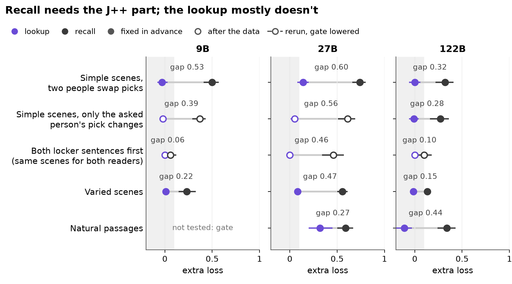
*Fig. 1. Lookup against recall in each row; grey band: not needed. Muse's natural passages: no gap (few lookup switches).*

**Status.** Qwen3.5-9B, Qwen3.6-27B, Qwen3.5-122B-A10B and Muse Glimmer 30B (another family); 26 Oct 2026. All numbers unverified until hand-checked (Section 7). Built at c15015f2 from the run files.

## Setup

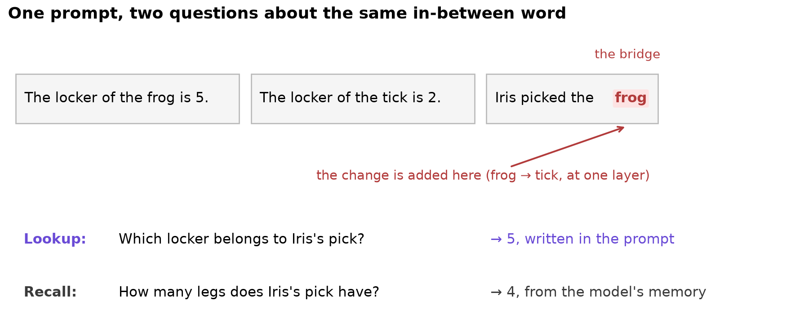

- **Bridge**: the in-between entity, here the item Iris picked (*frog*).
- **Lookup** and **recall**: the lookup asks for the bridge's locker, written in the prompt; the recall asks for a fact about it from memory.
- **The change**: swap the bridge (frog → tick), take the hidden state's difference at the bridge word at one layer, and add it into the original prompt there. A reader **switches** when it gives the swapped bridge's answer.
- **J++ part**: the 25 lens directions that best rebuild the change. We remove it, or as the control a **random part** of the same size.
- **Extra loss**: the share of switches lost without a part minus the share lost without its random part.
- **Gap**: the recall's extra loss minus the lookup's.
- **Fixed in advance**: test, layer, sample and bar committed before any result; **after the data**: chosen after seeing results. Brackets: 95% bootstrap intervals.

## 1. The split: recall needs the lens-readable part; the lookup mostly doesn't

*Fixed in advance (main test; Muse's whole grid); other settings: pass bars set before each run.*

- **What we did.** One layer per model; 200 scenes, then other scene sets and parts.
- **What we found.**
  - The gap is positive wherever measured (table). The strict rule held on the 9B, the 122B and Muse; on the 27B the lookup lost 0.14 [0.08, 0.20] (bar 0.10). In matched scenes (the asked pick is not the bridge's first mention) the gap is smaller.
  - It shrinks outside simple scenes; Muse's stays the largest.
  - On the logit difference instead of switches the gap holds on all four (bar fixed in advance; table).
  - On the 27B the lookup needs J++ once more directions are removed; the others keep the gap at 100 (table).
  - Other parts of a similar size cost the recall less than J++ (Fig. 2).

| Gap | Qwen3.5-9B | Qwen3.6-27B | Qwen3.5-122B | Muse Glimmer 30B |
|---|---|---|---|---|
| Two people swap picks (fixed in advance) | 0.53 [0.42, 0.61] | 0.60 [0.50, 0.69] | 0.32 [0.20, 0.43] | 0.85 [0.68, 0.98] |
| Only the asked person's pick changes | 0.39 [0.30, 0.46] | 0.56 [0.45, 0.65] | 0.28 [0.15, 0.39] | 0.67 [0.53, 0.80] |
| Matched: fresh scenes, both locker sentences first, only the asked pick changes | 0.13 | 0.37 | 0.06° | 0.32 |
| Varied scenes | 0.22 [0.14, 0.31] | 0.47 [0.42, 0.53] | 0.15 [0.12, 0.18] | 0.50 [0.40, 0.61] |
| Natural passages | 0.52 [0.36, 0.68]° | 0.27 [0.13, 0.41] | 0.44 [0.32, 0.58] | recall 0.75 [0.62, 0.86], lookup −0.20 [−0.55, 0.00] (60 passages) |
| More J++ directions removed, 100: gap (27B: lookup's extra loss at 25 / 50 / 100) | 0.54 | 0.12 / 0.30 / 0.60 | 0.55 | 0.85 |
| Logit difference: gap | 0.48 [0.42, 0.53] | 0.47 [0.42, 0.51] | 0.33 [0.29, 0.38] | 0.61 [0.52, 0.68] |
| Logit difference (lookup / recall extra loss) | −0.05 [−0.07, −0.03] / 0.43 [0.37, 0.48] | 0.13 [0.11, 0.16] / 0.60 [0.54, 0.65] | −0.02 [−0.05, −0.00] / 0.31 [0.26, 0.34] | −0.03 [−0.05, −0.02] / 0.58 [0.49, 0.65] |

*°: after the data, the gate lowered to 0.75.*

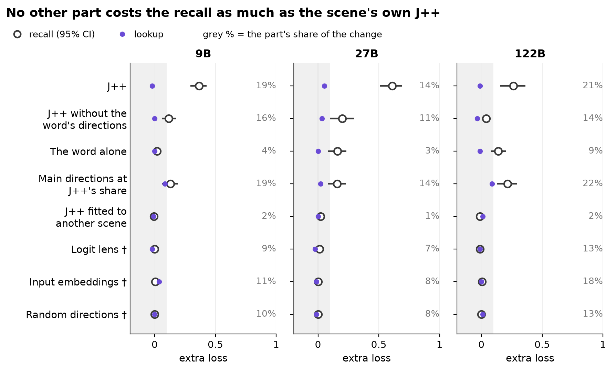
*Fig. 2. †: two people swap picks; others: only the asked pick changes.*

- **Caveat.** On the 122B the main directions at J++'s share cost the recall almost as much as J++ (0.21 [0.13, 0.30] vs 0.26 [0.16, 0.36]).

## 2. What the lookup takes instead: identity or position

*After the data; the routes test fixed in advance.*

- **What we did.** (a) Split lookups by sentence order. (b) Swapped prompts where the item's identity, its locker sentence's position and the locker value predict different lockers (Fig. 3).
- **What we found.**
  - (a) Lookups switch in 76%-89% of locker-first scenes and 9%-19% otherwise; lookup claims here are about locker-first scenes. On the 27B's natural passages the lookup switches mostly when the fact comes first (55 of 75 vs 5 of 62).
  - (b) When another item moved, the lookup follows its identity or its locker sentence's position, never the new value (Fig. 4); the J++ part alone moves none.

| Another item moved | Qwen3.5-9B | Qwen3.6-27B | Qwen3.5-122B° | Muse Glimmer 30B |
|---|---|---|---|---|
| Identity / position | 0.48 [0.43, 0.53] / 0.51 [0.46, 0.56] | 0.66 [0.60, 0.71] / 0.34 [0.28, 0.39] | 0.61 [0.56, 0.67] / 0.38 [0.33, 0.44] | 0.44 [0.38, 0.49] / 0.54 [0.49, 0.60] |
| Identity with only the J++ part | 0.00 [0.00, 0.00] | 0.00 [0.00, 0.00] | 0.00 [0.00, 0.00] | 0.00 [0.00, 0.00] |

*°: after the data, the gate lowered to 0.75.*

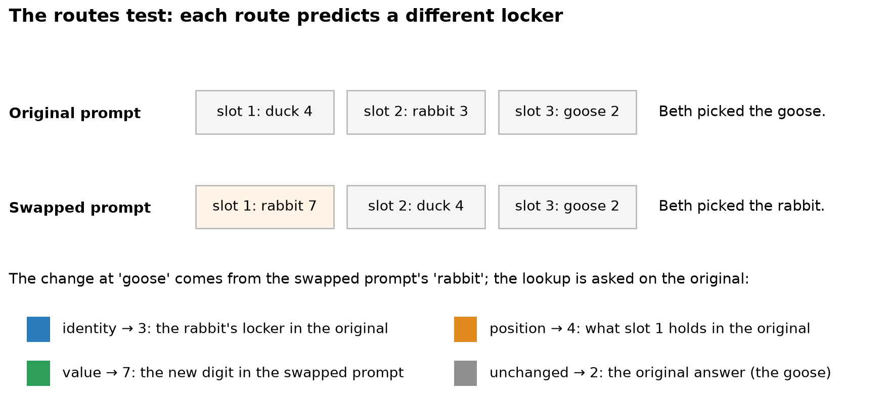
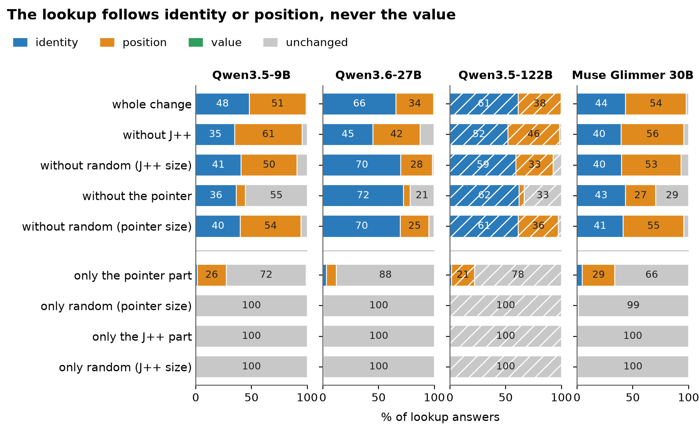
*Fig. 3, Fig. 4. Blue: identity; orange: position; no green (value). Hatched: 122B, after the data, gate 0.75.*

## 3. The pointer: remove it, write it

*Removal after the data (replicated in advance on the 9B and Muse); routes arms and writes fixed in advance; the writes' recall split after the data.*

- **What we did.** (a) Probed the bridge word for which sentence holds the item's locker; removed the 4 **pointer directions** that separate those answers, or added only them. (b) Wrote one fixed vector per slot pair (two slots' mean states' difference) at three doses, against a random direction of the same size.
- **What we found.**
  - (a) The probe is right in 0.92-0.99 of scenes (layout alone: 0.53), almost none of it in J++, and points at the item's first mention, even another person's earlier pick. Removing the pointer directions costs the lookup on every model, the recall less, and cuts position answers; adding only them gives position answers on all but the 27B.
  - (b) At the dose fixed in advance (s = 1) the write moves nothing. Stronger writes send the lookup to the target locker and a random direction does not; when the recall changes under the strongest write, it mostly gives the target slot's item (table, Fig. 8). Muse pending.

| Pointer directions | Qwen3.5-9B | Qwen3.6-27B | Qwen3.5-122B° | Muse Glimmer 30B |
|---|---|---|---|---|
| Lookup's extra loss without them | 0.47 [0.41, 0.53] (replicated) | 0.14 [0.07, 0.22] | 0.31 [0.20, 0.43] | 0.41 [0.34, 0.49] (replicated) |
| Position without them / without a random part of their size | 0.08 [0.05, 0.12] / 0.54 [0.49, 0.59] | 0.06 [0.03, 0.09] / 0.25 [0.19, 0.31] | 0.05 [0.02, 0.07] / 0.36 [0.31, 0.41] | 0.27 [0.23, 0.32] / 0.55 [0.50, 0.60] |
| Write, lookup's target share: s = 1 / 2 / 4; random direction, 4 | 0.02 [0.01, 0.03] / 0.46 [0.42, 0.50] / 0.73 [0.70, 0.77]; 0.00 [0.00, 0.00] | 0.01 [0.00, 0.01] / 0.24 [0.20, 0.29] / 0.50 [0.47, 0.53]; 0.01 [0.00, 0.01] | 0.01 [0.00, 0.01] / 0.50 [0.46, 0.54] / 0.66 [0.63, 0.69]; 0.00 [0.00, 0.01] | not landed |
| Write at s = 4: changed recalls giving the target slot's item | 205 of 256 | 55 of 68 | 211 of 268 | not landed |
| Position with only their part / only a random part of its size | 0.26 [0.20, 0.32] / 0.00 [0.00, 0.00] | 0.09 [0.06, 0.12] / 0.00 [0.00, 0.01] | 0.21 [0.16, 0.26] / 0.00 [0.00, 0.00] | 0.29 [0.25, 0.34] / 0.01 [0.00, 0.03] |

*°: after the data, the gate lowered to 0.75.*

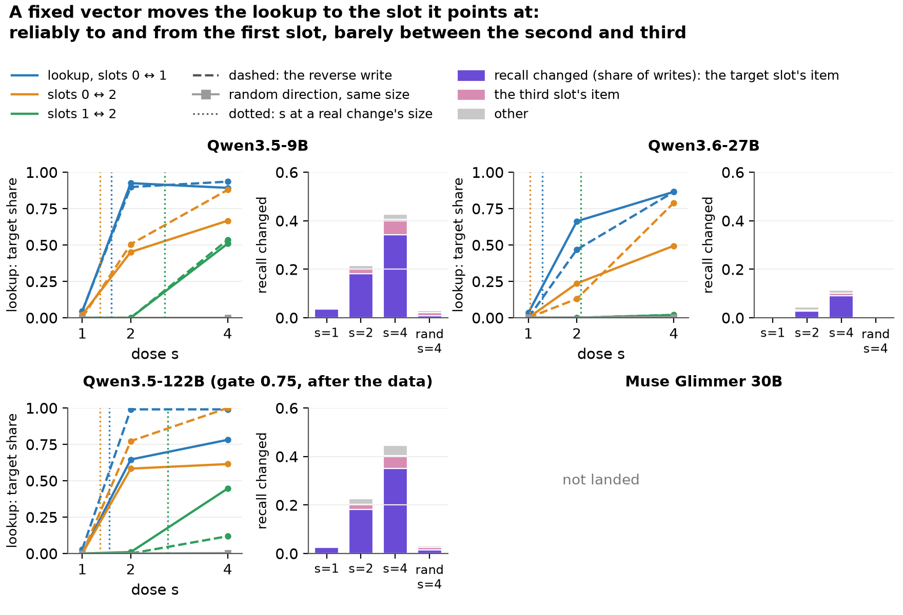
*Fig. 8. The dose fixed in advance (s = 1) moves nothing on any model; s\* marks a real pointer change's size. The real change's pointer part does not move the lookup between slots 1 and 2 either, while the whole change does: our 4 directions miss how the model tells later slots apart.*

## 4. How far the pointer reaches

*After the data, except the transfer bars and the identity direction, fixed in advance.*

- **First sentence.** The pointer directions we found mostly mark whether the item's mention was the prompt's first sentence (Fig. 9a). In the routes test only their part moves the lookup to or from slot 0, not between slots 1 and 2, while the whole change does (Fig. 9b): the position route exists for other places too, mostly outside these directions.
- **Transfer.** Fit on simple scenes and not refit, they cost the lookup 0.05 to 0.15 in varied scenes and 0.07 to 0.25 in natural passages, while the lookup still does not need J++ there (Fig. 10).
- **What is left.** J++ and the pointer directions removed together leave about half of the sanity swap's lookups switching, and cost more than the pointer alone only on the 27B. Adding the item's identity outside J++ leaves fewer, but a random part of the same share removes most switches too (Fig. 6, table). About half of the route around the lens is still unexplained. The recall needs identity on the 27B and Muse, not the 9B.
- **A pointer found without slot labels** is pending on three models.

| Pointer directions, by where the item sits | Qwen3.5-9B | Qwen3.6-27B | Qwen3.5-122B | Muse Glimmer 30B |
|---|---|---|---|---|
| Lookup's extra loss without them: first sentence / first locker, not first / neither | 0.66 (n 41) / 0.23 (n 22) / 0.33 (n 9) | 0.24 (n 37) / 0.05 (n 20) / 0.00 (n 13) | 0.52 (n 25) / 0.21 (n 19) / 0.00 (n 10) | 0.51 (n 39) / 0.14 (n 21) / 0.00 (n 7) |
| Same, first sentence minus the rest | 0.40 [0.18, 0.60] | 0.21 [0.05, 0.35] | 0.38 [0.21, 0.56] | 0.41 [0.25, 0.59] |
| Only their part's switch rate, first sentence minus the rest | 0.46 [0.31, 0.64] | 0.16 [0.04, 0.31] | 0.07 [−0.16, 0.32] | 0.23 [0.09, 0.39] |
| Routes, only their part: moves from or to slot 0 / 1 → 2 and 2 → 1 | 0.10 to 0.76 / 0.00 / 0.00 | 0.00 to 0.44 / 0.00 / 0.00 | 0.15 to 0.47 / 0.00 / 0.00 | 0.16 to 0.69 / 0.04 / 0.16 |
| Routes, the whole change: 1 → 2 / 2 → 1 | 0.53 / 0.78 | 0.24 / 0.38 | 0.40 / 0.35 | 0.49 / 0.71 |
| Varied scenes, lookup's extra loss without them | 0.11 [0.08, 0.13] | 0.05 [0.04, 0.06] | 0.06 [0.04, 0.07] | 0.15 [0.11, 0.19] |
| Same: prose / json / table | 0.16 / 0.02 / 0.07 | 0.09 / 0.01 / 0.03 | 0.07 / 0.06 / 0.04 | 0.21 / 0.05 / 0.12 |
| Natural passages (the fact before the bridge) | not tested (gate) | 0.07 [0.00, 0.18] | 0.07 [−0.02, 0.16] | 0.25 [0.00, 0.50] |
| Sanity swap, both removed minus the pointer alone | 0.12 [0.04, 0.19] | 0.26 [0.19, 0.32] | 0.09 [0.03, 0.16]° | 0.03 [−0.03, 0.08] |
| Lookups still switching: J++ and the pointer removed | 0.46 [0.41, 0.50] | 0.53 [0.48, 0.57] | 0.50 [0.45, 0.55]° | 0.74 [0.68, 0.79] |
| Same, with identity outside J++ / its random part | 0.07 [0.04, 0.11] / 0.38 [0.33, 0.43] | 0.18 [0.13, 0.22] / 0.67 [0.62, 0.72] | not run | 0.52 [0.47, 0.58] / 0.82 [0.76, 0.88] |
| Recall's extra loss without identity | 0.09 [0.04, 0.15] | 0.44 [0.34, 0.55] | not run | 0.39 [0.28, 0.49] |
| Switches lost: pointer + J++ minus pointer + random | −0.08 [−0.11, −0.04] | 0.23 [0.18, 0.27] | 0.00 [−0.02, 0.03]° | 0.01 [−0.02, 0.03] |

*°: after the data, the gate lowered to 0.75 (the routes and sanity-swap rows of the 122B).*

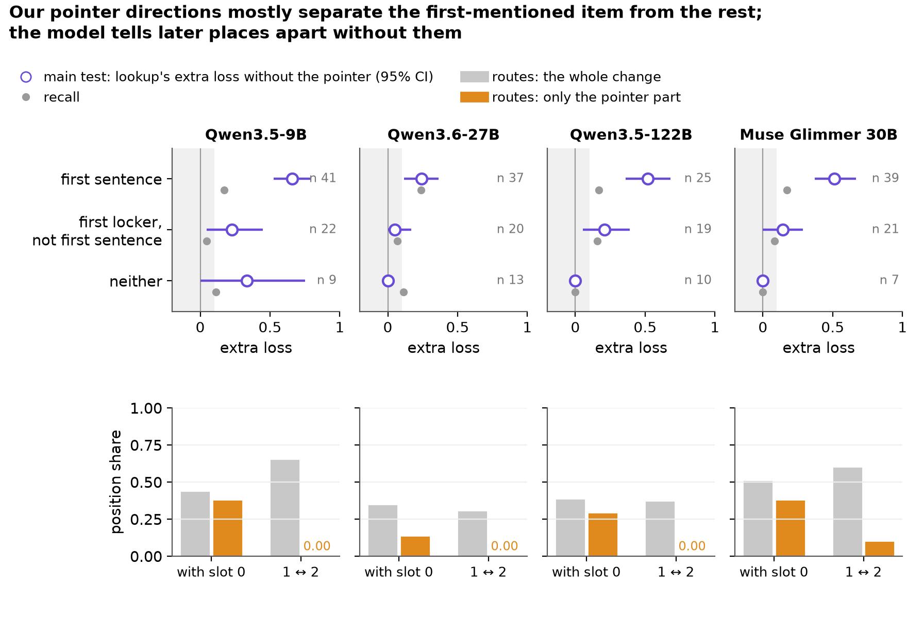
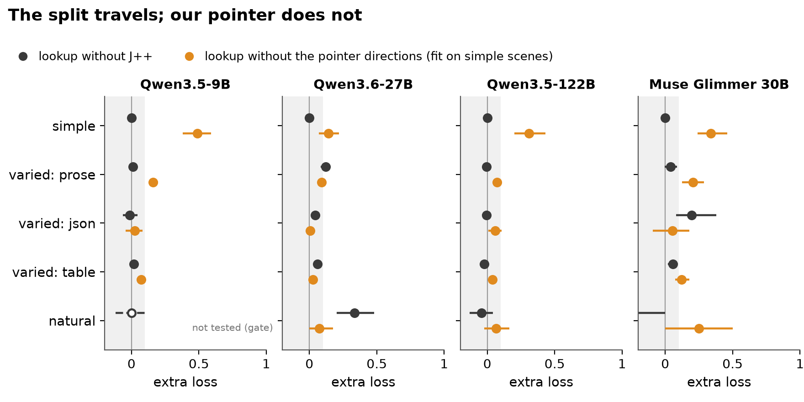
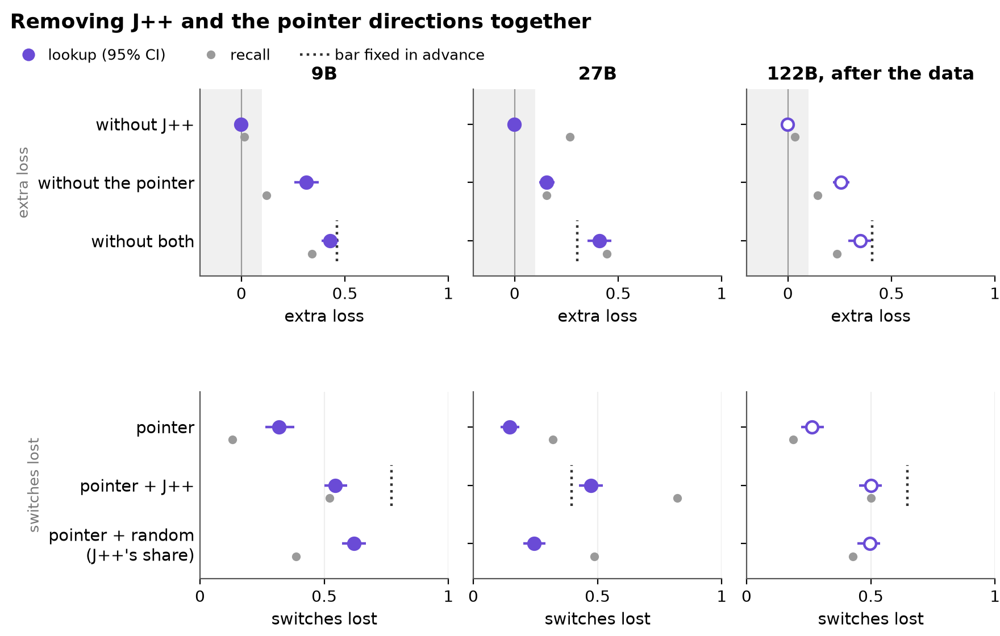
*Fig. 9, Fig. 10, Fig. 6. Fig. 6: dots against dotted bars; grey: recall; each part's share of the change on its bar.*

## 5. Depth (candidate)

*Candidate, after the data; the routes test's layers fixed in advance (Muse's two layers too).*

- **What we found.**
  - Early, the lookup follows identity only; without J++ the Qwens give the original answer (table). Position appears by layer 12 (9B), 28 (27B), 33 (122B), 26 (Muse); the rule fixed in advance holds on the 9B only.
  - The recall needs J++ most where the pick is the bridge's first mention (table below; the full table in [docs/x0_details.md](docs/x0_details.md)).
- **Caveat.** On the 27B the lookup stops needing J++ at layer 24, four layers before position answers appear (28).
- **Muse.** At L26 the whole change moves only 35%-43% of lookups; L34 not tested (no lookup switched).

| Early layer, another item moved | Qwen3.5-9B (L6) | Qwen3.6-27B (L16) | Qwen3.5-122B (L27)° | Muse Glimmer 30B (L13) |
|---|---|---|---|---|
| Identity share | 1.00 [1.00, 1.00] | 1.00 [1.00, 1.00] | 1.00 [1.00, 1.00] | 0.96 [0.93, 0.98] |
| Without J++: the original answer | 0.99 [0.97, 1.00] | 0.99 [0.98, 1.00] | 0.84 [0.78, 0.89] | 0.26 [0.20, 0.31] |

| Swap | Pick is the first mention? | Qwen3.5-9B lookup | Qwen3.5-9B recall | Qwen3.6-27B lookup | Qwen3.6-27B recall | Qwen3.5-122B lookup | Qwen3.5-122B recall | Muse Glimmer 30B lookup | Muse Glimmer 30B recall |
|---|---|---|---|---|---|---|---|---|---|
| Two people swap picks | yes | *−0.21 [−0.43, −0.05]; 19 switches* | 0.65 [0.57, 0.73] | *0.11 [0.00, 0.40]; 9 switches* | 0.81 [0.71, 0.91] | *0.08 [0.00, 0.23]; 13 switches* | 0.41 [0.26, 0.54] | *−0.30 [−0.44, 0.00]; 10 switches* | 0.80 [0.65, 0.92] |
| Two people swap picks | no | 0.01 [−0.04, 0.07] | 0.35 [0.26, 0.43] | 0.14 [0.07, 0.22] | 0.67 [0.58, 0.76] | −0.01 [−0.08, 0.06] | 0.20 [0.10, 0.30] | −0.07 [−0.12, −0.02] | 0.68 [0.46, 0.88] |
| Only the asked person's pick changes | yes | *−0.11 [−0.29, 0.10]; 19 switches* | 0.57 [0.47, 0.67] | *0.33 [0.10, 0.60]; 12 switches* | 0.73 [0.58, 0.86] | *0.00 [0.00, 0.00]; 14 switches* | 0.40 [0.25, 0.54] | *−0.10 [−0.29, 0.00]; 10 switches* | 0.76 [0.64, 0.87] |
| Only the asked person's pick changes | no | 0.00 [0.00, 0.00] | 0.17 [0.11, 0.23] | 0.01 [0.00, 0.04] | 0.49 [0.39, 0.60] | −0.01 [−0.07, 0.04] | 0.10 [0.03, 0.17] | 0.00 [0.00, 0.00] | 0.54 [0.32, 0.75] |

*°: gate 0.75; J++ extra loss, after the data; italics: under 30 lookup switches (count shown).*

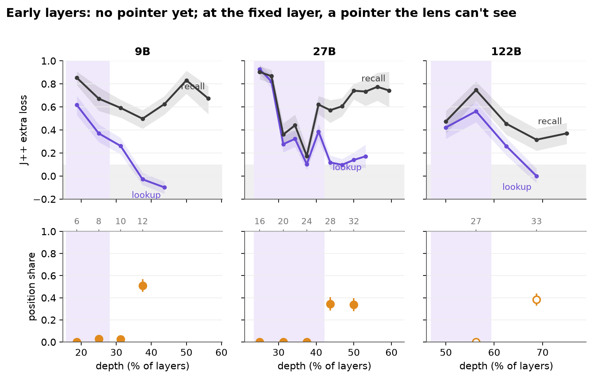
*Fig. 5. Shaded where the lookup still needs J++ (at least 0.30); Muse: the main test at layers 8-32 (after the data).*

## 6. What did not hold

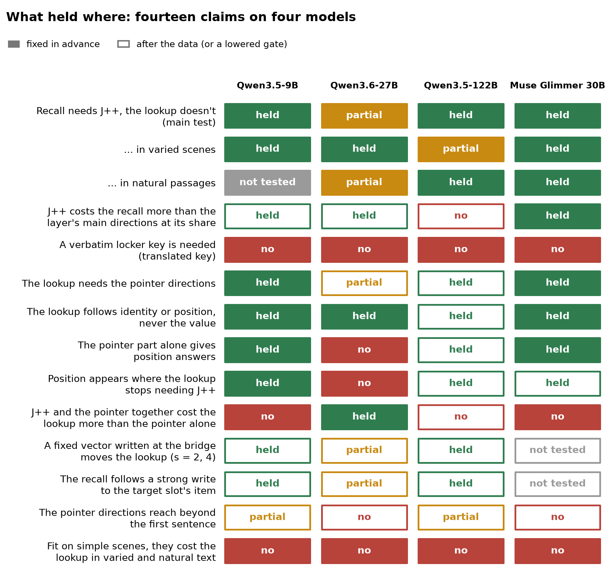
*Fig. 7. Filled: fixed in advance; open: after the data or a lowered gate.*

- **Failed when fixed in advance.**
  - The 27B's strict rule: lookup lost 0.14 [0.08, 0.20] (bar 0.10).
  - The 9B's replication: its J++ clause failed (recall 0.12 [0.06, 0.19]).
  - The positive control (chemical symbols) stayed below its 0.20 bar: 27B 0.15 [0.10, 0.19].
  - Removing the identity direction alone cut the identity route on the 27B only.
  - Gates missed (bar 0.80), not tested: the 9B's natural passages (lookup 0.78), the 122B's routes (recall 0.797) and replication (recall 0.77); reruns at 0.75 are descriptive.
- **Design errors.**
  - The write's dose fixed in advance, s = 1, was below a real change's size on every pair (s needed: 9B 1.36 to 2.70; 27B 1.04 to 2.08; 122B 1.37 to 2.76; Muse 1.12 to 2.30).
  - The bar for J++, the pointer and identity removed together was out of reach at their share: the random part alone removes most switches on the Qwens.
- **Limits.**
  - The pointer directions are fit on 5 slot labels and carry mostly first-vs-rest; the code for later slots is not captured (per-move table).
  - The locker number at the bridge word: never the answer; digit directions cost 0.00.
  - One-token answers and bridges; the reader is confounded with the answer's source (prompt vs memory). The 122B in FP8.
  - Zach's knock-out finds the split weak outside Qwen; our change-removal finds it on Muse.

## 7. How we checked

- **Hand-checked numbers.** None yet ([docs/review_summary.md](docs/review_summary.md)); [docs/verify_pack.md](docs/verify_pack.md) recounts each claim's numbers from the per-item files.
- **Raw examples.** `make review-serve`: random items per claim (fixed seed), as the model saw them.
- **Predictions.** Committed before results are opened, then scored ([predictions/](predictions/README.md)): mean Brier 0.34 over 102 answers, worse than always answering 50%; the mechanistic questions were mostly wrong.
- **Inventory.** [docs/inventory.md](docs/inventory.md): pre-pivot experiments are kept and labelled legacy.

## 8. Related work and what is new

Language models bind an entity to its attributes in context (Feng & Steinhardt 2023) and track entities through pointer-like mechanisms (Prakash et al.); the order of bound entities lives in a low-dimensional subspace (Dai et al. 2024). Two-hop recall resolves its bridge early (Biran et al. 2024). Our routes test sets identity, position and value against each other as in Gur-Arieh et al. (2025); the pointer directions are mass-mean directions (Marks & Tegmark 2023); a part that moves an answer when added alone can mislead (Makelov et al. 2023), so every part has a random part of its size beside it. The lens is the workspace paper's J++ (Gurnee et al. 2026). New here: two readers of one word need different parts of it, the lens-readable part only for recall; our pointer directions mostly mark the first sentence; one fixed vector steers the lookup.

## 9. Next

- **Running now.** Muse's transfer and writes; a pointer found without slot labels.
- **Follow-up: answers by sampling**, not the top token.
- **Follow-up: the routes and pointer tests without the chat template.**
- **Follow-up: OLMo checkpoints**, to see when in training the pointer appears.
- **Later.** New datasets; intermediates in reasoning traces; DeepSeek-V4-Flash (about four H200s or native FP4; its lens's residual stream unnamed).

## Appendix A. Links

Every number on this page comes from [figures/story/data.csv](figures/story/data.csv) (also every plotted number) and [docs/x0_numbers.json](docs/x0_numbers.json), each with its source file; [docs/x0_details.md](docs/x0_details.md) has the full tables; [docs/verify_pack.md](docs/verify_pack.md) recounts them. Earlier figures: [figures/status_2026-10-25/](figures/status_2026-10-25/).
