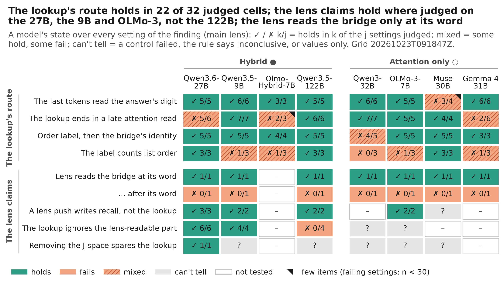
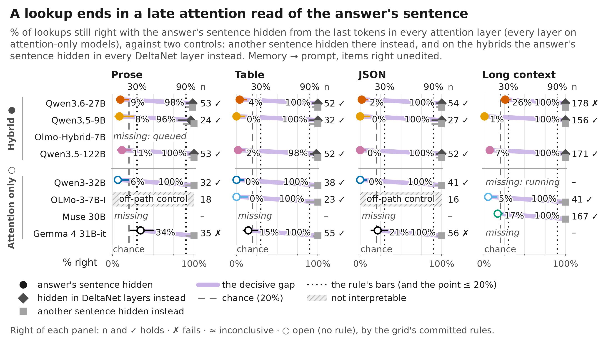
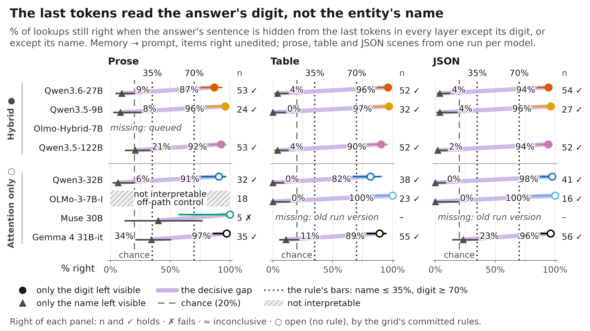
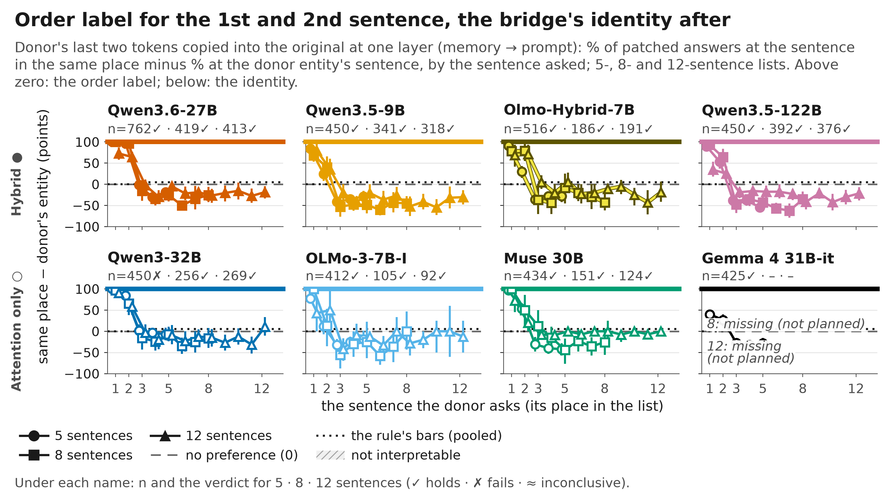
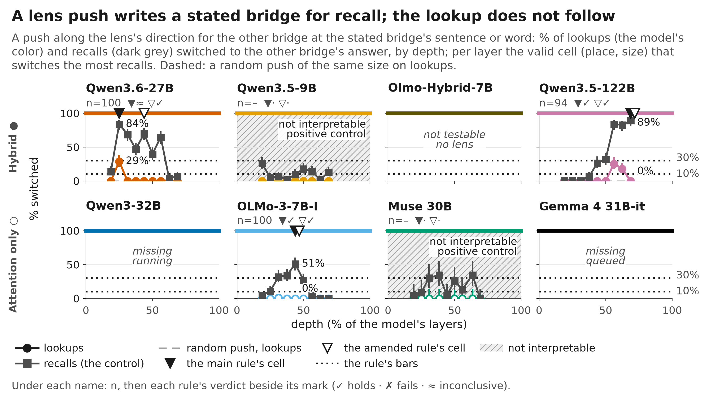
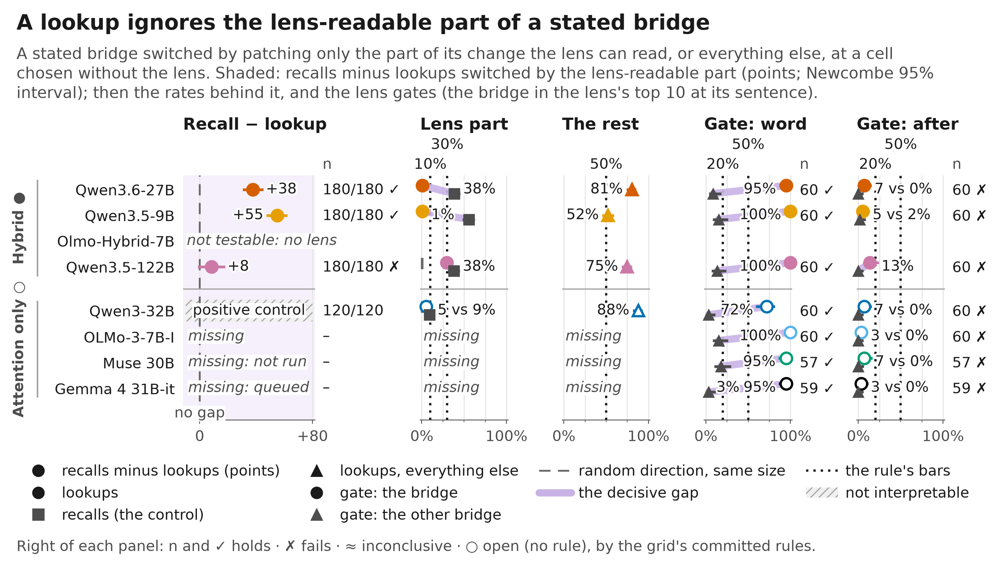

<!-- Generated by scripts/readme_build.py from docs/README.template.md and grid.csv; edit the template. -->
# bridge-jspace

**The question.** A two-step question makes a model find an entity in between, the **bridge**, and then use it. A **J-lens** reads hidden states as words. Does the model use the bridge in the form the lens reads, or by another route?

> "Which locker belongs to the animal known for oinking?" The bridge is *pig*. The answer is the pig's locker number, stated in the prompt.

**How to read this page.** Confidence words follow one fixed rule ([below](#confidence-and-verification)): strong, medium, open. "Verified" says who recomputed a number: a person, an independent agent, or nobody yet. Every number comes from the cross-model grid ([grid.md](results/cross_model/20261023T105852Z/grid.md)); every run is in [RUNS.md](RUNS.md).

> **Status, 23 Oct 2026.** Built at 1bf9685 from `results/cross_model/20261023T105852Z`. Exploration phase: no main claim is hand-verified yet. An independent agent recomputed claims 1-3, and claim 6 on the 27B, from raw rows: every cell matches. The hand check is today. Running on the A100: Gemma 4's lens tests, Qwen3-32B's tables and JSON, the 27B dose control. The one open counter-example is [the 122B](#the-open-counter-example-qwen35-122b).

Eight models. Hybrids, which mix attention with DeltaNet layers: Qwen3.6-27B (27B), Qwen3.5-9B (9B), Olmo-Hybrid-7B (Olmo-Hybrid), Qwen3.5-122B (122B). Attention-only: Qwen3-32B (32B), OLMo-3-7B (OLMo-3), Muse 30B (Muse), Gemma 4 31B (Gemma).

## Words

| Word | Meaning |
|---|---|
| bridge | The entity found in the first step: "the animal known for oinking" → pig |
| lookup / recall | The answer comes from a sentence in the prompt / from the model's memory |
| J-lens, J-space | A tool that reads hidden states as words ([Gurnee et al. 2026](https://transformer-circuits.pub/2026/workspace/index.html)) / the part of a hidden state it reads |
| lens-readable part | The part of a change in hidden states that lies in the J-space |
| lens push | Adding the lens's direction from one word to another (pig → cow) to a hidden state |
| patch | Copying hidden states from another prompt into this one, at chosen tokens and one layer |
| blocking | Stopping chosen tokens from attending to one sentence |
| last tokens | The tokens between the question and the answer: the chat template's closing tokens and "Answer:" (7-11 tokens). Claim 3 patches only the last two |
| positive control | A place where a method is known to work, so that a null result elsewhere means something |
| scene set | A fresh batch of generated prompts with new lists and entities, drawn with a fixed seed |

## Main claims

| Claim | Evidence | Holds on | Confidence | Verified | Details |
|---|---|---|---|---|---|
| **How a lookup works** | | | | | |
| The last tokens read the answer's sentence late, through attention, and take its digit | Blocking that read leaves 7% right on the 27B (chance 20%) | 5 of 8 models; Gemma, 27B long text, Olmo-Hybrid tables | medium | [agent re-check](verification/agent_check_finding4.md), [and](verification/agent_check_finding3.md) | [1](#1-the-last-tokens-read-the-answer-late-through-attention) · [2](#2-they-take-the-answers-digit-not-the-entitys-name) |
| An order label picks the 1st and 2nd sentence; the bridge's identity picks the rest | On the 27B the label leads by +94 / +18 points (1st-2nd / later) | 7 of 8 models; 32B mixed | medium | [agent re-check](verification/agent_check_finding5.md) | [3](#3-an-order-label-picks-the-1st-and-2nd-sentence-the-bridges-identity-the-rest) |
| **What the J-space does and doesn't carry** | | | | | |
| The lens reads a stated bridge only at its own word | On the 27B: 95% at the word, 7% right after it | 7 of 7 lensed models | medium | none | [4](#4-the-lens-reads-a-stated-bridge-only-at-its-own-word) |
| A lens push at the bridge's word writes recall, never the lookup | On the 122B: 0% of lookups move, 89% of recalls | 4 of 5 models with a valid test | medium | none | [5](#5-a-lens-push-at-the-bridges-word-writes-recall-never-the-lookup) |
| The lens-readable part of a stated bridge moves recall, not the lookup | On the 27B it moves 38% of recalls and 1% of lookups; on the 122B, 29% of lookups | 2 of 4 models; fails on the 122B | medium | [agent re-check](verification/agent_check_finding2.md) (27B) | [6](#6-the-lens-readable-part-of-a-stated-bridge-moves-recall-not-the-lookup) |
| Lookups don't need the J-space; how much recall needs it varies | Zach's rule on the 27B: recall loses +36 points more than lookups | 4 of 4 in Zach's runs; ours descriptive | medium | none | [7](#7-lookups-dont-need-the-j-space-recall-does-to-a-varying-degree) |

Every cell, its n and its interval: [grid.md](results/cross_model/20261023T105852Z/grid.md).

## The open counter-example: Qwen3.5-122B

- **What we saw.** On the 122B, the lens-readable part of a stated bridge moves 29% of lookups and 38% of recalls. So at that point there is no lookup/recall split.
- **Where.** The test point is the whole prompt at layer 24 of 48, chosen by a lens-free map. A lens push at the bridge's word, layer 33, moves 0% of lookups.
- **Explanation 1: late binding.** The split appears later in depth than on the smaller models. The test at layer 24 is simply too early.
- **Explanation 2: a real difference.** In the largest model, the lookup does use the lens-readable form.
- **Also possible.** The 122B runs in FP8, while its lens was fit on bf16 weights.
- **The planned test** (rule fixed before the run): the same test at layers 30, 33 and 36, with a random part of the same size as a control. Late binding holds if the lens part goes quiet on lookups (upper bound ≤ 5%), stays quiet later, and still moves recalls. The claim fails on the 122B if the lens part moves at least 20% of lookups at every later point.

## Findings

### 1. The last tokens read the answer late, through attention

**Confidence:** medium (holds 5 of 8; 27B: long context fails; Olmo-Hybrid: table (24 items) fails, 2 can't tell; Gemma: scene set 1, scene set 2, prose, JSON fail). **Verified:** [agent re-check](verification/agent_check_finding4.md), every cell matches; hand check pending.

**What we did**
- Stopped the last tokens from attending to the answer's sentence, in every attention layer.
- Counted the answers still right, against guessing among the list's digits.

| Model | Setting | Result [95% CI] | n | Verdict | All settings |
|---|---|---|---|---|---|
| Qwen3.6-27B | scene set 2 | 7% [5, 11] | 300 | holds | 5 of 6 hold; long context: fails |
| Qwen3.5-9B | scene set 2 | 1% [0, 3] | 300 | holds | 7 of 7 hold |
| Olmo-Hybrid-7B | scene set 2 | 7% [3, 14] | 100 | holds | 2 of 5 hold; prose (14 items): can't tell (a control failed); table (24 items): fails; JSON (14 items): can't tell (a control failed) |
| Qwen3.5-122B | scene set 2 | 5% [3, 8] | 300 | holds | 6 of 6 hold |
| Qwen3-32B | scene set 2 | 3% [2, 6] | 299 | holds | 7 of 7 hold |
| OLMo-3-7B | scene set 2 | 0% [0, 4] | 100 | holds | 5 of 7 hold; prose (18 items): can't tell (a control failed); JSON (16 items): can't tell (a control failed) |
| Muse 30B | scene set 2 | 1% [0, 3] | 300 | holds | 4 of 5 hold; prose (5 items): can't tell (a control failed) |
| Gemma 4 31B | scene set 2 | 22% [17, 27] | 300 | fails | 2 of 6 hold; scene set 1: fails; scene set 2: fails; prose: fails; JSON: fails |

**Controls**
- Another sentence blocked instead keeps 89-100% right.
- On the hybrids, blocking the DeltaNet layers instead keeps 88-100% right.

**Weak spots**
- The bar is the guessing rate, so a lookup that drops to chance but not below fails the rule.
- The long text is neutral filler, not a real document. A natural-text test is designed and waits for approval.

**What it means.** On every model the lookup ends in an ordinary attention read of the answer's sentence.

### 2. They take the answer's digit, not the entity's name

**Confidence:** medium (holds 7 of 8; Muse: prose (5 items) fails). **Verified:** [agent re-check](verification/agent_check_finding3.md), every cell matches; hand check pending.

**What we did**
- Hid part of the answer's sentence from the last tokens: everything except its name, or everything except its digit.

| Model | Setting | Result [95% CI] | n | Verdict | All settings |
|---|---|---|---|---|---|
| Qwen3.6-27B | scene set 2 | 10% [7, 14] | 300 | holds | 5 of 5 hold |
| Qwen3.5-9B | scene set 2 | 1% [0, 3] | 300 | holds | 6 of 6 hold |
| Olmo-Hybrid-7B | scene set 2 | 10% [6, 17] | 100 | holds | 3 of 5 hold; prose (14 items): can't tell (a control failed); JSON (14 items): can't tell (a control failed) |
| Qwen3.5-122B | scene set 2 | 7% [5, 10] | 300 | holds | 5 of 5 hold |
| Qwen3-32B | scene set 2 | 4% [2, 7] | 199 | holds | 6 of 6 hold |
| OLMo-3-7B | scene set 2 | 0% [0, 4] | 100 | holds | 5 of 6 hold; prose (18 items): can't tell (a control failed) |
| Muse 30B | scene set 2 | 1% [0, 3] | 299 | holds | 3 of 4 hold; prose (5 items): fails |
| Gemma 4 31B | scene set 2 | 29% [24, 34] | 300 | holds | 6 of 6 hold |

**Controls**
- With the digit left visible instead, the 27B keeps 88% right.
- Hiding the same parts of another sentence keeps 86-100% right.

**Weak spots**
- Gemma's split is weaker than the others'.
- Why the question's words read the name is not tested.

**What it means.** The last tokens fetch the answer's digit; the name is looked up earlier.

### 3. An order label picks the 1st and 2nd sentence, the bridge's identity the rest

**Confidence:** medium (holds 7 of 8; 32B: scene set 1 fails). **Verified:** [agent re-check](verification/agent_check_finding5.md), every cell matches; hand check pending.

**What we did**
- Two prompts list the same entities in a different order. We patched the last tokens from one into the other at one layer.
- Each possible answer is a different digit, so the answer shows what the patched tokens pointed to.
- Rule fixed in advance: the place must win for the 1st and 2nd sentence; the identity must tie or win after that.

| Model | Setting | Result [95% CI] | n | Verdict | All settings |
|---|---|---|---|---|---|
| Qwen3.6-27B | scene set 2 | +94 / +18 points | 307 / 460 | holds | 5 of 5 hold |
| Qwen3.5-9B | scene set 2 | +51 / +43 points | 167 / 283 | holds | 5 of 5 hold |
| Olmo-Hybrid-7B | scene set 2 | +52 / +35 points | 209 / 317 | holds | 4 of 4 hold |
| Qwen3.5-122B | scene set 2 | +64 / +41 points | 170 / 280 | holds | 5 of 5 hold |
| Qwen3-32B | scene set 2 | +82 / +12 points | 179 / 268 | holds | 4 of 5 hold; scene set 1: fails |
| OLMo-3-7B | scene set 2 | +51 / +26 points | 150 / 243 | holds | 5 of 5 hold |
| Muse 30B | scene set 2 | +79 / +30 points | 174 / 266 | holds | 5 of 5 hold |
| Gemma 4 31B | scene set 2 | +24 / +28 points | 164 / 262 | holds | 3 of 3 hold |

The numbers are two leads in points: place over identity for the 1st-2nd sentence, identity over place for the rest.

**How the label counts (open).** With a filler sentence moved, the label follows the order in the list on 7 of 8 models. With one sentence more or fewer, it does so on 3 of 8.

**Weak spots**
- One layer per model; the 27B's was chosen after its first runs.
- The identity lead is modest on the larger Qwens.

**What it means.** This matches lookback work in the middle of the list and differs at its end. It also holds when the bridge is recalled.

### 4. The lens reads a stated bridge only at its own word

**Confidence:** v1 holds on 7 of 7 lensed models, v2 fails on 7 of 7. **Verified:** none.

**What we did**
- Read the stated bridge with the lens, one test at its own word (v1) and one right after it (v2).
- Every lens is a J++ fit: published ones, Zach's, and our own for the 32B and OLMo-3. Other lenses are listed beside in grid.md.
- Pass: the bridge in the lens's top 10 on at least half of the items, the other bridge on at most a fifth.

| Model | Setting | Result [95% CI] | n | Verdict | All settings |
|---|---|---|---|---|---|
| Qwen3.6-27B | at its word | 95% [86, 98] | 60 | holds | 1 of 2 hold; after its word: fails |
| Qwen3.5-9B | at its word | 100% [94, 100] | 60 | holds | 1 of 2 hold; after its word: fails |
| Qwen3.5-122B | at its word | 100% [94, 100] | 60 | holds | 1 of 2 hold; after its word: fails |
| Qwen3-32B | at its word | 72% [59, 82] | 60 | holds | 1 of 2 hold; after its word: fails |
| OLMo-3-7B | at its word | 100% [94, 100] | 60 | holds | 1 of 2 hold; after its word: fails |
| Muse 30B | at its word | 95% [86, 98] | 57 | holds | 1 of 2 hold; after its word: fails |
| Gemma 4 31B | at its word | 95% [86, 98] | 59 | holds | 1 of 2 hold; after its word: fails |

Not tested: Olmo-Hybrid (no lens).

**Controls**
- The other bridge in the same scene reaches the top 10 on 0-18% of items.

**Weak spots**
- One run per model.

**What it means.** "The lens-readable part" in claims 5 and 6 is the bridge word's form at its position.

### 5. A lens push at the bridge's word writes recall, never the lookup

**Confidence:** medium (holds 4 of 5; Muse: main rule, amended rule can't tell). **Verified:** none.

**What we did**
- Pushed the hidden state at the stated bridge's word or sentence toward another animal's word, over layers and sizes.
- Picked the test point on recall alone, then read the lookups there.

| Model | Setting | Result [95% CI] | n | Verdict | All settings |
|---|---|---|---|---|---|
| Qwen3.6-27B | main rule, scene set 2 | 0% [0, 4] | 100 | holds | 3 of 4 hold; main rule: can't tell (the rule's own) |
| Qwen3.5-9B | main rule, scene set 2 | 0% [0, 4] | 100 | holds | 2 of 4 hold; main rule: can't tell (a control failed); amended rule: can't tell (a control failed) |
| Qwen3.5-122B | main rule | 0% [0, 4] | 94 | holds | 2 of 2 hold |
| OLMo-3-7B | main rule | 0% [0, 4] | 100 | holds | 2 of 2 hold |
| Muse 30B | main rule | – | – | can't tell (a control failed) | 0 of 2 hold; main rule: can't tell (a control failed); amended rule: can't tell (a control failed) |

Not tested: Olmo-Hybrid (no lens), 32B (still running), Gemma (still running).

**Controls**
- A random push of the same size moves 0% of lookups.
- Questions whose bridge is not on that sentence must not move (at most 10%).

**Weak spots**
- One topic and strong pushes, up to eight times a typical change.
- On the 27B's first scene set the rule picked an early layer, where the lookup moved too.

**What it means.** From about a third of the depth on, the lens writes a stated bridge for recall, and the lookup ignores it.

On the 27B, the full patch keeps moving lookups 8 layers after the lens push stops ([figure](figures/cross_model/f_layer_gap_lens_vs_patch_27b.png); its own run, not a grid cell). A size-matched control is running.

### 6. The lens-readable part of a stated bridge moves recall, not the lookup

**Confidence:** medium (holds 2 of 4; 122B: scene set 2, table, JSON fail; 32B: scene set 1 can't tell). **Verified:** [agent re-check](verification/agent_check_finding2.md) on the 27B, every cell matches; hand check pending.

**What we did**
- Changed the stated bridge (Jack's pet: cow → pig) and pasted back one part of the change: the lens-readable part, or the rest.
- The test point comes from a lens-free map. The lens-readable part must move recall there, or the test can't tell.

| Model | Setting | Result [95% CI] | n | Verdict | All settings |
|---|---|---|---|---|---|
| Qwen3.6-27B | scene set 2 | 1% [0, 3] | 180 | holds | 4 of 4 hold |
| Qwen3.5-9B | scene set 2 | 1% [0, 3] | 180 | holds | 3 of 3 hold |
| Qwen3.5-122B | scene set 2 | 29% [23, 36] | 180 | fails | 0 of 3 hold; scene set 2: fails; table: fails; JSON: fails |
| Qwen3-32B | scene set 1 | 5% [2, 10] | 120 | can't tell (a control failed) | 0 of 1 hold; scene set 1: can't tell (a control failed) |

Not tested: Olmo-Hybrid (no lens), OLMo-3 (too few usable scenes), Muse (too few usable scenes), Gemma (still running).

**Controls**
- The lens-readable part moves recall (9-66% across models and settings): it is not inert.
- The rest moves 52-96% of lookups.
- A random part of the same size moves 0-1% of lookups and 0-8% of recalls.

**Also:** a lens push at the same point writes 0% of lookups on the 27B, and 29% on the 122B.

**Weak spots**
- The 122B fails; see [the counter-example](#the-open-counter-example-qwen35-122b).
- On the 27B and 9B a random part of the same size moves lookups as little as the lens part does. So the claim is the contrast, not "the lens part is special for lookups".

**What it means.** On the 27B and 9B, the lens-readable part moves recall far beyond its size, and lookups not at all. The lookup takes the stated bridge from the rest.

### 7. Lookups don't need the J-space; recall does, to a varying degree

**Confidence:** medium (holds 1 of 2; OLMo-3: animal suite can't tell). **Verified:** none.

**What we did**
- Zach's test: knock out the lens's top directions at a middle band of layers. His rule: chains ending in a recall must lose more than chains ending in a lookup.
- Our test, descriptive: remove the whole J-space while the bridge forms; count recalls and lookups still right.

| Model | Setting | Result [95% CI] | n | Verdict | All settings |
|---|---|---|---|---|---|
| Qwen3.6-27B | Zach's tasks, his rule | +36 points | 506 | holds | 1 of 2 hold; animal suite: no rule (values only) |
| Qwen3.5-9B | animal suite | +14 points [+1, +30] | 400 | no rule (values only) | no rule |
| Qwen3.5-122B | animal suite | +10 points [+0, +22] | 400 | no rule (values only) | no rule |
| Qwen3-32B | animal suite | +9 points [+0, +19] | 400 | no rule (values only) | no rule |
| OLMo-3-7B | animal suite | +28 points [+16, +41] | 400 | can't tell (a control failed) | 0 of 1 hold; animal suite: can't tell (a control failed) |
| Muse 30B | animal suite | +10 points [+3, +18] | 400 | no rule (values only) | no rule |

Not tested: Olmo-Hybrid (no lens), Gemma (still running).

**Zach's runs, quoted from his plan (one scene set; not on his pushed branch):** the recall-minus-lookup gaps are 36, 38, 22 and 7 points on 27B, 9B, 32B and Muse. Lookups lose at most 13 points.

**Why the two tests differ.** His cut is smaller and chosen on held-out items; ours removes the whole J-space. His tasks score points lost; ours score answers still right.

**What it means.** Lookups don't need the J-space on any model tested. Recall needs it on the hybrid Qwens, less on the 32B, barely on Muse.

## Confidence and verification

**Confidence rule** (fixed before the grid was opened). Strong: holds on three or more models of both kinds, on two scene sets for two of them, with no failing cell. Open: fails on as many models as it holds on. Medium: everything else. Cells with fewer than 30 items are marked "too few items"; their verdicts are unchanged.

**Verification marks.** Hand: a person recomputed it from raw rows ([VERIFIED.md](VERIFIED.md)). Agent re-check: an independent agent recomputed it ([verification/](verification/)). None: agent analysis only.

## Boring explanations we checked

| Explanation | Test | Result | Status |
|---|---|---|---|
| The lens-readable part is just small | Paste a random part of the same size instead | It moves 0-1% of lookups and 0-8% of recalls, so the lens part's effect on recall is not its size | checked |
| FP8 weights vs a lens fit on bf16 (122B) | None yet | – | open |
| A weak lens | Lens gate and held-out word-reading score per lens ([lens table](results/cross_model/20261023T105852Z/grid.md)) | A better fit passes the gate on the 32B, but the 32B's recall control still fails | partly checked |
| The patch only shifts position | A random patch of the same size | Clean on all models but Gemma, in runs before 23 Oct (not in the grid) | checked, outside the grid |
| The patch copies any digit | Each answer is a different digit; the test layer is where the patched prompt's own digit is still rare | By design | checked |
| A lookup at chance vs below chance | The rule's bar is the guessing rate of a five-item list | Gemma and the 27B's long text stop at chance. Tables and JSON list three facts, so chance there is 33%; the bar was kept, which is stricter there | reported |
| One scene set | Claims 1-3 on three scene sets; the lens push on two | Same verdicts across sets | partly checked |

## Choices made after seeing the data

| Choice | When | Why | What we did |
|---|---|---|---|
| Claim 3: split by the asked sentence | 21 Oct | The pooled test was mixed | Confirmed as a fixed rule on fresh scene sets |
| Claim 3: layer 50 on the 27B | 21 Oct | Chosen after its first runs | Repeated on two more scene sets |
| Claim 5: a second rule from about a third of the depth on | 22 Oct | The first rule picked an early layer | Both rules reported; the first stays the main one |
| Claim 1: the first scene set judged by the rule fixed for the second | 22 Oct | The first runs used an older rule | Accepted by Dan |
| Claim 1: "at chance" for a lookup that drops to guessing, not below | 23 Oct | The bar is the guessing rate | Footnoted, the verdict unchanged |
| The lens gate after the word (v2) | 22 Oct | v1 read sat on the bridge's own word | Added before any v2 run |
| Our J++ fits as the main lens (32B, OLMo-3) | 23 Oct | The plain J-lens fails the 32B's gate | Other lenses listed beside, never switched in |
| Claim 7: our removal shown with an interval | 23 Oct | It has no committed rule | Shown as descriptive |
| Gemma's stated-bridge runs: fewer scenes than planned | 23 Oct | Misaligned scenes are skipped | Recorded as a deviation |
| "Too few items" for cells under 30 | 23 Oct | Small cells decided labels | Display only; verdicts unchanged |
| The label's counting read by setting | 23 Oct | The settings disagree | Both reported |

Older choices and the full wording: [CHANGELOG.md](CHANGELOG.md).

## Next steps

Only steps that change a claim or its confidence.

| Step | What it decides | Rule fixed? | Cost | Status | Owner |
|---|---|---|---|---|---|
| Hand check of claims 1-3 and 6 (27B) | Their "verified" mark | – | 1-2 hours | Packets ready: [verification/](verification/) (claim, recompute script, checklist) | Dan, Zach |
| A random part of the same size for claim 6 | Whether "the lens part is special" or only the lookup/recall contrast holds | yes | CPU | Done: the contrast is the claim | agent |
| The 122B late-binding test | Claim 6 on the largest model | yes | 1.5 GPU-hours, a rented H200 | Waits for a box and Dan's predictions | agent |
| Claim 1 on natural text | Whether the late read holds beyond generated lists | being written | ~4 GPU-hours | Design waits for approval | agent |
| The layer gap on the 9B | Whether claim 5's gap is general | yes | ~1 GPU-hour | Waits for Dan's predictions | agent |
| Slides | – | – | – | After the checks | Dan |

Timeline: update to Neel on Sat 24 Oct; write-up Wed-Fri 28-30 Oct.

## Links

[grid.md](results/cross_model/20261023T105852Z/grid.md) · [RUNS.md](RUNS.md) · [CHANGELOG.md](CHANGELOG.md) · [predictions and scorecard](predictions/) · [VERIFIED.md](VERIFIED.md) · [docs/mapping.md](docs/mapping.md) · [docs/datasets.md](docs/datasets.md) · [DEVELOPER.md](DEVELOPER.md) · [run log](EXPERIMENTS.md) · [plan (Google Doc)](https://docs.google.com/document/d/1bqqdXePTUXQGlowVjk73sPfJkbV_tsu0RNNX-BiTYUc/edit?usp=drivesdk) · [older README with every number](README_archive.md)
