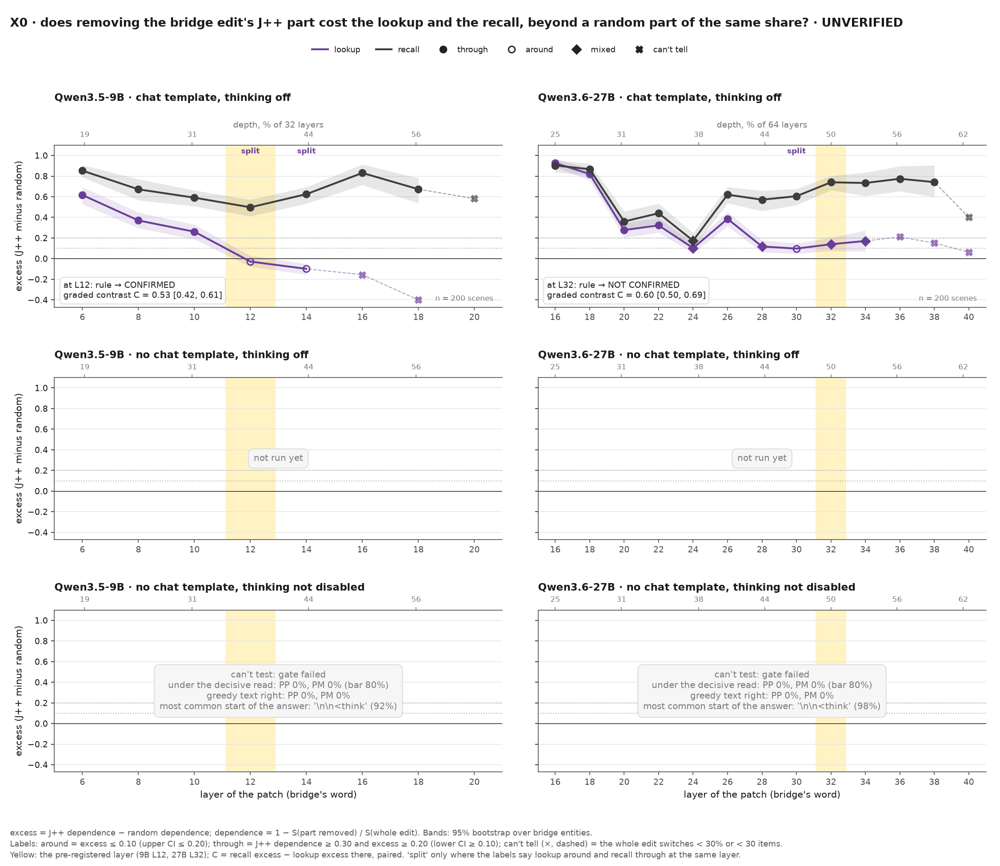
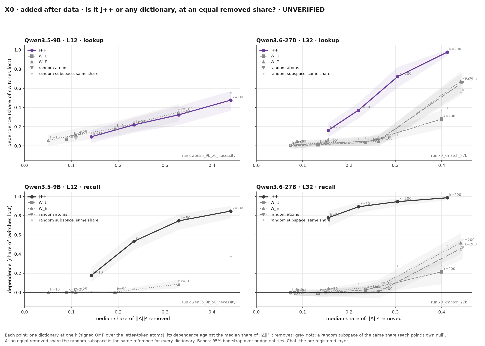
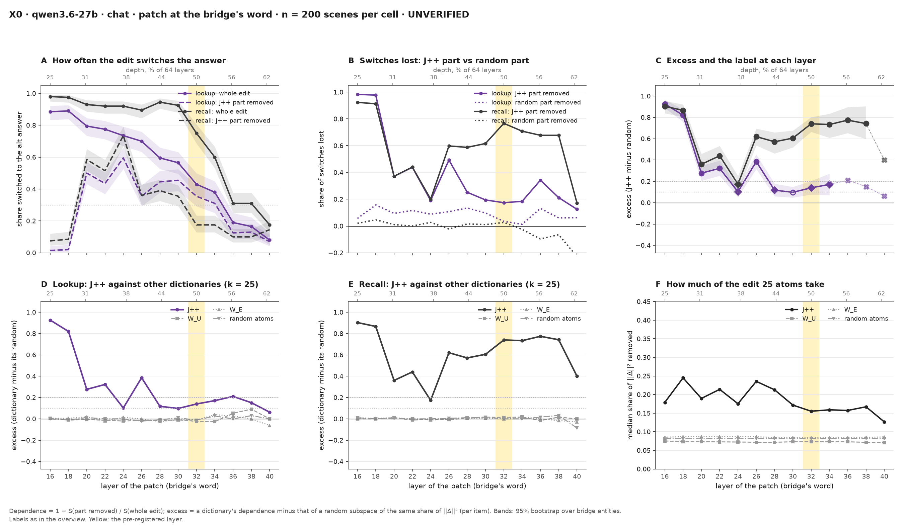
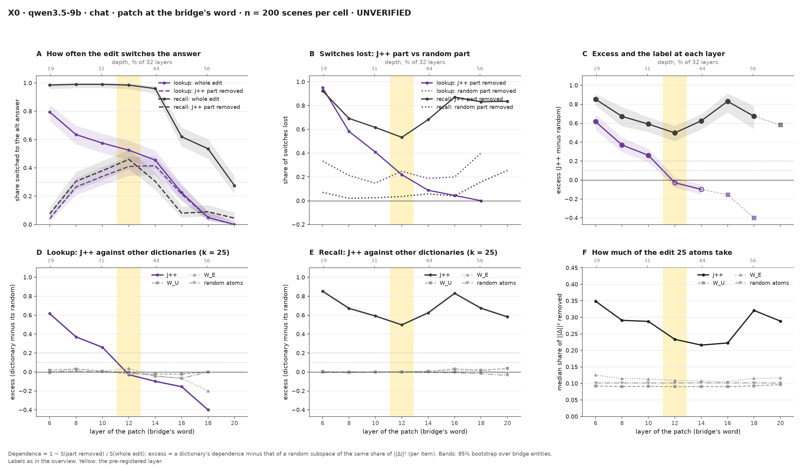

<!-- Generated by scripts/readme_build.py from docs/README.template.md and grid.csv; edit the template. -->
# bridge-jspace

**The question.** A two-step question makes a model find an entity in between, the **bridge**, and then use it. A **J-lens** reads hidden states as words; the **J-space** is the part of a hidden state it reads (Gurnee et al. 2026; we use its refit, **J++**). Does the model use the bridge in the form the lens reads, or by another route?

> "Iris picked the frog. The locker of the frog is 5. ..." The bridge is *frog*. A **lookup** ("Which locker belongs to Iris's pick?") takes the answer from a sentence in the prompt; a **recall** ("How many legs does Iris's pick have?") takes it from memory.

> **Status, 24 Oct 2026, evening.** Built at b204e075 from the X0 run files. This page is the first experiment of the direction, X0 (pre-registered 24 Oct; [jobs/c3/X0.md](jobs/c3/X0.md)), and the plan it led to. Numbers are quoted from the run files (linked). Exploration phase: nothing here is hand-verified (UNVERIFIED). Models: Qwen3.6-27B and Qwen3.5-9B, hybrids with DeltaNet layers. The earlier claims (the late read, order then identity) are in [CHANGELOG.md](CHANGELOG.md).

## TL;DR

- **Recalls need the J-space form more than lookups do.** Remove the J++-readable part of an edit of the bridge, at a depth fixed in advance. Recalls lose most of their switches; lookups lose little more than to a random part of the same size. The graded contrast is 0.60 [0.50, 0.69] on the 27B and 0.53 [0.42, 0.61] on the 9B.
- **It is about J++.** The logit lens's directions (W_U), the input embeddings (W_E) and random atoms do nothing comparable, also at a similar removed share.
- **The categorical version is model-dependent.** "Lookups do not use the J-form" is confirmed on the 9B (layer 12) and not confirmed on the 27B (layer 32): there the lookup uses J++ too, less.
- **Next**: what the lookup uses instead, and what decides the route (X2', X4, X1, X3), as graded reader comparisons.

## The experiment: X0

**What we did.**
- **Scenes.** Fresh scenes (600, seed 24, never read by a model before), one question per reader.
- **The edit.** The asked person's pick is changed (frog → tick), and the change Δ = h_alt − h_org is pasted at the bridge's word at one layer. It goes in three ways: whole; without its J++ part (25 atoms, signed OMP); or without a random part of the same share of ‖Δ‖².
- **Readers.** The lookup and the recall read the identical patched prompt, because the question comes after the patch. A difference is therefore in what the reader uses, not in the edit.
- **Measures.**
  - J-dependence = the share of switches lost without the part.
  - Excess = J-dependence − the random part's dependence.
  - Graded contrast C = recall excess − lookup excess (paired).
- **Pre-registration.** The rule and the layers (27B 32, 9B 12) were fixed before the run. Dan's predictions were committed before any result was opened.

**Key numbers** (n = 200 scenes per cell, CIs over 44 bridge entities). Sources: [27B verdict](results/x0_necessity/x0_necessity_27b_chat/verdict-20261024T135446Z/verdict.md), [9B verdict](results/x0_necessity/qwen35_9b_x0_necessity/verdict-20261024T135419Z/verdict.md), [27B tables](results/x0_necessity/x0_necessity_27b_chat/descriptive-20261024T135952Z/tables.md), [9B tables](results/x0_necessity/qwen35_9b_x0_necessity/descriptive-20261024T135953Z/tables.md).

| Model, layer | Lookup excess (label) | Recall J-dependence (label) | Rule | Contrast C |
|---|---|---|---|---|
| 27B, 32 | 0.14 [0.08, 0.20] (mixed) | 0.77 [0.67, 0.84] (through) | **not confirmed** | 0.60 [0.50, 0.69] |
| 9B, 12 | −0.03 [−0.08, 0.03] (around) | 0.53 [0.45, 0.61] (through) | **confirmed** | 0.53 [0.42, 0.61] |

- **In switches** (27B, layer 32):
  - removing J++ takes lookups from 86 to 71 of 200 and recalls from 150 to 35;
  - removing the random part takes them to 83 and 146.
- **Specific to J++.**
  - At 25 atoms, W_U, W_E and random atoms leave both readers "around" at every layer (27B excess within ±0.03).
  - At equal removed shares (27B layer 32, 25 to 200 atoms of each dictionary; [tables](results/x0_necessity/x0_kmatch_27b/descriptive-20261024T142650Z/tables.md)), at about a quarter of ‖Δ‖² the costs to lookups / recalls are:
    - J++ (100 atoms, share 0.305): 0.72 / 0.95;
    - W_E (share 0.264): 0.05 / 0.07;
    - random atoms (share 0.264): 0.06 / 0.01.
  - At about 0.4 every dictionary costs both readers (W_E 0.67 / 0.52), but only J++ costs more than a random subspace of the same share (excess 0.58 / 0.50; the others ≤ 0.12).
  - A rerun on recomputed items reproduces layer 32 (lookup excess 0.12, recall 0.77).
  - On the 9B (layer 12, about a third of ‖Δ‖²; [tables](results/x0_necessity/qwen35_9b_x0_kmatch/descriptive-20261024T143539Z/tables.md)), the costs to lookups / recalls are:
    - J++ (50 atoms, share 0.329): 0.31 / 0.74;
    - W_E (share 0.329): 0.34 / 0.09;
    - random atoms (share 0.323): 0.38 / 0.07.
  - So on the 9B, the lookup's cost does not depend on the dictionary and the recall's is J++-specific. On the 27B both are J++-specific, the lookup's less.
- **The split** (lookup "around" and recall "through" at the same layer): 27B layer 30; 9B layers 12-14.

**Controls**
- A random part at each dictionary's own share.
- The random dictionary's own fit.
- Both readers on the identical patch.
- A valid cell needs the whole edit to switch at least 30% and 30 items.
- A hardware gate reran a 23 Oct cell on the new box: 0.99 per-row agreement.

**Weak spots**
- **The 27B's lookup uses J++ too, only less.** With more atoms its excess rises (0.30 at 50 atoms, 0.60 at 100), while the 9B's lookup stays around (−0.03, −0.08).
- **Share tracks lookup dependence.** Across layers, the lookup's J-dependence tracks the share of ‖Δ‖² that J++ takes: 27B Pearson 0.54, Spearman 0.79 over 10 valid layers. The recall's does not (0.03). On the 9B, share and depth fall together. Added after data ([figure](figures/x0_necessity/share.png)).
- **The whole edit fades for lookups** with depth (27B: 0.89 at layer 16, 0.43 at 32), not for recalls (0.98, 0.75).
- **The alt changes a second pick.** On the items where the asked pick comes first, the 27B's lookups switch 24% at layer 32 ("can't tell"); recalls are unchanged. Added after data ([figure](figures/x0_necessity/asked_first.png)).
- **On the 9B, "around" means no J-specific cost, not no cost.** J++ and a random part of the same share each cost its lookups 0.12-0.13 of switches.
- **The 27B's categorical result depends on the position set.** Patching every context position at layer 32 (the 23 Oct cell, rerun on the fresh scenes with the 23 Oct code and filter; added after data):
  - lookups switch 84% with the whole change and 87% without J++, so they lose nothing;
  - recalls go from 77% to 36%; the random part costs them −1 point, so the difference is +42 [+34, +50] points (n = 180; [verdict](results/d1_verdict/x0_ctx_parts_27b_20261024-144050/verdict.md)).
  - At the bridge's word alone, the lookup is "mixed".
- **Without the chat template, neither model can be tested by the rule.**
  - **No chat template, thinking not disabled** (raw text): both models open a think block (gate 0%).
  - **No chat template, thinking off** (the template's empty think block added by hand): they answer in markdown or in words (" **6**", " **Seven**"), so the first-token read is right on 0% / 0% (9B) and 63% / 90.5% (27B) of lookups / recalls.
  - A descriptive arm that reads the first digit is running (amendment 3).

Per-model detail figures and the 23 Oct reading that X0 tested

- **The 23 Oct reading was post hoc.** The split depth was read per layer after a pre-registered rule failed ([27B](results/d1_verdict/d1_necessity_parts_27b_r2_20261023-164424/verdict.md), [9B](results/d1_verdict/qwen35_9b_d1_necessity_parts_r2_20261023-162800/verdict.md)). Its 27B headline (lookups 83% → 81%, recalls 78% → 27% at layer 32) was every context position, not the bridge's word. On the fresh scenes that cell repeats (84% → 87%, 77% → 36%; weak spots above).
- **Convergent evidence (Zach, quoted).** Knocking out the lens's top directions costs recall more points than lookups, on held-out bands chosen with lookups excluded.

## What X0 led to: what does the lookup use instead?

Each candidate for the lookup's route has one test. The rules are graded reader comparisons (D3 amendment, 24 Oct, after X0) and are committed to each spec before its run.

| Candidate | Test | Rule (fixed before the run) | Status |
|---|---|---|---|
| The bridge's input-token identity | X0's W_E dictionary | W_E lookup excess ≥ 0.20 | not supported: W_E is inert for both readers |
| Where the final fact sits, or whether the model knows it | X2': the same question with the final fact made up in the passage, true in the passage, recalled, or recalled with the answer present | r = (excess_K − excess_lookup) / (excess_M − excess_lookup): ≤ 0.33 where it sits, ≥ 0.67 what it knows; can't tell if the denominator < 0.30 | first (Zach's natctl scenes; 144 of 256 pass the token checks) |
| A verbatim-match shortcut | X4: the key stated verbatim, translated, or described | lookup excess, translated − verbatim: ≥ 0.20 verbatim, ≤ 0.10 not lexical; control: described − verbatim ≥ 0.20 | first, with X2' |
| The J-form rebuilt downstream | X1: among lookups that still switch without J++ at layer 32, remove the rebuilt J++ part over layers 33-44 | share lost minus the random part's: ≥ 0.20 rebuilding matters, ≤ 0.10 it does not | next |
| Generated lists only | X3: paired readers on natural passages (natplus) | C ≥ 0.30 with lower bound ≥ 0.15 holds; ≤ 0.10 fails | last (Zach has natural-text evidence) |
| A scene-relative address (order label) | the slot subspace removed (23 Oct) | – | open: not necessary (98% of lookups kept) |

**Running now** (descriptive, added after data): the first-digit read without the chat template, thinking off (27B, 9B).

## Boring explanations

| Explanation | Test | Result | Status |
|---|---|---|---|
| The J++ part is just small | A random part of the same share removed | Recalls lose 0.03 to it at the 27B's layer 32, 0.77 to J++ | checked |
| The edit differs between lookups and recalls | The identical patch at the bridge's word | By design | checked |
| Any token-aligned part would do | W_U, W_E and random atoms at 25 atoms; W_E at an equal share | All "around" at every layer; at equal shares only J++ costs the recall more than a random subspace (27B, 9B) | checked on the 27B and the 9B |
| The chat template | No chat template, with thinking not disabled / off | Can't test: a think block, or answers in markdown | open: first-digit read running |
| The alt's second changed pick | The asked-first subset | Recalls unchanged; the 27B's lookups switch less | partly checked |
| The lookup's layer profile is the J++ share | J-dependence against share across layers | 27B lookups track it (Spearman 0.79); recalls do not | open |

## Choices made after seeing the data (24 Oct; log in [jobs/c3/X0.md](jobs/c3/X0.md))

| Choice | Why | What we did |
|---|---|---|
| X1-X4 run on the 27B although X0 did not confirm it (D3 amendment) | The categorical premise failed there, but the graded contrast is large and J++-specific | X1-X4 become reader comparisons at layer 32 under graded rules; the X0 verdict stays "not confirmed" |
| A "no chat template, thinking off" arm (amendment 2) | Without the template thinking is not disabled: raw prompts open a think block | Descriptive; it failed its gate too (markdown answers) |
| A first-digit read without the gate (amendment 3) | Answers start with " **" or a word | Descriptive, labeled; chat stays the verdict |
| Descriptive tables and figures (the critic's requests) | To check share, absolute drops, the upstream change, equal shares | Labeled "added after data", outside the rule |

## Pre-registered tests and Dan's predictions

| Test | Rule fixed before the run | Verdict | Dan's prediction |
|---|---|---|---|
| X0, 27B at layer 32 | lookup excess ≤ 0.10 and recall J-dependence ≥ 0.30; killed if excess ≥ 0.20 or recall < 0.20 | not confirmed | confirmed, 80%: wrong |
| X0, 9B at layer 12 | the same | confirmed | confirmed, 80%: right |
| The 27B's layer-32 cell is valid for both readers | the whole edit switches ≥ 30% and ≥ 30 items | both valid (lookups 43%) | only recalls, 80%: wrong |
| W_E removal (H-token) | W_E lookup excess ≥ 0.20 with J++'s around | 9B: neither; 27B: not applicable (J++'s lookup mixed) | neither, 90%: right / wrong |
| W_U removal | both readers around | both models | inert, 90%: right |
| No chat template, thinking not disabled: gate | ≥ 80% for both readers | fails on both | both pass, 80%: wrong |
| No chat template, thinking off: gate (amendment 2) | the same | fails on both | both pass, 80%: wrong |

Batch 25 is scored question by question in [predictions/2026-10-24_dan.md](predictions/2026-10-24_dan.md) (Brier and calibration from batch 25 on: [predictions/README.md](predictions/README.md)).

## Next steps

| Step | Decides | Cost |
|---|---|---|
| X2' (natctl, four final hops) and X4 (verbatim / translated / described key): specs with the graded rules, Dan's predictions, runs | where the route is set; whether "around" is lexical | ~1 h data + ~3 GPU-h |
| X1: remove the rebuilt J++ form over layers 33-44 (27B) and 13-24 (9B) | whether the lookup re-reads a rebuilt J-form | ~1 GPU-h |
| X3: paired readers on natural passages | whether the contrast holds beyond generated lists | ~1.5 GPU-h |
| Hand check of the X0 cells at the predicted layers | the "verified" mark | 1 h, Dan |

Methods and words

| Word | Meaning |
|---|---|
| J++ | The refit J-lens used everywhere here (pinned per model, sha256 checked on load) |
| part | The 25-atom signed OMP fit of a change Δ over a dictionary's letter-token atoms |
| random part | Δ projected on a random subspace keeping the part's share of ‖Δ‖², per item |
| J-dependence | 1 − (switched without the part) / (switched by the whole edit) |
| excess | J-dependence − the random part's dependence |
| around / through / mixed | excess ≤ 0.10 (upper CI ≤ 0.20) / J-dependence ≥ 0.30 and excess ≥ 0.20 (lower CI ≥ 0.10) / the rest |
| can't tell | The whole edit switches < 30% or < 30 items of a reader |
| graded contrast C | recall excess − lookup excess on the same items, paired bootstrap over entities |
| split | lookup around and recall through at the same layer |
| renderings | chat = chat template, thinking off (the run key `chat`); no chat template, thinking off = the template's empty think block added by hand, no roles, no instruction (key `nochat`); no chat template, thinking not disabled = raw text (key `raw`) |
| read | Chat: the top token after "Answer:" and a space is the alt answer's first token |

Prior work: the workspace paper (Gurnee et al. 2026); two-hop recall resolves its bridge early (Biran et al. 2024): [docs/prior_art.md](docs/prior_art.md).

## Links

[jobs/c3/X0.md](jobs/c3/X0.md) · [X0 runs](results/x0_necessity/) · [figures](figures/x0_necessity/) · [predictions](predictions/) · [CHANGELOG.md](CHANGELOG.md) · [STATUS.md](STATUS.md) · [prior work](docs/prior_art.md) · [VERIFIED.md](VERIFIED.md) · [DEVELOPER.md](DEVELOPER.md) · [HISTORY.md](HISTORY.md)
