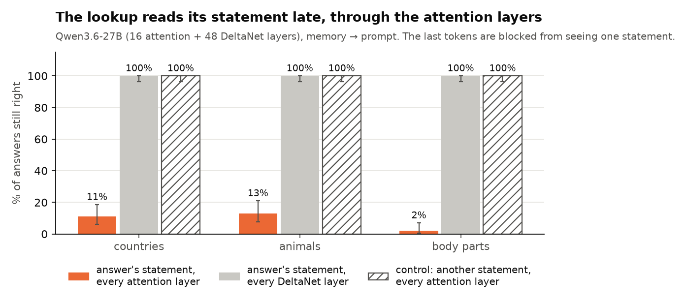
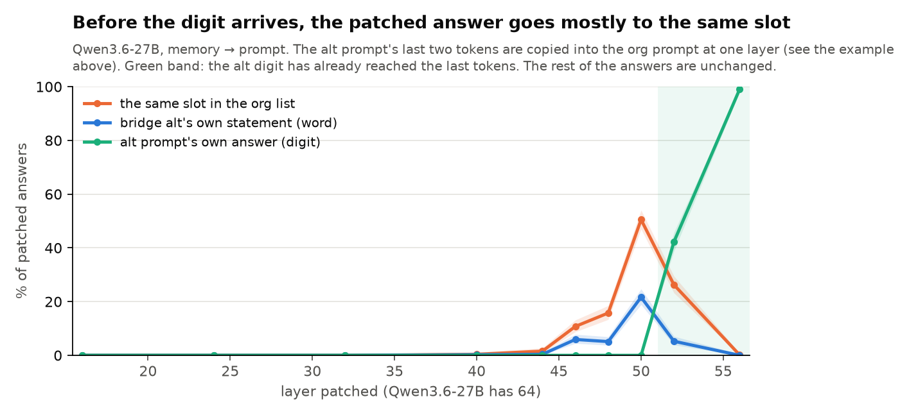
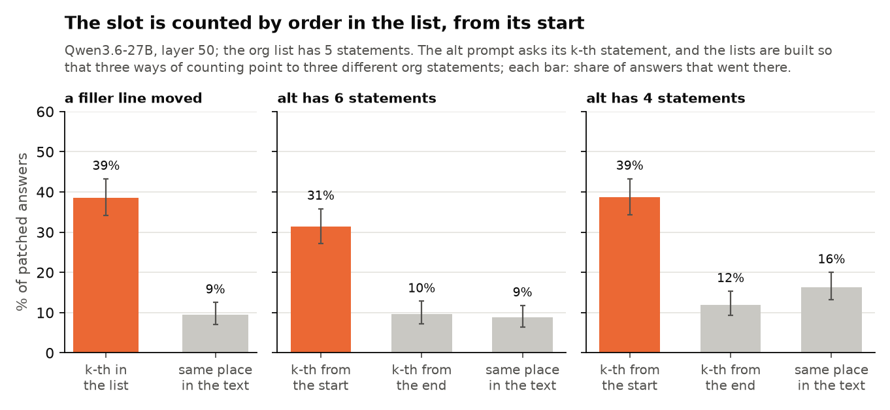
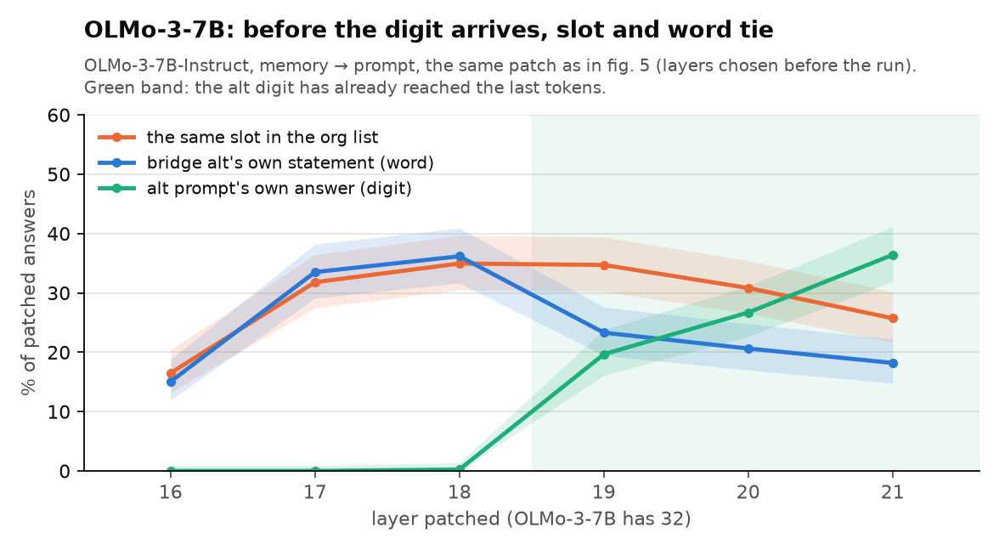

# bridge-jspace

Does a model use the words a lens can read in its hidden state, or something else? We test this on two-hop
questions in open models: Qwen3.6-27B first, then Qwen3.5-9B, OLMo-3-7B (and its training stages), Qwen3-32B and
Gemma 4 31B-it.

**Status: exploration.** Only the rows marked *verified* have been checked by a human ([VERIFIED.md](VERIFIED.md));
none of Dan's D-results is there yet. Everything else is an agent's recount of raw outputs and may change; "high" /
"medium" below rate the strength of that unverified evidence. The four headline Qwen3.6-27B runs (figs. 2-5) rerun
from a clean checkout reproduce item by item (99.8-100% of rows identical): the pipeline is deterministic, which is
not the same as the analysis being right.

[Full write-up and old tables](README_archive.md) · [run log](EXPERIMENTS.md) ·
[Dan's predictions vs results](jobs/predictions/) · [plan (Google Doc)](https://docs.google.com/document/d/1bqqdXePTUXQGlowVjk73sPfJkbV_tsu0RNNX-BiTYUc/edit?usp=drivesdk)
· [how to run](DEVELOPER.md)

## The question

In a two-hop question the model first finds a **bridge**, then uses it to get the **answer**:

> "Which locker belongs to the animal known for oinking?" → bridge: *pig* → answer: *the pig's locker number*.

The **J-lens** (Gurnee et al. 2026, [Verbalizable Representations Form a Global Workspace](https://transformer-circuits.pub/2026/workspace/index.html))
reads hidden states as words. The part of the hidden state it reads is the **J-space**. In Claude, the bridge acts
on the answer through the J-space. **Is that also true in open models, and if not, what carries the bridge instead?**

## Words used on this page

We name each kind of question by **where the bridge comes from → where the answer comes from**:

| Name | Example (context: "Jack's pet is a cow. … The cow's locker is 5.") | Bridge | Answer |
|---|---|---|---|
| prompt → prompt | Which locker belongs to Jack's pet? | stated | stated |
| memory → prompt | Which locker belongs to the animal known for mooing? | recalled | stated |
| prompt → memory | How many legs does Jack's pet have? | stated | recalled |
| memory → memory | How many legs does the animal known for mooing have? | recalled | recalled |
| named → prompt | Which locker belongs to the cow? | named in the question | stated |

- **Lookup** = the answer comes from the prompt. **Recall** = the answer comes from the model's memory.
- **Org / alt prompt**: two versions of a prompt that differ in the bridge. We copy hidden states from the alt prompt
  into the org prompt ("patching") and see which answer comes out.
- **Lens-readable part** of a hidden-state change: the piece made of J-lens word directions.
- **Slot**: the place of a statement in the list (1st, 2nd, …).

## What we see so far

| # | Pattern | How sure | Evidence |
|---|---|---|---|
| 1 | **Recall goes through the J-space; a lookup in the prompt goes around it.** | **High** on Qwen3.6-27B (partly *verified*); other models: see the table below | Verified B1-B3; Zach's three measures (fig. 1) |
| 2 | **The lens reads what the model has, not what it uses.** A stated bridge is read by the lens, but its lens-readable part does nothing for a lookup. | **High** on Qwen3.6-27B (partly *verified*), in prose and in Python code | Verified B4; D1 (fig. 2), D1 in code; Zach's C2 descriptive shows the same split by another method |
| 3 | **An early lens push changes *which entity is recalled*, not the lookup.** | **Medium-high**: pre-registered, one dataset, 2 wordings | D4 (fig. 3) |
| 4 | **A lookup reads the answer's statement late, from the last tokens, through attention layers** (not DeltaNet), spread over many heads. | **High**, and it holds on every model tested so far (3 of 3: two Qwen hybrids and OLMo with its training stages) | D2 (figs. 4, 10) |
| 5a | **Just before that, the last tokens carry a label for "the first" or "the second" statement.** Patched in, it moves the answer to the org prompt's 1st or 2nd statement. | **High** in the data: 1st statement 90-100% on every model, 2nd 89-97% on the larger Qwens and 54-58% on the smaller models; a second data seed, 8-statement lists and named bridges give the same; one post-hoc layer per model | D3 (figs. 5, 14) |
| 5b | **From the 3rd statement on, the bridge word steers the lookup instead.** | **High** in the data: for statements 3-5 the patched answer follows the alt bridge's own statement (27-54%) at least as often as the slot (2-31%), on every model. Unlike lookback results elsewhere (Gur-Arieh et al. 2026: positional at the first and last positions, lexical in the middle), there is no last-position peak | D3 (fig. 14) |
| 5c | **The label counts statements, not places in the text**, and from the start of the list. | **Medium**: pre-registered on Qwen3.6-27B, Qwen3.5-9B and OLMo, but these tests pool all statements, so their signal comes mostly from statements 1-2; under the absolute shift about a quarter of 1st-statement answers follow the place in the text | D3 (figs. 6, 8) |
| 6 | **A fitted direction can override the lookup; the lens direction cannot.** A ~4-dimensional direction from the slot averages moves the answer to another statement. | **Medium** on Qwen3.6-27B, as an override, not as the model's own address: it works at a patch's norm (31%, more than the patch itself, 26%) or twice its natural size (26%), barely at its natural size (4%, the pre-registered 10% bar missed), and removing it leaves lookups 98% right; not on OLMo (2%) | D3b (figs. 7, 13) |
| 7 | **A late attention head looks at the statement whose digit the model outputs, even when that answer is wrong.** | **Low**: digits are unique in a scene, so this follows the output itself and adds nothing beyond it yet (339 errors, 9 entities, mostly chemical symbols) | D5a (fig. 11) |
| 8 | "Around the lens" *is* this address. | **Not shown**: the pointer push beats the lens push pooled (34% vs 8%) but in 1 of 3 topics with valid controls; removing the J-space where the lookup reads leaves lookups at 100%, but recall survives there too | D3b fair test; J-space removal at 44-62 |

## Which models it holds on

Legend: **yes** holds · **partly** · **no** does not hold · *running* · – not tested. Unverified, one seed unless said.

| Pattern | Qwen3.6-27B (hybrid: 16 attention + 48 DeltaNet layers) | Qwen3.5-9B (hybrid, 32 layers) | OLMo-3-7B Instruct / SFT / DPO (all 32 layers attention) | Qwen3-32B (dense, 64 layers) | Gemma 4 31B-it (sliding + global attention, 60 layers) |
|---|---|---|---|---|---|
| 1. Recall through the J-space, lookup around it | **yes** (Zach) | partly (Zach: the lens reads but cannot write) | Zach's measures ran, not analysed yet | *Zach, Thu* | – (old lens failed; Zach's new lens passed its check) |
| 2. Stated bridge's lens part unused by a lookup | **yes** (prose, code) | – | – | – | – |
| 3. Early lens push moves recall, not the lookup | **yes** (pre-registered) | – | – | – | – |
| 4. Late read through attention | **yes** (2-13% kept; DeltaNet 100%) | **yes** (3%; DeltaNet 100%) | **yes** (0-1% in all three; layers 16-23) | *running* | *running* |
| 5a. Label for the 1st / 2nd statement | **yes** (100% / 97%) | **yes** / partly (90% / 58%) | **yes** / partly (93% / 54%) | **yes** (100% / 89%) | **yes** (of moved answers: 100% / 78%) |
| 5b. Statements 3-5: the word steers | **yes** | **yes** | **yes** | partly (word ≈ slot) | **yes** |
| 5c. Counts statements, not places | **yes** (pre-registered) | **yes** (order 22-29% vs place 5-8%) | **yes** (all three) | *running* | *running* |
| 6. A fitted direction overrides the lookup | partly (at ≥ 2× its natural size; not necessary) | – | no (2%) | – | – |
| 7. Late head follows the output statement | yes, but tautological so far | – | – | – | – |
| 8. "Around the lens" = the address | not shown | – | – | – | – |

**Reading the table.** The late read (4) holds on every model tested so far, hybrid or not. The address is narrower
than it first looked: the last tokens carry a label for **the first or the second statement** (5a), on every model,
and from the third statement on the lookup follows **the bridge word** (5b). The pooled "slot beats word" of earlier
versions of this page was this mix: with 5 statements two of five targets are labelled (~0.5 pooled), with 8 two of
eight (~0.3), which is what the 8-statement and smaller-model "ties" were. What differs between models is only how
strong the "second" label is (89-97% on the larger Qwens, 54-58% on the 9B and OLMo).

**The working picture** (Qwen3.6-27B, a hypothesis):

| Layers (of 64) | In a lookup from the prompt |
|---|---|
| 0-31 | A *named* entity's question words read its statement. |
| 16-28 | A *recalled* bridge is formed, as a word the lens can read and rewrite (pattern 3). |
| 28-44 | A *stated* bridge is spread over the context; its lens-readable part is not used (pattern 2). |
| 44-50 | The last tokens carry a label for the 1st or 2nd statement, or else the bridge word (patterns 5a-c). |
| 48-63 | The last tokens read that statement through the 16 attention layers (pattern 4). |
| 52+ | The last tokens carry the answer digit itself. |

## The evidence, one figure per pattern

**How to read the figures.** The bold title states the finding; the grey line under it says what was done. Bars and
lines are shares of items, whiskers and bands 95% intervals. Grey, hatched or tick-marked bars are controls. Each
caption below says first how to read the figure, then what it shows. All figures are built from saved runs by
[scripts/readme_figures.py](scripts/readme_figures.py).

### 1. Recall uses the J-space, a lookup does not


**How to read.** One row per kind of question (where the bridge comes from → where the answer comes from); orange
rows look the answer up in the prompt, blue rows recall it. Left: % of answers that switch to another animal after
the hidden state is pushed toward that animal's lens word. Right: % of answers still right after the J-space is
removed. Black tick: the same edit along a random direction.
**What it shows.** The lens push switches recalled answers (51%, 36%; random 6%, 0%) but lookups no more than the
random push (3% vs 4%, 19% vs 21%). Removing the J-space breaks recall (19-22% still right) and leaves lookups (99%);
a random subspace of the same size changes nothing (100%). Animal suite, layers 32-40, 80 (push) and 100 (removal)
scenes per kind. *Zach, 20 Oct.* The 122B shows the same direction but weaker; Gemma 4 cannot be tested this way.

### 2. A stated bridge: the lens-readable part is not what the lookup uses


**How to read.** Swapping the stated bridge (Jack's pet is a cow → a pig) changes the hidden states. We paste one part
of that change back into the original prompt and count how often the answer switches to the pig's. Dark grey: the
whole change; blue: only its lens-readable part; orange: everything except that part.
**What it shows.** For a lookup (left) the lens-readable part alone switches 0% of answers and the rest 83% (the whole
change 87%). For a recall from the same stated bridge (right) it is the other way round: the lens-readable part does
the work (66%; the rest 1%). The lens does read the stated bridge (its top word on 90% of items); the lookup uses
something else. 80 scenes × 3 layers (32, 36, 40) per kind. Run `d1_parts_n80_v1`.

### 3. An early lens push acts on recall, not on the lookup


**How to read.** At layer 20 we push the words that name the bridge ("the animal known for mooing", or "Jack's pet")
toward another animal's lens word and count answers that switch to that animal's. Left two groups: the bridge is
recalled; right two: it is stated. Light grey: a random push of the same size.
**What it shows.** A recalled bridge is rewritten (73%, 84%), a stated one is not (1%, 2%); random 0%. Pre-registered,
100 scenes per kind (second wording; the first gave the same picture). Run `d4_push_wording_b_v1`.

### 4. The lookup reads its statement late, through attention



**How to read.** The last tokens are blocked from attending to one statement in a chosen set of layers; bars are % of
answers still right. Orange: the answer's statement blocked in all 16 attention layers of Qwen3.6-27B; light grey: in
all 48 DeltaNet layers; hatched: another statement blocked in the attention layers (control).
**What it shows.** Blocking the answer's statement in the attention layers breaks the lookup (2-13% still right); in
the DeltaNet layers it changes nothing (100%), and neither does blocking another statement (100%). Same in 5 datasets
(also Python code and other languages). No single head or layer is needed: the read is spread out. 300 items, 85
entities, 3 topics, 9 wordings (`pointer_v4`). Run `d2_v4_late_read`.


**On other models** (same bars). Qwen3.5-9B (the same hybrid design, smaller) and OLMo-3-7B (attention in every layer,
no DeltaNet) lose the lookup just as completely (0-3% still right), and blocking another statement keeps 100% on every
model. On the 9B, the DeltaNet layers again do not matter. On OLMo the read sits in layers 16-23 (no single 4-layer
band is needed; the 8 layers together are), the same in its SFT and DPO checkpoints. OLMo fails its recall gate
(35-68% right), so it has no memory → memory control. 100-300 items per model. Runs `qwen35_9b_d2_v4_late_read_r2`,
`olmo3_7b_{instruct,sft,dpo}_d2_v4_late_read_*`.

### 5. The last tokens carry a label for the 1st or 2nd statement, then the bridge word


**How to read the patching figures (5, 6, 8, 9, 14).** Each item is a pair of prompts with the same entities in a
different order. We copy the alt prompt's last two tokens into the org prompt at one layer and read the digit the org
prompt now gives. Every outcome is a different digit, so the answer tells which statement the copied tokens pointed
to: **the same slot** (orange: the org statement at the place where alt's asked statement sits), **the word** (blue:
the org statement about alt's bridge animal), **the digit** (green: the alt prompt's own answer, already formed), or
unchanged. A real `pointer_v1` item.



**How to read.** x: the layer at which the last two tokens are copied; each line: % of patched answers with that
outcome. Green band: from here the alt digit itself has reached the last tokens, so the copy just carries the answer.
**What it shows.** Around layer 50, just before the digit arrives, more answers go to the same slot (50%) than to the
word (21%), in each of 3 topics; from layer 52 the digit takes over. This pools all asked statements; fig. 14 splits
it. 450-760 items, 85 entities; a second draw of scenes gives the same (50% vs 23%, every topic). Runs
`d3v4_swap_main`, `d3v4_swap_topics`, `d3v4_seed2_swap_27b`.


**How to read.** The same patch at one layer per model, with the items grouped by **where the alt question's answer
sits in the alt list** (x axis). In the example above the alt prompt asks about the lion, the 3rd statement of the alt
list, so that item counts at "3rd": orange is the share of such items whose patched answer is the org's 3rd statement
(spider, 7), blue the share whose answer is the org's lion statement (9). Shaded: the 1st and 2nd places. Corner of
each panel: items per point and the share of answers left unchanged.
**What it shows.** When alt asks its 1st or 2nd statement, the answer goes to the org's 1st or 2nd almost always
(Qwen3.6-27B 100% / 97%, Qwen3-32B 100% / 89%; the 9B and OLMo 90-93% / 54-58%; Gemma 4 40% / 37%, which is 100% /
78% of the answers that move). From the 3rd on, it follows the bridge word as often as or more than the slot, on every
model. So the "same slot" of fig. 5 is a label for the first two statements, and its pooled 50% is this mix. The same
on a second data seed (27B: 100% / 92%, then 14-25%), with 8 statements (100% / 94%, then at most 16% for statements
3-8) and for named bridges. Recounted from the raw rows by an outside reviewer and by us. Each model at its layer
before the alt digit arrives (the 27B's 50 was picked after seeing the first runs). Runs `d3v4_swap_topics`,
`d3v4_seed2_swap_27b`, `d3v5_swap_27b`, `qwen3_32b_d3v4_swap_r2`, `qwen35_9b_d3v4_swap_r2`,
`olmo3_7b_instruct_d3v4_swap_fn`, `gemma4it_d3v4_swap_v2_r2`.

**Colour-word answers** ("The cow's locker is red.") give the slot a pooled lead (27B: 31% vs 13%; 9B: 23-33% vs
14-21%), but on the 27B the same-entity control changes a third of the answers, so it cannot be judged there; on the
9B the lead holds pooled, in no topic alone. Runs `d3v5_swap_27b`, `qwen35_9b_d3v5_swap_r2`.



**How to read.** The org list has 5 statements; the alt list is changed (a filler line moved, or 6 or 4 statements)
so that three ways of counting name three different org statements: the k-th from the start, the k-th from the end,
and the one at the same place in the text. Bars: % of patched answers that went to each.
**What it shows.** The label follows the count from the start of the list (31-39%), not the place in the text
(9-16%) or the count from the end (10-12%). These tests pool all asked statements, so their signal comes mostly from
the 1st and 2nd (fig. 14). Pre-registered, layer 50, ~435 items per panel; holds pooled and in at least 2 of 3 topics
in every panel. Run `d3v4x_swap_main`.


**How to read.** One extra sentence, in one of the two prompts only. Added before the list, it moves every statement
in the text; added before the question, it moves every statement farther from the question. The number in the list
stays. Orange: % of answers to the same number in the list; grey: to the statement the shift lines up (now at the same
place in the text, or at the same distance before the question).
**What it shows.** Under both shifts the answer follows the number in the list (Qwen 38% and 50%, OLMo 36% and 42%),
not the lined-up statement (9-17%): an order index, not a token position or a distance (the guess that rotary position
would make the distance matter more did not hold). Statements twice as long change neither the plain answers' errors
nor the same-slot share. Pre-registered; ~435 items per bar (Qwen), 132 (OLMo). Runs `d3v6_swap_27b`,
`olmo3_7b_instruct_d3v6_swap`.

### 6. A fitted slot direction can override the lookup; the lens direction cannot


**How to read.** The slot direction (~4 dimensions) is fitted from the average last-token states of each slot. At
layer 48 we push the last tokens toward a target slot, by as much as a real patch changes them, and count answers that
move to the target statement. Blue: the same push along the lens direction of the target's word; grey: random. Both
are at 0%, so their bars are flat.
**What it shows.** The slot direction moves 42% of answers on fresh scenes and 31% on new entities with an unseen
wording; the lens and random directions move none. Runs `d3b_replicate_fresh_27b`, `d3v4_fit_main`. On OLMo-3-7B the
same fit moves 2% (layer 18): no writable direction there (`olmo3_7b_instruct_d3b_fit_v2`).


**Is it the model's own address, or a direction that overrides the lookup?** Three pre-registered tests, held-out
scenes, layer 48. The answer so far: an override.
- **(a) Labels, not a number line.** We push from slot a toward a slot j two or more away, growing the push step by
  step, and record the first new answer. It jumps straight to the target (78%), rarely to a slot in between (9%; if it
  landed at random among the other slots, 46%, dotted line). The slot averages are far apart for slots 1 and 2 and
  close for 3-5 (distances 1↔2 45, 2↔3 25, 3↔4 16, 4↔5 12.5), matching fig. 14; the pre-registered rank test on 10
  distances is underpowered (rho 0.62, p 0.055).
- **(b) Weak at its natural size.** A push by exactly the difference between two slot averages moves 4% [3, 7] of
  answers to the target (the pre-registered bar was 10%); twice that, 26%; a random direction of the same size, 0%.
- **(c) The model does not need it.** Removing the 4-dimensional slot subspace from every token after the question at
  every layer 44-52 leaves 98% of lookups right (random or top-variance 4 dimensions: 100%); recall is untouched too.
- **Reader** (not in the figure). After a push that moves the answer, head 51/22 still looks at the old statement (15%
  on the new one); head 59/21 follows on 49%. 420 memory → prompt and 150 memory → memory items. Run
  `d3b_mechanism_27b`.
- *Descriptive, post hoc (not in the figure):* each slot's code compared with the output directions of "first" …
  "fifth". The matching pairing is the strongest of 120 (p = 1/120), but the cosines are 0.04-0.12 against a
  random-token maximum of ~0.05, slots 1 and 5 are at noise level, and the largest is slot 3, which is barely used as
  a label. Not evidence either way.

### 7. A second model: OLMo-3-7B-Instruct



**How to read.** As fig. 5, on OLMo-3-7B-Instruct (softmax attention in all 32 layers, no DeltaNet). Its digit reaches
the last tokens from layer 19 (green band), so the decisive layers were fixed at 17-19 before the run.
**What it shows.** At 17-18 the answer goes to the same slot and to the word about equally (32-36% each); at 19 the
slot leads pooled (35% vs 23%) but in no topic alone, so the pre-registered test fails. Split by the asked statement
(fig. 14), OLMo has the same label for the 1st statement (93%) and a weaker one for the 2nd (54%). What also transfers:
the label counts statements by order, not places in the text (27-31% vs 8-11%, pre-registered), and survives both
position shifts (fig. 8). Counting from the start vs from the end is not separated on OLMo. 412 items, 3 topics; a
second draw of scenes and the SFT and DPO checkpoints give the same picture. Runs `olmo3_7b_instruct_d3v4_swap_fn`,
`olmo3_7b_instruct_d3v4x_swap`, `olmo3_7b_{sft,dpo}_d3v4*_swap`.

### 8. A late head looks at the statement whose digit is output, even when it is wrong


**How to read.** No patch. Qwen3.6-27B answers 4160 unedited lookup prompts (`alias_pointer_v1`: statements in other
languages, animals and chemical elements). It gets 3819 right; on 339 it outputs the digit of another statement in the
list (2 more wrong answers, with a digit not in the list, are left out). For each prompt we find the statement that
layer 51, head 22 attends to most from the last token. Left: the 339 wrong prompts, split into "the head is on the
statement the wrong digit comes from" (orange) and "on the asked statement" (blue). Right: the 3819 right prompts.
**What it shows.** On wrong prompts the head is on the statement the wrong digit comes from 76% [71, 80] of the time,
on the asked one 17%; on right prompts, on the asked statement 99%. **But this is close to a tautology:** every digit
appears once in a scene, so "the statement the answer comes from" is fixed by the output, and a head that attends to
the statement holding the digit it is about to write tells us nothing beyond the output. It becomes a provenance
read-out only if it predicts the answer before the digit is formed, or on scenes with a repeated digit, and against a
J-lens baseline; none of that is run yet. Most errors (208 of 339) are recalled elements named by their chemical
symbol, 9 entities in all. Run `d5a_natural_errors_27b`.

## What is not shown yet

- **The label covers only the 1st and 2nd statements.** From the 3rd on, the bridge word steers the lookup, on every
  model. The decisive layers were chosen after seeing the first runs (the 27B's 50), though a second data seed
  reproduces them; colour-word answers break the control.
- **Nothing from Dan's track is human-verified yet.** Candidates to freeze and check by hand with Zach: D1 paired
  readers (pattern 2), the late read (4), "1st / 2nd label, then the word" (5a-b).
- **Simple scenes.** 3-8 short statements, mostly one-digit answers, the question right after the list.
- **Moderate effects.** Patches and pushes move 30-50% of answers; many patches change nothing.
- **The link between patterns 2 and 5** ("the lookup uses the address, which the lens does not read") is a candidate
  explanation, not a result. The fair test at layers 32-40 passes pooled (pointer 34%, lens 8%) but in 1 of 3 topics
  with valid controls; the layers where a bridge is "in transit" exist in only one topic, where C2 holds. Removing the
  J-space at the read layers (44-62) leaves lookups at 100%, but recall survives there too (its digit answer is
  already formed), so this does not separate the routes; word answers (countries) do break at 58-62.
- After a patch, head 51/22 follows the new statement 58% of the time (the bar was 60%); on natural errors it follows
  the output statement 76% (pattern 7), which the output alone already tells.

## Next steps

| Step | Question | Status |
|---|---|---|
| A sharp C2 test where the lookup uses the word (statements 3-5): a supervised word direction vs the lens direction, same tokens, layer and norm (already: the patch moves 44 of 256 such answers to the word, the lens push 0) | The link between patterns 2 and 5b: does a word direction the lens cannot write steer the lookup? | to design, pre-register |
| D1 paired readers on pointer_v4's 3 topics, and on Qwen3-32B or OLMo | Pattern 2 beyond one topic and one model | next |
| Freeze D1, D2 and "1st / 2nd label, then the word"; verify by hand with Zach into VERIFIED.md | Process | next |
| Patch only the 4-dim part of the alt − org difference at its natural size | Does the 4-dim subspace carry half of the patch's effect? (would make pattern 6 an address) | next |
| Head 51/22 on scenes with a repeated digit, read before the digit forms, vs a J-lens baseline | Pattern 7 beyond the output | next |
| D2 on Qwen3-32B and Gemma 4 (queued); the remaining D3 sweeps on new models | Pattern 4 generality; more D3 models are low value now | running |
| Zach's three measures on OLMo (ran, raw format) | Pattern 1 on a second architecture | to analyse |
| Natural carriers (chat turn, table, document; Zach's full_v8), open- vs closed-book | Does any of this survive real layouts? | next, with Zach |

## Datasets

All are generated by us from templates with fixed seeds. A model is only tested on items it answers correctly
unedited (a competence gate per run). Sizes and files: [data/README.md](data/README.md). Examples below are real items
(random, seed 0).

**Animal suite** (`suite_v1`, Zach): pets and lockers, every kind of question. Used for patterns 1-3.
```
Tara's pet is a pig. Jack's pet is a cow. Dan's pet is a chicken.
The cow's locker is 5. The pig's locker is 3. The chicken's locker is 7.
Which locker belongs to the animal known for oinking?                        → 3
```

**Locker lists** (`pointer_v1`): five statements, an org and an alt prompt; each possible outcome of a patch is a
different digit. Used for patterns 4-6.
```
org: The bee's locker is 3. The chicken's locker is 1. The spider's locker is 7. The lion's locker is 9.
     The cat's locker is 2.  Which locker belongs to the animal known for making honey?        → 3
alt: The chicken's locker is 3. The spider's locker is 7. The lion's locker is 5. The cat's locker is 1.
     The bee's locker is 9.  Which locker belongs to the animal known for its roar?             → 5
after patching alt into org: 9 = the word (lion's statement in org), 7 = the same slot (3rd), 5 = alt's digit
```

**Many entities and wordings** (`pointer_v4`): the same design on 85 entities in 3 topics (countries, animals, body
parts), 9 sentence wordings per topic, some entities and one wording held out. Used for patterns 4-6.
```
The file on Greece is kept in drawer 1. The file on China is kept in drawer 9. The file on Hungary is kept in
drawer 7. The file on Venezuela is kept in drawer 2. The file on Sweden is kept in drawer 6.
Which drawer holds the file on the country whose capital is Athens?          → 1
```

**Moved filler, one statement more or fewer** (`pointer_v2`, `pointer_v3`, and `pointer_v4x` on the 85 entities):
a filler sentence of the same length moves, or the alt list gets one statement more or fewer, so "the Nth
statement", "the Nth from the end" and "the same place in the text" name different statements. Used for fig. 6.
```
org: The forehead chart is in folder 6. The skull chart is in folder 3. The wind picked up late in the evening.
     The tongue chart is in folder 5. The eye chart is in folder 9. The eyebrow chart is in folder 4.
alt: (the same charts reshuffled; the filler sentence is now 5th instead of 3rd)
```

**Python code** (`code_pointer_v1`): the same lookup as a dict, with list indices and variable chains.
```
lockers = {"dog": 7, "owl": 9, "cat": 5, "bee": 8, "frog": 3}
What number does lockers store for the animal known for making honey?      → 8
```

**Other languages** (`alias_pointer_v1`): statements in French, Spanish and German, question in English.
```
Le cheval a le casier 5. El perro tiene la taquilla 6. Die Kuh hat den Spind 7. El pollo tiene la taquilla 8.
La souris a le casier 3.  Which locker belongs to the animal known for clucking?          → 8
```

## Where things are

| What | Code | Results |
|---|---|---|
| Animal suite; Zach's copy split, lens push, knock-out | `scripts/suite_v1.py`, `suite_split.py`, `read_write.py`, `ablate_pilot.py` | `results/suite_split/`, `read_write/`, `ablate_pilot/` |
| Pattern 2 (D1): paste parts of a stated bridge | `scripts/statement_positions.py` | `results/statement_positions/` |
| Pattern 3 (D4): early lens push | `scripts/early_push.py` | `results/early_push/` |
| Pattern 4 (D2): hide a statement from chosen tokens and layers | `scripts/attn_knockout.py` | `results/attn_knockout/` |
| Patterns 5-6 (D3, D3b): patching, pointer direction | `scripts/pointer_v*.py`, `pointer_swap.py`, `pointer_fit.py` | `results/pointer_swap/`, `pointer_fit/` |
| Job queue (4×A100), pre-registered job specs | `scripts/jobq.py`, `jobs/` | `results/jobq/` |
| Figures on this page | `scripts/readme_figures.py` | `figures/readme_1021/` |

Every run's spec in `jobs/` states its hypotheses, decision rule and controls before it runs. The old README, with
every number, the generality audit, the hand checks of the controls and the long-shot designs, is in
[README_archive.md](README_archive.md#readme-before-the-rewrite-21-oct-2230-claims-table-audit-batch-4-plan-d5-design).
