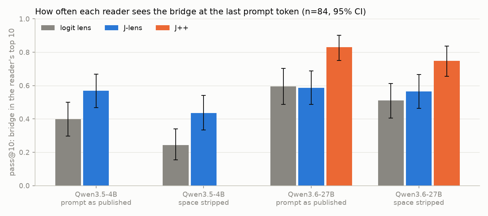
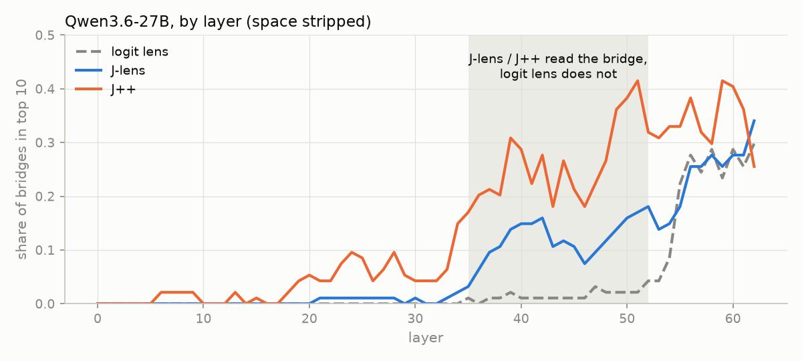
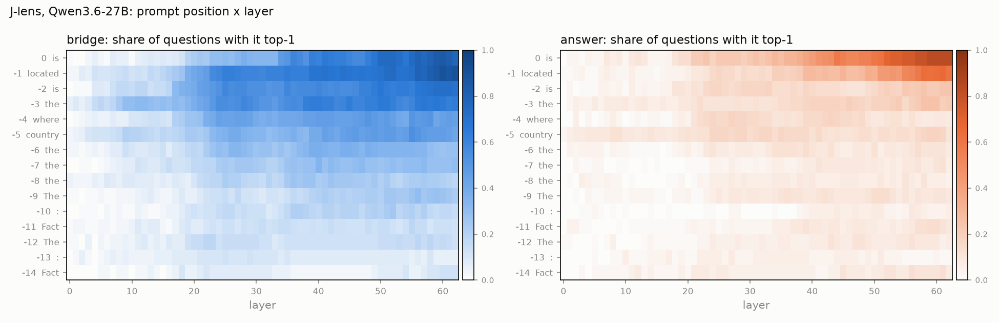

# bridge-jspace

**Question.** In a two-hop question ("the language spoken in the country where the Amazon River ends is ..."), the
model has to compute a bridge entity (Brazil) before it can answer (Portuguese). On Qwen3.6-27B and Gemma 4 31B the
J-lens often cannot read that bridge. Does the bridge still act on the answer through the J-space, or through a part
of the representation the J-lens cannot read?

**Reference result (Claude, Gurnee et al. 2026,
[Verbalizable Representations Form a Global Workspace](https://transformer-circuits.pub/2026/workspace/index.html)).**
Swapping the bridge's probe for another entity's flips the answer in 61% of items when only the J-space part of the
probe is swapped, 28% for the remainder, and 6% for the remainder when the J-space coordinates are clamped.

**Reading.** If on open models the remainder flips about as often as the J-space part and survives the clamp, the
bridge works outside the workspace. If the numbers look like Claude's, the J-lens misses on open models are a read-site
or tokenization artifact.

## Method, part A: can any reader see the bridge? (exp10+)
1. `exp10_lens_sanity`: the lens works on this model. Sanity gate (known fact, HF parity, our readout == jlens's
   `apply`), then `lens-eval-multihop` pass@k for the J-lens and J++ against the logit lens, plus a bridge vs
   same-category distractor control. Debugged on Qwen3.5-0.8B (CPU), run on Qwen3.5-4B (same `qwen3_5` hybrid
   architecture as the target), then Qwen3.6-27B. Results under Status.
2. `exp11_bridge_vs_answer_by_layer`: on part B's items and labels, at the last prompt token, at which layers each
   reader has the bridge (and, separately, the answer) on top of its candidate pool. Results under Status.
3. `exp12_position_map`: the same readout at every prompt position x layer: where in the prompt, and how deep, each
   word is readable; the best position per reader, chosen on half the items and checked on the other half.
4. Oracle lens and NLA on the same items, split by part B's J-mediated / non-J labels (planned).

## Method, part B: is the bridge used outside the J-space? (exp01-09)
1. `data/entity_prompts.json`: about 8 prompts per entity that imply the entity without naming it, for the 97
   entities in `data/probe_swap.json` (bridges and swap targets). Qwen keeps the ones it answers correctly.
2. Probe per entity and layer: mean final-token residual over its kept prompts minus the mean over all entities.
3. Decomposition per layer: non-negative OMP (k=25) over J-lens token directions gives the J-space part; the remainder
   is the rest.
4. Swaps on the 90 two-hop items, at every band layer and prompt position, under five conditions: raw J-lens vectors,
   full probe, J-space part, remainder, remainder with the J-space coordinates clamped. Each has a random-direction
   control of the same edit norm. Metric: rate at which the swap answer becomes the top word, with Wilson 95% CIs.

## Layout
```
src/bridge_jspace/
  config.py       typed YAML configs + dotted CLI overrides (model=<yaml> swaps the whole model)
  models.py       pinned HF model -> jlens LensModel; lens / J++ files (same format) moved to GPU once
  readout.py      rank-only readouts (J-lens, J++, logit lens), word -> token ids
  sanity.py       checks every new model/pod must pass before any readout is trusted
  stats.py        Wilson and bootstrap CIs
  experiment.py   Experiment base: results/<exp id>/<timestamp>/, manifest.json before run()
  pins.py         pinned upstream data, sha256-checked on load
configs/models/   one YAML per model: HF revision + lens files (qwen3.5-0.8b / 2b / 4b, qwen3.6-27b)
scripts/          experiment code: part A expNN_name/ (config.yaml + experiment.py), part B expNN_*.py
scripts/run.sh    experiment in a detached tmux session, log in log/
scripts/prefetch.py  download a model YAML's snapshot + lenses, retrying on HF rate limits
infra/            pod bootstrap
```
`AGENTS.md`: rules for running experiments. `VERIFIED.md`: results a human has checked. `data/README.md`: what
data we use and what the lenses were fitted on (`make data-report`).

## Running
```bash
make install                 # uv sync + pre-commit hooks
make check                   # ruff + pyright + unit tests (no download)
make test-model              # integration on Qwen3.5-0.8B + its lenses (CPU ok)

# GPU box: bash infra/setup_pod.sh, then any experiment = one config, run in tmux:
make run CONFIG=scripts/exp10_lens_sanity/config.yaml                      # Qwen3.5-4B
make run CONFIG=scripts/exp10_lens_sanity/config.yaml ARGS="model=configs/models/qwen3.6-27b.yaml"
tmux attach -t <session>     # or: tail -f log/<session>.log
```
GPU memory: Qwen3.5-4B fits a 24 GB card; Qwen3.6-27B needs 1x 80 GB (bf16 weights ~54 GB + two fp32 lens maps
~13 GB).

To fetch a model and its lenses ahead of a run (retries on HF 429s; put `HF_TOKEN` in `.env`):
`uv run python scripts/prefetch.py configs/models/qwen3.6-27b.yaml`.

## Status
Draft, UNVERIFIED: nothing is in `VERIFIED.md` yet. The STATE block in `AGENTS.md` tracks what is in flight.
Final figures, numbers and examples per experiment: [results/README.md](results/README.md).

**What we know so far (Qwen3.6-27B, the 67 two-hop questions it answers correctly).**
1. The J-lens and J++ can read the bridge; the plain logit lens mostly cannot before the last layers (exp10, exp11).
2. The bridge is readable earlier than the answer, both in the prompt and in depth: it builds up on the last words
   before "is" from about layer 20, while the answer appears only at the last token from about layer 44 (exp12).
3. Where the bridge is readable, part B's swaps also show it is used (J-mediated questions read better), but the
   groups are small.
4. The original "J-lens cannot see the bridge" is mostly where and how we looked: compared with the whole vocabulary
   at the last token it is often missed; compared with other entities, or one word earlier, it is usually there.

### exp10_lens_sanity: does the lens work on Qwen at all?
**What we measure.** We give the model a two-hop question, e.g. "The language spoken in the country where the Amazon
River ends is" (answer Portuguese, bridge Brazil). At the last prompt token we ask each *reader* for its ranked word
list at every layer, and count how often the bridge is in the top 10 at some layer (pass@10). Three readers: the
**logit lens** (simplest; the baseline), the **J-lens**, and **J++** (an improved J-lens).

**In short.**
- **Qwen3.5-4B:** the J-lens sees the bridge more often than the baseline.
- **Qwen3.6-27B:** J++ clearly beats the baseline (0.75 vs 0.51 with the space stripped). The J-lens is only slightly
  ahead, within the error bars.
- **The bridge is often invisible at the last token.** On the 61 items 27B answers correctly, J++ misses the bridge in
  1 of 3 and the J-lens in 1 of 2. This is Zach's observation. The next experiment checks earlier tokens.



*Share of two-hop questions where each reader has the bridge in its top 10 at the last prompt token (84 questions
with single-token bridges; bars are 95% CIs). Qwen3.5-4B has no J++ lens. "Prompt as published" keeps the trailing
space of the original prompts; "space stripped" removes it (pitfall 1).*

**Why the J-lens looks no better than the baseline on 27B.** In the middle layers (shaded) only the J-lens and J++
see the bridge; near the output the logit lens catches up. pass@10 takes the *best* layer, so the late layers hide
the difference.



*Same questions, Qwen3.6-27B, space stripped: share of bridges in each reader's top 10, layer by layer.*

<details><summary>Full numbers</summary>

pass@10 on the 84 single-token items, 95% percentile bootstrap CI over items (n_boot=10000, seed 0). Runs are under
`results/exp10_lens_sanity/`. All sanity checks pass on both models (HF parity and our readout vs `jlens.apply`:
max abs diff 0.0).

| Model | Prompt end | Model correct | Logit lens | J-lens | J++ | J-lens - logit | J++ - logit | Run |
|---|---|---|---|---|---|---|---|---|
| Qwen3.5-4B | as published (`" "`) | 18/93 | 0.40 [0.30, 0.50] | 0.57 [0.47, 0.67] | - | +0.17 [+0.08, +0.27] | - | `20261013-205029` |
| Qwen3.5-4B | stripped (`" is"`) | 50/93 | 0.24 [0.15, 0.34] | 0.43 [0.33, 0.54] | - | +0.19 [+0.10, +0.29] | - | `20261013-205057` |
| Qwen3.6-27B | as published (`" "`) | 21/93 | 0.60 [0.49, 0.70] | 0.59 [0.49, 0.69] | 0.83 [0.75, 0.90] | -0.01 [-0.08, +0.07] | +0.23 [+0.14, +0.33] | `20261013-205736` |
| Qwen3.6-27B | stripped (`" is"`) | 61/93 | 0.51 [0.40, 0.61] | 0.57 [0.46, 0.67] | 0.75 [0.65, 0.84] | +0.06 [-0.05, +0.17] | +0.24 [+0.13, +0.35] | `20261013-205936` |

On the items the model answers correctly (27B, stripped, n=61): J++ 0.67 [0.56, 0.79], J-lens 0.48 [0.36, 0.61].
Controls (27B, stripped, rank at the last token): Brazil 0 vs distractor Mexico 57 (J-lens) / 45 (J++); Hungary 1 / 0
vs Poland 16 / 18. Figures: `uv run python -m scripts.exp10_lens_sanity.plot --summary`.
</details>

### exp11_bridge_vs_answer_by_layer: where is the bridge readable, and where the answer?
**What we measure.** The 90 probe-swap questions of part B, prompts as published; the headline uses the 67 the model
answers correctly (part B's `eligible`; our check agrees on all 83 items with a single-token answer). At the last
prompt token, at every layer, we ask each reader: is the bridge (Brazil) the top candidate among all 97 entities of
the set, and is the answer (Portuguese) the top candidate among all 112 answers? The same-category distractors
(Mexico, Spanish) are the controls. Chance is about 1%.

**In short.**
- **J-lens and J++ read the bridge in the middle layers; the logit lens only near the output.** Averaged over
  layers 32-48 the bridge is top-1 among entities in 59% of questions (J-lens), 56% (J++), 26% (logit lens);
  its distractor in 6%. This reproduces part B's `gate_debug` (0.55-0.70).
- **The bridge comes first, the answer later, but they overlap.** Half the questions have the bridge on top by
  layer 34; the answer gets there by layer 43 (J-lens, 8 layers later [4, 18]) or 47 (J++, 11 [5, 18]). There is
  no clean hand-off: the bridge stays on top until about layer 60, and per question the bridge settles on top
  before the answer in only 57% [45, 70] of cases (J-lens).
- **Where the bridge is readable, it is also used.** On the 25 questions where part B's J-space swap flips the
  answer, the J-lens has the bridge on top in 79% [66, 89] of layers 32-48; on the 40 where no swap works, 49%
  [35, 62]. Suggestive: the intervals nearly touch.


*Last prompt token, 67 questions the model answers correctly. Blue: share of questions where the bridge is the top
entity; orange: where the answer is the top answer; grey: the same for their distractors (controls); dotted:
chance. Shaded: the layer bands the summary averages over (32-48 fixed in advance from part B; 28-52 exploratory,
which changes nothing: 58% vs 59%).*

**What this does not show.** A lens shows what can be read out at a layer, not when it was computed. And this is
one token: the first hop may happen earlier in the prompt (at "Amazon River ends"), which exp11 does not look at.
About 40% of questions do not have the bridge on top at the last token; exp12 looks at the earlier tokens.

<details><summary>Full numbers</summary>

Run `20261014-092835` (prompts as published, Qwen3.6-27B @ `192d8cb`), re-aggregated in
`results/exp11_bridge_vs_answer_by_layer/20261014-092835/analysis-20261014-113947/summary.json` (`analyze`; the run's own `summary.json` predates the bands and order metrics).
Eligible n=67, band 32-48, 95% percentile bootstrap CI over questions (n_boot=10000, seed 0).

| Reader | Bridge top-1 | Answer top-1 | Bridge distractor top-1 | Bridge above distractor (vocab) | 50% crossing: bridge / answer (lag) |
|---|---|---|---|---|---|
| logit lens | 0.26 [0.17, 0.35] | 0.13 [0.08, 0.20] | 0.04 | 0.80 [0.72, 0.87] | L49 / L52 (2 [-4, 4]) |
| J-lens | 0.59 [0.49, 0.68] | 0.41 [0.32, 0.50] | 0.06 | 0.84 [0.76, 0.91] | L34 / L43 (8 [4, 18]) |
| J++ | 0.56 [0.46, 0.65] | 0.38 [0.29, 0.47] | 0.06 | 0.85 [0.78, 0.92] | L34 / L47 (11 [5, 18]) |

Space-stripped prompts (run `20261014-093050`) give the same picture (J-lens bridge 0.56, lag 8 [3, 16]). On the 21
eligible questions whose prompt ends in a space the answer is read less often (J-lens 0.24 vs 0.49 without the
space); the bridge less so (0.53 vs 0.62).
</details>

### exp12_position_map: where in the prompt, and how deep?
**What we measure.** The exp11 readout (is the word the top candidate in its pool?) at every token of the prompt, not
just the last. Prompts differ in length, so tokens are aligned by their distance from the last word: 0 is the last
word (usually "is"), -1 the word before it (e.g. "located", "ends"), and so on. The best position for each reader is
picked on a random half of the questions and checked on the other half, because the best of 15 positions looks better
than it is on the data that picked it; the same search for the distractor (Mexico) shows how high noise alone gets.

**In short.**
- **The bridge is read best one word before the end; the answer only at the end.** J-lens: the bridge is on top in
  66% of layers 32-48 at position -1 (56% at the last word); the answer in 41% at the last word and at most 24%
  anywhere earlier. Both halves of the data pick the same positions. Noise ceiling: 12%.
- **The bridge comes about 20 layers before the answer.** Read where each is strongest, half the questions have the
  bridge on top by layer 23 and the answer by layer 44: 21 layers later [16, 28] (J++: 20 vs 43, 23 [18, 32]).
  Read at a single token (exp11) the two overlapped; this is the step that one token hides.
- **Most last-token misses are a read-site effect.** Of the 26 questions where the J-lens does not have the bridge on
  top at the last token, 73% [54, 88] have it on top at an earlier token (distractor, same search: 35% [15, 54]).


*Left: share of layers 32-48 in which the word is the top candidate, at each prompt position (label: the most common
token there). Right: share of questions with the word on top at each layer, the bridge read at position -1 and the
answer at the last word; dots and arrow: where each reaches half the questions. Thick: J-lens (shaded 95% CI); thin:
J++. Grey band: layers 32-48.*

**What this does not show.** Positions are aligned by distance from the end, not by meaning: in the 44 prompts that
end in "is" the bridge peaks on the word before it (75%), in the 23 others it has no clear peak. The ordering holds
for the group of questions, not reliably for each one. A lens shows what is readable, not what is computed.

<details><summary>Full numbers and checks</summary>

Run `20261014-095358` (Qwen3.6-27B @ `c373821`, prompts as published), analysed in `results/exp12_position_map/20261014-095358/analysis-20261014-121341/summary.json`.
Eligible n=67; positions -14..0 analysed (reached by at least half the questions; -11..0 by 66-67).

| Reader | Bridge: best position | Share of layers 32-48 [95% CI] | Held-out halves (position: share) | Answer: best position | Share | Distractor ceiling |
|---|---|---|---|---|---|---|
| logit lens | -3 | 0.40 [0.30, 0.51] | -1: 0.31, -3: 0.37 | 0 | 0.14 [0.09, 0.21] | 0.05 |
| J-lens | -1 | 0.66 [0.55, 0.76] | -1: 0.62, -1: 0.70 | 0 | 0.41 [0.32, 0.51] | 0.12 |
| J++ | -1 | 0.66 [0.56, 0.76] | -1: 0.62, -3: 0.63 | 0 | 0.40 [0.30, 0.49] | 0.10 |

- Depth (half the questions on top, bridge at its best position vs answer at the last word): J-lens L23 vs L44, lag
  21 [16, 28]; J++ L20 vs L43, 23 [18, 32]; logit lens L24 vs L51, 27 [-5, 30].
- Same optimum on the balanced panel (the 66 questions that reach every position -11..0), so prompt length does not
  drive it.
- Read at position -1, part B's J-mediated questions have the bridge on top in 0.79 [0.63, 0.92] of layers 32-48,
  "neither" questions in 0.60 [0.46, 0.74] (J-lens).
- Missed at the last token: J-lens 26 questions, bridge on top earlier in 73% [54, 88] (distractor 35% [15, 54]);
  J++ 26, 81% [65, 96] (distractor 31% [15, 50]).


</details>

### Pitfalls found so far
1. **Trailing space.** Most original prompts end in a space (83/93), which Qwen's tokenizer leaves as a lone `" "`
   token. The model then answers far worse (27B: 21/93 correct vs 61/93 with the space stripped) and the lens reads a
   different token. Switch: `params.strip_trailing_space`.
2. **Numbers split into digits.** Qwen splits `" 26"` into `" "`, `"2"`, `"6"`, so scoring "26" by its first token
   gave fake hits (fixed in `d068538`; the two runs before the fix, `20261013-204427` and `-204551`, are superseded
   and not committed). Headlines use only single-token bridges.
3. **"The bridge is visible somewhere" is too weak.** Across all layers x tokens, a same-category distractor (Mexico
   for Brazil) also reaches the top somewhere. The read-site map must compare the bridge against a distractor.
4. **Best-of-all-layers favours the logit lens on deep models** (see the layer plot). exp11/exp12 average over the
   middle-layer band 32-48 instead.
5. **Token positions differ between prompts.** exp12 aligns them by distance from the last word, which mixes roles
   ("-1" is "ends" in one prompt, "is" in another); checked by splitting on the last word.
6. **Not yet checked:** in 5/93 lens-eval questions the bridge word appears in the prompt itself.

### Decisions
- **Trailing space: stripped is primary; prompts as published are kept as the paper-literal replication**
  (2026-10-13, Danyil; to confirm with Zach since part B's correct-answer filter depends on it). Why:
  - The protocol reads "the token right before `target`". In natural text that is `" is"`; the lone `" "` exists only
    because the prompts were written for another tokenizer, and after it the answer becomes a fragment (`"Port"`).
  - We study reasoning the model actually does: 27B answers 61/93 stripped vs 21/93 as published. 21 items is also
    too few for swap rates with useful CIs.
  - The lone `" "` invites digits, which produced fake hits (pitfall 2): 6 at layer 0 on 4B vs 0 when stripped.
  - Part B uses the same prompts (29/90 probe-swap prompts end in a space), so both parts must treat them the same.
  Against: numbers are not 1:1 with the paper (hence the replication variant). The J-lens reads the bridge more often
  on the lone `" "` (4B: 0.57 vs 0.43), but that is confounded with the digit artifact and with the model mostly
  failing there; the all-positions map will test it directly.

### Open decisions (humans)
- Whether to drop the 5 questions whose bridge appears in the prompt.
- Band for part A headlines: 32-48 (part B's) is used as primary; 28-52 is reported as exploratory.

## Next steps (part A)
In order; designs need human sign-off before GPU runs.
1. **Tell part B where the bridge is:** strongest on the last words before "is", from about layer 20. Swaps applied at
   those positions and layers should be stronger than at the last token alone.
2. **Per question, not just per group:** for how many questions is the bridge on top at an earlier position and
   layer than the answer? Align positions by role (the words that cue the bridge) instead of distance from the end.
3. **The 5 lens-eval questions whose bridge appears in the prompt:** check whether they drive any exp10 headline.
4. **Oracle lens** on the same items: the Qwen3.6-27B adapter is on HF (`neuronpedia/jacobian-lens`,
   `qwen3.6-27b/oracle`); its reference read code may not be public, so check that first, then propose a design.
   This is the only long GPU job in sight.
5. **NLA:** source and weights still to identify.
6. Optional: reproduce J++'s published Recall@10 (55.2% on Qwen3.6-27B) over all six lens-eval sets.
7. Stretch: repeat on Gemma 4 31B (J-lens and J++ exist on HF).
