<!-- Generated by scripts/readme_root.py from docs/readme/README.template.md; edit the template. -->
# Recall goes through the workspace, lookup goes around it

*A controlled test of the J++ lens on two-step questions in open models: what it reads at the middle entity, and whether the model uses it.*

**Zach Perlman and Danyil Orel** · MATS 12.0 sprint, Neel Nanda's stream · 19–30 Oct 2026<!-- src: docs/plans/hypotheses.md | The proposal (19 Oct) --><!-- src: docs/depth/README.md | 29 Oct 2026 -->

**Status.** A two-week sprint by two people; every number is computed from tracked run files and checked by tests, and a 46-item [hand-check](docs/review/handcheck_findings.md)<!-- src: docs/review/handcheck_findings.md | 46 items across views a-g --> changed no headline claim ([verification levels](docs/STANDARD.md#8-shared-vocabulary) 1 to 3). The 63 numbers of the one-layer and routes tests were also recounted by agent-written code (level 4); no human has recomputed any number (level 5 not reached; [VERIFIED.md](VERIFIED.md)). Main caveat: the knock-out mostly removes the answer's own directions, so the claims about the bridge rest on the one-layer test and the swap.

<!-- POST LINK: Dan adds "[Write-up](…) · " at the start of the next line at publication -->
[Depth report](docs/depth/README.md) · [Breadth report](docs/breadth/README.md) · [Hypotheses](docs/plans/hypotheses.md) · [Examples](docs/writeup/examples.md) · [Figures](figures/) · [Data](data/README.md) · [Reproduce](#reproduce) · [Slides](docs/slides/) · Code: [MIT](LICENSE) · [Data licences](data/SOURCES.md)

## TL;DR

Gurnee et al. (2026) argue that the J++ lens reads a "workspace" holding the middle step of a model's reasoning. We tested this on two-step questions that pass through a middle entity, the *bridge*. Their second step is *recalled* from memory or *looked up* in the prompt. A *knock-out* removes the *lens part*, the few directions the lens reads most at the bridge, over a band of middle layers.

- **Recall needs the lens directions at the bridge; lookup needs far less.** The knock-out costs recalled answers 42.6<!-- src: docs/breadth/data.csv | ko.q9.mk --> to 53.1<!-- src: docs/breadth/data.csv | ko.nl.mk --> points more than looked-up ones on Qwen 9B, Qwen 27B and Lightning. They are the three of nine that pass the bar fixed in advance of the main runs ([amendment 33](docs/breadth/prereg_replication_1022.md#amendment-33-zach-2026-10-24-1723-utc-commit-4464369-the-combined-suite-v2-one-dataset-jsuite_v2)).
- **The lookup goes around the lens.** It finds the item by its identity or by an address, a code for where the item sits in the prompt. A probe reads the address at 0.85 to 0.99<!-- src: data/figures/depth/data.csv | the locker probe at the bridge word, locker-first scenes -->, and swapping it in redirects the lookup; the lens directions capture about as little of it as random directions do.
- **A lens reading shows what an entity brings to mind, not what the model uses.** At the answer position a probe on the lens part reads the entity. Yet swapping that part moves at most 0.14 ○ of answers<!-- src: data/figures/depth/data.csv | 51.10: recall, last token, read peak: the lens swap's switches -->.
- **For anyone monitoring with a lens.** At an entity, a lens readout shows which entity is in play and what it brings to mind. It does not show whether the model answers from memory or from the text.

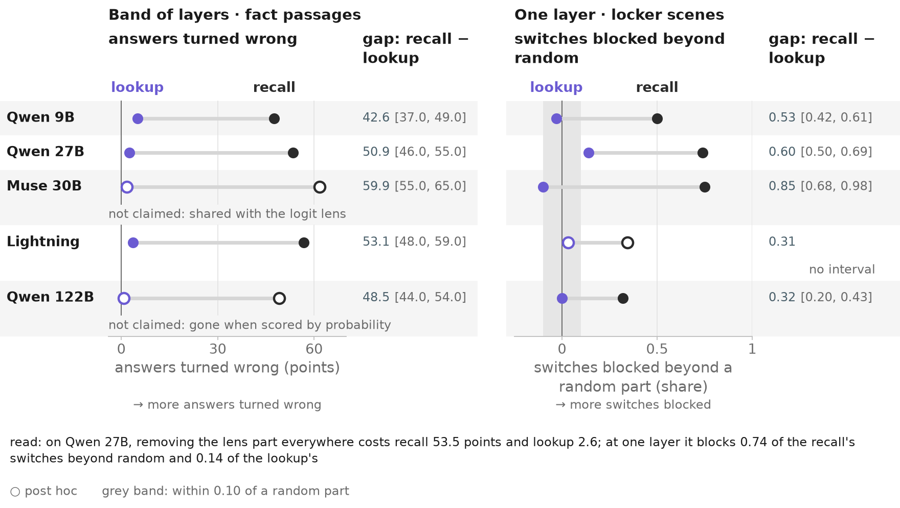

*The panels count in different units (left points, right shares), so compare their pattern: removing the lens part costs recall far more than lookup in both. Rows are models, gaps at the right. Left: the knock-out over a band of layers (fact passages), answers turned wrong. Right: one layer (locker scenes), switches blocked beyond a random part.*

## Setup

An illustrative scene: "The locker of carbon is 3. The locker of helium is 5. … Eric picked **carbon**."<!-- src: docs/depth/README.md | The locker of carbon is 3. The locker of helium is 5. --> Asked which locker belongs to Eric's pick, the model looks up 3 in the text<!-- src: docs/depth/README.md | Which locker belongs to Eric's pick?" (3, found in the prompt) -->. Asked the atomic number of Eric's pick, it recalls 6 from memory<!-- src: docs/depth/README.md | What is the atomic number of Eric's pick?" (6, from memory) -->. Both questions pass through the bridge, *carbon*. The fact passages pose the same contrast with real facts, giving the bridge's fact or leaving it to memory. Five models are tested on locker scenes, nine on fact passages.

Real test items, each picked by a fixed rule (`data/figures/examples/data.csv`); captions say how typical each is.

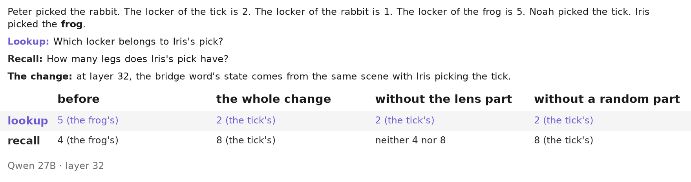

*Without the lens part the lookup still switches and the recall does not. One locker scene, Qwen 27B (the bridge word in bold). Of the main test's 200<!-- src: docs/depth/x0_numbers.json | n_27b --> scenes, the whole change switches the recall in 150<!-- src: docs/depth/x0_numbers.json | rc_whole_27b -->, and without the lens part in only 35<!-- src: docs/depth/x0_numbers.json | rc_noj_27b -->; the lookup still switches in 71<!-- src: docs/depth/x0_numbers.json | lk_noj_27b -->.*

A fact passage

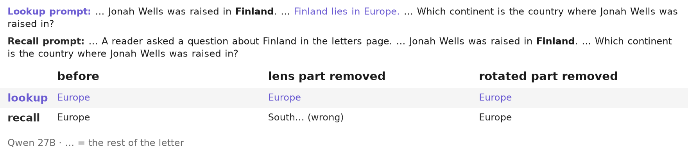

*Without the lens part the recall turns wrong and the lookup holds; a rotated part turns neither. One pair of fact passages, Qwen 27B (the bridge in bold): the lookup's passage gives the fact, the recall's does not. This flip shows on 164<!-- src: data/figures/examples/data.csv | e2.pairs_flip --> of the 338<!-- src: data/figures/examples/data.csv | e2.pairs_both_right --> pairs answered right before the removal.*

### Key terms

- **Bridge.** The entity a two-step question passes through. **Recall** and **lookup** answer its second step from memory and from the prompt.
- **Lens part.** The few directions the J++ lens reads most at the bridge. The **logit lens**, read through the output layer, is a control.
- **Knock-out.** The lens part removed at every token over a band of middle layers.
- **Patch.** The change between two prompts' states at the bridge word and one layer. An answer **switches** when the patch makes it the other prompt's answer. **Remove from the patch** adds the patch back without its lens part.
- **Swap.** Another entity's lens part written into the bridge. A **probe** is a linear classifier on hidden states.
- **Identity and address.** Which item the bridge is, and where its sentence sits in the prompt.
- **Answer span.** The answers' own lens directions.
- **Post hoc (○).** A gate or rule set after the data were seen. More in the [glossary](docs/shared/glossary_joint.md).

Which lens each model uses

Quality: the share of held-out items whose middle entity is in the lens's top ten at some layer.

| model | lens | J++ |
|---|---|---|
| Qwen 9B | published<!-- src: data/figures/lenses.csv \| lens.q9.kind --> | 0.630<!-- src: data/figures/lenses.csv \| lens.q9.passk --> |
| Qwen 27B | published<!-- src: data/figures/lenses.csv \| lens.q27.kind --> | 0.717<!-- src: data/figures/lenses.csv \| lens.q27.passk --> |
| Muse | our fit<!-- src: data/figures/lenses.csv \| lens.mu.kind --> | 0.959<!-- src: data/figures/lenses.csv \| lens.mu.passk --> |
| Lightning | our fit<!-- src: data/figures/lenses.csv \| lens.nl.kind --> | 0.587<!-- src: data/figures/lenses.csv \| lens.nl.passk --> |
| Qwen 122B | published<!-- src: data/figures/lenses.csv \| lens.q122.kind --> | not measured<!-- src: data/figures/lenses.csv \| lens.q122.passk --> |
| Bolt | our fit<!-- src: data/figures/lenses.csv \| lens.nb.kind --> | 0.800<!-- src: data/figures/lenses.csv \| lens.nb.passk --> |
| Ministral | our fit<!-- src: data/figures/lenses.csv \| lens.mi.kind --> | 0.651<!-- src: data/figures/lenses.csv \| lens.mi.passk --> |
| DeepSeek | published<!-- src: data/figures/lenses.csv \| lens.ds.kind --> | not measured<!-- src: data/figures/lenses.csv \| lens.ds.passk --> |
| OLMo 32B | published<!-- src: data/figures/lenses.csv \| lens.ol.kind --> | not measured<!-- src: data/figures/lenses.csv \| lens.ol.passk --> |
| Gemma 4 31B-it | our fit<!-- src: data/figures/lenses.csv \| lens.gemma.kind --> | 0.633<!-- src: data/figures/lenses.csv \| lens.gemma.passk --> |
| gpt-oss-20b | our fit<!-- src: data/figures/lenses.csv \| lens.gptoss.kind --> | not measured<!-- src: data/figures/lenses.csv \| lens.gptoss.passk --> |
| Kolibri-1 | our fit<!-- src: data/figures/lenses.csv \| lens.kol.kind --> | 0.484<!-- src: data/figures/lenses.csv \| lens.kol.passk --> |

The three tools, drawn

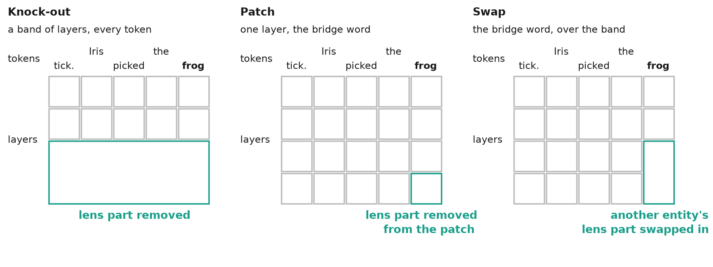

*Three tests of the lens part at the bridge, drawn over the first example's last words (rows are layers, columns tokens; teal marks the cells changed). The knock-out removes it at every token over a band of layers. Removal from the patch adds the patch back without it. The swap writes in another entity's.*

### Reading the figures

Colours, marks and the key, one row read aloud

Each colour is a role. Recall is black, lookup violet, the lens part teal, the address amber, identity blue, a gap slate, and a control grey. Hollow marks (○) are post hoc; whiskers are 95% intervals over bridge items<!-- src: docs/breadth/README.md | Brackets: 95% bootstrap over bridges -->. Fact passages count in points, locker scenes in shares.

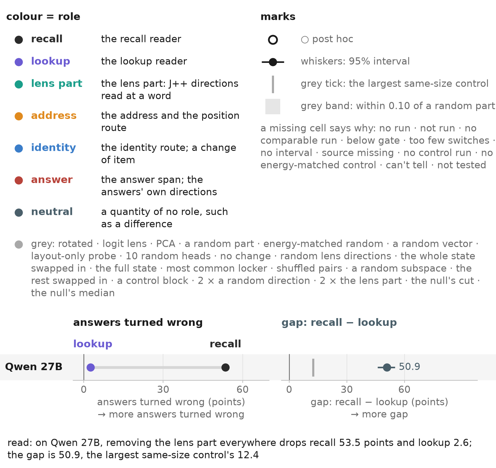

## Findings

### Finding 1. Recall needs the lens part; lookup needs far less

Qwen 9B, Qwen 27B and Lightning are the three of nine that pass the bar fixed in advance of the main runs ([amendment 33](docs/breadth/prereg_replication_1022.md#amendment-33-zach-2026-10-24-1723-utc-commit-4464369-the-combined-suite-v2-one-dataset-jsuite_v2), 24 Oct; recall − lookup ≥ 30, rotated and logit-lens controls < 10)<!-- src: docs/breadth/prereg_replication_1022.md | M - K >= 30 with the logit-lens and rotated controls < 10 -->. On them the knock-out costs recall 42.6<!-- src: docs/breadth/data.csv | ko.q9.mk --> to 53.1<!-- src: docs/breadth/data.csv | ko.nl.mk --> points more than lookup; same-size controls cost far less. At one layer the recall follows the lens part when the patch's parts disagree, and the lookup does not.

The paper's Figure 24 already shows removal hurting free recall (TriviaQA) and sparing extraction (SQuAD)<!-- src: docs/shared/references.md | Figure 24 -->; new here are matched items where only the answer's source changes. Two mundane readings remain.

First, the knock-out's damage to recall is the answer's own directions. Removing only the answer span does all of it, in a test fixed in advance on three models. Keeping the answer span undoes 0.91<!-- src: data/figures/writeup/data.csv | fig10.keep_span.nl --> to 0.95<!-- src: data/figures/writeup/data.csv | fig10.keep_span.q27 --> of it. So the knock-out shows that recall needs the directions of its remembered word, not that the bridge is used. The bridge claims rest on the one-layer test and the swap ([Finding 3](#finding-3-a-lens-reading-shows-what-an-entity-brings-to-mind-not-what-the-model-uses)).

Second, general damage: on these three models it costs plain text +0.30 nats<!-- src: docs/breadth/data.csv | text.q27 --> to +1.67 nats<!-- src: docs/breadth/data.csv | text.nl -->, against +0.03 nats<!-- src: docs/breadth/data.csv | text.q9.rot --> to +0.30 nats<!-- src: docs/breadth/data.csv | text.nl.rot --> for a rotated part. But general damage would also hurt the lookup, which drops only 2.6<!-- src: docs/breadth/data.csv | ko.q27.klost --> to 5.0<!-- src: docs/breadth/data.csv | ko.q9.klost --> points.

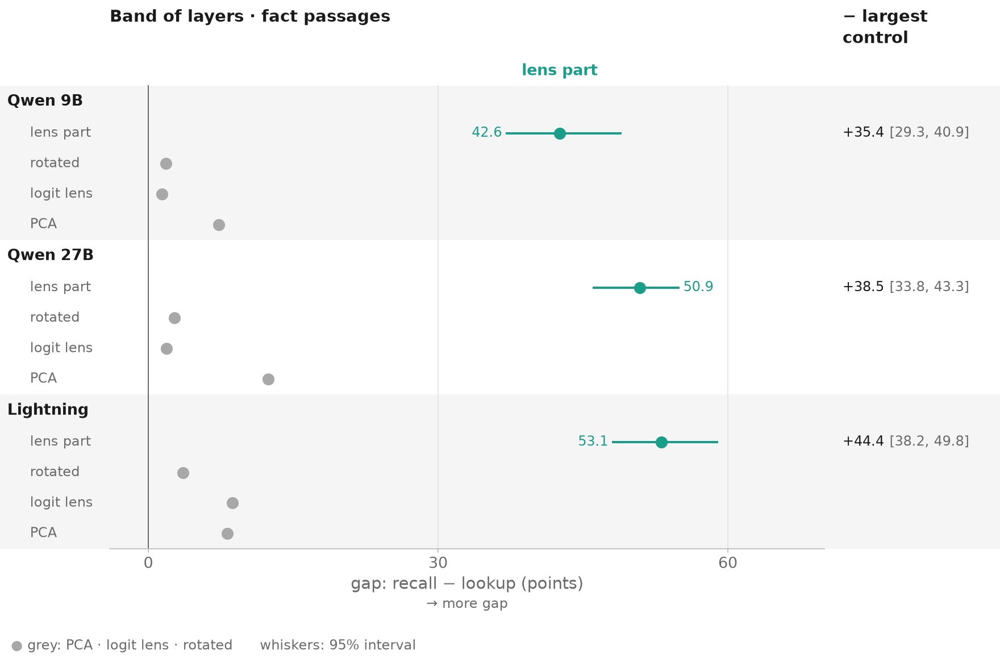

*Same-size controls cost far less than the lens part. Per model, one lane each: the recall − lookup gap when the knock-out removes the lens part (teal) or a same-size control (grey: a rotated part, the logit lens's or the top principal directions). The column at the right: the lens part minus its largest control, paired on the same items.*

Test, results, controls and limits

- **Test.** The knock-out over a band of middle layers (fact passages). Removal from the patch at one layer (locker scenes).
- **Result and controls.** Muse and the 122B are not claimed (post hoc in the band test). Against that bar, Muse and the 122B fail on the logit-lens control (34.6<!-- src: docs/breadth/data.csv | ko.mu.u -->, 11.8<!-- src: docs/breadth/data.csv | ko.q122.u -->), and Ministral, DeepSeek, Bolt and OLMo 32B on the gap (23.3<!-- src: docs/breadth/data.csv | ko.mi.mk -->, 17.9<!-- src: docs/breadth/data.csv | ko.ds.mk -->, 6.0<!-- src: docs/breadth/data.csv | ko.nb.mk -->, 5.4<!-- src: docs/breadth/data.csv | ko.ol.mk -->). The rotated part, the logit lens's directions and the principal directions match the lens part's norm; the one-layer random part matches its energy (the same share of the change).

| | 9B | 27B | Muse | Lightning | 122B |
|---|---|---|---|---|---|
| knock-out: recall − lookup, points | 42.6<!-- src: docs/breadth/data.csv \| ko.q9.mk --> | 50.9<!-- src: docs/breadth/data.csv \| ko.q27.mk --> | 59.9<!-- src: docs/breadth/data.csv \| ko.mu.mk --> ○ | 53.1<!-- src: docs/breadth/data.csv \| ko.nl.mk --> | 48.5<!-- src: docs/breadth/data.csv \| ko.q122.mk --> ○ |
| the same, scored by probability | 35.3<!-- src: docs/breadth/data.csv \| ko.q9.soft --> | 50.3<!-- src: docs/breadth/data.csv \| ko.q27.soft --> | 49.4<!-- src: docs/breadth/data.csv \| ko.mu.soft --> ○ | 44.1<!-- src: docs/breadth/data.csv \| ko.nl.soft --> | 1.7<!-- src: docs/breadth/data.csv \| ko.q122.soft --> ○ |
| looked-up answers' own drop, points | 5.0<!-- src: docs/breadth/data.csv \| ko.q9.klost --> | 2.6<!-- src: docs/breadth/data.csv \| ko.q27.klost --> | 1.8<!-- src: docs/breadth/data.csv \| ko.mu.klost --> ○ | 3.7<!-- src: docs/breadth/data.csv \| ko.nl.klost --> | 0.8<!-- src: docs/breadth/data.csv \| ko.q122.klost --> ○ |
| control: a rotated part | 1.8<!-- src: docs/breadth/data.csv \| ko.q9.rot --> | 2.7<!-- src: docs/breadth/data.csv \| ko.q27.rot --> | 2.6<!-- src: docs/breadth/data.csv \| ko.mu.rot --> ○ | 3.6<!-- src: docs/breadth/data.csv \| ko.nl.rot --> | 2.1<!-- src: docs/breadth/data.csv \| ko.q122.rot --> ○ |
| control: the logit lens's directions | 1.4<!-- src: docs/breadth/data.csv \| ko.q9.u --> | 1.9<!-- src: docs/breadth/data.csv \| ko.q27.u --> | 34.6<!-- src: docs/breadth/data.csv \| ko.mu.u --> ○ | 8.7<!-- src: docs/breadth/data.csv \| ko.nl.u --> | 11.8<!-- src: docs/breadth/data.csv \| ko.q122.u --> ○ |
| control: top principal directions, same norm | 7.3<!-- src: docs/breadth/data.csv \| ko.q9.pc --> | 12.4<!-- src: docs/breadth/data.csv \| ko.q27.pc --> | 5.3<!-- src: docs/breadth/data.csv \| dose.mu.k10.pc --> ○ (dose run) | 8.2<!-- src: docs/breadth/data.csv \| ko.nl.pc --> | not run |
| lens part minus its largest control, paired | 35.4<!-- src: docs/breadth/data.csv \| f2.band.q9.pc --> | 38.5<!-- src: docs/breadth/data.csv \| f2.band.q27.pc --> | 25.3<!-- src: docs/breadth/data.csv \| f2.band.mu.u --> ○ | 44.4<!-- src: docs/breadth/data.csv \| f2.band.nl.u --> | 36.6<!-- src: docs/breadth/data.csv \| f2.band.q122.u --> ○ |
| one layer: recall's switches blocked beyond random | 0.50<!-- src: docs/depth/x0_numbers.json \| rc_excess_9b --> | 0.74<!-- src: docs/depth/x0_numbers.json \| rc_excess_27b --> | 0.75<!-- src: docs/depth/x0_numbers.json \| rc_excess_muse --> | 0.34<!-- src: data/figures/depth/data.csv \| conflict: recall, switches lost beyond a random part --> ○ | 0.32<!-- src: docs/depth/x0_numbers.json \| rc_excess_122b --> |
| one layer: lookup's switches blocked beyond random | −0.03<!-- src: docs/depth/x0_numbers.json \| lk_excess_9b --> | 0.14<!-- src: docs/depth/x0_numbers.json \| lk_excess_27b --> | −0.10<!-- src: docs/depth/x0_numbers.json \| lk_excess_muse --> | 0.03<!-- src: data/figures/depth/data.csv \| conflict: lookup, switches lost beyond a random part --> ○ | 0.00<!-- src: docs/depth/x0_numbers.json \| lk_excess_122b --> |
| one layer: lens part minus principal directions, paired | 0.24<!-- src: docs/breadth/data.csv \| f2.layer.q9.pca --> | 0.45<!-- src: docs/breadth/data.csv \| f2.layer.q27.pca --> | 0.48<!-- src: docs/breadth/data.csv \| f2.layer.mu.pca --> | no per-item contrast saved | 0.05, interval includes zero<!-- src: docs/breadth/data.csv \| f2.layer.q122.pca --> |

- **Scope.** Every passage set we built shows it on the two Qwens: 22.8 to 52.1 points on toy puzzles and on less templated passages (generated, with Wikipedia filler)<!-- src: docs/breadth/data.csv | toy.q27.s1; toy.q27.s2; toy.q27.s3; toy.q9.s1; toy.q9.s2; toy.q9.s3; nat.q27.s1; nat.q27.s2; nat.q27.s3; nat.q9.s1; nat.q9.s2; nat.q9.s3; natplus.q27; natplus.q9 -->. It holds on every relation, from 36.0 (languages) to 72.0 (dishes) on the 27B<!-- src: docs/breadth/data.csv | ko.q27.rel.languages; ko.q27.rel.dishes -->, and for rare and popular bridges alike<!-- src: docs/breadth/data.csv | natplus.q27.rare; natplus.q27.pop; natplus.nl.rare; natplus.nl.pop -->. On the twin set, which describes people instead of naming them, it survives dropping every item a shortcut could answer (post hoc) and asking the question first. The need is spread over the bridge's words; removing the lens part at the final token alone costs almost nothing ([where the need sits](figures/common/readme/17_where.png)). The one-layer controls are [in this figure](figures/common/readme/03b_controls_layer.png).
- **Confidence.** Credence [~90%](docs/plans/credences.md)<!-- src: docs/plans/credences.md | main_split --> for the split as stated, [~40%](docs/plans/credences.md)<!-- src: docs/plans/credences.md | broadly --> that it holds beyond the models and settings tested. The 27B's lookup is also partly blocked ([Where it does not hold](#where-it-does-not-hold)).
- **Limits.** "Lookup needs far less" holds at middle layers; in the deep layers the 9B's and Lightning's lookups need the lens part too (twin set). At one layer the recall follows the lens part but does not need it, because other layers carry copies: zeroing it leaves 0.94 to 0.97 of recalled answers unchanged<!-- src: data/figures/depth/data.csv | 47.5: recall's answers kept at L, the J++ part's 25 directions taken out -->. English templated prompts, one-token answers, greedy decoding with thinking off.

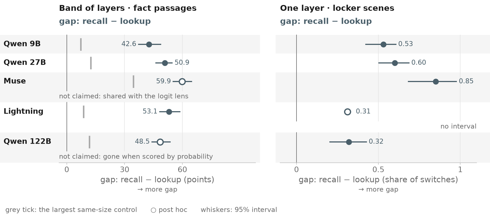

*The gap stays far above the largest same-size control's in the band test, and above zero at one layer. Left: the band test, in points; grey tick: the largest control's gap. Right: one layer, as a share of switches; Lightning's gap has no interval.*

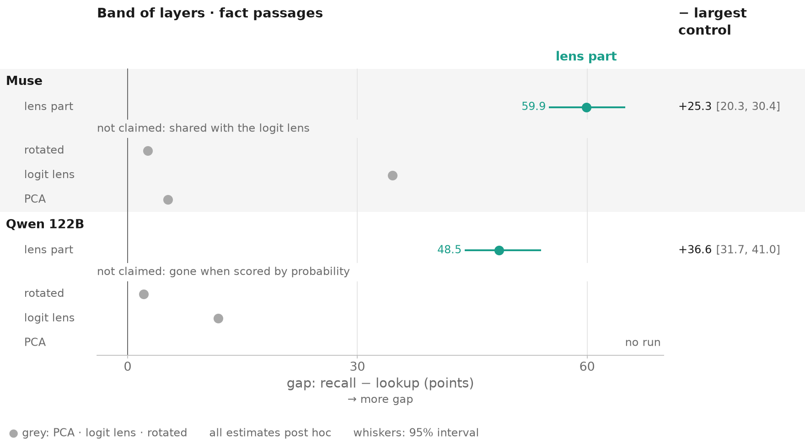

*On Muse and the 122B the band-test gap is large but not claimed: on Muse it is shared with the logit lens, and on the 122B it is gone when scored by probability. Every estimate here is post hoc.*

The answer span: test, results and limits

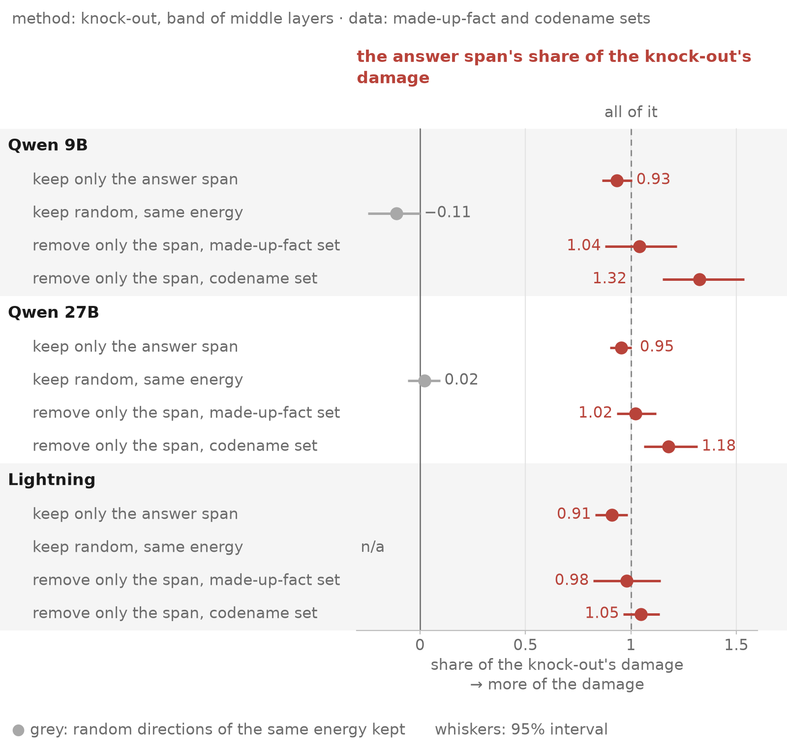

*What the knock-out removes from the recall is its answer's own directions. Left: the share of the damage undone when the answer span is kept (brick), against an energy-matched random keep (grey); descriptive. Middle: the damage when only the answer span is removed, as a multiple of the full knock-out's. Right: the same on the codename set.*

- **Test.** On the twin set, the knock-out keeping the answer span's directions, and the answer span removed alone, each net of a random part of the same energy. On a one-hop question about the subject (a city), removing its lens directions, the answer span, or its directions made orthogonal to the answers. A subspace built from the data and cleaned of the answers, against the rule fixed in advance: under 15 points beyond random means the subject is not seen<!-- src: data/figures/writeup/data.csv | fig11.clean_subspace.q27 -->.
- **Result.**

| | 9B | 27B | Lightning |
|---|---|---|---|
| keeping the answer span: share of damage undone | 0.93 [0.86, 1.01]<!-- src: data/figures/writeup/data.csv \| fig10.keep_span.q9 --> | 0.95 [0.90, 1.00]<!-- src: data/figures/writeup/data.csv \| fig10.keep_span.q27 --> | 0.91 [0.83, 0.98]<!-- src: data/figures/writeup/data.csv \| fig10.keep_span.nl --> |
| control: a random keep of the same energy | −0.11 [−0.25, 0.00]<!-- src: data/figures/writeup/data.csv \| fig10.keep_ctrl.q9 --> | 0.02 [−0.06, 0.10]<!-- src: data/figures/writeup/data.csv \| fig10.keep_ctrl.q27 --> | no energy-matched control |
| answer span alone: multiple of the full damage | 1.04 [0.88, 1.22]<!-- src: data/figures/writeup/data.csv \| fig10.span_only.v4.q9 --> | 1.02 [0.93, 1.12]<!-- src: data/figures/writeup/data.csv \| fig10.span_only.v4.q27 --> | 0.98 [0.82, 1.14]<!-- src: data/figures/writeup/data.csv \| fig10.span_only.v4.nl --> |
| the same, codename set | 1.32 [1.15, 1.54]<!-- src: data/figures/writeup/data.csv \| fig10.span_only.codename.q9 --> | 1.18 [1.06, 1.32]<!-- src: data/figures/writeup/data.csv \| fig10.span_only.codename.q27 --> | 1.05 [0.96, 1.14]<!-- src: data/figures/writeup/data.csv \| fig10.span_only.codename.nl --> |
| one hop: the city's lens directions, points | 41.5 [35.3, 47.3]<!-- src: data/figures/writeup/data.csv \| fig11.onehop.city.q9 --> | 29.2 [24.3, 34.5]<!-- src: data/figures/writeup/data.csv \| fig11.onehop.city.q27 --> | 25.2 [21.3, 29.4]<!-- src: data/figures/writeup/data.csv \| fig11.onehop.city.nl --> |
| one hop: the answer span | 59.3 [53.1, 65.1]<!-- src: data/figures/writeup/data.csv \| fig11.onehop.answers.q9 --> | 60.9 [55.7, 66.2]<!-- src: data/figures/writeup/data.csv \| fig11.onehop.answers.q27 --> | 75.0 [70.8, 78.9]<!-- src: data/figures/writeup/data.csv \| fig11.onehop.answers.nl --> |
| one hop: the city's directions orthogonal to the answers | 0.4<!-- src: data/figures/writeup/data.csv \| fig11.onehop.city_perp.q9 --> ○ | 1.2<!-- src: data/figures/writeup/data.csv \| fig11.onehop.city_perp.q27 --> ○ | 0.0<!-- src: data/figures/writeup/data.csv \| fig11.onehop.city_perp.nl --> ○ |
| cleaned subspace minus random, points | −0.8 [−2.0, 0.0]<!-- src: data/figures/writeup/data.csv \| fig11.clean_subspace.q9 --> | 11.1 [3.0, 21.1]<!-- src: data/figures/writeup/data.csv \| fig11.clean_subspace.q27 --> | 11.3 [6.6, 18.0]<!-- src: data/figures/writeup/data.csv \| fig11.clean_subspace.nl --> |

- **Read.** The keep is descriptive; the answer-only removal was fixed in advance. The orthogonal arm is post hoc on all three models and has no interval. All three subspace estimates are under the bar, but the 27B's and Lightning's intervals reach above it, so that test is not decisive there.
- **Confidence.** Credence [~85%](docs/plans/credences.md)<!-- src: docs/plans/credences.md | answer_directions --> that the damage is the answer's own directions, [~55%](docs/plans/credences.md)<!-- src: docs/plans/credences.md | beyond_countries --> that this holds beyond the countries relation, [~65%](docs/plans/credences.md)<!-- src: docs/plans/credences.md | orthogonal --> that answer-orthogonal removals cannot see the subject.
- **Limits.** On Lightning the random part reached its target energy on only 0.29<!-- src: data/figures/writeup/data.csv | fig10.span_only_matched.v4.nl --> of the twin items and 0.02<!-- src: data/figures/writeup/data.csv | fig10.span_only_matched.codename.nl --> of the codename items. The one-hop question covers one relation. Items of these sets are not posted; the numbers are.

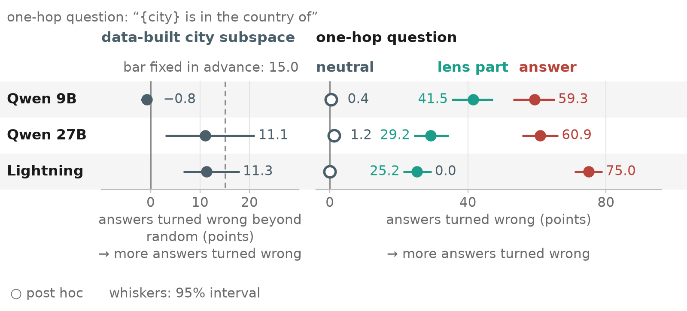

*Removals made orthogonal to the answers cost little. Left: a subspace for the subject built from the data (slate), beyond random, against the bar fixed in advance (dashed). Right, a one-hop question about the subject: removing its lens directions (teal), the answer span (brick), or its directions made orthogonal to the answers (slate, post hoc).*

### Finding 2. The lookup goes around the lens, through an identity or an address

When another item moves, the lookup follows either the item's own locker (its identity) or the position its locker sat in (the address). It never follows the new number. A probe at the bridge word reads the address at 0.85 to 0.99<!-- src: data/figures/depth/data.csv | the locker probe at the bridge word, locker-first scenes -->. Removing the address from the patch stops lookups by position; swapping in another locker's address redirects the lookup. The lens directions rebuild almost none of that swap, so a lens monitor misses both codes.

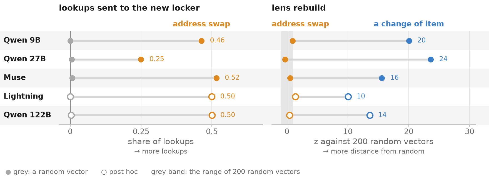

*Swapping in another locker's address moves the lookup, and the lens directions do not rebuild that swap. Left: lookups sent to the new locker (amber), against a same-size random vector (grey). Right: how far above random vectors the lens rebuilds the swap (amber), against a same-size change of item (blue, the positive control).*

Test, results, controls and limits

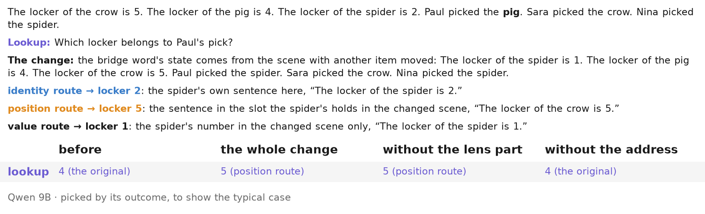

*The three routes predict three different lockers, and here the lookup takes the identity route's. One scene, Qwen 9B, in which another item moved. Over such scenes the whole change sends the lookup to the identity route's locker in 0.48<!-- src: data/figures/depth/data.csv | another item moved, whole: identity share --> of them.*

- **Test.** Train a probe at the bridge word to read which locker sentence holds the item's locker. Remove the probe's directions from the patch. Write another locker's address in. Measure how much of that write the lens directions rebuild.
- **Result.** Shares of the lookup's answers; Lightning is post hoc throughout.

| | 9B | 27B | Muse | Lightning | 122B |
|---|---|---|---|---|---|
| another item moves: lookup by identity | 0.48<!-- src: data/figures/depth/data.csv \| another item moved, whole: identity share --> | 0.66<!-- src: data/figures/depth/data.csv \| another item moved, whole: identity share --> | 0.44<!-- src: data/figures/depth/data.csv \| another item moved, whole: identity share --> | 0.44<!-- src: data/figures/depth/data.csv \| another item moved, whole: identity share --> ○ | 0.61<!-- src: data/figures/depth/data.csv \| another item moved, whole: identity share --> ○ |
| another item moves: lookup by position | 0.51<!-- src: data/figures/depth/data.csv \| another item moved, whole: position share --> | 0.34<!-- src: data/figures/depth/data.csv \| another item moved, whole: position share --> | 0.54<!-- src: data/figures/depth/data.csv \| another item moved, whole: position share --> | 0.55<!-- src: data/figures/depth/data.csv \| another item moved, whole: position share --> ○ | 0.38<!-- src: data/figures/depth/data.csv \| another item moved, whole: position share --> ○ |
| probe reads the address | 0.97<!-- src: data/figures/depth/data.csv \| the locker probe at the bridge word, locker-first scenes --> | 0.99<!-- src: data/figures/depth/data.csv \| the locker probe at the bridge word, locker-first scenes --> | 0.97<!-- src: data/figures/depth/data.csv \| the locker probe at the bridge word, locker-first scenes --> | 0.85<!-- src: data/figures/depth/data.csv \| the locker probe at the bridge word, locker-first scenes --> ○ | 0.92<!-- src: data/figures/depth/data.csv \| the locker probe at the bridge word, locker-first scenes --> |
| position lookups left, address removed | 0.08<!-- src: data/figures/depth/data.csv \| another item moved, no_alf: position share --> | 0.06<!-- src: data/figures/depth/data.csv \| another item moved, no_alf: position share --> | 0.27<!-- src: data/figures/depth/data.csv \| another item moved, no_alf: position share --> | 0.10<!-- src: data/figures/depth/data.csv \| another item moved, no_alf: position share --> ○ | 0.05<!-- src: data/figures/depth/data.csv \| another item moved, no_alf: position share --> ○ |
| … a random part removed instead | 0.54<!-- src: data/figures/depth/data.csv \| another item moved, no_alf_rand: position share --> | 0.25<!-- src: data/figures/depth/data.csv \| another item moved, no_alf_rand: position share --> | 0.55<!-- src: data/figures/depth/data.csv \| another item moved, no_alf_rand: position share --> | 0.56<!-- src: data/figures/depth/data.csv \| another item moved, no_alf_rand: position share --> ○ | 0.36<!-- src: data/figures/depth/data.csv \| another item moved, no_alf_rand: position share --> ○ |
| lookups sent by an address swap | 0.46<!-- src: data/figures/depth/data.csv \| lookup target share, mean over locker pairs, s = 2 --> | 0.25<!-- src: data/figures/depth/data.csv \| lookup target share, mean over locker pairs, s = 2 --> | 0.52<!-- src: data/figures/depth/data.csv \| lookup target share, mean over locker pairs, s = 2 --> | 0.50<!-- src: data/figures/depth/data.csv \| lookup target share, mean over locker pairs, s = 2 --> ○ | 0.50<!-- src: data/figures/depth/data.csv \| lookup target share, mean over locker pairs, s = 2 --> ○ |

- **Controls.** A probe trained on the layout only reads the address at 0.53<!-- src: data/figures/depth/data.csv | the locker probe's layout baseline, locker-first scenes -->. A random vector sends at most 0.01 of lookups anywhere<!-- src: data/figures/depth/data.csv | lookup target share, random direction, s = 4 -->. The 25 lens directions rebuild 0.01 to 0.06 of the address swap<!-- src: data/figures/depth/data.csv | 47.0 (b) share rebuilt by 25 lens directions: pointer -->, as little as for a random vector.
- **Scope.** The identity code lies outside the lens on the 9B, 27B, Muse and Lightning; the 122B was below its gate. The address was found in the locker scenes:
  - removing it cuts position answers beyond a random part on five models, and a swap moves lookups to the swapped-in locker, also across neutral sentences;
  - on the varied scenes (prose, JSON, tables) the address fit on simple scenes does little, but refit on each format it carries the lookup again on the 9B, Muse and Lightning, not the 27B;
  - on the fact passages the lookup rarely takes the position route the address serves (almost never on the 27B), and the less templated passages were not tested;
  - in Python code and tool output (exploratory, the 9B and the 27B) it is readable and needed, added alone it brings few position answers back, and the swap was not run there.
- **Confidence.** Credence [~80%](docs/plans/credences.md)<!-- src: docs/plans/credences.md | address -->. The swap's dose was chosen after its rule, fixed in advance, was read at the wrong dose and said no on every model<!-- src: docs/depth/README.md | read at s = 1 and said no on every model -->.
- **Limits.** The 27B's address is weak, and adding it alone does not bring position answers back. Which code each lookup gives up, scene by scene, is post hoc ([figure](figures/common/readme/10_two_codes.png)). The address points to the item's mention, not to a number; on the 9B and Lightning its swap also changes some recalls ([depth report](docs/depth/README.md#part-iii-the-address-where-the-items-locker-sits)).

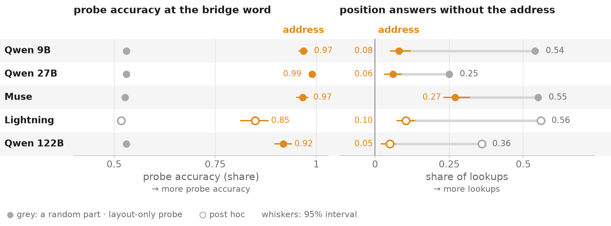

*A probe reads the address, and removing it stops lookups by position. Left: a probe at the bridge word reads which sentence holds the item's locker (amber), against a probe trained on the layout only (grey). Right: lookups still answering by position with the address removed from the patch (amber) or a same-size random part (grey).*

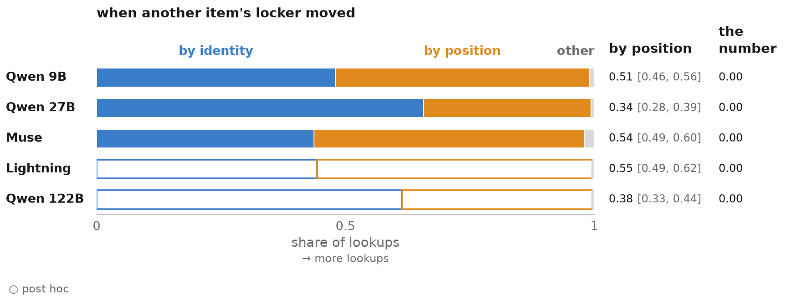

*When another item moves, the lookup follows the item's identity or its position, never the new value. Shares of the lookup's answers by route, per model. The routes scenes are not among the hand-checked views.*

### Finding 3. A lens reading shows what an entity brings to mind, not what the model uses

At the bridge the lens part works as a reference to the entity: what its words evoke. Swapped into another prompt it redirects the recall, even from one neutral sentence naming the entity. At the answer position a probe on the lens part reads the entity at 0.91 to 0.98<!-- src: data/figures/depth/data.csv | 51.10: recall, last token, read peak: the probe's accuracy on the lens part -->. Swapping that part moves at most 0.14 ○ of the answers<!-- src: data/figures/depth/data.csv | 51.10: recall, last token, read peak: the lens swap's switches -->.

Test, results, controls and limits

- **Test.** Swap another entity's lens part into the bridge, taken from its own passage or from one neutral sentence naming it. At the last token, train a probe on the lens part to read the recall's entity, then swap only the lens part and compare with patching the whole state.
- **Result at the bridge**, points of answers moved to the other entity's fact.

| | 9B | 27B | Lightning |
|---|---|---|---|
| the lens part from the entity's own passage | 63.9<!-- src: docs/breadth/data.csv \| swap.q9.swap --> | 63.0<!-- src: docs/breadth/data.csv \| swap.q27.swap --> | 44.8<!-- src: docs/breadth/data.csv \| swap.nl.swap --> |
| from one neutral sentence, as a multiple of the above | 1.10<!-- src: docs/breadth/data.csv \| ptr.q9.neutral --> | 1.09<!-- src: docs/breadth/data.csv \| ptr.q27.neutral --> | 1.01<!-- src: docs/breadth/data.csv \| ptr.nl.neutral --> |
| control: a probe's subspace that reads the fact | 5.5<!-- src: docs/breadth/data.csv \| probe.q9.probe --> | 8.3<!-- src: docs/breadth/data.csv \| probe.q27.probe --> | 2.2<!-- src: docs/breadth/data.csv \| probe.nl.probe --> |
| the lens part on the same relations | 79.5<!-- src: docs/breadth/data.csv \| probe.q9.swap --> | 74.8<!-- src: docs/breadth/data.csv \| probe.q27.swap --> | 62.4<!-- src: docs/breadth/data.csv \| probe.nl.swap --> |

- **Result at the answer position**, shares of recalls; Lightning is post hoc.

| | 9B | 27B | Muse | Lightning | 122B |
|---|---|---|---|---|---|
| probe on the lens part reads the entity | 0.97<!-- src: data/figures/depth/data.csv \| 51.10: recall, last token, read peak: the probe's accuracy on the lens part --> | 0.95<!-- src: data/figures/depth/data.csv \| 51.10: recall, last token, read peak: the probe's accuracy on the lens part --> | 0.95<!-- src: data/figures/depth/data.csv \| 51.10: recall, last token, read peak: the probe's accuracy on the lens part --> | 0.98<!-- src: data/figures/depth/data.csv \| 51.10: recall, last token, read peak: the probe's accuracy on the lens part --> ○ | 0.91<!-- src: data/figures/depth/data.csv \| 51.10: recall, last token, read peak: the probe's accuracy on the lens part --> |
| recalls switched by swapping the lens part | 0.00<!-- src: data/figures/depth/data.csv \| 51.10: recall, last token, read peak: the lens swap's switches --> | 0.01<!-- src: data/figures/depth/data.csv \| 51.10: recall, last token, read peak: the lens swap's switches --> | 0.01<!-- src: data/figures/depth/data.csv \| 51.10: recall, last token, read peak: the lens swap's switches --> | 0.14<!-- src: data/figures/depth/data.csv \| 51.10: recall, last token, read peak: the lens swap's switches --> ○ | 0.00<!-- src: data/figures/depth/data.csv \| 51.10: recall, last token, read peak: the lens swap's switches --> |
| … by patching the whole state | 0.95<!-- src: data/figures/depth/data.csv \| 51.10: recall, last token, read peak: the whole-state patch's switches --> | 0.97<!-- src: data/figures/depth/data.csv \| 51.10: recall, last token, read peak: the whole-state patch's switches --> | 1.00<!-- src: data/figures/depth/data.csv \| 51.10: recall, last token, read peak: the whole-state patch's switches --> | 0.97<!-- src: data/figures/depth/data.csv \| 51.10: recall, last token, read peak: the whole-state patch's switches --> ○ | 0.79<!-- src: data/figures/depth/data.csv \| 51.10: recall, last token, read peak: the whole-state patch's switches --> |

- **More.** In the locker scenes the lens part is the old and the new bridge words, almost never the answer word. Across nine models the entity is readable everywhere and needed only in some: OLMo 32B carries it (swap 41.4) without needing it (knock-out 5.4)<!-- src: docs/breadth/data.csv | swap.ol.swap; ko.ol.mk --> ([nine models](figures/common/readme/13_nine_models.png)). In a conflict between memory and the passage (twin set), the bridge shows the remembered attribute about as strongly whichever source wins.
- **Scope.** The neutral-sentence reference holds on 8 of 8 relations on the 27B<!-- src: docs/breadth/README.md | It holds on 8 of 8 relations on the 27B -->. It needs words that name the entity: a codename defined in the passage shows almost nothing of the person.
- **Confidence.** Credence [~70%](docs/plans/credences.md)<!-- src: docs/plans/credences.md | associations --> that the bridge shows what its words evoke, [~50%](docs/plans/credences.md)<!-- src: docs/plans/credences.md | swap_through_answer --> that the swap runs through the answer on our items, [~80%](docs/plans/credences.md)<!-- src: docs/plans/credences.md | readable_not_used --> that readable is not always used.
- **Limits.** "Not used" means not used at that token and layer, at a real change's size; at twice that size the lens part moves part of Muse's and Lightning's recalls. At described bridges the swap's effect runs through the answer's directions.

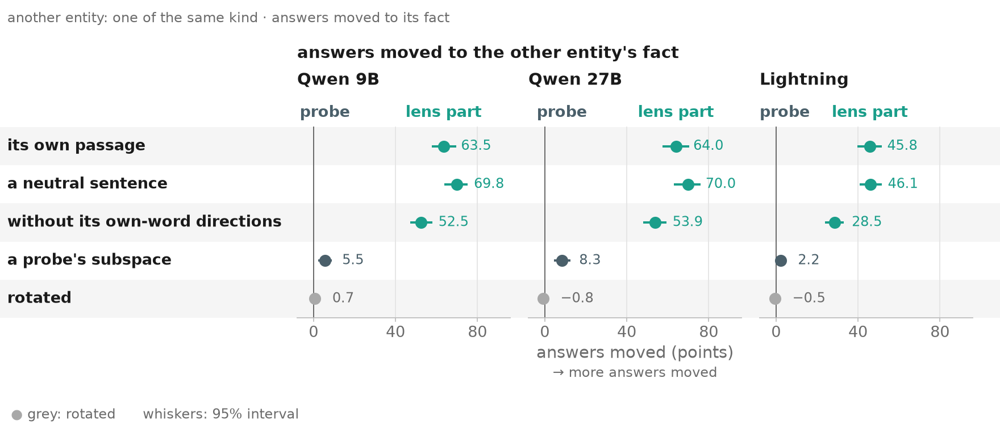

*Another entity's lens part moves the recall to that entity's fact, even from one neutral sentence; a probe's subspace that reads the fact barely does. Rows: the source of the part swapped in at the bridge. Dots: answers moved, in points.*

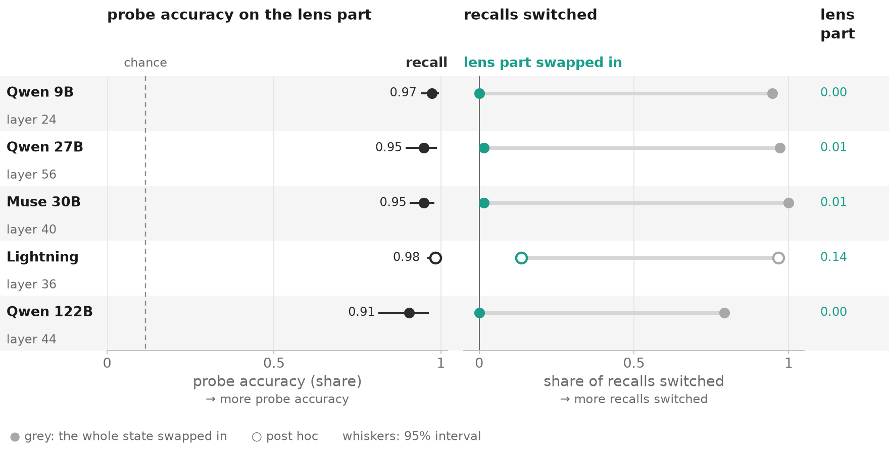

*At the answer position a probe on the lens part reads the recall's entity, yet swapping that part barely moves the answer. Left: the probe's accuracy, at the layer where it peaks; dashed: chance. Right: recalls switched by swapping only the lens part (teal) or the whole state (grey).*

Other results (ledger only)

- **Agents.** On one relation posed as agent tasks, the knock-out costs producing the answer 35.7<!-- src: data/figures/writeup/data.csv | figA1.produce.q9 --> / 36.6<!-- src: data/figures/writeup/data.csv | figA1.produce.q27 --> / 50.8<!-- src: data/figures/writeup/data.csv | figA1.produce.nl --> points beyond a rotated part, picking the true one of two 10.1<!-- src: data/figures/writeup/data.csv | figA1.pick.q9 --> / 4.5<!-- src: data/figures/writeup/data.csv | figA1.pick.q27 --> / 2.3<!-- src: data/figures/writeup/data.csv | figA1.pick.nl -->, and verifying a claim −16.3<!-- src: data/figures/writeup/data.csv | figA1.verify.q9 --> / 3.8<!-- src: data/figures/writeup/data.csv | figA1.verify.q27 --> / 3.7<!-- src: data/figures/writeup/data.csv | figA1.verify.nl --> (9B / 27B / Lightning; several cells descriptive; [figure](figures/common/writeup/a01_agents.png)). Credence [~55%](docs/plans/credences.md)<!-- src: docs/plans/credences.md | agents -->.
- **Pretraining.** The 9B base model's split is 33.7<!-- src: docs/breadth/data.csv | v1.q9base.qa -->, its instruct model's 41.2<!-- src: docs/breadth/data.csv | v1.q9inst.qa -->.

## What we predicted, and what happened

Our committed guesses; each verdict links to its row in the [hypotheses ledger](docs/plans/hypotheses.md).

- The bridge counts only through its own word → **[failed](docs/plans/hypotheses.md#h0-deflationary-failed-for-recalled-entities-held-in-part-for-computed-numbers)** for recalled entities, **held in part** for computed numbers.
- A bridge used to recall is inside the lens part, one used to look up is outside the lens part → **[not separable](docs/plans/hypotheses.md#h1-use-not-separable-from-h2-on-the-main-tests-where-they-come-apart-the-data-follow-h2)** from the next guess.
- A recalled answer keeps the bridge inside the lens part → **[favored, not proven](docs/plans/hypotheses.md#h2-answer-source-favored-not-proven)**.
- Any lookup in the chain puts the bridge outside the lens part → **[failed](docs/plans/hypotheses.md#h3-any-retrieval-from-context-failed)**.
- Memory steps need the lens part, prompt lookups do not → **[held](docs/plans/hypotheses.md#c1-memory-steps-need-the-j-space-prompt-lookups-dont-held-graded-across-models)**, graded across models.
- The lens steers recall-used bridges, not lookup-used ones → **[withdrawn](docs/plans/hypotheses.md#c2-reading--using-the-lens-steers-recall-used-bridges-not-lookup-used-ones-withdrawn-24-oct)**, replaced by the swap.
- A bridge in the prompt is written only when a recall uses it → **[held in part](docs/plans/hypotheses.md#c2-a-stated-or-computed-bridge-is-written-only-when-a-recall-uses-it-held-in-part)**.
- Computed bridges sit in the workspace → **[not tested in the final design](docs/plans/hypotheses.md#c3-computed-bridges-sit-in-the-j-space-beyond-their-own-word-not-tested-in-the-final-design)**.
- The split follows the Olmo architecture → **[failed](docs/plans/hypotheses.md#architecture-22-oct-c1-holds-on-olmo-hybrid-7b-and-fails-on-olmo-3-7b-failed)**.
- Muse's recalls survive the knock-out → **[did not reproduce](docs/plans/hypotheses.md#the-muse-puzzle-22-oct-removal-barely-touches-muses-recalls-while-writing-redirects-them-did-not-reproduce-on-jsuite-v2)** on the main passage set.
- An address readout steers the lookup → **[held in part](docs/plans/hypotheses.md#a-pointer-readout-that-steers-the-lookup-depth-held-in-part)**.
- Gemma and the Olmo post-training ladder → **not tested** ([Gemma](docs/plans/hypotheses.md#gemma-4-31b-not-tested-in-the-final-design-untestable), [ladder](docs/plans/hypotheses.md#the-olmo-3-7b-post-training-ladder-base-sft-dpo-instruct-not-tested-in-the-final-design)).

## Where it does not hold

- **Longer chains.** On three-hop chains the cost does not simply follow the recalled hop. Lightning fits that rule; the 27B breaks it twice, once dropping only 8.2<!-- src: docs/breadth/data.csv | mod.q27.threehop.paper10.PPM-PPP --> points where the rule predicts a large drop.
- **The 27B's lookup** leans on the lens part partly: 0.60<!-- src: docs/depth/x0_numbers.json | lk_excess_k100_27b --> of its switches are blocked beyond random at 100 directions.
- **Known facts.** When the passage gives a fact the model knows, the 9B's and 27B's lookups follow the lens part (0.26 to 0.28 beyond random)<!-- src: data/figures/depth/data.csv | Z1: lookup, switches lost beyond a random part -->.
- **Across models the split is graded.** It is strong and specific on three of nine. On the rest it is weaker, not specific, shared with the logit lens, or gone when scored by probability.

Chains, order and model by model

- **Two tests disagree on two models.** The 122B fails the band test by probability but passes the one-layer test. Muse shares much of its band effect with the logit lens, but not at one layer.

- **Chains.** Each hop is read in the passage (P) or recalled (M); the rule says a chain needs the lens part when its last hop is recalled. On the 27B, P → P → M costs 8.2 [-4, 21]<!-- src: docs/breadth/data.csv | mod.q27.threehop.paper10.PPM-PPP --> points beyond the all-passage chain, on the second seed 8.6 [-4, 23]<!-- src: docs/breadth/data.csv | mod2.q27.threehop.paper10.PPM-PPP -->. M → M → P costs 20.5 [5, 35]<!-- src: docs/breadth/data.csv | mod.q27.threehop.paper10.MMP-PPP -->, which was not predicted. The 9B's chains cannot be read: its all-passage chain alone drops 45.8<!-- src: docs/breadth/data.csv | mod.q9.threehop.paper10.loss.PPP --> points ([chain figures](figures/breadth/readme/10a1_beyond.png)).

  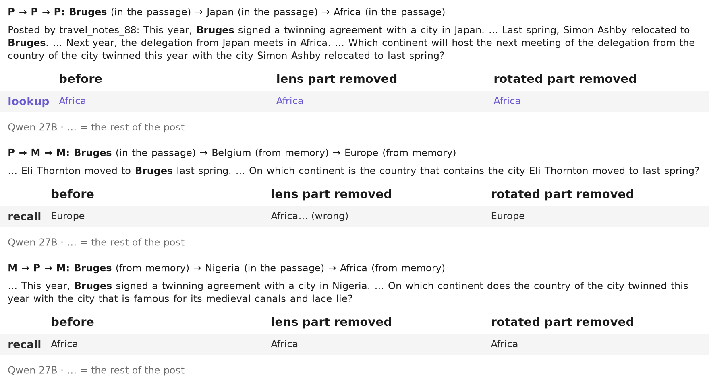

  *On this entity only the chain ending in two recalls turns wrong, and only without the lens part. Three three-hop chains, Qwen 27B: each hop is read in the passage (P) or recalled (M). Answers before the removal, with the lens part removed, and with a rotated part removed.*

- **The 27B's lookup** at 25 directions: 0.14<!-- src: docs/depth/x0_numbers.json | lk_excess_27b --> beyond random; the 122B's at 100 directions: −0.12<!-- src: docs/depth/x0_numbers.json | lk_excess_k100_122b --> ([figure](figures/common/readme/14_directions.png)).
- **Question order** has no general effect. With the question before the scene, the 27B's lookup has 0.11<!-- src: data/figures/depth/data.csv | the lookup, question before minus after (paired) --> more of its switches blocked (interval from 0.01<!-- src: data/figures/depth/data.csv | 53.1: the lookup, question before minus after (paired): the interval's lower bound -->); the 122B's -0.05<!-- src: data/figures/depth/data.csv | the lookup, question before minus after (paired) -->. On the twin set the 27B's lookup leans less on it, and the 9B's and Lightning's do not move.
- **Known facts.** With made-up facts the split returns on the 9B and the 122B.
- **Model by model.** Weak: Ministral 23.3 and DeepSeek 17.9 points<!-- src: docs/breadth/data.csv | ko.mi.mk; ko.ds.mk -->. Not specific on Bolt and DeepSeek: at 100 directions a same-size principal-direction removal costs 24.0 against 31.3, and 25.9 against 28.7<!-- src: docs/breadth/data.csv | dose.nb.k100.pc; dose.nb.k100; dose.ds.k100.pc; dose.ds.k100 -->. Shared with the logit lens: Muse, 34.6 of its 59.9<!-- src: docs/breadth/data.csv | ko.mu.u; ko.mu.mk -->. Gone by probability: the 122B's 48.5 drops to 1.7<!-- src: docs/breadth/data.csv | ko.q122.mk; ko.q122.soft -->. Untestable: the knock-out breaks plain text on Gemma 4 31B-it, gpt-oss-20b and Kolibri-1 (9.3, 4.7 and 6.4 nats added)<!-- src: docs/breadth/data.csv | text.gemma; text.gptoss; text.kol -->.

## How we checked

- **Rules fixed in advance.** Breadth runs follow a [pre-registration](docs/breadth/prereg_replication_1022.md) with amendments committed before each run. Depth [predictions](predictions/README.md) were committed before results were opened, then scored; they did worse than always guessing even odds (mean Brier 0.32)<!-- src: docs/depth/README.md | mean Brier 0.32 over 121 answers -->.
- **What we dropped**, with the test that dropped it: [depth](docs/depth/README.md#tested-and-dropped), [breadth](docs/breadth/README.md#8-what-did-not-hold).

Reruns, recounts, run provenance and red-teaming

- **Reruns.** From a clean checkout the breadth headline runs match row for row: 0 of 22325 rows differ on the 27B<!-- src: docs/breadth/README.md | 0 of 22325 -->.
- **Independent recounts.** The 63 numbers of the one-layer and routes tests, recounted by agent-written code that does not import the analysis code (e549c348), all match their sources<!-- src: data/figures/depth/data.csv | checks: the independent recount, rows matching -->.

- **The runs behind this page.** Its numbers trace to 67<!-- src: data/figures/provenance.csv | prov.runs --> run folders: 6<!-- src: data/figures/provenance.csv | prov.no_commit --> of their manifests record no git commit, and 9<!-- src: data/figures/provenance.csv | prov.no_lens_sha --> no lens sha256 (where a commit is recorded, the lens follows from the model's pin at that commit, `configs/models/*.yaml`); 14<!-- src: data/figures/provenance.csv | prov.untraced --> cited files are CPU read-outs or verdicts with no manifest of their own. Counted by `scripts/provenance_counts.py`.
- **Environment switches.** The 43<!-- src: data/figures/provenance.csv | g1.writers_unrecorded --> late-sprint run scripts did not record their environment switches; 26<!-- src: data/figures/provenance.csv | g1.writers_switches --> of them now do, and the other 17<!-- src: data/figures/provenance.csv | g1.writers_left_out --> load no model. For the runs already on disk the `BJ_` variables (device map, batch size) were not recorded.
- **Depth reruns and checks.** Rerun labels agree on 382-400 of 400 items per arm<!-- src: docs/depth/README.md | 382-400 of 400 items per arm -->; automatic checks read 45,942 items<!-- src: docs/depth/README.md | 45,942 items read --> and their recount matches 245 of 245 numbers<!-- src: docs/depth/README.md | their recount matches 245 of 245 -->.
- **Red-teaming.** A shortcut in one twin-set variant, and false values in the conflict variant that were too easy to reject, were fixed by rebuilding both sets before any result was read.

## Related work and what is new

- **Not new.** Removing the top lens directions hurts free-form recall and multi-step reasoning, and spares extraction and multiple choice (Gurnee et al. 2026, Figure 24<!-- src: docs/shared/references.md | Gurnee et al. 2026; Figure 24 -->). Subjects are enriched with their attributes (Geva et al. 2023<!-- src: docs/shared/references.md | Geva, Bastings, Filippova and Globerson 2023 -->). Entities are bound in context (Feng & Steinhardt 2023) and found through "lookback pointers", our addresses (Prakash et al. 2025)<!-- src: docs/depth/README.md | (Feng & Steinhardt 2023); "lookback pointers" [addresses] (Prakash et al. 2025) -->. Memory and context are arbitrated outside the verbal workspace (Kawada & Kellis 2026<!-- src: docs/shared/references.md | Kawada and Kellis 2026 -->).
- **New here.** Matched recall and lookup twins across nine models with three kinds of control. The address as the part the lens misses. A miss is plausible, since an address has no single word. We checked, post hoc, that position words do not carry it. Asked for the position, the 27B's lens top five hold the right position word on 0.00<!-- src: data/figures/depth/data.csv | 47.10: lens top-5 holds the right ordinal (report prompt) --> ○ of items. New: the causal tests of the address on five models ([Finding 2](#finding-2-the-lookup-goes-around-the-lens-through-an-identity-or-an-address)). The lens directions rebuild only 0.01<!-- src: data/figures/depth/data.csv | 47.0 (b) share rebuilt by 25 lens directions: pointer --> to 0.06<!-- src: data/figures/depth/data.csv | 47.0 (b) share rebuilt by 25 lens directions: pointer --> of its swap, about as little as random vectors. False positives and negatives of lens readouts at entities.

Methods we build on

- Gur-Arieh et al. (2025) for the routes, mass-mean directions (Marks & Tegmark 2023) for the address, Makelov et al. (2023) for random parts<!-- src: docs/depth/README.md | Gur-Arieh et al. (2025); (Marks & Tegmark 2023); Makelov et al. (2023) -->. All [references](docs/shared/references.md).

## Open questions

The open questions, each with what we would run next

- **Why does the 27B behave differently?** Next, the same twin items through both lookup measures.
- **Why does the recall follow the lens part without needing it at one layer?** Removing it over four layers costs the 9B's recall about a quarter<!-- src: docs/depth/README.md | Removing it over four layers costs the 9B's recall about a quarter. -->. Next, map where the other copies sit.
- **Does the address exist in natural text?** Next, a probe trained on one format and tested on another.
- **Can a monitor tell recall from lookup?** Next, a lens readout plus an address probe, scored on which source the model uses.
- **Does a computed bridge go through the workspace?** Computed numbers do not; a computed entity is untested.
- **What makes models differ?** Next, OLMo through the dose grid, and base and instruct pairs of one family.
- **Is the split general damage?** Next, a control matched on its cost to plain text instead of norm or energy.
- **Beyond our setting.** Next, multi-token answers and reasoning traces.

## Reproduce

To read the docs and figures only: `git clone --filter=blob:none --sparse https://github.com/zach-perlman/bridge-jspace` then `git sparse-checkout set docs figures data/figures`.

- **Tier one, the figures and READMEs from tracked numbers (CPU).** `uv sync && make readme`.
- **Tier two, this page's numbers against the run files (CPU).** `make check-numbers`: every number on the three READMEs traces to tracked files.
- **Tier three, the runs (GPU).** `make run CONFIG=…` ([DEVELOPER.md](DEVELOPER.md#reproduce)). Not re-run for this page.

Measured in fresh clones

On an Apple M5<!-- src: data/figures/reproduce.csv | repro.hw.cpu --> laptop (10<!-- src: data/figures/reproduce.csv | repro.hw.cores --> cores, 24<!-- src: data/figures/reproduce.csv | repro.hw.ram_gb --> GB RAM), at commit f72d8a7b<!-- src: data/figures/reproduce.csv | repro.commit -->, by `scripts/measure_reproduce.py`.

| tier | time | disk | reads |
|---|---|---|---|
| read only | 2<!-- src: data/figures/reproduce.csv \| repro.read.time_s --> s | 72<!-- src: data/figures/reproduce.csv \| repro.read.files_mb --> MB of files, 52<!-- src: data/figures/reproduce.csv \| repro.read.git_mb --> MB of history | docs, figures, data/figures |
| one | 68<!-- src: data/figures/reproduce.csv \| repro.t1.readme_s --> s, exit 0<!-- src: data/figures/reproduce.csv \| repro.t1.exit --> | 516<!-- src: data/figures/reproduce.csv \| repro.t1.files_mb --> MB of files, 137<!-- src: data/figures/reproduce.csv \| repro.t1.git_mb --> MB of history | 124<!-- src: data/figures/reproduce.csv \| repro.t1.results_folders --> run folders, 383<!-- src: data/figures/reproduce.csv \| repro.t1.results_mb --> MB |
| two | 2.5<!-- src: data/figures/reproduce.csv \| repro.t2.test_s --> s, exit 0<!-- src: data/figures/reproduce.csv \| repro.t2.exit -->, 199<!-- src: data/figures/reproduce.csv \| repro.t2.passed --> tests passed | 135<!-- src: data/figures/reproduce.csv \| repro.t2.files_mb --> MB of files, 31<!-- src: data/figures/reproduce.csv \| repro.t2.git_mb --> MB of history | 47<!-- src: data/figures/reproduce.csv \| repro.t2.run_folders --> run folders, 96<!-- src: data/figures/reproduce.csv \| repro.t2.run_mb --> MB |
| three | not re-run | a GPU of 80<!-- src: data/figures/reproduce.csv \| repro.t3.gpu_gb_27b --> GB for the 27B | the pinned models |

## Repository guide

- **Reports.** The [depth report](docs/depth/README.md) (locker scenes) with its [experiment ledger](docs/depth/EXPERIMENTS.md); the [breadth report](docs/breadth/README.md) (fact passages); the [hypotheses ledger](docs/plans/hypotheses.md); a [map of the documents](docs/README.md).
- **Figures and code.** [figures/](figures/) by set; numbers in `data/figures/` and `docs/breadth/data.csv`; code in `scripts/` and `src/`; runs in `results/`.
- **This page** is built from `docs/readme/README.template.md` by `scripts/readme_root.py` ([DEVELOPER.md](DEVELOPER.md)).
- **Licences and citing.** Code is [MIT](LICENSE); each data file keeps its source's terms ([data/SOURCES.md](data/SOURCES.md)), and data derived from model weights keeps the model's licence. Cite with [CITATION.cff](CITATION.cff).
