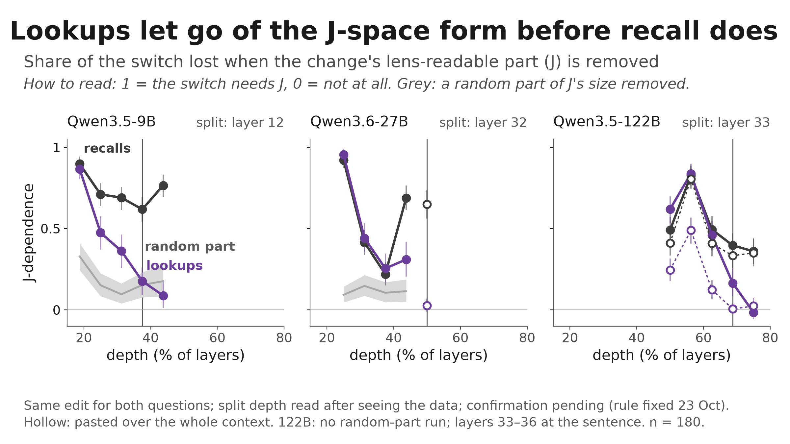
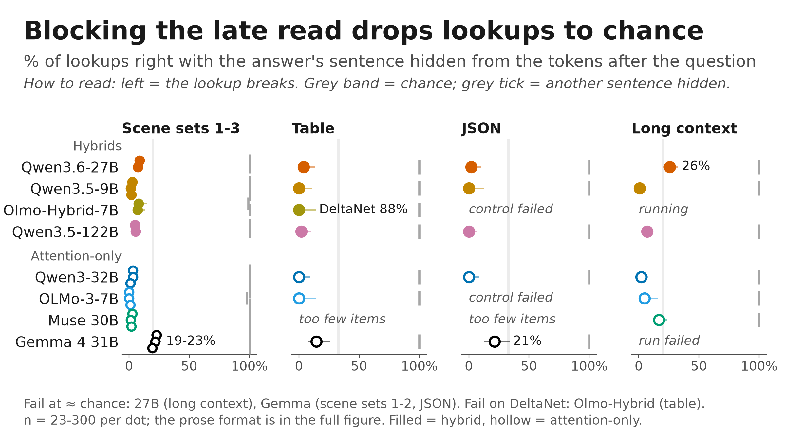
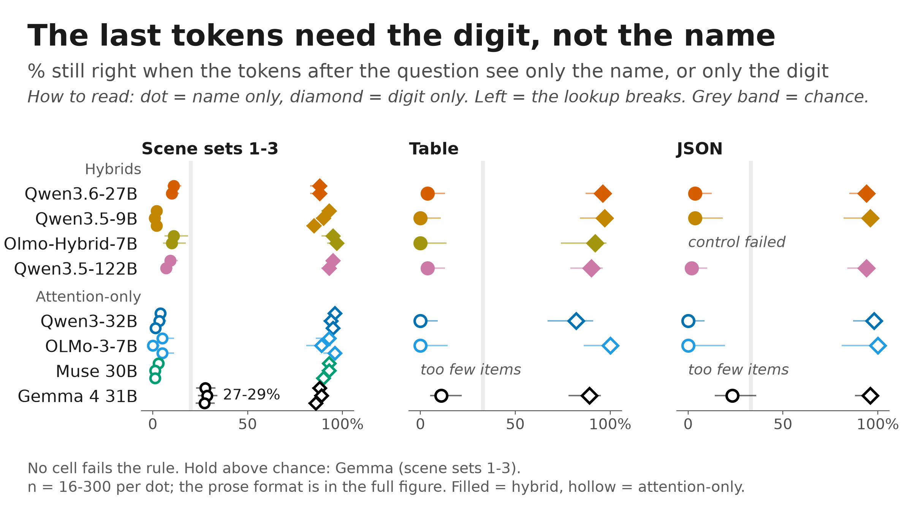
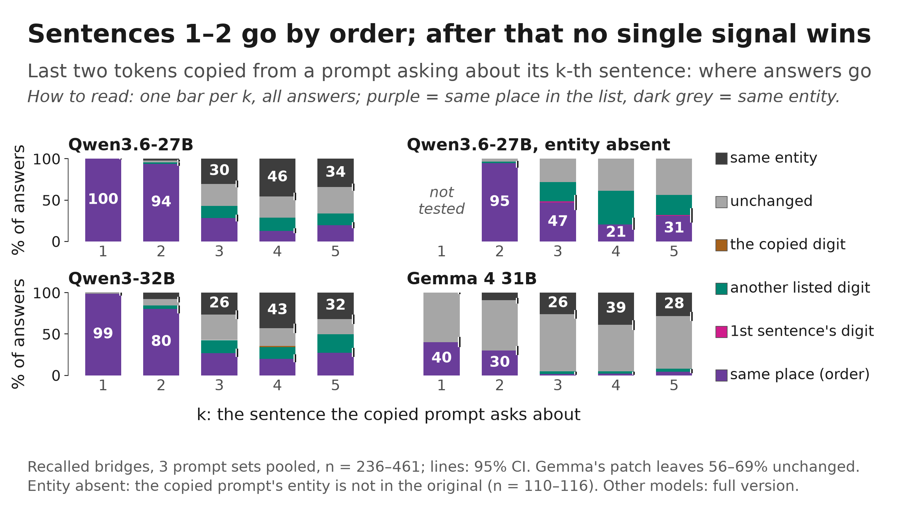
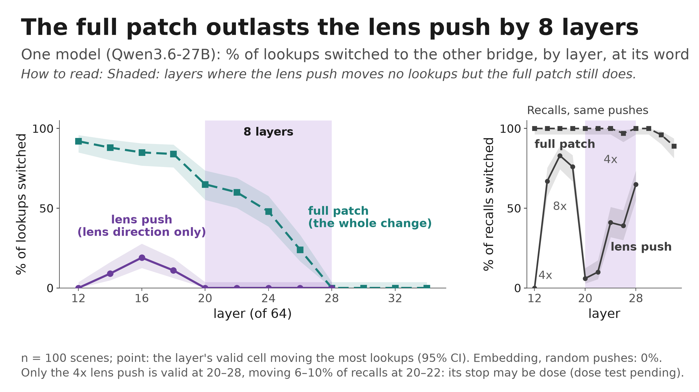

<!-- Generated by scripts/readme_build.py from docs/README.template.md and grid.csv; edit the template. -->
# bridge-jspace

**The question.** A two-step question makes a model find an entity in between, the **bridge**, and then use it. A **J-lens** reads hidden states as words; the **J-space** is the part of a hidden state it reads (Gurnee et al. 2026). Does the model use the bridge in the form the lens reads, or by another route?

> "Which locker belongs to the animal known for oinking?" The bridge is *pig*. A **lookup** takes the pig's locker number from a sentence in the prompt; a **recall** ("How many legs does it have?") takes the answer from memory.

> **Status, 23 Oct 2026, night.** Built at c641cb3 from `results/cross_model/20261023T105852Z`; the 23 Oct runs are quoted from their own verdict files (linked). Exploration phase: nothing here is hand-verified; an independent agent recomputed C1 and C2 from raw rows. Eight models: hybrids with DeltaNet layers (Qwen3.6-27B, Qwen3.5-9B, Olmo-Hybrid-7B, Qwen3.5-122B) and attention-only (Qwen3-32B, OLMo-3-7B, Muse 30B, Gemma 4 31B).

## TL;DR

- **C1 (credence ~85%).** A lookup ends with a late attention read: the last tokens take the answer's digit from its sentence; the question's tokens take the entity's name.
- **C2 (~75%).** The last tokens carry an order label and the bridge's identity. The label decides the 1st and 2nd sentence; from the 3rd, identity is the most common outcome when the entity is listed, but no single signal decides.
- **C3 (~60%; its split depth was read after seeing the data).** Remove the lens-readable part from an edit of a stated bridge: early in depth this hurts lookups and recalls alike; past a model-specific depth it hurts only recall.

| Claim | Key number (27B) | Holds on | Control | Confidence | Verified |
|---|---|---|---|---|---|
| [C1](#c1-a-lookup-ends-with-a-late-attention-read) late read | 7% still right with the read blocked | 6 of 8 models (old rule); v2 below | another sentence blocked keeps 89-100% | medium | agent re-check |
| [C2](#c2-an-order-label-then-the-bridges-identity) order, then identity | place leads identity by +94 / +18 points (sentences 1-2 / later) | 7 of 8 models | random patch of the same size | medium | agent re-check |
| [C3](#c3-lookups-let-go-of-the-j-space-form-before-recall-does) split by depth | without the lens part: lookups 84% → 4%, recalls 98% → 8% at layer 16; at layer 32 lookups 83% → 81%, recalls 78% → 27% (n = 180) | 27B, 9B; 122B weaker; OLMo-3 small | a random part of the same share removed instead | open (post hoc) | none |

## C1. A lookup ends with a late attention read

**What we did.** Stopped the last tokens (the chat-template tokens after the question) from attending to the answer's sentence in every attention layer; then hid all of that sentence but its name, or all but its digit.

**Key numbers**
- Blocking the read leaves 7% right on the 27B; with only the name visible, 10%; with only the digit visible, 88%.
- With every later token blocked too, the last tokens carry at least 70% of the drop wherever that is testable (0.75-1.01 on 6 models, two scene sets and long text; 122B 1.01 and 0.95) ([summary](docs/runs_2026-10-23/late_read.md)).
- Where answers survive the block (Gemma 19-23%, the 27B's long text 26%), swapping the hidden digit shows a relay through other tokens: the new digit gains +20 [+16, +25] and +24 [+18, +29] points, also with the DeltaNet layers blocked ([Gemma](results/relay_swap), [27B](results/relay_swap)).
- Real paragraphs (SQuAD, n = 426-502): 4.7-7.6% right on the 9B, 32B and OLMo-3; 30.1% [26.1, 34.4] on the 27B.

**Controls**
- Another sentence blocked keeps 89-100%; on the hybrids, the same sentence blocked in the DeltaNet layers instead keeps 88-100%.

**Weak spots**
- The 27B on real paragraphs keeps 30%; no digit swap has been run there, so it is open, not "a relay".
- On the 32B, OLMo-3 and the 122B, blocking every later token leaves more right than blocking the last tokens only; on the 32B its 10% matches blind guessing over 1-9 ([analysis](results/late_read_guess/20261023T140024Z/table.md)).

Prior work: retrieval heads (Wu et al. 2025); lookbacks, an address then a payload (Prakash et al. 2026): [docs/prior_art.md](docs/prior_art.md).

Per model: the late read; the digit-not-name figure

| Model | Setting | Result [95% CI] | n | Verdict | All settings |
|---|---|---|---|---|---|
| Qwen3.6-27B | scene set 2 | 7% [5, 11] | 300 | holds | 5 of 6 hold; long context: fails |
| Qwen3.5-9B | scene set 2 | 1% [0, 3] | 300 | holds | 7 of 7 hold |
| Olmo-Hybrid-7B | scene set 2 | 7% [3, 14] | 100 | holds | 2 of 5 hold; prose (14 items): can't tell (a control failed); table (24 items): fails; JSON (14 items): can't tell (a control failed) |
| Qwen3.5-122B | scene set 2 | 5% [3, 8] | 300 | holds | 6 of 6 hold |
| Qwen3-32B | scene set 2 | 3% [2, 6] | 299 | holds | 7 of 7 hold |
| OLMo-3-7B | scene set 2 | 0% [0, 4] | 100 | holds | 5 of 7 hold; prose (18 items): can't tell (a control failed); JSON (16 items): can't tell (a control failed) |
| Muse 30B | scene set 2 | 1% [0, 3] | 300 | holds | 4 of 5 hold; prose (5 items): can't tell (a control failed) |
| Gemma 4 31B | scene set 2 | 22% [17, 27] | 300 | fails | 2 of 6 hold; scene set 1: fails; scene set 2: fails; prose: fails; JSON: fails |

## C2. An order label, then the bridge's identity

**What we did.** Two prompts list the same entities in a different order; we copied the last two tokens of one into the other at one layer (27B: layer 50). Each answer is a different digit, so the answer shows what the copy pointed to.

**Key numbers**
- 27B, three scene sets, recalled bridge: the same place wins at sentences 1-2 (100%, 94%); at 3-5 the same entity is the largest single outcome (30 / 46 / 34%), the same place 28 / 13 / 19%, unchanged 26-32% ([table](results/slot_outcomes/20261023T135208Z/table.md)).
- The donor asks about an entity the original never lists: same place minus first sentence = +48 [+43, +52] points (n = 453); by asked sentence 2-5 the same place gets 95 / 47 / 21 / 31%; the first sentence 0.7% ([verdict](results/absent_entity/d3_absent_entity_27b_r2_20261023-150258/verdict.md)).
- "Another digit" answers are mostly the neighbour of the asked place (77 of 100 at sentences 3-5): the label is still there after the 2nd sentence, but blurry.

**Controls**
- A random patch of the same size: −0.2 [−0.7, 0.0] points; an entity-matched control changes 0.5%.

**Weak spots**
- One layer per model; the 27B's was chosen after its first runs.
- From the 3rd sentence the largest share is often "unchanged" when the bridge is named; Gemma's copy leaves most answers unchanged.
- How the label counts is mixed: list order with a moved filler on 7 of 8 models, with one sentence more or fewer on 3 of 8.

Prior work: binding and ordering IDs (Feng & Steinhardt 2024; Dai et al. 2024); Mixing Mechanisms (Gur-Arieh et al. 2026) finds a last-position peak we do not see: [docs/prior_art.md](docs/prior_art.md).

Per model: place vs identity by the rule fixed in advance

| Model | Setting | Result [95% CI] | n | Verdict | All settings |
|---|---|---|---|---|---|
| Qwen3.6-27B | scene set 2 | +94 / +18 points | 307 / 460 | holds | 5 of 5 hold |
| Qwen3.5-9B | scene set 2 | +51 / +43 points | 167 / 283 | holds | 5 of 5 hold |
| Olmo-Hybrid-7B | scene set 2 | +52 / +35 points | 209 / 317 | holds | 4 of 4 hold |
| Qwen3.5-122B | scene set 2 | +64 / +41 points | 170 / 280 | holds | 5 of 5 hold |
| Qwen3-32B | scene set 2 | +82 / +12 points | 179 / 268 | holds | 4 of 5 hold; scene set 1: fails |
| OLMo-3-7B | scene set 2 | +51 / +26 points | 150 / 243 | holds | 5 of 5 hold |
| Muse 30B | scene set 2 | +79 / +30 points | 174 / 266 | holds | 5 of 5 hold |
| Gemma 4 31B | scene set 2 | +24 / +28 points | 164 / 262 | holds | 3 of 3 hold |

## C3. Lookups let go of the J-space form before recall does

**What we did.** Changed a stated bridge (Jack's pet: cow → pig) and pasted the change into the prompt, whole or without its lens-readable part (the part in the J-space), at the bridge's word, over depth. At these positions the lookup and the recall get the identical patch on the same scenes, because the question comes after: a difference is in what the reader uses, not in the edit.

**Key numbers** (J-dependence = the share of switches lost without the lens part; [27B](results/d1_verdict/d1_necessity_parts_27b_r2_20261023-164424/verdict.md), [9B](results/d1_verdict/qwen35_9b_d1_necessity_parts_r2_20261023-162800/verdict.md), [OLMo-3](results/d1_verdict/olmo3_7b_instruct_jpp_d1_necessity_parts_r2_20261023-161410/verdict.md))
- 27B: lookups 0.95, 0.44, 0.25, 0.31 at layers 16, 20, 24, 28, then 0.03 at 32; recalls 0.92, 0.41, 0.22, 0.69, then 0.65.
- 9B: lookups 0.86 → 0.11 over layers 6-14, at the random level from layer 12; recalls stay 0.62-0.90.
- Removing a random part of the same share instead costs lookups 0.10-0.32 and recalls at most 0.06.
- Convergent, quoted until Zach pushes his runs: knocking out the lens's top directions costs recall 36, 38, 22 and 7 points more than lookups on the 27B, 9B, 32B and Muse.

**Controls**
- A random part of the same share (above); the whole change moves at least 50% of lookups at every cell counted.

**Weak spots**
- **Post hoc.** The split depth was read per layer after the pre-registered rule failed ("does not hold" on all three models: it pooled layers before the split). A confirmation with a fresh scene set and a rule fixed in advance is the first next step.
- The 27B's recall dips at layers 20-24 (0.41, 0.22) before rising at 28; OLMo-3's gap is small (recall 0.2-0.4); the 122B runs have no random-part removal at these cells.
- The bridge's own lens direction is a weak handle: an 8x lens push steers recall where cells are valid, and lookups only before the split (27B layers 16-18, 122B 27-30).

Prior work: the workspace paper (Gurnee et al. 2026); two-hop recall resolves its bridge early (Biran et al. 2024): [docs/prior_art.md](docs/prior_art.md).

The 27B close-up, the lens push per layer, the 122B, and the retired figures

- Size-matched patch at the word (27B, [dose](results/early_push_where/d4_layer_gap_dose_27b/summary.md), [without J](results/early_push_where/d4_layer_gap_perp_27b/summary.md)): with its lens part 20% [13, 29] of lookups at layer 20, stopping at 28 (8x only); without it 0% [0, 4] at every layer. At layer 16 the lens part alone moves 42% [33, 52] of lookups, the rest 0% ([split](results/early_push_where/d4_l16_split_27b_r2/summary.md)).
- The 122B: J-dependence of lookups 0.62, 0.84, 0.46 at layers 24, 27, 30, 0.18 at 33 (sentence); recalls 0.49, 0.83, 0.49, 0.39. Its late-switch rule is inconclusive: at layers 33 and 36 the lens part moves 0-1% of lookups but its recall control fails (26%, 21%, 8% against 30%); its 2x H100 numbers drift 4-7 points from the H200's ([summary](docs/runs_2026-10-23/parts.md)).
- The lens push per layer (valid cells): the 32B holds (word, layer 24: recalls 59%, lookups 5%); Gemma has no valid cell ([summary](docs/runs_2026-10-23/order.md)).

Retired from the main page: [window](figures/cross_model/window_main.png) (mixed scene sets, unmatched sizes), [necessity at one cell](figures/cross_model/necessity_main.png), [stated bridge, sufficiency](figures/cross_model/stated_bridge_main.png).

## What didn't work, and what we learned

- **Sufficiency nulls.** "The lens part moves 1% of lookups" → the rest at the same size moves 1% (27B) and 3% (9B) too → a small part moving nothing is a size result; test necessity, and compare readers given the same edit.
- **The null for blocking.** Chance (20%) → the blocked tokens cannot see the hidden digit, and blocking more can raise accuracy (32B 3% → 10%, blind guessing) → test information directly, with a digit swap.
- **The lens push as "the J-space".** An 8x push on the bridge's own direction → at natural size the patch's projection on the two animals' lens vectors moves 0% of lookups → the lens names one direction; the model uses a broader lens-readable part.
- **A band where "the lookup ignores the J-form".** It held for unmatched sizes on different scene sets → with size-matched patches on the same scenes, the lookup needs the lens part before the split → band claims need the same scenes and matched sizes.
- **Fallback vs order.** Dan predicted the absent-entity donor would fall back to the 1st sentence → 0.7% did.
- Earlier, one line each: the fitted position direction, head L51 H22, color words, the OLMo ladder, and the first band table built from invalid cells ([CHANGELOG.md](CHANGELOG.md)).

## Boring explanations

| Explanation | Test | Result | Status |
|---|---|---|---|
| The lens part is just small | The rest at its size; a random part of the same share removed | The rest moves 1-3% of lookups (sufficiency says nothing); removing a random part costs lookups 4-25 points, recalls 0-7 | checked; C3 rests on necessity |
| The edit differs between lookups and recalls | The identical patch at statement positions | By design | checked |
| Any token-aligned part would do | The same test with a logit-lens or embedding dictionary at the same atom count | – | open: the main one for C3 |
| A relay explains surviving answers | Digit swap under the block | +20 (Gemma), +24 (27B long text) | checked |
| A fallback to the 1st sentence explains "order" | Donor entity absent from the original | Fallback 0.7%, same place 48% | checked |
| Hardware (the 122B on H100 vs H200) | The same scenes on both | Lens parts ±4-7 points, the whole copy ±1 | reported |
| FP8 vs a bf16-fit lens; the only mixture-of-experts model | None | – | open |
| Generated lists only | SQuAD paragraphs | Holds on 3 of 4; the 27B 30% | partly checked |

## Choices made after seeing the data (23 Oct)

| Choice | Why | What we did |
|---|---|---|
| C3's split depth read per layer | The pre-registered rule pooled layers before the split and failed on all three models | Labeled post hoc; a confirmation with a rule fixed in advance is next |
| Claims regrouped into C1-C3 | Today's runs changed the band and old claim 6 | Old claims 5-7, the band and the 122B section folded into C3 |
| Old claim 6's sufficiency headline dropped | The rest at the lens part's size moves no lookups either | Moved to "what didn't work" |
| The 122B late switch reported as inconclusive | Its recall control fails at layers 33 and 36 | Its necessity reading goes into C3, post hoc |
| The 27B on SQuAD left open | No digit swap there | Not called a relay |
| Our J++ fits as the main lens (32B, OLMo-3) | The plain J-lens fails the 32B's gate | Other lenses listed beside, never switched in |

Older choices: [CHANGELOG.md](CHANGELOG.md).

## Pre-registered tests of 23 Oct and Dan's predictions

| Test | Rule fixed before the run | Verdict | Dan's prediction |
|---|---|---|---|
| Size-matched patch without its lens part (27B, 9B, OLMo-3, 122B) | outlasts the push by a set margin: direction; else size | size (OLMo-3 inconclusive) | wrong |
| Size-matched patch with it (27B) | same | direction, 8x only | partly |
| The 27B layer-16 split | the lens part alone moves lookups | lens part (42% vs 0%) | wrong |
| Shared code across scenes (27B) | moves lookups without its lens part | none | partly |
| The rest at the lens part's size (27B, 9B) | moves at least 20% | size | wrong |
| Necessity in the band (27B, 9B, OLMo-3) | lookups lose at most 10 points, recalls at least 20 | does not hold | wrong |
| The 122B late switch | lens part quiet on lookups, still moving recalls | inconclusive | partly |
| Every later token blocked (8 models) | last tokens carry at least 70% | holds where testable | right |
| Real paragraphs (4 models) | at most 10% right | holds on 3 of 4 | partly |
| Digit swap (Gemma, 27B long) | gain lower bound above 5 points | relay on both | right |
| Donor entity absent (27B) | same place beats the 1st sentence and a random push | order | wrong |

Scorecard for these 11 (scored by agents from Dan's committed answers, batches 16-24): 2 right, 4 partly, 5 wrong. Answers: [predictions/2026-10-23_dan.md](predictions/2026-10-23_dan.md).

## Next steps

| Step | Decides | Cost |
|---|---|---|
| Hand check of C1-C3 on the 27B (packets in [verification/](verification/)) | the "verified" mark | 1-2 h, Dan and Zach |
| Split-depth confirmation: a fresh scene set; rule fixed before the run (lookups' J-dependence at most the random part's + 0.10, recall's at least 0.30, at a predicted layer: 9B 12, 27B 32 at the word, 122B 33); plus the 27B word cells at 32, 36 and the 122B random-part removal | C3 from post hoc to pre-registered | ~0.5 GPU-h per model |
| Token-aligned control: the same test with a logit-lens or embedding dictionary at the same atom count | whether C3 is about the J-space or any token-aligned part | CPU + ~0.5 GPU-h per model |
| Digit swap on SQuAD (27B) | the 27B's 30% on real paragraphs: relay or not | ~0.3 GPU-h |

Methods and words

| Word | Meaning |
|---|---|
| lens-readable part | The part of a change in hidden states that lies in the J-space |
| lens push | Adding the lens's direction from one word to another (pig → cow) to a hidden state |
| patch | Copying hidden states from another prompt into this one, at chosen tokens and one layer |
| necessity / sufficiency | What is lost when a part is removed from the whole edit / what a part does alone |
| J-dependence | (switched by the whole edit − switched without the lens part) / switched by the whole edit |
| split depth | The first layer where lookups' J-dependence falls to the random part's while recall's stays well above |
| paired readers | A lookup and a recall reading the identical patched prompt, differing only after it |
| valid cell | A test point where a push or patch changes at most 10% of questions off the bridge's path |
| last tokens | The chat-template tokens after the user's text: 11 on the Qwen models, 7 on OLMo-3; C2's copy moves the last two |
| relay | A route around a block: the answer reaches the last tokens through other tokens that still see the sentence |

**Methods note (old finding 4).** The lens names a stated bridge at its own word on 7 of 7 lensed models and right after it on 0 of 7; without a logit-lens baseline at the same cells this describes the tool. Lens quality per model: [grid.md](results/cross_model/20261023T105852Z/grid.md).

**Confidence rule** (fixed before the grid was opened): strong = holds on three or more models of both kinds, on two scene sets for two of them, with no failing cell; open = fails on as many models as it holds on; medium = the rest. **Verification:** hand ([VERIFIED.md](VERIFIED.md)), agent re-check ([verification/](verification/)), or none.

## Links

[grid.md](results/cross_model/20261023T105852Z/grid.md) · [today's runs, per run](docs/runs_2026-10-23/) · [call pack](docs/call_pack_2026-10-23.md) · [RUNS.md](RUNS.md) · [CHANGELOG.md](CHANGELOG.md) · [STATUS.md](STATUS.md) · [prior work](docs/prior_art.md) · [predictions](predictions/) · [VERIFIED.md](VERIFIED.md) · [DEVELOPER.md](DEVELOPER.md) · [plan (Google Doc)](https://docs.google.com/document/d/1bqqdXePTUXQGlowVjk73sPfJkbV_tsu0RNNX-BiTYUc/edit?usp=drivesdk) · [HISTORY.md](HISTORY.md) · [ONEPAGER_dan.md](ONEPAGER_dan.md)
