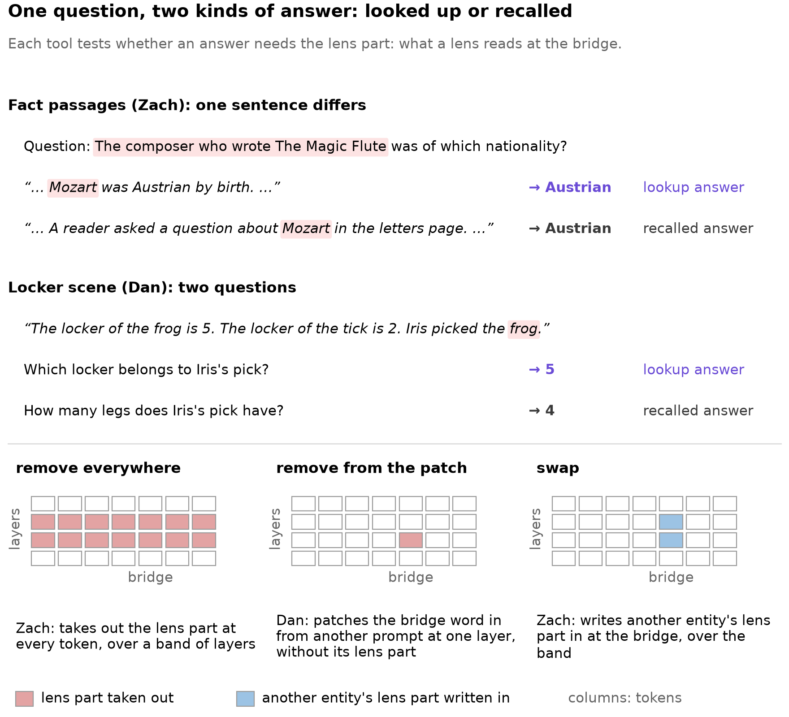
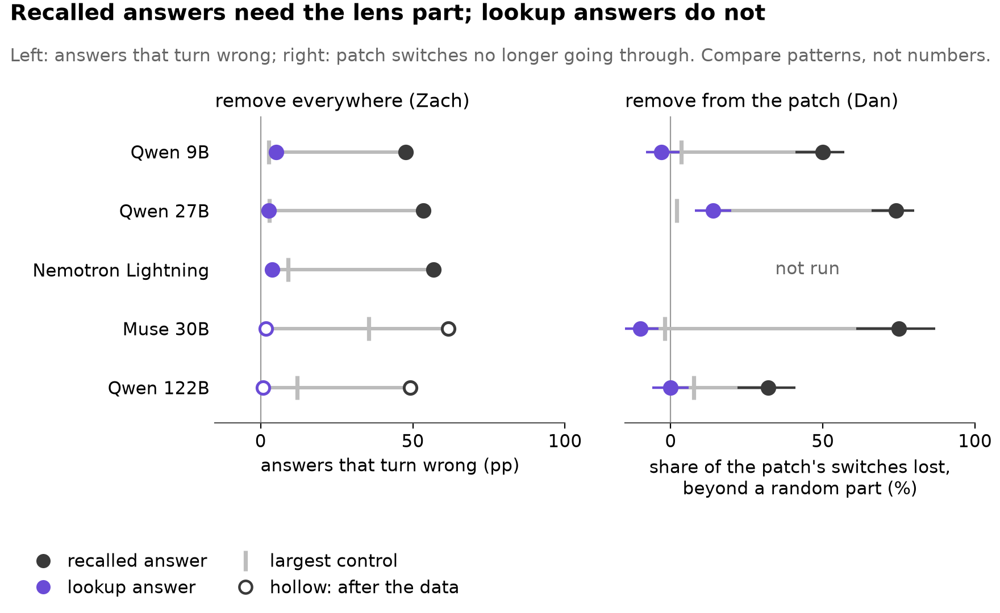
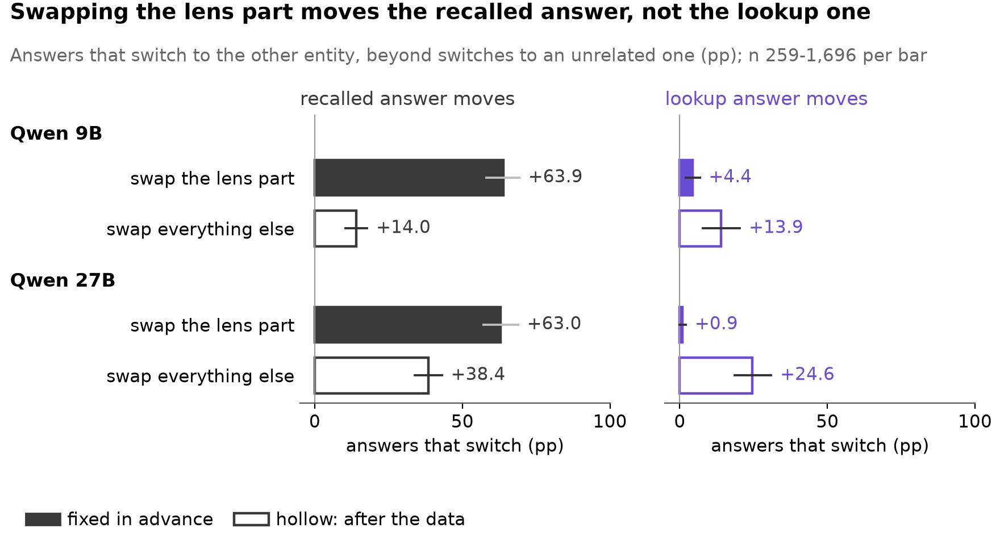
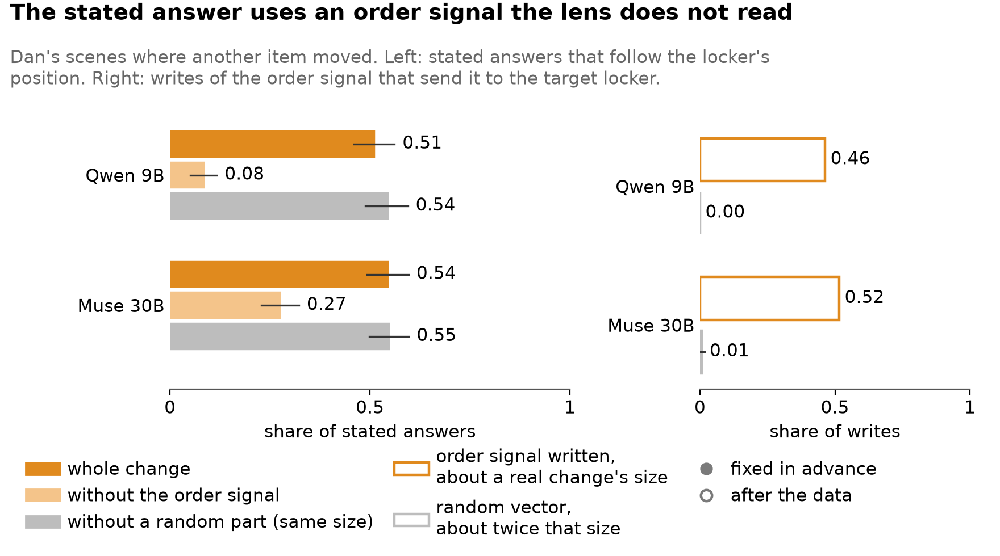
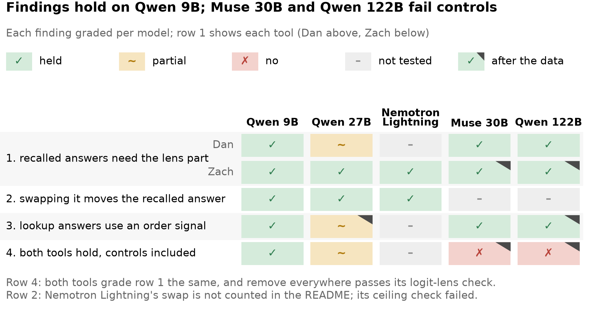
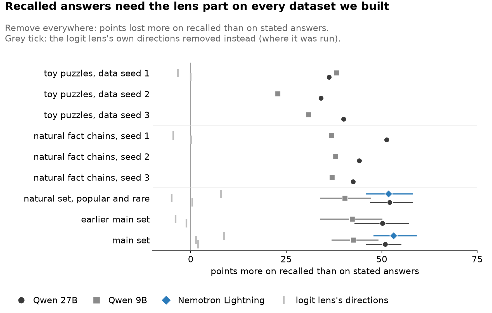
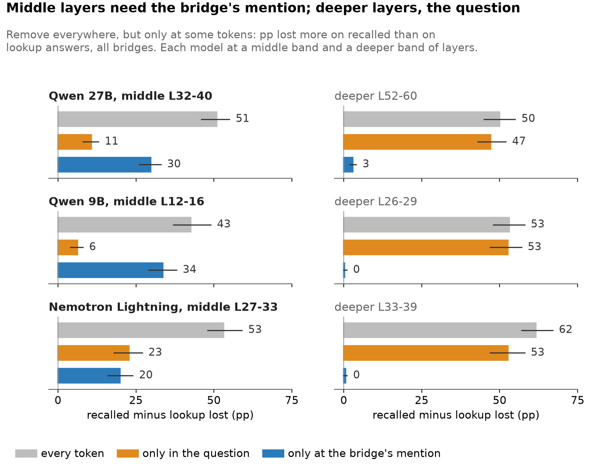
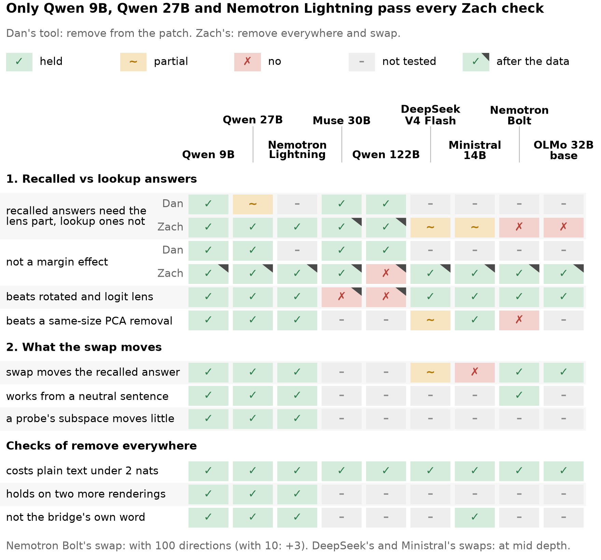
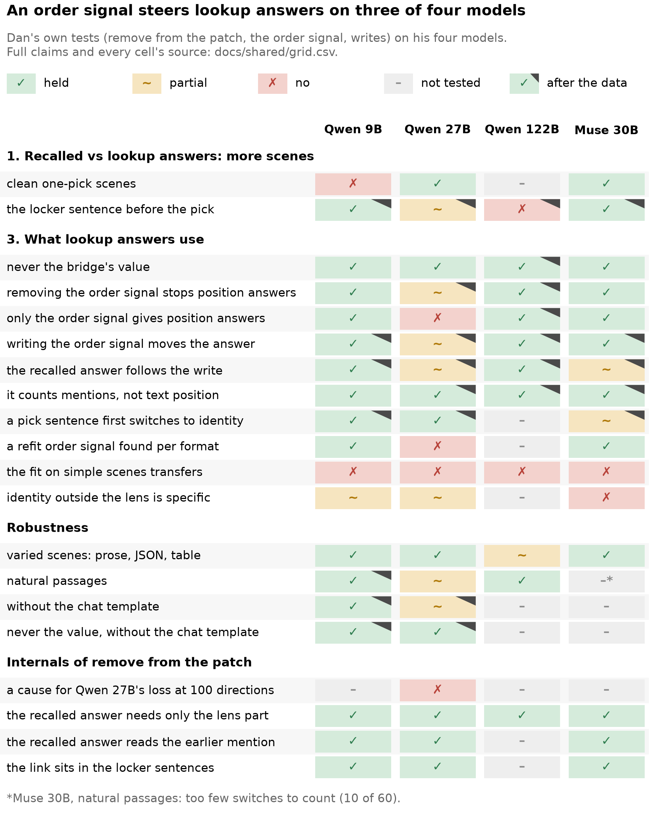

# Recalled answers read the lens; lookup answers go around it

*When a model answers a two-step question, does it use what the J++ lens reads at the entity in the middle, and does that depend on whether the answer must be recalled or is written in the text?*

Draft (27 Oct). Every number is unverified until the hand check on Thu 29 Oct.

## In one minute

<!-- DRAFT bullets: Dan's text pending -->
- **Recalled answers need the lens part; lookup answers do not.** Both of our methods find this on Qwen 9B and Qwen 27B; on Nemotron Lightning one method has been run.
- **The lens part says which entity it is.** Write in another entity's lens part and the model recalls that entity's facts, while lookup answers stay put.
- **Lookup answers use something the lens cannot see.** In our scenes they partly use an order signal outside the lens; much of that route is unexplained.
- **Two models do not fit cleanly.** On Muse 30B the two tools disagree and look at different depths; on Qwen 122B each method has a failed control.

## The setup

- **The question** goes through a bridge entity: "The composer who wrote The Magic Flute was of which nationality?" (Zach's passages) or "How many legs does Iris's pick have?" (Dan's scenes). Models: Qwen 9B, Qwen 27B, Qwen 122B, Muse 30B, Nemotron Lightning.
- **Two kinds of answer.** A **recalled answer** must come from memory; a **lookup answer** is written in the text.
- **The lens part:** the directions the J++ lens reads at the bridge (Zach's top 10; Dan's 25 that rebuild the patch). <!-- src: docs/breadth/README.md | project out the 10 directions the J++ lens reads most there --> <!-- src: docs/breadth/README.md | Replace the J-part (the span of the top-10 J++ directions) --> <!-- src: docs/depth/README.md | the 25 lens directions that best rebuild the change -->
- **Three tools.** **Remove everywhere** (Zach: at every token, over a band of layers): does the model need it? **Remove from the patch** (Dan: the bridge word's patch from another prompt, added at one layer without it): does the patch travel through it? **Swap** (Zach: another entity's lens part written in): is it enough? <!-- src: predictions/2026-10-26_dan.md | (9B L12, 27B L32, 122B L33, Muse L26) --> <!-- src: docs/breadth/README.md | Qwen3.5-9B (L12-16); Qwen3.6-27B (L32-40); Nemotron 3.5 Lightning (L27-33); Muse Glimmer 30B (L36-42); Qwen3.5-122B (FP8) (L39-45) -->

## Finding 1. Recalled answers need the lens part; lookup answers do not

**Taking the lens part out breaks recalled answers and leaves lookup answers almost intact (Qwen 9B, Qwen 27B; Nemotron Lightning with one method).**

- **Remove everywhere** costs Qwen 27B 50.9 more points on recalled than on lookup answers; control removals cost far less. <!-- src: docs/breadth/data.csv | ko.q9.mk; ko.q27.mk; ko.nl.mk; ko.q122.mk; ko.mu.mk --> <!-- src: docs/breadth/data.csv | ko.q9.rot; ko.q27.rot; ko.nl.rot --> <!-- src: docs/breadth/data.csv | ko.q9.u; ko.q27.u; ko.nl.u --> <!-- src: docs/breadth/data.csv | ko.q9.soft; ko.q27.soft; ko.nl.soft -->
- **Remove from the patch** stops it moving recalled answers, not lookup ones: a gap of 0.60 of its effect on Qwen 27B. <!-- src: figures/story/data.csv | contrast_9b; contrast_27b; contrast_122b; contrast_muse --> <!-- src: figures/story/data.csv | J++ part: recall extra loss; PCA directions (same size): recall extra loss --> <!-- src: figures/story/data.csv | ld_gap_9b; ld_gap_27b -->
- **Same question, different source:** a recalled number costs Qwen 27B 13.3 points, a computed one nothing. <!-- src: docs/breadth/data.csv | mod.q9.numbers.paper10.MR-PR; mod.q27.numbers.paper10.MR-PR; mod.nl.numbers.paper10.MR-PR --> <!-- src: docs/breadth/data.csv | mod.q9.numbers.paper10.AR-PR; mod.q27.numbers.paper10.AR-PR; mod.nl.numbers.paper10.AR-PR -->
  - Three-step chains that end on a recalled answer need the lens part too: all four kinds on Lightning, three of four on Qwen 27B, on two data seeds each. <!-- src: docs/breadth/data.csv | mod.nl.threehop.paper10.PPM-PPP; mod.nl.threehop.paper10.MMP-PPP; mod2.nl.threehop.paper10.PPM-PPP; mod2.nl.threehop.paper10.MMM-PPP --> <!-- src: docs/breadth/data.csv | mod.q27.threehop.paper10.PPM-PPP; mod.q27.threehop.paper10.MMP-PPP; mod2.q27.threehop.paper10.PPM-PPP; mod2.q27.threehop.paper10.MMM-PPP -->
  - A number computed from the text and then used to recall something needs no more of the lens part than a number written in the text: counted +0.7, computed −12.6 points on Qwen 27B (fixed in advance). On Qwen 9B and Lightning the controls break those chains too, so it cannot be read. <!-- src: docs/breadth/data.csv | mod2.q27.numbers.paper10.KM-PM; mod2.q27.numbers.paper10.AM-PM --> <!-- src: docs/breadth/data.csv | mod2.q9.numbers.paper10_rot.AM-PM; mod2.nl.numbers.paper10_rot.AM-PM -->

**How sure.**
- Medium-high on Qwen 9B and Qwen 27B. Medium on Lightning: one method, several caveats. <!-- src: docs/breadth/data.csv | mod.nl.numbers.paper10.MR-PR --> <!-- src: docs/breadth/README.md | recalled at least 10 above --> <!-- src: docs/claims_skeleton.md | +1.67 nats over L17-35 vs +0.30 rotated --> <!-- src: docs/breadth/README.md | 9 of 14075 rows differ --> <!-- src: docs/breadth/data.csv | ko.nl.u --> <!-- src: docs/breadth/README.md | logit lens +32 on the natural set -->
- Main limits: in Dan's scenes answer kind and source go together <!-- src: docs/depth/README.md | reader and answer source (prompt vs memory) confounded -->; his positive control failed <!-- src: docs/depth/README.md | chemical symbols, 27B 0.15, bar 0.20 -->; Qwen 27B misses his strict bar <!-- src: figures/story/data.csv | lk_excess_27b --> <!-- src: docs/x0_details.md | lookup excess ≤ 0.10 and recall J-dependence ≥ 0.30 -->; Qwen 9B is weaker where the item was named earlier (after the data) <!-- src: figures/story/data.csv | x45m_before_gap_9b --> <!-- src: docs/split_by_order.md | only the asked pick (replication, fresh scenes) --> <!-- src: figures/story/data.csv | x45p_d23_9b -->.

## Finding 2. The lens part says which entity it is; lookup answers do not follow it

**Writing another entity's lens part into the bridge moves the recalled answer to that entity; the lookup answer stays.**

- **The swap** moves Qwen 27B's recalled answers 63.0 points toward the other entity (Qwen 9B alike), even from one neutral sentence. <!-- src: docs/breadth/data.csv | swap.q9.swap; swap.q27.swap --> <!-- src: docs/breadth/data.csv | ptr.q9.neutral; ptr.q27.neutral -->
- **Lookup answers** stay in 99.1% of Qwen 27B's cases; Qwen 9B's move a little. <!-- src: EXPERIMENTS.md | l.166 --> <!-- src: EXPERIMENTS.md | l.165 -->
- **Everything but the lens part** moves Qwen 27B's lookup answers by 24.6 points, Qwen 9B's less, Lightning's not at all (after the data; confirmed by Zach). <!-- src: results/jswap/jswap_v2_v1/summary.json | PK/swap_comp; TK/swap_comp --> <!-- src: results/jswap/qwen35_9b_jswap_v2_v1/summary.json | PK/swap_comp; TK/swap_comp --> <!-- src: results/jswap/nem35l_jswap_v2_v1/summary.json | PK/swap_comp; TK/swap_comp --> <!-- src: docs/breadth/data.csv | swap.q27.comp.PK; swap.q9.comp.PK; swap.nl.comp.PK --> <!-- src: docs/shared/zach_reply_2026-10-27.md | Complement swap on stated finals: confirmed -->

**How sure.**
- Medium-high on Qwen 9B and Qwen 27B (fixed in advance). Lightning is not counted: after the data, and its ceiling check failed. <!-- src: docs/breadth/data.csv | swap.nl.swap --> <!-- src: EXPERIMENTS.md | l.209 --> <!-- src: docs/prereg_replication_1022.md | l.1175-1176 -->
- Dan's scenes are context only: the lookup answer never takes the moved number, but his lens part alone moves neither kind. <!-- src: figures/story/data.csv | another item moved, whole: value share --> <!-- src: figures/story/data.csv | rtk_C2_keep_jpp_recall_follows_s_9b; rtk_C2_keep_jpp_recall_follows_s_27b; rtk_C2_keep_jpp_recall_follows_s_muse; rtk_C2_keep_jpp_rand_recall_follows_s_9b; rtk_C2_keep_jpp_rand_recall_follows_s_27b; rtk_C2_keep_jpp_rand_recall_follows_s_muse -->

## Finding 3. In our scenes, lookup answers use an order signal the lens cannot see

**In Dan's locker scenes the model finds the lookup answer partly through an order signal: four directions outside the lens that mark which locker sentence came first (Qwen 9B, Muse 30B).** <!-- src: docs/depth/README.md | four directions separating the positions -->

- **A simple probe reads it** at the bridge in 0.92-0.99 of scenes; the lens does not. <!-- src: docs/depth/README.md | 0.92-0.99 of scenes (layout alone: 0.53) --> <!-- src: docs/depth/README.md | A probe reads the pointer, the lens does not -->
- **Removing it from the patch** leaves Qwen 9B answering by position in 0.08 of scenes and halves Muse 30B's; a random part does not (after the data; repeated in advance). <!-- src: figures/story/data.csv | another item moved, no_alf: position share; another item moved, no_alf_rand: position share -->
- **Writing it in** sends the lookup answer to the written locker in about half of the writes (after the data). <!-- src: docs/x0_details.md | The pointer: removed, added alone, written -->

**How sure.**
- Medium for the order signal, on Qwen 9B and Muse 30B, in simple scenes.
- Low for a second route through the item's identity outside the lens: not specific when tested in advance, partly lens-readable on Qwen 27B, and used by recalled answers too. <!-- src: predictions/2026-10-26_dan.md | **Q45.7** --> <!-- src: predictions/2026-10-26_dan.md | 0.07 / 0.18 of the lookups still switch, against 0.15 / 0.39 --> <!-- src: predictions/2026-10-26_dan.md | Size check (Dan ~01:00 --> <!-- src: figures/story/data.csv | (b) another item moved, no_jpp: identity share; (b) another item moved, no_jpp_rand: identity share --> <!-- src: docs/depth/README.md | Recall's extra loss without identity (nothing else removed) -->
- Main limits: weak on Qwen 27B <!-- src: figures/story/data.csv | another item moved, keep_alf: position share --> <!-- src: docs/x0_details.md | A refit pointer per format --> <!-- src: figures/story/data.csv | the sanity swap, lookup extra loss without the pointer; the sanity swap, recall extra loss without the pointer -->; refit per text format <!-- src: predictions/2026-10-26_dan.md | **Q42.1** -->; Zach's evidence rests on the swap of everything but the lens part, confirmed but after the data <!-- src: results/jswap/jswap_v2_v1/summary.json | PK/swap_comp; PK/swap --> <!-- src: docs/shared/zach_reply_2026-10-27.md | Complement swap on stated finals: confirmed -->.

## Finding 4. It holds across datasets and in two families; across models it is graded

**On Qwen 27B, Qwen 9B and Nemotron Lightning, recalled answers need the lens part on every dataset, relation and wording tried. On the other six models we could test it is weak, shared with a control, or not needed; three more cannot be tested.**

- **Every dataset since day one** (Qwen 27B / Qwen 9B, points more on recalled than on lookup answers): toy puzzles over three data seeds 34.1-40.0 / 22.8-38.2, natural fact chains over three seeds 42.5-51.3 / 36.9-38.0, a natural set 52.1 / 40.4, and the main set 50.9 / 42.6. The logit lens's own directions cost −5.0 to +1.9 wherever they were run. <!-- src: docs/breadth/data.csv | toy.q27.s1; toy.q27.s2; toy.q27.s3; toy.q9.s1; toy.q9.s2; toy.q9.s3 --> <!-- src: docs/breadth/data.csv | nat.q27.s1; nat.q27.s2; nat.q27.s3; nat.q9.s1; nat.q9.s2; nat.q9.s3 --> <!-- src: docs/breadth/data.csv | natplus.q27; natplus.q9; ko.q27.mk; ko.q9.mk --> <!-- src: docs/breadth/data.csv | toy.q27.u; nat.q27.u; natplus.q27.u; v1.q27.u; ko.q27.u; toy.q9.u; nat.q9.u; natplus.q9.u; v1.q9.u; ko.q9.u -->
- **Lightning on natural text:** 51.8 more on recalled answers; a random rotation costs −1.2, the logit lens's directions 7.9. <!-- src: docs/breadth/data.csv | natplus.nl; natplus.nl.rot; natplus.nl.u -->
- **Every relation and wording:** on Qwen 27B from 36.0 (languages) to 72.0 (dishes); two rewordings of every passage give 49.3 and 50.2 (Qwen 27B), 48.9 and 50.3 (Lightning). Rare bridges lose as much as popular ones (Qwen 27B 55.6 against 50.4, Lightning 61.4 against 47.5). <!-- src: docs/breadth/data.csv | ko.q27.rel.languages; ko.q27.rel.dishes --> <!-- src: docs/breadth/data.csv | ko.q27.r2; ko.q27.r3; ko.nl.r2; ko.nl.r3 --> <!-- src: docs/breadth/data.csv | natplus.q27.rare; natplus.q27.pop; natplus.nl.rare; natplus.nl.pop -->
- **Across models it is graded.**
  - Weak: Ministral 14B 23.3 and DeepSeek V4 Flash 17.9 points. <!-- src: docs/breadth/data.csv | ko.mi.mk; ko.ds.mk -->
  - Not specific: on Nemotron Bolt and DeepSeek a same-size removal of the largest directions costs nearly as much as the lens part, at every number of directions (at 100: 24.0 against 31.3, and 25.9 against 28.7). <!-- src: docs/breadth/data.csv | dose.nb.k100.pc; dose.nb.k100; dose.ds.k100.pc; dose.ds.k100 -->
  - Carried, not needed: OLMo 32B's lens part moves recalled answers when swapped (41.4) but removing it costs 5.4. <!-- src: docs/breadth/data.csv | swap.ol.swap; ko.ol.mk -->
  - Shared or fragile: Muse 30B shares 34.6 of its 59.9 with the logit lens's directions; Qwen 122B's 48.5 drops to 1.7 scored by probability. <!-- src: docs/breadth/data.csv | ko.mu.u; ko.mu.mk; ko.q122.mk; ko.q122.soft -->
  - Untestable: removing the top 10 lens directions breaks plain text on Gemma 4, gpt-oss and Kolibri (9.3, 4.7 and 6.4 nats added). <!-- src: docs/breadth/data.csv | text.gemma; text.gptoss; text.kol -->

**How sure.**
- High that it is not one dataset, relation or wording on Qwen 27B and Qwen 9B: each set was fixed in advance, and clean-checkout reruns match row for row. Medium on Lightning: two datasets. <!-- src: docs/breadth/README.md | 0 of 22325 --> <!-- src: docs/breadth/data.csv | natplus.nl; ko.nl.mk -->
- Medium on the grading: one band of layers per model, and several models use lenses we fit ourselves (on Qwen 9B our own fit gives 44.8 against the published lens's 42.6). <!-- src: docs/breadth/data.csv | ko.q9oj.mk; ko.q9.mk -->
- Main limits: templated passages, English only, greedy answers with thinking off.

## Finding 5. At middle layers the bridge's mention carries it; deeper, the question does

**Removing the lens part only at the bridge's mention does most of the damage at middle layers on the Qwens; deeper, removing it only in the question does nearly all of it, and the mention nothing (Qwen 27B, Qwen 9B, Nemotron Lightning).**

- **Middle layers** (all bridges): the mention alone costs Qwen 27B 29.7 of 50.9 points and Qwen 9B 33.6 of 42.6; the question alone 10.7 and 6.2. Lightning needs both: mention 19.9, question 22.7, of 53.1. <!-- src: docs/breadth/data.csv | pos.q27.all.bridge; pos.q27.all.all; pos.q9.all.bridge; pos.q9.all.all --> <!-- src: docs/breadth/data.csv | pos.q27.all.question; pos.q9.all.question --> <!-- src: docs/breadth/data.csv | pos.nl.all.bridge; pos.nl.all.question; pos.nl.all.all -->
- **Deeper layers:** the question alone costs 47.1 of 50.0 (Qwen 27B), 52.6 of 53.1 (Qwen 9B) and 52.6 of 61.6 (Lightning); the mention alone 2.9, 0.2 and 0.5. Ministral 14B, tested only deep, agrees (24.0 of 23.3); Qwen 122B is split (question 28.3, mention 10.0, of 48.5). <!-- src: docs/breadth/data.csv | late.q27.question; late.q27.all; late.q9.question; late.q9.all; late.nl.question; late.nl.all --> <!-- src: docs/breadth/data.csv | late.q27.bridge; late.q9.bridge; late.nl.bridge --> <!-- src: docs/breadth/data.csv | pos.mi.question; ko.mi.mk; pos.q122.question; pos.q122.bridge; ko.q122.mk -->
- **Deeper, more is shared with the logit lens's directions:** 27.5 (Qwen 9B) and 22.9 (Lightning), against 1.4 and 8.7 at middle layers. <!-- src: docs/breadth/data.csv | late.q9.all.u; late.nl.all.u; ko.q9.u; ko.nl.u -->
- The same split on Muse 30B is queued (Where it breaks). <!-- src: jobs/c3/x57_pos_muse.yaml | question-only and bridge-mention-only -->

**How sure.**
- High on Qwen 27B, Qwen 9B and Lightning: fixed in advance, rotated controls cost at most 2.5 points, and Qwen 9B's and Lightning's deeper splits rerun identically from a clean checkout. The deeper bands of Qwen 9B and Lightning were picked on separate data. <!-- src: docs/breadth/data.csv | late.q27.question.rot; late.q9.question.rot; late.nl.question.rot --> <!-- src: docs/breadth/data.csv | clean57.same -->
- Main limits: one band per depth; Lightning's deeper band sits shallower than the Qwens' (past about 70% of its depth the removal breaks lookup answers too). <!-- src: docs/prereg_replication_1022.md | Lightning L33-39 (64-75%; dev M - K +50, logit lens +5) -->

## Where it breaks

- **Muse 30B.** The two tools disagree here, and they look at different depths. Remove from the patch, at a middle layer, is specific to the lens: the logit lens's directions cost nothing. <!-- src: figures/story/data.csv | J++ part: recall extra loss; logit-lens directions: recall extra loss --> Remove everywhere, deeper (layers 36-42), shares more than half of its effect with the logit lens (after the data), and barely moved Muse on Zach's earlier puzzles. <!-- src: docs/breadth/data.csv | ko.mu.u; ko.mu.mk --> <!-- src: EXPERIMENTS.md | l.169 --> <!-- src: EXPERIMENTS.md | l.87 -->
- **Qwen 122B.** Ours is not specific against a same-size removal; Zach's vanishes when scored by probability (after the data). Neither of us claims it. <!-- src: figures/story/data.csv | J++ part: recall extra loss; PCA directions (same size): recall extra loss --> <!-- src: docs/breadth/data.csv | ko.q122.soft --> <!-- src: EXPERIMENTS.md | l.167; l.169 -->

## What we learned about methods

- **Report the size of a removal, not the number of directions.** Nemotron Bolt's top 10 remove only 5.6% of the residual. <!-- src: docs/breadth/data.csv | size.nb; size.q9; size.mi --> At 100 directions a same-size removal nearly matches the lens part on Bolt and DeepSeek. <!-- src: docs/breadth/README.md | Bolt is weak, not spread out --> <!-- src: docs/breadth/README.md | DeepSeek is weak at every dose --> Qwen 27B's 100-direction cost is generic in Zach's test, specific in Dan's. <!-- src: docs/breadth/README.md | More directions add damage that is not specific --> <!-- src: figures/story/data.csv | main test: lookup extra loss without another scene's 100 directions -->
- **Readable, carried and needed come apart.** OLMo carries the entity without needing it; a probe reads facts its directions do not carry; the lens misses the order signal a probe reads. <!-- src: docs/breadth/README.md | OLMo carries the entity (swap +41), but the knock-out costs only +5 --> <!-- src: docs/breadth/data.csv | probe.q27.probe; probe.q27.swap -->
- **One layer can understate what a site carries.** The swap over a band moves recalled answers; the lens part added at one layer moves neither kind. Zach's earlier copy sweep, once cited for this, was withdrawn. <!-- src: docs/breadth/data.csv | swap.q9.swap; swap.q27.swap --> <!-- src: EXPERIMENTS.md | l.153 --> <!-- src: figures/story/data.csv | rtk_C2_keep_jpp_recall_follows_s_9b; rtk_C2_keep_jpp_recall_follows_s_27b; rtk_C2_keep_jpp_recall_follows_s_muse; rtk_C2_keep_jpp_rand_recall_follows_s_9b; rtk_C2_keep_jpp_rand_recall_follows_s_27b; rtk_C2_keep_jpp_rand_recall_follows_s_muse --> <!-- src: EXPERIMENTS.md | l.78 -->

## How we checked

- **Nothing is hand-checked yet.** On Thu 29 Oct each of us checks 10 random items of the other's headline ([lists](docs/shared/gaps.md)). <!-- src: docs/shared/gaps.md | 10 random items of each other's headline -->
- **Dan:** a reimplementation matches 20 of 20 items; a [hand-check pack](docs/handcheck_pack.md) recounts the newest tests; his predictions score worse than always answering 50%. <!-- src: docs/depth/README.md | 20 of 20 random items --> <!-- src: docs/depth/README.md | mean Brier 0.32 over 121 answers, worse than always answering 50% -->
- **Zach:** clean-checkout reruns match row for row on Qwen 27B and Qwen 9B, and on all 11 of his newest runs, Lightning's included; a [verification kit](docs/verify_kit.md) recomputes his headline. <!-- src: docs/breadth/README.md | 0 of 22325 --> <!-- src: docs/breadth/data.csv | clean57.same; clean57.n -->

## What did not hold

- Dan: Qwen 27B misses his strict bar; Qwen 9B misses his cleaner design and its replication.
- Dan: the positive control; identity outside the lens; writing the order signal at the strength fixed in advance (below a real patch's size); one test withdrawn as a design error. <!-- src: predictions/2026-10-26_dan.md | **Q44.1** -->
- Zach: Qwen 122B by probability; Muse's share with the logit lens; Bolt; OLMo.
- Zach: one Qwen 27B three-step chain; Lightning's number predictions; the rule for a recall keyed by a number, on all three models. <!-- src: docs/breadth/README.md | Lightning's v2 recall-keyed-by-a-recalled-number result --> <!-- src: docs/breadth/data.csv | mod2.q27.numbers.paper10.MM-ML; mod2.q9.numbers.paper10.MM-ML; mod2.nl.numbers.paper10.MM-ML -->

Full lists: [depth report](docs/depth/README.md) <!-- src: docs/depth/README.md | Failed when fixed in advance -->, [breadth report](docs/breadth/README.md) <!-- src: docs/breadth/README.md | Failed when fixed in advance -->.

## Pending tests

- **Nemotron Lightning, Dan's method** at layer 27, the first layer of Zach's band; his lens file is now [public](https://huggingface.co/zachperlman20/NVIDIA-Nemotron-3.5-Lightning-30B-A3B-jpp-lens). No test is planned for the order signal on Lightning. <!-- src: scripts/x45s.py | at L27 (the shallowest layer of Zach's band L27-33 -->
- **Muse 30B, Zach's tools** at layers 36-42: how many directions it needs, and whether the question or the mention carries it (running on Zach's box). <!-- src: jobs/c3/x57_dose_muse.yaml | dose grid at L36-42 --> <!-- src: jobs/c3/x57_pos_muse.yaml | question-only and bridge-mention-only -->

## Open questions

- The rest of the lookup answer's route around the lens.
- The order signal in natural text: a refit version is found only on Qwen 9B and Muse 30B. <!-- src: docs/x0_details.md | A refit pointer per format -->
- **Earlier mentions** lower the recalled answer's dependence on the bridge in both tracks, by different mechanisms; not on Lightning or Qwen 122B. <!-- src: figures/story/data.csv | x45p_d23_9b; x45p_d23_27b; x45p_d23_muse --> <!-- src: docs/breadth/data.csv | r.q9; r.q27; r.mu --> <!-- src: EXPERIMENTS.md | l.170 --> <!-- src: docs/breadth/data.csv | r.nl; r.q122 -->

## Reports and where things live

- **Reports:** [Dan's depth report](docs/depth/README.md) (`scripts/readme_build.py`) and [Zach's breadth report](docs/breadth/README.md) (`scripts/report_breadth.py`).
- **Files:** code in `scripts/`, `src/`; runs in `results/`; figures in `figures/`, `docs/breadth/figures/`; [DEVELOPER.md](DEVELOPER.md), [AGENTS.md](AGENTS.md).
- **Joint notes:** [glossary](docs/shared/glossary_joint.md) (the reports' terms mapped to this page's), [story notes](docs/shared/joint_story_draft.md), [gaps](docs/shared/gaps.md), [review notes](docs/shared/joint_review_notes.md).
- **Freeze and sources:** experiments freeze Wed 28 Oct evening; every number's source is an HTML comment checked by `tests/test_readme_sources.py`. <!-- src: STATUS.md | Experiments freeze Wed 28 Oct evening -->

## Appendix: the full grid

Claims graded on all nine models (both tracks; Zach's tests):

Dan's own tests on his four models:

