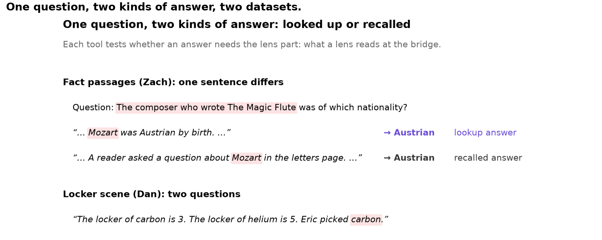
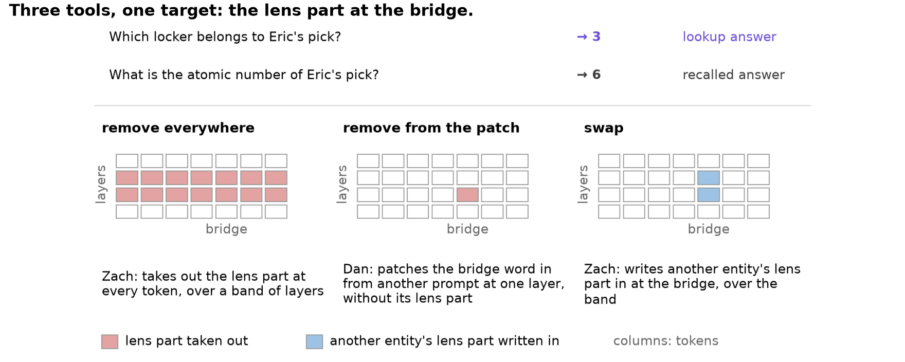
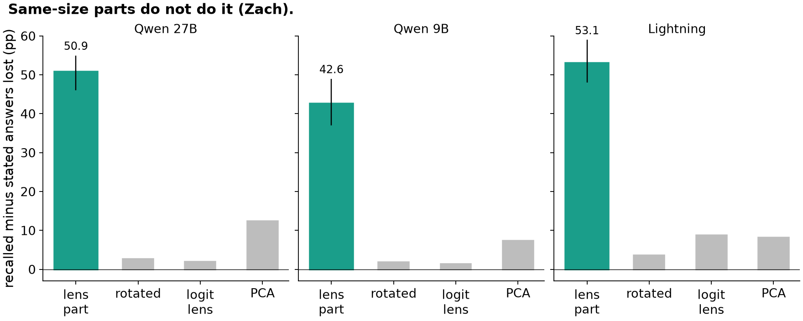
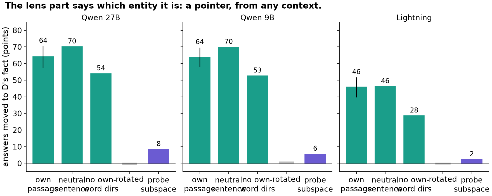
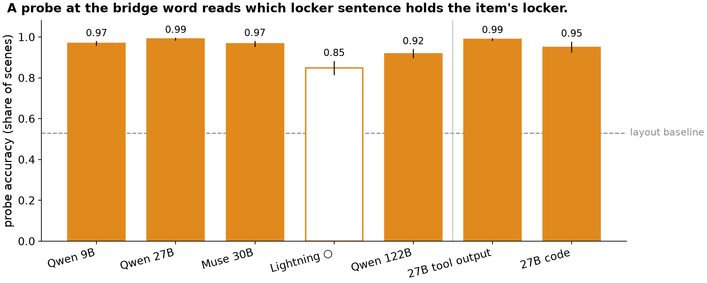
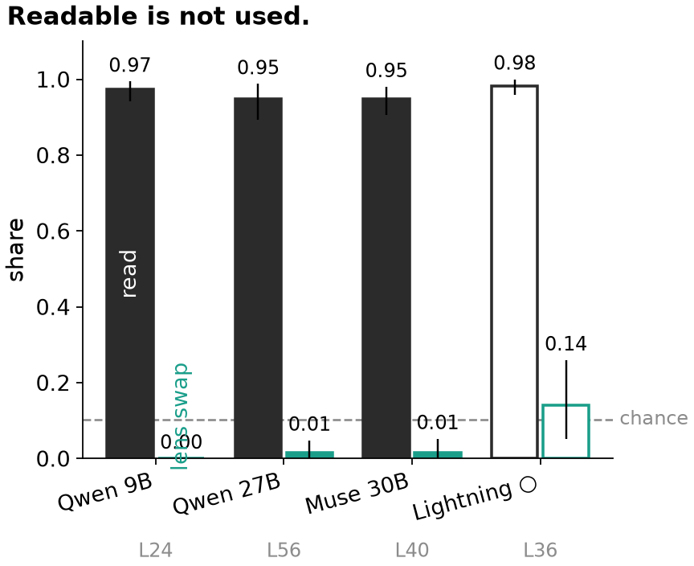
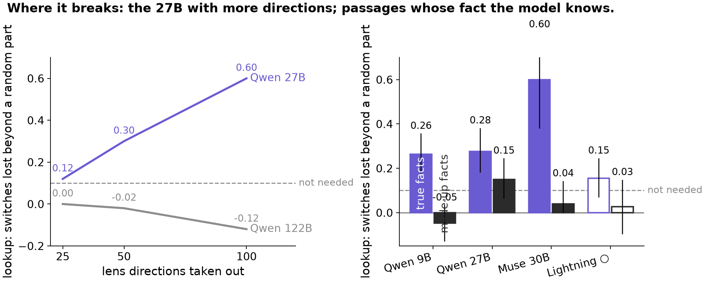

<!-- Generated by scripts/readme_root.py from docs/README.root.template.md; edit the template. -->
# The J++ lens reads which entity; recall goes through it, lookup goes around it, and readable is not used

*A two-step question passes through one word, the bridge. The model can recall the bridge entity's fact from memory or look up a fact the prompt states. What does the J++ lens read at the bridge, and which kind of answer uses it?*

Joint draft of Dan's track (depth) and Zach's track (breadth), 29-30 Oct 2026, at 138c671d<!-- src: docs/slides/depth_outline.md | at 138c671d --> for Dan's numbers. Unverified until the 30 Oct hand-check ([VERIFIED.md](VERIFIED.md)). Units differ by track: Zach reports points lost (recalled minus stated answers, M − K); Dan reports the share of switches lost beyond a random part (0 to 1). Compare patterns, not numbers. Model order in Dan's rows: 9B · 27B · Muse · Lightning ○ · 122B; ○ Lightning's gate was chosen after its pre-check; the 122B is hollow where its gate was lowered after the data (routes, address, swap).

> **Zach, to fill:** check every sentence of yours below (marked "Zach"), add your newest runs where a placeholder says so, and your nine-model lines. The outline the deck is built from: [docs/slides/deck_outline.md](docs/slides/deck_outline.md).

## In one minute

- **C1. Recall needs the lens part; lookup does not.** Zach: removed over a band, recalled answers lose 50.9 / 42.6 / 53.1 points more than stated ones (27B / 9B / Lightning)<!-- src: docs/breadth/data.csv | ko.q27.mk; ko.q9.mk; ko.nl.mk -->. Dan: removed from a one-layer patch, the recall loses 0.50 / 0.74 / 0.75 / 0.34 ○ / 0.32 of its switches beyond random<!-- src: docs/x0_numbers.json | rc_excess_9b; rc_excess_27b; rc_excess_muse; rc_excess_122b -->, the lookup about none.
- **C2. The lens part says which entity it is: a pointer, from any context, not its fact.** Zach: another entity's lens part moves the recall 63.0 / 63.9 / 44.8 points<!-- src: docs/breadth/data.csv | swap.q27.swap; swap.q9.swap; swap.nl.swap -->, as much from one neutral sentence (1.09 / 1.10 / 1.01 ×)<!-- src: docs/breadth/data.csv | ptr.q27.neutral; ptr.q9.neutral; ptr.nl.neutral -->. Dan: its 25 directions are the two bridge words, never the answer word.
- **C3. The lookup reads an address the lens cannot see.** Dan: a probe reads where the item's locker sentence sits at 0.85-0.99<!-- src: data/figures/depth/data.csv | the locker probe at the bridge word, locker-first scenes -->, a swap moves the lookup there, and through the lens the swap looks like a random vector.
- **C4. Readable is not used.** Dan: at the last token the lens reads the entity at 0.95-0.98<!-- src: data/figures/depth/data.csv | 51.10: recall, last token, read peak: the probe's accuracy on the lens part --> while the answer does not go through it. Zach: across nine models the entity's lens part is readable everywhere and needed in a few<!-- src: docs/shared/grid.csv | ko.q9.mk; ko.q27.mk; ko.q122.mk -->.
- **For a J++ monitor:** at the bridge it tells you which entity the model is about to recall from; it does not tell you whether the model is recalling or looking up, and at the output it cannot tell whether what it reads is in use.

## Setup

- **The question** goes through a bridge entity: "The composer who wrote The Magic Flute was of which nationality?" (Zach's passages) or "How many legs does Iris's pick have?" (Dan's scenes). Models: Qwen 9B, Qwen 27B, Qwen 122B, Muse 30B, Nemotron Lightning.
- **Two kinds of answer.** A **recalled answer** must come from memory; a **lookup answer** is written in the text.
- **The lens part:** the directions the J++ lens reads at the bridge (Zach's top 10; Dan's 25 that rebuild the patch). <!-- src: docs/breadth/README.md | project out the 10 directions the J++ lens reads most there --> <!-- src: docs/breadth/README.md | Replace the J-part (the span of the top-10 J++ directions) --> <!-- src: docs/README_v5_2026-10-28.md | the 25 lens directions that best rebuild the change -->
- **Three tools.** **Remove everywhere** (Zach: at every token, over a band of layers): does the model need it? **Remove from the patch** (Dan: the bridge word's patch from another prompt, added at one layer without it): does the patch travel through it? **Swap** (Zach: another entity's lens part written in): is it enough? <!-- src: predictions/2026-10-26_dan.md | (9B L12, 27B L32, 122B L33, Muse L26) --> <!-- src: docs/breadth/README.md | Qwen3.5-9B (L12-16); Qwen3.6-27B (L32-40); Nemotron 3.5 Lightning (L27-33); Muse Glimmer 30B (L36-42); Qwen3.5-122B (FP8) (L39-45) -->

## C1. Recall needs the lens part; lookup does not

- **Zach, remove everywhere (a band of layers):** recalled minus stated answers lost 50.9 / 42.6 / 53.1 points (27B / 9B / Lightning)<!-- src: docs/breadth/data.csv | ko.q27.mk; ko.q9.mk; ko.nl.mk -->; rotated directions 2.7<!-- src: docs/breadth/data.csv | ko.q27.rot --> / 1.8<!-- src: docs/breadth/data.csv | ko.q9.rot --> / 3.6<!-- src: docs/breadth/data.csv | ko.nl.rot -->, the logit lens's 1.9<!-- src: docs/breadth/data.csv | ko.q27.u --> / 1.4<!-- src: docs/breadth/data.csv | ko.q9.u --> / 8.7<!-- src: docs/breadth/data.csv | ko.nl.u -->, same-norm PCA directions 12.4<!-- src: docs/breadth/data.csv | ko.q27.pc --> / 7.3<!-- src: docs/breadth/data.csv | ko.q9.pc --> / 8.2<!-- src: docs/breadth/data.csv | ko.nl.pc -->.
  - Three-step chains that end on a recalled answer need the lens part too: all four kinds on Lightning, three of four on Qwen 27B, on two data seeds each. <!-- src: docs/breadth/data.csv | mod.nl.threehop.paper10.PPM-PPP; mod.nl.threehop.paper10.MMP-PPP; mod2.nl.threehop.paper10.PPM-PPP; mod2.nl.threehop.paper10.MMM-PPP --> <!-- src: docs/breadth/data.csv | mod.q27.threehop.paper10.PPM-PPP; mod.q27.threehop.paper10.MMP-PPP; mod2.q27.threehop.paper10.PPM-PPP; mod2.q27.threehop.paper10.MMM-PPP -->
- **Dan, remove from the patch (one layer, the conflict test):** the recall loses 0.50 / 0.74 / 0.75 / 0.34 ○ / 0.32 of its switches beyond a random part<!-- src: docs/x0_numbers.json | rc_excess_9b; rc_excess_27b; rc_excess_muse; rc_excess_122b -->, the lookup −0.03 / 0.14 / −0.10 / 0.03 ○ / 0.00<!-- src: docs/x0_numbers.json | lk_excess_9b; lk_excess_27b; lk_excess_muse; lk_excess_122b -->: confirmed on four models, not on the 27B. Added by itself at a higher dose, the lens part moves the recall above a random part on the 9B, 27B and Muse<!-- src: docs/depth/EXPERIMENTS.md | Added by itself, the lens part moves the recall more than a random part on all three models -->.

**It holds on every dataset we built** (Zach's Finding 4, unchanged):

- **Every dataset since day one** (Qwen 27B / Qwen 9B, points more on recalled than on lookup answers): toy puzzles over three data seeds 34.1-40.0 / 22.8-38.2, natural fact chains over three seeds 42.5-51.3 / 36.9-38.0, a natural set 52.1 / 40.4, and the main set 50.9 / 42.6. The logit lens's own directions cost −5.0 to +1.9 wherever they were run. <!-- src: docs/breadth/data.csv | toy.q27.s1; toy.q27.s2; toy.q27.s3; toy.q9.s1; toy.q9.s2; toy.q9.s3 --> <!-- src: docs/breadth/data.csv | nat.q27.s1; nat.q27.s2; nat.q27.s3; nat.q9.s1; nat.q9.s2; nat.q9.s3 --> <!-- src: docs/breadth/data.csv | natplus.q27; natplus.q9; ko.q27.mk; ko.q9.mk --> <!-- src: docs/breadth/data.csv | toy.q27.u; nat.q27.u; natplus.q27.u; v1.q27.u; ko.q27.u; toy.q9.u; nat.q9.u; natplus.q9.u; v1.q9.u; ko.q9.u -->
- **Lightning on natural text:** 51.8 more on recalled answers; a random rotation costs −1.2, the logit lens's directions 7.9. <!-- src: docs/breadth/data.csv | natplus.nl; natplus.nl.rot; natplus.nl.u -->
- **Every relation and wording:** on Qwen 27B from 36.0 (languages) to 72.0 (dishes); two rewordings of every passage give 49.3 and 50.2 (Qwen 27B), 48.9 and 50.3 (Lightning). Rare bridges lose as much as popular ones (Qwen 27B 55.6 against 50.4, Lightning 61.4 against 47.5). <!-- src: docs/breadth/data.csv | ko.q27.rel.languages; ko.q27.rel.dishes --> <!-- src: docs/breadth/data.csv | ko.q27.r2; ko.q27.r3; ko.nl.r2; ko.nl.r3 --> <!-- src: docs/breadth/data.csv | natplus.q27.rare; natplus.q27.pop; natplus.nl.rare; natplus.nl.pop -->

**Boring explanation, said first:** the lens part is the bridge word's identity; the lookup only needs where the sentence sits, which is not a word. **Limits:** the 27B (in part); Dan's answer kind and answer source go together; English templated passages, greedy answers with thinking off.

> **Zach, to fill:** your newest runs for this claim (placeholder).

## C2. The lens part says which entity it is: a pointer, from any context, not its fact

- **Zach, the swap:** another entity's lens part moves the recall 63.0 / 63.9 / 44.8 points (27B / 9B / Lightning)<!-- src: docs/breadth/data.csv | swap.q27.swap; swap.q9.swap; swap.nl.swap -->; from one neutral sentence about that entity 1.09 / 1.10 / 1.01 times as much<!-- src: docs/breadth/data.csv | ptr.q27.neutral; ptr.q9.neutral; ptr.nl.neutral -->; a probe's subspace that reads the fact moves it 8.3 / 5.5 / 2.2 points, against 74.8 / 79.5 / 62.4 for the lens part on the same relations<!-- src: docs/breadth/data.csv | probe.q27.probe; probe.q9.probe; probe.nl.probe; probe.q27.swap; probe.q9.swap; probe.nl.swap -->.
- **Lookup answers** stay in 99.1% of Qwen 27B's cases; Qwen 9B's move a little. <!-- src: EXPERIMENTS.md | l.166 --> <!-- src: EXPERIMENTS.md | l.165 -->
- **Dan, what the 25 directions are:** each bridge word carries 0.09-0.19 of the rebuilt energy<!-- src: data/figures/depth/data.csv | 52 A: share of the rebuilt energy in the original bridge word; 52 A: share of the rebuilt energy in the new bridge word -->, the answer word 0.00<!-- src: data/figures/depth/data.csv | 52 A: share of the rebuilt energy in the reader's answer word --> (9B, 27B, Muse, Lightning ○).

**Boring explanation:** it is the entity's name-like code. **Neel's likely question:** "is it just the answer token?" Keeping the answer word's lens directions keeps 0.92-0.98 of the recall's loss<!-- src: data/figures/depth/data.csv | main test, recall: share of its loss kept when the lens part keeps the answer words' directions -->.

> **Zach, to fill:** the own-word and answer-direction rows, in your words (placeholder).

## C3. The lookup reads an address: a probe finds it, a swap moves it, the lens cannot see it

- **The address (a pointer to the item's mention).** A probe at the bridge word reads which locker sentence holds the item's locker: 0.97 / 0.99 / 0.97 / 0.85 ○ / 0.92<!-- src: data/figures/depth/data.csv | the locker probe at the bridge word, locker-first scenes -->, against a layout baseline of 0.53<!-- src: data/figures/depth/data.csv | the locker probe's layout baseline, locker-first scenes -->; in tool output 0.97-0.99<!-- src: data/figures/depth/data.csv | code and tool output, tool: the locker probe at the bridge word, locker-first scenes -->, in code 0.95<!-- src: data/figures/depth/data.csv | code and tool output, code: the locker probe at the bridge word, locker-first scenes --> (27B).
- **The swap** at about a real change's size sends 0.46 / 0.25 / 0.52 / 0.50 ○ / 0.50 ○ of lookups to the swapped-in locker<!-- src: data/figures/depth/data.csv | lookup target share, mean over locker pairs, s = 2 -->; a random vector 0.00<!-- src: data/figures/depth/data.csv | lookup target share, random direction, s = 4 -->.
- **The lens cannot see it:** the swap's share rebuilt by 25 lens directions is 0.01-0.06<!-- src: data/figures/depth/data.csv | 47.0 (b) share rebuilt by 25 lens directions: pointer -->, as for a random vector of its size.
- **A nuance, not a route:** on the 9B and Lightning the address swap also changes 0.21 / 0.27 ○ of recalls<!-- src: data/figures/depth/data.csv | the address swap at s = 2: recalls that change -->: the address points to the item's mention, not to a number.

**Boring explanation:** the lookback pointer of Prakash et al. 2025<!-- src: docs/README_v5_2026-10-28.md | lookback pointers (Prakash et al. 2025) --> in a list layout; new here: it is the part the lens misses, and it survives in tool output and code. **Limits:** the swap's rule fixed in advance was read at s = 1 and said no<!-- src: docs/depth/README.md | read at s = 1 and said no on every model --> (a design error; the numbers above are at s = 2); the address is refit per format; the 27B's address is weak.

## C4. Readable is not used

- **Dan, the last token:** a probe on the lens part reads the recall's entity 0.97 / 0.95 / 0.95 / 0.98 ○<!-- src: data/figures/depth/data.csv | 51.10: recall, last token, read peak: the probe's accuracy on the lens part -->; the lens swap moves 0.00 / 0.01 / 0.01 / 0.14 ○ of recalls<!-- src: data/figures/depth/data.csv | 51.10: recall, last token, read peak: the lens swap's switches -->, the whole-state patch 0.95-1.00<!-- src: data/figures/depth/data.csv | 51.10: recall, last token, read peak: the whole-state patch's switches -->: "(b) readable, not used".
- **Zach, nine models:** OLMo carries the entity without needing it (swap 41.4, removal 5.4)<!-- src: docs/breadth/data.csv | swap.ol.swap; ko.ol.mk -->; the grading per model is in the strip (from [the grid](figures/shared/grid.png)).

**Boring explanation:** the answer was computed earlier, at the bridge; the last-token copy is a by-product. For a monitor it still matters: it sees the entity and cannot tell whether it is in use.

> **Zach, to fill:** "readable at the mention" on all nine models (no row in the CSVs yet), and Ministral's reads-without-carrying line with its source (placeholder).

## Where it breaks

- **The 27B with more lens directions:** its lookup loses 0.60<!-- src: docs/x0_numbers.json | lk_excess_k100_27b --> beyond random at 100 directions; the 122B's −0.12<!-- src: docs/x0_numbers.json | lk_excess_k100_122b -->.
- **Passages whose fact the model knows:** on Zach's true-fact passages the 9B's and 27B's lookups follow the lens part (0.26 / 0.28<!-- src: data/figures/depth/data.csv | Z1: lookup, switches lost beyond a random part -->); with made-up facts the 9B's split returns, the 27B is in between.
- **Dan's one-layer test where Zach's band test is weak:** on the 122B the conflict test is confirmed (the lookup 0.00, the recall 0.32 beyond random)<!-- src: docs/x0_numbers.json | lk_excess_122b; rc_excess_122b -->; on Muse the logit lens's directions cost the recall nothing at one layer<!-- src: data/figures/depth/data.csv | logit-lens directions: recall extra loss -->.
- **Across models it is graded** (Zach):
  - Weak: Ministral 14B 23.3 and DeepSeek V4 Flash 17.9 points. <!-- src: docs/breadth/data.csv | ko.mi.mk; ko.ds.mk -->
  - Not specific: on Nemotron Bolt and DeepSeek a same-size removal of the largest directions costs nearly as much as the lens part, at every number of directions (at 100: 24.0 against 31.3, and 25.9 against 28.7). <!-- src: docs/breadth/data.csv | dose.nb.k100.pc; dose.nb.k100; dose.ds.k100.pc; dose.ds.k100 -->
  - Carried, not needed: OLMo 32B's lens part moves recalled answers when swapped (41.4) but removing it costs 5.4. <!-- src: docs/breadth/data.csv | swap.ol.swap; ko.ol.mk -->
  - Shared or fragile: Muse 30B shares 34.6 of its 59.9 with the logit lens's directions, though a same-size removal costs it at most 6.5 at any number of directions; Qwen 122B's 48.5 drops to 1.7 scored by probability. <!-- src: docs/breadth/data.csv | ko.mu.u; ko.mu.mk; ko.q122.mk; ko.q122.soft --> <!-- src: docs/breadth/data.csv | dose.mu.k30.pc; dose.mu.k300.pc -->
  - Untestable: removing the top 10 lens directions breaks plain text on Gemma 4, gpt-oss and Kolibri (9.3, 4.7 and 6.4 nats added). <!-- src: docs/breadth/data.csv | text.gemma; text.gptoss; text.kol -->

> **Zach, to fill:** the rest of your grading lines (placeholder).

## How we checked, and what we dropped

| Dan | Zach |
|---|---|
| Independent recount 63 of 63<!-- src: docs/depth/README.md \| matches 63 of 63 -->; automatic checks on 45,542 items<!-- src: docs/depth/README.md \| 45,542 items read -->; rerun label agreement 393-400 of 400<!-- src: docs/depth/README.md \| 393-400 of 400 items per arm --> | Clean-checkout reruns match row for row: 0 of 22325 rows differ<!-- src: docs/breadth/README.md \| 0 of 22325 --> |
| Predictions: Brier 0.32 over 121 answers, worse than always answering 50%<!-- src: docs/depth/README.md \| mean Brier 0.32 over 121 answers --> | *Zach, to fill: your predictions / checks line (placeholder)* |
| Six readings dropped, each with its test ([the list](docs/depth/README.md#tested-and-dropped)) | Zach: Qwen 122B by probability; Muse's share with the logit lens; Bolt; OLMo. |

Hand-check: 30 Oct, results in [VERIFIED.md](VERIFIED.md).

## Next

- **Dan:** the word-answer cells that failed the gate, with a relation that passes it.
- **Zach:** a bridge computed from the passage (H0 head-on). *Zach, to fill (placeholder).*
- **For monitoring:** a J++ monitor at the bridge reads which entity is about to be recalled; whether it is in use needs something beyond the lens.

## Appendix: every backup figure

Main backups, in order: B1 below (where, by depth); B2 [identity or position, never the value](figures/shared/j8_routes.png); B3 [the grading, nine models](figures/shared/grid_front.png) and [the full grid](figures/shared/grid.png); B4 [three hops](figures/breadth/fig10_beyond.png); B5 [identity early, address late](figures/depth/fig06b_anatomy.png). Dan's backup figures, each with its question and key number: [docs/slides/appendix.md](docs/slides/appendix.md) (A1-A31). The deck: [docs/slides/deck_outline.md](docs/slides/deck_outline.md); captions and n: [data/figures/archive/deck/CAPTIONS.md](data/figures/archive/deck/CAPTIONS.md). Older figures kept as history: [the swap](figures/shared/j2_swap.png), [the order signal](figures/shared/j3_order_signal.png), [datasets](figures/shared/j6_datasets.png), [the link](figures/shared/j9_link.png), [the 27 Oct depth composites](figures/archive/slides/d1_split.png).<!-- src: docs/slides/appendix.md | A31 -->

### B1. At middle layers the bridge's mention carries it; deeper, the question does (Zach's Finding 5, unchanged)

**Removing the lens part only at the bridge's mention does most of the damage at middle layers on the Qwens; deeper, removing it only in the question does nearly all of it, and the mention nothing (Qwen 27B, Qwen 9B, Nemotron Lightning).**

- **Middle layers** (all bridges): the mention alone costs Qwen 27B 29.7 of 50.9 points and Qwen 9B 33.6 of 42.6; the question alone 10.7 and 6.2. Lightning needs both: mention 19.9, question 22.7, of 53.1. <!-- src: docs/breadth/data.csv | pos.q27.all.bridge; pos.q27.all.all; pos.q9.all.bridge; pos.q9.all.all --> <!-- src: docs/breadth/data.csv | pos.q27.all.question; pos.q9.all.question --> <!-- src: docs/breadth/data.csv | pos.nl.all.bridge; pos.nl.all.question; pos.nl.all.all -->
- **Deeper layers:** the question alone costs 47.1 of 50.0 (Qwen 27B), 52.6 of 53.1 (Qwen 9B) and 52.6 of 61.6 (Lightning); the mention alone 2.9, 0.2 and 0.5. Ministral 14B, tested only deep, agrees (24.0 of 23.3); Qwen 122B is split (question 28.3, mention 10.0, of 48.5). <!-- src: docs/breadth/data.csv | late.q27.question; late.q27.all; late.q9.question; late.q9.all; late.nl.question; late.nl.all --> <!-- src: docs/breadth/data.csv | late.q27.bridge; late.q9.bridge; late.nl.bridge --> <!-- src: docs/breadth/data.csv | pos.mi.question; ko.mi.mk; pos.q122.question; pos.q122.bridge; ko.q122.mk -->
- **Deeper, more is shared with the logit lens's directions:** 27.5 (Qwen 9B) and 22.9 (Lightning), against 1.4 and 8.7 at middle layers. <!-- src: docs/breadth/data.csv | late.q9.all.u; late.nl.all.u; ko.q9.u; ko.nl.u -->
- **Dan's routes test agrees in direction** (after the data): at an early layer the patch moves the lookup by identity only (inside the lens part on the Qwens); position answers appear a few layers later. <!-- src: docs/README_v5_2026-10-28.md | Position appears with depth (candidate) -->
- **Muse 30B**, tested only at layers 36-42, agrees: the question alone costs 59.3 of 59.9, the mention 1.8 (fixed in advance, amendment 57 note 1). <!-- src: docs/breadth/data.csv | pos.mu.question; ko.mu.mk; pos.mu.bridge -->

**How sure.**
- High on Qwen 27B, Qwen 9B and Lightning: fixed in advance, rotated controls cost at most 2.5 points, and Qwen 9B's and Lightning's deeper splits rerun identically from a clean checkout. The deeper bands of Qwen 9B and Lightning were picked on separate data. <!-- src: docs/breadth/data.csv | late.q27.question.rot; late.q9.question.rot; late.nl.question.rot --> <!-- src: docs/breadth/data.csv | clean57.same -->
- Main limits: one band per depth; Lightning's deeper band sits shallower than the Qwens' (past about 70% of its depth the removal breaks lookup answers too). <!-- src: docs/prereg_replication_1022.md | Lightning L33-39 (64-75%; dev M - K +50, logit lens +5) -->

### Notes on methods (Zach's, unchanged; Dan's design-error note)

- **Report the size of a removal, not the number of directions.** Nemotron Bolt's top 10 remove only 5.6% of the residual. <!-- src: docs/breadth/data.csv | size.nb; size.q9; size.mi --> At 100 directions a same-size removal nearly matches the lens part on Bolt and DeepSeek. <!-- src: docs/breadth/README.md | Bolt is weak, not spread out --> <!-- src: docs/breadth/README.md | DeepSeek is weak at every dose --> Qwen 27B's 100-direction cost is generic in Zach's test, specific in Dan's. <!-- src: docs/breadth/README.md | More directions add damage that is not specific --> <!-- src: data/figures/depth/data.csv | main test: lookup extra loss without another scene's 100 directions -->
- **Readable, carried and needed come apart.** OLMo carries the entity without needing it; a probe reads facts its directions do not carry; the lens misses the order signal a probe reads. <!-- src: docs/breadth/README.md | OLMo carries the entity (swap +41), but the knock-out costs only +5 --> <!-- src: docs/breadth/data.csv | probe.q27.probe; probe.q27.swap -->
- **A rule can pass on a flawed design.** Our first test of where the link is made passed, but its prompts also differed after the bridge word; on the items that did not, it failed. We withdrew it and reran it on clean scenes. <!-- src: docs/README_v5_2026-10-28.md | The first test of where the link is made was a design error --> <!-- src: predictions/2026-10-26_dan.md | **Q45.12** -->

## Reports and where things live

- **Reports:** [Dan's depth report](docs/depth/README.md) (`scripts/readme_build.py`) and [Zach's breadth report](docs/breadth/README.md) (`scripts/report_breadth.py`).
- **Files:** code in `scripts/`, `src/`; runs in `results/`; figures in `figures/`, `figures/breadth/`; [DEVELOPER.md](DEVELOPER.md), [AGENTS.md](AGENTS.md).
- **Joint notes:** [glossary](docs/shared/glossary_joint.md) (the reports' terms mapped to this page's), [story notes](docs/shared/joint_story_draft.md), [gaps](docs/shared/gaps.md), [review notes](docs/shared/joint_review_notes.md).
- **Sources:** every number's source is an HTML comment checked by `tests/test_readme_sources.py`; Dan's deck numbers also by `scripts/check_slides.py`.
