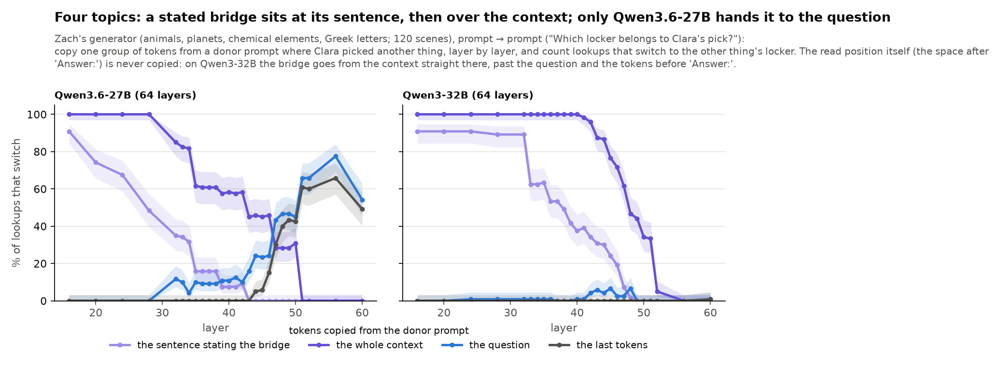
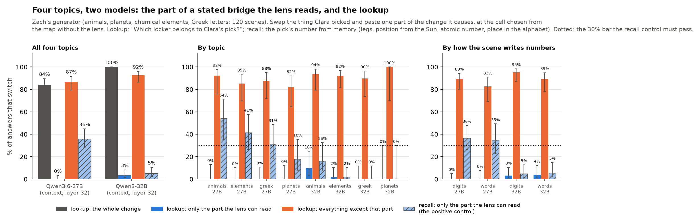
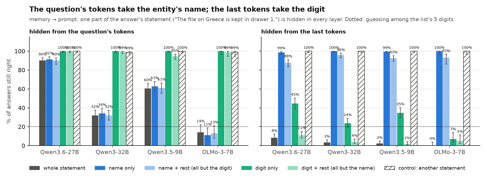
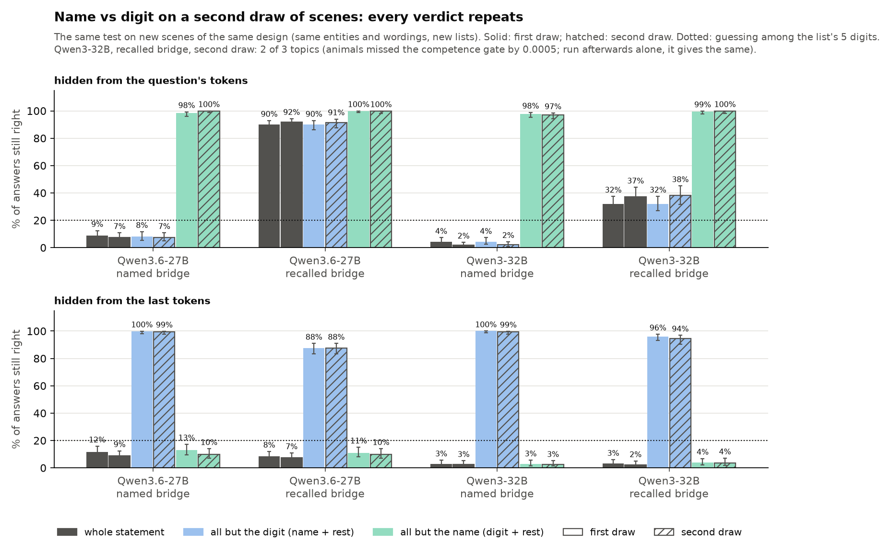
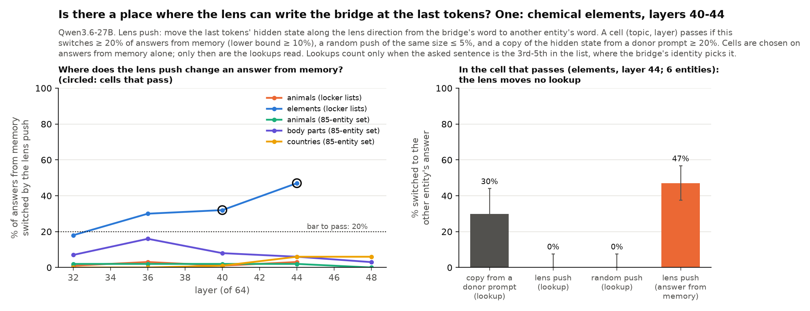
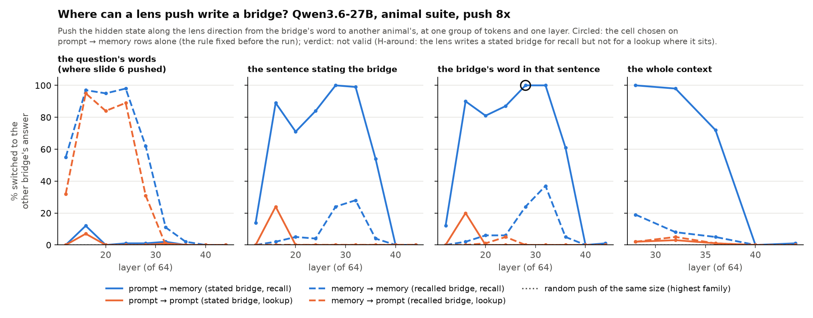

# bridge-jspace

**The question.** To answer a two-step question, a model first finds an entity in between (the **bridge**), then uses it to get the answer. A **J-lens** reads a model's hidden states as words. Does the model use the bridge in the form the lens reads, or by another route?

> "Which locker belongs to the animal known for oinking?" → bridge: *pig* → answer: *the pig's locker number*, stated in the prompt.

Five open models: Qwen3.6-27B, Qwen3-32B, Qwen3.5-9B, OLMo-3-7B (SFT, DPO, Instruct), Gemma 4 31B-it.

> **Status, 22 Oct (night): exploration.** Nothing on this page is in [VERIFIED.md](VERIFIED.md) yet except Zach's B1-B4. The numbers are an agent's recount of saved runs. The main Qwen3.6-27B runs reproduce row for row from a clean checkout: the pipeline is deterministic, which does not mean the analysis is right.

[Dan's predictions vs results](predictions/) · [plan (Google Doc)](https://docs.google.com/document/d/1bqqdXePTUXQGlowVjk73sPfJkbV_tsu0RNNX-BiTYUc/edit?usp=drivesdk) · [run log](EXPERIMENTS.md) · [old README with every number](README_archive.md) · [how to run](DEVELOPER.md)

---

## Findings at a glance

🟢 strong (large effect, controls pass, repeated or fixed in advance) · 🟡 medium (one model or topic, or a weak control) · ⚪ open

| # | Finding | Key evidence | How sure | Models |
|---|---|---|---|---|
| 1 | Recall uses the bridge in the form the lens reads, while the bridge forms; a lookup does not ([slide 1](#1-background-recall-goes-through-the-j-space-a-lookup-does-not)) | J-space removed: recall 19-22% right, lookup 99% | 🟡 one model, one topic | 27B |
| 2 | A lookup ignores the lens-readable part of a stated bridge ([slide 2](#2-where-does-the-lookup-read-the-bridge)) | that part moves 0% of lookups on 5 topics; the rest 82-92% | 🟡 one model; the recall control passes on 4 of 5 topics, weakly on the new ones | 27B |
| 3 | The question's tokens read the bridge's name; the last tokens read its digit ([slide 2](#2-where-does-the-lookup-read-the-bridge)) | hidden from the last tokens: digit 2-11% right, name 88-96% | 🟢 fixed in advance; two draws of scenes | 4 models |
| 4 | A lookup ends in a late attention read of the answer's sentence by the last tokens ([slide 3](#3-blocking-the-read-the-lookup-reads-late-through-attention)) | read blocked: 0-23% right (guessing 20%) | 🟢 two draws of scenes | 5 models |
| 5 | Which sentence is read: an order label for the 1st and 2nd, the bridge's identity after ([slide 4](#4-what-the-last-tokens-carry-an-order-label-then-the-bridges-identity)) | label +82-95 points; identity +12-14 points | 🟢 fixed in advance, fresh scenes | 5 models |
| 6 | The order label counts order in the list, not place in the text ([slide 4](#4-what-the-last-tokens-carry-an-order-label-then-the-bridges-identity)) | 31-39% vs 9-16% (27B) | 🟡 pooled over sentences | 4 models |
| 7 | A lens push writes a stated bridge at its sentence for recall, not for the lookup ([slide 6](#6-where-can-a-lens-push-write-a-bridge)) | recall 37-100%, lookup 0% | 🟡 one model, one topic; off-path check failed at the chosen cell | 27B |
| 8 | Where the lens can write the bridge, the lookup still does not follow it ([slides 5-6](#5-can-a-code-outside-the-lens-write-the-lookup)) | stated bridges: findings 2 and 7; last tokens: 0 of 47 lookups, recall 47% | 🟡 stated bridges · ⚪ recalled bridges (one topic) | 27B |

27B = Qwen3.6-27B. Findings 2, 3, 4, 5, 7 and 8 were updated on 22 Oct with new data.

**Why it matters.** If finding 8 holds widely, a monitor that reads a model through the J-lens would see the bridge but miss what drives a lookup.

**Main caveats.**
- Every lens claim rests on Qwen3.6-27B. Qwen3-32B's lens does not read these bridges (7.5% vs 92%).
- The scenes are simple: 3-8 short sentences, one-digit answers, the question right after the list.
- Some splits were chosen after seeing the data; two were then confirmed in advance ([list](#choices-made-after-seeing-the-data)).

**Negative or not testable:** the fitted position code only overrides the lookup (slide 5); head 51/22 is near-tautological and the OLMo ladder shows no difference (slide 7); colour-word answers and Gemma's random patch fail their controls (slide 4); random damage instead of blocking was not testable (slide 3).

---

## Words we use

| Word | Meaning | Example |
|---|---|---|
| **bridge** | The entity found in the first step | "the animal known for oinking" → pig |
| **recall / lookup** | The answer comes from the model's memory / from a sentence in the prompt | how many legs a pig has / "The pig's locker is 3." |
| **kind of question** | Where the bridge comes from → where the answer comes from | **memory → prompt**: "Which locker belongs to the animal known for oinking?" |
| **J-lens, J-space** | A tool that reads hidden states as words ([Gurnee et al. 2026](https://transformer-circuits.pub/2026/workspace/index.html)); the part of a hidden state it reads | |
| **lens push** | Add the lens's direction from one word to another (pig → cow) to a hidden state | |
| **patch** | Copy hidden states from a **donor prompt** (same task, another bridge or another order) into the **original prompt**, at chosen tokens and one layer, and see which answer comes out | |
| **blocking** | Stop chosen tokens from attending to one sentence, in chosen layers | |
| **question tokens / last tokens** | The words of the question / the 1-2 tokens right before the answer ("Answer:") | |
| **positive control** | A place where a method is known to work, so that a null result elsewhere means something | |

**Kinds of question** (context: "Jack's pet is a cow. … The cow's locker is 5."):

| Kind | Example | Bridge | Answer |
|---|---|---|---|
| prompt → prompt | Which locker belongs to Jack's pet? | stated in the prompt | looked up in the prompt |
| memory → prompt | Which locker belongs to the animal known for mooing? | recalled | looked up |
| prompt → memory | How many legs does Jack's pet have? | stated | recalled |
| memory → memory | How many legs does the animal known for mooing have? | recalled | recalled |
| named → prompt | Which locker belongs to the cow? | named in the question | looked up |

**Models.**

| Model | Layers | Architecture |
|---|---|---|
| Qwen3.6-27B | 64 | hybrid: 16 attention + 48 DeltaNet (a compressed running memory) layers |
| Qwen3-32B | 64 | attention in every layer |
| Qwen3.5-9B | 32 | hybrid: 8 attention + 24 DeltaNet |
| OLMo-3-7B (SFT, DPO, Instruct) | 32 | attention, 3 of 4 layers with a sliding window |
| Gemma 4 31B-it | 60 | attention, sliding window + global |

Each model is tested only on items it answers right without any edit. All scenes are generated from templates with fixed seeds ([datasets](#datasets)).

---

## 1. Background: recall goes through the J-space, a lookup does not

> **In short:** while the bridge is being formed (layers 32-40 here, layer 20 in slide 6), pushing a hidden state toward another animal's lens word changes recalled answers but not looked-up ones; removing the J-space breaks recall but not lookups.
>
> **How sure:** 🟡 one model, one topic; partly verified (B1-B3) · **Models:** Qwen3.6-27B · **Source:** Zach's runs, 20 Oct


**What we did**
- At layers 32-40, pushed the hidden state toward another animal's lens word, and compared with a random push of the same size.
- Removed the J-space from the hidden state, and compared with removing a random subspace of the same size.

**What we found**
- The push switches **recalled** answers (36-51%), but lookups no more than a random push (3% vs 4%, 19% vs 21%).
- Removing the J-space leaves 19-22% of **recalls** right and 99% of **lookups**; a random subspace changes nothing.

**Weak spots**
- One model, one topic (animals).
- It holds only while the bridge is being formed. Later, at the last tokens, the lens push writes recall in one topic of five (slide 5).
- Qwen3.5-9B: the lens reads the bridge but cannot write it. Gemma 4 could not be tested with the old lens.

**What it means:** a lookup in the prompt does not need the J-space. Slides 2-5 ask what it uses instead.

---

## 2. Where does the lookup read the bridge?

> **In short:** a bridge stated in the prompt stays at its sentence until about two thirds of the depth. The lookup reads it there, late, and not through the part the lens reads. The question's tokens read the entity's name back from the sentence; the last tokens read its digit.
>
> **How sure:** (a) 🟢 lens-free, five topics, two models · (b) 🟡 one model (Qwen3.6-27B), five topics, the recall control weak on the new ones · (c) 🟢 pre-registered, four models, repeated on a second draw · **Plan item:** "where the lookup reads the bridge: the positions where it's stated vs the question tokens"

**What we did**
- **(a) Where the bridge sits.** Copy the hidden states of one group of tokens (the sentences, the question, the last tokens) from a donor prompt with another bridge, layer by layer.
- **(b) Which part is used.** Change the stated bridge (Jack's pet: cow → pig) and paste back only one part of the change it causes: the part the lens can read, or everything else.
- **(c) Name or digit.** Hide one part of the answer's sentence ("The file on **Greece** is kept in drawer **1**.") from the question's tokens or from the last tokens: the name, the digit, the sentence without its digit, or the sentence without its name. The last two exist because the sentence's other tokens may have already read the part.











**What we found**
- A **stated** bridge stays at its sentence: copying the sentences switches 79-94% of answers at layers 32-44. The question and the last tokens carry it only from layer 48-52.
- A **recalled** bridge sits at the question (57-100% from layer 36) and reaches the last tokens at layer 48.
- **On four topics** (Zach's generator: animals, planets, chemical elements, Greek letters; 120 scenes; prompt → prompt):
  - Qwen3.6-27B repeats the animal-suite picture: the stated bridge stays at its sentence to layer ~24, over the whole context to layer 42, and the question takes it from layer 47 (78% at layer 56).
  - Qwen3-32B keeps it at its sentence to layer ~37 and over the context to layer 47, but copying the question or the tokens before "Answer:" never moves the lookup (0-7% at every layer). There the bridge goes from the context straight to the position where the answer is read.
- Of a stated bridge's change, the **lens-readable part alone switches 0% of lookups**; everything else switches 83% (the whole change 87%). The lens does name the stated bridge: it is the lens's top word on 90% of items.
- For a **recall** from the same stated bridge it is the reverse: the lens-readable part does the work (66%).
- **On four topics** (Zach's generator), at the cell the map chose without the lens (the whole context at layer 32), Qwen3.6-27B:

  | Topic | Recall: lens-readable part (the control, needs ≥ 30%) | Lookup: lens-readable part | Lookup: everything else | Items | Bridges |
  |---|---|---|---|---|---|
  | animals | 54% [35, 71] | 0% [0, 13] | 92% | 26 | 12 |
  | chemical elements | 41% [26, 58] | 0% [0, 10] | 85% | 34 | 6 |
  | Greek letters | 31% [18, 49] | 0% [0, 11] | 88% | 32 | 8 |
  | planets | 18% [8, 36] (fails) | 0% [0, 12] | 82% | 28 | 7 |
  | all four (the pre-registered verdict: replicates) | 36% [28, 45] | 0% [0, 3] | 87% | 120 | 33 |

  - The lens-readable part gives 0% of lookups on all four topics. The control passes on 3 of 4, and the split holds on those three.
  - Scenes that write numbers as words ("The locker of the eagle is three.") give the same as digits (lookup 0% and 83-89%; control 35-36%).
  - The lens still names the stated bridge (its top word on 92% of items), and its push writes the lookup no more than a random push (6% vs 6% at 4x).
- **Qwen3-32B** on the same scenes is not interpretable: the recall control fails (5% [2, 10]; 0-16% per topic). Its lens names the stated bridge on only 7.5% of items, so it does not see these bridges.
- The **question's tokens read the name**. Hiding the name hurts as much as hiding the whole sentence, hiding the digit and the rest of the sentence costs nothing (95-100% right), and the wrong answers fall off the list.
  - For a **named** bridge ("Which drawer holds the file on Greece?") this holds on all four models: 5-12% right with the name hidden, Qwen3.6-27B included.
  - For a **recalled** bridge it holds on Qwen3-32B (32%), Qwen3.5-9B (61%) and OLMo (13%), but not on Qwen3.6-27B (90%): there the recalled bridge skips this step.
- The **last tokens read the digit**. Hiding the digit with the sentence's other tokens breaks the lookup (2-11% right, as low as hiding the whole sentence). Hiding the name and the rest barely matters (88-96%). This holds on all four models and at every position of the asked sentence; the controls (the same parts of another sentence) keep 99-100%.
- **On a second draw of scenes** (same design, new lists) every verdict repeats on Qwen3.6-27B and Qwen3-32B. Qwen3-32B, recalled bridge, sentence without its digit hidden from the question's tokens: 38% right (whole sentence 37%), sentence without its name 100%. From the last tokens, sentence without its name: 4% (Qwen3-32B) and 10% (Qwen3.6-27B) right; sentence without its digit: 94% and 88%.

**Weak spots**
- (b) rests on one model. On the new topics its control is weak: 31-54% where it passes (92% on the animal suite), only animals clears 30% with its lower bound, and planets fails; 6-12 different bridges per topic.
- The recall control on the new topics is carried as much by the rest of the change as by the lens-readable part (rest 38% vs lens part 36%, pooled), unlike the animal suite (1% vs 92%).
- The copies never include the read position itself (the space after "Answer:"), so "the last tokens" here means the template tokens before it.
- On Qwen3-32B the question's tokens need the name to a different degree by topic, the same on both draws: with the sentence hidden from them, 8-10% right on countries, 23% on animals, 63-68% on body parts. On the second draw animals missed the pre-registered competence gate by 0.0005 (lower bound 0.8495, gate 0.85), so the pre-registered result rests on two topics. Run afterwards and labelled post hoc, animals alone gives the same verdicts (sentence hidden from the question's tokens 27% right, without its digit 27%, without its name 100%; from the last tokens, without its name 6%, without its digit 94%). From now on the gate compares the lower bound rounded to two decimals.
- The digit token alone leaks through its neighbours (7-44% right when only it is hidden), so the decisive test hides the sentence without its name or digit.
- Why the question's tokens read the name (for instance, to pick the bridge among the listed entities) is not tested. For a named bridge there is nothing to pick.

**What it means:** the lookup reads the bridge where it is stated, late, and not through the part the lens reads, now on four topics of a second generator where the control works (Qwen3.6-27B). The question's tokens look the name up; the last tokens fetch the digit.

---

## 3. Blocking the read: the lookup reads late, through attention

> **In short:** stop the last tokens from attending to the answer's sentence and the lookup drops to guessing, on all five models. Only the attention layers matter.
>
> **How sure:** 🟢 · **Models:** 5 of 5 · **Plan item:** "block question→statement attention: does the lookup break while recall survives?"

**What we did**
- Stopped the last tokens from attending to the answer's sentence in a set of layers, and counted the answers still right against guessing among the list's 5 digits (20%).
- Controls: block another sentence instead; on the hybrid models, block the answer's sentence in the DeltaNet layers instead; recall questions, where the model has them.


**What we found**
- The **lookup breaks on all five models**: 0-23% still right (Qwen3.6-27B 9%, Gemma 23%, the others 0-3%), and 72-96% of the answers go to another digit of the list.
- Blocking another sentence keeps 100% right on every model.
- On the hybrid models only the **attention** layers matter: blocking the DeltaNet layers keeps 100%.
- The read is spread over attention heads: no single head or layer is needed. Where it sits along the depth differs by model (slide 8).
- The same in 5 datasets on Qwen3.6-27B, including Python code and sentences in other languages.
- **On a second draw of scenes**, pre-registered: Qwen3.6-27B 7% right [5, 11] (first draw 9%), Qwen3-32B 3% [2, 6] (first draw 3%); another sentence blocked instead keeps 100%, and on Qwen3.6-27B the DeltaNet layers blocked instead keep 100%.
- The wrong answers favour the **1st sentence** and never the last. Against a uniform choice among each scene's 4 other sentences: Qwen3.6-27B 128 / 56 / 35 / 25 / 19 on sentences 1-5 (expected 59 / 51 / 51 / 51 / 51), Gemma 154 / 35 / 25 / 8 / 3 (expected 56 / 42 / 42 / 43 / 42); weaker on the other three models.

**Weak spots**
- Recall stays right (Qwen3.6-27B 99%, Qwen3.5-9B 96%, Gemma 100%), but by construction: the blocked sentence is not on a recall's path. It is a control, not a finding. Qwen3-32B's run had no recall questions, and OLMo fails its recall gate.
- The link between the first-sentence bias and the order label (slide 4) is only suggestive: models may guess with a positional bias anyway. The random-damage control we ran (noise at the last tokens in layers 48-63 instead of blocking) could not answer this: noise strong enough to break the lookup sends 87% of answers off the list, leaving 15 wrong answers from the list (50 needed). A version that reads the forced choice among the list's digits is the next try.

**What it means:** the route around the J-space ends in an ordinary attention read of the answer's sentence by the last tokens.

---

## 4. What the last tokens carry: an order label, then the bridge's identity

> **In short:** which sentence gets read is set by an **order label** for the 1st and 2nd sentence and by the **bridge's identity** for the rest. The label counts order in the list, not place in the text.
>
> **How sure:** 🟢 the split by the asked sentence, first chosen after the pooled test, is consistent on 5 of 5 models and held as a rule fixed in advance on fresh scenes (Qwen3.6-27B, Qwen3-32B); one layer per model; the counting tests 🟡 pooled · **Plan item:** "pointers: lookback / binding-ID tests (swap the statement order)"

**What we did**
- Two prompts list the same entities in a different order. We copy the donor prompt's last two tokens into the original prompt at one layer. Each possible answer is a different digit, so the answer shows what the copied tokens pointed to:


- To see how the label counts, the lists are built so that three ways of counting (from the start, from the end, place in the text) point to three different sentences, or an extra sentence moves every sentence in the text or away from the question.

**What we found**
- **When.** On every model there is a short window, just before the digit itself reaches the last tokens, where the copy moves the answer to another sentence:


- **What, by position.** When the donor asks its **1st or 2nd** sentence, the answer goes to the original's 1st or 2nd: Qwen3.6-27B 100% / 97%, Qwen3-32B 100% / 89%, Qwen3.5-9B 89% / 57%, OLMo 86% / 41%, Gemma 40% / 37% (100% / 78% of the answers that move).
- From the **3rd** sentence on, the answer follows the **bridge's identity** (the original's sentence about the donor's entity) as often as or more than the position: identity 27-52%, position 2-31%.


- **Confirmed as a rule fixed in advance on fresh scenes** (scripts/finding5_confirm.py, entity-cluster intervals): for the 1st and 2nd sentence the place must beat the identity, from the 3rd on the identity must be at least as frequent.
  - Qwen3.6-27B, a third draw never seen before, layer 50: place minus identity +95 [+93, +98] points for the 1st and 2nd; identity minus place +14 [+7, +22] from the 3rd on.
  - Qwen3-32B, its second draw, layer 50 (chosen by the fixed donor-digit rule): +82 [+75, +89] and +12 [+4, +20]. On its first draw the 3rd-5th tied.
  - Named bridges (reported, not decisive): the same on Qwen3.6-27B; on Qwen3-32B only the 1st-2nd part (3rd-5th: -1 [-11, +10]).
- The same in Python dicts and with the sentences in French, Spanish and German (Qwen3.6-27B, layer 50): 1st / 2nd 96% / 90% in code and 100% / 83% across languages, then the identity (code 20-55% vs position 6-37%; languages 37-45% vs 13-29%).
- The same with 8 sentences (Qwen3.6-27B, Qwen3.5-9B, Gemma) and with colour words as answers (Qwen3.5-9B only):


- **How the label counts.** It follows the **order in the list**, not the place in the text, on all four models tested (Qwen3.6-27B 31-39% vs 9-16%, Qwen3.5-9B 14-23% vs 5-8%, OLMo 23-31% vs 10-12%, Gemma 9-12% vs 2-3%). "From the start" beats "from the end" only on Qwen3.6-27B.
- It survives an extra sentence before the list or before the question on all four (16-50% vs 1-17%). Sentences twice as long change nothing.


**Weak spots**
- Qwen3.6-27B's layer 50 was chosen after the first runs (a second and a third draw of scenes reproduce it). The other models' layers follow a fixed rule: the last layer where the donor's digit is still under 10% of answers.
- The identity part (3rd-5th) is a modest margin (+12-14 points), with many answers unchanged or elsewhere in the list.
- The counting tests pool all asked sentences, so their signal comes mostly from the 1st and 2nd.
- On Gemma a random patch of the same size breaks 85% of answers (never into a position or identity answer). Colour words fail their control on Qwen3.6-27B and Gemma.
- "Identity", not "word": whether the identity is the lens's word form is the open question of slide 5.

**What it means:** this matches lookback work (Gur-Arieh et al. 2026) in the middle of the list and differs at its end: they find a positional pointer for the last item too, we find none. New here: it holds when the bridge is recalled rather than named, in code and across languages, on five models.

---

## 5. Can a code outside the lens write the lookup?

> **In short:** a fitted 4-dimensional "position" code moves 31-42% of lookups where the lens moves none, but the model does not depend on it. Where the lens does write recall at the last tokens (one topic), it still moves no lookups.
>
> **How sure:** the fitted code 🟡 (an override only); the lens test ⚪ one topic, six entities · **Plan item:** "fit a code that does write the lookup, and its cosine with the lens direction"

**What we did**
- **Fitted code.** From the average last-token states of each list position, fit a ~4-dimensional "position" direction. Push the last tokens toward another position by as much as a real patch changes them. Compare with the lens direction of the target's word and with a random direction.
- **Positive control for the lens.** A lens push that moves no lookups means something only where the same push does write recall. We swept layers 32-48 on five topics and kept only the cells where the lens push switches recall (≥ 20%, lower bound ≥ 10%), a random push ≤ 5% and a patch ≥ 20%. Cells were chosen on recall alone, before any lookup was read.




**What we found**
- On Qwen3.6-27B the fitted code moves **31-42%** of lookups to the target sentence; the lens direction and a random one move **0%**. On OLMo the same fit moves 2%.
- It is an **override, not the model's own address**: at its natural size it moves 4% (the pre-registered bar was 10%), at twice that 26%. It jumps straight to the target (78%), not through the positions in between. It writes the 1st and 2nd positions (65%, 39%) far better than the 3rd-5th (5-13%). Removing it from the model leaves 98% of lookups right.
- It lies **outside the J-space**: its largest cosine with any entity's lens direction is 0.032, against 0.036 for random vectors; its J-space share is 7.1%, against 7.6% for a random vector.
- **Positive control.** Only **chemical elements at layers 40 and 44** qualify (the lens switches 31-47% of recalls). On countries, animals and body parts the lens writes 0-16% of recalls at every layer, while a patch moves 23-63% of recalls on animals and body parts at layers 44-48; on countries even a patch moves no recall at the last tokens.
- In the decisive cell (elements, layer 44) the lens moves **0 of 47 lookups** to the bridge's sentence (upper bound 8%), random 0%, patch 30%; **the same push moves 47% of recalls.** Only lookups of the 3rd-5th sentence count here, where the identity (not the order label) picks the sentence. At layer 40 the result is inconclusive: the lens moves 13% of lookups [6, 25], random 2%.
- On 154 new scenes, the same rule at layer 44 gives the same: lens 2 of 154, patch 42 of 154, the push moves 39 of 90 recalls.

**Weak spots**
- The lens's 0% at layer 50 (first bullet) has no positive control: there the lens push does not write recall either (2 of 150 at 1x, 8 of 150 at 2x, while a patch moves 50 of 150).
- The positive control exists in one topic only (six entities). A supervised identity direction needs ≥ 12 entities, so it is not run.
- For a recall the bridge's identity and the answer coincide, so a late patch may carry the answer itself rather than the bridge.
- An earlier version of this page called a 201-item set "independent"; it shared 47 items with the sweep. The 154 scenes above are new.

**What it means:** a code outside the J-space can steer the lookup and lines up with the order labels of slide 4, but the model does not depend on this fitted version. Late at the last tokens the lens push writes the bridge for almost no question, recall included; the one place it does (elements) shows the lens failing to write the lookup, on six entities.

---

## 6. Where can a lens push write a bridge?

> **In short:** a lens push writes a bridge where the bridge sits. A recalled bridge is written at the question's words; a stated bridge at its own sentence. But a stated bridge written there moves only recall (37-100%), never the lookup (0% from layer 20 on). Early on, a lens push is also not the same as editing the input word.
>
> **How sure:** 🟡 pre-registered, one model, one topic; the decisive cell failed its off-path check (the cells that pass show the same) · **Models:** Qwen3.6-27B · **Plan item:** "the 27B's early writes: is a hard early lens push the same as editing the input word?"

**What we did**
- **(a) First test (21 Oct).** At layer 20, pushed the words of the question that name the bridge ("the animal known for mooing", "Jack's pet") toward another animal's lens word; or edited those words to name that animal ("the sheep"). A random push of the same size as the control.
- **(b) Second test (22 Oct, D4 v2).** The first test pushed a stated bridge at the question, but slide 2 shows it sits at its own sentence. So: the same push at four places (the question's words; the sentence stating the bridge, "Clara's pet is a cow."; the bridge's word in it, "cow"; the whole context), at layers 12-44, 1-8x a typical change.
  - Controls: a random push of the same size; a push toward an animal not in the scene; the text edits of (a).
  - Rule fixed before the run: pick the cell on prompt → memory rows only (the push must switch ≥ 30% of recalls there, a random push ≤ 5%); there, read prompt → prompt. The cell is valid only if the same push changes ≤ 10% of the questions whose bridge is recalled (their bridge is not on that sentence).




**What we found**
- (a) Editing the input words switches **every** kind of question (100%). The lens push at the question switches only questions whose bridge is **recalled** (73%, 84%), not those whose bridge is stated (1%, 2%); a random push 0%. Pre-registered verdict: the push "writes the bridge", not "acts like an input edit". The second test repeats this cell: 84% and 95% vs 0% and 0%.
- (b) At the stated bridge's **sentence or word**, the push writes it for **recall**: prompt → memory switches in 21 cells at layers 16-36 (37-100%; 100% at the word, layer 28, 8x). A random push switches 0%. A push toward an animal outside the scene gives that animal's leg count in 96% of recalls.
- In the same cells it never writes the **lookup**: prompt → prompt 0% in every cell from layer 20 on. Only at layer 16, 8x, does the lookup move (20-24%), where the push acts closer to an input edit.
- Over the whole context (layers 28-36) the same: recall 72-100%, lookup 0-3%.
- Pre-registered verdict: **not valid**. At the decisive cell (the word, layer 28, 8x: recall 100%, lookup 0%), the push also moved 25% of memory → memory answers ("How many legs does the animal known for mooing have?"): the cue's animal is the same cow, named in the scene, and its recall reads that mention. In the cells that pass the off-path check (layers 20-36, 4-8x; for instance the sentence at layer 24, 8x: recall 84%, lookup 0%, off-path 4-10%) the pattern is the same; that reading is ours, after the data.

**Weak spots**
- One model, one topic (the animal suite), strong pushes (4-8x a typical change).
- The decisive cell failed its off-path check: the scene names the cued animal, so "off the path" is not clean for memory → memory.
- (a) and (b) push a single direction (the lens's word difference); a lookup could still use a lens-readable feature that this direction does not reach.

**What it means:** the lens can write a bridge, recalled or stated, where that bridge sits, and recall follows it. The lookup does not follow a stated bridge written that way, not at its sentence, not over the context. This is a second, independent form of slide 2's split (there: pasting the lens-readable part of a real change; here: a lens push) and the main evidence for finding 8 so far.

---

## 7. Longshots: a read-out of the model's own errors, and the OLMo post-training ladder

> **In short:** a late attention head follows the sentence the wrong answer comes from, but that is near-tautological so far. OLMo's three post-training checkpoints look the same.
>
> **How sure:** 🟠 both · **Models:** Qwen3.6-27B; OLMo-3-7B · **Plan item:** "the longshot: a pointer read-out; the OLMo post-training ladder"

**What we did**
- **Read-out.** Without any edit, on Qwen3.6-27B's own wrong lookups: does a late attention head look at the sentence the wrong answer came from?
- **Ladder.** Ran slides 3 and 4 on three checkpoints of OLMo-3-7B: SFT, DPO and Instruct.

**What we found**
- On 339 wrong answers (of 4160 prompts), layer 51, head 22 looks most at the sentence the wrong digit comes from 76% of the time and at the asked one 17%. On right answers it looks at the asked sentence 99% of the time.
- SFT, DPO and Instruct give the same late read (0-1% still right when blocked), the same order label / identity split, and the same order count.

**Weak spots**
- **The read-out is near-tautological:** each digit appears once per scene, so the output already names that sentence. It becomes a read-out only if it predicts the answer before the digit forms, or on scenes with a repeated digit. Not run yet.
- The OLMo base model is not tested, so the ladder says only that SFT, DPO and Instruct do not change the route, not whether post-training builds it. OLMo fails the recall gate (35-68% right), so it has no memory → memory control.

---

## 8. Across models

> **In short:** the late attention read, the order label for the first two sentences and the identity for the rest are common to all five models. How deep these steps sit, and whether the question's tokens must also see the sentence, differ.
>
> **How sure:** 🟡 one seed per cell; with five models, size, depth and architecture are confounded

**Where the steps sit along the depth.** Orange: the window where the last tokens carry a label or the bridge's identity. Grey: the block of layers where they must read the answer's sentence (8-16 layers wide, so it does not say whether the read comes before or after the orange window). Green: the layer where the digit itself arrives.


| | Qwen3.6-27B | Qwen3-32B | Qwen3.5-9B | OLMo-3-7B | Gemma 4 31B |
|---|---|---|---|---|---|
| Architecture | hybrid | attention | hybrid | attention, sliding | sliding + global |
| Label → digit, % of depth | 72-81% | 75-81% | 56-72% | 50-59% | 67-70% |
| Lookup right, sentence hidden from the last tokens (guessing: 20%) | 9% | 3% | 3% | 0% | 23% |
| … hidden from the question's tokens | 90% | 32% | 61% | 14% | 98% |
| What the question's tokens take from the sentence (recalled / named bridge) | – (not needed) / the name | the name / the name | the name / the name | the name / the name | – / – |
| What the last tokens take from the sentence | the digit | the digit | the digit | the digit | – |
| 1st / 2nd sentence label | 100% / 97% | 100% / 89% | 89% / 57% | 86% / 41% | 40% / 37% |
| 3rd-5th: the bridge's identity steers | yes | ties with the position | yes | yes | yes |
| Order in the list, not place in the text | yes | – | yes | yes | yes |
| "From the start", not "from the end" | yes | – | pooled only | no | pooled only |
| Fitted position code writes the lookup | yes (override) | – | – | no (2%) | – |
| Recall through the J-space (Zach) | yes | – | reads, cannot write | ran, not analysed | – |
| Random-patch control | clean | clean | clean | clean | breaks 85% |

– not tested. One seed per cell unless said.

**Common to all:** the late attention read; an order label for the first two sentences and the bridge's identity for the rest; the label counts order in the list; a first-sentence bias when the read is blocked; the DeltaNet layers play no part on the hybrids.

**Differs:**
- How deep the steps sit: late on the two 64-layer Qwens, mid-depth on the others.
- How strong the "2nd" label is: strong on the larger Qwens.
- Whether the question's tokens must also see the sentence: yes on Qwen3-32B, OLMo and Qwen3.5-9B. Qwen3.6-27B (hybrid) and Qwen3-32B (attention only) match on the label and the late read but differ here (90% vs 32% right).

---

## 9. What it adds up to, and what is missing

**The story so far.**
- Recall uses the bridge in the form the lens reads while the bridge forms (slide 1); a lookup reads its sentence late, through attention, from the last tokens (slide 3, now on two draws of scenes).
- The lens reads a stated bridge, and can even write it where it sits, but the lookup does not use that form: two independent tests on Qwen3.6-27B (slide 2, pasting the lens-readable part; slide 6, a lens push), on five topics with a working recall control.
- The last tokens pick the sentence by an order label (1st, 2nd) or by the bridge's identity (3rd on), and fetch its digit (slides 2 and 4, now confirmed as rules fixed in advance on fresh scenes).

**A candidate mechanism (not tested).** The last tokens form a query (an order label, or the bridge's identity) and read the answer's **digit**, not its name, even for sentences 3-5. So the owner's identity must sit in the attention key at the digit or its neighbours, and late attention matches query to key, as in binding and lookback work. Two cheap tests: read the digit positions with the lens; patch the digit token's hidden state between scenes.

**Not shown yet.**
- **Finding 8 for a recalled bridge:** is its identity at the last tokens a code the lens cannot write? The only positive control there is one topic (six entities), where it holds at layer 44 (also on 154 new scenes) and is inconclusive at layer 40.
- **A second model with a working lens.** Qwen3-32B's lens does not read these bridges (7.5% vs 92%), so every lens claim rests on Qwen3.6-27B.
- **Strength of the recall control on new topics:** 31-54%, and carried as much by the non-lens part as by the lens part.
- The scenes are simple: 3-8 short sentences, one-digit answers, the question right after the list. Patches move 30-50% of answers at most.

---

## 10. Next steps

**Done on 22 Oct** (each with its rule and Dan's prediction written before it was opened):

| Step | Result |
|---|---|
| Positive control for the lens at the last tokens (slide 5) | Only chemical elements, layers 40-44 |
| Name vs digit, and again on a second draw (slide 2) | Repeats on Qwen3.6-27B and Qwen3-32B |
| The stated-bridge test on four topics and on Qwen3-32B (slide 2) | Holds on the 3 of 4 topics where the control passes (Qwen3.6-27B); Qwen3-32B not interpretable |
| Where a lens push writes a stated bridge (slide 6, step 1) | Recall yes, the lookup no; formally not valid at the decisive cell |
| Finding 5 as a rule fixed in advance on fresh scenes; the late read on a second draw (slides 3-4) | Both hold, on both models |
| Random damage instead of blocking (slide 3) | Not testable as designed |

**Next**, in order. What strengthens the findings we are about to freeze comes before anything that opens a new question.

| # | Step | Why | When |
|---|---|---|---|
| 1 | **Slide 6, step 2:** the same push on Zach's generator (four topics, prose and tables), in scenes that do not name the cued thing elsewhere, so the off-path check is clean | Findings 7 and 8 beyond one topic, without the off-path flaw | Fri 23 (needs a push adapter for tasks_v2) |
| 2 | **A second model with a working lens.** Before any new lens run, a cheap read-only check: does the lens name the stated bridge (as on Qwen3.6-27B, 92%)? Candidates: OLMo-3-7B's J-lens, Qwen3.5-9B's | Every lens claim rests on one model; Qwen3-32B's lens reads these bridges on 7.5% of items | Fri 23 |
| 3 | **New late-recall topics for the positive control** (recall-only lens sweep first): the animal by its young's name ("the animal whose young is called a kid") → legs; chemical elements extended to 15-20 entities, recalled by symbol → period | Finding 8 for a recalled bridge beyond six entities; ≥ 12 entities for the supervised identity direction | Fri 23, if 1-2 leave GPUs free |
| 4 | The first-sentence bias, version 2: the forced choice among the list's digits under noise | Slide 3's caveat | When a GPU is idle (~0.1 GPU-h) |
| 5 | **Update to Neel**: finding 1 holds only while the bridge forms; findings 4 and 5 now strong; finding 8 has evidence for stated bridges, not yet for recalled ones; all lens claims on one model | Process | Sat 24 |
| 6 | Freeze findings 3, 4, 5 and slide 2; verify by hand with Zach into VERIFIED.md; sync on Zach's work on the other models | Process | Sat-Sun 24-25 |
| 7 | Blocking (slide 3) on Zach's generator: prose and tables, four topics, Qwen3.6-27B, Qwen3-32B, OLMo (code ready and smoke-tested) | Finding 4 beyond our toy scenes | After Zach freezes the data and the weekend's verification |
| 8 | The late read in Zach's six formats (chat turn, table, document, JSON, Python, prose) | Finding 4 beyond simple scenes | Mon-Tue 26-27 |
| 9 | Write-up and slides | | Wed-Fri 28-30 |

Not before 30 Oct (new questions): the candidate mechanism (the lens at the digit positions; patch the digit token's hidden state); the label with two lists in one prompt, a header before the list, or the question before the list; the identity with each entity in a different language in the original and donor prompts; the late head on scenes with a repeated digit.

---

## Appendix

### Datasets

All generated from templates with fixed seeds; the examples are real items (random, seed 0). Sizes: [data/README.md](data/README.md).

**Animal suite** (Zach): pets and lockers, every kind of question. Slides 1, 2, 6.
```
Tara's pet is a pig. Jack's pet is a cow. Dan's pet is a chicken.
The cow's locker is 5. The pig's locker is 3. The chicken's locker is 7.
Which locker belongs to the animal known for oinking?                        → 3
```

**Locker lists**: five sentences, an original and a donor prompt; each outcome of a patch is a different digit. Slides 3-5.
```
original: The bee's locker is 3. The chicken's locker is 1. The spider's locker is 7. The lion's locker is 9.
          The cat's locker is 2.  Which locker belongs to the animal known for making honey?        → 3
donor:    The chicken's locker is 3. The spider's locker is 7. The lion's locker is 5. The cat's locker is 1.
          The bee's locker is 9.  Which locker belongs to the animal known for its roar?             → 5
after copying the donor's last tokens into the original: 9 = identity (the lion's sentence in the original),
          7 = the same position (3rd), 5 = the donor's own digit
```

**Many entities and wordings**: the same design on 85 entities in 3 topics (countries, animals, body parts), 9 wordings per topic, some entities and one wording held out. Slides 3-5, 7.
```
The file on Greece is kept in drawer 1. The file on China is kept in drawer 9. The file on Hungary is kept in
drawer 7. The file on Venezuela is kept in drawer 2. The file on Sweden is kept in drawer 6.
Which drawer holds the file on the country whose capital is Athens?          → 1
```

**Counting and shifts**: a filler line moves, the donor list gets one sentence more or fewer, or an extra sentence goes before the list or the question; also 8-sentence lists and colour-word answers. Slide 4.
```
original: The forehead chart is in folder 6. The skull chart is in folder 3. The wind picked up late in the evening.
          The tongue chart is in folder 5. The eye chart is in folder 9. The eyebrow chart is in folder 4.
donor:    (the same charts reshuffled; the filler sentence is now 5th instead of 3rd)
```

**Python code** and **other languages**: the same lookup as a dict, and with sentences in French, Spanish and German. Slide 3.
```
lockers = {"dog": 7, "owl": 9, "cat": 5, "bee": 8, "frog": 3}
What number does lockers store for the animal known for making honey?      → 8

Le cheval a le casier 5. El perro tiene la taquilla 6. Die Kuh hat den Spind 7. El pollo tiene la taquilla 8.
La souris a le casier 3.  Which locker belongs to the animal known for clucking?          → 8
```

**Zach's generator (tasks_v2)**: picks and lockers on four topics (animals, planets, chemical elements, Greek letters), in prose or tables, numbers as digits or words. The running stated-bridge test (slide 2) and the next blocking runs.
```
Maria picked the tick. The locker of the tick is six. The locker of the turkey is seven. Nina picked the fox.
Tara picked the turkey. The locker of the fox is nine.
Which locker belongs to Maria's pick?                                       → 6
```

### Choices made after seeing the data

| Choice | What happened since |
|---|---|
| Finding 5: the split by the asked sentence (the pooled pre-registered test was mixed) | Confirmed as a rule fixed in advance on fresh scenes, two models |
| Slide 4: layer 50 on Qwen3.6-27B (other models follow a fixed rule) | Repeated on two more draws of scenes |
| Finding 2: counting a topic only when its own recall control passes | Stricter than the pre-registered pooled rule (which replicates); 3 of 4 new topics pass |
| Finding 3: animals on Qwen3-32B's second draw, which missed the competence gate by 0.0005 | Run post hoc with the gate at 0.845; same verdicts. The gate now rounds to two decimals |
| Finding 7: reading the cells that pass the off-path check | The decisive cell, fixed in advance, failed that check |
| Slide 5: the position code's natural-size test allowed 1x or 2x | Passes only at 2x (26%; 4% at 1x); we read it as an override |
| Finding 2's rule: one decisive cell, chosen from the lens-free map | Amended on 22 Oct 17:36, after the runs started and before any result was opened |

### Where things are

| What | Code | Results |
|---|---|---|
| Slide 1 (Zach) | `scripts/suite_split.py`, `read_write.py`, `ablate_pilot.py` | `results/read_write/`, `ablate_pilot/` |
| Slide 2 | `scripts/statement_positions.py`, `d1_verdict.py` (the four-topic rule); name vs digit: `scripts/attn_knockout.py`, `scripts/d2_parts.py` | `results/statement_positions/`, `results/attn_knockout/` |
| Slide 3 | `scripts/attn_knockout.py`; the random-damage control: `primacy_noise.py` | `results/attn_knockout/`, `primacy_noise/` |
| Slide 4 | `scripts/pointer_v*.py`, `pointer_swap.py`; the fixed-in-advance check: `finding5_confirm.py` | `results/pointer_swap/`, `finding5_confirm/` |
| Slide 5 | `scripts/pointer_fit.py`, `pointer_mechanism.py`, `c2_cells.py` | `results/pointer_fit/`, `pointer_mechanism/`, `c2_cells/` |
| Slide 6 | `scripts/early_push.py`, `early_push_where.py` | `results/early_push/`, `early_push_where/` |
| Slide 7 | `scripts/d5a_natural_errors.py`, the slide 3-4 scripts | `results/d5a_natural_errors/` |
| All figures | `scripts/readme_figures.py` | `figures/readme_1021/` |
| Job queue, pre-registered specs | `scripts/jobq.py`, `jobs/` | `results/jobq/` |

Every run's spec in `jobs/` states its hypotheses, decision rule and controls before it runs. Internal names used in `jobs/` and [predictions/](predictions/): D1 = the stated-bridge test (slide 2), D2 = blocking (slides 2-3), D3 = patching the last tokens (slide 4), D3b = the fitted position code (slide 5), C2 = the lens positive control (slide 5), D4 = the early push (slide 6), D4 v2 = where the push writes (slide 6).

<details>
<summary>Runs behind each slide</summary>

| Slide | Runs |
|---|---|
| 1 | `read_write/dose_v1`, `ablate_pilot/abl_rot_v1` |
| 2 | `statement_positions/d1_map_n80_v1`, `d1_parts_n80_v1`; four topics: `d1_topics_{map,parts,rw}_27b`, `qwen3_32b_d1_topics_{map,parts,rw}`, judged by `scripts/d1_verdict.py` into `results/d1_verdict/`; question-token rows of the slide 3 runs; name vs digit: `attn_knockout/{d2_parts_v2_27b, qwen3_32b_d2_parts_v2, qwen35_9b_d2_parts_v2, olmo3_7b_instruct_d2_parts_v2}` (first version without the leak-robust spans: `*d2_parts*` without `_v2`), analysed by `scripts/d2_parts.py`; second draw: `d2_parts_seed2_27b`, `qwen3_32b_d2_parts_seed2` |
| 3 | `attn_knockout/d2_v4_late_read`, `qwen3_32b_d2_v4_late_read_v2_r2`, `qwen35_9b_d2_v4_late_read_r2`, `olmo3_7b_{instruct,sft,dpo}_d2_v4_late_read_*`, `gemma4it_d2_v4_late_read_v3_r2`; second draw: `d2_late_read_seed2_27b`, `qwen3_32b_d2_late_read_seed2`; random damage: `primacy_noise/d2_primacy_noise_27b` |
| 4 | `pointer_swap/d3v4_swap_topics`, `d3v4_seed2_swap_27b`, `qwen3_32b_d3v4_swap_r2`, `qwen35_9b_d3v4_swap_r2`, `olmo3_7b_instruct_d3v4_swap_fn`, `gemma4it_d3v4_swap_v2_r2`; 8 sentences and colour words: `d3v5_swap_27b`, `qwen35_9b_d3v5_swap_r2`, `gemma4it_d3v5_swap_r2`; counting: `d3v4x_swap_main`, `qwen35_9b_d3v4x_swap_r2`, `olmo3_7b_instruct_d3v4x_swap`, `gemma4it_d3v4x_swap_r2`; shifts: `d3v6_swap_27b`, `qwen35_9b_d3v6_swap_r2`, `olmo3_7b_instruct_d3v6_swap`, `gemma4it_d3v6_swap_r2`; fixed in advance on fresh scenes: `d3v4_seed3_swap_27b`, `qwen3_32b_d3v4_seed2_swap`, judged by `scripts/finding5_confirm.py` |
| 5 | `pointer_fit/d3b_replicate_fresh_27b`, `d3v4_fit_main`, `olmo3_7b_instruct_d3b_fit_v2`; `pointer_mechanism/d3b_mechanism_27b`; positive control: `pointer_fit/c2_sweep_v4_27b`, `c2_sweep_v1_27b`, selected and revealed by `scripts/c2_cells.py` into `results/c2_cells/step_a_20261022/` |
| 6 | `early_push/d4_push_wording_b_v1` (wording A: `d4_push_v1`); where the push writes: `early_push_where/d4_where_27b` |
| 7 | `d5a_natural_errors/d5a_natural_errors_27b`; OLMo ladder: `olmo3_7b_{sft,dpo}_d3v4_swap`, `olmo3_7b_{sft,dpo}_d3v4x_swap` and the slide 3 OLMo runs |

Two blocking runs (Qwen3-32B, Gemma) were analysed locally: the box's figure stage hit an old plotting bug. On Qwen3.5-9B the shifts run also reported layers 20-22, where the donor's digit had started to arrive; the spec excludes them.

</details>
