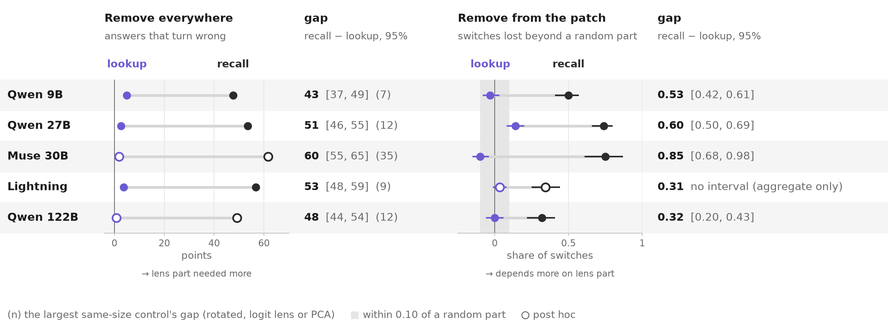
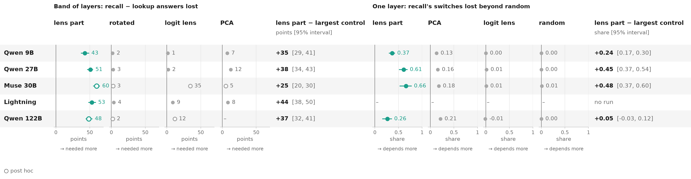
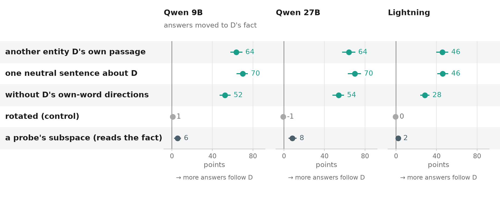
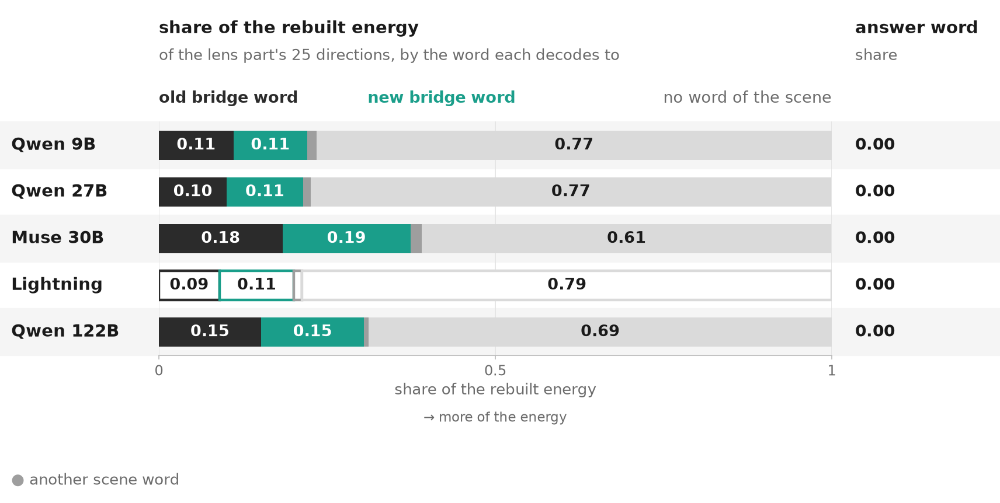
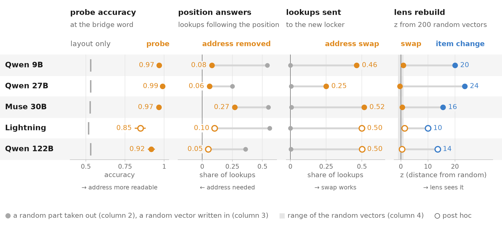
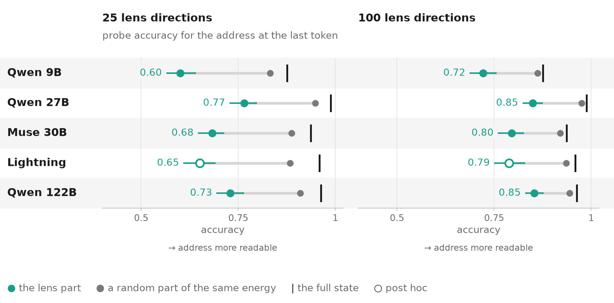
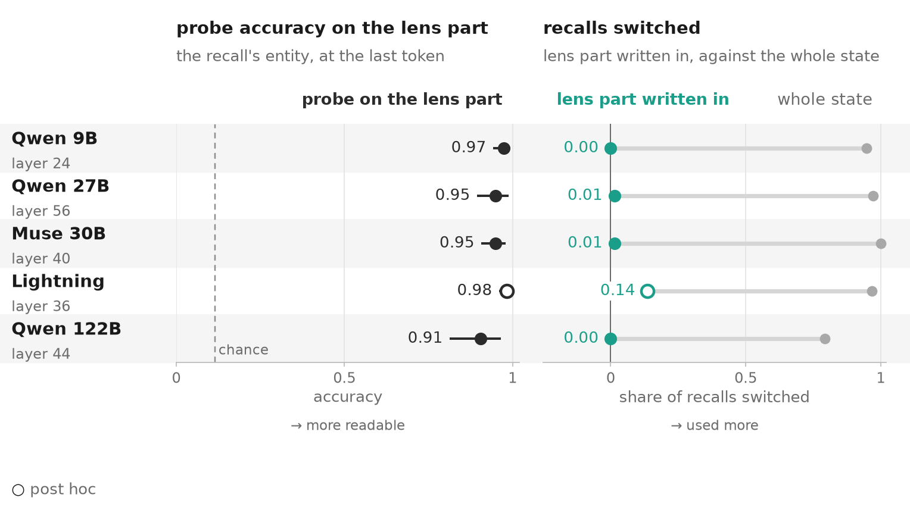
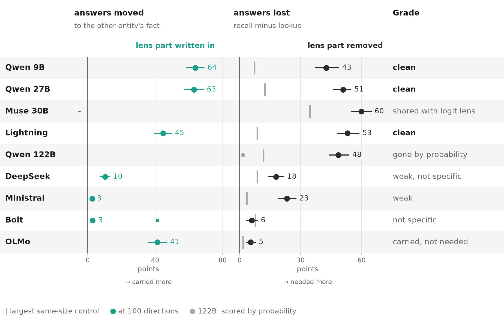
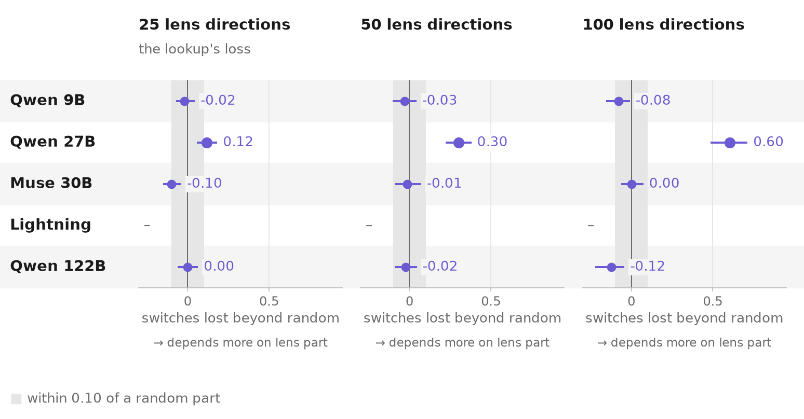
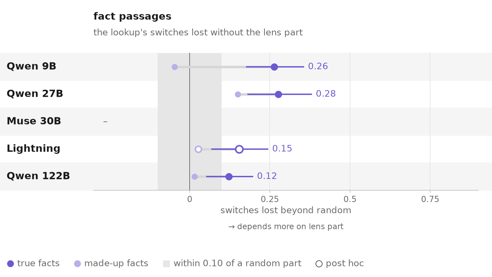

<!-- Generated by scripts/readme_root.py from docs/readme/README.template.md; edit the template. -->
# Recall goes through the workspace, lookup goes around it

*A controlled test of the J++ lens on two-step questions in open language models: what the lens reads at the middle entity of a question, and whether the model uses it.*

**Danyil and Zach Perlman** · two-week research sprint, October 2026<!-- src: docs/depth/README.md | 29 Oct 2026 --> · **Status:** every number below comes from the sprint's run files and carries its source; a human hand-check is in progress ([VERIFIED.md](VERIFIED.md) lists what has been checked).

## Summary

A recent interpretability tool, the J++ lens, reads a language model's hidden state as a short list of word-like directions. Its authors argue that these directions form a *global workspace*: a small shared space the model uses for multi-step thinking. If so, reading the lens could become a way to monitor what a model is thinking about. We tested what the lens shows, and whether the model depends on it, on questions that need two steps: first find an entity (*the composer who wrote The Magic Flute* → Mozart), then a fact about it (Mozart's nationality). The fact either comes from the model's memory (**recall**) or is written in the text in front of it (**lookup**).

- **Recall goes through the lens's directions; lookup does not** (at middle layers). Removing a handful of them costs recalled answers 43 to 53 points more than looked-up ones on the three clearest models<!-- src: docs/breadth/data.csv | ko.q9.mk; ko.nl.mk -->. Over a band of layers what needs them is *saying* a remembered word (named people; twin set); at a single layer the recall follows them without needing them, because other layers hold copies.
- **The lens shows what the entity's words evoke**: its name or its remembered attributes. That works as a pointer to the entity, but it is not a fact retrieved for the question.
- **Lookup runs on two codes outside the lens**: which item it is, and an address for where the item sits in the prompt. A linear probe reads the address at 0.85 to 0.99<!-- src: data/figures/depth/data.csv | the locker probe at the bridge word, locker-first scenes -->, swapping it redirects the lookup. The lens reads which item it is, but the lookup's copy of the identity lies outside the lens directions, and the lens cannot see the address at all.
- **What the lens can read is not always what the model uses.** At the answer position the lens part reads the entity at 0.91 to 0.98, yet swapping it changes at most 0.14 of answers<!-- src: data/figures/depth/data.csv | 51.10: recall, last token, read peak: the probe's accuracy on the lens part; 51.10: recall, last token, read peak: the lens swap's switches -->. Across nine models the entity is readable in all of them but needed in only some.

**For anyone who wants to monitor models through this lens:** at the entity, the lens tells you what the model associates with it. It does not tell you whether the model is answering from memory or from the text, which source wins when they conflict, or whether what it shows is in use.

## Background

- **Two-step questions.** "What nationality was the composer who wrote The Magic Flute?" can only be answered by passing through Mozart, the **bridge**. Interpretability work asks where and how a model holds such an intermediate step.
- **Recall and lookup.** The second step can come from memory ("Mozart was Austrian", learned in pretraining) or from the prompt ("...Mozart was Austrian by birth..."). We call these a **recalled answer** and a **lookup answer**. Our datasets pair them: the same question about the same entity, with the fact stated or not.
- **The J++ lens.** The J-lens and its improved version J++ (Gurnee et al. 2026<!-- src: docs/depth/README.md | (Gurnee et al. 2026) -->; [paper](https://transformer-circuits.pub/2026/workspace/index.html), [code](https://github.com/anthropics/jacobian-lens)) map a hidden state at any layer to vocabulary words through the model's own Jacobian. The few directions it reads most strongly at a token are what we call **the lens part** of that token's state. The paper reports that removing the top directions across middle layers leaves fluency intact but breaks multi-step reasoning and free-form recall.
- **Why test it here.** A two-step question gives a clean place to look (the bridge), two kinds of answer that differ only in where the fact comes from, and answers that can be scored exactly.

## What we did

*The two kinds of prompt. Top: a fact passage, where the final fact is stated in the passage or left to memory. Bottom: a locker scene, where the same bridge word feeds a lookup question and a recall question.*

- **Fact passages** (breadth track). A short passage mentions an entity; the question needs one of its facts. In the matched pair the fact is either stated in the passage or left to memory; everything else is identical. The main set, `jsuite_v2`, has 8 relations; 179 bridge facts on test and 5,370 test items<!-- src: docs/breadth/README.md | 8 relations; 179 bridge facts on test; 5,370 test items -->. Earlier sets (toy puzzles, natural fact chains, natural text) give the same picture. The newest set, `jsuite_v4` (**the twin set**), describes six people instead of naming them and adds three variants: a codename defined in the passage, a real conflict between the passage and memory, and a remembered attribute used as a key into the passage.
- **Locker scenes** (depth track). "The locker of carbon is 3. The locker of helium is 5. ... Eric picked carbon." The lookup asks "Which locker belongs to Eric's pick?"; the recall asks "What is the atomic number of Eric's pick?" Both pass through the bridge word "carbon". <!-- src: docs/depth/README.md | The locker of carbon is 3. The locker of helium is 5. -->
- **The lens part.** The directions the J++ lens reads at the bridge: the top 10 in the breadth track<!-- src: docs/breadth/README.md | project out the 10 directions the J++ lens reads most there -->; in the depth track, the 25 that best rebuild the change between two prompts<!-- src: docs/depth/README.md | the 25 directions of the J++ lens that best rebuild the change -->.

*Three ways to test the lens part, each at the bridge.*

- **Remove everywhere** (breadth): project the lens part out of every token across a band of middle layers, and count the answers that turn wrong. *Is it needed?*
- **Remove from the patch** (depth): take the bridge word's state from a prompt where it names another item, add the difference to the original run at one layer without its lens part, and count the answers that no longer switch. *Does the change travel through it?*
- **Swap** (both): write another entity's lens part into the bridge, and count the answers that move to that entity's fact. *Is it enough?*
- **Controls.** Every removal is compared with removals of the same size: a randomly rotated part, the logit lens's own top directions (a simpler lens), and the residual stream's top principal directions at the same norm. Only the excess over these says something about the lens.
- **Models.** Both tracks: Qwen3.5-9B, Qwen3.6-27B, Qwen3.5-122B-A10B (FP8), Muse Glimmer 30B and Nemotron 3.5 Lightning (a Mamba-attention hybrid). The breadth track adds DeepSeek-V4-Flash, Ministral-3-14B, Nemotron 3.5 Bolt and OLMo-3-32B base. <!-- src: docs/breadth/README.md | Nemotron 3.5 Lightning (L27-33); DeepSeek-V4-Flash (L18-23); Ministral-3-14B (L32-37); Nemotron 3.5 Bolt (L42-53); OLMo-3-32B base (L12-20) --><!-- src: docs/depth/README.md | a Mamba-attention hybrid -->
- **How to read the numbers.** The tracks use different units, so compare patterns, not values. *Points* (breadth): answers lost on recall minus answers lost on lookup, out of 100 (M − K)<!-- src: docs/breadth/README.md | recall answers lost minus stated-fact answers lost, in points -->. *Share* (depth): the share of the change's switches lost beyond a random part of the same size, from 0 to 1<!-- src: docs/depth/README.md | switches lost without a part minus those lost without its random part, as a share of the whole change's switches -->. Brackets are 95% bootstrap intervals over bridge items<!-- src: docs/breadth/README.md | Brackets: 95% bootstrap over bridges -->. A hollow ○ marks a result whose gate or rule was set after the data were seen (*post hoc*); everything else was fixed in advance.

## Findings

Each finding has the same parts: the claim, the main figure, then **Test**, **Result**, **Controls**, **Scope**, **Confidence**, **Limits** and **Takeaway**, and a supporting figure.

### Finding 1. Recall goes through the lens part; lookup does not

**Claim.** At middle layers the recall goes through the directions the lens reads at the bridge: removed over a band of layers they break recalled answers, and at one layer the recall follows them when the patch's parts disagree. Lookup answers do neither.

*Rows are models. Left: points lost when the lens part is removed everywhere, for lookup and recall. Right: the share of switches lost beyond a random part when it is removed from the patch. The gap columns are recall minus lookup, with the interval over bridge items; in brackets, the largest same-size control's gap.*

- **Test.** Remove everywhere over a band of middle layers (fact passages), and remove from the patch at one layer (locker scenes).
- **Result.**
  - Remove everywhere: recalled answers lose 50.9 / 42.6 / 53.1 points more than stated ones (Qwen 27B / Qwen 9B / Lightning)<!-- src: docs/breadth/data.csv | ko.q27.mk; ko.q9.mk; ko.nl.mk -->; the stated facts themselves lose 3, 5 and 4 points<!-- src: docs/breadth/README.md | Stated facts lose 3, 5 and 4 points -->.
  - Remove from the patch: the recall loses 0.50 / 0.74 / 0.75 / 0.34 ○ / 0.32 of its switches beyond random (9B / 27B / Muse / Lightning / 122B)<!-- src: docs/depth/x0_numbers.json | rc_excess_9b; rc_excess_27b; rc_excess_muse; rc_excess_122b --><!-- src: data/figures/depth/data.csv | conflict: recall, switches lost beyond a random part -->; the lookup −0.03 / 0.14 / −0.10 / 0.03 ○ / 0.00<!-- src: docs/depth/x0_numbers.json | lk_excess_9b; lk_excess_27b; lk_excess_muse; lk_excess_122b --><!-- src: data/figures/depth/data.csv | conflict: lookup, switches lost beyond a random part -->.
  - Where in the prompt (twin set): the recall's need is spread over the bridge's words. Removing the lens part only at the final token costs it almost nothing; only at the description or only at the mention costs more; the full effect needs all positions. The damage is upstream, so this is not the output being suppressed.
  - Say versus use (twin set, named people): when a remembered word is only used as a key to pick a line of the passage, removing the lens part costs no more than a random part of the same size; saying the same word costs much more.
- **Controls.** Same-size removals cost far less. Remove everywhere: rotated 2.7 / 1.8 / 3.6 points, the logit lens's own directions 1.9 / 1.4 / 8.7, principal directions of the same norm 12.4 / 7.3 / 8.2 (27B / 9B / Lightning)<!-- src: docs/breadth/data.csv | ko.q27.rot; ko.q9.rot; ko.nl.rot; ko.q27.u; ko.q9.u; ko.nl.u; ko.q27.pc; ko.q9.pc; ko.nl.pc -->. Remove from the patch, in the earlier runs that carry the same-size control: the lens part costs the recall 0.37 / 0.61 / 0.66 / 0.26 beyond random, principal directions of the same size 0.13 / 0.16 / 0.18 / 0.21 (9B / 27B / Muse / 122B)<!-- src: data/figures/depth/data.csv | J++ part: recall extra loss; PCA directions (same size): recall extra loss -->; random lens directions and the logit lens's at most 0.01<!-- src: data/figures/depth/data.csv | random lens directions: recall extra loss; logit-lens directions: recall extra loss -->. Paired on the same items, the lens part beats its largest same-size control by 35.4 / 38.5 / 44.4 points in the band (9B / 27B / Lightning)<!-- src: docs/breadth/data.csv | f2.band.q9.pc; f2.band.q27.pc; f2.band.nl.u --> and by 0.24 / 0.45 / 0.48 / 0.05 of its switches at one layer (9B / 27B / Muse / 122B), the 122B's interval including zero<!-- src: docs/breadth/data.csv | f2.layer.q9.pca; f2.layer.q27.pca; f2.layer.mu.pca; f2.layer.q122.pca -->.
- **Scope.** Every passage set we built shows it on the two Qwens: 22.8 to 52.1 points on toy puzzles, natural fact chains and natural text<!-- src: docs/breadth/data.csv | toy.q27.s1; toy.q27.s2; toy.q27.s3; toy.q9.s1; toy.q9.s2; toy.q9.s3; nat.q27.s1; nat.q27.s2; nat.q27.s3; nat.q9.s1; nat.q9.s2; nat.q9.s3; natplus.q27; natplus.q9 -->; every relation, from 36.0 (languages) to 72.0 (dishes) on the 27B<!-- src: docs/breadth/data.csv | ko.q27.rel.languages; ko.q27.rel.dishes -->; rare and popular bridges alike<!-- src: docs/breadth/data.csv | natplus.q27.rare; natplus.q27.pop; natplus.nl.rare; natplus.nl.pop -->; scored by probability, not only by the top answer (50.3 / 35.3 / 44.1)<!-- src: docs/breadth/data.csv | ko.q27.soft; ko.q9.soft; ko.nl.soft -->. On the twin set it survives dropping every item a shortcut could answer (a check run after the data), and asking the question before the passage. With a codename, which the lens does not show, recall still needs the lens part far more than lookup does, though on the 27B a random part of the same size costs nearly as much.
- **Confidence.** High for the recall on every model tested, and for the lookup on the 9B, Muse, Lightning and 122B. Partial on the 27B, whose lookup also loses some (see [Where it does not hold](#where-it-does-not-hold)).
- **Limits.** "Lookup does not need it" holds at middle layers: in the deep layers, where the answer is about to be said, lookups on the 9B and Lightning need the lens part too (twin set). At one layer the recall does not *need* the lens part, because other layers carry copies: zeroing it keeps 0.94 to 0.97 of recalled answers<!-- src: data/figures/depth/data.csv | 47.5: recall's answers kept at L, the J++ part's 25 directions taken out -->; it *follows* the lens part when the two parts of the patch disagree. The removal also costs plain text +0.30 nats (27B) to +1.67 nats (Lightning)<!-- src: docs/breadth/README.md | +0.30 nats (27B) to +1.67 nats (Lightning) -->. English templated prompts, one-token answers, greedy answers with thinking off.
- **Takeaway.** The directions the lens reads are on the causal path for producing a remembered word (needed over a band, followed at one layer), not for reading the prompt.

*Every control next to the lens part. Left: removed everywhere, in points. Right: removed from the patch, as a share of switches. Grey values are controls. The last column of each half is the lens part minus its largest same-size control, paired on the same items, with its interval.*

### Finding 2. The lens part holds what the bridge's words evoke

**Claim.** At the bridge the lens reads what the entity's words evoke: its name or its remembered attributes. This works as a pointer to the entity: written into another prompt it redirects recall to that entity, and it does so just as well when taken from one neutral sentence naming the entity. It is not the address the lookup uses (Finding 3), and not a fact computed for the question.

*One panel per model. Each row is a different source of the swapped-in part; the dot is how many answers move to the other entity's fact, in points, with a 95% interval over bridge items. The neutral sentence beats the same-passage swap by +6.0 [3.3, 8.7] / +6.2 [3.2, 8.9] / +0.3 [−2.4, 3.2] points (27B / 9B / Lightning, paired on the same items)<!-- src: docs/breadth/data.csv | ptr.q27.neutral_minus_swap; ptr.q9.neutral_minus_swap; ptr.nl.neutral_minus_swap -->.*

- **Test.** Swap another entity's lens part into the bridge, taken from its own passage, from one neutral sentence naming it, or with its name's own directions removed. Decompose the lens part into the vocabulary words it stands for. Compare what the lens shows at the bridge before a recall, before a lookup, and with no question asked (twin set).
- **Result.**
  - Swap: 63.0 / 63.9 / 44.8 points of answers move to the other entity (27B / 9B / Lightning)<!-- src: docs/breadth/data.csv | swap.q27.swap; swap.q9.swap; swap.nl.swap -->.
  - From one neutral sentence: 1.09 / 1.10 / 1.01 times as much as from the entity's own passage<!-- src: docs/breadth/data.csv | ptr.q27.neutral; ptr.q9.neutral; ptr.nl.neutral -->.
  - Decomposed in the locker scenes: the old and the new bridge words each carry 0.09 to 0.19 of the rebuilt energy, the answer word 0.00 (9B, 27B, Muse, Lightning ○, 122B)<!-- src: data/figures/depth/data.csv | 52 A: share of the rebuilt energy in the original bridge word; 52 A: share of the rebuilt energy in the new bridge word; 52 A: share of the rebuilt energy in the reader's answer word -->.
  - Before the question (twin set): the person's remembered attribute shows as strongly before a lookup of a made-up value as before a recall, and as strongly when no question is asked. The made-up value the model will say barely shows at the bridge and appears only at the final token.
  - At described bridges (the twin set and its predecessor), the swap's effect runs through the answer's directions: scrubbing the relation's answer directions removes almost all of it, while a random scrub of the same size keeps most of it.
- **Controls.** Swapping a supervised probe's subspace that reads the fact moves 8.3 / 5.5 / 2.2 points, against 74.8 / 79.5 / 62.4 for the lens part on the same relations<!-- src: docs/breadth/data.csv | probe.q27.probe; probe.q9.probe; probe.nl.probe; probe.q27.swap; probe.q9.swap; probe.nl.swap -->. Rotated and logit-lens parts move nothing on the 27B (0 and 0)<!-- src: docs/breadth/README.md | Rotated or logit-lens parts move nothing (27B: 0 and 0) -->. In the locker scenes, sparing the answer words' directions keeps 0.92 to 0.98 of the recall's loss<!-- src: data/figures/depth/data.csv | main test, recall: share of its loss kept when the lens part keeps the answer words' directions -->: there, the loss is not the answer token's.
- **Scope.** The neutral-sentence pointer holds on 8 of 8 relations on the 27B<!-- src: docs/breadth/README.md | It holds on 8 of 8 relations on the 27B --> and on Bolt with more directions (1.01)<!-- src: docs/breadth/data.csv | ptr.nb.neutral -->. It needs words that name the entity: a codename that the passage itself defines shows almost nothing of the person in the lens (twin set).
- **Confidence.** High for the pointer (fixed in advance; three models, two families; two methods agree). Medium for "what the words evoke" (twin set: three models, one seed each).
- **Limits.** Which of the two the lens part holds depends on the setting. With named items and numeric answers (locker scenes), the part readable as words is the item's name; most of its energy matches no word of the scene; at a description (fact passages) it is the remembered attributes, the answer among them<!-- src: docs/depth/README.md | the answer when it is a word tied to the entity (Zach's passages) -->. Even at a named mention it is more than the name in the Qwens: without the name's own directions the swap keeps 0.84 / 0.83 / 0.62 (27B / 9B / Lightning)<!-- src: docs/breadth/README.md | swap keeps 0.84 / 0.83 / 0.62 -->, while Bolt's keeps 0.43<!-- src: docs/breadth/README.md | Bolt's keeps 0.43 -->.
- **Takeaway.** A lens reading at an entity reports associations, primed by the words, before and regardless of the question. A misleading cue word in a description outranks the true attribute there, on all three models tested (twin set).

*What the lens directions stand for in the locker scenes: the share of their energy in the old bridge word, the new bridge word, and no word of the scene; right, the answer word's share.*

### Finding 3. Lookup runs on codes outside the lens: identity and address

**Claim.** The lookup answers either by which item it is (its own locker) or by where its locker sat (the address); never by the number. Its position answers read the bridge through an *address*, a code for where the item's sentence sits in the prompt (a lookback pointer). A linear probe reads it, removing it stops lookups by position, swapping it redirects the lookup, and the lens cannot see it.

*Rows are models; columns are four tests of the address, each with its control in grey.*

- **Test.** Train a probe at the bridge word to read which locker sentence holds the item's locker. Remove the probe's directions from the patch. Write another locker's address in. Measure how much of that write the lens directions rebuild.
- **Result.**
  - Routes: when another item moves, the lookup names the item's own locker in 0.48 / 0.66 / 0.44 / 0.44 ○ / 0.61 ○ of cases and follows the position in the rest; never the new number (9B / 27B / Muse / Lightning / 122B)<!-- src: data/figures/depth/data.csv | another item moved, whole: identity share; another item moved, whole: position share -->. [Figure](figures/readme/r5_routes.png).
  - Read: the probe reads the address at 0.97 / 0.99 / 0.97 / 0.85 ○ / 0.92 (9B / 27B / Muse / Lightning / 122B)<!-- src: data/figures/depth/data.csv | the locker probe at the bridge word, locker-first scenes -->.
  - Remove: lookups that follow the item's position fall to 0.08 / 0.06 / 0.27 / 0.10 ○ / 0.05 ○, against 0.54 / 0.25 / 0.55 / 0.56 ○ / 0.36 ○ with a random part removed<!-- src: data/figures/depth/data.csv | another item moved, no_alf: position share; another item moved, no_alf_rand: position share -->.
  - Swap: writing another locker's address sends 0.46 / 0.25 / 0.52 / 0.50 ○ / 0.50 ○ of lookups to that locker<!-- src: data/figures/depth/data.csv | lookup target share, mean over locker pairs, s = 2 -->.
  - Lens: the 25 lens directions rebuild 0.01 to 0.06 of that write<!-- src: data/figures/depth/data.csv | 47.0 (b) share rebuilt by 25 lens directions: pointer -->, as little as for a random vector.
- **Controls.** A layout-only baseline reads the address at 0.53<!-- src: data/figures/depth/data.csv | the locker probe's layout baseline, locker-first scenes -->; a random vector sends at most 0.01 of lookups anywhere<!-- src: data/figures/depth/data.csv | lookup target share, random direction, s = 4 -->. At the last token, a probe on the lens part reads the address worse than a random part of the same energy (0.60 / 0.77 / 0.68 / 0.65 ○ / 0.73 against 0.83 / 0.95 / 0.89 / 0.88 ○ / 0.91; this energy rule was set after the data)<!-- src: data/figures/depth/data.csv | the address at the last token, main test, 25 lens directions: the J++ part; the address at the last token, main test, 25 lens directions: a random part (same energy) -->, and about as well as a random part of the same size.
- **Scope.** The identity code survives removing the lens's next directions too: it lies outside the lens on the 9B, 27B, Muse and Lightning (not tested on the 122B: below its gate). Five models, three families; prose, JSON, tables, made-up-fact passages and 50 neutral sentences; Python code and tool output too<!-- src: docs/depth/README.md | prose, JSON, tables, Zach's made-up-fact passages, 50 neutral sentences; Python code and tool output too -->, where the probe reads 0.97 to 0.99 (tool output) and 0.95 (code, 27B)<!-- src: data/figures/depth/data.csv | code and tool output, tool: the locker probe at the bridge word, locker-first scenes; code and tool output, code: the locker probe at the bridge word, locker-first scenes -->.
- **Confidence.** Medium. Reading and removal were fixed in advance on three models. The swap's rule fixed in advance was read at the wrong dose and said no on every model<!-- src: docs/depth/README.md | read at s = 1 and said no on every model -->; the numbers above use twice that dose, chosen afterwards. Lightning and the 122B's lowered gate are post hoc.
- **Limits.** The 27B's address is weak: its swap reaches only 0.25, and adding the address alone does not bring position answers back. The probe is refit for each format. The address points to the item's mention, not to a number: on the 9B and Lightning its swap also changes 0.21 / 0.27 ○ of recalls<!-- src: data/figures/depth/data.csv | the address swap at s = 2: recalls that change -->.
- **Takeaway.** What the lookup uses is linearly readable and causally effective, but invisible to the lens. A monitor that reads only the lens misses it.

*A probe for the address at the last token, trained on the lens part (colour), on a random part of the same energy (grey) and on the full state (bar), for two sizes of the lens part.*

### Finding 4. Readable is not the same as used

**Claim.** What the lens can read is not necessarily what the model uses. At the last token the lens part reads the bridge entity almost perfectly while the answer does not go through it; across nine models the entity is readable everywhere and needed in only some; and in a real conflict between memory and the passage, the bridge shows memory whichever source wins.

*Rows are models. Left: how well a probe on the lens part reads the entity at the last token. Right: answers that switch when only the lens part is swapped, against the whole state.*

- **Test.** At the last token, train a probe on the lens part to read the recall's entity, then swap only the lens part between prompts and compare with patching the whole state. Across nine models, compare whether the lens part is carried (the swap moves the answer) and needed (the removal costs it). In the twin set's conflict variant ("The club's notes say Achebe was Peruvian"), read the bridge when memory wins and when the passage wins.
- **Result.**
  - Last token: the probe reads the entity at 0.97 / 0.95 / 0.95 / 0.98 ○ / 0.91 (9B / 27B / Muse / Lightning / 122B)<!-- src: data/figures/depth/data.csv | 51.10: recall, last token, read peak: the probe's accuracy on the lens part -->; swapping that part changes 0.00 / 0.01 / 0.01 / 0.14 ○ / 0.00 of recalls<!-- src: data/figures/depth/data.csv | 51.10: recall, last token, read peak: the lens swap's switches -->, while patching the whole state changes 0.95 to 1.00 (the 122B 0.79)<!-- src: data/figures/depth/data.csv | 51.10: recall, last token, read peak: the whole-state patch's switches -->.
  - Nine models: OLMo 32B carries the entity (swap 41.4) without needing it (removal 5.4)<!-- src: docs/breadth/data.csv | swap.ol.swap; ko.ol.mk -->; Ministral's lens reads the fact at mid depth, but its lens part carries only +3<!-- src: docs/breadth/README.md | Ministral's lens reads the fact at mid depth, but its J-part carries only +3 -->.
  - Conflict (twin set): removing the lens part pushes answers toward the passage, but the bridge shows the remembered attribute about as strongly whether memory or the passage wins, and barely shows the passage's false value. It predicts the winner poorly, and framing that makes the model follow the passage much more barely changes it.
- **Controls.** The whole-state patch shows that the answer-changing information is at the last token; only the lens part's share of it goes unused. In the nine-model comparison every removal is set against the rotated, logit-lens and same-size controls of Finding 1.
- **Scope.** The last-token test on five models, three families; the carried-or-needed comparison on nine models; the conflict on three (twin set).
- **Confidence.** Medium. The last-token test's rule was fixed in advance; Lightning is post hoc. The nine-model grading is descriptive: each model's band was fixed in advance, the grades after.
- **Limits.** "Not used" means not used at that token and layer, and at a real change's size: at twice that size the lens part moves part of Muse's and Lightning's recalls. The simplest explanation fits: the answer was computed earlier, at the bridge, and the last-token copy is a by-product.
- **Takeaway.** Seeing an entity or an attribute through the lens does not tell a monitor whether the model is using it, or which source the model will answer from.

*Nine models. Carried: answers moved when another entity's lens part is written in. Needed: recall minus lookup points when it is removed. Right: the grade.*

## Where it does not hold

- **The 27B's lookup.** It leans on the lens part partly: 0.14 beyond random at 25 directions, 0.60 at 100<!-- src: docs/depth/x0_numbers.json | lk_excess_27b; lk_excess_k100_27b -->, while the 122B's stays at −0.12<!-- src: docs/depth/x0_numbers.json | lk_excess_k100_122b -->.
- **Question order.** With the question before the scene, the 27B's lookup loses 0.11<!-- src: data/figures/depth/data.csv | the lookup, question before minus after (paired) --> more of its switches without the lens part (95% interval from 0.01<!-- src: data/figures/depth/data.csv | 53.1: the lookup, question before minus after (paired): the interval's lower bound -->); the 122B's -0.05<!-- src: data/figures/depth/data.csv | the lookup, question before minus after (paired) -->. On the twin set's question-first rendering, the 27B's lookup leans *less* on the lens part, and the 9B's and Lightning's do not move. There is no general order effect; the 27B moves on both measures, in opposite directions.
- **Passages whose fact the model already knows.** On true-fact passages the 9B's and 27B's lookups follow the lens part (0.26 / 0.28 beyond random)<!-- src: data/figures/depth/data.csv | Z1: lookup, switches lost beyond a random part -->: the model answers from memory even when the passage states the fact. With made-up facts the split returns on the 9B and the 122B; the 27B is in between.
- **Across models it is graded.** Strong and lens-specific on three of nine (Qwen 27B, Qwen 9B, Lightning). The rest:
  - Weak: Ministral 23.3 and DeepSeek 17.9 points<!-- src: docs/breadth/data.csv | ko.mi.mk; ko.ds.mk -->.
  - Not specific: on Bolt and DeepSeek, a same-size removal along the top principal directions costs nearly as much (at 100 directions: 24.0 against 31.3, and 25.9 against 28.7)<!-- src: docs/breadth/data.csv | dose.nb.k100.pc; dose.nb.k100; dose.ds.k100.pc; dose.ds.k100 -->.
  - Carried, not needed: OLMo 32B (swap 41.4, removal 5.4)<!-- src: docs/breadth/data.csv | swap.ol.swap; ko.ol.mk -->.
  - Shared with the logit lens: Muse, 34.6 of its 59.9<!-- src: docs/breadth/data.csv | ko.mu.u; ko.mu.mk -->.
  - Lost by probability: the 122B's 48.5 drops to 1.7 when scored by the answer's probability<!-- src: docs/breadth/data.csv | ko.q122.mk; ko.q122.soft -->.
  - Untestable: removing the top lens directions breaks plain text on Gemma 4 31B-it, gpt-oss-20b and Kolibri-1 (9.3, 4.7 and 6.4 nats added)<!-- src: docs/breadth/data.csv | text.gemma; text.gptoss; text.kol -->.
- **Two tests disagree on two models.** The 122B fails the band test by probability but passes the one-layer conflict test (recall 0.32, lookup 0.00 beyond random)<!-- src: docs/depth/x0_numbers.json | rc_excess_122b; lk_excess_122b -->. Muse shares much of its band effect with the logit lens, yet at one layer the logit lens's directions cost its recall nothing<!-- src: data/figures/depth/data.csv | logit-lens directions: recall extra loss -->.

*The 27B's lookup loses more beyond random as more lens directions are removed; the other models' does not. One point per model and number of directions, with an interval over bridge items from the conflict test; Lightning is not drawn (below gate).*

*The lookup on passages with true and with made-up facts, per model; whiskers: intervals on the true-fact values (Muse: too few lookup switches, not drawn).*

*The question-first cell passed its gate on the 27B and the 122B only. The rule was set after the 27B's cells. The breadth track's band measure on its twin set moves the 27B the other way (less reliance with the question first).*

## More results

- **Where in the network.** At middle layers the bridge's mention carries most of the need on the Qwens (Qwen 27B: 29.7 of 50.9 points from the mention alone); deeper, the question carries nearly all of it (47.1 of 50.0)<!-- src: docs/breadth/data.csv | pos.q27.all.bridge; pos.q27.all.all; late.q27.question; late.q27.all -->. [Figure](figures/readme/f9_where.png).
- **Longer chains.** A three-hop chain needs the lens part when its last hop is recalled: Lightning loses 36 to 60 points beyond an all-passage chain<!-- src: docs/breadth/README.md | Lightning loses 36 to 60 points beyond an all-passage chain -->; when the last hop is read it loses −3 to +2<!-- src: docs/breadth/README.md | When the last hop is read it loses -3 to +2 -->, even if earlier hops were recalled. [Figure](figures/breadth/fig10_beyond.png).
- **Numbers computed from the passage.** Reporting a number computed by arithmetic costs nothing in all three models; a recalled number costs the Qwens +13 and +15 points<!-- src: docs/breadth/README.md | Reporting a number computed from the passage by arithmetic costs nothing in all three models; a recalled one costs the Qwens +13 and +15. -->.
- **Mostly from pretraining.** The 9B base model shows +34 against the instruct model's +41 in the same format<!-- src: docs/breadth/README.md | The 9B base model gives +34 against the instruct model's +41 -->.
- **The fact is fetched later.** At the answer position the lens first reads the entity's fact only after the band: layer 50 on the 27B, whose band ends at L40<!-- src: docs/breadth/README.md | layer 50 on the 27B (band ends at L40) -->; for a swapped entity it reads the new entity's fact at the same layers.

## Why this matters

- **For monitoring through lenses.** Lens readouts are an attractive monitor: cheap, and in words. Our results say what such a monitor can and cannot claim. At an entity it reports what the model associates with it; it does not report whether the model is recalling or reading, which source wins a conflict, whether what it shows is in use, or anything defined only in the context (a codename, an address).
- **For the global-workspace view.** We find a narrower version of the claim: the lens's directions are needed to produce a remembered word, and the swap effects that look like moving an intermediate step run through the answer's directions. In-context lookup runs on a non-verbal address outside the workspace.
- **For interpretability practice.** Readable, carried, needed and used are four different properties, and here they come apart (OLMo, the last token, the conflict). A fixed number of directions is not a fixed dose: report the share of the state removed and compare with a same-size removal. Greedy accuracy can hide large losses in probability (the 122B). A test can pass on a flawed design; ours did once, and was withdrawn ([tested and dropped](docs/depth/README.md#tested-and-dropped)).
- **Reusable pieces.** Matched recall/lookup datasets, J++ lens fits for models without a published lens ([results/lens_fit](results/lens_fit)), the scripts, and the pre-registered rules with every run logged.

## Open questions and next steps

- **Why does the 27B behave differently?** Its lookup leans on the lens part with more directions, needs it little even in deep layers (twin set), and question order moves it in opposite directions on two measures. *Next:* the same twin items through both measures on one model.
- **Why does the recall follow the lens part without needing it at one layer?** Removing it over four layers costs the 9B's recall about a quarter<!-- src: docs/depth/README.md | Removing it over four layers costs the 9B's recall about a quarter. -->. *Next:* map where the other copies sit, layer by layer.
- **Does the address exist in natural text?** Refit per format, it is found on the 9B, Muse and Lightning, not the 27B<!-- src: docs/depth/README.md | Refit per format, it is found on the 9B, Muse and Lightning, not the 27B. -->. *Next:* a probe trained on one format and tested on another.
- **Does a bridge the model computes, rather than reads or recalls, go through the workspace?** Computed numbers do not; a computed entity is untested. *Next:* a bridge computed from the passage on the main passage set.
- **What makes models differ?** Bolt and DeepSeek are weak at every dose, OLMo carries without needing, Muse shares with the logit lens. *Next:* OLMo through the dose grid; base and instruct pairs of one family.
- **Can a monitor tell recall from lookup?** The lens alone cannot. *Next:* combine a lens readout with an address probe and score which source the model uses.
- **Beyond our setting.** One-token answers, English templates, greedy decoding with thinking off. *Next:* multi-token answers, reasoning traces, other languages.

## How we checked

- **Rules fixed in advance.** Breadth: [a pre-registration](docs/breadth/prereg_replication_1022.md), with amendments committed before each run. Depth: [predictions](predictions/README.md) committed before results were opened, then scored: mean Brier 0.32 over 121 answers, worse than always answering 50%<!-- src: docs/depth/README.md | mean Brier 0.32 over 121 answers -->.
- **Reruns.** From a clean checkout the breadth headline runs match row for row: 0 of 22325 rows differ on the 27B<!-- src: docs/breadth/README.md | 0 of 22325 -->. Depth rerun labels agree on 382-400 of 400 items per arm<!-- src: docs/depth/README.md | 382-400 of 400 items per arm -->.
- **Independent recounts.** Code written from scratch recounts the depth headline numbers from the per-item files and matches 56 of 63<!-- src: docs/depth/README.md | matches 56 of 63 -->; automatic checks read 45,942 items<!-- src: docs/depth/README.md | 45,942 items read --> and their recount matches 245 of 245 numbers<!-- src: docs/depth/README.md | their recount matches 245 of 245 -->.
- **Red-teaming.** A shortcut found in one twin-set variant, and false values in the conflict variant that were too easy to reject, were fixed by rebuilding both sets, with the changes registered before any result was read.
- **What we dropped.** Readings we once made, each with the test that dropped it: [depth](docs/depth/README.md#tested-and-dropped), [breadth](docs/breadth/README.md#8-what-did-not-hold).
- **Hand-check.** In progress; checked claims enter [VERIFIED.md](VERIFIED.md).
- **Sources.** Every number on this page carries a source comment into the run data, checked by `tests/test_readme_sources.py`.

## Related work and what is new

- **What is not new.** The J-space paper already shows that removing the top lens directions hurts free-form recall and multi-step reasoning (Gurnee et al. 2026<!-- src: docs/shared/references.md | Gurnee et al. 2026 -->). A subject's attributes are written into its last token before they are needed (subject enrichment; Geva et al. 2023<!-- src: docs/shared/references.md | Geva, Bastings, Filippova and Globerson 2023 -->). Entities are bound in context (Feng & Steinhardt 2023) and found through lookback pointers (Prakash et al. 2025)<!-- src: docs/depth/README.md | (Feng & Steinhardt 2023); lookback pointers (Prakash et al. 2025) -->. The state that arbitrates between context and memory lies outside the verbalizable workspace (Kawada & Kellis 2026<!-- src: docs/shared/references.md | Kawada and Kellis 2026 -->).
- **What is new here.**
  - The removal test as matched twins, the same question answered from memory or from the passage, across nine open models with three kinds of control, graded per model.
  - Where the recall's need sits: on the bridge's description and mention, not the final token, so it is not output suppression.
  - The swap effect at a described bridge, decomposed: it runs through the answer's directions.
  - The address at the bridge, shown to be the part the lens misses, in prose, structured data, code and tool output.
  - Measured false positives and negatives of lens readings at entities: a misleading cue wins, a codename is invisible, an attribute shows whether or not it is used, and the reading does not predict which source wins.
- **Methods we build on.** The identity and position routes follow Gur-Arieh et al. (2025); the address uses mass-mean directions (Marks & Tegmark 2023); random parts answer Makelov et al. (2023)<!-- src: docs/depth/README.md | Gur-Arieh et al. (2025); (Marks & Tegmark 2023); Makelov et al. (2023) -->. Full list: [references](docs/shared/references.md).

## Glossary

- **Bridge**: the entity a two-step question passes through (Mozart; "carbon").
- **Recall / lookup**: the second step answered from memory / from the prompt.
- **J++ lens, lens part**: the lens that reads a hidden state as words; the few directions it reads most at the bridge.
- **Logit lens**: a simpler lens that reads the state through the model's output layer; used as a control.
- **Remove everywhere / remove from the patch / swap**: the three tests (see [What we did](#what-we-did)).
- **Switch**: an answer that changes to the changed prompt's answer when the patch is added.
- **Address**: the code at the bridge for where the item's sentence sits in the prompt.
- **Identity code**: what the lookup uses to know which item the bridge is; outside the lens.
- **Readable / carried / needed / used**: decodable by a probe / moves the answer when swapped in / costs answers when removed / on the path the answer actually takes.
- **Post hoc (○)**: a gate or rule set after the data were seen.

## Repository guide

- **Reports.** [Depth report](docs/depth/README.md) (locker scenes, five models) with its [experiment ledger](docs/depth/EXPERIMENTS.md); [breadth report](docs/breadth/README.md) (fact passages, nine models).
- **Code and data.** Code in `scripts/` and `src/`; run outputs in `results/`; figures in `figures/`; the numbers behind the figures in `data/figures/` and `docs/breadth/data.csv`.
- **Rebuilding this page.** Edit `docs/readme/README.template.md`, then run `scripts/readme_root.py build`; see [DEVELOPER.md](DEVELOPER.md).
- **Joint notes.** [Glossary mapping the reports' terms](docs/shared/glossary_joint.md), [references](docs/shared/references.md).
