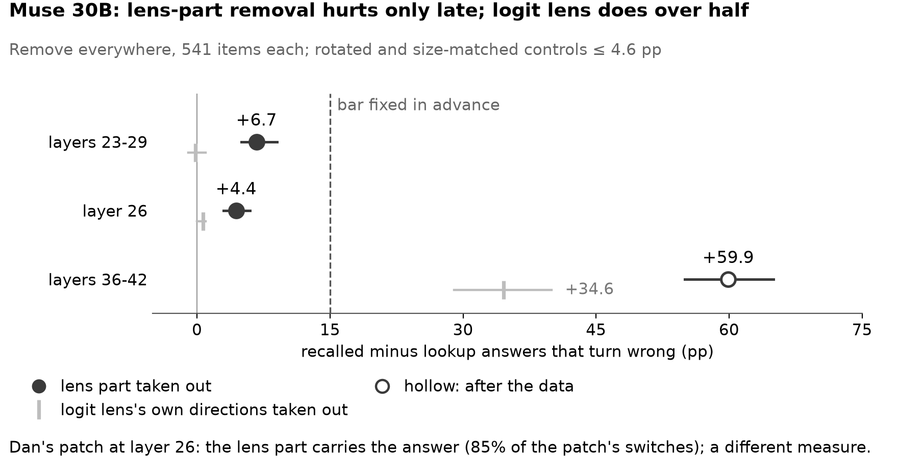

# Recalled answers read the lens; stated answers go around it

*When a model answers a two-step question, does it use what the J++ lens reads at the entity in the middle, and does that depend on whether the answer must be recalled or is written in the text?*

Draft (27 Oct). Every number is unverified until the hand check on Thu 29 Oct.

## In one minute

<!-- DRAFT bullets: Dan's text pending -->
- **Recalled answers need the lens part; stated answers do not.** Both of our methods find this on Qwen 9B and Qwen 27B; on Nemotron Lightning one method has been run.
- **The lens part says which entity it is.** Write in another entity's lens part and the model recalls that entity's facts, while stated answers stay put.
- **Stated answers use something the lens cannot see.** In our scenes they partly use an order signal outside the lens; much of that route is unexplained.
- **Two models do not fit cleanly.** On Muse 30B the lens part is carried at a middle layer but needed only deep, where its removal is less specific; on Qwen 122B each method has a failed control.

## The setup

- **The question** goes through a bridge entity: "The composer who wrote The Magic Flute was of which nationality?" (Zach's passages) or "How many legs does Iris's pick have?" (Dan's scenes). Models: Qwen 9B, Qwen 27B, Qwen 122B, Muse 30B, Nemotron Lightning.
- **Two kinds of answer.** A **recalled answer** must come from memory; a **stated answer** is written in the text.
- **The lens part:** the directions the J++ lens reads at the bridge (Zach's top 10; Dan's 25 that rebuild the change). <!-- src: docs/breadth/README.md | project out the 10 directions the J++ lens reads most there --> <!-- src: docs/breadth/README.md | Replace the J-part (the span of the top-10 J++ directions) --> <!-- src: docs/depth/README.md | the 25 lens directions that best rebuild the change -->
- **Three tools.** **Remove everywhere** (Zach: at every token, over a band of layers): does the model need it? **Remove from the change** (Dan: the bridge word's change from another prompt, added at one layer without it): does the change travel through it? **Swap** (Zach: another entity's lens part written in): is it enough? <!-- src: predictions/2026-10-26_dan.md | (9B L12, 27B L32, 122B L33, Muse L26) --> <!-- src: docs/breadth/README.md | Qwen3.5-9B (L12-16); Qwen3.6-27B (L32-40); Nemotron 3.5 Lightning (L27-33); Muse Glimmer 30B (L36-42); Qwen3.5-122B (FP8) (L39-45) -->

## Finding 1. Recalled answers need the lens part; stated answers do not

**Taking the lens part out breaks recalled answers and leaves stated answers almost intact (Qwen 9B, Qwen 27B; Nemotron Lightning with one method).**

- **Remove everywhere** costs Qwen 27B 50.9 more points on recalled than on stated answers; control removals cost far less. <!-- src: docs/breadth/data.csv | ko.q9.mk; ko.q27.mk; ko.nl.mk; ko.q122.mk; ko.mu.mk --> <!-- src: docs/breadth/data.csv | ko.q9.rot; ko.q27.rot; ko.nl.rot --> <!-- src: docs/breadth/data.csv | ko.q9.u; ko.q27.u; ko.nl.u --> <!-- src: docs/breadth/data.csv | ko.q9.soft; ko.q27.soft; ko.nl.soft -->
- **Remove from the change** stops it moving recalled answers, not stated ones: a gap of 0.60 of its effect on Qwen 27B. <!-- src: figures/story/data.csv | contrast_9b; contrast_27b; contrast_122b; contrast_muse --> <!-- src: figures/story/data.csv | J++ part: recall extra loss; PCA directions (same size): recall extra loss --> <!-- src: figures/story/data.csv | ld_gap_9b; ld_gap_27b -->
- **Same question, different source:** a recalled number costs Qwen 27B 13.3 points, a computed one nothing. Three-step chains agree on Lightning, not Qwen 27B. <!-- src: docs/breadth/data.csv | mod.q9.numbers.paper10.MR-PR; mod.q27.numbers.paper10.MR-PR; mod.nl.numbers.paper10.MR-PR --> <!-- src: docs/breadth/data.csv | mod.q9.numbers.paper10.AR-PR; mod.q27.numbers.paper10.AR-PR; mod.nl.numbers.paper10.AR-PR --> <!-- src: docs/breadth/data.csv | mod.nl.threehop.paper10.PPM-PPP; mod.nl.threehop.paper10.MMP-PPP --> <!-- src: docs/breadth/data.csv | mod.q27.threehop.paper10.PPM-PPP; mod.q27.threehop.paper10.MMP-PPP -->

**How sure.**
- Medium-high on Qwen 9B and Qwen 27B. Medium on Lightning: one method, several caveats. <!-- src: docs/breadth/data.csv | mod.nl.numbers.paper10.MR-PR --> <!-- src: docs/breadth/README.md | recalled at least 10 above --> <!-- src: docs/claims_skeleton.md | +1.67 nats over L17-35 vs +0.30 rotated --> <!-- src: docs/breadth/README.md | 9 of 14075 rows differ --> <!-- src: docs/breadth/data.csv | ko.nl.u --> <!-- src: docs/breadth/README.md | logit lens +32 on the natural set -->
- Main limits: in Dan's scenes answer kind and source go together <!-- src: docs/depth/README.md | reader and answer source (prompt vs memory) confounded -->; his positive control failed <!-- src: docs/depth/README.md | chemical symbols, 27B 0.15, bar 0.20 -->; Qwen 27B misses his strict bar <!-- src: figures/story/data.csv | lk_excess_27b --> <!-- src: docs/x0_details.md | lookup excess ≤ 0.10 and recall J-dependence ≥ 0.30 -->; Qwen 9B is weaker where the item was named earlier (after the data) <!-- src: figures/story/data.csv | x45m_before_gap_9b --> <!-- src: docs/split_by_order.md | only the asked pick (replication, fresh scenes) --> <!-- src: figures/story/data.csv | x45p_d23_9b -->.

## Finding 2. The lens part says which entity it is; stated answers do not follow it

**Writing another entity's lens part into the bridge moves the recalled answer to that entity; the stated answer stays.**

- **The swap** moves Qwen 27B's recalled answers 63.0 points toward the other entity (Qwen 9B alike), even from one neutral sentence. <!-- src: docs/breadth/data.csv | swap.q9.swap; swap.q27.swap --> <!-- src: docs/breadth/data.csv | ptr.q9.neutral; ptr.q27.neutral -->
- **Stated answers** stay in 99.1% of Qwen 27B's cases; Qwen 9B's move a little. <!-- src: EXPERIMENTS.md | l.166 --> <!-- src: EXPERIMENTS.md | l.165 -->
- **Everything but the lens part** moves Qwen 27B's stated answers by 24.6 points, Qwen 9B's less, Lightning's not at all (after the data; Zach to confirm). <!-- src: results/jswap/jswap_v2_v1/summary.json | PK/swap_comp; TK/swap_comp --> <!-- src: results/jswap/qwen35_9b_jswap_v2_v1/summary.json | PK/swap_comp; TK/swap_comp --> <!-- src: results/jswap/nem35l_jswap_v2_v1/summary.json | PK/swap_comp; TK/swap_comp -->

**How sure.**
- Medium-high on Qwen 9B and Qwen 27B (fixed in advance). Lightning is not counted: after the data, and its ceiling check failed. <!-- src: docs/breadth/data.csv | swap.nl.swap --> <!-- src: EXPERIMENTS.md | l.209 --> <!-- src: docs/prereg_replication_1022.md | l.1175-1176 -->
- Dan's scenes are context only: the stated answer never takes the moved number, but his lens part alone moves neither kind. <!-- src: figures/story/data.csv | another item moved, whole: value share --> <!-- src: figures/story/data.csv | rtk_C2_keep_jpp_recall_follows_s_9b; rtk_C2_keep_jpp_recall_follows_s_27b; rtk_C2_keep_jpp_recall_follows_s_muse; rtk_C2_keep_jpp_rand_recall_follows_s_9b; rtk_C2_keep_jpp_rand_recall_follows_s_27b; rtk_C2_keep_jpp_rand_recall_follows_s_muse -->

## Finding 3. In our scenes, stated answers use an order signal the lens cannot see

**In Dan's locker scenes the model finds the stated answer partly through an order signal: four directions outside the lens that mark which locker sentence came first (Qwen 9B, Muse 30B).** <!-- src: docs/depth/README.md | four directions separating the positions -->

- **A simple probe reads it** at the bridge in 0.92-0.99 of scenes; the lens does not. <!-- src: docs/depth/README.md | 0.92-0.99 of scenes (layout alone: 0.53) --> <!-- src: docs/depth/README.md | A probe reads the pointer, the lens does not -->
- **Removing it from the change** leaves Qwen 9B answering by position in 0.08 of scenes and halves Muse 30B's; a random part does not (after the data; repeated in advance). <!-- src: figures/story/data.csv | another item moved, no_alf: position share; another item moved, no_alf_rand: position share -->
- **Writing it in** sends the stated answer to the written locker in about half of the writes (after the data). <!-- src: docs/x0_details.md | The pointer: removed, added alone, written -->

**How sure.**
- Medium for the order signal, on Qwen 9B and Muse 30B, in simple scenes.
- Low for a second route through the item's identity outside the lens: not specific when tested in advance, partly lens-readable on Qwen 27B, and used by recalled answers too. <!-- src: predictions/2026-10-26_dan.md | **Q45.7** --> <!-- src: predictions/2026-10-26_dan.md | 0.07 / 0.18 of the lookups still switch, against 0.15 / 0.39 --> <!-- src: predictions/2026-10-26_dan.md | Size check (Dan ~01:00 --> <!-- src: figures/story/data.csv | (b) another item moved, no_jpp: identity share; (b) another item moved, no_jpp_rand: identity share --> <!-- src: docs/depth/README.md | Recall's extra loss without identity (nothing else removed) -->
- Main limits: weak on Qwen 27B <!-- src: figures/story/data.csv | another item moved, keep_alf: position share --> <!-- src: docs/x0_details.md | A refit pointer per format --> <!-- src: figures/story/data.csv | the sanity swap, lookup extra loss without the pointer; the sanity swap, recall extra loss without the pointer -->; refit per text format <!-- src: predictions/2026-10-26_dan.md | **Q42.1** -->; Zach's evidence waits on his confirmation of the swap of everything but the lens part <!-- src: results/jswap/jswap_v2_v1/summary.json | PK/swap_comp; PK/swap -->.

## Where it breaks

- **Muse 30B carries the lens part at a middle layer but needs it only deep.** <!-- src: results/x45r/score-20261027T165540Z/x45r.json | label -->
  - At layer 26 remove from the change finds it carried (gap 0.85 [0.68, 0.98]) and specific to the lens: the logit lens's directions cost nothing. Over layers 23-29 remove everywhere costs recalled answers only 6.7 [5, 9] points more than stated ones, 6.8 beyond the logit lens's directions; the bar fixed in advance was 15. <!-- src: results/x45r/score-20261027T165540Z/x45r.json | our_gap_L26; his_L23_29; excess_L23_29 --> <!-- src: figures/story/data.csv | J++ part: recall extra loss; logit-lens directions: recall extra loss --> <!-- src: results/x45r/score-20261027T165540Z/x45r.md | not needed if M - K < 15 -->
  - Deeper, over layers 36-42, it costs 59.9, but more than half is shared with the logit lens (after the data); Zach's earlier puzzles barely moved Muse. The result was opened before Zach confirmed this use of his tool. <!-- src: results/x45r/score-20261027T165540Z/x45r.json | descriptive; note --> <!-- src: docs/breadth/data.csv | ko.mu.u; ko.mu.mk --> <!-- src: EXPERIMENTS.md | l.169 --> <!-- src: EXPERIMENTS.md | l.87 -->

  

- **Qwen 122B.** Ours is not specific against a same-size removal; Zach's vanishes when scored by probability (after the data). Neither of us claims it. <!-- src: figures/story/data.csv | J++ part: recall extra loss; PCA directions (same size): recall extra loss --> <!-- src: docs/breadth/data.csv | ko.q122.soft --> <!-- src: EXPERIMENTS.md | l.167; l.169 -->

## What we learned about methods

- **Report the size of a removal, not the number of directions.** Nemotron Bolt's top 10 remove only 5.6% of the residual. <!-- src: docs/breadth/data.csv | size.nb; size.q9; size.mi --> At 100 directions a same-size removal nearly matches the lens part on Bolt and DeepSeek. <!-- src: docs/breadth/README.md | Bolt is weak, not spread out --> <!-- src: docs/breadth/README.md | DeepSeek is weak at every dose --> Qwen 27B's 100-direction cost is generic in Zach's test, specific in Dan's. <!-- src: docs/breadth/README.md | More directions add damage that is not specific --> <!-- src: figures/story/data.csv | main test: lookup extra loss without another scene's 100 directions -->
- **Readable, carried and needed come apart.** OLMo carries the entity without needing it; a probe reads facts its directions do not carry; the lens misses the order signal a probe reads. <!-- src: docs/breadth/README.md | OLMo carries the entity (swap +41), but the knock-out costs only +5 --> <!-- src: docs/breadth/data.csv | probe.q27.probe; probe.q27.swap -->
- **One layer can understate what a site carries.** The swap over a band moves recalled answers; the lens part added at one layer moves neither kind. Zach's earlier copy sweep, once cited for this, was withdrawn. <!-- src: docs/breadth/data.csv | swap.q9.swap; swap.q27.swap --> <!-- src: EXPERIMENTS.md | l.153 --> <!-- src: figures/story/data.csv | rtk_C2_keep_jpp_recall_follows_s_9b; rtk_C2_keep_jpp_recall_follows_s_27b; rtk_C2_keep_jpp_recall_follows_s_muse; rtk_C2_keep_jpp_rand_recall_follows_s_9b; rtk_C2_keep_jpp_rand_recall_follows_s_27b; rtk_C2_keep_jpp_rand_recall_follows_s_muse --> <!-- src: EXPERIMENTS.md | l.78 -->

## How we checked

- **Nothing is hand-checked yet.** On Thu 29 Oct each of us checks 10 random items of the other's headline ([lists](docs/shared/gaps.md)). <!-- src: docs/shared/gaps.md | 10 random items of each other's headline -->
- **Dan:** a reimplementation matches 20 of 20 items; a [hand-check pack](docs/handcheck_pack.md) recounts the newest tests; his predictions score worse than always answering 50%. <!-- src: docs/depth/README.md | 20 of 20 random items --> <!-- src: docs/depth/README.md | mean Brier 0.32 over 121 answers, worse than always answering 50% -->
- **Zach:** clean-checkout reruns match row for row on Qwen 27B and Qwen 9B; a [verification kit](docs/verify_kit.md) recomputes his headline. <!-- src: docs/breadth/README.md | 0 of 22325 -->

## What did not hold

- Dan: Qwen 27B misses his strict bar; Qwen 9B misses his cleaner design and its replication.
- Dan: the positive control; identity outside the lens; writing the order signal at the strength fixed in advance (below a real change); one test withdrawn as a design error. <!-- src: predictions/2026-10-26_dan.md | **Q44.1** -->
- Zach: Qwen 122B by probability; Muse's share with the logit lens; Bolt; OLMo.
- Zach: one Qwen 27B three-step chain; Lightning's number predictions. <!-- src: docs/breadth/README.md | Lightning's v2 recall-keyed-by-a-recalled-number result -->

Full lists: [depth report](docs/depth/README.md) <!-- src: docs/depth/README.md | Failed when fixed in advance -->, [breadth report](docs/breadth/README.md) <!-- src: docs/breadth/README.md | Failed when fixed in advance -->.

## Pending tests

- **Nemotron Lightning, Dan's method** at layer 27, the first layer of Zach's band; waits for his lens file. <!-- src: scripts/x45s.py | at L27 (the shallowest layer of Zach's band L27-33 -->
- **Zach's confirmation** of the swap of everything but the lens part. No test is planned for the order signal on Lightning.

## Open questions

- The rest of the stated answer's route around the lens.
- The order signal in natural text: a refit version is found only on Qwen 9B and Muse 30B. <!-- src: docs/x0_details.md | A refit pointer per format -->
- **Earlier mentions** lower the recalled answer's dependence on the bridge in both tracks, by different mechanisms; not on Lightning or Qwen 122B. <!-- src: figures/story/data.csv | x45p_d23_9b; x45p_d23_27b; x45p_d23_muse --> <!-- src: docs/breadth/data.csv | r.q9; r.q27; r.mu --> <!-- src: EXPERIMENTS.md | l.170 --> <!-- src: docs/breadth/data.csv | r.nl; r.q122 -->

## Reports and where things live

- **Reports:** [Dan's depth report](docs/depth/README.md) (`scripts/readme_build.py`) and [Zach's breadth report](docs/breadth/README.md) (`scripts/report_breadth.py`).
- **Files:** code in `scripts/`, `src/`; runs in `results/`; figures in `figures/`, `docs/breadth/figures/`; [DEVELOPER.md](DEVELOPER.md), [AGENTS.md](AGENTS.md).
- **Joint notes:** [glossary](docs/shared/glossary_joint.md) (the reports' terms mapped to this page's), [story notes](docs/shared/joint_story_draft.md), [gaps](docs/shared/gaps.md), [review notes](docs/shared/joint_review_notes.md).
- **Freeze and sources:** experiments freeze Wed 28 Oct evening; every number's source is an HTML comment checked by `tests/test_readme_sources.py`. <!-- src: STATUS.md | Experiments freeze Wed 28 Oct evening -->

## Appendix: the full grid

Claims graded on all nine models (both tracks; Zach's tests):

Dan's own tests on his four models:

