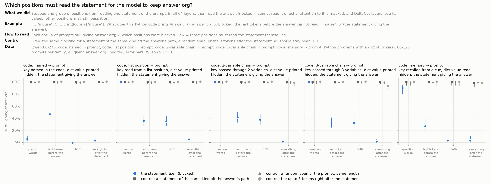
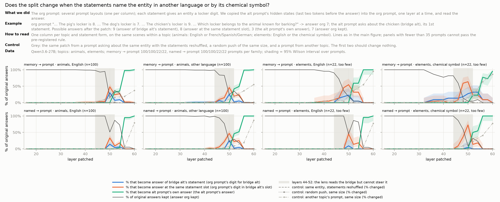
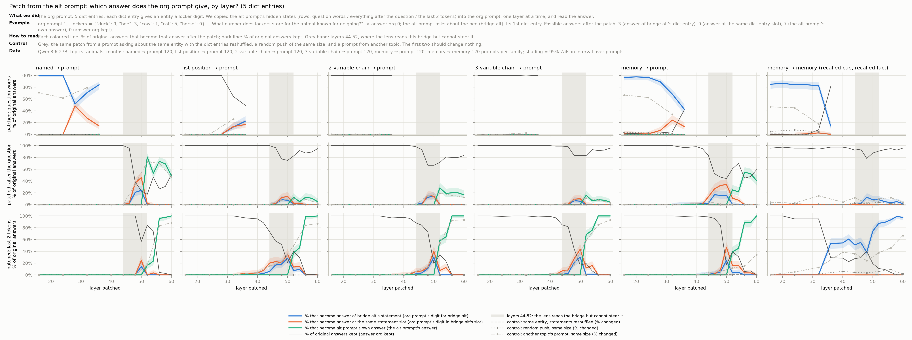
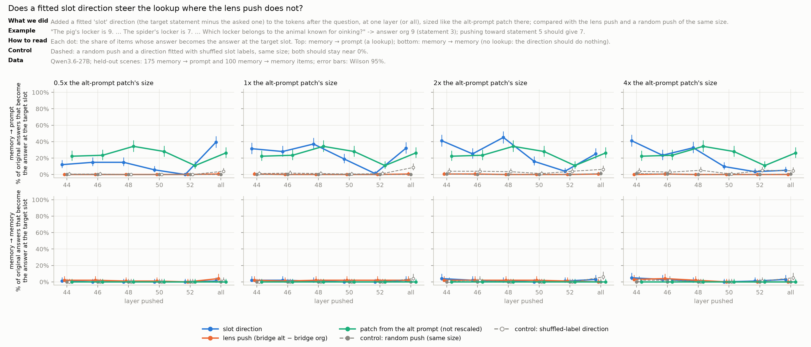

# bridge-jspace

**Where things are:** this page = main results and open questions · full write-up of every experiment:
[README_archive.md](README_archive.md) · run log: [EXPERIMENTS.md](EXPERIMENTS.md) · human-checked results:
[VERIFIED.md](VERIFIED.md) · status by Zach (20 Oct): [STATUS.md](STATUS.md) · plan:
[Google Doc](https://docs.google.com/document/d/1bqqdXePTUXQGlowVjk73sPfJkbV_tsu0RNNX-BiTYUc/edit?usp=drivesdk) ·
how to run, queue, figures: [DEVELOPER.md](DEVELOPER.md)

## The question
In a two-hop question the model first finds a **bridge** and then uses it to find the answer: "the language spoken in
the country where the Amazon River ends" → bridge *Brazil* → answer *Portuguese*. In Claude, the bridge acts on the
answer through the **J-space**, the part of the hidden state that the J-lens reads as words (Gurnee et al. 2026,
[Verbalizable Representations Form a Global Workspace](https://transformer-circuits.pub/2026/workspace/index.html)).
On open models (Qwen3.6-27B first): **what goes through the J-space, what goes around it, and what is the "around"
route?**

## Names used on this page
Each family of questions is named **"where the bridge comes from → where the answer comes from"**: *prompt* = stated
in the prompt, *memory* = recalled by the model.
```
Jack's pet is a cow. Mia's pet is a dog. Tom's pet is a pig.
The cow's locker is 5. The dog's locker is 3. The pig's locker is 7.
```
| Name (old code) | Question | Bridge | Answer |
|---|---|---|---|
| prompt → prompt (BL) | Which locker belongs to Jack's pet? | cow, from the prompt | 5, from the prompt |
| prompt → memory (BR) | How many legs does Jack's pet have? | cow, from the prompt | 4, recalled |
| memory → prompt (RL) | Which locker belongs to the animal known for mooing? | cow, recalled | 5, from the prompt |
| memory → memory (RR) | How many legs does the animal known for mooing have? | cow, recalled | 4, recalled |

Edits compare an **org prompt** with an **alt prompt** (the same prompt with another bridge): **bridge org** (cow) vs
**bridge alt** (dog), **answer org** (5) vs **answer alt** (3). The **lens-readable part** of a change is its piece
made of J-lens word directions; the rest is everything else.

## Main results

### Verified by a human ([VERIFIED.md](VERIFIED.md), Qwen3.6-27B)
| | Result |
|---|---|
| Lenses see the bridge (A1-A3) | At the last word the lenses rank the bridge first far more often than a same-kind distractor (57% vs 5% of layers 32-48); most remaining misses are found at an earlier word (22/30). |
| A recalled bridge acts through the J-space (B1) | Swapping only the lens-readable part of the bridge's direction switches 52% of answers (Claude 61%); the rest, with the J-space held fixed, 1% (Claude 6%). |
| A lookup in the prompt does not (B2-B3) | In brew (a two-step lookup in a colour table) the step is carried outside the J-space: the lens reads it but writing along its direction switches 1%; a direction nearly orthogonal to the lens (cosine 0.02) switches 34%. |
| Readers report what is written, not what is used (B4) | Two verbalizers (oracle lens, NLA) name a direction the model ignores on 99% of items. |

### Unverified: memory vs prompt (Zach, 20 Oct; animal suite, 27B)
Recall from memory goes through the J-space; a lookup in the prompt goes around it. Three measures agree:
- **Copy split:** the lens-readable part of the model's own bridge change carries 0.3-0.4× its fair share for lookups
  (memory → prompt, prompt → prompt) and 1.4-1.9× for recalls (random null 0.15-0.4).
- **Read vs write:** the lens reads the bridge of memory → prompt on 95% of items but pushing along it switches ≤ 3%;
  for memory → memory the push switches 36%.
- **Knock-out:** removing the J-space at layers 32/36/40 leaves lookups at 99% and drops recalls to 19-22%; random
  and size-matched controls stay at 98-100%. Also holds with JSON tool outputs and natural facts (TwoHopFact).
- **Generality is the gap:** the 122B shows read-without-write at every depth but a 4-6× weaker knock-out; the 9B is
  mostly untested; Gemma 4 31B-it is untestable (its lens cannot write even the positive control, and any J-space
  removal wrecks the model).


### Unverified: what is the "around" route? (Dan, 21 Oct; depth track D1-D4)
One overnight queue, Qwen3.6-27B, pre-registered rules and controls; headline numbers recounted from the raw files.
Predictions vs results: [jobs/predictions/2026-10-21_dan.md](jobs/predictions/2026-10-21_dan.md). Full write-up
(methods and datasets compared, worked examples, every figure, numbers to recompute):
[README_archive.md](README_archive.md#depth-track-d1-d4-2026-10-21-what-is-the-around-route).

| | Question | Result |
|---|---|---|
| D1 | Is "lookups go around the lens" an artefact of measuring only at the question? | **No.** For a bridge stated in the prompt (prompt → prompt), at layers 28-44 the bridge is spread over the whole context (pasting there switches 86% [77, 92]). The lens-readable part of that paste switches 0%: it does 14% of what its size predicts (1 = its fair share; a random piece of the same size does 7%). The same paste's lens-readable part does carry the bridge for the recall question (prompt → memory: 5× its fair share). |
| D2 | From where, and when, does the answer read "The cow's locker is 5."? | Memory → prompt: hide that statement from **the last tokens before the answer** and only 7% [3, 16] stay right (4/60); hide it from the question words: 100%. The read runs through **attention layers** (attention only 8%, DeltaNet only 100%) at **layers 48-63** (blocking 0-47: 100%). Recall questions do not need it (100%). |
| D3 | At that moment, do those tokens carry the **word** (cow), a **pointer to a statement slot**, or the **answer**? | Pasting from an alt prompt with reordered statements at layers 44-52: the answer at the **same statement slot** 29% [21, 39] vs bridge alt's statement 9% [5, 16] vs the alt prompt's own answer 12%; control 0/100. From layer ~52-56 the tokens carry the fetched digit (98-100%). Memory → memory never shows a slot answer. Pooled only: each topic alone is "mixed". |
| D4 | Is the strong early lens push that switched memory → prompt just typing the word in? | It works only on the subject phrase (37% [26, 49]; rest of the question 0%; random 0%). Injection vs writing **not decidable** by the pre-registered tests; post-hoc reading below. |

*D4, post hoc (same run, not pre-registered):* the early push switches exactly the families where the animal is
**recalled from the cue**, whatever uses it next (layer 20, 8×, subject phrase: memory → prompt 49/60, memory →
memory 57/60), and not those where it is stated in the prompt (prompt → prompt 0/60, prompt → memory 0/60) until 16×
(28/60, 43/60, matching the earlier layer sweep). So the early push acts on **recalling the bridge**, a step that
goes through the J-space, not on the lookup.


### Unverified: batch 2 (Dan, 21 Oct; new data and a learned pointer)
Same rules (pre-registered, controls, headline numbers recounted from the raw files), 4×A100. Predictions vs results:
[jobs/predictions/2026-10-22_dan.md](jobs/predictions/2026-10-22_dan.md). Still running: "statement order or token
position?" (pointer_v2).

| | Question | Result |
|---|---|---|
| D2 | Does "the last tokens read the statement late, through attention" hold beyond the first animal scenes? | **Yes, on all three new datasets.** Statement hidden from the last tokens in every attention layer: new locker scenes 11% still right (memory → prompt, 20/175), Python lookups 38% (203/540), statements in another language 2% (1/60). In every DeltaNet layer: 99-100% everywhere. Recall questions (memory → memory) keep ≥ 96%. |
| D2, details | | (1) **A named animal is read twice.** The question words read the statement early: hidden from the question words and the last tokens in layers 0-31 only, 1/175 stay right (from the question words alone, all layers: 2/175); the last tokens still read it late (48-63 only: 11%; 32-47 only: 100%). A recalled animal does not need the question words (88% when hidden from them). (2) **For a recalled animal the middle layers back up the late read:** hidden from the question words and the last tokens together in 32-47, only 45% [37, 52] stay right (78/175), each alone 87-88%. (3) In code the last tokens are one of several readers: blocked from them alone, 36% of list-position lookups stay right; blocked from every later token, 3%; with the key named in the print line, the print line itself reads the entry (as with a named animal). (4) A statement in another language is read over more depth: blocking only 48-63 keeps 45% [33, 58] vs 20% [12, 32] for the same scenes in English. |
| Gates | Can the model do the new tasks unedited? | Python lookups of every kind (named key, list position, 2- or 3-variable chain) 98-100%; statements in another language 96-98%. Fails two cases, left out of the patching: a **recalled** element matched to its **chemical symbol** (52% [45, 58]; named, 100%) and a recalled month in code (61%). So the lookup matches the recalled entity against how the statement spells it, and some spellings don't match. |
| D3 | Does the last-token pointer survive statements in another language? | **Yes at the last two tokens:** answer at the same statement slot 46% [37, 56] vs 48% [38, 58] in English (layer 50, 100 animal scenes). **No on the tokens after the question:** 14% vs 42% (layer 48). The pre-registered cell (after the question, layers 44-52) is not readable in the other language (the patch changes only 27%). |
| D3 | In Python code, is there a pointer to the dict entry's **position**? | **Yes, at layers 48-50.** Patching the alt program into the org program gives the value at the **same dict position** more often than the alt key's value: recalled key, last two tokens, layer 50: 47% [38, 56] vs 24% [17, 33]; after the question 34% vs 16%. At the last two tokens every way of finding the key shows it (35-47%; named key 24%). The pre-registered window (layers 44-52 together) is mixed: in code the alt program's own answer arrives already at layer 52. n=120 per family (animals 100, months 20). |
| D3b | Can a learned **pointer direction** steer the lookup where the lens push cannot? | **For animals yes; pooled, only by the item-level rule.** A direction fitted to "which statement the question asks", added at layer 48 at the size of the alt-prompt patch: 37% of memory → prompt answers become the target statement's digit, item-level [30.3, 45] (the pre-registered rule passes by 0.3 points), but resampling the 22 queried entities gives [28.7, 45.2] (does not pass). **By domain: animals 54% (52/96, 16 animals), elements 16% (13/79, 6 elements;** the alt-prompt patch itself switches only 11/79 there). Lens push of the same size 0/175; random 0; shuffled-label direction 1%; memory → memory 1/100. Four dimensions are enough; unrelated to the lens's word directions (cosine 0.03, random 0.03). A probe reads which statement is asked at only 39% (chance 20%; small fit set). Prior art: an "ordering ID" subspace that steers binding (Dai, Heinzerling & Inui 2024, arXiv 2409.05448); new here is that it appears for a *recalled* bridge, where the lens reads the word but cannot steer. Caveat: at layer 48 the last tokens no longer carry the word (D3), so the lens push's 0% there is expected either way; it is not a test of "lookups go around the lens" (that is layers 32-40, question tokens). |






**The current picture** (a hypothesis, one model), layer by layer:

| Layers | What happens in a lookup in the prompt | Seen in |
|---|---|---|
| 0-24 | a bridge stated in the prompt sits in its own sentence ("Jack's pet is a cow.") | D1 |
| 0-31 | a *named* entity's words in the question read its statement ("Which locker belongs to the pig?" → "The pig's locker is 9."); a recalled one's do not | D2 |
| 16-28 | a recalled bridge is formed from the cue; an early lens push here changes which animal is recalled | D4 (post hoc) |
| up to ~40 | the question words carry the recalled word; after ~40 they no longer matter | D3 |
| 28-44 | a stated bridge is spread over the whole context; its lens-readable part does nothing | D1 |
| 44-50 | the last tokens before the answer carry *which statement* to read (a pointer, ~4 dimensions, unrelated to the lens's words, the same with statements in another language and for dict entries in code) more than *which animal*; pushing along it switches the lookup, the lens push does not | D3, D3b |
| 48-63 | the last tokens read that statement through attention (DeltaNet layers are not needed); also in code, and in another language (there over more depth); in code other tokens read it too; for a recalled entity the question words and the last tokens at 32-47 are a backup (blocking both there: 45%) | D2 |
| 52-60 | the last tokens carry the fetched digit | D3 |

The lens reads the word, but the lookup works with the pointer: the lens cannot steer it, a pointer direction can (so
far clearly for animals only; elements weak).

## Open questions and the plan
By thread, D1 → D4, then what cuts across them. Status: **running** = batch 2 on the 4×A100 box
(`jobs/batches/2026-10-21_batch2.md`; predictions in `jobs/predictions/2026-10-22_dan.md`), **next** = designed,
not built, **later** = after something else.

### D1. Where is the bridge carried?
- **Next: which pieces of the context hold a stated bridge at layers 28-44?** The whole context carries it, no single
  sentence does. Paste piece by piece (each statement, the asked person's sentence, the locker rows). In-context
  tasks are known to gather information on such "anchors" before the answer token reads it (Wang et al. 2023,
  "Label words are anchors").
- **Next: the lens push where the bridge is carried, with enough items.** Now n=32 and one 16× cell is
  inconclusive (3/32 vs 1/32 random); rerun at n=80, and at layers 20-28 (not run).

### D2. From where and when is the statement read?
- **Done (batch 2): the same blocking on new data.** Holds on new locker scenes, Python code and statements in
  another language (above).
- **Next: in code, who else reads the entry?** Blocking the last tokens alone keeps 36% of list-position lookups,
  blocking every later token 3%: hide the entry from one code line at a time (the `names` line, each variable of a
  chain, the print line).
- **Next: which attention heads read it.** The full-attention layers inside 48-63 are 51, 55, 59 and 63. Block one
  head at a time from reading the answer's statement at the last tokens; the heads whose block breaks
  memory → prompt are the lookup heads (~1 GPU-h).
- **Later: Qwen3-32B**, full attention in every layer: the cleanest version of this test.

### D3. Does the lookup carry the word, a pointer, or the answer?
- **Running: the statement's order, or its token position?** In every first-night prompt the n-th statement also
  sat at a fixed token offset. A filler sentence placed differently in the org and alt prompts now makes order and
  token position predict different digits (>= 35 items per topic and slot), with 5 and 3 statements.
- **Running: a pointer to the answer token itself** (the "reflexive" route, Gur-Arieh, Geva & Geiger 2025): scenes
  where the alt prompt's answer also appears in the org prompt.
- **Done: statements in another language.** The last-token pointer is unchanged (46% vs 48%); the tokens after the
  question carry less (14% vs 42%). Chemical symbols: too few scenes pass the gate (22).
- **Done: Python code.** A pointer to the entry's position at layers 48-50 for every way of finding the key (above);
  the pre-registered 44-52 window is mixed because the digit arrives by layer 52.
- **Next: why does a recalled entity miss its chemical symbol (52%) when a named one finds it (100%)?** A direct
  probe of "the lookup matches spellings": the same scenes with half the statements by symbol, half by name.
- **Done (D3b): a learned pointer direction steers the lookup** (37% vs lens push 0%, above). Fragile: the lower
  bound clears the 30% bar by 0.3 points. Next: confirm on pointer_v2 scenes (statement order vs token position,
  which these scenes do not separate) and on code; and steer at 2× size / layer 44, where it was stronger (41-45%).
- **Next: counted from the start or from the end?** Slot answers rose toward the last statement (first 13%, middle
  28%, last 42%; cuts too small for the rule). Alt prompts with one statement more or fewer than the org prompt
  separate "2nd from the start" from "4th from the end" (~0.5 GPU-h).
- **Next: why do half the patches change nothing?** (49% answer org kept at 44-52.) Patch the question words and
  the last tokens together, and the last 1 / 2 / all template tokens separately; read item by item which items
  carry the pointer.
- **Later (after the D2 heads): a pointer readout.** A linear probe reads which statement is asked at only 39%
  (chance 20%), though the direction steers. Score each statement by how much the lookup heads attend to it from
  the last tokens, and read off which statement will be fetched before the answer exists; compare item by item with
  D3's slot answers and with the J-lens.

### D4. Early lens push vs editing the prompt
- **Next: does the early push re-route the pointer?** If the push writes "dog" at the recall step (post-hoc reading
  above), the last tokens at 44-52 of the pushed run should point at the dog's statement: patch them into the org
  prompt and read the slot answer. Plus a continuous measure (logit difference) instead of switched-or-not, and
  later-layer similarity to "change the clue" vs "name it".

### Across threads
- **Reporting standard (from 21 Oct, after an outside review).** Next to every number: n items / k entities / t
  templates / d domains, and per domain. Headline intervals by entity-cluster bootstrap (stratified by domain), the
  item-level Wilson interval second; the interval method fixed in the manifest before the run. Item counts set
  precision, not diversity: pointer_v1 has 16 animals and 6 elements with one template each, so more scenes of the
  same entities add little; the bottleneck is new domains with ≥ 12 entities that pass the gate.
- **Other models.** The OLMo-3-7B ladder (base → SFT → DPO → Instruct; ported with verified lenses): do the
  memory/prompt split and the pointer exist before post-training? The 122B (weaker knock-out). Then Zach's ports.
- **Knock-out confounds (Zach).** Removing the J-space also costs word answers ~35% even in a pure lookup; does it
  erase the subject's identity rather than the workspace? (Control: keep the subject's own word.)
- **Write-up.** Freeze 2-3 claims once batch 2 is in (candidates: D1 "not a location artefact", D2 "the last
  tokens read the statement late through attention", D3 "a slot pointer, not the word"); each checked by the other
  person into `VERIFIED.md`.

## Data used in the depth track
All generated by us (templates + fixed seeds; the model must pass a competence gate on a cut before it is used).
The rule needs ≥ 35 items per cut (then 0 switches gives an upper bound ≤ 10%); runs use 50-180 per domain.

| Dataset | Example | Size | Used by (items per run) |
|---|---|---|---|
| Animal suite (Zach, `data/suite_v1`) | "Jack's pet is a cow. … Which locker belongs to the animal known for mooing?" | 400 per family | night 1: D1 (80 per family), D2 (60), D4 (60) |
| `pointer_v1`: 5 statements, one domain per scene | "The turkey's locker is 5. The mouse's locker is 1. The pig's locker is 9. … Which locker belongs to the animal known for oinking?" → 9 | 400 scenes per domain × family; animals, elements pass the gate (planets, months fail) | D3 (50 per domain), D2 batch 2 (96 animals + 79 elements), D3b (same 175, held out from the fit) |
| `pointer_v2`: plus one filler sentence placed differently in org and alt | "… The bee's locker is 1. The street was lined with old trees." | 180 per topic (5 statements), 120 (3 statements) | D3 order vs token position (running) |
| `code_pointer_v1`: Python dict lookups | `lockers = {"bee": 7, …, "mouse": 5}`, `x = "mouse"; h = x; print(lockers[h])` → 5 (named key, list position, 2- or 3-variable chain, recalled key) | 400 per domain × family; animals, months | D2 (60 per domain), D3 (animals 100 + months 20 per family: months fail the gate for the recalled key) |
| `alias_pointer_v1`: statements in another language / by chemical symbol, question in English | "El perro tiene la taquilla 8. Die Kuh hat den Spind 6. … known for barking?" → 8; "The He card is in locker 9. … Which locker holds the helium card?" → 9 | 400 per domain × form × family | D2 (60 per form), D3 (up to 100 per topic) |

## Code and data (short map)
| What | Code | Data / results |
|---|---|---|
| Animal suite (all families), competence | `scripts/suite_v1.py` | `data/suite_v1*`, `results/suite_v1/` |
| Copy split, read/write, knock-out (Zach) | `scripts/suite_split.py`, `scripts/read_write.py`, `scripts/ablate_pilot.py` | `results/suite_split/`, `results/read_write/`, `results/ablate_pilot/` |
| D1 patch at one place | `scripts/statement_positions.py` | `results/statement_positions/` |
| D2 blocking reads | `src/bridge_jspace/knockout.py`, `scripts/attn_knockout.py` | `results/attn_knockout/` |
| D3 word / slot / answer | `scripts/pointer_v1.py`, `scripts/pointer_v2.py`, `scripts/code_pointer_v1.py`, `scripts/alias_pointer_v1.py`, `scripts/pointer_swap.py` | `data/pointer_v1/`, `data/pointer_v2/`, `data/code_pointer_v1/`, `data/alias_pointer_v1/`, `results/pointer_v1/`, `results/pointer_v2/`, `results/code_pointer_v1/`, `results/alias_pointer_v1/`, `results/pointer_swap/` |
| D3b learned pointer direction | `scripts/pointer_fit.py` | `results/pointer_fit/` |
| D4 early push vs edits | `scripts/early_push.py` | `results/early_push/` |
| Job queue, job pages, plain names | `scripts/jobq.py`, `src/bridge_jspace/job_pages.py`, `jobs/`, `jobs/titles.yaml` | `results/jobq/` (ledger, draft run-log rows) |
| Figures used on this page | | `figures/overview_1020/`, `figures/depth_1021/`, `figures/depth_1022/` |
| Earlier experiments (exp01-exp23, part A readers) | `scripts/exp*` | see [README_archive.md](README_archive.md) |
