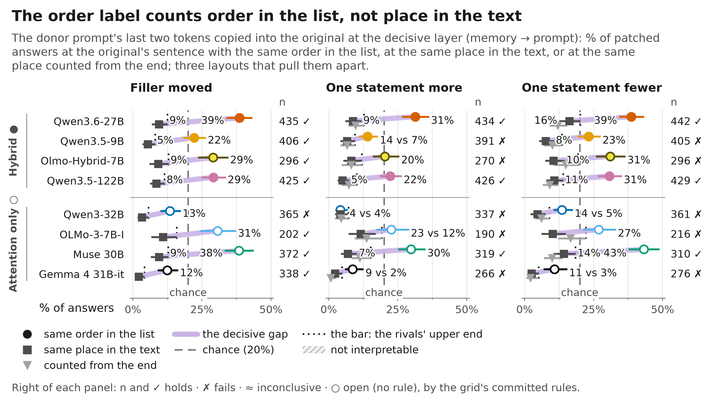
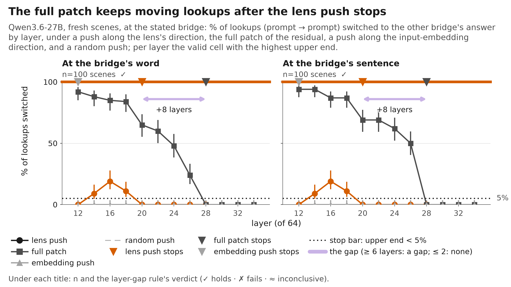
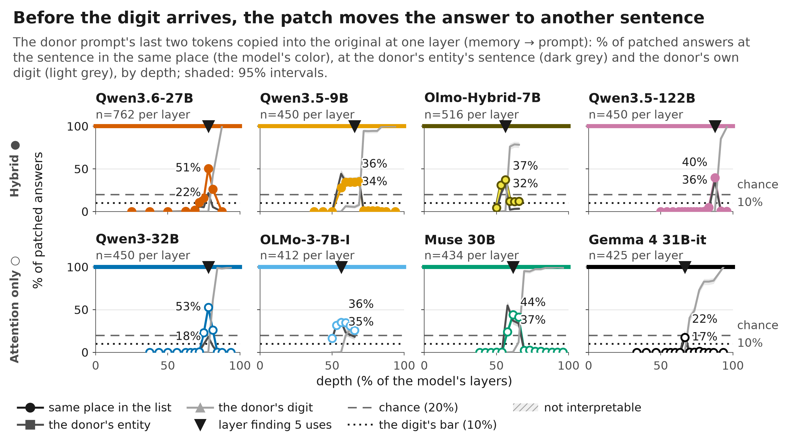

# bridge-jspace

**The question.** To answer a two-step question, a model first finds an entity in between (the **bridge**), then uses it to get the answer. A **J-lens** reads a model's hidden states as words. Does the model use the bridge in the form the lens reads, or by another route? Example: "Which locker belongs to the animal known for oinking?" → bridge *pig* → answer: the pig's locker number, stated in the prompt (a **lookup**; a **recall** takes the answer from the model's memory).

Eight open models: four hybrids (attention mixed with DeltaNet layers): Qwen3.6-27B, Qwen3.5-9B, Olmo-Hybrid-7B, Qwen3.5-122B-A10B; four attention-only: Qwen3-32B, OLMo-3-7B-Instruct, Muse 30B, Gemma 4 31B-it.

> **Status, 23 Oct 2026, ~09:30 UTC: exploration, draft.** Every number on this page comes from the cross-model grid `results/cross_model/20261023T091847Z` (built by `scripts/cross_model_grid.py` from the saved runs; code at 3c30a89) or from a run folder named next to it. Nothing here is human-verified except the entries of [VERIFIED.md](VERIFIED.md) (A1-A4, B1-B4). Still running on the A100: the Qwen3-32B lens push and its stated-bridge test in tables and JSON; Olmo-Hybrid's long context. The Gemma 4 lens chain reruns with a 30-minute cap. Lens results use J++ throughout; on Qwen3-32B and OLMo-3 the lens is our own fit (published), other fits are listed beside it, never switched in.

[Dan's predictions vs results](predictions/) · [plan (Google Doc)](https://docs.google.com/document/d/1bqqdXePTUXQGlowVjk73sPfJkbV_tsu0RNNX-BiTYUc/edit?usp=drivesdk) · [run log](EXPERIMENTS.md) · README of 22 Oct: `git show a135a54:README.md` · [old README with every number](README_archive.md) · [how to run](DEVELOPER.md) · [grid.md](results/cross_model/20261023T091847Z/grid.md) · [grid.csv](results/cross_model/20261023T091847Z/grid.csv)

## Findings at a glance

How sure, by a fixed rule on the grid's verdicts ([the rule](#how-sure-the-rule)): **strong**: holds on three or more models of both architectures, on two separate runs on at least two of them, and no cell fails or fails a control · **open**: fails (or is mixed) on as many models as it holds on · **medium**: everything in between. The reason is the condition that decided it.

| # | Finding | Key evidence (grid.csv; % of items, [95% CI]) | How sure | Models |
|---|---|---|---|---|
| 1 | [Removing the J-space breaks recall, not the lookup](#1-removing-the-j-space-breaks-recall-not-the-lookup) | Zach's C1 (his runs, his rule): memory-final chains lose more than lookup-final ones by 36 points (27B), 38 (9B), 22 (32B) and 7 (Muse); lookups lose at most 13 points. Our animal-suite removal (descriptive, no rule): 78 points on the 27B, 9-17 points on 9B, 32B, Muse, 122B | **medium**: Zach's rule holds on 27B, 9B, 32B (one random control 13 points off on the 32B), holds-ish on Muse (gap 7); one data seed; only the 27B's verdict file is in our grid (n=506) | holds (Zach): 27B, 9B, 32B · holds-ish (Zach): Muse · values only (ours): 122B · unclear (ours): OLMo-3 (control 80%, n=400) · not testable: Olmo-Hybrid · missing: Gemma |
| 2 | [A lookup ignores the lens-readable part of a stated bridge](#2-a-lookup-ignores-the-lens-readable-part-of-a-stated-bridge) | That part switches 0-3% of lookups on the 27B and 9B (prose, tables, JSON); on the 122B 29% [23, 36] (tables 49%, JSON 34%), with its recall control passing (38%) | **medium**: fails on the 122B (prose n=180, tables n=88, JSON n=92); the 32B's control fails (n=120) | holds: 27B, 9B · fails: 122B · unclear: 32B · not testable: Olmo-Hybrid, OLMo-3 · missing: Muse, Gemma |
| 3 | [The last tokens read the answer's digit, not the entity's name](#3-the-last-tokens-read-the-answers-digit-not-the-entitys-name) | With the digit hidden from the last tokens (the name visible): 0-11% right on three draws of seven models; Gemma 27-29% | **medium**: Muse fails in prose (n=5); the off-path control fails in prose on OLMo-3 (n=18) and in prose and JSON on Olmo-Hybrid (n=14 each) | holds: 27B, 9B, Olmo-Hybrid, 32B, OLMo-3, Gemma, 122B · mixed: Muse |
| 4 | [A lookup ends in a late attention read of the answer's sentence](#4-a-lookup-ends-in-a-late-attention-read-of-the-answers-sentence) | With the read blocked: 0-9% right on the draws of seven models (chance 20%); Gemma 19-23% and the 27B after ~2000 tokens of filler 26% [20, 33] drop to chance, not below | **medium**: the bar (≤ 20%) fails where the lookup drops to chance (Gemma draws n=300 each, prose n=35, JSON n=56; 27B long context n=178); Olmo-Hybrid's DeltaNet layers matter in tables (88%, n=24) | holds: 9B, 32B, OLMo-3, Muse, 122B · mixed: 27B, Olmo-Hybrid, Gemma |
| 5 | [Order label for the 1st and 2nd sentence, the bridge's identity after](#5-order-label-for-the-1st-and-2nd-sentence-the-bridges-identity-after) | Rule fixed in advance, three draws and lists of 8 and 12: the place beats the identity by 24-98 points for the 1st-2nd sentence, the identity leads by 5-50 points from the 3rd on | **medium**: one cell fails (32B, draw 1: identity +3 points, n=450) | holds: 27B, 9B, Olmo-Hybrid, OLMo-3, Muse, Gemma, 122B · mixed: 32B |
| 6 | [The order label counts order in the list, not place in the text](#6-the-order-label-counts-order-in-the-list-not-place-in-the-text) | A filler sentence moved: 12-39% of patched answers follow the order in the list vs 2-11% the place in the text, on 7 of 8 models. One sentence more or fewer in the donor: holds on 3 of 8 | **open**: the one-more / one-fewer tests fail on five models (n=190-405 each); the 32B also fails with the filler moved (n=365) | holds: 27B, Muse, 122B · fails: 32B · mixed: 9B, Olmo-Hybrid, OLMo-3, Gemma |
| 7 | [A lens push writes a stated bridge for recall; the lookup does not follow](#7-a-lens-push-writes-a-stated-bridge-for-recall-the-lookup-does-not-follow) | At the rule's cell the push switches 0% of lookups and 40-89% of recalls on 27B, 9B, OLMo-3 and 122B; on the 27B's first fresh draw the main rule picks layer 16 (lookups 29%: inconclusive) | **medium**: no valid cell on the 9B's first draw and on Muse; the 27B's main rule inconclusive once (n=100) | holds: 27B, 9B, OLMo-3, 122B · unclear: Muse · not testable: Olmo-Hybrid · missing: 32B (running), Gemma |
| 8 | [Where the lens writes the bridge, the lookup still does not follow it](#8-where-the-lens-writes-the-bridge-the-lookup-still-does-not-follow-it) | At the stated-bridge cell the lens push writes 43-55% of recalls and 0% of lookups (27B, 9B); on the 122B it writes 29% of lookups (recall 78%) | **medium**: fails on the 122B (n=180); the 32B's lookup write is inconclusive (n=120) | holds: 27B, 9B · fails: 122B · unclear: 32B · values only (last tokens): 27B, 9B, 32B, OLMo-3, 122B · not testable: Olmo-Hybrid · missing: Muse, Gemma |
| – | [The lens names a stated bridge only at its own word](#lens) | Gate v1 (top 10 at the bridge's sentence): 72-100% on all seven lensed models; gate v2 (after the word): 3-13% on all seven | v1 and v2 one run per model | v1 holds, v2 fails: 27B, 9B, 32B, OLMo-3, Muse, Gemma, 122B |

27B = Qwen3.6-27B, 9B = Qwen3.5-9B, 122B = Qwen3.5-122B-A10B, Olmo-Hybrid = Olmo-Hybrid-7B (hybrids); 32B = Qwen3-32B, OLMo-3 = OLMo-3-7B-Instruct, Muse = Muse 30B, Gemma = Gemma 4 31B-it (attention-only).

## What we can say now

Drafts, not verified; each point names the cells it rests on.

- **The lookup's route is the same on all eight models.** The last tokens read the answer's sentence late, through attention, and take its digit; which sentence they read is set by an order label for the 1st and 2nd sentence and by the bridge's identity after (findings 3-5: three draws of scenes, tables and JSON, lists of 8 and 12 sentences, 7B to 122B, both architectures). Blocking the read drops the lookup to chance or below everywhere; Gemma and the 27B with a long context stop at chance (19-26%). The order label skips a filler sentence on 7 of 8 models; how it counts against a list with one sentence more or fewer differs by model (finding 6).
- **The lens reads the bridge's word where it stands, not more.** Every lens we use names the stated bridge at its own sentence (gate v1, 72-100%), and none names it right after its word (gate v2, 3-13%). So "the lens-readable part" in findings 2, 7 and 8 is the form of the bridge's word at its position.
- **On the 27B and 9B the lookup does not use that form.** The lens-readable part of a real change of the bridge moves 0-3% of lookups in prose, tables and JSON while it moves recall; a lens push writes recall and not the lookup. On the 27B the full patch keeps moving lookups for 8 layers after the lens push stops (layers 20-26): there the lookup's bridge is in the residual at its sentence but outside what the lens push writes.
- **The 122B breaks the split over the context at half depth, not at the bridge's word.** On Qwen3.5-122B the lens-readable part moves 29% of lookups (tables 49%, JSON 34%) with a passing recall control, and a lens push over the context at that cell writes 29% of lookups; yet a lens push at the bridge's word, at the cell the push rule picks (layer 33 of 48), writes 89% of recalls and 0% of lookups. At that cell the lens-readable part moves recalls just as much (38%; 41% vs 41% in tables and JSON), so there is no lookup/recall split at half depth on the 122B. "The lookup ignores the lens form" does not hold as stated on the largest model; whether a split appears at later cells is pre-registered as the next test (the 122B runs in FP8 with a lens fit on bf16 weights).
- **The lens push at the bridge's own word or sentence never writes the lookup past the early layers** on the four models where it has a valid cell (27B, 9B, OLMo-3, 122B; both architectures). This is the lens claim with the widest support so far (finding 7).
- **Lookups do not need the J-space; how much recall needs it varies by model.** By Zach's rule (his runs, one data seed) the knock-out costs lookups at most 13 points on every model he tested, and costs recalls 36-38 points more on the two hybrid Qwens, 22 more on Qwen3-32B and 7 more on Muse. Our separate animal-suite removal (descriptive) agrees on the 27B (78 points) and gives smaller gaps elsewhere (9-17 points); on the 32B it costs lookups too (57-74% right), unlike Zach's tasks.
- **Not decided:** the lens claims on attention-only models except OLMo-3's push: Qwen3-32B's recall control fails (our J++), OLMo-3 has no layer where its stated bridge can still be moved from layer 16 on, Muse answers too few scenes, Gemma's chain is blocked.

## What changed on the night of 22-23 Oct

182 jobs started from 22 Oct 19:30 UTC: 148 on the 4x A100, 34 on a rented 2x H200 (deleted after a verified pull); 67.2 GPU-hours ([runs](#runs)).

- **Qwen3.5-122B-A10B, every experiment (34 jobs):** findings 3, 4 (two draws, tables, JSON, long context), 5 and 6 hold; the lens push holds (lookups 0%, recall 89%); the stated-bridge test fails (lens part 29% of lookups; tables 49%, JSON 34%) and so does the lens write at that cell (29%).
- **Lens gate v2 fails on all seven lensed models** (3-13%; v1 72-100%): the lens names the bridge at its word only.
- **Our J++ lenses for Qwen3-32B and OLMo-3** (fit with the published recipe on 64 prompts; [danorel/Qwen3-32B-jpp-lens](https://huggingface.co/danorel/Qwen3-32B-jpp-lens), [danorel/Olmo-3-7B-Instruct-jpp-lens](https://huggingface.co/danorel/Olmo-3-7B-Instruct-jpp-lens)): pass@10 0.55 and 0.47, +0.43 and +0.15 over the logit lens; gate v1 72% and 100%. With them: the 32B stated-bridge test is not interpretable (recall control fails), OLMo-3's lens push holds (0% vs 51%), OLMo-3's stated-bridge test is not testable (no transit cell), its J-space removal is not interpretable (a control removal keeps 80%).
- **Third draws** on 9B, 32B, OLMo-3, Muse, Gemma: findings 3, 4 and 5 hold on all five (Gemma's late read 19%). **Lists of 8 and 12 sentences:** finding 5 holds on seven models.
- **Long context (~2000 tokens of filler):** the late read holds on 9B (1%), 32B (2%), OLMo-3 (5%), Muse (17%), 122B (7%); the 27B drops to chance (26%; the DeltaNet layers blocked instead keep 100%); Gemma ran out of memory twice.
- **Two new models.** Olmo-Hybrid-7B (no lens): findings 3, 4 and 5 hold on two draws; in tables the DeltaNet layers blocked instead keep 88% (n=24), under the 90% bar. Muse 30B (Zach's J++): findings 4, 5 and 6 hold, finding 3 on three draws (prose fails on 5 items); its lens push has no valid cell; it answers too few table, JSON and stated-bridge scenes.
- **The stated-bridge test in tables and JSON:** holds on 27B (2-3%) and 9B (0%), fails on 122B.
- **The 27B layer-gap test:** the lens push stops moving lookups at layer 20, the full patch at 28 (pre-registered "gap"). The input-embedding push moves nothing, recall included, so it cannot say whether the layer-16 lookup movement is an input edit.

---

## 1. Removing the J-space breaks recall, not the lookup

**How sure:** medium: Zach's rule holds on three models (27B, 9B, 32B) and holds-ish on Muse, on one data seed; his runs for the 9B, 32B and Muse are not on his pushed branch, so our grid has only the 27B's verdict file. Our own removal has no committed rule.

**Models:** Zach's C1: holds: Qwen3.6-27B, Qwen3.5-9B, Qwen3-32B · holds-ish: Muse 30B · Gemma 4: loses nearly everything at every depth (his note). Our animal-suite removal: values only: Qwen3.6-27B, Qwen3.5-9B, Qwen3-32B, Muse 30B, Qwen3.5-122B · unclear: OLMo-3-7B-I · not testable: Olmo-Hybrid-7B (no lens) · missing: Gemma 4 (blocked).


**What we did**
- **Zach's C1** (his generator's tasks, his runs): a knock-out of the lens's top directions at a middle band of layers chosen on held-out items; his rule, pre-registered 20-21 Oct: chains whose last step is a recall must lose more points than chains whose last step is a lookup, with the random controls within 10 points.
- **Our removal** (the animal suite, separate and descriptive): while the bridge forms, removed the J-space (the part of a hidden state the lens reads) and counted the answers still right, for recalls and lookups. Controls: the same removal with the fit rotated, or a random dictionary of the same size.

**What we found**
- **Zach's C1** (his Day 3 plan, 22 Oct; unverified, one data seed): recall-minus-lookup gaps 36 (27B), 38 (9B), 22 (32B; one random control 13 points off) and 7 (Muse) points. Lookups lose at most 13 points to the knock-out on every model; recalls lose 37-49 points on the hybrid Qwens, 21-23 on Qwen3-32B, 3-11 on Muse. On the items all four models answer right the order stays (44 / 41 / 20 / 3). Logit-lens directions of the same count give gaps of 0 (27B) and -3 (9B); random removals of the same size give -1 to 2 on the hybrids and 2-11 on Qwen3-32B, whose recalls are fragile to any removal. The verdict file on our grid: the 27B, +36 points, n=506.
- **Our removal, 27B:** recall keeps 19-22% right, lookups 99%; the rotated and random controls keep 100% (lookups minus recalls +78 points [+62, +90]).
- **Our removal, the other models** (values only): recall keeps 65% on the 9B, 53-60% on the 32B, 87-92% on Muse, 80-87% on the 122B; lookups keep 76-82%, 57-74%, 100% and 94%. Lookups minus recalls: +14 [+1, +30], +9 [0, +19], +10 [+3, +18], +10 [0, +22] points.
- **OLMo-3** (our J++): +28 points [+16, +41], but a control removal keeps only 80% on one family: not interpretable (the plain J-lens: the same).
- **Gemma** (Zach's earlier refit, listed beside): the removal breaks every answer, and so does a random dictionary of the same size (the rotated fit keeps 100%); the run with his every-layer fit is blocked.

**Weak spots**
- Zach's 9B, 32B and Muse numbers are quoted from his plan, not recomputed here; one data seed, synthetic templates.
- On Muse the knock-out raises plain-text loss as much as on the others but its recalls survive (Zach), so "Muse does not need the J-space" could also be "the knock-out does not reach Muse's bridge".
- Our animal-suite removal has no committed rule: its cells are descriptive (their interval was chosen after seeing the data). On the 32B it costs lookups as much as recalls, unlike Zach's tasks on the same model.
- Three of our runs dropped the random-dictionary control (32B, Muse, Gemma: too large next to the model on one GPU); their control reads the rotated fit alone.

**What it means:** lookups in the prompt do not need the J-space on any model tested; recall needs it a lot on the hybrid Qwens, about half as much on Qwen3-32B and barely on Muse. "Needs the J-space" is model-dependent; "lookups do not" is general so far.

---

## 2. A lookup ignores the lens-readable part of a stated bridge

**How sure:** medium: holds on the 27B and 9B (two Qwen hybrids); fails on the 122B; the 32B's control fails.

**Models:** holds: Qwen3.6-27B (two draws, tables, JSON), Qwen3.5-9B (draw 2, tables, JSON) · fails: Qwen3.5-122B (draw 2, tables, JSON) · unclear: Qwen3-32B (the control fails) · not testable: Olmo-Hybrid-7B (no lens), OLMo-3-7B-I (no transit cell) · missing: Muse 30B (competence), Gemma 4 (blocked).

 ([SVG](figures/cross_model/f_lookup_ignores_lens_part_all_models.svg))

**What we did**
- Changed the stated bridge (Jack's pet: cow → pig) and pasted back one part of the change it causes, at one cell chosen from a lens-free map: the part the lens can read, or everything else.
- Control: the lens-readable part must switch recall from that stated bridge (≥ 30%), else the cell is not interpretable. Prose on three topics, and tables and JSON tool outputs.

**What we found**
- **27B** (the context, layer 32 of 64): the lens-readable part switches 0% [0, 3] (draw 1) and 1% [0, 3] (draw 2) of lookups, 2% in tables, 3% in JSON; the rest 81-96%; the recall control 36-42%.
- **9B** (the context, layer 16 of 32): 1% [0, 3] (draw 2), 0% in tables and JSON.
- **122B** (the context, layer 24 of 48): the lens-readable part switches **29% [23, 36]** of lookups, the rest 75%, the recall control 38% [31, 45] (passes). Per topic 25-40% where the control passes. Tables 49% [39, 59] (the rest 55%), JSON 34% [25, 44] (the rest 61%).
- **32B** (our J++): 5% [2, 10] of lookups, but the recall control fails, so not interpretable; the plain J-lens the same.
- **OLMo-3**: patching the bridge's sentence changes the answer only up to layers 12-15, and the test reads from layer 16, so there is no cell to test (the run stopped by its precheck). **Muse**: too few scenes it answers right (11 / 2 / 2 per topic).

**Weak spots**
- The lens reads the bridge mostly at its own word (gate v2 fails everywhere), so the "lens-readable part" is the word's form at its position.
- The recall control is modest (36-42% on the 27B; 38% on the 122B).
- One decisive cell per model, from the lens-free map; on the 122B that cell (the context at half depth) is where the split fails; other cells are not tested.
- **The 122B, specifically:** (a) it runs in FP8 while its published J++ was fit on the bf16 weights; (b) at its cell the lens-readable part moves lookups and recalls alike (29% vs 38% in prose; 41% vs 41% in tables and JSON pooled, on partly different scenes), while the random-dictionary part moves 0-1%: the part is specific to the J-space, but at that depth there is no lookup/recall split, which is what the finding is about; (c) the cell is layer 24 of 48 (half depth), while the lens push at the bridge's word at layer 33 moves 0% of lookups (finding 7). A pre-registered test at later cells (the bridge's sentence and the context, layers ~30-36) is [next step 3](#next-steps).

**What it means:** on the 27B and 9B the lookup reads the bridge where it is stated, not through the part the lens reads. On the 122B part of the lookup's bridge is in that part, at that cell. With the 32B, OLMo-3, Muse and Gemma undecided, this is a two-model result with one counter-example.

---

## 3. The last tokens read the answer's digit, not the entity's name

**How sure:** medium: Muse fails in prose on 5 items; the off-path control fails in prose and JSON on the two OLMos (14-18 items).

**Models:** holds: Qwen3.6-27B, Qwen3.5-9B, Olmo-Hybrid-7B, Qwen3-32B, OLMo-3-7B-I, Gemma 4 31B-it, Qwen3.5-122B · mixed: Muse 30B.

 ([SVG](figures/cross_model/f_digit_not_name_all_models.svg))

**What we did**
- Hid one part of the answer's sentence from the last tokens: the sentence without its name (so the digit is hidden), or the sentence without its digit; the same parts of another sentence as the control. (A lone digit token leaks through its neighbours, so these two are the decisive pair.)
- Three draws of scenes; prose, markdown tables and JSON tool outputs.

**What we found**
- With the digit hidden: 0-11% right on every draw of seven models (27B 10-11%, 9B 1-2%, Olmo-Hybrid 10-11%, 32B 2-4%, OLMo-3 0-5%, Muse 1-3%, 122B 7-9%); Gemma 27-29%, still far below the 82-100% right with the name hidden instead.
- Prose, tables and JSON (Zach's generator): 0-9% right on 27B, 9B, 32B, OLMo-3 (tables, JSON), Olmo-Hybrid (tables), and 122B in tables and JSON (21% in prose); Gemma 11-34%.
- Muse in prose: 40% [12, 77] on 5 items (fails); Muse answers too few table and JSON scenes (not testable).

**Weak spots**
- Gemma's split is weaker (27-29% right with the digit hidden).
- Why the question's tokens read the name (for instance, to pick the bridge among the listed entities) is not tested; on Olmo-Hybrid the question's tokens do not read only the name.

**What it means:** the last tokens fetch the answer's digit; the name is looked up earlier. This holds across sizes, families and both architectures.

---

## 4. A lookup ends in a late attention read of the answer's sentence

**How sure:** medium: the pre-registered bar (≤ 20% right, upper bound ≤ 30%) fails where the lookup drops to chance and not below (Gemma; the 27B with a long context); Olmo-Hybrid's DeltaNet control fails in tables.

**Models:** holds: Qwen3.5-9B, Qwen3-32B, OLMo-3-7B-I, Muse 30B, Qwen3.5-122B · mixed: Qwen3.6-27B (long context at chance), Olmo-Hybrid-7B (tables), Gemma 4 31B-it (at chance).

 ([SVG](figures/cross_model/f_late_read_all_models.svg))

**What we did**
- Stopped the last tokens from attending to the answer's sentence (every attention layer) and counted the answers still right against guessing among the list's digits (20%).
- Controls: block another sentence instead; on the hybrids, block the DeltaNet layers instead. Three draws, tables and JSON, and ~2000 tokens of neutral filler between the list and the question.

**What we found**
- Draws: 0-9% right on seven models (27B 7-9%, 9B 1-3%, Olmo-Hybrid 7-8%, 32B 1-3%, OLMo-3 0-1%, Muse 1-3%, 122B 5%); Gemma 22-23% on draws 1-2 and 19% [15, 24] on draw 3. Another sentence blocked keeps 98-100%; the DeltaNet layers blocked keep 99-100% on all four hybrids.
- Tables and JSON: 0-11% on 27B, 9B, 32B, 122B, OLMo-3 (tables); Gemma 15-34%.
- Long context: 9B 1%, 32B 2%, OLMo-3 5%, Muse 17%, 122B 7%; **27B 26% [20, 33]** with the attention blocked, 100% with the DeltaNet layers blocked instead: the lookup still drops from 100% to chance, so the read stays in attention.
- Olmo-Hybrid in tables: attention blocked 0% right, but the DeltaNet layers blocked instead keep 88% (21 of 24), under the 90% bar: the first cell where the DeltaNet layers play any part.

**Weak spots**
- The bar is the guessing rate, so a lookup that drops to guessing but not below fails it; the grid footnotes these cells "at chance".
- Format runs are small on the OLMos and Muse (5-24 items); several fail their off-path control.
- Recall stays right by construction (the blocked sentence is not on its path): a control, not a finding.
- The long context is neutral filler, not a real document.

**What it means:** on every model the lookup ends in an ordinary attention read of the answer's sentence by the last tokens; the DeltaNet layers do not carry it (one small exception: Olmo-Hybrid tables).

---

## 5. Order label for the 1st and 2nd sentence, the bridge's identity after

**How sure:** medium: one cell fails (Qwen3-32B, draw 1: the 3rd-on part).

**Models:** holds: Qwen3.6-27B, Qwen3.5-9B, Olmo-Hybrid-7B, OLMo-3-7B-I, Muse 30B, Gemma 4 31B-it, Qwen3.5-122B · mixed: Qwen3-32B.

 ([SVG](figures/cross_model/f_order_then_identity_all_models.svg))

**What we did**
- Two prompts list the same entities in a different order; copied the donor prompt's last two tokens into the original at one layer. Each possible answer is a different digit, so the answer shows what the copied tokens pointed to.
- Rule fixed in advance: for the 1st and 2nd asked sentence the place must beat the identity; from the 3rd on the identity must be at least as frequent (intervals over entities). Three draws; lists of 8 and 12 sentences.

**What we found**
- 1st-2nd, place minus identity: +24 to +98 points (27B +69-98, 32B +73-92, 122B +30-80, Muse +56-79, Olmo-Hybrid +52-79, 9B +51-57, OLMo-3 +40-51, Gemma +24-33); the lead shrinks at 12 sentences on every model.
- 3rd on, identity minus place: +5 to +50 points; the smallest on Muse at 12 sentences (+5 [0, +10]) and on the 27B and 32B (+12 to +32).
- Qwen3-32B, draw 1: +92 / +3: the 3rd-on part fails; it holds on draws 2-3 and at 8 and 12 sentences.

**Weak spots**
- One layer per model: Qwen3.6-27B's chosen after its first runs (repeated on later draws), the others by a fixed rule (the last layer where the donor's digit is still rare).
- The identity margin is modest on the larger Qwens, with many answers unchanged or elsewhere in the list.
- "Identity", not "word": whether the identity is the lens's word form is the open question of findings 2, 7 and 8.

**What it means:** this matches lookback work in the middle of the list and differs at its end (no positional pointer for the last items); it holds when the bridge is recalled rather than named, on all eight models.

---

## 6. The order label counts order in the list, not place in the text

**How sure:** open: the test with one sentence more or fewer in the donor fails on five models.

**Models:** holds: Qwen3.6-27B, Muse 30B, Qwen3.5-122B · fails: Qwen3-32B · mixed: Qwen3.5-9B, Olmo-Hybrid-7B, OLMo-3-7B-I, Gemma 4 31B-it (filler moved holds, one more / one fewer fails).

 ([SVG](figures/cross_model/f_counts_list_order_not_text_all_models.svg))

**What we did**
- Built the lists so that the order in the list, the place in the text and counting from the end point to different sentences: a filler sentence moves, or the donor list has one sentence more or fewer; then the same patch of the last tokens.

**What we found**
- **A filler sentence moved:** the answer follows the order in the list on 7 of 8 models (12-39% vs 2-11% at the same place in the text); Qwen3-32B fails (13% vs 3%).
- **One sentence more or fewer:** holds on the 27B (31-39% vs 9-16%), Muse (30-43% vs 7-14%) and the 122B (22-31% vs 5-11%); fails by the rule on the 9B, Olmo-Hybrid, 32B, OLMo-3 and Gemma, where the list order leads by less (9-31% vs 2-12%) or, on the 32B with one sentence more, ties (4% vs 4%).

**Weak spots**
- The tests pool all asked sentences, so their signal comes mostly from the 1st and 2nd.
- The decisive layers on five models are the swept layers where the donor's digit is still rare, the specs' rule applied by the grid.

**What it means:** the label skips sentences that are not list items on almost every model. Whether it counts items from the start (so one more or one fewer shifts it) holds only on three models; on the others the lead of the list order is too small for the rule.

---

## 7. A lens push writes a stated bridge for recall; the lookup does not follow

**How sure:** medium: holds on four models of both architectures, but the 9B's first draw and Muse have no valid cell, and the 27B's main rule was inconclusive once.

**Models:** holds: Qwen3.6-27B, Qwen3.5-9B (draw 2), OLMo-3-7B-I, Qwen3.5-122B · unclear: Muse 30B · not testable: Olmo-Hybrid-7B · missing: Qwen3-32B (running), Gemma 4 (blocked).

 ([SVG](figures/cross_model/f_lens_push_recall_not_lookup_all_models.svg))

 ([SVG](figures/cross_model/f_layer_gap_lens_vs_patch_27b.svg))

**What we did**
- Pushed the hidden state at the stated bridge's sentence or word toward another animal's lens word, over a sweep of layers and sizes; chose the cell on recall alone (the push must switch recall, a random push must not, and questions off the bridge's path must not move), then read the lookups there.
- Two rules, both reported: the pre-registered one (the valid cell with the most recall) and an amendment written knowing the old data (only cells from about a third of the depth on).
- **Layer gap (27B, pre-registered):** the lens push, the full patch of the residual, an input-embedding push and a random push at the bridge's word and sentence, every second layer 12-34, on 100 new scenes.

**What we found**
- **At the rule's cell the lookup moves 0%:** 27B (draw 2, sentence, layer 24: recall 84%), 9B (draw 2, sentence, layer 12: recall 40%), OLMo-3 (word, layer 14: recall 51%), 122B (word, layer 33 of 48: recall 89%). A random push moves 0% of lookups everywhere.
- **27B, first fresh draw:** the main rule picks layer 16 (word, 8x), where the lookup moves 29% [21, 39]: inconclusive; the amendment's cell (layer 28) gives 0% vs recall 70%.
- **No valid cell:** the 9B's first draw and Muse: wherever the push switches recall it also moves more than 10% of the questions off the bridge's path. On the 9B's first draw lookups still move 0% at every layer 6-22, where recalls move up to 66-73% (descriptive).
- **Layer gap (27B):** the lens push stops moving lookups at layer 20, the full patch at layer 28 (+8 layers: the pre-registered "gap"). At layer 20 the patch still switches 65% [55, 74] of lookups at the word and 69% [59, 77] at the sentence; the lens push moves lookups only at 8x before layer 20 (19% [13, 28] at layer 16). Files: `results/early_push_where/d4_layer_gap_v2_27b/analysis-v2-20261023T090847Z/`.
- **Is the layer-16 movement an input edit?** Not settled: the input-embedding push moves 0% of lookups and 0% of recalls at every layer, so it fails its own positive control; the committed embedding test reads "no lead" because it pools scales where nothing moves (`results/early_push_where/d4_embed_27b/analysis-v2-20261023T090850Z/`).

**Weak spots**
- One topic (the animal suite) and strong pushes (up to 8x a typical change).
- A single direction (the lens's word difference) is pushed; a lookup could still use a lens-readable feature it does not reach.
- Layer gap: one model, one draw, one random seed; the patch is not norm-matched to the pushes, so part of "the patch moves more" may be dose. At the word the 8x lens cells from layer 20 fail the off-path check, so the stop rests on the 4x cells.

**What it means:** from about a third of the depth on, the lens can write a stated bridge where it sits and recall follows; the lookup does not, on four models of both architectures. On the 27B the lookup's bridge stays in the residual at its sentence for 8 layers after the lens push stops moving it: there it is outside the part the lens writes.

---

## 8. Where the lens writes the bridge, the lookup still does not follow it

**How sure:** medium: holds on the 27B and 9B; fails on the 122B; the 32B's lookup write is inconclusive.

**Models:** holds: Qwen3.6-27B, Qwen3.5-9B · fails: Qwen3.5-122B · unclear: Qwen3-32B · values only (last tokens): 27B, 9B, 32B, OLMo-3, 122B · not testable: Olmo-Hybrid-7B · missing: Muse 30B, Gemma 4.

**What we did**
- At the stated-bridge test's cell (finding 2), pushed the lens direction over the context: the cell counts only where the push writes recall (the positive control); then read whether it writes the lookup.
- At the last tokens, the fitted position code's test also pushed the lens direction (no committed rule for that arm).

**What we found**
- **Stated bridge:** 27B 0% of lookups vs recall 43-51% (draws 1-2; the plain J-lens 0% vs 32%), 9B 0% vs 55%. **122B: 29% of lookups vs recall 78%** at 1x (at 4x 37%, but a random push of that size also moves 22%). 32B (our J++): recall 22%, the lookup at 4x 26% vs random 28%: inconclusive.
- **Last tokens:** the lens push moves 0% of lookups on 27B, 9B, 32B, OLMo-3 and 122B (n=257-420), where the fitted position code moves 1-31%.

**Weak spots**
- At the last tokens the lens arm has no rule and its positive control exists in one topic only.
- At 4x a push over the whole context also moves lookups at random on the 32B and 122B (22-28%), so only the 1x write is clean there.
- The 122B: FP8 weights with a lens fit on bf16; its cell is the context at layer 24 of 48, where the lens-readable part moves recalls as much as lookups (finding 2); at the bridge's word at layer 33 the push moves 0% of lookups (finding 7).

**What it means:** on the 27B and 9B, where the lens is shown to write the bridge, the lookup does not use that form. On the 122B it partly does, at the same cell where finding 2 fails: the two tests agree, so the 122B's divergence is about that cell's representation, not about one method.

---

## Across models

**What differs by architecture.** From grid.csv's verdicts; a pattern here describes the grid, it does not test architecture. Hybrids: 27B, 9B, Olmo-Hybrid, 122B; attention-only: 32B, OLMo-3, Muse, Gemma.
- Findings 3, 4 and 5 hold on both architectures; their exceptions (Muse prose on 5 items; the 32B's first draw; Gemma and the 27B long context at chance) do not line up with the architecture.
- The DeltaNet layers never carry the late read, with one small exception (Olmo-Hybrid tables, 88% of 24).
- The lens claims (findings 2 and 8) are decided only on hybrids so far: they hold on the 27B and 9B and fail on the 122B. The lens push (finding 7) holds on three hybrids and one attention-only model (OLMo-3).
- Size, family and architecture are confounded across these models: the grid shows where a finding holds, not why.

Where the steps sit along the depth (patch outcomes by % of depth):

 ([SVG](figures/cross_model/f_patch_outcomes_by_depth_all_models.svg))

| Model | Layers | Architecture |
|---|---|---|
| Qwen3.6-27B | 64 | hybrid: 16 attention + 48 DeltaNet |
| Qwen3.5-9B | 32 | hybrid: 8 attention + 24 DeltaNet |
| Olmo-Hybrid-7B (Instruct, DPO) | 32 | hybrid: 8 attention (no position encoding) + 24 DeltaNet |
| Qwen3.5-122B-A10B (FP8) | 48 | hybrid (attention + DeltaNet), mixture of experts, 10B active |
| Qwen3-32B | 64 | attention in every layer |
| OLMo-3-7B-Instruct | 32 | attention, 3 of 4 layers with a sliding window |
| Muse 30B | 52 | attention, 3 of 4 layers with a sliding window |
| Gemma 4 31B-it | 60 | attention, sliding window + global |

### Lens

Lens quality: pass@10 (macro) on the J++ recipe's held-out readout evals, minus the logit lens on the same items and layers (results/lens_table/20261023T091623Z/table.json). Gates: the bridge in the lens's top 10 at its own sentence (v1) or after its word (v2), share of items.

| Model | Lens | Source, sha256 | Recipe (prompts) | pass@10 | Gate v1 | Gate v2 | Listed beside |
|---|---|---|---|---|---|---|---|
| Qwen3.6-27B | J++ | published (neuronpedia), bbef480b | jpp_lens recipe (koayon/jpp-lenses), 64 WikiText prompts | 0.71 (+0.28 vs the logit lens) | ✓ 95% [86,98] n=60 | ✗ 7% [3,16] n=60 | plain J-lens (plain J-lens, published (neuronpedia, n1000), 1718c8c5): v1 ✓ 92% [82,96] n=60, v2 ✗ 0% [0,6] n=60, pass@10 0.43 (-0.00 vs the logit lens) |
| Qwen3.5-9B | J++ | published (neuronpedia), 8cda12f7 | jpp_lens recipe (koayon/jpp-lenses), 64 WikiText prompts | pending | ✓ 100% [94,100] n=60 | ✗ 5% [2,14] n=60 | - |
| Olmo-Hybrid-7B | none | - | - | - | ⊘ no lens | ⊘ no lens | - |
| Qwen3-32B | J++ | ours, 7d6856b6 | J++ (jpp_lens@93f02cd), 64 WikiText prompts (2 shards x 32), layers 16-51 | 0.55 (+0.43 vs the logit lens, on the 298 items both runs kept) | ✓ 72% [59,81] n=60 | ✗ 7% [3,16] n=60 | plain J-lens (plain J-lens, published (neuronpedia), 0af5ccf2): v1 ✗ 8% [4,18] n=60, v2 ✗ 0% [0,6] n=60, pass@10 0.24 (+0.11 vs the logit lens) |
| OLMo-3-7B-I | J++ | ours, 6847cfb3 | J++ (jpp_lens@93f02cd), 64 WikiText prompts, layers 0-30 | 0.47 (+0.15 vs the logit lens) | ✓ 100% [94,100] n=60 | ✗ 3% [1,11] n=60 | plain J-lens (plain J-lens, published (mhough), b847dbba): v1 ✓ 85% [74,92] n=60, v2 ✗ 0% [0,6] n=60, pass@10 0.36 (+0.04 vs the logit lens) |
| Muse 30B | J++ | Zach, 90fc5e52 | J++ (jpp_lens@93f02cd + jpp_lens_muse_1022.patch), 32 WikiText prompts, layers 0-50 | 0.96 (+0.29 vs the logit lens) | ✓ 95% [86,98] n=57 | ✗ 7% [3,17] n=57 | - |
| Gemma 4 31B-it | J++ | Zach (every layer), d16d81d8 | J++ (jpp_lens@93f02cd), 64 WikiText prompts, layers 0-58 | 0.63 (+0.07 vs the logit lens) | ✓ 95% [86,98] n=59 | ✗ 3% [1,12] n=59 | base-model J++ (J++, published (neuronpedia, base model), ef50bc54): v1 ✓ 81% [70,89] n=59, v2 ✗ 2% [0,9] n=59, pass@10 0.52 (-0.04 vs the logit lens) |
| Qwen3.5-122B | J++ | published (neuronpedia), b771e502 | jpp_lens recipe (koayon/jpp-lenses), fit on the bf16 weights | pending | ✓ 100% [94,100] n=60 | ✗ 13% [7,24] n=60 | - |

Our two fits are public: [danorel/Qwen3-32B-jpp-lens](https://huggingface.co/danorel/Qwen3-32B-jpp-lens), [danorel/Olmo-3-7B-Instruct-jpp-lens](https://huggingface.co/danorel/Olmo-3-7B-Instruct-jpp-lens). On the plain J-lens Qwen3-32B fails gate v1 (8%); our J++ passes it (72%).

### Every finding on every model

From [grid.md](results/cross_model/20261023T091847Z/grid.md) · [grid.csv](results/cross_model/20261023T091847Z/grid.csv). Cell: verdict, key number [95% CI], n. ✓ holds · ✗ fails · ≈ inconclusive (the rule itself says so; no control failed) · ⚠ not interpretable (a control failed; footnote) · ⊘ not testable (no lens, the gate or competence failed) · · missing (did not run, failed, or no saved verdict) · ○ open (values shown, no committed rule: descriptive). A second line lists a run with another lens (plain J-lens, base-model J++) or another run beside the main one. Numbered footnotes: failed controls and the cell-level notes. Finding 1: "no random-dictionary control" marks the removal runs that dropped it (Qwen3-32B, Gemma 4, Muse: too large next to the model on an 80 GB GPU); their control gate reads the rotated control alone.

| # | Finding | Setting | Qwen3.6-27B | Qwen3.5-9B | Olmo-Hybrid-7B | Qwen3-32B | OLMo-3-7B-I | Muse 30B | Gemma 4 31B-it | Qwen3.5-122B |
|---|---|---|---|---|---|---|---|---|---|---|
| 1 | Removing the J-space breaks recall, not the lookup | tasks, Zach's rule | ✓ +36 pts n=506 | · missing: no spec | ⊘ not testable: no lens | · missing: no spec | · missing: no spec | · missing: no spec | · missing: not on Zach's branch | · missing: no spec |
| 1 | Removing the J-space breaks recall, not the lookup | animal suite | ○ gap +78 [+62,+90] n=400 | ○ gap +14 [+1,+30] n=400 | ⊘ not testable: no lens | ○ gap +9 [+0,+19] n=400, no random-dictionary control | ⚠ gap +28 [+16,+41] n=400 [5]<br>plain J-lens: ⚠ gap +14 [+4,+26] n=400 [6] | ○ gap +10 [+3,+18] n=400, no random-dictionary control | · missing: blocked<br>refit J++: ○ gap +1 [+0,+3] n=200 | ○ gap +10 [+0,+22] n=400<br>Zach's pilot: ○ gap +17 [+8,+26] n=400 |
| 2 | A lookup ignores the lens-readable part of a stated bridge | draw 1 | ✓ 0% [0,3] n=120 | · missing: no spec | ⊘ not testable: no lens | ⚠ 5% [2,10] n=120 [3]<br>plain J-lens: ⚠ 3% [1,8] n=120 [4] | · missing: no spec | · missing: no spec | · missing: no spec | · missing: no spec |
| 2 | A lookup ignores the lens-readable part of a stated bridge | draw 2 | ✓ 1% [0,3] n=180<br>plain J-lens: ⚠ 0% [0,2] n=180 [7] | ✓ 1% [0,3] n=180 | ⊘ not testable: no lens | · missing: no spec | · missing: failed<br>plain J-lens: · missing: failed | · missing: not run | · missing: blocked<br>base-model J++: · missing: not run | ✗ 29% [23,36] n=180 |
| 2 | A lookup ignores the lens-readable part of a stated bridge | table | ✓ 2% [1,8] n=83 | ✓ 0% [0,4] n=93 | ⊘ not testable: no lens | · missing: pending | ⊘ not testable: see csv | · missing: not run | · missing: blocked | ✗ 49% [39,59] n=88 |
| 2 | A lookup ignores the lens-readable part of a stated bridge | JSON | ✓ 3% [1,9] n=97 | ✓ 0% [0,4] n=87 | ⊘ not testable: no lens | · missing: pending | ⊘ not testable: see csv | · missing: not run | · missing: blocked | ✗ 34% [25,44] n=92 |
| 3 | The last tokens read the answer's digit, not the entity's name | draw 1 | ✓ 11% [8,15] n=300 | ✓ 2% [1,4] n=300 | ✓ 11% [6,19] n=100 | ✓ 4% [2,7] n=300 | ✓ 5% [2,11] n=100 | ✓ 3% [2,6] n=300 | ✓ 28% [23,33] n=300 | ✓ 9% [7,13] n=300 |
| 3 | The last tokens read the answer's digit, not the entity's name | draw 2 | ✓ 10% [7,14] n=300 | ✓ 1% [0,3] n=300 | ✓ 10% [6,17] n=100 | ✓ 4% [2,7] n=199 | ✓ 0% [0,4] n=100 | ✓ 1% [1,3] n=299 | ✓ 29% [24,34] n=300 | ✓ 7% [5,10] n=300 |
| 3 | The last tokens read the answer's digit, not the entity's name | draw 3 | · missing: no spec | ✓ 2% [1,4] n=300 | · missing: no spec | ✓ 2% [1,4] n=199 | ✓ 5% [2,11] n=99 | ✓ 1% [1,3] n=300 | ✓ 27% [23,33] n=300 | · missing: no spec |
| 3 | The last tokens read the answer's digit, not the entity's name | prose | ✓ 9% [4,20] n=53 | ✓ 8% [2,26] n=24 | ⚠ 14% [4,40] n=14 [8] | ✓ 6% [2,20] n=32 | ⚠ 0% [0,18] n=18 [9] | ✗ 40% [12,77] n=5 | ✓ 34% [21,51] n=35 | ✓ 21% [12,33] n=53 |
| 3 | The last tokens read the answer's digit, not the entity's name | table | ✓ 4% [1,13] n=52 | ✓ 0% [0,11] n=32 | ✓ 0% [0,14] n=24 | ✓ 0% [0,9] n=38 | ✓ 0% [0,14] n=23 | ⊘ not testable: no item right | ✓ 11% [5,22] n=55 | ✓ 4% [1,13] n=52 |
| 3 | The last tokens read the answer's digit, not the entity's name | JSON | ✓ 4% [1,13] n=54 | ✓ 4% [1,18] n=27 | ⚠ 0% [0,22] n=14 [10] | ✓ 0% [0,9] n=41 | ✓ 0% [0,19] n=16 | ⊘ not testable: no item right | ✓ 23% [14,36] n=56 | ✓ 2% [0,10] n=52 |
| 4 | A lookup ends in a late attention read of the answer's sentence | draw 1 | ✓ 9% [6,12] n=300 [11] | ✓ 3% [1,5] n=300 [12] | ✓ 8% [4,15] n=100 [13] | ✓ 3% [2,6] n=300 [14] | ✓ 0% [0,4] n=100 [15] | ✓ 3% [1,5] n=300 [16] | ✗ 23% [18,28] n=300 [17] [18] | ✓ 5% [3,8] n=300 [19] |
| 4 | A lookup ends in a late attention read of the answer's sentence | draw 2 | ✓ 7% [5,11] n=300 | ✓ 1% [1,3] n=300 | ✓ 7% [3,14] n=100 | ✓ 3% [2,6] n=299 | ✓ 0% [0,4] n=100 | ✓ 1% [1,3] n=300 | ✗ 22% [17,27] n=300 [20] | ✓ 5% [3,8] n=300 |
| 4 | A lookup ends in a late attention read of the answer's sentence | draw 3 | · missing: no spec | ✓ 2% [1,4] n=300 | · missing: no spec | ✓ 1% [0,4] n=199 | ✓ 1% [0,6] n=99 | ✓ 2% [1,4] n=300 | ✓ 19% [15,24] n=300 | · missing: no spec |
| 4 | A lookup ends in a late attention read of the answer's sentence | prose | ✓ 9% [4,20] n=53 | ✓ 8% [2,26] n=24 | ⚠ 14% [4,40] n=14 [21] | ✓ 6% [2,20] n=32 | ⚠ 0% [0,18] n=18 [22] | ⚠ 40% [12,77] n=5 [23] | ✗ 34% [21,51] n=35 | ✓ 11% [5,23] n=53 |
| 4 | A lookup ends in a late attention read of the answer's sentence | table | ✓ 4% [1,13] n=52 | ✓ 0% [0,11] n=32 | ✗ 0% [0,14] n=24 | ✓ 0% [0,9] n=38 | ✓ 0% [0,14] n=23 | ⊘ not testable: no item right | ✓ 15% [8,26] n=55 | ✓ 2% [0,10] n=52 |
| 4 | A lookup ends in a late attention read of the answer's sentence | JSON | ✓ 2% [0,10] n=54 | ✓ 0% [0,12] n=27 | ⚠ 0% [0,22] n=14 [24] | ✓ 0% [0,9] n=41 | ⚠ 6% [1,28] n=16 [25] | ⊘ not testable: no item right | ✗ 21% [13,34] n=56 [26] | ✓ 0% [0,7] n=52 |
| 4 | A lookup ends in a late attention read of the answer's sentence | long context | ✗ 26% [20,33] n=178 [1] | ✓ 1% [0,4] n=156 | · missing: running | ✓ 2% [1,8] n=93 | ✓ 5% [1,16] n=41 | ✓ 17% [12,23] n=167 | · missing: failed | ✓ 7% [4,12] n=171 |
| 5 | Order label for the 1st and 2nd sentence, the bridge's identity after | draw 1 | ✓ +98/+17 n=762 | ✓ +52/+35 n=450 | ✓ +58/+31 n=516 | ✗ +92/+3 n=450 | ✓ +43/+26 n=412 | ✓ +75/+38 n=434 | ✓ +33/+30 n=425 | ✓ +72/+43 n=450 |
| 5 | Order label for the 1st and 2nd sentence, the bridge's identity after | draw 2 | ✓ +94/+18 n=767 | ✓ +51/+43 n=450 | ✓ +52/+35 n=526 | ✓ +82/+12 n=447 | ✓ +51/+26 n=393 | ✓ +79/+30 n=440 | ✓ +24/+28 n=426 | ✓ +64/+41 n=450 |
| 5 | Order label for the 1st and 2nd sentence, the bridge's identity after | draw 3 | ✓ +95/+14 n=766 | ✓ +53/+40 n=450 | · missing: no spec | ✓ +84/+12 n=445 | ✓ +40/+22 n=408 | ✓ +76/+24 n=436 | ✓ +31/+27 n=432 | ✓ +65/+34 n=450 |
| 5 | Order label for the 1st and 2nd sentence, the bridge's identity after | 8 sentences | ✓ +98/+32 n=419 | ✓ +56/+50 n=341 | ✓ +79/+31 n=186 | ✓ +83/+20 n=256 | ✓ +50/+33 n=105 | ✓ +78/+22 n=151 | · missing: no spec | ✓ +80/+46 n=392 |
| 5 | Order label for the 1st and 2nd sentence, the bridge's identity after | 12 sentences | ✓ +69/+18 n=413 | ✓ +57/+35 n=318 | ✓ +70/+13 n=191 | ✓ +73/+14 n=269 | ✓ +44/+18 n=92 | ✓ +56/+5 n=124 | · missing: no spec | ✓ +30/+24 n=376 |
| 6 | The order label counts order in the list, not place in the text | filler moved | ✓ 39% vs 9% n=435 | ✓ 22% vs 5% n=406 [27] | ✓ 29% vs 9% n=296 | ✗ 13% vs 3% n=365 [2] | ✓ 31% vs 11% n=202 | ✓ 38% vs 9% n=372 [28] | ✓ 12% vs 2% n=338 [29] | ✓ 29% vs 8% n=425 [30] |
| 6 | The order label counts order in the list, not place in the text | one statement more | ✓ 31% vs 9% n=434 | ✗ 14% vs 7% n=391 [31] | ✗ 20% vs 8% n=270 | ✗ 4% vs 4% n=337 [32] | ✗ 23% vs 12% n=190 | ✓ 30% vs 7% n=319 [33] | ✗ 9% vs 2% n=266 [34] | ✓ 22% vs 5% n=426 [35] |
| 6 | The order label counts order in the list, not place in the text | one statement fewer | ✓ 39% vs 16% n=442 | ✗ 23% vs 8% n=405 [36] | ✗ 31% vs 10% n=296 | ✗ 14% vs 5% n=361 [37] | ✗ 27% vs 10% n=216 | ✓ 43% vs 14% n=310 [38] | ✗ 11% vs 3% n=276 [39] | ✓ 31% vs 11% n=429 [40] |
| 7 | A lens push writes a stated bridge for recall; the lookup does not follow | main rule | ≈ 29% vs recall 84% n=100 | ⚠  [41] | ⊘ not testable: no lens | · missing: running | ✓ 0% vs recall 51% n=100 | ⚠  [42] | · missing: blocked | ✓ 0% vs recall 89% n=94 |
| 7 | A lens push writes a stated bridge for recall; the lookup does not follow | amended rule | ✓ 0% vs recall 70% n=100 | ⚠  [43] | ⊘ not testable: no lens | · missing: running | ✓ 0% vs recall 51% n=100 | ⚠  [44] | · missing: blocked | ✓ 0% vs recall 89% n=94 |
| 7 | A lens push writes a stated bridge for recall; the lookup does not follow | main rule, draw 2 | ✓ 0% vs recall 84% n=100 | ✓ 0% vs recall 40% n=100 | ⊘ not testable: no lens | · missing: no spec | · missing: no spec | · missing: no spec | · missing: no spec | · missing: no spec |
| 7 | A lens push writes a stated bridge for recall; the lookup does not follow | amended rule, draw 2 | ✓ 0% vs recall 84% n=100 | ✓ 0% vs recall 40% n=100 | ⊘ not testable: no lens | · missing: no spec | · missing: no spec | · missing: no spec | · missing: no spec | · missing: no spec |
| 8 | Where the lens writes the bridge, the lookup still does not follow it | stated bridge, draw 1 | ✓ 0% vs recall 51% n=120 | · missing: no spec | ⊘ not testable: no lens | ⚠ 0% vs recall 22% n=120 [45]<br>plain J-lens: ✓ 0% vs recall 23% n=120 | · missing: no spec | · missing: no spec | · missing: no spec | · missing: no spec |
| 8 | Where the lens writes the bridge, the lookup still does not follow it | stated bridge, draw 2 | ✓ 0% vs recall 43% n=180<br>plain J-lens: ✓ 0% vs recall 32% n=180 | ✓ 0% vs recall 55% n=180 | ⊘ not testable: no lens | · missing: no spec | · missing: not run<br>plain J-lens: · missing: not run | · missing: not run | · missing: pending<br>base-model J++: · missing: not run | ✗ 29% vs recall 78% n=180 |
| 8 | Where the lens writes the bridge, the lookup still does not follow it | last tokens | ○ 0% [0,1] n=420 | ○ 0% [0,1] n=410 | ⊘ not testable: no lens | ○ 0% [0,1] n=377 | ○ 0% [0,1] n=257<br>plain J-lens: ○ 0% [0,1] n=257 | · missing: no spec | · missing: blocked | ○ 0% [0,1] n=418 |

What the key numbers are, by finding:

- 1: tasks, Zach's rule: points, memory-final minus prompt-final loss under the lens knock-out (his verdict); animal suite: points, lookups minus recalls right with the J-space removed [unpaired bootstrap over bridge entities], descriptive.
- 2: % of lookups the lens-readable part of a stated bridge's change switches.
- 3: % right with the sentence without its name hidden from the last tokens (the digit hidden too).
- 4: % right with the answer's sentence hidden from the last tokens (chance 20%).
- 5: points, position - identity for the 1st-2nd asked sentence / identity - position from the 3rd on.
- 6: % of patched answers at the same order in the list vs at the same place in the text (or from the end).
- 7: % of lookups vs recalls the lens push switches at the rule's cell.
- 8: % of lookups vs recalls the lens push writes (1x) at the stated bridge's cell; last tokens: % of lookups the lens push moves in the fitted-code test.

Finding 1, "tasks, Zach's rule": the grid reads only the verdict files on Zach's pushed branch, which has the 27B's; his 9B, 32B and Muse verdicts (holds, holds, holds-ish) are quoted from his Day 3 plan in [finding 1](#1-removing-the-j-space-breaks-recall-not-the-lookup).

### Footnotes

1. Qwen3.6-27B, A lookup ends in a late attention read of the answer's sentence, long context: at chance (26% [20, 33], chance 20%)
2. Qwen3-32B, The order label counts order in the list, not place in the text, filler moved: decisive layers by the donor-digit rule (the spec's rule, applied by the grid: pointer_swap's code tests every swept layer); accepted by Dan, 23 Oct
3. Qwen3-32B, A lookup ignores the lens-readable part of a stated bridge, draw 1: not interpretable (the positive control fails)
4. Qwen3-32B, A lookup ignores the lens-readable part of a stated bridge, draw 1 (plain J-lens): not interpretable (the positive control fails)
5. OLMo-3-7B-I, Removing the J-space breaks recall, not the lookup, animal suite: not interpretable (the control gate: a control removal keeps < 90% on country-R/clean (rotated 80%), country-R/clean (random 80%))
6. OLMo-3-7B-I, Removing the J-space breaks recall, not the lookup, animal suite (plain J-lens): not interpretable (the control gate: a control removal keeps < 90% on country-R/clean (rotated 80%), country-R/clean (random 80%))
7. Qwen3.6-27B, A lookup ignores the lens-readable part of a stated bridge, draw 2 (plain J-lens): not interpretable (the positive control fails)
8. Olmo-Hybrid-7B, The last tokens read the answer's digit, not the entity's name, prose: not interpretable (the off-path control: an off-path sentence's part hidden keeps < 90%)
9. OLMo-3-7B-I, The last tokens read the answer's digit, not the entity's name, prose: not interpretable (the off-path control: an off-path sentence's part hidden keeps < 90%)
10. Olmo-Hybrid-7B, The last tokens read the answer's digit, not the entity's name, JSON: not interpretable (the off-path control: an off-path sentence's part hidden keeps < 90%)
11. Qwen3.6-27B, A lookup ends in a late attention read of the answer's sentence, draw 1: draw 1 judged by the late-read rule fixed on 22 Oct for the second draws (the first draws ran under the older rule); accepted by Dan, 23 Oct
12. Qwen3.5-9B, A lookup ends in a late attention read of the answer's sentence, draw 1: draw 1 judged by the late-read rule fixed on 22 Oct for the second draws (the first draws ran under the older rule); accepted by Dan, 23 Oct
13. Olmo-Hybrid-7B, A lookup ends in a late attention read of the answer's sentence, draw 1: draw 1 judged by the late-read rule fixed on 22 Oct for the second draws (the first draws ran under the older rule); accepted by Dan, 23 Oct
14. Qwen3-32B, A lookup ends in a late attention read of the answer's sentence, draw 1: draw 1 judged by the late-read rule fixed on 22 Oct for the second draws (the first draws ran under the older rule); accepted by Dan, 23 Oct
15. OLMo-3-7B-I, A lookup ends in a late attention read of the answer's sentence, draw 1: draw 1 judged by the late-read rule fixed on 22 Oct for the second draws (the first draws ran under the older rule); accepted by Dan, 23 Oct
16. Muse 30B, A lookup ends in a late attention read of the answer's sentence, draw 1: draw 1 judged by the late-read rule fixed on 22 Oct for the second draws (the first draws ran under the older rule); accepted by Dan, 23 Oct
17. Gemma 4 31B-it, A lookup ends in a late attention read of the answer's sentence, draw 1: at chance (23% [18, 28], chance 20%)
18. Gemma 4 31B-it, A lookup ends in a late attention read of the answer's sentence, draw 1: draw 1 judged by the late-read rule fixed on 22 Oct for the second draws (the first draws ran under the older rule); accepted by Dan, 23 Oct
19. Qwen3.5-122B, A lookup ends in a late attention read of the answer's sentence, draw 1: draw 1 judged by the late-read rule fixed on 22 Oct for the second draws (the first draws ran under the older rule); accepted by Dan, 23 Oct
20. Gemma 4 31B-it, A lookup ends in a late attention read of the answer's sentence, draw 2: at chance (22% [17, 27], chance 20%)
21. Olmo-Hybrid-7B, A lookup ends in a late attention read of the answer's sentence, prose: not interpretable (the off-path control: the off-path sentence hidden keeps < 90% or its lower bound < 85%)
22. OLMo-3-7B-I, A lookup ends in a late attention read of the answer's sentence, prose: not interpretable (the off-path control: the off-path sentence hidden keeps < 90% or its lower bound < 85%)
23. Muse 30B, A lookup ends in a late attention read of the answer's sentence, prose: not interpretable (the off-path control: the off-path sentence hidden keeps < 90% or its lower bound < 85%)
24. Olmo-Hybrid-7B, A lookup ends in a late attention read of the answer's sentence, JSON: not interpretable (the off-path control: the off-path sentence hidden keeps < 90% or its lower bound < 85%)
25. OLMo-3-7B-I, A lookup ends in a late attention read of the answer's sentence, JSON: not interpretable (the off-path control: the off-path sentence hidden keeps < 90% or its lower bound < 85%)
26. Gemma 4 31B-it, A lookup ends in a late attention read of the answer's sentence, JSON: at chance (21% [13, 34], chance 20%)
27. Qwen3.5-9B, The order label counts order in the list, not place in the text, filler moved: decisive layers by the donor-digit rule (the spec's rule, applied by the grid: pointer_swap's code tests every swept layer); accepted by Dan, 23 Oct
28. Muse 30B, The order label counts order in the list, not place in the text, filler moved: decisive layers by the donor-digit rule (the spec's rule, applied by the grid: pointer_swap's code tests every swept layer); accepted by Dan, 23 Oct
29. Gemma 4 31B-it, The order label counts order in the list, not place in the text, filler moved: decisive layers by the donor-digit rule (the spec's rule, applied by the grid: pointer_swap's code tests every swept layer); accepted by Dan, 23 Oct
30. Qwen3.5-122B, The order label counts order in the list, not place in the text, filler moved: decisive layers by the donor-digit rule (the spec's rule, applied by the grid: pointer_swap's code tests every swept layer); accepted by Dan, 23 Oct
31. Qwen3.5-9B, The order label counts order in the list, not place in the text, one statement more: decisive layers by the donor-digit rule (the spec's rule, applied by the grid: pointer_swap's code tests every swept layer); accepted by Dan, 23 Oct
32. Qwen3-32B, The order label counts order in the list, not place in the text, one statement more: decisive layers by the donor-digit rule (the spec's rule, applied by the grid: pointer_swap's code tests every swept layer); accepted by Dan, 23 Oct
33. Muse 30B, The order label counts order in the list, not place in the text, one statement more: decisive layers by the donor-digit rule (the spec's rule, applied by the grid: pointer_swap's code tests every swept layer); accepted by Dan, 23 Oct
34. Gemma 4 31B-it, The order label counts order in the list, not place in the text, one statement more: decisive layers by the donor-digit rule (the spec's rule, applied by the grid: pointer_swap's code tests every swept layer); accepted by Dan, 23 Oct
35. Qwen3.5-122B, The order label counts order in the list, not place in the text, one statement more: decisive layers by the donor-digit rule (the spec's rule, applied by the grid: pointer_swap's code tests every swept layer); accepted by Dan, 23 Oct
36. Qwen3.5-9B, The order label counts order in the list, not place in the text, one statement fewer: decisive layers by the donor-digit rule (the spec's rule, applied by the grid: pointer_swap's code tests every swept layer); accepted by Dan, 23 Oct
37. Qwen3-32B, The order label counts order in the list, not place in the text, one statement fewer: decisive layers by the donor-digit rule (the spec's rule, applied by the grid: pointer_swap's code tests every swept layer); accepted by Dan, 23 Oct
38. Muse 30B, The order label counts order in the list, not place in the text, one statement fewer: decisive layers by the donor-digit rule (the spec's rule, applied by the grid: pointer_swap's code tests every swept layer); accepted by Dan, 23 Oct
39. Gemma 4 31B-it, The order label counts order in the list, not place in the text, one statement fewer: decisive layers by the donor-digit rule (the spec's rule, applied by the grid: pointer_swap's code tests every swept layer); accepted by Dan, 23 Oct
40. Qwen3.5-122B, The order label counts order in the list, not place in the text, one statement fewer: decisive layers by the donor-digit rule (the spec's rule, applied by the grid: pointer_swap's code tests every swept layer); accepted by Dan, 23 Oct
41. Qwen3.5-9B, A lens push writes a stated bridge for recall; the lookup does not follow, main rule: not interpretable (no cell where the lens push writes recall: the positive control fails)
42. Muse 30B, A lens push writes a stated bridge for recall; the lookup does not follow, main rule: not interpretable (no cell where the lens push writes recall: the positive control fails)
43. Qwen3.5-9B, A lens push writes a stated bridge for recall; the lookup does not follow, amended rule: not interpretable (no cell where the lens push writes recall: the positive control fails)
44. Muse 30B, A lens push writes a stated bridge for recall; the lookup does not follow, amended rule: not interpretable (no cell where the lens push writes recall: the positive control fails)
45. Qwen3-32B, Where the lens writes the bridge, the lookup still does not follow it, stated bridge, draw 1: not interpretable (the lookup write is inconclusive by the rule)

---

## Negative or not testable

From before 23 Oct: the fitted position code only overrides the lookup (finding 8); a late attention head's read-out of the model's own errors is near-tautological, and the OLMo post-training ladder shows no difference (the longshots of the README before 23 Oct); colour-word answers and Gemma's random patch fail their controls (finding 5); random damage instead of blocking was not testable (finding 4).

From the grid (main lens; cells never specified, 'no spec', are marked in the grid only):

- **Removing the J-space breaks recall, not the lookup**: unclear on OLMo-3 (the control gate: a control removal keeps < 90% on country-R/clean (rotated 80%), country-R/clean (random 80%)); not testable on Olmo-Hybrid (no lens); missing on Gemma (not on Zach's branch; blocked).
- **A lookup ignores the lens-readable part of a stated bridge**: fails on 122B (draw 2 / table / JSON); unclear on 32B (the positive control fails; pending); not testable on Olmo-Hybrid (no lens), OLMo-3 (failed; see grid.csv); missing on Muse (not run), Gemma (blocked).
- **The last tokens read the answer's digit, not the entity's name**: mixed on Muse (fails on prose).
- **A lookup ends in a late attention read of the answer's sentence**: mixed on 27B (fails on long context), Olmo-Hybrid (fails on table), Gemma (fails on draw 1 / draw 2 / prose / JSON).
- **Order label for the 1st and 2nd sentence, the bridge's identity after**: mixed on 32B (fails on draw 1).
- **The order label counts order in the list, not place in the text**: fails on 32B (filler moved / one statement more / one statement fewer); mixed on 9B (fails on one statement more / one statement fewer), Olmo-Hybrid (fails on one statement more / one statement fewer), OLMo-3 (fails on one statement more / one statement fewer), Gemma (fails on one statement more / one statement fewer).
- **A lens push writes a stated bridge for recall; the lookup does not follow**: unclear on Muse (no cell where the lens push writes recall: the positive control fails); not testable on Olmo-Hybrid (no lens); missing on 32B (running), Gemma (blocked).
- **Where the lens writes the bridge, the lookup still does not follow it**: fails on 122B (stated bridge, draw 2); unclear on 32B (the lookup write is inconclusive by the rule); not testable on Olmo-Hybrid (no lens); missing on Muse (not run), Gemma (pending; blocked).
- **The lens names a stated bridge where it is stated (lens gate), at the word**: not testable on Olmo-Hybrid (no lens).
- **The lens names a stated bridge where it is stated (lens gate), after the word**: fails on 27B, 9B, 32B, OLMo-3, Muse, Gemma, 122B; not testable on Olmo-Hybrid (no lens).

## Choices made after seeing the data

Kept from the README of 22 Oct:

| Choice | What happened since |
|---|---|
| Finding 5: the split by the asked sentence (the pooled pre-registered test was mixed) | Confirmed as a rule fixed in advance on fresh scenes |
| Finding 5: layer 50 on Qwen3.6-27B (the other models follow a fixed rule) | Repeated on two more draws of scenes |
| Finding 2: counting a topic only when its own recall control passes | Stricter than the pre-registered pooled rule |
| Finding 3: animals on Qwen3-32B's second draw, which missed the competence gate by a rounding margin | Run post hoc with the gate lowered; same verdicts. The gate now rounds to two decimals |
| Finding 7: reading the cells that pass the off-path check | The decisive cell fixed in advance failed that check. The main rule (the off-path check before the maximum) was fixed after seeing these data; the amendment (from layer 20 on) was added knowing them, before the rerun's results were opened. The main rule stays main; both verdicts are reported |
| Finding 2, the doubled run: the cell fixed in advance (the first map's choice); on Qwen3.5-9B the 27B's layers scaled by depth | Fixed before those runs |
| Finding 4: the first-sentence bias as a fall-back to the order label | Dropped from the story; its control was not testable |
| Batch 12 opened before Dan's predictions (his request, 22 Oct) | His answers count as written after the results |
| Finding 8: the position code's natural-size test allowed 1x or 2x | Passes only at 2x; we read it as an override |
| Finding 2's rule: one decisive cell, chosen from the lens-free map | Amended on 22 Oct, after the runs started and before any result was opened |

Added on the night of 22-23 Oct (decisions, not results):

- **Lens gate v2, where the lens is read**: only where the bridge's word is not: after the word in the bridge's own sentence (in prose, its closing period; decisive) and over the context without any mention of either bridge (reported); the same bars as v1. Set after seeing that v1's read sat on the bridge's own word, before any v2 run. v1 still opens the stated-bridge test; v2 is informational: if it fails, 'the lens reads the bridge' becomes 'the lens reads the bridge's word where it stands' (Dan, 22 Oct 23:20; 2b0701f, c2add04).
- **When an arm of the layer-gap test 'stops'**: at a layer where every valid cell's Wilson upper bound is below 5% of lookups (it keeps moving while some cell's lower bound is above 5%); the gap holds if the full patch stops at least six layers after the lens push and still moves lookups where the lens push stopped. Four arms on the same scenes (lens push, full patch, input-embedding push, random push), each with its own off-path check; set before the rerun, which replaced a first version stopped part-way (c2add04).
- **The keep-answer gate on Gemma and Muse**: in the stated-bridge test the lookups must keep their answer under the lens-part patch on at least 80% of items, else the cell is not interpretable. Added because a random patch of the same size breaks most of Gemma's answers (finding 5's control); set before any Gemma or Muse stated-bridge run (c2add04).
- **The primary lens**: where we fit our own J++ with the published recipe (Qwen3-32B, OLMo-3-7B-I; 64 prompts), every claim is judged on it; Zach's fits and the plain J-lens are listed beside it, never switched in silently. Decided by Dan (23 Oct ~00:30) after the plain J-lens results on Qwen3-32B were seen, before the J++ pins and any J++ run (e50b1dc, 193c060, 2f3c320).
- **The stated-bridge verdict's layer grid (a fix)**: its decisive cell is searched on the map's coarse grid (every sixteenth of the depth), not on every 4th layer, which never met the parts run's layers on Muse, met them at one layer on Gemma and skipped half the grid on the 32-layer models (the 64-layer models are unchanged). Found before any Muse, Gemma or OLMo J++ stated-bridge verdict ran; those runs were requeued (076edbb, 65f8dba).
- **OLMo-3-7B-I's lens push in raw prompts**: the chat format leaves too few fresh scenes OLMo answers right, so the raw-prompt run was fixed as OLMo's decisive cell before any OLMo J++ result, behind a short smoke check that stops it if the raw prompts' unedited answers differ from its competence run; the chat copy is not run (fe8f12f, f9f06b8).
- **Qwen3.5-122B at batch 16**: its read-heavy steps run 16 prompts per batch (J-space removal 8), to fit the night on the rented H200s (Dan, 23 Oct ~01:20); the originals queued at batch 4 were cancelled before running and requeued as copies; no rule, layer or item changed (d286f2c, cc02033).
- **Seven verdict words**: holds, fails, inconclusive (the rule itself says so; no control failed), not interpretable (a control failed: which), not testable (no lens, the gate or competence failed), missing (did not run, failed, or no saved verdict: why), open (values shown under no committed rule). 'Open' is its own word for the descriptive cells (the animal-suite J-space removal, the last-token lens arm), never 'missing' for that reason; the lens push's main rule keeps its own 'inconclusive' where the lookup moves between 10% and 30% (Dan, 23 Oct; 3b8e3cc, 978cbdc).
- **Finding 1's interval**: the animal-suite removal has no committed rule, so its cell is descriptive: the share of lookups right minus the share of recalls right with the J-space removed (clean question). Its 95% interval: the bridge animals drawn with replacement, separately for the lookups and the recalls (unpaired), 4000 times with seed 0; the interval is the 2.5th to 97.5th percentile of the differences. Chosen after seeing the data; accepted by Dan (23 Oct; 978cbdc).
- **Finding 8, stated bridge, in the grid**: the cell holds iff the lens push writes recall and not the lookup at the stated-bridge cell; recall not written means no positive control (not interpretable). Written by the grid agent, accepted by Dan (23 Oct).
- **Finding 6's decisive layers** on Qwen3.5-9B, Qwen3-32B, Muse, Gemma and Qwen3.5-122B: the swept layers where the donor's digit is still rare (Wilson upper bound below 10%), the specs' rule applied by the grid. Accepted by Dan (23 Oct).
- **Finding 4, first draws**: judged by the late-read rule fixed on 22 Oct for the second draws (the first draws ran under an older rule); a late read that fails with its interval around chance is footnoted 'at chance' (Dan, 23 Oct).
- **Reading finding 6 by setting** (a filler sentence moved vs one sentence more or fewer) in the overview and the conclusions, instead of only the per-model state: chosen after seeing the grid (23 Oct).
- **The layer-gap and embedding analyses** were run once each with the committed `analyze --rule v2`, into new folders; they reproduce the runs' own summaries. The embedding test's committed verdict ("no lead") stands; that it pools scales where the lens push moves nothing is our reading after the data.

## Predictions scorecard

Dan writes a guess under each question before any result is opened; the agents add the result and a verdict after. From [predictions/README.md](predictions/README.md):

| Day | File | Batches | What was asked | Right / partly / wrong / not decidable |
|---|---|---|---|---|
| 20 Oct | [2026-10-20_dan.md](predictions/2026-10-20_dan.md) | 1 (runs the night of 20-21 Oct) | Where a stated bridge sits; blocking the read of the answer's statement; what a patch of the last tokens carries (the word, the statement's place, the digit); is an early lens push the same as editing the input | 6 / 7 / 5 / 2 (20) |
| 21 Oct | [2026-10-21_dan.md](predictions/2026-10-21_dan.md) | 2-5 | The read and the pointer in Python code and other languages; counted from the start or the end; a fitted pointer direction; 85 entities and 9 wordings; plain-text prompts; OLMo | 22 / 19 / 28 / 1 (70) |
| 22 Oct | [2026-10-22_dan.md](predictions/2026-10-22_dan.md) | 6-12 | Five models; the OLMo post-training ladder; is the fitted direction the model's own address; a positive control for the lens; name vs digit; the stated bridge on four topics; where the lens writes a stated bridge; finding 5 and the late read on fresh scenes; a random-damage control | 24 / 9 / 11 / 4 (48) |
| 23 Oct | [2026-10-23_dan.md](predictions/2026-10-23_dan.md) | 13-15 | The night of 22-23 Oct: the lens beyond its own word; every lens result on J++ (Qwen3-32B and OLMo with our fits, Gemma and Muse with Zach's); Olmo-Hybrid; longer lists; a third draw; tables and JSON for the stated bridge; Qwen3.5-122B, the whole grid | 8 / 7 / 4 / 1 (20) |

Total so far: 60 right, 42 partly, 48 wrong, 8 not decidable, of 158 scored questions (38% right).

**Batches 13-15** ([2026-10-23_dan.md](predictions/2026-10-23_dan.md), scored after Dan's answers were committed at a135a54): 8 right, 7 partly, 4 wrong, 1 not decidable of 20. Right: the layer gap, OLMo-3's lens push, Olmo-Hybrid's late read and name vs digit, Muse's random-patch control, longer lists, the third draws, the lens push on second draws (27B, 9B). Wrong: gate v2 passing on some models (it fails on all), the stated-bridge test on the attention-only models, the counting on Qwen3-32B, the removal gap growing with lens quality. Per question: [the file](predictions/2026-10-23_dan.md).

---

## Runs

The night of 22-23 Oct, from the queue ledgers (jobs started from 22 Oct 19:30 to 23 Oct 09:15 UTC): 148 jobs on the 4x A100 (132 done, 16 failed, 50.6 GPU-hours) and 34 on a rented 2x H200 (34 done, 16.6 GPU-hours); 67.2 GPU-hours in all. Every cell of the grid, the run behind it (linked) and the job that wrote it:

<details>
<summary>Runs behind each finding (from <code>scripts/run_table.py</code>)</summary>

Each table is one finding of the grid ([grid.md](results/cross_model/20261023T091847Z/grid.md)), in its order and words. A row is a setting, a column a model; a cell names the run behind the grid cell, linked to the folder the grid read, with the grid's verdict (✓ holds · ✗ fails · ≈ inconclusive · ⚠ not interpretable · ⊘ not testable · · missing · ○ open). A second line in a cell is a run with another lens, or another run listed beside the main one. A run that never ran is named without a link, with the reason. Under each table, the job that wrote each run, from the queue ledgers; a job that failed at its figures step had finished its run step (exit 0). Nothing here is human-verified.

Night of 22-23 Oct, from the queue ledgers: the jobs started from 22 Oct 19:30 UTC to the last record (23 Oct 09:15 UTC). sesterce-a100x4 (NVIDIA A100 80GB PCIe): 148 jobs, 132 done, 16 failed, 50.6 GPU-hours; sesterce-h200x2 (NVIDIA H200): 34 jobs, 34 done, 0 failed, 16.6 GPU-hours. In all 182 jobs, 166 done, 16 failed, 67.2 GPU-hours (wall time x GPUs, failed jobs included; without a wall time in the ledger, not counted: d4_layer_gap_27b (worker died during the run (found on worker restart))).

#### Finding 1: Removing the J-space breaks recall, not the lookup

| Setting | Qwen3.6-27B | Qwen3.5-9B | Olmo-Hybrid-7B | Qwen3.5-122B | Qwen3-32B | OLMo-3-7B-I | Muse 30B | Gemma 4 31B-it |
|---|---|---|---|---|---|---|---|---|
| tasks, Zach's rule | ✓ `full2_ko_v1` (on origin/zach/v8-breadth-1021) | · no spec | ⊘ no lens | · no spec | · no spec | · no spec | · no spec | · `gemma4itf_full_ko_v1` (not on Zach's branch) |
| animal suite | ○ [`abl_rot_v1`](results/ablate_pilot/abl_rot_v1/) | ○ [`qwen35_9b_abl_rot_v1`](results/ablate_pilot/qwen35_9b_abl_rot_v1/) | ⊘ no lens | ○ [`qwen35_122b_abl_rot_v1`](results/ablate_pilot/qwen35_122b_abl_rot_v1/)<br>Zach's pilot: ○ [`qwen35_122b_abl_v1`](results/ablate_pilot/qwen35_122b_abl_v1/) | ○ [`qwen3_32b_jpp_abl_rot_v1`](results/ablate_pilot/qwen3_32b_jpp_abl_rot_v1/) | ⚠ [`olmo3_7b_instruct_jpp_abl_rot_raw_v1`](results/ablate_pilot/olmo3_7b_instruct_jpp_abl_rot_raw_v1/)<br>plain J-lens: ⚠ [`olmo3_7b_instruct_abl_rot_raw_v1`](results/ablate_pilot/olmo3_7b_instruct_abl_rot_raw_v1/) | ○ [`muse30b_abl_rot_v1`](results/ablate_pilot/muse30b_abl_rot_v1/) | · `gemma4itf_abl_rot_v1` (blocked)<br>refit J++: ○ [`gemma4itr_abl_rot_v1`](results/ablate_pilot/gemma4itr_abl_rot_v1/) |

Jobs behind these runs (queue ledgers; finished in UTC; the commit the spec was enqueued at):

| Run | Job | Box | Finished | GPU-hours | Spec commit |
|---|---|---|---|---|---|
| `qwen35_9b_abl_rot_v1` | `qwen35_9b_abl_rot_v1` | sesterce-a100x4 | 23 Oct 03:10 | 0.78 | 0a8820d |
| `qwen3_32b_jpp_abl_rot_v1` | `qwen3_32b_jpp_abl_rot_v1` | sesterce-a100x4 | 23 Oct 08:59 | 0.43 | 193c060 |
| `olmo3_7b_instruct_jpp_abl_rot_raw_v1` | `olmo3_7b_instruct_jpp_abl_rot_raw_v1` | sesterce-a100x4 | 23 Oct 09:14 | 0.28 | 2f3c320 |
| `olmo3_7b_instruct_abl_rot_raw_v1` | `olmo3_7b_instruct_abl_rot_raw_v1` | sesterce-a100x4 | 21 Oct 20:30 | 0.29 | 1eec3a3 |
| `muse30b_abl_rot_v1` | `muse30b_abl_rot_v1` | sesterce-a100x4 | 23 Oct 04:35 | 0.89 | 0a8820d |
| `qwen35_122b_abl_rot_v1` | `qwen35_122b_abl_rot_v1_b16` | sesterce-h200x2 | 23 Oct 07:54 | 0.37 | 54e7edd |

Not in the queue ledgers (run by hand, before the queue, or on Zach's branch): `full2_ko_v1`, `abl_rot_v1`, `gemma4itr_abl_rot_v1`, `qwen35_122b_abl_v1`.

#### Finding 2: A lookup ignores the lens-readable part of a stated bridge

| Setting | Qwen3.6-27B | Qwen3.5-9B | Olmo-Hybrid-7B | Qwen3.5-122B | Qwen3-32B | OLMo-3-7B-I | Muse 30B | Gemma 4 31B-it |
|---|---|---|---|---|---|---|---|---|
| draw 1 | ✓ [`d1_topics_parts_27b`](results/d1_verdict/d1_topics_parts_27b_20261022-185412/) | · no spec | ⊘ no lens | · no spec | ⚠ [`qwen3_32b_jpp_d1_topics_parts`](results/d1_verdict/qwen3_32b_jpp_d1_topics_parts_20261023-084011/)<br>plain J-lens: ⚠ [`qwen3_32b_d1_topics_parts`](results/d1_verdict/qwen3_32b_d1_topics_parts_20261022-193655/) | · no spec | · no spec | · no spec |
| draw 2 | ✓ [`d1_topics2_parts_27b`](results/d1_verdict/d1_topics2_parts_27b_20261022-204445/)<br>plain J-lens: ⚠ [`qwen36_27b_jlens_d1_topics2_parts`](results/d1_verdict/qwen36_27b_jlens_d1_topics2_parts_20261022-214620/) | ✓ [`qwen35_9b_d1_topics2_parts`](results/d1_verdict/qwen35_9b_d1_topics2_parts_20261022-185955/) | ⊘ no lens | ✗ [`qwen35_122b_d1_topics2_parts`](results/d1_verdict/qwen35_122b_d1_topics2_parts_20261023-022547/) | · no spec | · [`olmo3_7b_instruct_jpp_d1_topics2_parts`](results/statement_positions/olmo3_7b_instruct_jpp_d1_topics2_parts/) (failed)<br>plain J-lens: · [`olmo3_7b_instruct_d1_topics2_parts`](results/statement_positions/olmo3_7b_instruct_d1_topics2_parts/) (failed) | · `muse30b_d1_topics2_parts` (not run) | · `gemma4itf_d1_topics2_parts` (blocked)<br>base-model J++: · `gemma4itb_d1_topics2_parts` (not run) |
| table | ✓ [`d1_formats_parts_27b`](results/d1_verdict/d1_formats_parts_27b_20261023-005643/) | ✓ [`qwen35_9b_d1_formats_parts`](results/d1_verdict/qwen35_9b_d1_formats_parts_20261022-220529/) | ⊘ no lens | ✗ [`qwen35_122b_d1_formats_parts`](results/d1_verdict/qwen35_122b_d1_formats_parts_20261023-075315/) | · `qwen3_32b_jpp_d1_formats_parts` (pending) | ⊘ `olmo3_7b_instruct_jpp_d1_formats_parts` (stopped by the precheck: too few eligible scenes, or the gate (blocks olmo3_7b_instruct_jpp_d1_formats_parts)) | · `muse30b_d1_formats_parts` (not run) | · `gemma4itf_d1_formats_parts` (blocked) |
| JSON | ✓ [`d1_formats_parts_27b`](results/d1_verdict/d1_formats_parts_27b_20261023-005643/) | ✓ [`qwen35_9b_d1_formats_parts`](results/d1_verdict/qwen35_9b_d1_formats_parts_20261022-220529/) | ⊘ no lens | ✗ [`qwen35_122b_d1_formats_parts`](results/d1_verdict/qwen35_122b_d1_formats_parts_20261023-075315/) | · `qwen3_32b_jpp_d1_formats_parts` (pending) | ⊘ `olmo3_7b_instruct_jpp_d1_formats_parts` (stopped by the precheck: too few eligible scenes, or the gate (blocks olmo3_7b_instruct_jpp_d1_formats_parts)) | · `muse30b_d1_formats_parts` (not run) | · `gemma4itf_d1_formats_parts` (blocked) |

Jobs behind these runs (queue ledgers; finished in UTC; the commit the spec was enqueued at):

| Run | Job | Box | Finished | GPU-hours | Spec commit |
|---|---|---|---|---|---|
| `d1_topics_parts_27b` | `d1_topics_parts_27b` | sesterce-a100x4 | 22 Oct 16:48 | 0.29 | 3e90959 |
| `d1_topics2_parts_27b` | `d1_topics2_parts_27b` | sesterce-a100x4 | 22 Oct 20:44 | 0.43 | a786b36 |
| `qwen36_27b_jlens_d1_topics2_parts` | `qwen36_27b_jlens_d1_topics2_parts` | sesterce-a100x4 | 22 Oct 21:46 | 0.43 | b51e964 |
| `qwen35_9b_d1_topics2_parts` | `qwen35_9b_d1_topics2_parts` | sesterce-a100x4 | 22 Oct 18:59 | 0.24 | a786b36 |
| `qwen3_32b_jpp_d1_topics_parts` | `qwen3_32b_jpp_d1_topics_parts` | sesterce-a100x4 | 23 Oct 08:40 | 0.40 | 193c060 |
| `qwen3_32b_d1_topics_parts` | `qwen3_32b_d1_topics_parts` | sesterce-a100x4 | 22 Oct 16:57 | 0.40 | 3e90959 |
| `olmo3_7b_instruct_jpp_d1_topics2_parts` | `olmo3_7b_instruct_jpp_d1_topics2_parts` (failed at run, exit 1) | sesterce-a100x4 | 23 Oct 08:33 | 0.01 | 2f3c320 |
| `olmo3_7b_instruct_d1_topics2_parts` | `olmo3_7b_instruct_d1_topics2_parts_r2` (failed at run, exit 1) | sesterce-a100x4 | 22 Oct 21:05 | 0.01 | 921671d |
| `qwen35_122b_d1_topics2_parts` | `qwen35_122b_d1_topics2_parts_r3` | sesterce-h200x2 | 23 Oct 02:25 | 0.52 | 4a87d79 |
| `d1_formats_parts_27b` | `d1_formats_parts_27b` | sesterce-a100x4 | 23 Oct 00:56 | 0.84 | dbc4527 |
| `qwen35_9b_d1_formats_parts` | `qwen35_9b_d1_formats_parts` | sesterce-a100x4 | 22 Oct 22:05 | 0.36 | dbc4527 |
| `qwen35_122b_d1_formats_parts` | `qwen35_122b_d1_formats_parts_b16` | sesterce-h200x2 | 23 Oct 07:53 | 0.61 | 54e7edd |

#### Finding 3: The last tokens read the answer's digit, not the entity's name

| Setting | Qwen3.6-27B | Qwen3.5-9B | Olmo-Hybrid-7B | Qwen3.5-122B | Qwen3-32B | OLMo-3-7B-I | Muse 30B | Gemma 4 31B-it |
|---|---|---|---|---|---|---|---|---|
| draw 1 | ✓ [`d2_parts_v2_27b`](results/attn_knockout/d2_parts_v2_27b/) | ✓ [`qwen35_9b_d2_parts_v2`](results/attn_knockout/qwen35_9b_d2_parts_v2/) | ✓ [`olmo_hybrid_7b_d2_parts_v2`](results/attn_knockout/olmo_hybrid_7b_d2_parts_v2/) | ✓ [`qwen35_122b_d2_parts`](results/attn_knockout/qwen35_122b_d2_parts/) | ✓ [`qwen3_32b_d2_parts_v2`](results/attn_knockout/qwen3_32b_d2_parts_v2/) | ✓ [`olmo3_7b_instruct_d2_parts_v2`](results/attn_knockout/olmo3_7b_instruct_d2_parts_v2/) | ✓ [`muse30b_d2_parts`](results/attn_knockout/muse30b_d2_parts/) | ✓ [`gemma4it_d2_parts_v2`](results/attn_knockout/gemma4it_d2_parts_v2/) |
| draw 2 | ✓ [`d2_parts_seed2_27b`](results/attn_knockout/d2_parts_seed2_27b/) | ✓ [`qwen35_9b_d2_parts_seed2`](results/attn_knockout/qwen35_9b_d2_parts_seed2/) | ✓ [`olmo_hybrid_7b_d2_parts_seed2`](results/attn_knockout/olmo_hybrid_7b_d2_parts_seed2/) | ✓ [`qwen35_122b_d2_parts_seed2`](results/attn_knockout/qwen35_122b_d2_parts_seed2/) | ✓ [`qwen3_32b_d2_parts_seed2`](results/attn_knockout/qwen3_32b_d2_parts_seed2/) | ✓ [`olmo3_7b_instruct_d2_parts_seed2`](results/attn_knockout/olmo3_7b_instruct_d2_parts_seed2/) | ✓ [`muse30b_d2_parts_seed2`](results/attn_knockout/muse30b_d2_parts_seed2/) | ✓ [`gemma4it_d2_parts_seed2`](results/attn_knockout/gemma4it_d2_parts_seed2/) |
| draw 3 | · `d2_parts_seed3_27b` (no spec) | ✓ [`qwen35_9b_d2_parts_seed3`](results/attn_knockout/qwen35_9b_d2_parts_seed3/) | · `olmo_hybrid_7b_d2_parts_seed3` (no spec) | · `qwen35_122b_d2_parts_seed3` (no spec) | ✓ [`qwen3_32b_d2_parts_seed3`](results/attn_knockout/qwen3_32b_d2_parts_seed3/) | ✓ [`olmo3_7b_instruct_d2_parts_seed3`](results/attn_knockout/olmo3_7b_instruct_d2_parts_seed3/) | ✓ [`muse30b_d2_parts_seed3`](results/attn_knockout/muse30b_d2_parts_seed3/) | ✓ [`gemma4it_d2_parts_seed3`](results/attn_knockout/gemma4it_d2_parts_seed3/) |
| prose | ✓ [`d2_formats_27b`](results/attn_knockout/d2_formats_27b/) | ✓ [`qwen35_9b_d2_formats`](results/attn_knockout/qwen35_9b_d2_formats/) | ⚠ [`olmo_hybrid_7b_d2_formats`](results/attn_knockout/olmo_hybrid_7b_d2_formats/) | ✓ [`qwen35_122b_d2_formats`](results/attn_knockout/qwen35_122b_d2_formats/) | ✓ [`qwen3_32b_d2_formats`](results/attn_knockout/qwen3_32b_d2_formats/) | ⚠ [`olmo3_7b_instruct_d2_formats`](results/attn_knockout/olmo3_7b_instruct_d2_formats/) | ✗ [`muse30b_d2_formats`](results/attn_knockout/muse30b_d2_formats/) | ✓ [`gemma4it_d2_formats`](results/attn_knockout/gemma4it_d2_formats/) |
| table | ✓ [`d2_formats_27b`](results/attn_knockout/d2_formats_27b/) | ✓ [`qwen35_9b_d2_formats`](results/attn_knockout/qwen35_9b_d2_formats/) | ✓ [`olmo_hybrid_7b_d2_formats`](results/attn_knockout/olmo_hybrid_7b_d2_formats/) | ✓ [`qwen35_122b_d2_formats`](results/attn_knockout/qwen35_122b_d2_formats/) | ✓ [`qwen3_32b_d2_formats`](results/attn_knockout/qwen3_32b_d2_formats/) | ✓ [`olmo3_7b_instruct_d2_formats`](results/attn_knockout/olmo3_7b_instruct_d2_formats/) | ⊘ [`muse30b_d2_formats`](results/attn_knockout/muse30b_d2_formats/) (competence) | ✓ [`gemma4it_d2_formats`](results/attn_knockout/gemma4it_d2_formats/) |
| JSON | ✓ [`d2_formats_27b`](results/attn_knockout/d2_formats_27b/) | ✓ [`qwen35_9b_d2_formats`](results/attn_knockout/qwen35_9b_d2_formats/) | ⚠ [`olmo_hybrid_7b_d2_formats`](results/attn_knockout/olmo_hybrid_7b_d2_formats/) | ✓ [`qwen35_122b_d2_formats`](results/attn_knockout/qwen35_122b_d2_formats/) | ✓ [`qwen3_32b_d2_formats`](results/attn_knockout/qwen3_32b_d2_formats/) | ✓ [`olmo3_7b_instruct_d2_formats`](results/attn_knockout/olmo3_7b_instruct_d2_formats/) | ⊘ [`muse30b_d2_formats`](results/attn_knockout/muse30b_d2_formats/) (competence) | ✓ [`gemma4it_d2_formats`](results/attn_knockout/gemma4it_d2_formats/) |

Jobs behind these runs (queue ledgers; finished in UTC; the commit the spec was enqueued at):

| Run | Job | Box | Finished | GPU-hours | Spec commit |
|---|---|---|---|---|---|
| `d2_parts_v2_27b` | `d2_parts_v2_27b` | sesterce-a100x4 | 22 Oct 14:37 | 0.22 | 5cb6a87 |
| `d2_parts_seed2_27b` | `d2_parts_seed2_27b` | sesterce-a100x4 | 22 Oct 16:01 | 0.21 | d822f6e |
| `d2_formats_27b` | `d2_formats_27b` | sesterce-a100x4 | 22 Oct 18:44 | 0.34 | 444500e |
| `olmo3_7b_instruct_d2_parts_v2` | `olmo3_7b_instruct_d2_parts_v2` | sesterce-a100x4 | 22 Oct 14:26 | 0.03 | 5cb6a87 |
| `olmo3_7b_instruct_d2_parts_seed2` | `olmo3_7b_instruct_d2_parts_seed2` | sesterce-a100x4 | 22 Oct 19:03 | 0.03 | b23c331 |
| `olmo3_7b_instruct_d2_parts_seed3` | `olmo3_7b_instruct_d2_parts_seed3` | sesterce-a100x4 | 23 Oct 07:21 | 0.03 | c07e7cf |
| `olmo3_7b_instruct_d2_formats` | `olmo3_7b_instruct_d2_formats_r2_q` | sesterce-a100x4 | 23 Oct 07:27 | 0.06 | 2dadb64 |
| `olmo_hybrid_7b_d2_parts_v2` | `olmo_hybrid_7b_d2_parts_v2` | sesterce-a100x4 | 23 Oct 05:35 | 0.05 | 51ff150 |
| `olmo_hybrid_7b_d2_parts_seed2` | `olmo_hybrid_7b_d2_parts_seed2` | sesterce-a100x4 | 23 Oct 04:04 | 0.05 | ec3be50 |
| `olmo_hybrid_7b_d2_formats` | `olmo_hybrid_7b_d2_formats` | sesterce-a100x4 | 23 Oct 09:15 | 0.08 | 51ff150 |
| `qwen35_9b_d2_parts_v2` | `qwen35_9b_d2_parts_v2` | sesterce-a100x4 | 22 Oct 14:30 | 0.07 | 5cb6a87 |
| `qwen35_9b_d2_parts_seed2` | `qwen35_9b_d2_parts_seed2` | sesterce-a100x4 | 22 Oct 19:09 | 0.07 | b23c331 |
| `qwen35_9b_d2_parts_seed3` | `qwen35_9b_d2_parts_seed3` | sesterce-a100x4 | 23 Oct 07:12 | 0.07 | c07e7cf |
| `qwen35_9b_d2_formats` | `qwen35_9b_d2_formats_r2_q` | sesterce-a100x4 | 23 Oct 07:27 | 0.09 | 2dadb64 |
| `qwen3_32b_d2_parts_v2` | `qwen3_32b_d2_parts_v2` | sesterce-a100x4 | 22 Oct 14:31 | 0.12 | 5cb6a87 |
| `qwen3_32b_d2_parts_seed2` | `qwen3_32b_d2_parts_seed2` | sesterce-a100x4 | 22 Oct 16:05 | 0.10 | d822f6e |
| `qwen3_32b_d2_parts_seed3` | `qwen3_32b_d2_parts_seed3` | sesterce-a100x4 | 23 Oct 07:06 | 0.10 | c07e7cf |
| `qwen3_32b_d2_formats` | `qwen3_32b_d2_formats` | sesterce-a100x4 | 22 Oct 18:56 | 0.21 | 444500e |
| `muse30b_d2_parts` | `muse30b_d2_parts` | sesterce-a100x4 | 23 Oct 00:47 | 0.18 | 2dadb64 |
| `muse30b_d2_parts_seed2` | `muse30b_d2_parts_seed2` | sesterce-a100x4 | 23 Oct 01:25 | 0.17 | 2dadb64 |
| `muse30b_d2_parts_seed3` | `muse30b_d2_parts_seed3` | sesterce-a100x4 | 23 Oct 07:59 | 0.17 | c07e7cf |
| `muse30b_d2_formats` | `muse30b_d2_formats` | sesterce-a100x4 | 23 Oct 07:40 | 0.02 | 2dadb64 |
| `gemma4it_d2_parts_v2` | `gemma4it_d2_parts_v2` | sesterce-a100x4 | 22 Oct 19:27 | 0.19 | b23c331 |
| `gemma4it_d2_parts_seed2` | `gemma4it_d2_parts_seed2` | sesterce-a100x4 | 22 Oct 19:40 | 0.19 | b23c331 |
| `gemma4it_d2_parts_seed3` | `gemma4it_d2_parts_seed3` | sesterce-a100x4 | 23 Oct 07:39 | 0.19 | c07e7cf |
| `gemma4it_d2_formats` | `gemma4it_d2_formats_r2_q` | sesterce-a100x4 | 23 Oct 07:47 | 0.30 | 2dadb64 |
| `qwen35_122b_d2_parts` | `qwen35_122b_d2_parts` | sesterce-h200x2 | 23 Oct 00:29 | 0.19 | 38eb5d4 |
| `qwen35_122b_d2_parts_seed2` | `qwen35_122b_d2_parts_seed2_b16` | sesterce-h200x2 | 23 Oct 02:26 | 0.17 | 54e7edd |
| `qwen35_122b_d2_formats` | `qwen35_122b_d2_formats` | sesterce-h200x2 | 23 Oct 02:11 | 0.35 | 38eb5d4 |

#### Finding 4: A lookup ends in a late attention read of the answer's sentence

| Setting | Qwen3.6-27B | Qwen3.5-9B | Olmo-Hybrid-7B | Qwen3.5-122B | Qwen3-32B | OLMo-3-7B-I | Muse 30B | Gemma 4 31B-it |
|---|---|---|---|---|---|---|---|---|
| draw 1 | ✓ [`d2_v4_late_read`](results/attn_knockout/d2_v4_late_read/) | ✓ [`qwen35_9b_d2_v4_late_read_r2`](results/attn_knockout/qwen35_9b_d2_v4_late_read_r2/) | ✓ [`olmo_hybrid_7b_d2_v4_late_read_v3`](results/attn_knockout/olmo_hybrid_7b_d2_v4_late_read_v3/) | ✓ [`qwen35_122b_d2_late_read`](results/attn_knockout/qwen35_122b_d2_late_read/) | ✓ [`qwen3_32b_d2_v4_late_read_v2_r2`](results/attn_knockout/qwen3_32b_d2_v4_late_read_v2_r2/) | ✓ [`olmo3_7b_instruct_d2_v4_late_read_v3`](results/attn_knockout/olmo3_7b_instruct_d2_v4_late_read_v3/) | ✓ [`muse30b_d2_late_read`](results/attn_knockout/muse30b_d2_late_read/) | ✗ [`gemma4it_d2_v4_late_read_v3_r2`](results/attn_knockout/gemma4it_d2_v4_late_read_v3_r2/) |
| draw 2 | ✓ [`d2_late_read_seed2_27b`](results/attn_knockout/d2_late_read_seed2_27b/) | ✓ [`qwen35_9b_d2_late_read_seed2`](results/attn_knockout/qwen35_9b_d2_late_read_seed2/) | ✓ [`olmo_hybrid_7b_d2_late_read_seed2`](results/attn_knockout/olmo_hybrid_7b_d2_late_read_seed2/) | ✓ [`qwen35_122b_d2_late_read_seed2`](results/attn_knockout/qwen35_122b_d2_late_read_seed2/) | ✓ [`qwen3_32b_d2_late_read_seed2`](results/attn_knockout/qwen3_32b_d2_late_read_seed2/) | ✓ [`olmo3_7b_instruct_d2_late_read_seed2`](results/attn_knockout/olmo3_7b_instruct_d2_late_read_seed2/) | ✓ [`muse30b_d2_late_read_seed2`](results/attn_knockout/muse30b_d2_late_read_seed2/) | ✗ [`gemma4it_d2_late_read_seed2`](results/attn_knockout/gemma4it_d2_late_read_seed2/) |
| draw 3 | · `d2_late_read_seed3_27b` (no spec) | ✓ [`qwen35_9b_d2_late_read_seed3`](results/attn_knockout/qwen35_9b_d2_late_read_seed3/) | · `olmo_hybrid_7b_d2_late_read_seed3` (no spec) | · `qwen35_122b_d2_late_read_seed3` (no spec) | ✓ [`qwen3_32b_d2_late_read_seed3`](results/attn_knockout/qwen3_32b_d2_late_read_seed3/) | ✓ [`olmo3_7b_instruct_d2_late_read_seed3`](results/attn_knockout/olmo3_7b_instruct_d2_late_read_seed3/) | ✓ [`muse30b_d2_late_read_seed3`](results/attn_knockout/muse30b_d2_late_read_seed3/) | ✓ [`gemma4it_d2_late_read_seed3`](results/attn_knockout/gemma4it_d2_late_read_seed3/) |
| prose | ✓ [`d2_formats_27b`](results/attn_knockout/d2_formats_27b/) | ✓ [`qwen35_9b_d2_formats`](results/attn_knockout/qwen35_9b_d2_formats/) | ⚠ [`olmo_hybrid_7b_d2_formats`](results/attn_knockout/olmo_hybrid_7b_d2_formats/) | ✓ [`qwen35_122b_d2_formats`](results/attn_knockout/qwen35_122b_d2_formats/) | ✓ [`qwen3_32b_d2_formats`](results/attn_knockout/qwen3_32b_d2_formats/) | ⚠ [`olmo3_7b_instruct_d2_formats`](results/attn_knockout/olmo3_7b_instruct_d2_formats/) | ⚠ [`muse30b_d2_formats`](results/attn_knockout/muse30b_d2_formats/) | ✗ [`gemma4it_d2_formats`](results/attn_knockout/gemma4it_d2_formats/) |
| table | ✓ [`d2_formats_27b`](results/attn_knockout/d2_formats_27b/) | ✓ [`qwen35_9b_d2_formats`](results/attn_knockout/qwen35_9b_d2_formats/) | ✗ [`olmo_hybrid_7b_d2_formats`](results/attn_knockout/olmo_hybrid_7b_d2_formats/) | ✓ [`qwen35_122b_d2_formats`](results/attn_knockout/qwen35_122b_d2_formats/) | ✓ [`qwen3_32b_d2_formats`](results/attn_knockout/qwen3_32b_d2_formats/) | ✓ [`olmo3_7b_instruct_d2_formats`](results/attn_knockout/olmo3_7b_instruct_d2_formats/) | ⊘ [`muse30b_d2_formats`](results/attn_knockout/muse30b_d2_formats/) (competence) | ✓ [`gemma4it_d2_formats`](results/attn_knockout/gemma4it_d2_formats/) |
| JSON | ✓ [`d2_formats_27b`](results/attn_knockout/d2_formats_27b/) | ✓ [`qwen35_9b_d2_formats`](results/attn_knockout/qwen35_9b_d2_formats/) | ⚠ [`olmo_hybrid_7b_d2_formats`](results/attn_knockout/olmo_hybrid_7b_d2_formats/) | ✓ [`qwen35_122b_d2_formats`](results/attn_knockout/qwen35_122b_d2_formats/) | ✓ [`qwen3_32b_d2_formats`](results/attn_knockout/qwen3_32b_d2_formats/) | ⚠ [`olmo3_7b_instruct_d2_formats`](results/attn_knockout/olmo3_7b_instruct_d2_formats/) | ⊘ [`muse30b_d2_formats`](results/attn_knockout/muse30b_d2_formats/) (competence) | ✗ [`gemma4it_d2_formats`](results/attn_knockout/gemma4it_d2_formats/) |
| long context | ✗ [`d2_late_read_long_27b_r3`](results/attn_knockout/d2_late_read_long_27b_r3/) | ✓ [`qwen35_9b_d2_late_read_long`](results/attn_knockout/qwen35_9b_d2_late_read_long/) | · `olmo_hybrid_7b_d2_late_read_long` (running) | ✓ [`qwen35_122b_d2_late_read_long`](results/attn_knockout/qwen35_122b_d2_late_read_long/) | ✓ [`qwen3_32b_d2_late_read_long`](results/attn_knockout/qwen3_32b_d2_late_read_long/) | ✓ [`olmo3_7b_instruct_d2_late_read_long`](results/attn_knockout/olmo3_7b_instruct_d2_late_read_long/) | ✓ [`muse30b_d2_late_read_long`](results/attn_knockout/muse30b_d2_late_read_long/) | · `gemma4it_d2_late_read_long` (failed) |

Jobs behind these runs (queue ledgers; finished in UTC; the commit the spec was enqueued at):

| Run | Job | Box | Finished | GPU-hours | Spec commit |
|---|---|---|---|---|---|
| `d2_v4_late_read` | `d2_v4_late_read` | sesterce-a100x4 | 21 Oct 20:04 | 1.06 | c2d5b8e |
| `d2_late_read_seed2_27b` | `d2_late_read_seed2_27b` | sesterce-a100x4 | 22 Oct 17:12 | 0.06 | 6538445 |
| `d2_formats_27b` | `d2_formats_27b` | sesterce-a100x4 | 22 Oct 18:44 | 0.34 | 444500e |
| `d2_late_read_long_27b_r3` | `d2_late_read_long_27b_r3` | sesterce-a100x4 | 23 Oct 04:51 | 1.69 | 326b54a |
| `olmo3_7b_instruct_d2_v4_late_read_v3` | `olmo3_7b_instruct_d2_v4_late_read_v3` (failed at figures, exit 1) | sesterce-a100x4 | 22 Oct 00:23 | 0.13 | 9ac2657 |
| `olmo3_7b_instruct_d2_late_read_seed2` | `olmo3_7b_instruct_d2_late_read_seed2` | sesterce-a100x4 | 22 Oct 19:01 | 0.01 | b23c331 |
| `olmo3_7b_instruct_d2_late_read_seed3` | `olmo3_7b_instruct_d2_late_read_seed3` | sesterce-a100x4 | 23 Oct 07:19 | 0.01 | c07e7cf |
| `olmo3_7b_instruct_d2_formats` | `olmo3_7b_instruct_d2_formats_r2_q` | sesterce-a100x4 | 23 Oct 07:27 | 0.06 | 2dadb64 |
| `olmo3_7b_instruct_d2_late_read_long` | `olmo3_7b_instruct_d2_late_read_long_r2_q` | sesterce-a100x4 | 23 Oct 07:57 | 0.27 | 2dadb64 |
| `olmo_hybrid_7b_d2_v4_late_read_v3` | `olmo_hybrid_7b_d2_v4_late_read_v3` | sesterce-a100x4 | 23 Oct 05:49 | 0.26 | 51ff150 |
| `olmo_hybrid_7b_d2_late_read_seed2` | `olmo_hybrid_7b_d2_late_read_seed2` | sesterce-a100x4 | 23 Oct 04:01 | 0.02 | ec3be50 |
| `olmo_hybrid_7b_d2_formats` | `olmo_hybrid_7b_d2_formats` | sesterce-a100x4 | 23 Oct 09:15 | 0.08 | 51ff150 |
| `qwen35_9b_d2_v4_late_read_r2` | `qwen35_9b_d2_v4_late_read_r2` (failed at figures, exit 1) | sesterce-a100x4 | 22 Oct 09:44 | 0.41 | 0c0c675 |
| `qwen35_9b_d2_late_read_seed2` | `qwen35_9b_d2_late_read_seed2` | sesterce-a100x4 | 22 Oct 19:05 | 0.03 | b23c331 |
| `qwen35_9b_d2_late_read_seed3` | `qwen35_9b_d2_late_read_seed3` | sesterce-a100x4 | 23 Oct 07:08 | 0.03 | c07e7cf |
| `qwen35_9b_d2_formats` | `qwen35_9b_d2_formats_r2_q` | sesterce-a100x4 | 23 Oct 07:27 | 0.09 | 2dadb64 |
| `qwen35_9b_d2_late_read_long` | `qwen35_9b_d2_late_read_long` | sesterce-a100x4 | 22 Oct 20:04 | 0.56 | ae5f47f |
| `qwen3_32b_d2_v4_late_read_v2_r2` | `qwen3_32b_d2_v4_late_read_v2_r2` (failed at figures, exit 1) | sesterce-a100x4 | 22 Oct 12:18 | 0.94 | 0c0c675 |
| `qwen3_32b_d2_late_read_seed2` | `qwen3_32b_d2_late_read_seed2` | sesterce-a100x4 | 22 Oct 17:12 | 0.03 | 6538445 |
| `qwen3_32b_d2_late_read_seed3` | `qwen3_32b_d2_late_read_seed3` | sesterce-a100x4 | 23 Oct 07:00 | 0.02 | c07e7cf |
| `qwen3_32b_d2_formats` | `qwen3_32b_d2_formats` | sesterce-a100x4 | 22 Oct 18:56 | 0.21 | 444500e |
| `qwen3_32b_d2_late_read_long` | `qwen3_32b_d2_late_read_long_r2_q` | sesterce-a100x4 | 23 Oct 09:03 | 1.10 | 2dadb64 |
| `muse30b_d2_late_read` | `muse30b_d2_late_read` | sesterce-a100x4 | 23 Oct 00:37 | 0.03 | 2dadb64 |
| `muse30b_d2_late_read_seed2` | `muse30b_d2_late_read_seed2` | sesterce-a100x4 | 23 Oct 01:16 | 0.04 | 2dadb64 |
| `muse30b_d2_late_read_seed3` | `muse30b_d2_late_read_seed3` | sesterce-a100x4 | 23 Oct 07:48 | 0.03 | c07e7cf |
| `muse30b_d2_formats` | `muse30b_d2_formats` | sesterce-a100x4 | 23 Oct 07:40 | 0.02 | 2dadb64 |
| `muse30b_d2_late_read_long` | `muse30b_d2_late_read_long` | sesterce-a100x4 | 23 Oct 08:16 | 0.21 | 2dadb64 |
| `gemma4it_d2_v4_late_read_v3_r2` | `gemma4it_d2_v4_late_read_v3_r2` (failed at figures, exit 1) | sesterce-a100x4 | 22 Oct 12:29 | 1.42 | 0c0c675 |
| `gemma4it_d2_late_read_seed2` | `gemma4it_d2_late_read_seed2` | sesterce-a100x4 | 22 Oct 19:29 | 0.03 | b23c331 |
| `gemma4it_d2_late_read_seed3` | `gemma4it_d2_late_read_seed3` | sesterce-a100x4 | 23 Oct 07:29 | 0.03 | c07e7cf |
| `gemma4it_d2_formats` | `gemma4it_d2_formats_r2_q` | sesterce-a100x4 | 23 Oct 07:47 | 0.30 | 2dadb64 |
| `qwen35_122b_d2_late_read` | `qwen35_122b_d2_late_read` | sesterce-h200x2 | 23 Oct 00:18 | 0.08 | 38eb5d4 |
| `qwen35_122b_d2_late_read_seed2` | `qwen35_122b_d2_late_read_seed2_b16` | sesterce-h200x2 | 23 Oct 02:16 | 0.08 | 54e7edd |
| `qwen35_122b_d2_formats` | `qwen35_122b_d2_formats` | sesterce-h200x2 | 23 Oct 02:11 | 0.35 | 38eb5d4 |
| `qwen35_122b_d2_late_read_long` | `qwen35_122b_d2_late_read_long` | sesterce-h200x2 | 23 Oct 01:54 | 0.88 | 38eb5d4 |

#### Finding 5: Order label for the 1st and 2nd sentence, the bridge's identity after

| Setting | Qwen3.6-27B | Qwen3.5-9B | Olmo-Hybrid-7B | Qwen3.5-122B | Qwen3-32B | OLMo-3-7B-I | Muse 30B | Gemma 4 31B-it |
|---|---|---|---|---|---|---|---|---|
| draw 1 | ✓ [`d3v4_swap_topics`](results/pointer_swap/d3v4_swap_topics/) | ✓ [`qwen35_9b_d3v4_swap_r2`](results/finding5_confirm/qwen35_9b_d3v4_swap_r2_20261022-203850/) | ✓ [`olmo_hybrid_7b_d3v4_swap_fn`](results/finding5_confirm/olmo_hybrid_7b_d3v4_swap_fn_20261023-043737/) | ✓ [`qwen35_122b_d3v4_swap`](results/finding5_confirm/qwen35_122b_d3v4_swap_20261023-010203/) | ✗ [`qwen3_32b_d3v4_swap_r2`](results/pointer_swap/qwen3_32b_d3v4_swap_r2/) | ✓ [`olmo3_7b_instruct_d3v4_swap_fn`](results/finding5_confirm/olmo3_7b_instruct_d3v4_swap_fn_20261022-200354/) | ✓ [`muse30b_d3v4_swap`](results/pointer_swap/muse30b_d3v4_swap/) | ✓ [`gemma4it_d3v4_swap_v2_r2`](results/finding5_confirm/gemma4it_d3v4_swap_v2_r2_20261022-203851/) |
| draw 2 | ✓ [`d3v4_seed2_swap_27b`](results/pointer_swap/d3v4_seed2_swap_27b/) | ✓ [`qwen35_9b_d3v4_seed2_swap`](results/finding5_confirm/qwen35_9b_d3v4_seed2_swap_20261022-191553/) | ✓ [`olmo_hybrid_7b_d3v4_seed2_swap`](results/finding5_confirm/olmo_hybrid_7b_d3v4_seed2_swap_20261023-041610/) | ✓ [`qwen35_122b_d3v4_seed2_swap`](results/finding5_confirm/qwen35_122b_d3v4_seed2_swap_20261023-025906/) | ✓ [`qwen3_32b_d3v4_seed2_swap`](results/finding5_confirm/qwen3_32b_d3v4_seed2_swap_20261022-171026/) | ✓ [`olmo3_7b_instruct_d3v4_seed2_swap`](results/finding5_confirm/olmo3_7b_instruct_d3v4_seed2_swap_20261022-222827/) | ✓ [`muse30b_d3v4_seed2_swap`](results/finding5_confirm/muse30b_d3v4_seed2_swap_20261023-012450/) | ✓ [`gemma4it_d3v4_seed2_swap`](results/finding5_confirm/gemma4it_d3v4_seed2_swap_20261022-200015/) |
| draw 3 | ✓ [`d3v4_seed3_swap_27b`](results/finding5_confirm/d3v4_seed3_swap_27b_20261022-172157/) | ✓ [`qwen35_9b_d3v4_seed3_swap`](results/finding5_confirm/qwen35_9b_d3v4_seed3_swap_20261023-071911/) | · `olmo_hybrid_7b_d3v4_seed3_swap` (no spec) | ✓ [`qwen35_122b_d3v4_seed3_swap`](results/finding5_confirm/qwen35_122b_d3v4_seed3_swap_20261023-032645/) | ✓ [`qwen3_32b_d3v4_seed3_swap`](results/finding5_confirm/qwen3_32b_d3v4_seed3_swap_20261023-071224/) | ✓ [`olmo3_7b_instruct_d3v4_seed3_swap`](results/finding5_confirm/olmo3_7b_instruct_d3v4_seed3_swap_20261023-072419/) | ✓ [`muse30b_d3v4_seed3_swap`](results/finding5_confirm/muse30b_d3v4_seed3_swap_20261023-081705/) | ✓ [`gemma4it_d3v4_seed3_swap`](results/finding5_confirm/gemma4it_d3v4_seed3_swap_20261023-080351/) |
| 8 sentences | ✓ [`d3v5_len8_swap_27b`](results/finding5_confirm/d3v5_len8_swap_27b_e8-digit_20261023-055503/) | ✓ [`qwen35_9b_d3v5_len8_swap`](results/finding5_confirm/qwen35_9b_d3v5_len8_swap_e8-digit_20261023-053233/) | ✓ [`olmo_hybrid_7b_d3v5_len8_swap`](results/finding5_confirm/olmo_hybrid_7b_d3v5_len8_swap_e8-digit_20261023-063242/) | ✓ [`qwen35_122b_d3v5_len8_swap`](results/finding5_confirm/qwen35_122b_d3v5_len8_swap_e8-digit_20261023-051442/) | ✓ [`qwen3_32b_d3v5_len8_swap`](results/finding5_confirm/qwen3_32b_d3v5_len8_swap_e8-digit_20261023-061917/) | ✓ [`olmo3_7b_instruct_d3v5_len8_swap`](results/finding5_confirm/olmo3_7b_instruct_d3v5_len8_swap_e8-digit_20261023-060403/) | ✓ [`muse30b_d3v5_len8_swap`](results/finding5_confirm/muse30b_d3v5_len8_swap_e8-digit_20261023-065433/) | · `gemma4it_d3v5_len8_swap` (no spec) |
| 12 sentences | ✓ [`d3v5_len12_swap_27b`](results/finding5_confirm/d3v5_len12_swap_27b_e12-word_20261023-054540/) | ✓ [`qwen35_9b_d3v5_len12_swap`](results/finding5_confirm/qwen35_9b_d3v5_len12_swap_e12-word_20261023-053329/) | ✓ [`olmo_hybrid_7b_d3v5_len12_swap`](results/finding5_confirm/olmo_hybrid_7b_d3v5_len12_swap_e12-word_20261023-064150/) | ✓ [`qwen35_122b_d3v5_len12_swap`](results/finding5_confirm/qwen35_122b_d3v5_len12_swap_e12-word_20261023-041808/) | ✓ [`qwen3_32b_d3v5_len12_swap`](results/finding5_confirm/qwen3_32b_d3v5_len12_swap_e12-word_20261023-061726/) | ✓ [`olmo3_7b_instruct_d3v5_len12_swap`](results/finding5_confirm/olmo3_7b_instruct_d3v5_len12_swap_e12-word_20261023-101137/) | ✓ [`muse30b_d3v5_len12_swap`](results/finding5_confirm/muse30b_d3v5_len12_swap_e12-word_20261023-064324/) | · `gemma4it_d3v5_len12_swap` (no spec) |

Jobs behind these runs (queue ledgers; finished in UTC; the commit the spec was enqueued at):

| Run | Job | Box | Finished | GPU-hours | Spec commit |
|---|---|---|---|---|---|
| `d3v4_swap_topics` | `d3v4_swap_topics` | sesterce-a100x4 | 21 Oct 19:28 | 1.58 | d94c169 |
| `d3v4_seed2_swap_27b` | `d3v4_seed2_swap_27b` | sesterce-a100x4 | 21 Oct 22:49 | 0.48 | d3315bc |
| `d3v4_seed3_swap_27b` | `d3v4_seed3_swap_27b` | sesterce-a100x4 | 22 Oct 17:21 | 0.33 | 6538445 |
| `qwen35_9b_d3v4_swap_r2` | `qwen35_9b_d3v4_swap_r2` | sesterce-a100x4 | 22 Oct 09:33 | 0.23 | 0c0c675 |
| `qwen35_9b_d3v4_seed2_swap` | `qwen35_9b_d3v4_seed2_swap` | sesterce-a100x4 | 22 Oct 19:15 | 0.21 | b23c331 |
| `qwen35_9b_d3v4_seed3_swap` | `qwen35_9b_d3v4_seed3_swap` | sesterce-a100x4 | 23 Oct 07:19 | 0.21 | c07e7cf |
| `qwen3_32b_d3v4_swap_r2` | `qwen3_32b_d3v4_swap_r2` | sesterce-a100x4 | 22 Oct 10:03 | 0.58 | 0c0c675 |
| `qwen3_32b_d3v4_seed2_swap` | `qwen3_32b_d3v4_seed2_swap` | sesterce-a100x4 | 22 Oct 17:10 | 0.26 | 6538445 |
| `qwen3_32b_d3v4_seed3_swap` | `qwen3_32b_d3v4_seed3_swap` | sesterce-a100x4 | 23 Oct 07:12 | 0.26 | c07e7cf |
| `olmo3_7b_instruct_d3v4_swap_fn` | `olmo3_7b_instruct_d3v4_swap_fn` | sesterce-a100x4 | 21 Oct 20:40 | 0.18 | dbc3a8d |
| `olmo3_7b_instruct_d3v4_seed2_swap` | `olmo3_7b_instruct_d3v4_seed2_swap` | sesterce-a100x4 | 21 Oct 23:09 | 0.11 | 80880cd |
| `olmo3_7b_instruct_d3v4_seed3_swap` | `olmo3_7b_instruct_d3v4_seed3_swap` | sesterce-a100x4 | 23 Oct 07:24 | 0.12 | c07e7cf |
| `muse30b_d3v4_swap` | `muse30b_d3v4_swap` | sesterce-a100x4 | 23 Oct 00:34 | 0.77 | 2dadb64 |
| `muse30b_d3v4_seed2_swap` | `muse30b_d3v4_seed2_swap` | sesterce-a100x4 | 23 Oct 01:24 | 0.62 | 2dadb64 |
| `muse30b_d3v4_seed3_swap` | `muse30b_d3v4_seed3_swap` | sesterce-a100x4 | 23 Oct 08:17 | 0.60 | c07e7cf |
| `gemma4it_d3v4_swap_v2_r2` | `gemma4it_d3v4_swap_v2_r2` | sesterce-a100x4 | 22 Oct 10:07 | 0.63 | 0c0c675 |
| `gemma4it_d3v4_seed2_swap` | `gemma4it_d3v4_seed2_swap` | sesterce-a100x4 | 22 Oct 20:00 | 0.62 | b23c331 |
| `gemma4it_d3v4_seed3_swap` | `gemma4it_d3v4_seed3_swap` | sesterce-a100x4 | 23 Oct 08:03 | 0.62 | c07e7cf |
| `olmo_hybrid_7b_d3v4_swap_fn` | `olmo_hybrid_7b_d3v4_swap_fn` | sesterce-a100x4 | 23 Oct 04:37 | 0.27 | 77b372b |
| `olmo_hybrid_7b_d3v4_seed2_swap` | `olmo_hybrid_7b_d3v4_seed2_swap` | sesterce-a100x4 | 23 Oct 04:16 | 0.19 | 77b372b |
| `qwen35_122b_d3v4_swap` | `qwen35_122b_d3v4_swap` | sesterce-h200x2 | 23 Oct 01:02 | 0.54 | 38eb5d4 |
| `qwen35_122b_d3v4_seed2_swap` | `qwen35_122b_d3v4_seed2_swap_b16` | sesterce-h200x2 | 23 Oct 02:59 | 0.55 | 54e7edd |
| `qwen35_122b_d3v4_seed3_swap` | `qwen35_122b_d3v4_seed3_swap_b16` | sesterce-h200x2 | 23 Oct 03:26 | 0.55 | 54e7edd |
| `d3v5_len8_swap_27b` | `d3v5_len8_swap_27b` | sesterce-a100x4 | 23 Oct 05:55 | 0.82 | 49c008c |
| `d3v5_len12_swap_27b` | `d3v5_len12_swap_27b` | sesterce-a100x4 | 23 Oct 05:45 | 0.53 | 49c008c |
| `qwen35_9b_d3v5_len8_swap` | `qwen35_9b_d3v5_len8_swap` | sesterce-a100x4 | 23 Oct 05:32 | 0.31 | 49c008c |
| `qwen35_9b_d3v5_len12_swap` | `qwen35_9b_d3v5_len12_swap` | sesterce-a100x4 | 23 Oct 05:33 | 0.20 | 49c008c |
| `qwen3_32b_d3v5_len8_swap` | `qwen3_32b_d3v5_len8_swap` | sesterce-a100x4 | 23 Oct 06:19 | 0.53 | 51ff150 |
| `qwen3_32b_d3v5_len12_swap` | `qwen3_32b_d3v5_len12_swap` | sesterce-a100x4 | 23 Oct 06:17 | 0.39 | 51ff150 |
| `olmo3_7b_instruct_d3v5_len8_swap` | `olmo3_7b_instruct_d3v5_len8_swap` | sesterce-a100x4 | 23 Oct 06:04 | 0.08 | 51ff150 |
| `olmo3_7b_instruct_d3v5_len12_swap` | `olmo3_7b_instruct_d3v5_len12_swap` (failed at figures, exit 1) | sesterce-a100x4 | 23 Oct 06:09 | 0.04 | 51ff150 |
| `muse30b_d3v5_len8_swap` | `muse30b_d3v5_len8_swap` | sesterce-a100x4 | 23 Oct 06:54 | 0.51 | 51ff150 |
| `muse30b_d3v5_len12_swap` | `muse30b_d3v5_len12_swap` | sesterce-a100x4 | 23 Oct 06:43 | 0.27 | 51ff150 |
| `olmo_hybrid_7b_d3v5_len8_swap` | `olmo_hybrid_7b_d3v5_len8_swap` | sesterce-a100x4 | 23 Oct 06:33 | 0.15 | 51ff150 |
| `olmo_hybrid_7b_d3v5_len12_swap` | `olmo_hybrid_7b_d3v5_len12_swap` | sesterce-a100x4 | 23 Oct 06:42 | 0.09 | 51ff150 |
| `qwen35_122b_d3v5_len8_swap` | `qwen35_122b_d3v5_len8_swap_b16` | sesterce-h200x2 | 23 Oct 05:14 | 0.76 | 54e7edd |
| `qwen35_122b_d3v5_len12_swap` | `qwen35_122b_d3v5_len12_swap_b16` | sesterce-h200x2 | 23 Oct 04:18 | 0.43 | 54e7edd |

#### Finding 6: The order label counts order in the list, not place in the text

| Setting | Qwen3.6-27B | Qwen3.5-9B | Olmo-Hybrid-7B | Qwen3.5-122B | Qwen3-32B | OLMo-3-7B-I | Muse 30B | Gemma 4 31B-it |
|---|---|---|---|---|---|---|---|---|
| filler moved | ✓ [`d3v4x_swap_main`](results/pointer_swap/d3v4x_swap_main/) | ✓ [`qwen35_9b_d3v4x_swap_r2`](results/pointer_swap/qwen35_9b_d3v4x_swap_r2/) | ✓ [`olmo_hybrid_7b_d3v4x_swap`](results/pointer_swap/olmo_hybrid_7b_d3v4x_swap/) | ✓ [`qwen35_122b_d3v4x_swap`](results/pointer_swap/qwen35_122b_d3v4x_swap/) | ✗ [`qwen3_32b_d3v4x_swap_r3`](results/pointer_swap/qwen3_32b_d3v4x_swap_r3/) | ✓ [`olmo3_7b_instruct_d3v4x_swap`](results/pointer_swap/olmo3_7b_instruct_d3v4x_swap/) | ✓ [`muse30b_d3v4x_swap`](results/pointer_swap/muse30b_d3v4x_swap/) | ✓ [`gemma4it_d3v4x_swap_r2`](results/pointer_swap/gemma4it_d3v4x_swap_r2/) |
| one statement more | ✓ [`d3v4x_swap_main`](results/pointer_swap/d3v4x_swap_main/) | ✗ [`qwen35_9b_d3v4x_swap_r2`](results/pointer_swap/qwen35_9b_d3v4x_swap_r2/) | ✗ [`olmo_hybrid_7b_d3v4x_swap`](results/pointer_swap/olmo_hybrid_7b_d3v4x_swap/) | ✓ [`qwen35_122b_d3v4x_swap`](results/pointer_swap/qwen35_122b_d3v4x_swap/) | ✗ [`qwen3_32b_d3v4x_swap_r3`](results/pointer_swap/qwen3_32b_d3v4x_swap_r3/) | ✗ [`olmo3_7b_instruct_d3v4x_swap`](results/pointer_swap/olmo3_7b_instruct_d3v4x_swap/) | ✓ [`muse30b_d3v4x_swap`](results/pointer_swap/muse30b_d3v4x_swap/) | ✗ [`gemma4it_d3v4x_swap_r2`](results/pointer_swap/gemma4it_d3v4x_swap_r2/) |
| one statement fewer | ✓ [`d3v4x_swap_main`](results/pointer_swap/d3v4x_swap_main/) | ✗ [`qwen35_9b_d3v4x_swap_r2`](results/pointer_swap/qwen35_9b_d3v4x_swap_r2/) | ✗ [`olmo_hybrid_7b_d3v4x_swap`](results/pointer_swap/olmo_hybrid_7b_d3v4x_swap/) | ✓ [`qwen35_122b_d3v4x_swap`](results/pointer_swap/qwen35_122b_d3v4x_swap/) | ✗ [`qwen3_32b_d3v4x_swap_r3`](results/pointer_swap/qwen3_32b_d3v4x_swap_r3/) | ✗ [`olmo3_7b_instruct_d3v4x_swap`](results/pointer_swap/olmo3_7b_instruct_d3v4x_swap/) | ✓ [`muse30b_d3v4x_swap`](results/pointer_swap/muse30b_d3v4x_swap/) | ✗ [`gemma4it_d3v4x_swap_r2`](results/pointer_swap/gemma4it_d3v4x_swap_r2/) |

Jobs behind these runs (queue ledgers; finished in UTC; the commit the spec was enqueued at):

| Run | Job | Box | Finished | GPU-hours | Spec commit |
|---|---|---|---|---|---|
| `d3v4x_swap_main` | `d3v4x_swap_main` | sesterce-a100x4 | 21 Oct 20:23 | 1.54 | 469ad9c |
| `qwen35_9b_d3v4x_swap_r2` | `qwen35_9b_d3v4x_swap_r2` | sesterce-a100x4 | 22 Oct 10:03 | 0.41 | 0c0c675 |
| `qwen3_32b_d3v4x_swap_r3` | `qwen3_32b_d3v4x_swap_r3` | sesterce-a100x4 | 23 Oct 02:23 | 0.96 | a5f0604 |
| `olmo3_7b_instruct_d3v4x_swap` | `olmo3_7b_instruct_d3v4x_swap` | sesterce-a100x4 | 21 Oct 20:57 | 0.29 | 84285f3 |
| `olmo_hybrid_7b_d3v4x_swap` | `olmo_hybrid_7b_d3v4x_swap` | sesterce-a100x4 | 23 Oct 05:10 | 0.54 | 77b372b |
| `muse30b_d3v4x_swap` | `muse30b_d3v4x_swap` | sesterce-a100x4 | 23 Oct 01:15 | 1.52 | 2dadb64 |
| `gemma4it_d3v4x_swap_r2` | `gemma4it_d3v4x_swap_r2` | sesterce-a100x4 | 22 Oct 11:22 | 0.96 | 0c0c675 |
| `qwen35_122b_d3v4x_swap` | `qwen35_122b_d3v4x_swap_b16` | sesterce-h200x2 | 23 Oct 04:24 | 1.19 | 54e7edd |

#### The lens names a stated bridge where it is stated (lens gate)

| Setting | Qwen3.6-27B | Qwen3.5-9B | Olmo-Hybrid-7B | Qwen3.5-122B | Qwen3-32B | OLMo-3-7B-I | Muse 30B | Gemma 4 31B-it |
|---|---|---|---|---|---|---|---|---|
| v1 (at the word) | ✓ [`lens_gate_27b`](results/lens_gate/lens_gate_27b/)<br>plain J-lens: ✓ [`qwen36_27b_jlens_lens_gate_v2`](results/lens_gate/qwen36_27b_jlens_lens_gate_v2/) | ✓ [`qwen35_9b_lens_gate`](results/lens_gate/qwen35_9b_lens_gate/) | ⊘ no lens | ✓ [`qwen35_122b_lens_gate_v2`](results/lens_gate/qwen35_122b_lens_gate_v2/) | ✓ [`qwen3_32b_jpp_lens_gate`](results/lens_gate/qwen3_32b_jpp_lens_gate/)<br>plain J-lens: ✗ [`qwen3_32b_lens_gate`](results/lens_gate/qwen3_32b_lens_gate/) | ✓ [`olmo3_7b_instruct_jpp_lens_gate`](results/lens_gate/olmo3_7b_instruct_jpp_lens_gate/)<br>plain J-lens: ✓ [`olmo3_7b_instruct_lens_gate_v2`](results/lens_gate/olmo3_7b_instruct_lens_gate_v2/) | ✓ [`muse30b_lens_gate_v2`](results/lens_gate/muse30b_lens_gate_v2/) | ✓ [`gemma4itf_lens_gate_v2`](results/lens_gate/gemma4itf_lens_gate_v2/)<br>base-model J++: ✓ [`gemma4itb_lens_gate_v2_r2`](results/lens_gate/gemma4itb_lens_gate_v2_r2/) |
| v2 (after the word) | ✗ [`lens_gate_v2_27b`](results/lens_gate/lens_gate_v2_27b/)<br>plain J-lens: ✗ [`qwen36_27b_jlens_lens_gate_v2`](results/lens_gate/qwen36_27b_jlens_lens_gate_v2/) | ✗ [`qwen35_9b_lens_gate_v2`](results/lens_gate/qwen35_9b_lens_gate_v2/) | ⊘ no lens | ✗ [`qwen35_122b_lens_gate_v2`](results/lens_gate/qwen35_122b_lens_gate_v2/) | ✗ [`qwen3_32b_jpp_lens_gate`](results/lens_gate/qwen3_32b_jpp_lens_gate/)<br>plain J-lens: ✗ [`qwen3_32b_lens_gate_v2`](results/lens_gate/qwen3_32b_lens_gate_v2/) | ✗ [`olmo3_7b_instruct_jpp_lens_gate`](results/lens_gate/olmo3_7b_instruct_jpp_lens_gate/)<br>plain J-lens: ✗ [`olmo3_7b_instruct_lens_gate_v2`](results/lens_gate/olmo3_7b_instruct_lens_gate_v2/) | ✗ [`muse30b_lens_gate_v2`](results/lens_gate/muse30b_lens_gate_v2/) | ✗ [`gemma4itf_lens_gate_v2`](results/lens_gate/gemma4itf_lens_gate_v2/)<br>base-model J++: ✗ [`gemma4itb_lens_gate_v2_r2`](results/lens_gate/gemma4itb_lens_gate_v2_r2/) |

Jobs behind these runs (queue ledgers; finished in UTC; the commit the spec was enqueued at):

| Run | Job | Box | Finished | GPU-hours | Spec commit |
|---|---|---|---|---|---|
| `lens_gate_27b` | `lens_gate_27b` | sesterce-a100x4 | 22 Oct 19:41 | 0.01 | b7ad363 |
| `lens_gate_v2_27b` | `lens_gate_v2_27b` | sesterce-a100x4 | 22 Oct 20:45 | 0.01 | 2b0701f |
| `qwen36_27b_jlens_lens_gate_v2` | `qwen36_27b_jlens_lens_gate_v2` | sesterce-a100x4 | 22 Oct 21:20 | 0.01 | b51e964 |
| `qwen35_9b_lens_gate` | `qwen35_9b_lens_gate` | sesterce-a100x4 | 22 Oct 19:40 | 0.01 | b7ad363 |
| `qwen35_9b_lens_gate_v2` | `qwen35_9b_lens_gate_v2` | sesterce-a100x4 | 22 Oct 20:45 | 0.01 | 2b0701f |
| `qwen3_32b_jpp_lens_gate` | `qwen3_32b_jpp_lens_gate` | sesterce-a100x4 | 23 Oct 08:13 | 0.01 | 193c060 |
| `qwen3_32b_lens_gate` | `qwen3_32b_lens_gate` | sesterce-a100x4 | 22 Oct 19:42 | 0.01 | b7ad363 |
| `qwen3_32b_lens_gate_v2` | `qwen3_32b_lens_gate_v2` | sesterce-a100x4 | 22 Oct 20:45 | 0.01 | 2b0701f |
| `olmo3_7b_instruct_jpp_lens_gate` | `olmo3_7b_instruct_jpp_lens_gate` | sesterce-a100x4 | 23 Oct 08:13 | 0.01 | 2f3c320 |
| `olmo3_7b_instruct_lens_gate_v2` | `olmo3_7b_instruct_lens_gate_v2` | sesterce-a100x4 | 22 Oct 20:45 | 0.01 | 2b0701f |
| `muse30b_lens_gate_v2` | `muse30b_lens_gate_v2` | sesterce-a100x4 | 22 Oct 22:11 | 0.01 | 2dadb64 |
| `gemma4itf_lens_gate_v2` | `gemma4itf_lens_gate_v2` | sesterce-a100x4 | 22 Oct 21:18 | 0.01 | c2add04 |
| `gemma4itb_lens_gate_v2_r2` | `gemma4itb_lens_gate_v2_r2` | sesterce-a100x4 | 22 Oct 21:19 | 0.01 | c2add04 |
| `qwen35_122b_lens_gate_v2` | `qwen35_122b_lens_gate_v2` | sesterce-h200x2 | 22 Oct 23:54 | 0.10 | 38eb5d4 |

#### Finding 7: A lens push writes a stated bridge for recall; the lookup does not follow

| Setting | Qwen3.6-27B | Qwen3.5-9B | Olmo-Hybrid-7B | Qwen3.5-122B | Qwen3-32B | OLMo-3-7B-I | Muse 30B | Gemma 4 31B-it |
|---|---|---|---|---|---|---|---|---|
| main rule | ≈ [`d4_where_fresh_27b`](results/early_push_where/d4_where_fresh_27b/) | ⚠ [`qwen35_9b_d4_where`](results/early_push_where/qwen35_9b_d4_where/) | ⊘ no lens | ✓ [`qwen35_122b_d4_where`](results/early_push_where/qwen35_122b_d4_where/) | · `qwen3_32b_jpp_d4_where` (running) | ✓ [`olmo3_7b_instruct_jpp_d4_where_raw`](results/early_push_where/olmo3_7b_instruct_jpp_d4_where_raw/) | ⚠ [`muse30b_d4_where`](results/early_push_where/muse30b_d4_where/) | · `gemma4itf_d4_where` (blocked) |
| amended rule | ✓ [`d4_where_fresh_27b`](results/early_push_where/d4_where_fresh_27b/) | ⚠ [`qwen35_9b_d4_where`](results/early_push_where/qwen35_9b_d4_where/) | ⊘ no lens | ✓ [`qwen35_122b_d4_where`](results/early_push_where/qwen35_122b_d4_where/) | · `qwen3_32b_jpp_d4_where` (running) | ✓ [`olmo3_7b_instruct_jpp_d4_where_raw`](results/early_push_where/olmo3_7b_instruct_jpp_d4_where_raw/) | ⚠ [`muse30b_d4_where`](results/early_push_where/muse30b_d4_where/) | · `gemma4itf_d4_where` (blocked) |
| main rule, draw 2 | ✓ [`d4_where_fresh_seed2_27b`](results/early_push_where/d4_where_fresh_seed2_27b/) | ✓ [`qwen35_9b_d4_where_fresh_seed2`](results/early_push_where/qwen35_9b_d4_where_fresh_seed2/) | ⊘ no lens | · `qwen35_122b_d4_where_fresh_seed2` (no spec) | · no spec | · no spec | · no spec | · no spec |
| amended rule, draw 2 | ✓ [`d4_where_fresh_seed2_27b`](results/early_push_where/d4_where_fresh_seed2_27b/) | ✓ [`qwen35_9b_d4_where_fresh_seed2`](results/early_push_where/qwen35_9b_d4_where_fresh_seed2/) | ⊘ no lens | · `qwen35_122b_d4_where_fresh_seed2` (no spec) | · no spec | · no spec | · no spec | · no spec |

Jobs behind these runs (queue ledgers; finished in UTC; the commit the spec was enqueued at):

| Run | Job | Box | Finished | GPU-hours | Spec commit |
|---|---|---|---|---|---|
| `d4_where_fresh_27b` | `d4_where_fresh_27b` | sesterce-a100x4 | 22 Oct 19:29 | 1.18 | a786b36 |
| `d4_where_fresh_seed2_27b` | `d4_where_fresh_seed2_27b` | sesterce-a100x4 | 23 Oct 03:46 | 1.15 | c07e7cf |
| `qwen35_9b_d4_where` | `qwen35_9b_d4_where` | sesterce-a100x4 | 22 Oct 21:09 | 0.39 | 2b0701f |
| `qwen35_9b_d4_where_fresh_seed2` | `qwen35_9b_d4_where_fresh_seed2` | sesterce-a100x4 | 23 Oct 03:26 | 0.39 | c07e7cf |
| `olmo3_7b_instruct_jpp_d4_where_raw` | `olmo3_7b_instruct_jpp_d4_where_raw` | sesterce-a100x4 | 23 Oct 08:57 | 0.36 | 2f3c320 |
| `muse30b_d4_where` | `muse30b_d4_where` | sesterce-a100x4 | 23 Oct 03:42 | 0.39 | 2dadb64 |
| `qwen35_122b_d4_where` | `qwen35_122b_d4_where_r2` | sesterce-h200x2 | 23 Oct 01:49 | 0.68 | 38eb5d4 |

#### Finding 8: Where the lens writes the bridge, the lookup still does not follow it

| Setting | Qwen3.6-27B | Qwen3.5-9B | Olmo-Hybrid-7B | Qwen3.5-122B | Qwen3-32B | OLMo-3-7B-I | Muse 30B | Gemma 4 31B-it |
|---|---|---|---|---|---|---|---|---|
| stated bridge, draw 1 | ✓ [`d1_topics_rw_27b`](results/statement_positions/d1_topics_rw_27b/) | · no spec | ⊘ no lens | · no spec | ⚠ [`qwen3_32b_jpp_d1_topics_rw`](results/statement_positions/qwen3_32b_jpp_d1_topics_rw/)<br>plain J-lens: ✓ [`qwen3_32b_d1_topics_rw`](results/statement_positions/qwen3_32b_d1_topics_rw/) | · no spec | · no spec | · no spec |
| stated bridge, draw 2 | ✓ [`d1_topics2_rw_27b`](results/statement_positions/d1_topics2_rw_27b/)<br>plain J-lens: ✓ [`qwen36_27b_jlens_d1_topics2_rw`](results/statement_positions/qwen36_27b_jlens_d1_topics2_rw/) | ✓ [`qwen35_9b_d1_topics2_rw`](results/statement_positions/qwen35_9b_d1_topics2_rw/) | ⊘ no lens | ✗ [`qwen35_122b_d1_topics2_rw`](results/statement_positions/qwen35_122b_d1_topics2_rw/) | · no spec | · `olmo3_7b_instruct_jpp_d1_topics2_rw` (not run)<br>plain J-lens: · `olmo3_7b_instruct_d1_topics2_rw` (not run) | · `muse30b_d1_topics2_rw` (not run) | · `gemma4itf_d1_topics2_rw` (pending)<br>base-model J++: · `gemma4itb_d1_topics2_rw` (not run) |
| last tokens | ○ [`d3v4_fit_main`](results/pointer_fit/d3v4_fit_main/) | ○ [`qwen35_9b_d3b_fit_v2`](results/pointer_fit/qwen35_9b_d3b_fit_v2/) | ⊘ no lens | ○ [`qwen35_122b_d3b_fit_v2`](results/pointer_fit/qwen35_122b_d3b_fit_v2/) | ○ [`qwen3_32b_jpp_d3b_fit_v2`](results/pointer_fit/qwen3_32b_jpp_d3b_fit_v2/) | ○ [`olmo3_7b_instruct_jpp_d3b_fit_v2`](results/pointer_fit/olmo3_7b_instruct_jpp_d3b_fit_v2/)<br>plain J-lens: ○ [`olmo3_7b_instruct_d3b_fit_v2`](results/pointer_fit/olmo3_7b_instruct_d3b_fit_v2/) | · no spec | · `gemma4itf_d3b_fit_v2` (blocked) |

Jobs behind these runs (queue ledgers; finished in UTC; the commit the spec was enqueued at):

| Run | Job | Box | Finished | GPU-hours | Spec commit |
|---|---|---|---|---|---|
| `d1_topics_rw_27b` | `d1_topics_rw_27b` (failed at figures, exit 1) | sesterce-a100x4 | 22 Oct 16:54 | 0.10 | 3e90959 |
| `d1_topics2_rw_27b` | `d1_topics2_rw_27b` (failed at figures, exit 1) | sesterce-a100x4 | 22 Oct 20:53 | 0.15 | a786b36 |
| `qwen36_27b_jlens_d1_topics2_rw` | `qwen36_27b_jlens_d1_topics2_rw_q` | sesterce-a100x4 | 23 Oct 01:33 | 0.15 | 2dadb64 |
| `qwen35_9b_d1_topics2_rw` | `qwen35_9b_d1_topics2_rw` (failed at figures, exit 1) | sesterce-a100x4 | 22 Oct 19:03 | 0.06 | a786b36 |
| `qwen3_32b_jpp_d1_topics_rw` | `qwen3_32b_jpp_d1_topics_rw` | sesterce-a100x4 | 23 Oct 08:51 | 0.19 | 193c060 |
| `qwen3_32b_d1_topics_rw` | `qwen3_32b_d1_topics_rw` (failed at figures, exit 1) | sesterce-a100x4 | 22 Oct 17:08 | 0.19 | 3e90959 |
| `qwen35_122b_d1_topics2_rw` | `qwen35_122b_d1_topics2_rw_r3` | sesterce-h200x2 | 23 Oct 02:41 | 0.26 | 4a87d79 |
| `d3v4_fit_main` | `d3v4_fit_main` | sesterce-a100x4 | 21 Oct 16:06 | 0.40 | a15cd0b |
| `qwen35_9b_d3b_fit_v2` | `qwen35_9b_d3b_fit_v2` | sesterce-a100x4 | 23 Oct 02:25 | 0.10 | 0a8820d |
| `qwen3_32b_jpp_d3b_fit_v2` | `qwen3_32b_jpp_d3b_fit_v2` | sesterce-a100x4 | 23 Oct 08:30 | 0.23 | 193c060 |
| `olmo3_7b_instruct_jpp_d3b_fit_v2` | `olmo3_7b_instruct_jpp_d3b_fit_v2` | sesterce-a100x4 | 23 Oct 08:35 | 0.08 | 2f3c320 |
| `qwen35_122b_d3b_fit_v2` | `qwen35_122b_d3b_fit_v2_b16` | sesterce-h200x2 | 23 Oct 07:24 | 0.23 | 54e7edd |
| `olmo3_7b_instruct_d3b_fit_v2` | `olmo3_7b_instruct_d3b_fit_v2` | sesterce-a100x4 | 21 Oct 22:24 | 0.07 | 6149001 |

</details>

---

## Next steps

Proposals; the humans choose. Ordered by what they decide for the J-space claims.

| # | Step | Why | Status |
|---|---|---|---|
| 1 | **Gemma 4 lens chain** (stated bridge, lens push, J-space removal with Zach's every-layer J++): the map job reruns with a 30-minute cap; if it fails again on scene alignment, Gemma's lens claims are "not testable (scene alignment)" | The only attention-only family with a lens that passes v1 and enough competence | Running (capped) |
| 2 | **Finish Qwen3-32B with our J++:** the lens push (running) and the stated-bridge test in tables and JSON (running, ~5 h) | The 32B's recall control fails on prose; the push is its last lens test | Running |
| 3 | **"Late binding" on the 122B** (pre-registered before the run): the stated-bridge test at later cells (the bridge's sentence and the context, layers ~30, 33, 36 of 48), with a random-subspace control of the same share of the change's norm. Holds if at some later cell the lens-readable part moves ≤ 5% of lookups (upper bound) while the rest moves ≥ 30%; finding 2 fails on the 122B if the lens-readable part moves ≥ 20% at every later cell | The one counter-example to findings 2 and 8: is it the model or the cell? | Spec being written; needs a rented H200 |
| 4 | **The 27B's layer gap, two controls** (pre-registered): (a) dose: a push along the full patch's direction, scaled to the lens push's norm, same layers and scenes; (b) the layer-16 split: the patch at the bridge's word, layers 14-18, split into its lens-readable part and the rest | (a) "the patch moves more" may be dose; (b) the input-embedding control is inert, so "an input edit by another name" is still open | Specs being written; A100 |
| 5 | **A rule for our animal-suite removal** (finding 1) before any more such runs; Zach's C1 rule already covers his tasks | Our removal cells are descriptive | To decide |
| 6 | **Olmo-Hybrid in tables:** rerun with more scenes before reading 88% (21 of 24) as "the DeltaNet layers matter" | One item from the bar | Cheap (~1 GPU-h) |
| 7 | **Verify findings 3-5 by hand** with Zach into VERIFIED.md (frozen is not verified) | They now rest on eight models | Starts 23 Oct |
| 8 | **Update to Neel:** the lookup's route holds on eight models; the lens reads the bridge's word only; the lens split holds on the 27B and 9B and breaks on the 122B's paste test | Process | Sat 24 |
| 9 | Less toy data: a passage vs a closed book, or TwoHopFact, for finding 1 and the stated-bridge test | The scenes are 3-12 short sentences with one-digit answers | Mon-Tue 26-27 |
| 10 | Write-up and slides | | Wed-Fri 28-30 |

**Decision point.** If the Gemma chain and the 122B follow-ups (step 3) do not rescue findings 2 and 8, the J-space story is: the lens reads the bridge's word where it stands; on the 27B and 9B the lookup goes around that form, on the 122B partly through it; a lens push at the bridge's word never writes the lookup (four models). The talk then rests on findings 3-5 (eight models) and finding 7.

---

## Appendix

### Mapping: names, internal codes, scripts, specs

The only place internal codes appear. Rule ids: grid.md's mapping table states each rule.

| # | Finding | Internal codes | Scripts | Specs | Rule ids |
|---|---|---|---|---|---|
| 1 | Removing the J-space breaks recall, not the lookup | C1 (Zach's J-space knock-out; the J-space removal) | Zach's scripts/c1_v2.py (his branch); scripts/ablate_pilot.py | jobs/d5/ | removal, zach-c1 |
| 2 | A lookup ignores the lens-readable part of a stated bridge | D1 (topics, formats; parts) | scripts/statement_positions.py parts, scripts/d1_verdict.py | jobs/d1/ | stated-bridge |
| 3 | The last tokens read the answer's digit, not the entity's name | D2 parts (name vs digit) | scripts/attn_knockout.py, scripts/d2_parts.py, scripts/d2_formats.py | jobs/d2/ | formats, name-digit |
| 4 | A lookup ends in a late attention read of the answer's sentence | D2 late read (C1b) | scripts/attn_knockout.py, scripts/d2_formats.py | jobs/d2/ | formats, late-read |
| 5 | Order label for the 1st and 2nd sentence, the bridge's identity after | D3 v4 / v5 (pointer_swap) | scripts/pointer_swap.py, scripts/finding5_confirm.py | jobs/d3/ | order-identity |
| 6 | The order label counts order in the list, not place in the text | D3 v4x (pointer_v4x) | scripts/pointer_swap.py (v4x tests) | jobs/d3/ | counting |
| - | The lens names a stated bridge where it is stated (lens gate) | lens gate v1 / v2 | scripts/lens_gate.py | jobs/d1/ | lens-gate-v1, lens-gate-v2 |
| 7 | A lens push writes a stated bridge for recall; the lookup does not follow | D4 v2 / v2.1 (early_push_where) | scripts/early_push_where.py | jobs/d4/ | push-amended, push-main |
| 8 | Where the lens writes the bridge, the lookup still does not follow it | D1 readwrite; D3b lens arm | scripts/statement_positions.py readwrite, scripts/pointer_fit.py | jobs/d1/, jobs/d3/ | fitted-code, lens-write |

### How sure: the rule

**strong**: holds on three or more models, of both architectures (hybrid and attention-only), on two separate runs (draws, formats, long context) on at least two of them, and no cell of the finding fails, fails a control or is inconclusive · **open**: holds on no model, or fails (or is mixed) on as many models as it holds on · **medium**: everything in between. The reason given is the condition that decided it.

A model's state for a finding, from the verdicts of its cells (every draw and setting, main lens): holds = some cell holds and none fails; fails = some fails and none holds; mixed = both; unclear = only failed controls or the rule's own 'inconclusive'; values only = only cells without a committed rule; not testable = no lens, the gate or competence failed; missing = did not run or no saved verdict.

Rows used: the main lens's (grid.csv's lens column without 'listed beside'), each finding's grid settings; per-topic and per-family breakdown rows are not judged here. Separate runs: separate result folders. Numbers: grid.csv's, rounded half to even.

### Words we use

| Word | Meaning | Example |
|---|---|---|
| **bridge** | The entity found in the first step | "the animal known for oinking" → pig |
| **recall / lookup** | The answer comes from the model's memory / from a sentence in the prompt | how many legs a pig has / "The pig's locker is 3." |
| **J-lens, J-space** | A tool that reads hidden states as words ([Gurnee et al. 2026](https://transformer-circuits.pub/2026/workspace/index.html)); the part of a hidden state it reads; J++ is its refined fit |  |
| **lens push** | Add the lens's direction from one word to another (pig → cow) to a hidden state |  |
| **patch** | Copy hidden states from a donor prompt into the original prompt, at chosen tokens and one layer, and see which answer comes out |  |
| **blocking** | Stop chosen tokens from attending to one sentence, in chosen layers |  |
| **question tokens / last tokens** | The words of the question / the 1-2 tokens right before the answer |  |
| **positive control** | A place where a method is known to work, so that a null result elsewhere means something |  |
| **hybrid / attention-only** | Attention layers mixed with DeltaNet layers (a compressed running memory) / attention in every layer |  |

### Datasets

All generated from templates with fixed seeds; the examples are real items (random, seed 0). Sizes: [data/README.md](data/README.md).

**Animal suite** (Zach): pets and lockers, every kind of question. Findings 1, 7, 8.
```
Tara's pet is a pig. Jack's pet is a cow. Dan's pet is a chicken.
The cow's locker is 5. The pig's locker is 3. The chicken's locker is 7.
Which locker belongs to the animal known for oinking?                        → 3
```

**Locker lists**: five sentences (also 8 and 12), an original and a donor prompt; each outcome of a patch is a different digit. Findings 3-6.
```
original: The bee's locker is 3. The chicken's locker is 1. The spider's locker is 7. The lion's locker is 9.
          The cat's locker is 2.  Which locker belongs to the animal known for making honey?        → 3
donor:    The chicken's locker is 3. The spider's locker is 7. The lion's locker is 5. The cat's locker is 1.
          The bee's locker is 9.  Which locker belongs to the animal known for its roar?             → 5
after copying the donor's last tokens into the original: 9 = identity (the lion's sentence in the original),
          7 = the same position (3rd), 5 = the donor's own digit
```

**Many entities and wordings**: the same design on 85 entities in 3 topics (countries, animals, body parts), 9 wordings per topic. Findings 3-5; draws 1-3 are fresh lists from this generator.
```
The file on Greece is kept in drawer 1. The file on China is kept in drawer 9. The file on Hungary is kept in
drawer 7. The file on Venezuela is kept in drawer 2. The file on Sweden is kept in drawer 6.
Which drawer holds the file on the country whose capital is Athens?          → 1
```

**Counting and shifts**: a filler line moves, or the donor list gets one sentence more or fewer. Finding 6.
```
original: The forehead chart is in folder 6. The skull chart is in folder 3. The wind picked up late in the evening.
          The tongue chart is in folder 5. The eye chart is in folder 9. The eyebrow chart is in folder 4.
donor:    (the same charts reshuffled; the filler sentence is now 5th instead of 3rd)
```

**Zach's generator (tasks_v2)**: picks and lockers on four topics (animals, planets, chemical elements, Greek letters), in prose, markdown tables or JSON tool outputs. The stated-bridge test (finding 2) and the format runs of findings 3-4.
```
Maria picked the tick. The locker of the tick is six. The locker of the turkey is seven. Nina picked the fox.
Tara picked the turkey. The locker of the fox is nine.
Which locker belongs to Maria's pick?                                       → 6
```

**Long context**: the second draw's scenes with ~2000 tokens of neutral sentences between the list and the question (`data/pointer_v4/long`). Finding 4.

### Where things are

| What | Code | Results |
|---|---|---|
| The grid, this page's numbers | `scripts/cross_model_grid.py` (tests: `tests/test_cross_model_grid.py`) | `results/cross_model/<stamp>/` |
| Merged figures | `scripts/cross_model_figures.py`, `src/bridge_jspace/plot_style.py` | `figures/cross_model/` |
| This page's draft | `scripts/readme_draft.py` | `drafts/README_<stamp>.md` (not committed) |
| Lens quality table | `scripts/lens_table.py` | `results/lens_table/<stamp>/` |
| Our J++ fits | `scripts/lens_fit/` | `results/lens_fit/`, Hugging Face |
| Job queue, pre-registered specs | `scripts/jobq.py`, `jobs/` | `results/jobq/` (one ledger per box) |
| Single-model figures of 21-22 Oct | `scripts/readme_figures.py` | `figures/readme_1021/` |

Every run's spec in `jobs/` states its hypotheses, decision rule and controls before it runs; the mapping table above links each finding to its specs and scripts.
