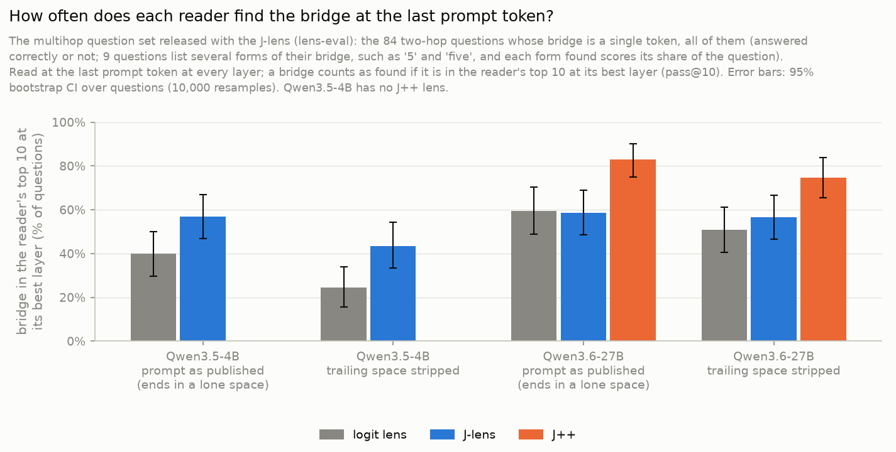
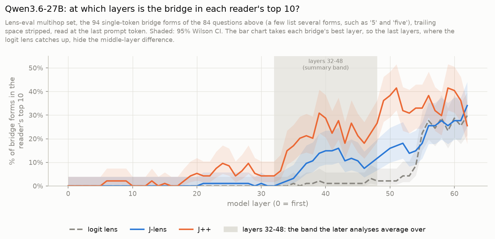

# bridge-jspace

**Question.** In a two-hop question ("the language spoken in the country where the Amazon River ends is ..."), the
model has to compute a bridge entity (Brazil) before it can answer (Portuguese). On Qwen3.6-27B and Gemma 4 31B the
J-lens often cannot read that bridge. Does the bridge still act on the answer through the J-space, or through a part
of the representation the J-lens cannot read?

**Reference result (Claude, Gurnee et al. 2026,
[Verbalizable Representations Form a Global Workspace](https://transformer-circuits.pub/2026/workspace/index.html)).**
Swapping the bridge's probe for another entity's flips the answer in 61% of items when only the J-space part of the
probe is swapped, 28% for the remainder, and 6% for the remainder when the J-space coordinates are clamped.

**Reading.** If on open models the remainder flips about as often as the J-space part and survives the clamp, the
bridge works outside the workspace. If the numbers look like Claude's, the J-lens misses on open models are a read-site
or tokenization artifact.

## Method, part A: can any reader see the bridge? (exp10+)
1. `exp10_lens_sanity`: the lens works on this model. Sanity gate (known fact, HF parity, our readout == jlens's
   `apply`), then `lens-eval-multihop` pass@k for the J-lens and J++ against the logit lens, plus a bridge vs
   same-category distractor control. Debugged on Qwen3.5-0.8B (CPU), run on Qwen3.5-4B (same `qwen3_5` hybrid
   architecture as the target), then Qwen3.6-27B. Results under Status.
2. `exp11_bridge_vs_answer_by_layer`: on part B's items and labels, at the last prompt token, at which layers each
   reader has the bridge (and, separately, the answer) on top of its candidate pool. Results under Status.
3. `exp12_position_map`: the same readout at every prompt position x layer: where in the prompt, and how deep, each
   word is readable; the best position per reader, chosen on half the items and checked on the other half.
4. Oracle lens and NLA on the same items, split by part B's J-mediated / non-J labels (planned).

## Method, part B: is the bridge used outside the J-space? (exp01-09)
1. `data/entity_prompts.json`: about 8 prompts per entity that imply the entity without naming it, for the 97
   entities in `data/probe_swap.json` (bridges and swap targets). Qwen keeps the ones it answers correctly.
2. Probe per entity and layer: mean final-token residual over its kept prompts minus the mean over all entities.
3. Decomposition per layer: non-negative OMP (k=25) over J-lens (or J++) token directions gives the J-space part; the
   remainder is the rest. From v4, both lenses decompose the same probes (`exp01_probes redecompose`).
4. Swaps on the 90 two-hop items, at every band layer and prompt position, under five conditions: raw J-lens vectors,
   full probe, J-space part, remainder, remainder with the J-space coordinates clamped. Each has a random-direction
   control of the same edit norm. Metric: rate at which the swap answer becomes the top word, with Wilson 95% CIs.
   From v4: prompts with the trailing space stripped, and eligibility and flips judged on the greedy continuation
   (exp13's criterion C), which makes 77 items eligible; swaps can be restricted to some prompt positions.
5. `exp03_brew_swaps`: the same swaps and graded steering along lens directions on an in-context two-step lookup
   (WorkspaceBench's brew bank), where the counterfactual answer is read straight off a table in the prompt.

## Layout
```
src/bridge_jspace/
  config.py       typed YAML configs + dotted CLI overrides (model=<yaml> swaps the whole model)
  models.py       pinned HF model -> jlens LensModel; lens / J++ files (same format) moved to GPU once
  readout.py      rank-only readouts (J-lens, J++, logit lens), word -> token ids
  sanity.py       checks every new model/pod must pass before any readout is trusted
  stats.py        Wilson and bootstrap CIs
  experiment.py   Experiment base: results/<exp id>/<timestamp>/, manifest.json before run()
  pins.py         pinned upstream data, sha256-checked on load
configs/models/   one YAML per model: HF revision + lens files (qwen3.5-0.8b / 2b / 4b, qwen3.6-27b)
scripts/          experiment code: part A expNN_name/ (config.yaml + experiment.py), part B expNN_*.py
scripts/run.sh    experiment in a detached tmux session, log in log/
scripts/prefetch.py  download a model YAML's snapshot + lenses, retrying on HF rate limits
examples/         rendered worked-example pages per experiment (make examples-render; slices/ not committed)
infra/            pod bootstrap
```
`AGENTS.md`: rules for running experiments. `VERIFIED.md`: results a human has checked. `data/README.md`: what
data we use and what the lenses were fitted on (`make data-report`).

## Running
```bash
make install                 # uv sync + pre-commit hooks
make check                   # ruff + pyright + unit tests (no download)
make test-model              # integration on Qwen3.5-0.8B + its lenses (CPU ok)

# GPU box: bash infra/setup_pod.sh, then any experiment = one config, run in tmux:
make run CONFIG=scripts/exp10_lens_sanity/config.yaml                      # Qwen3.5-4B
make run CONFIG=scripts/exp10_lens_sanity/config.yaml ARGS="model=configs/models/qwen3.6-27b.yaml"
tmux attach -t <session>     # or: tail -f log/<session>.log

# Worked examples (lens tables for sampled questions; the examples run needs the GPU, rendering does not):
make run CONFIG=scripts/exp12_position_map/examples.yaml   # results/<exp>/<stamp>/examples.json + slices/
make examples-render                                       # examples/<exp>/ from the latest examples run of each exp
make examples-serve                                        # render, serve examples/ on localhost:8000, open browser
```
On a pod, `make examples-serve` plus `ssh -L 8000:localhost:8000 sesterce-a100` shows the pages locally. To update the
published exp12 page, publish `examples/exp12_position_map/artifact.html` with `slices/*` as files to its URL.
GPU memory: Qwen3.5-4B fits a 24 GB card; Qwen3.6-27B needs 1x 80 GB (bf16 weights ~54 GB + two fp32 lens maps
~13 GB).

To fetch a model and its lenses ahead of a run (retries on HF 429s; put `HF_TOKEN` in `.env`):
`uv run python scripts/prefetch.py configs/models/qwen3.6-27b.yaml`.

## Status
Draft, UNVERIFIED: nothing is in `VERIFIED.md` yet. The STATE block in `AGENTS.md` tracks what is in flight.
Final figures, numbers and examples per experiment: [results/README.md](results/README.md). Every part A number below
is recomputed from the raw run files by `uv run python scripts/verify_headlines.py`.

**How to read the part A figures.**
- **Which questions.** exp11 and exp12 use part B's 90 two-hop questions with the trailing space stripped, and keep
  the 77 the model answers correctly (its greedy continuation contains the answer). exp10 uses another
  set: lens-eval multihop, the 84 questions whose bridge is a single token, answered correctly or not.
- **Readers.** At a given layer and prompt position each reader scores every token of the vocabulary: the logit lens
  (the model's own unembedding; the baseline), the J-lens and J++ (two fits of the average-Jacobian lens).
- **"Ranked first among its candidates" (exp11, exp12).** For the bridge (Brazil) we ask whether the reader scores it
  above every other entity of the set: the **97 entities** are all distinct bridges and swap targets of the 90
  questions (70 bridges and 68 swap targets, overlapping), each a single Qwen token. For the answer (Portuguese) the
  candidates are the **112 answers**: all distinct answers and swap answers of the 90 questions that are a single
  token (120 in all; the 8 multi-token ones cannot be ranked, so 5 of the 77 questions drop out of the answer lines).
  Restricting the ranking to these pools asks "of the entities these questions are about, which one does the reader
  pick?", the same choice part B's swaps change; chance is 1 in 97 (about 1%). The full-vocabulary rank is used only
  for the comparison with the distractor.
- **Control.** Each question has a same-category distractor (Mexico for Brazil, Spanish for Portuguese; part B's swap
  target). If the distractor came first as often as the bridge, the reader would be reading the category, not the
  entity.
- **Layers 32-48.** The band part B swaps in, fixed before exp11; the summary numbers average over it.
- **Positions (exp12)** are counted back from the last word of the prompt: 0 = the last word (usually "is"), -1 the
  word before ("located", "ends"), and so on; each position's label is its most common token.
- **Shading.** 95% intervals: a bootstrap over questions (10,000 resamples) for averages over layers or positions,
  Wilson for the share of questions at one layer.

**Final figures (Qwen3.6-27B).**
| Figure | What it shows |
|---|---|
| [exp12 `two_step.png`](figures/exp12_position_map/two_step.png) | **Headline.** Where in the prompt each word is read (left) and from which layer (right): the bridge one word before the end from layer 23, the answer at the last word from layer 44 |
| [exp12 `layers_at_positions_jlens.png`](figures/exp12_position_map/layers_at_positions_jlens.png) | The same, one line per position for the last four words: which positions carry the bridge, and the answer, at which layers |
| [exp12 `by_offset.png`](figures/exp12_position_map/by_offset.png) | The "where in the prompt" panel for all three readers, logit lens included |
| [exp12 `position_layer.png`](figures/exp12_position_map/position_layer.png) | Reference heatmaps: every position x layer, all three readers |
| [exp11 `pool_top1_by_layer.png`](figures/exp11_bridge_vs_answer_by_layer/pool_top1_by_layer.png) | Last token only: bridge and answer ranked first, by layer, three readers |
| [exp11 `advantage_by_layer.png`](figures/exp11_bridge_vs_answer_by_layer/advantage_by_layer.png) | Last token only: how many times higher than its distractor each word ranks |
| [exp10 `pass_at_10_by_model.png`](figures/exp10_lens_sanity/20261015-123717/pass_at_10_by_model.png) | Does each lens find the bridge at all (pass@10), 4B and 27B |
| [exp10 `27b_by_layer.png`](figures/exp10_lens_sanity/20261015-123717/27b_by_layer.png) | Why the J-lens looks no better than the logit lens on pass@10 |

Worked examples with lens tables: `make examples-serve` opens [examples/index.html](examples/index.html) (all three
experiments); the exp12 page is also published at https://claude.ai/artifact/TXLZH6WxuxSQDhoK5YHTj9 (anyone with the
link can open it).

**What we know so far (Qwen3.6-27B, the 77 two-hop questions it answers correctly).**
1. The J-lens and J++ can read the bridge in the middle layers; the plain logit lens mostly only near the output
   (exp10, exp11).
2. The bridge is readable earlier than the answer, both in the prompt and in depth: one word before the end from about
   layer 23, while the answer appears only at the last word from about layer 44, 19 layers later [15, 27] (exp12).
3. Where the bridge is readable, part B's swaps tend to work: questions whose J-space swap flips the answer have the
   bridge ranked first more often (J-lens 73% vs 50%, J++ 70% vs 41% of layers 32-48), but the groups are small and
   the intervals overlap.
4. The original "J-lens cannot see the bridge" is mostly where and how we looked: of the 30 questions where it does not
   have the bridge first at the last word, 73% have it first at an earlier word (distractor, same search: 33%).

### exp10_lens_sanity: does the lens work on Qwen at all?
**What we measure.** We give the model a two-hop question, e.g. "The language spoken in the country where the Amazon
River ends is" (answer Portuguese, bridge Brazil). At the last prompt token we ask each *reader* for its ranked word
list at every layer, and count how often the bridge is in the top 10 at some layer (pass@10). Three readers: the
**logit lens** (simplest; the baseline), the **J-lens**, and **J++** (an improved J-lens).

**In short.**
- **Qwen3.5-4B:** the J-lens sees the bridge more often than the baseline.
- **Qwen3.6-27B:** J++ clearly beats the baseline (0.75 vs 0.51 with the space stripped). The J-lens is only slightly
  ahead, within the error bars.
- **The bridge is often invisible at the last token.** On the 61 items 27B answers correctly, J++ misses the bridge in
  1 of 3 and the J-lens in 1 of 2. This is Zach's observation. The next experiments check other ways of reading it.



*How to read it: each bar is the share of the 84 questions whose bridge is in that reader's top 10 at its best layer,
read at the last prompt token (a question listing two forms of its bridge, '5' and 'five', scores half per form
found); error bars are 95% bootstrap intervals. Grey is the baseline. On 27B, J++ (orange) is
clearly above the logit lens; the J-lens (blue) is within its error bars. "Prompt as published" keeps the lone
trailing space of the original prompts (pitfall 1).*

**Why the J-lens looks no better than the baseline on 27B.** In the middle layers only the J-lens and J++ see the
bridge; near the output the logit lens catches up. pass@10 takes the *best* layer, so the late layers hide the
difference.



*How to read it: x is the layer, y the share of the 94 bridge forms in the reader's top 10 at that layer (84
questions; 9 of them list several forms of their bridge, such as '5' and 'five', and each form is ranked separately). Inside layers 32-48 (grey) J++ has up to 31% of the bridges in its top 10, the J-lens up to 16%, the
logit lens at most 3%; only from about layer 55 does the logit lens join them.*

<details><summary>Full numbers</summary>

pass@10 on the 84 single-token items, 95% percentile bootstrap CI over items (n_boot=10000, seed 0). Runs are under
`results/exp10_lens_sanity/`. All sanity checks pass on both models (HF parity and our readout vs `jlens.apply`:
max abs diff 0.0).

| Model | Prompt end | Model correct | Logit lens | J-lens | J++ | J-lens - logit | J++ - logit | Run |
|---|---|---|---|---|---|---|---|---|
| Qwen3.5-4B | as published (`" "`) | 18/93 | 0.40 [0.30, 0.50] | 0.57 [0.47, 0.67] | - | +0.17 [+0.08, +0.27] | - | `20261013-205029` |
| Qwen3.5-4B | stripped (`" is"`) | 50/93 | 0.24 [0.15, 0.34] | 0.43 [0.33, 0.54] | - | +0.19 [+0.10, +0.29] | - | `20261013-205057` |
| Qwen3.6-27B | as published (`" "`) | 21/93 | 0.60 [0.49, 0.70] | 0.59 [0.49, 0.69] | 0.83 [0.75, 0.90] | -0.01 [-0.08, +0.07] | +0.23 [+0.14, +0.33] | `20261013-205736` |
| Qwen3.6-27B | stripped (`" is"`) | 61/93 | 0.51 [0.40, 0.61] | 0.57 [0.46, 0.67] | 0.75 [0.65, 0.84] | +0.06 [-0.05, +0.17] | +0.24 [+0.13, +0.35] | `20261013-205936` |

On the items the model answers correctly (27B, stripped, n=61): J++ 0.67 [0.56, 0.79], J-lens 0.48 [0.36, 0.61].
Controls (27B, stripped, rank at the last token): Brazil 0 vs distractor Mexico 57 (J-lens) / 45 (J++); Hungary 1 / 0
vs Poland 16 / 18. Figures: `uv run python -m scripts.exp10_lens_sanity.plot --summary`.
</details>

### exp11_bridge_vs_answer_by_layer: where is the bridge readable, and where the answer?
**What we measure.** Part B's 90 two-hop questions, trailing space stripped; the headline uses the 77 the model answers
correctly (its greedy continuation contains the answer). At the last prompt token, at every layer, we ask each reader: is the bridge (Brazil) ranked
first among the 97 entities of the set, and is the answer (Portuguese) ranked first among the 112 answers? The
same-category distractors (Mexico, Spanish) are the controls. Chance is about 1%.

**In short.**
- **J-lens and J++ read the bridge in the middle layers; the logit lens only near the output.** Averaged over
  layers 32-48 the bridge is ranked first in 57% of questions (J-lens), 56% (J++), 25% (logit lens); its distractor
  in 5%. This reproduces part B's `gate_debug` (0.55-0.70).
- **At the last token the bridge comes first, the answer later, but they overlap.** Half the questions have the
  bridge first by layer 35; the answer gets there by layer 44 (J-lens, 8 layers later [3, 16]) or 43 (J++, 8 [3, 20]).
  There is no clean hand-off: the bridge stays first until about layer 60, and per question the bridge settles first
  before the answer in only 52% [39, 64] of cases (J-lens).
- **Where the bridge is readable, it is also used.** On the questions where part B's J-space swap flips the answer,
  the bridge is first in 73% [58, 86] of layers 32-48 (J-lens, n=25) and 70% [59, 81] (J++, n=39); on those where no
  swap works, 50% [38, 62] (n=49) and 41% [29, 54] (n=37). Suggestive: the intervals overlap (J-lens) or nearly touch
  (J++). Each lens is split by its own swaps.


*How to read it: one panel per reader; x is the layer, y the share of the 77 questions in which the reader ranks the
word first among its candidates, at the last prompt token (shaded: 95% Wilson interval). Blue = bridge among the 97
entities, orange = answer among the 112 answers, grey = their distractors, dotted = chance. In the J-lens and J++
panels the blue line leaves the grey control from about layer 20 and stays above the orange one until layers 55-60:
the bridge is readable here, and ahead of the answer. The logit lens picks either word mostly after layer 50.*

**What this does not show.** A lens shows what can be read out at a layer, not when it was computed. And this is
one token: the first hop may happen earlier in the prompt (at "Amazon River ends"), which exp11 does not look at.
About 40% of questions do not have the bridge first at the last token; exp12 looks at the earlier tokens.

<details><summary>Full numbers</summary>

Run `20261015-100110` (Qwen3.6-27B, trailing space stripped, labels `exp02_swaps/main_v4_jlens`); its `summary.json` is
current; figures re-rendered in `analysis-20261015-122817/`. Eligible n=77 (answer columns: the 72 with a
single-token answer), layers 32-48, 95% percentile bootstrap CI over questions (n_boot=10000, seed 0).

| Reader | Bridge first | Answer first | Bridge's distractor first | Bridge above its distractor (full vocabulary) | Half the questions: bridge / answer (lag) |
|---|---|---|---|---|---|
| logit lens | 0.25 [0.18, 0.33] | 0.14 [0.09, 0.20] | 0.04 | 0.80 [0.73, 0.87] | L50 / L51 (1 [-2, 4]) |
| J-lens | 0.57 [0.48, 0.66] | 0.41 [0.32, 0.50] | 0.05 | 0.83 [0.76, 0.90] | L35 / L44 (8 [3, 16]) |
| J++ | 0.56 [0.46, 0.64] | 0.38 [0.29, 0.47] | 0.05 | 0.84 [0.78, 0.90] | L36 / L43 (8 [3, 20]) |


*How to read it: y is how many times higher than its same-category distractor the reader ranks the word in the full
vocabulary (log scale; 1x = no better). Line: the median question; shaded: the middle half. Within layers 32-48 the
median question has the bridge 4-24 times above its distractor with the J-lens and J++, 2-11 times with the logit
lens; the gaps pass 100x only near the output (from about layer 55).*

Bridge first, split by which questions part B's J-space swap flips (labels `exp02_swaps/main_v4_jlens` in run
`20261015-100110`, `main_v4_jpp` in run `20261015-100426`; the two runs' ranks are identical row for row, only the
split differs):

| Reader | Swaps by | Eligible | J-mediated (swap flips) | Neither (no swap flips) |
|---|---|---|---|---|
| J-lens | J-lens | 0.57 [0.48, 0.66] (n=77) | 0.73 [0.58, 0.86] (n=25) | 0.50 [0.38, 0.62] (n=49) |
| J++ | J++ | 0.56 [0.46, 0.64] (n=77) | 0.70 [0.59, 0.81] (n=39) | 0.41 [0.29, 0.54] (n=37) |
| J-lens | J++ | 0.57 [0.48, 0.66] | 0.73 [0.62, 0.83] | 0.41 [0.28, 0.55] |
| logit lens | J-lens | 0.25 [0.18, 0.33] | 0.28 [0.15, 0.42] | 0.25 [0.16, 0.35] |

- The wide band 28-52 changes nothing (J-lens bridge 0.56).
- The 22 eligible questions whose published prompt ended in a space read worse even with the space stripped (J-lens
  bridge 0.40 [0.23, 0.59] vs 0.64 [0.53, 0.74]; answer 0.29 vs 0.47).
- Earlier run, prompts as published with part B's earlier labels (`20261014-092835`, 67 eligible): the same picture
  (J-lens bridge 0.59, lag 8 [4, 18]); J-mediated 79% [66, 89] vs neither 49% [35, 62].
</details>

### exp12_position_map: where in the prompt, and how deep?
**What we measure.** The exp11 readout (is the word ranked first among its candidates?) at every token of the prompt,
not just the last. Prompts differ in length, so tokens are aligned by their distance from the last word: 0 is the
last word (usually "is"), -1 the word before it (e.g. "located", "ends"), and so on. The best position for each
reader is picked on a random half of the questions and checked on the other half, because the best of 15 positions
looks better than it is on the data that picked it; the same search for the distractor (Mexico) shows how high noise
alone gets.

**In short.**
- **The bridge is read best one word before the end; the answer only at the end.** J-lens: the bridge is first in 65%
  [54, 74] of layers 32-48 at position -1 (57% at the last word); the answer in 41% at the last word and at most 25%
  anywhere earlier. Both halves of the data pick -1 for the bridge (held out: 67%, 62%). Noise ceiling: 11%.
- **The bridge comes about 20 layers before the answer.** Read where each is strongest, half the questions have the
  bridge first by layer 23 and the answer by layer 44: 19 layers later [15, 27] (J++: 22 vs 43, 22 [17, 30]).
  Read at a single token (exp11) the two overlapped; this is the step that one token hides.
- **Most last-token misses are a read-site effect.** Of the 30 questions where the J-lens does not have the bridge
  first at the last word, 73% [57, 90] have it first at an earlier word (distractor, same search: 33% [17, 50]).


*How to read it. Left: x is the position in the prompt, counted back from the last word; y is in what share of layers
32-48 the reader ranks the word first, averaged over the questions. The blue bridge line rises toward the end of the
prompt and peaks one word before it (-1): the bridge is there before the last word. The orange answer line stays at
the level of the grey control until the last two words. Right: x is the layer, y the share of questions with the word
ranked first, the bridge read at -1 and the answer at the last word; the dots mark the layer at which each reaches
half of the questions, the arrow the 19-layer lag. Thick: J-lens with 95% intervals; thin: J++.*


*How to read it: one line per prompt position (J-lens), y the share of questions with the word ranked first at each
layer. Bridge (left): one word before the end (thick) reaches half of the questions at layer 23, the two words before
it at layers 24-25, the last word only at layer 35; earlier words (grey, averaged) stay at or below 30%. Answer
(right): the last word (thick) reaches half of the questions at layer 44, the word before it at layer 55; the two
words before that stay at or below 25%, earlier words at or below 10%.*

**What this does not show.** Positions are aligned by distance from the end, not by meaning: in the 46 prompts that
end in "is" the bridge peaks on the word before it (76% [64, 87]); in the 31 others it has no clear peak (46-59% over
positions -3..0). The ordering holds for the group of questions, not reliably for each one. A lens shows what is
readable, not what is computed.

<details><summary>Full numbers and checks</summary>

Run `20261015-100735` (Qwen3.6-27B, trailing space stripped, labels `exp02_swaps/main_v4_jlens`); its `summary.json` is
current; figures re-rendered in `analysis-20261015-122822/`. Eligible n=77 (answer: 72); positions -14..0 analysed
(reached by at least half the questions; -11..0 by 76-77).

| Reader | Bridge: best position | Share of layers 32-48 [95% CI] | Held-out halves (position: share) | Answer: best position | Share | Distractor ceiling |
|---|---|---|---|---|---|---|
| logit lens | -1 | 0.37 [0.28, 0.46] | -1: 0.36, -3: 0.36 | 0 | 0.14 [0.09, 0.20] | 0.06 |
| J-lens | -1 | 0.65 [0.54, 0.74] | -1: 0.67, -1: 0.62 | 0 | 0.41 [0.32, 0.50] | 0.11 |
| J++ | -1 | 0.64 [0.54, 0.73] | -1: 0.67, -1: 0.61 | 0 | 0.38 [0.29, 0.47] | 0.11 |

- Depth (half the questions first, bridge at -1 vs answer at the last word): J-lens L23 vs L44, lag 19 [15, 27];
  J++ L22 vs L43, 22 [17, 30]; logit lens L40 vs L51, 11 [-4, 14].
- Same optimum on the balanced panel (the 76 questions that reach every position -11..0), so prompt length does not
  drive it.
- Read at position -1, the questions whose J-space swap flips the answer have the bridge first in 0.73 [0.56, 0.88]
  of layers 32-48, the others in 0.60 [0.47, 0.73] (J-lens, split by the J-lens swaps, n=25 / 49); J++ split by its own
  swaps (run `20261015-100947`): 0.75 [0.63, 0.86] vs 0.51 [0.36, 0.65] (n=39 / 37).
- Missed at the last word: J-lens 30 questions, bridge first earlier in 73% [57, 90] (distractor 33% [17, 50]);
  J++ 31, 77% [61, 90] (distractor 26% [13, 42]).
- Earlier run, prompts as published with part B's earlier labels (`20261014-095358`, 67 eligible): the same picture
  (J-lens bridge at -1: 0.66; lag 21 [16, 28]).


*Reference: every position x layer for all three readers, colour = share of questions with the word ranked first; the
box marks the best position over layers 32-48. The line figure above shows the J-lens rows that matter.*
</details>

### exp02_swaps (part B): does the bridge act through the J-space, and where?
**What we measure.** In "The capital of the country where Naples is located is" the model answers Rome through the
bridge Italy. We swap the bridge's representation for another entity's (Italy -> Spain) at layers 24-40 and count how
often the answer becomes the other entity's (Madrid). The swap uses one part of the bridge's probe at a time: its
J-space part, its remainder, or the remainder with the J-space coordinates held fixed. Each swap has a control: a
random direction of the same edit size. v4 runs the swaps with the J-lens and with J++ on the same probes, on the 77
questions the model answers correctly (stripped prompts, answers judged on the greedy continuation).


**In short.**
- **The bridge acts through the J-space.** Swapping only the J-space part flips 52% of answers with J++ and 35% with
  the J-lens; the remainder flips 8% / 12%, and 1% / 4% with the J-space held fixed. Controls flip at most 3%. Claude
  (Gurnee et al. 2026): 61% / 28% / 6%.
- **J++ closes most of the gap to Claude.** On identical probes, J++'s J-space part carries much more of the swap
  than the J-lens's (52% vs 35%), so the J-lens's smaller effect is largely the lens, not a route outside the
  workspace.
- **It is the lens's direction, not how much of the probe it carries.** Directions with the same cosine to each probe
  as its J-space part, but random otherwise, flip 14% (J++) / 10% (J-lens) against the J-space part's 52% / 35%
  (paired difference +38 [+27, +49] / +25 [+16, +34] pts), although their edits are three times larger. Within each
  lens, edit size does not predict which questions flip, and J++ flips more than the J-lens at every edit size.
- **The swap acts at the cue phrase, not where the bridge is read.** Swapped only at the words that name the bridge's
  cue ("Naples", "emperor defeated at Waterloo"; `data/cue_spans.json`), the J-space part flips 31% (J++) / 19%
  (J-lens); at the other earlier words ("The capital of the country where"), 1% / 1%; only at offset -1, where exp12
  reads the bridge best, 9% / 3%; only at the last token, 8% / 4%.
- **It works when the bridge is a place or a person.** J++: 88% of questions whose bridge is a country or place,
  86% for people (n=7), 25% for everything else (elements, organs, animals, dates). The J-lens matches J++ on places
  (85%) but not on people (14%).


**What this does not show.** The runs are exploratory, one seed, n=77. The control matches each layer's edit size,
not the total over layers (the real swap's later edits shrink, the control's do not), so it is stricter for flips and
overstates collateral damage. Positions are counted back from the last token, as in exp12, so offset -1 is a
different word in different prompts.

<details><summary>Full numbers and checks</summary>

Runs under `results/exp02_swaps/`: `gate_v4`, `main_v4_{jlens,jpp}` (layers 24-40, the gate's pick),
`main_v4_{jlens,jpp}_32-48` (part A's band, set by hand),
`main_v4_{jlens,jpp}_pos-{prev,last,last_two,earlier,cue,earlier_noncue}`.
Probes: `exp01_probes/v3_jpp` (v3's prompts rebuilt on the H200: 11 of 2673 filter decisions differ from v3) and
`v3_jlens` (the same probes, decomposed over the J-lens). Flip rate, Wilson 95% CI, n=77:

| Swap (all positions) | J-lens 24-40 | J++ 24-40 | J-lens 32-48 | J++ 32-48 |
|---|---|---|---|---|
| raw lens vectors | 40% [30, 51] | 49% [38, 60] | 48% [37, 59] | 55% [43, 65] |
| full probe | 27% [19, 38] | 27% [19, 38] | 25% [16, 35] | 25% [16, 35] |
| J-space part | 35% [25, 46] | 52% [41, 63] | 34% [24, 45] | 44% [34, 55] |
| remainder | 12% [6, 21] | 8% [4, 16] | 12% [6, 21] | 10% [5, 19] |
| remainder, J-space held | 4% [1, 11] | 1% [0, 7] | 1% [0, 7] | 3% [1, 9] |

| J-space part swapped only at | J-lens | J++ |
|---|---|---|
| the cue phrase (median 5 tokens) | 19% [12, 30] | 31% [22, 42] |
| the other earlier words (median 7 tokens) | 1% [0, 7] | 1% [0, 7] |
| the earlier words (both of the above) | 23% [15, 34] | 35% [25, 46] |
| offset -1 | 3% [1, 9] | 9% [4, 18] |
| offset 0 | 4% [1, 11] | 8% [4, 16] |
| offsets -1 and 0 | 10% [5, 19] | 17% [10, 27] |
| every position | 35% [25, 46] | 52% [41, 63] |

| Bridge is | n | J-lens | J++ |
|---|---|---|---|
| a country or place | 26 | 85% [66, 94] | 88% [71, 96] |
| a person | 7 | 14% [3, 51] | 86% [49, 97] |
| anything else | 44 | 9% [4, 21] | 25% [15, 39] |

- Paired bootstrap, J-space part minus remainder: J-lens +23 pts [+13, +35], J++ +44 [+32, +56] (layers 24-40).
- Matched-alignment control (`matched_v4_{jpp,jlens}`, layers 24-40; decision rule fixed in the manifests): per entity
  and layer, a unit direction with the J-space part's cosine to the probe, the rest random. Flips: J++ 14% [8, 24]
  (J-space part 52% [41, 63]), J-lens 10% [5, 19] (35% [25, 46]); random-direction nulls 0%. Median edit: 0.049 /
  0.044 of the norm vs the J-space part's 0.016 / 0.014. The J-space part's rates reproduce `main_v4` item for item.
- Edit size (`exp02_swaps/analysis/edit_size_v1/report.md`, from `main_v4` outcomes): the J-space part's edit is the
  smallest of the probe swaps (median 0.016 / 0.014 vs 0.074-0.090) and flips most; within a lens, a flipped
  question's edit is no larger than a kept one's (AUC 0.48 J++, 0.49 J-lens); J++'s edits are 21% larger per
  question, but J++ flips more in every edit-size quartile, and flips every question the J-lens flips (13 vs 0,
  exact McNemar p = 0.0002).
- The full probe uses no lens: its outcomes are identical item by item in the J-lens and J++ runs.
- Every run's report (`results/exp02_swaps/analysis/<run>/REPORT_auto.md`) lists edit sizes, collateral damage and
  the files to recompute from. Supplementary figures in `figures/exp02_swaps/v4b/` (`v4/` is the same set before
  the cue runs): `lens_comparison.png`,
  `positions.png`, `outcomes.png`, `dose.png`, `per_question.png`, `examples.png`, `by_bridge_type.png`.
</details>

### exp03_brew_swaps (part B): an in-context two-step lookup
**What we measure.** In brew the prompt gives a colour table and a start colour; the answer is two lookups away
(blue -> green -> black), so the counterfactual answer of any edit can be read off the table and no prior knowledge is
involved. 100 items from WorkspaceBench's `brew_intermediates` bank, gated on Qwen3.6-27B; 99 have a valid swap
target, 94 a valid alternative start. We swap and steer along the colours' J-lens and J++ vectors and read which
colour the model answers after the bank's "Answer:" prefill.

**In short.**
- **Swapping the start colour redirects the computation; swapping the intermediate does not.** exp02's coordinate swap
  as is moves no answer here, positive controls included (0-1% at every band). Amplified 3x at layers 8-24, swapping
  the start colour S for S' makes the model answer f(f(S')) for 61% [51, 70] of items with J++ (J-lens 17% [11, 26];
  random direction 0-1%), while swapping the intermediate I for X, at the same layers and strength, gives f(X) for 0%
  [0, 4] after the start line and 3% [1, 9] at every position (random direction 0%). With the positive control
  working, this is a null: where and how we edit, the intermediate is not carried along its lens direction (or is
  recomputed downstream of the edit).
- **Steering the start line redirects the whole computation, and replicates on fresh items.** Adding 3% of the
  residual norm along J++'s S' - S at the start line (layers 8-24), the model answers f(f(S')), both lookups from the
  new start, for 56% [46, 66] of the bank's items (J-lens 20%); one lookup, f(S'), for a further 19%; S' itself for
  5%. The layers and sizes were picked on these items, so the same steering was rerun on 200 fresh items in the bank's
  format (164 usable): 63% [55, 70] at 3% (J-lens 30% [24, 38]), random direction 0% [0, 2]. The effect needs about 2%
  of the norm, peaks at 3-5% and fades above (larger edits break the answer), is weaker at layers 16-32 and absent at
  36-52.
- **Steering after the start colour only ever makes the model say X.** Along X - I at the positions after the start
  line, the answer becomes X itself (100% at 20% of the norm, layers 36-52) and almost never f(X) (1 item of 99 at one
  setting, 0 at every other size, band and lens). There, where the J-lens reads the intermediate, its direction acts as a candidate answer, not as a step:
  consistent with WorkspaceBench's caveat that the brew intermediate is usually the model's runner-up answer.


**What this does not show.** That the model does not compute the intermediate serially: the intermediate swap is
tested at layers 8-24 only, and steering after the start line only produces an output; neither reaches an
intermediate held in another direction or at other layers. The amplified swaps' random directions edit more than the
real swaps (median 0.05-0.1 of the norm vs 0.02-0.03), since they are re-added at every layer while the real clamp
settles; that makes the nulls stronger, not weaker. Steering is not dose-matched to exp02's swaps (about 1% of the
norm). One seed, one model; S' and X are drawn per item with a fixed seed.

<details><summary>Full numbers and checks</summary>

Runs under `results/exp03_brew_swaps/`: `sweep` and `main` (intermediate swaps, all regimes), `followup` (positive
controls, swaps at 16-32 and 36-52, steering after the start), `start_steer` and `start_steer_low` (steering the start
line), `swap_amp` (start and intermediate swaps at 8-24, amplified 1x/3x/5x), `fresh_steer` (start-line steering on
`data/brew_fresh.json`, from `exp03_make_items.py`; decision rule fixed in its manifest). `swap_early` is `swap_amp`
with a bug: its amplification multiplied the edit at every layer, which compounded (edits of 1.4-3.9x the residual
norm), so its 3x and 5x rows are void. Our render puts the start line and the last token on the bank's labelled cells for every item
(`render_matches_bank` in `items.jsonl`). Figures: `figures/exp03_brew_swaps/v1/`, `v2_swaps/`, `v2_fresh/` (`exp03_figures.py`; categories are
read off each item's table, and an unchanged answer counts as "original" even where one lookup from S' lands on it).

| Start line steered along S' - S, layers 8-24, n=94 | 1% | 2% | 3% | 5% | 10% | 20% |
|---|---|---|---|---|---|---|
| J++: f(f(S')) | 0% | 40% | 56% [46, 66] | 48% [38, 58] | 27% | 14% |
| J-lens: f(f(S')) | 0% | 9% | 20% | 30% [21, 40] | 17% | 11% |
| random direction: answer changed | | | 0% | 0% | | 12% |
| fresh items (n=164), J++: f(f(S')) | | | 63% [55, 70] | 49% [42, 57] | | |
| fresh items, J-lens: f(f(S')) | | | 30% [24, 38] | 35% [28, 43] | | |
| fresh items, random direction: answer changed | | | 0% [0, 2] | 0% [0, 2] | | |

| Swaps at layers 8-24, predicted answer reached | 1x | 3x | 5x |
|---|---|---|---|
| start S -> S' (start line, n=94), J++ / J-lens | 0% / 0% | 61% / 17% | 51% / 32% |
| random direction | 0% / 0% | 1% / 0% | 3% / 2% |
| intermediate I -> X (after the start line, n=99), J++ / J-lens | 0% / 0% | 0% / 0% | 1% / 0% |
| intermediate I -> X (every position), J++ / J-lens | 0% / 0% | 3% / 1% | 3% / 0% |
| random direction (every position) | 0% / 0% | 0% / 2% | 18% / 5% |
</details>

### exp04_brew_patch (part B): where brew carries its intermediate, without a lens
**What we measure.** exp03's lens edits of the intermediate moved no answer. To see whether there is anything there to
edit, we copy activations from a counterfactual prompt into the original run, one layer and one group of positions at a
time, with no lens involved. In the counterfactual the start colour's rule gives exp03's X instead of I, and X's rule
gives a new colour c. If the copied positions carry X as the intermediate, the second lookup still reads the original
table and the answer becomes f(X); if they already carry the answer, it becomes c. A control copies from a prompt whose
two changed rules are off the path. 82 of exp03's 99 bank items are eligible (the model answers the original, the
counterfactual and the control correctly); every second layer.

**In short.**
- **The intermediate is carried after the start line, at layers 36-50.** Copying the positions after the start line
  (the question, the chat scaffolding, "Answer:") gives f(X) for 11% of items at layer 36, rising to 48% [37, 58] at
  layers 46-50; from layer 52 the same copy gives c (71%, then 93-99% from layer 56). The start line itself carries
  neither at any layer. The window fixed before the run (f(X) above c and above the control, Wilson intervals not
  overlapping) is layers 36-50 for the positions after the start line and 46 and 50 for the last token alone. The
  control changes at most 2% of answers anywhere.
- **The rules are read at layers 28-36.** Copying the two changed rule lines gives c up to layer 28 (87-100%) and the
  start colour's rule alone gives f(X) (78-89% to layer 24); both stop working by layers 36-40.
- **Lens edits in the same window write the answer, not the step.** exp03's steering along v_X - v_I at these positions
  and layers (36-52) made the model say X itself (33-100% of items) and never f(X) (0 of 99 at every size, both
  lenses), at sizes like the copy's (it changes 7-14% of the norm there). The intermediate is there to be edited, but
  not along the colour's lens direction.


**What this does not show.** Which direction carries the step: the copy replaces whole block outputs at about 21
positions. 48% is the best single-layer copy, not a ceiling: information held at several layers at once is missed by
every single-layer copy. One seed for c and the control's colours.

<details><summary>Full numbers and checks</summary>

Run: `results/exp04_brew_patch/patch_map` (manifest written before the run; layers 0-62 in steps of 2, chosen by the
human). Per-layer rates of every role for each group, and the off-path control, are in `summary.md`; the first answer
token's log-probabilities in `figures/exp04_brew_patch/v1/patch_logp.png`. Eligibility: 13 items fail on the
counterfactual and 4 on the control prompt. 52 of the 82 items give f(X) at one window layer or more. Headlines are
recomputed by `scripts/verify_headlines.py`.
</details>

### Pitfalls found so far
1. **Trailing space.** Most original prompts end in a space (83/93), which Qwen's tokenizer leaves as a lone `" "`
   token. The model then answers far worse (27B: 21/93 correct vs 61/93 with the space stripped) and the lens reads a
   different token. Switch: `params.strip_trailing_space`.
2. **Numbers split into digits.** Qwen splits `" 26"` into `" "`, `"2"`, `"6"`, so scoring "26" by its first token
   gave fake hits (fixed in `d068538`; the two runs before the fix, `20261013-204427` and `-204551`, are superseded
   and not committed). Headlines use only single-token bridges.
3. **"The bridge is visible somewhere" is too weak.** Across all layers x tokens, a same-category distractor (Mexico
   for Brazil) also reaches the top somewhere. The read-site map must compare the bridge against a distractor.
4. **Best-of-all-layers favours the logit lens on deep models** (see the layer plot). exp11/exp12 average over the
   middle-layer band 32-48 instead.
5. **Token positions differ between prompts.** exp12 aligns them by distance from the last word, which mixes roles
   ("-1" is "ends" in one prompt, "is" in another); checked by splitting on the last word.
6. **Not yet checked:** in 5/93 lens-eval questions the bridge word appears in the prompt itself.

### Decisions
- **Trailing space: stripped is primary; prompts as published are kept as the paper-literal replication**
  (2026-10-13, Danyil; to confirm with Zach since part B's correct-answer filter depends on it). Why:
  - The protocol reads "the token right before `target`". In natural text that is `" is"`; the lone `" "` exists only
    because the prompts were written for another tokenizer, and after it the answer becomes a fragment (`"Port"`).
  - We study reasoning the model actually does: 27B answers 61/93 stripped vs 21/93 as published. 21 items is also
    too few for swap rates with useful CIs.
  - The lone `" "` invites digits, which produced fake hits (pitfall 2): 6 at layer 0 on 4B vs 0 when stripped.
  - Part B uses the same prompts (29/90 probe-swap prompts end in a space), so both parts must treat them the same.
  Against: numbers are not 1:1 with the paper (hence the replication variant). The J-lens reads the bridge more often
  on the lone `" "` (4B: 0.57 vs 0.43), but that is confounded with the digit artifact and with the model mostly
  failing there; the all-positions map will test it directly.

### Open decisions (humans)
- Whether to drop the 5 questions whose bridge appears in the prompt.
- Band for part A headlines: 32-48 (part B's) is used as primary; 28-52 is reported as exploratory.

## Next steps (part A)
In order; designs need human sign-off before GPU runs.
1. **Tell part B where the bridge is:** strongest on the last words before "is", from about layer 20. Part B already
   swaps at every prompt position, and its earlier bands (16-32, 24-40) did not pass its gate either, so this is
   information for reading its results, not a fix for the gate.
2. **Per question, not just per group:** for how many questions is the bridge on top at an earlier position and
   layer than the answer? Align positions by role (the words that cue the bridge) instead of distance from the end.
3. **The 5 lens-eval questions whose bridge appears in the prompt:** check whether they drive any exp10 headline.
4. **Oracle lens and NLA** on the same items (design proposed, awaiting sign-off). Both are public: the oracle
   lens is a LoRA on Qwen3.6-27B at our pinned `neuronpedia/jacobian-lens` revision (`qwen3.6-27b/oracle`, layers
   20-60); the NLA is a separate 27B reader trained on layer 42 (`ceselder/qwen3.6-27b-nla-rl`). Reference read code:
   WorkspaceBench's producer (github.com/camilablank/workspace-bench, MIT). Both fit one 80 GB GPU (the NLA in two
   phases: capture, then verbalize). Main risk: the oracle is the model itself, so it may re-solve the hop from the
   question instead of reading the bridge; probe directions (no question in them) are the cleaner test.
5. Optional: reproduce J++'s published Recall@10 (55.2% on Qwen3.6-27B) over all six lens-eval sets.
6. Stretch: repeat on Gemma 4 31B (J-lens and J++ exist on HF).

## Next steps (part B)
1. **Verify v4:** `scripts/verify_headlines.py` now recomputes exp02 v4's, exp03's and exp04's headlines from the raw
   files (one DIFF: the fresh items' random-direction row says "answer changed 0%"; 1 of 164 changed, and 0% is
   its f(f(S')) rate); a human recomputes the headlines.
2. **The gate:** decide whether 30% on the full probe is still the right go/no-go now that the J-space part and the raw
   lens vectors carry the effect.
3. **Why "anything else" bridges rarely flip:** probe quality vs how those bridges are represented.
4. **A control matched in total edit size** across layers.
5. **Brew:** the patching map is exp04 (the intermediate is carried after the start line at layers 36-50). Next:
   which part of that copy carries the step, its J-space part or the rest; and steering at the cue phrase in exp02
   at the same sizes, to compare the two settings at one dose.
