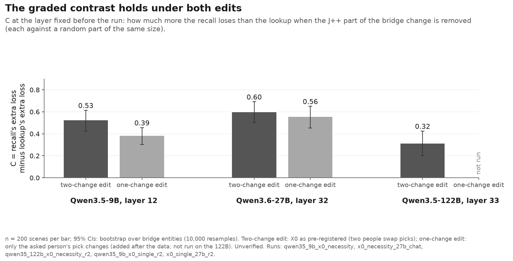
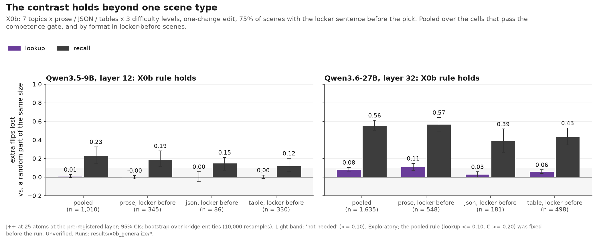
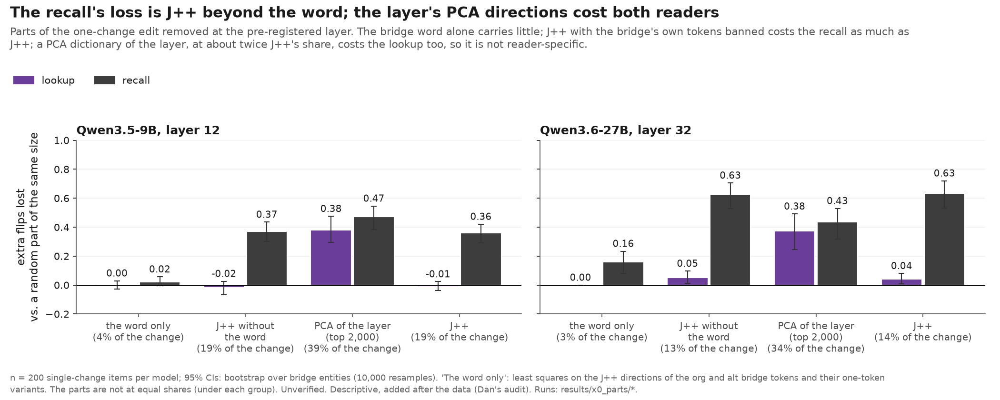
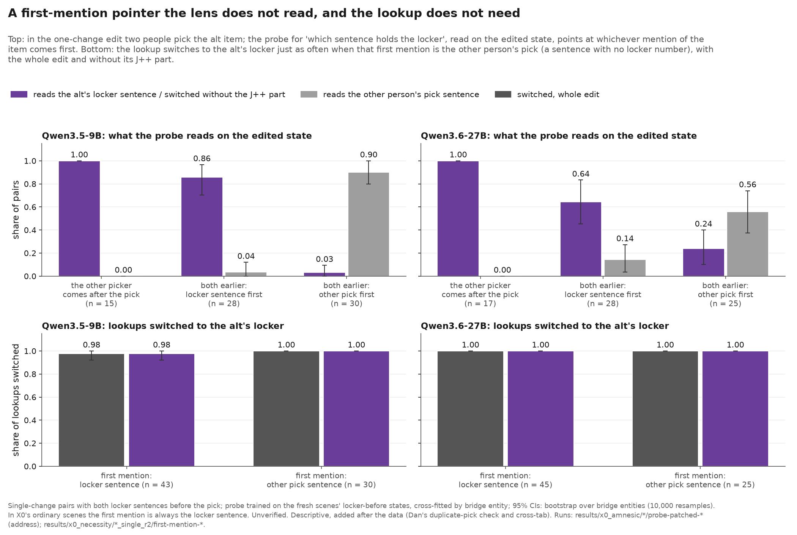
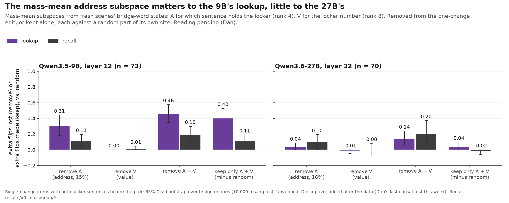

<!-- Generated by scripts/readme_build.py from docs/README.template.md and grid.csv; edit the template. -->
# bridge-jspace

**Question.** To answer a two-step question, a model first finds an entity in between (the **bridge**) and then uses it. A lens called **J++** reads hidden states as words. Does the model use the part of the bridge's representation that J++ can read, or does it reach the bridge another way? And does that depend on what the model does with the bridge next?

> **Example.** "Iris picked the frog. The locker of the frog is 5. …" The bridge is *frog*.
> - **Lookup:** "Which locker belongs to Iris's pick?" The answer is written in the prompt.
> - **Recall:** "How many legs does Iris's pick have?" The answer comes from the model's memory.

**Status (24 Oct 2026).**
- Models: Qwen3.5-9B, Qwen3.6-27B and Qwen3.5-122B-A10B (FP8 weights, mixture of experts, split over two H100s; its J++ was fitted on the bf16 weights; a hardware gate reproduced a 23 Oct cell first, 0.998 per-row agreement).
- All numbers are unverified (not yet hand-checked); the layers, the rules and Dan's predictions were fixed before any result was opened. Built at d2e5a72f from the run files. Full log: [jobs/c3/X0.md](jobs/c3/X0.md).

## Main findings

1. **Recall needs the J++ part of the change.** Removing the J++ part of a bridge change costs recalls 0.53 (9B), 0.77 (27B) and 0.40 (122B) of their answer flips. A random part of the same size costs 0.04, 0.03 and 0.08.
2. **It is the J++ part, not the word and not any direction.** At the same size, the logit-lens directions, the input embeddings and random directions do nothing comparable, on all three models. The bridge word alone costs the recall 0.16 (27B) and 0.02 (9B); J++ with the bridge's own tokens banned costs it 0.63 and 0.37, as much as J++. A PCA dictionary of the layer (top 2,000 directions, about twice J++'s share of the change) costs both readers (lookup 0.38, recall 0.43 on the 27B): only J++'s part is reader-specific.
3. **Lookups need it much less.**
   - **9B:** not at any number of J++ atoms (extra loss −0.02 at 25 atoms to −0.17 at 200). The pre-registered test: **confirmed**.
   - **27B:** a little at 25 atoms, so the pre-registered test was **not confirmed**; at 100 atoms about as much as recall (0.60 vs 0.67). Added after the data: with an edit that changes only the asked pick, its lookup's extra loss is 0.05 [0.01, 0.09] (9B: −0.02); at 100 atoms still 0.49.
   - **122B:** the pre-registered test at layer 33: **confirmed** (lookup 0.00 [−0.06, 0.06]; recalls lose 0.40 of their flips); at 100 atoms the lookup stays at −0.12. Up to layer 30 both readers need the J++ part. Its J++ part takes no smaller a share of the change (0.25) than the 27B's (0.16) or the 9B's (0.23), so its weaker recall dependence is not a smaller J++ share; its cause is open.
4. **It holds beyond one scene type (X0b, exploratory; one-change edit).** On 7 topics × prose / JSON / tables × 3 difficulty levels, the pooled rule holds on both models: 27B lookup 0.08 [0.06, 0.10], C 0.47 [0.42, 0.53] (1,635 scenes, 49 of 51 cells pass the gate); 9B lookup 0.01 [−0.01, 0.03], C 0.22 [0.14, 0.31] (1,010 scenes; under the brief's stricter C threshold, 0.30, only the 27B passes). On the 27B, locker-before lookups are around in JSON (0.03) and tables (0.06), mixed in prose (0.11).
5. **Not a missing digit.** Lookups flip mostly when the locker sentence comes *before* the pick, so the lookup might read a locker number attached to the bridge word, which our letter-only J++ cannot remove. The digit tokens are not the route: with every token allowed the 27B lookup's extra loss is 0.13 (letters only: 0.14), and the 10 digit directions alone give 0.00 on all three models.
6. **An address and a value at the bridge word, outside the J++ part (descriptive, probes).** On 1,500 fresh locker-before scenes a linear probe at the bridge word reads which sentence holds the bridge's locker (0.99 on the 27B, 0.97 on the 9B; the layout alone 0.53) and the locker number (0.40 and 0.27, chance 0.11; 0.38 and 0.28 with the sentence factored out). The address readout tracks the item's first mention: where another person's pick of the item comes first, it points there (9B: 0.90 of such pairs), and the lookup still switches to the alt's locker (1.00): the bridge word carries a first-mention pointer that a linear probe reads and the lens does not, and the lookup does not need it. Its change sits outside the J++ part (10% of the change, 0.5% of its component along the probe's directions, 27B), and the ridge probe's directions are not what the lookup reads (removing them: 0.00 [0.00, 0.00]).
7. **The mass-mean address subspace matters to the 9B's lookup (descriptive; reading pending).** Removing it (rank 4, 15% of the change) costs the 9B lookup 0.31 [0.18, 0.44] and its recall 0.11 [0.04, 0.19]; kept alone with the value subspace it flips 0.40 [0.29, 0.53] more lookups than a random part. On the 27B: 0.04 [0.00, 0.09] (A alone), 0.14 [0.06, 0.24] (A and V, the recall 0.20 [0.06, 0.37]). The value subspace alone does nothing on either.

## How we test it

- **Change the bridge.** Make a copy of the prompt where Iris picks a different animal (frog → tick). At one layer, take the difference between the two hidden states at the bridge word.
- **Paste the change back in three ways:** whole; without its J++ part (the 25 J++ directions that best describe it); without a random part of the same size.
- **Ask both questions on the same patched prompt.** The question comes after the patch, so both readers get the exact same edit. Any difference comes from the reader, not the edit.
- **Measure** how many answers flip to the new animal's answer. The key number is the **extra loss**: the flips lost without the J++ part, minus the flips lost without the random part, both as shares of the whole change's flips.

## Results at the pre-registered layer

| Model, layer | Lookup: extra loss | Recall: extra loss | Rule (pre-registered, two-change edit) | Recall minus lookup, C: two-change edit | C: one-change edit | J++ part's median share of the change's ‖Δ‖² |
|---|---|---|---|---|---|---|
| 9B, 12 | −0.03 [−0.08, 0.03] | 0.50 [0.41, 0.57] | **confirmed** | 0.53 [0.42, 0.61] | 0.39 [0.30, 0.46] | 0.23 |
| 27B, 32 | 0.14 [0.08, 0.20] | 0.74 [0.66, 0.80] | **not confirmed** | 0.60 [0.50, 0.69] | 0.56 [0.45, 0.65] | 0.16 |
| 122B, 33 | 0.00 [−0.06, 0.06] | 0.32 [0.22, 0.41] | **confirmed** | 0.32 [0.20, 0.43] | not run | 0.25 |

How to read this:
- The rule asked for a lookup extra loss of at most 0.10, and for recalls to lose at least 0.30 of their flips without the J++ part. The headline is C, the recall's extra loss minus the lookup's, under both edits; the categorical verdicts are the pre-registered ones (two-change edit).
- In answer counts (27B, 200 scenes): lookups go 86 → 71 without J++ and 86 → 83 without the random part; recalls go 150 → 35 and 150 → 146.
- Scope: almost all of the lookup's flips at the bridge word come from scenes where the locker sentence comes before the pick; the lookup results describe those scenes. 95% intervals come from resampling the bridge entities (40 on the 9B, 44 on the 27B, 40 on the 122B).

   

  

   

## What did not hold

- **"Past mid-depth, lookups don't use the J++ part of the change at all."** It holds on the 9B, and on the 122B from layer 33. On the 27B it holds only when the change is pasted across the whole context (lookups 84% → 87% without J++, recalls 77% → 36%). That repeats a 23 Oct result on fresh scenes, but at the bridge word alone it does not hold.
- **"The lookup reads the answer digit at the bridge word"** (stated before the check). Digit tokens change nothing (above), and the J++ readout at the bridge word ranks the lookup's answer digit first in 13% of items (27B; chance is 10%).
- **Prompts without the chat template.** Can't test: the models open a thinking block or answer in markdown. This says nothing about the question.

## Weak spots we know about

| Weak spot | Status |
|---|---|
| How the lookup reads what it needs is open: not the J++ part (9B, 122B), not a digit, not the first-mention pointer a linear probe reads; the mass-mean address subspace costs the 9B lookup but little on the 27B, and that sits beside the lookup surviving a misdirected pointer | X4; DAS after the sprint |
| The PCA comparison is not at equal share (34% of the change on the 27B and 39% on the 9B, vs J++'s 14% and 19%) | stated beside F11 |
| Lookup flips depend on sentence order: locker before pick 76%–89%, after 9%–19% | figure F4; X0b fixed the order by design (75% before) |
| The two-change edit inflated the extra loss: on the same items, one change instead of two moves the recall's by −0.15 [−0.22, −0.08] (27B) and −0.13 [−0.19, −0.08] (9B), the 27B lookup's by −0.08 [−0.16, 0.00] | the one-change edit from X0b on (it makes two people pick the same item) |
| On the 27B, the lookup's drop with depth follows how much of the change J++ captures (Spearman 0.79) | stated beside the depth figure |
| Three models from one family; generated scenes only | X0b: 7 topics, 3 formats, 3 levels; natural text parked (X3) |

## Next

| Step | What it tells us |
|---|---|
| The word and J++-without-the-word parts on X0b's items (running) | whether the recall's loss is J++ beyond the word across topics and formats |
| X4 (queued): the locker key written word for word, translated (animals) or by chemical symbol (elements, the positive control); the probe first, then the patch test | whether the lookup's independence from J++ needs the key to match the pick word verbatim |
| Slides (Thu-Fri; no new GPU runs after Thu 12:00) | the three-model table, the dictionary controls, sentence order, the probe and the lens's blindness to it, the parts, the mass-mean result, the process (calibration) |
| After the sprint: distributed alignment search (DAS) on the bridge word | how the lookup reads what it needs outside the J++ part |

## More

- [Detailed results](docs/x0_details.md): every layer, every dictionary and number of atoms, subsets, controls, simple explanations we ruled out.
- [Pre-registration and every change made after the data](jobs/c3/X0.md) · [X0b](jobs/c3/X0b.md) · [X4](jobs/c3/X4.md) · [Dan's predictions and scores](predictions/2026-10-24_dan.md).
- [Earlier claims and history](CHANGELOG.md) · [Zach's breadth results](https://github.com/zach-perlman/bridge-jspace/tree/zach/v8-breadth-1021).

Prior work: the workspace paper (Gurnee et al. 2026); two-hop recall resolves its bridge early (Biran et al. 2024); mass-mean probing (Marks & Tegmark 2023).
