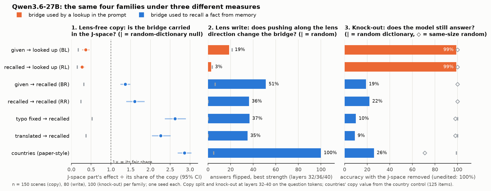
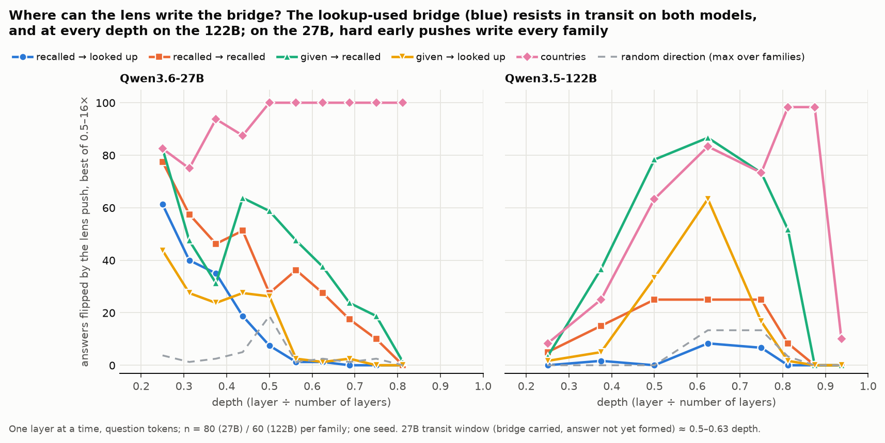
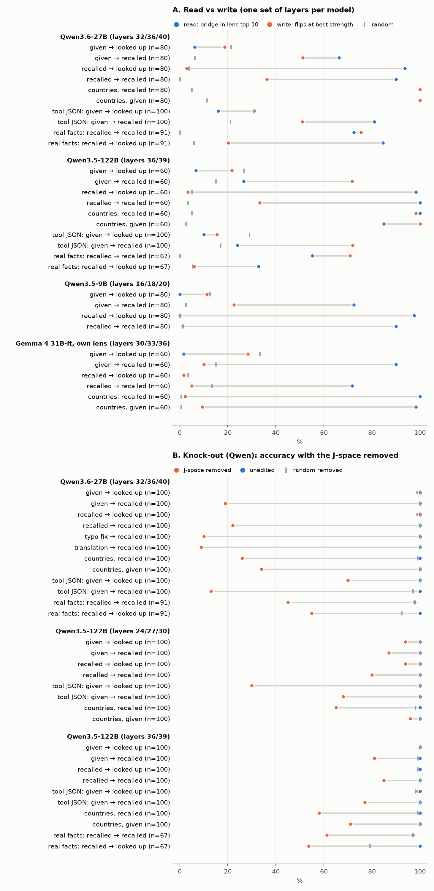
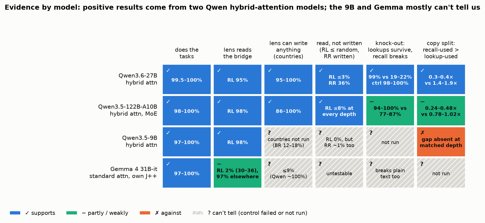

# Results matrix, 26 Oct ~04:30 (agent). All numbers UNVERIFIED

Every cell from docs/x0_numbers.json (in figures/story/data.csv). Lookup / recall = the two readers; extra loss and gap as in the README. 122B routes runs are after the data (gate 0.75), and so are its fresh scenes (x0_122b_b11; the run fixed in advance stopped at its gate). Muse Glimmer 30B (held out, another family; L26 fixed in advance): batch 38's rules as for the Qwens, every gate passed at 0.80 on the first try, except its routes at L34 (the sanity swap moved the lookup in no scene: not tested); its labels are my reading of the fixed rules, not yet scored against Q38.

| Hypothesis | 9B (L12) | 27B (L32) | 122B (L33) | Muse 30B (L26) |
|---|---|---|---|---|
| Recall needs J++ more than the lookup (main test; fixed in advance) | held: gap 0.53 [0.42, 0.61] | partial: gap 0.60 [0.50, 0.69]; lookup 0.14 [0.08, 0.20] over its 0.10 bar | held: gap 0.32 [0.20, 0.43] | held: gap 0.85 [0.68, 0.98] |
| Only the asked pick changes | gap 0.39 [0.30, 0.46] | gap 0.56 [0.45, 0.65] | held (fixed in advance): gap 0.28 [0.15, 0.39] | held: gap 0.67 [0.53, 0.80] |
| Varied scenes (rule fixed before the run) | held: gap 0.22 [0.14, 0.31] | held: gap 0.47 [0.42, 0.53] | in between: gap 0.15 [0.12, 0.18] (prose and tables, levels 0-1) | held: gap 0.50 [0.40, 0.61] (every format and level) |
| Natural passages (rule fixed before the run) | not tested at 0.80 (lookup 0.78); after the data at 0.75: gap 0.52 [0.36, 0.68] | in between: gap 0.27 [0.13, 0.41]; lookup 0.32 [0.20, 0.45] | held: gap 0.44 [0.32, 0.58] | held: gap 0.95 [0.64, 1.33] |
| A verbatim key needed (translated key) | did not hold: D −0.02 [−0.05, −0.00] | did not hold: D 0.01 [−0.01, 0.04] | did not hold: D −0.00 [−0.01, 0.00] | did not hold: D −0.06 [−0.08, −0.04] |
| J++ is only the layer's main directions (recall, J++ vs PCA at its share) | did not hold: 0.37 [0.29, 0.43] vs 0.13 [0.06, 0.19] | did not hold: 0.61 [0.51, 0.69] vs 0.16 [0.08, 0.23] | close: 0.26 [0.16, 0.36] vs 0.21 [0.13, 0.30] | did not hold: 0.66 [0.53, 0.78] vs 0.18 [0.08, 0.26] |
| J++ fitted to another scene costs the recall (Q33.1) | no: −0.01 [−0.02, 0.00] (2% of the change) | no: 0.02 [−0.01, 0.05] (1%) | no (after the data): −0.01 [−0.03, 0.00] (2%) | no: 0.04 [0.01, 0.09] (1%) |
| The bridge word holds a first-mention pointer outside J++ (probe) | held: 0.97; 0.90 | held: 0.99; partial 0.56 | held: 0.92; 0.96 | held: 0.97; partial 0.65 |
| The lookup needs the pointer directions (lookup / recall extra loss) | held, replicated: 0.47 [0.41, 0.53] / 0.15 [0.10, 0.21] | weak: 0.14 [0.07, 0.22] / 0.16 [0.02, 0.31] | held: 0.31 [0.20, 0.43] / 0.13 [0.02, 0.26] | held, replicated: 0.41 [0.34, 0.49] / 0.08 [0.00, 0.17] |
| Routes, another item moved: identity / position / value (fixed in advance) | 0.48 [0.43, 0.53] / 0.51 [0.46, 0.56] / 0.00 [0.00, 0.00] | 0.66 [0.60, 0.71] / 0.34 [0.28, 0.39] / 0.00 [0.00, 0.00] | after the data (gate 0.75): 0.61 [0.56, 0.67] / 0.38 [0.33, 0.44] / 0.00 [0.00, 0.00] | 0.44 [0.38, 0.49] / 0.54 [0.49, 0.60] / 0.00 [0.00, 0.00] |
| Routes: position needs the pointer directions (without them / random part) | 0.08 [0.05, 0.12] / 0.54 [0.49, 0.59] | 0.06 [0.03, 0.09] / 0.25 [0.19, 0.31] | 0.05 [0.02, 0.07] / 0.36 [0.31, 0.41] | 0.27 [0.23, 0.32] / 0.55 [0.50, 0.60] |
| Early layer: identity only; without J++ the original answer | L6 1.00 [1.00, 1.00]; 0.99 [0.97, 1.00] | L16 1.00 [1.00, 1.00]; 0.99 [0.98, 1.00] | L27 (after the data) 1.00 [1.00, 1.00]; 0.84 [0.78, 0.89] | L13 0.96 [0.93, 0.98]; 0.26 [0.20, 0.31] |
| Position appears where the lookup stops needing J++ (Q35.1) | held: L6 0.00 [0.00, 0.00], L8 0.03 [0.01, 0.05], L10 0.02 [0.01, 0.04], L12 0.51 [0.46, 0.56] | did not hold: L24 0.00 [0.00, 0.00] (lookup no longer needs J++), L28 0.34 [0.29, 0.40] | after the data: L24 0.00 [0.00, 0.00], L27 0.00 [0.00, 0.00], L30 0.00 [0.00, 0.00], L33 0.38 [0.33, 0.44], L36 0.58 [0.52, 0.63] | no sweep: L13 0.04 [0.02, 0.07], L26 0.54 [0.49, 0.60]; L34 not tested (sanity swap gate) |
| Removing J++ and the pointer together costs the lookup >= 0.15 more than the pointer (Q34.1) | no: 0.12 [0.04, 0.19] | yes: 0.26 [0.19, 0.32] | no (after the data): 0.09 [0.03, 0.16] | no: 0.03 [−0.03, 0.08] |
| ... and J++ beats a random part of its size there (Q36.1, switches lost) | no: −0.08 [−0.11, −0.04] | yes: 0.23 [0.18, 0.27] | no (after the data): 0.00 [−0.02, 0.03] | no: 0.01 [−0.02, 0.03] |
| The pointer part alone gives position answers (Q37.1) | yes: 0.26 [0.20, 0.32] vs 0.00 [0.00, 0.00] | no: 0.09 [0.06, 0.12] vs 0.00 [0.00, 0.01] | descriptive (after the data): 0.21 [0.16, 0.26] | yes: 0.29 [0.25, 0.34] vs 0.01 [0.00, 0.03] |
| The J++ part alone gives identity answers (Q37.2) | no: 0.00 [0.00, 0.00] | no: 0.00 [0.00, 0.00] | descriptive (after the data): 0.00 [0.00, 0.00] | no: 0.00 [0.00, 0.00] |
| Recall needs J++ more where the pick is the bridge's first mention (only the asked pick changes: yes / no) | 0.57 [0.47, 0.67] / 0.17 [0.11, 0.23]; fresh scenes 0.12 [0.06, 0.19] | 0.73 [0.58, 0.86] / 0.49 [0.39, 0.60]; fresh scenes 0.37 [0.28, 0.46] | 0.40 [0.25, 0.54] / 0.10 [0.03, 0.17]; fresh scenes after the data (gate 0.75) 0.06 [0.03, 0.09] | 0.76 [0.64, 0.87] / 0.54 [0.32, 0.75]; fresh scenes 0.31 [0.16, 0.45] |

Scored 25 Oct: Q32.7, Q32.8 right; Q33.1, Q34.1, Q35.1, Q36.1, Q37.1 wrong; Q37.2 right (predictions/2026-10-25_dan.md; calibration in predictions/README.md). Batch 38 (Muse): not scored yet.

# Monday 26 Oct (Dan's plan ~10:30, addendum ~10:35; agent). Decisions logged, not asked

- Step 1, batch 38 scored (ef8ea103): 11 of 12 right, Q38.9 wrong; calibration over 93 answers. Q38.11 reported as the two readers' extra loss (8dbc8a59), as Dan asked.
- Step 2, batch 39 written in Dan's wording (70a39416), answers pending; no value read. Fixed in the preamble before any value: the fraction of the shift lost is a ratio of means (as the switch-based loss); the gap is a point estimate; Q39.2's tercile counts if each reader has at least 30 switched items in it (X0's validity bar). Q39.1 counts Muse (the ~10:30 wording, "all four models"); Muse is also the report's fourth column (the addendum). The per-arm logit differences are saved on all four models (checked by field).
- Step 3, README (4ba988e2): Muse in Figs. 1, 2, 4, 5, 6 and table 3c; full model names as panel titles, no "after the data" in titles (Dan ~11:10); the body budget raised to 2,000 words and Appendix C removed (Dan ~11:30; the internal-codes test now covers the whole page). Per-model numbers moved into small tables in each section. The 122B's fresh-scene cells in table 3c and Appendix A from the rerun at gate 0.75 (after the data).
- Fig. 5's Muse panel had two points (the grid's layers 13 / 26 / 34; L34 no valid cell): muse_depth queued (Dan ~11:15 asked why), the main test at L8-L32 every 2 layers, after the data, descriptive; Fig. 5 reads it once it lands.
- x0_strata: the readers' confidence is asked for by name, FEATURES stays the scene's own features (adding it there broke x0_details' strata table); x0_details' sentence-order numbers take the newest strata run that has the sentence order.
- Batches 40 (D1) and 41 (D2) written in Dan's wording (495fbddf), before any run.
- Dan ~11:55 (answers to the open points) applied before any run (066db8ac): Q39.1 counts Muse; Q39.2 "can't tell" if fewer than two terciles count; batch 40 redefined (the rank-1 identity direction mu_alt - mu_org, identity outside J++, the arms; the identity subspace descriptive); batch 41's isolation arm and whole locker sentences, Q41.3; batch 42 (T) written; batch 43's P_cf share in J++.
- muse_depth landed (f94922cf, after the data, descriptive): Fig. 5's Muse panel is a depth curve.
- D1 (05400b9b): x6_routes --identity, job d1_identity running on the H100 (27B on GPU0; 9B then Muse on GPU1); results closed until batch 40's answers.
- T (d4d12f60): x0b_generalize --pointer and x5_natural --pointer (a fixed pointer dictionary in X0; OMP over its 4 orthonormal atoms equals the projection, checked); jobs t_pointer and t_pointer_122b queued on the H100 after D1 until Dan's second box is up (then moved there under new ids; one id, one box). The 9B's natural passages may miss the 0.80 gate again: not tested, no rerun unless Dan asks.
- Next: batch 39's analysis once answered; step 4 (fig7 scorecard, the Next section); P_cf (batch 43) after T; D2 (batch 41) last. Cut order if late (Dan): D2 first, then P_cf's natural-passage step.
- Boxes (Dan ~12:10): "mats" = sesterce-h100x2 (2x H100; QUEUE=mats, = h100), "helper" = sesterce-helper (1x H100 PCIe, CA; QUEUE=helper); each its own queue and ledger (results/jobq/ledger_<host>.jsonl); make queue-stats QUEUE=all lists both. Helper set up from mats box to box (agent forwarding): the 9B / 27B / Muse snapshots and their J++ lenses copied (mats keeps blobs in a shared store: copied dereferenced), checked against the pins (snapshot revisions; every LFS file's sha256 against its blob name: 9B 5/5, 27B 16/16, Muse 3/3; the lens files' sha256 = frozen_lens_sha256); uv, torch 2.11 cu128, flash-linear-attention ok; setup_pod's prefetch failed on the old working copy's jlens pin (not used by jobs, which run their own commit).
- Queues now: mats: d1_identity, then t_pointer_122b, then pcf_mats_122b (the 122B's P_cf routes at gate 0.75, after the data, as its earlier routes runs). Helper: t_helper_9b / 27b / muse (T, one model at a time), then pcf_helper_9b / 27b / muse (no dependency on T: a T job failing on a gate, e.g. the 9B's natural passages, must not block P_cf).
- Step 4 done (bd605eda): Fig. 7 scorecard (my reading of each claim per model, UNVERIFIED) at the top of Section 4; the README's Next section. P_cf code (4d1b3bf6): x7_pcf and x6_routes --alf-from; the natural-passage step not built yet (cut first if late).
- Dan ~12:55: Q39.2 void agreed. Q40.1 scored as written when Muse lands, with his note (the bar was out of reach at the union's share: its random part alone costs 0.62 / 0.33 of the switches, so the most the extra loss could be was 0.38 / 0.67; a design error in the question, not a finding) and, descriptive, the switches left without the union vs its random part (9B 0.07 vs 0.38; 27B 0.18 vs 0.67) at its share (56% / 34%). Standing rule from now on: every bar on an extra loss is checked against 1 - (the random part's loss) before it is fixed; batches 42 / 43's open bars pass (the pointer's share is about 14%, its random part costs about 0.00-0.01). Split-half noise ceiling added to x7_pcf (31f01bf2); the P_cf jobs requeued as _v2 before any started. Batch 44 (writing the pointer) written in Dan's wording (7a63e18a) before any run; its bars checked under the new rule (share differences; a random direction almost never lands on locker k, so the ceiling is about 1). Code: scripts/x8_write.py (A writes, halfway writes, B filler variants, the pointer geometry on CPU) and x0_massmean.pointer_means (6f8efcea). Queues (Dan's placement): helper x8_a_9b first, d1_identity_muse_r2, t_helper_27b, x8_a_27b, t_helper_muse, x8_a_muse, pcf_helper_9b_v2, pcfnat_helper_9b_v2, the halfway writes and B for the 9B / 27B / Muse last; mats after its running T: x8_a_122b, the P_cf jobs (122B, 27B, Muse), x8_half_122b, x8_b_122b last. Batch 44's results, the geometry included, closed until Dan's answers.
- ~13:05: batch 44 answered (0912becd); its results open as they land. T 9B on helper: x0b done (1010 eligible in 36 of 51 cells); x5_natural stopped at its gate (the 9B natural cell "not tested", as before). Muse routes at L34 (run 26 Oct ~02:00, verdict computed now, after the data): the swap at the bridge word moves nothing there (C0 original 1.00), so L34 is past the read, not a missing cell. Dan "fill the queue": the main test without the chat template on the 122B and Muse (x0_notemplate_122b / _muse, raw rendering as the 27B's and the 9B's; after the data, descriptive, not scored), last on mats; first cut if late.
- ~13:15, Dan: no new GPU jobs before the freeze (the two no-template jobs cancelled before they started; sampling readout, routes / T without the template and OLMo checkpoints go to the README's Next as follow-ups); CPU work, then the review dashboard (Phase 0 views file, Phase 1 MVP for Tuesday's hand check). Boxes: helper's 1-GPU jobs move to mats if it lags; ask Dan before stopping a box (helper first; mats until Thu 12:00).
- Pointer geometry (CPU, batch 44's pre-stated reading: PC1 >= 0.7 and monotone -> ordinal): PC1 share 0.72 / 0.76 / 0.73 / 0.73 (9B / 27B / 122B / Muse), PC1 monotone in slot on all four; midpoint deviation 0.45-0.51 (the middle class mean is far from the midpoint of the end ones). Read next to the halfway writes when they land.
- Batch 44 A, 9B (scored when all four land): at s = 1 the writes move almost nothing (target 0.02 [0.01, 0.03], random 0.00; Q44.1-3 no on the 9B); s = 2: 0.46, s = 4: 0.73 [0.70, 0.77], random at s = 4 0.00. ||mu_k - mu_j|| is 2.4-4.8 against a median 6.6 for the pointer part of the real C2 changes: s = 1 is under the real dose.
- T, 9B (scripts/t_pointer.py, batch 42; scored when all four land): varied scenes, the lookup's extra loss without the pointer directions 0.11 [0.08, 0.13] pooled (bar 0.20), json + table 0.06 [0.03, 0.09] (bar 0.15), prose 0.16 [0.13, 0.20]; recall 0.02. Natural: the 9B stopped at its gate (not tested).
- ~13:35 batch 40 scored (D1 on Muse landed, muse30b_x6_routes_d1_r2, 290 scenes: 10 without class means dropped): Q40.1 (d) none (lookup extra loss 0.31 / 0.49 / 0.29; Dan's note recorded: the bar was out of reach at the union's share), Q40.2 (c) one, the 27B, Q40.3 (b) two (27B, Muse); all three wrong; calibration over batches 25-40: 97 answers, mean Brier 0.33. README Section 3 (d) adds the identity direction (x0_details keys rtd_*); "Running now" no longer lists it.
- Review dashboard (Dan ~13:30): Phase 0 done, docs/review_views.yaml (65eb0701): six Phase-1 views (main swap, one change, routes, routes early, pointer on the main items, x8 writes), the rest listed as later; every source key checked against docs/x0_numbers.json. x8 stores no prompts: its scenes are the routes run's C2 cases (same generator, seed, gate); checked on the 9B: 300 of 300 scenes, entity and slot j match. The main test (x0) stores no top token, only role b / A / other.
- Phase 0.5 done: scripts/inventory.py -> docs/inventory.md (scripts 59 current / 194 legacy / 12 unknown; results 106 current / 10 superseded / 830 legacy / 19 unknown; rules in its docstring; the pivot day is 23 Oct as Dan's 19-23 Oct). Unknown, for Dan: tooling named in the Makefile (jobq.py, run.sh, data_report.py), x7_pcf.py (its runs not landed), and the post-pivot runs nothing cites (the nothink / nochat-digit runs, two older composition runs, the x0 figures runs, hw-gate parts, ...). docs/mapping.md: a first line "legacy: maps the 23 Oct README" (not regenerated: the views file and the inventory replace it). README Section 5 links the inventory. Nothing moved, renamed or deleted (until Friday).
- Dashboard Phase 1-3 done (89a03e90, c3916816, 9d683772, d9933695): make review-serve SEED=7 [PORT=8001] / review-export SEED=0 N=10 / review-summary; scripts/review.py pack writes docs/verify_pack.md from the views file (the 25 Oct pack kept as docs/verify_pack_25oct.md; scripts/verify_pack.py now writes there); docs/review/seed-0/ committed (N = 5, 10 views, 2.4 MB). Views in the dashboard: main swap, one change, routes, routes early, pointer on the main items, x8 writes, routes at more layers, both removed, its control, the identity direction. Automatic checks over every item: no disagreement with the stored data. Four first-draft checks were wrong and fixed after reading the tokens and the run code, not the data: word alignment when two sentences swap (now position by position), x8's recall "changed" (top != O's answer, x8_write.py:155, not the unwritten read), routes C1's recall (one answer token: n/a), C0 rows not joined from the keep-only run (n/a); and the routes item set now keeps only the view's conditions. Recount vs data.csv: 331 match, 0 mismatch, 60 with no data.csv number (the "other" route; Muse L34). Then (b88a9bf1) the k-curve (16 match) and batch 39 on the logit difference (12 equal to its ld.json to 1e-9). Dan's CPU items 2-3 are folded in: docs/verify_pack.md is generated from the views (Muse in every view, routes C2 keep-only and without the pointer on four models, the early layer on four, batch 39, D1); the raw examples are docs/review/seed-0/ (prompts and tokens verbatim, seed 0), not a separate docs/verify_examples.md. Not per-item: the main test (x0) stores no top token (role only); massmean lists no ineligible items; x8 stores no prompts (the routes C2 cases, matched per scene). Later views (listed, not yet in the dashboard): k-curve, varied scenes, natural passages, translated key, parts at J++'s share, matched scenes, sentence order, probe, replication, Muse depth, digits, logit difference, T, P_cf, no-template, x8 halfway / B, geometry (aggregate: no per-item file).
- ~14:20 (Dan): dashboard cards in plain words (fb23a504): under each item what the model answered before the change and under each change, and how the item counts in the extra loss; no org / cf / p_org / ld abbreviations (a "how to read a card" legend; the stored numbers under a details row).
- ~14:50 x8 follow-ups (19bc36f4; CPU, after the data, descriptive): x8_write.py recall stage. 9B: changed recalls by item, s = 4: 205 target / 38 third / 0 original / 13 other of 256; s = 2: 109 of 129 target; random s = 4: 5 of 18 (Dan's counts reproduced); writes whose target item has the original's legs: 93 of 600. s* (a write at the median real pointer-change norm, 6.56): 1.36-2.70 per pair, so the primary s = 1 was below it on every pair: a design error in batch 44 (README Section 4 line). Geometry with the pairwise distances (9B 4.10 / 4.82 / 2.43; 27B 13.57 / 16.79 / 8.39; 122B 0.93 / 1.05 / 0.52; Muse 41.38 / 50.84 / 24.87). Dashboard x8 cards show each slot's legs and the recall's item. As each x8 run lands: the recall stage, then the README line for that model.
- ~14:40 T on the 122B landed (1318ff42): varied scenes, lookup extra loss without the pointer directions 0.06 [0.04, 0.07] pooled (json + table 0.04, prose 0.07), natural 0.07 [-0.02, 0.16] (57 passages). With the 9B: 0.11 / 0.06 pooled, under the 0.20 bar (Q42.1 scored when the 27B and Muse land).
- ~15:00 (Dan): Fig. 8, writing the pointer (a356b218; the 9B, the others "not landed"; README Section 6); T's rows in the Section 2 table (00970422: varied scenes pooled and prose / json / table, natural; "not landed" cells); dashboard sentence order on the main-test / one-change / pointer cards and an order filter (97f165a1; agrees with x0_strata on every item). Figs 0-7 untouched. Pending: one full figure pass when both queues are empty or at 18:00 at the latest, then what changed in each figure.
- ~15:00 T on the 27B (1492af3f): varied 0.05 pooled (prose / json / table 0.09 / 0.01 / 0.03), natural 0.07 [0.00, 0.18]; with the 9B and 122B no model reaches Q42's bars so far (Muse pending). Batch 44 A on the 27B (9bda9b4f): s = 1 0.01, s = 2 0.24, s = 4 0.50, random 0.01; recall at s = 4: 55 of 68 changed give the target slot's item; same legs 95 of 600; s* 1.04-2.08. For Dan: on the 27B the slot pair 1 <-> 2 stays at 0.02 even at s = 4, above its s* (2.08), so Fig. 8's title ("once the push is as strong as a real change") does not hold for that pair; title kept until Dan decides.
- ~15:30 (Dan): batch 44 A on the 122B (8b78102c; gate 0.75 after the data): s = 1 0.01, s = 2 0.50, s = 4 0.66, random 0.00; recall s = 4 211 of 268 target; s* 1.37-2.76. Fig. 8 title in Dan's words ("reliably to and from the first slot, barely between the second and third") and caption; README Section 2 scope line (0.05 to 0.11 varied, 0.07 natural, P_cf pending); Sections 4-6 trimmed for the word budget. Slot-pair checks (after the data, descriptive; corrected ~16:00, Dan: the first table grouped the routes items by the two slots S swapped, not by the pointer's move, so its 'estimate's artefact' reading does not follow): (a) the 1 <-> 2 address is the least stable across entity halves (cos 0.74-0.83 vs 0.92-0.96) and least separated (1.20-1.34 vs 1.78-2.09 within-class SDs); (b) by the pointer's move (O bridge's slot -> S bridge's slot): 9B whole 1 -> 2 0.53, 2 -> 1 0.78; without the pointer 0.28, 0.14; only the pointer part 0.00, 0.00; moves into or out of slot 0: without the pointer 0.00-0.10, only the pointer part 0.10-0.76 (Dan's recount 0.18-0.76: 0 -> 2 is 0.10 on 39 items here); the 27B and 122B the same (only the pointer part 0.00 on both 1 <-> 2 moves); Muse alike but softer (only the pointer part 0.04 / 0.16; without the pointer 0.38 / 0.57, and 0.31 on 0 -> 1). Reading (Dan): the pointer directions carry first slot vs the rest; the model separates slots 1 and 2 too, mostly outside the 4 directions: neither branch of the reading fixed before, a third outcome. Q44.2: "can't tell" (not scored) if no model reaches 30 moved writes at s = 1 (11 / 5 / 3 so far).
- ~16:20 first-sentence check (85ae8531; CPU, after the data, descriptive): the pointer removal's lookup extra loss by where the bridges' locker sentences sit (first sentence / first locker, not first / neither): 9B 0.66 / 0.23 / 0.33 (n 41 / 22 / 9), 27B 0.24 / 0.05 / 0.00, 122B 0.52 / 0.21 / 0.00, Muse 0.51 / 0.14 / 0.00; first sentence minus the rest (paired cluster bootstrap) 0.40 [0.18, 0.60] / 0.21 [0.05, 0.35] / 0.38 [0.21, 0.56] / 0.41 [0.25, 0.59]; only the pointer part: first sentence minus the rest 0.46 / 0.16 / 0.07 [-0.16, 0.32] (not the 122B) / 0.23. README narrowing (Dan's text + the per-group / per-move table) ready but 49 words over the 2,000 cap: held for Dan. To do as they land: B's beta for j = 0 separately; P_cf's split on its natural-passage run.
- ~16:40 README v3 (416c637c; Dan's brief file not found in the repo or Drive: worked from his message): template restructured (In one minute, Setup glossary, 1-9, Appendix A links only); body 1,998 words; the full first-mention table moved to docs/x0_details.md; every old Appendix A number is in data.csv (62 of 113 no longer on the page). Figure code for Figs. 9 and 10, Fig. 6's identity row and Fig. 7's four new rows (statuses: agent's reading, for Dan), rendered only to the scratchpad; figures/story untouched until the full pass. P_cf on the 122B (d3d8f993) landed.
- Cleanup plan, NOT executed (after the presentation): (1) tag the pre-cleanup commit; (2) git mv the legacy scripts and results into archive/ (scripts imported by current ones stay until (4)); (3) group the current scripts by stage: scenes / arms / readout / verdict; (4) merge duplicated helpers (e.g. the legacy modules the README chain still imports: exp03_brew_swaps, exp04_brew_parts, suite_v1, pointer_v1, finding5_confirm via cross_model_grid). Each step checked by rerunning `make review-export SEED=0` and the tests, with identical outputs.
- make check: ruff format flags 6 files not touched today (one is predictions/2026-10-21_dan.md); tests/test_figs_lens.py (the old scripts/figs pipeline, 23 Oct) fails 2 of 9 on overlapping labels and a missing finding-7 point. Left as is; the other 917 tests pass.

# Overnight 25-26 Oct: the Muse grid, defaults taken, DeepSeek-V4-Flash note (agent)

Queue on the H100 box (check: `make queue-status QUEUE=h100`): x0_122b_b11 (the 122B replication rerun at gate 0.75, after the data; it replaced b10, which the queue blocked because it depended on b9, which ended FAILED), then muse_g1, g2, g3, g4b, g5, g6 (2-GPU jobs, one lane per GPU; muse_g6 one GPU). Every Muse step runs through scripts/muse_step.sh, so nothing waits for me.

Defaults taken (Dan: log, don't ask):
- Muse target copied from origin/zach/v8-breadth-1021, not merged: MUSE_TEMPLATE_EDITS (no date line, reasoning low, the answer channel opened), the final norm's gain "weight", the output multiplier in Model.unembed. Kept ours: the run prefix muse30b_ and the lens from the Hub (the same file: sha256 90fc5e52..., verified on the box). Weights downloaded to /ephemeral/hf and checked file by file against the Hub.
- Smoke: tokenizer-level on every grid script (all plan stages run on Muse); one GPU smoke of x6_routes (20 sanity-swap scenes, L26, no pointer arms) passed end to end. The other scripts were not GPU-smoked: the GPUs were busy with b9 until it ended.
- G1 fallback (Dan ~00:20): a run whose gate.json says the readers' gate missed at 0.80 is redone as *_g75 with BJ_GATE=0.75 (X0's gate is now an env override), after the data, descriptive, not scored; if it misses at 0.75 too it is "not tested". Per-cell gates (varied scenes, keys) are partial by design and not redone.
- G2: every Muse routes run has --c0-min 0.5 (Muse has no C0 reference run). G3 (J++ >= 10% of the change at L26) is read from the outputs afterwards.
- Varied scenes on Muse: as on the 9B / 27B (prose / json / table, levels 0-2, the k = 50 / 100 curve; Dan 26 Oct ~00:50). My first default copied the 122B's cut (prose and tables, levels 0-1, no curve), which was chosen there for the 122B's speed, not by a rule; muse_g4 was cancelled before it started and replaced by muse_g4b at the same place in the queue (about one GPU-hour more by estimate).
- The 122B's varied scenes the same way (Dan 26 Oct ~01:00: "122B теж?"): x0_122b_b12 (qwen35_122b_x0b_v2_all, every format, levels 0-2, the curve, L33), queued after muse_g6 so no Muse job waits. After the data, descriptive, not scored: it overlaps b6's cells, which were seen; the 122B verdict fixed in advance stays b6's. Reported pooled and split into b6's cells vs the new ones (json; level 2). b7's parts are not rerun on the new cells.
- muse_g3 ended FAILED, by its gate, not a code error: the routes at L34 stopped at G2 (the sanity swap moved the lookup in none of the scenes, bar half): "not tested", not lowered, not requeued (G2 as fixed). Its other steps finished (the routes at L13, the parts, the first-mention split). The first-mention table wrote into the one-change run's folder, which the queue's pull skips (new folders only): recomputed locally from the same outcomes, identical to the box log.
- The Muse grid landed in full by ~04:10 (muse_g1-g6): G1 passed at 0.80 on the first try in every run (no _g75 rerun), G2 everywhere but L34, G3 0.142 of the change at L26 (bar 0.10). Muse is the matrix's fourth column (above); its labels are my reading of the fixed rules, batch 38 not scored. Left for Dan: README / figure panels, table 3c, fig7, the batch-38 scoring. The probe's a-given-b stage (needed by x0_details) run locally.
- x0_122b_b12 ended (exit 0; after the data, descriptive, not scored): X0b's rule on the 122B over every format and level, pooled MIXED, C = 0.15 [0.13, 0.18] (b6, prose and tables at levels 0-1: 0.15 [0.12, 0.18]); split as its spec fixed: b6's cells 0.16 [0.14, 0.20], the new cells (json; level 2) 0.14 [0.10, 0.18], both mixed (results/x0b_generalize/qwen35_122b_x0b_v2_all/split-*/). The 122B row stays "in between" on every format.
- The matrix regeneration (scratchpad regen_matrix.py, first block only) dropped this section once at 2d62f3d9; restored from 1ddd4170 as its own top-level block, so a regeneration keeps it.
- The overnight shell chain I first wrote was never started (Dan asked for the jobq queue instead).
- The 122B replication fixed in advance stopped at its gate (recall 0.77 < 0.80): not tested; b11 is the descriptive rerun.

DeepSeek-V4-Flash feasibility (CPU only, no download):
- Weights: 284B total, 13B active (MoE); "FP4 + FP8 mixed" (experts FP4, the rest FP8); about 150-170 GB on disk by third-party counts.
- Our box (2x H100, 160 GB): does not fit, before activations. H100 has no native FP4; transformers would dequantize the experts to bf16 (about 570 GB). vLLM's recipes list H200 / B200 and larger.
- HF implementation: transformers model type deepseek_v4 (AutoModelForCausalLM). The residual is 4 parallel streams (mHC, hc_mult = 4), shape [B, S, 4, D] through each block, mixed by attn_hc / ffn_hc, collapsed to one stream by a final head before the model norm. Whether output_hidden_states returns the 4 streams or a collapse was not stated in the docs found.
- Lens: koayon/jpp-lenses has a J++ for it (deepseek-v4-flash/lens.pt, layers 0-41, its recall@10 on its card, hyper-connections detached in the fit); its card does not say which stream (or which collapse) it reads.
- Chat: no Jinja template; a Python encoder (encoding_dsv4: encode_messages); modes non-think / think high / think max.
- Verdict: not on this box. It needs about 4x H200-class memory or a box with native FP4, and an answer to which residual the lens reads.

# Results opened, 25 Oct ~12:45 (agent; after Dan's batch-31 / 32 commit). All numbers UNVERIFIED

Every number below is read from docs/x0_numbers.json or figures/status_2026-10-25/data.csv. Queue (~13:40): x6_routes_early_r2 and x0_jppother done (not opened yet; batch 33 closed until Dan's Q33.1 answer is committed); x0_122b_b7 running (F17's 122B panel); then x6_routes_bothoff (batch 34, closed until Dan answers), x6_routes_122b_g75, x5_natural_9b_g75.

## Decisions (Dan, 25 Oct ~13:15-13:20)

- ~13:15, in chat: "round to 2 decimals, the 122B passes the gate". Queued as x6_routes_122b_r2 (gate on the accuracy rounded to 2 decimals), then cancelled before it ran: Dan's terms ~13:20 replace it.
- ~13:20, both reruns yes, on these terms: (1) the verdicts fixed in advance stay "not tested" (gate missed: 122B recall 0.797, 9B lookup 0.78, bar 0.80), and the panels say so; (2) the reruns are a separate descriptive line, "after the data, gate lowered to 0.75", scored against no prediction, drawn hatched or in a separate panel; (3) order after b7: x6_routes_bothoff, the 122B routes (x6_routes_122b_g75), the 9B natural passages (x5_natural_9b_g75).
- x6_routes_bothoff (new, before the reruns): C0 and swap 2, 9B L12 and 27B L32, 300 per condition; arms without J++, without the pointer directions, without both together (the union of the two spans), without a random part of the union's share. Agent's choices, recorded in the spec: the random parts at J++'s and the pointer directions' own shares are kept too (each part's extra loss needs its own); the union is each item's 25 signed-OMP J++ atoms plus the pointer directions, the change projected onto their span by least squares; Q34.1 is scored on the point estimate of (union's extra loss - pointer directions' extra loss), the paired CI reported. Batch 34 (Q34.1) committed without an answer (bf898993); Dan's uncommitted Q33.1 answer was left out of that commit.
- README finding 7 and F20: in swap 1, "identity" renamed "unchanged (same item)" (identity and nothing changed give the same answer there).
- Plan to the claims freeze (Dan, ~13:40), GPU order x0_jppother, bothoff, 122B routes, b7, 9B natural passages. Default taken: x0_122b_b7 had already started (x0_jppother finished ~13:35) and is left running, not killed; the rest follow in Dan's order.
- Predictions moved (Dan ~13:55): batches 31-34 to predictions/2026-10-25_dan.md, unchanged; Dan's Q33.1 and Q34.1 answers committed with the move (01e3828d). Then x0_jppother and x6_routes_early_r2 opened and scored: Q32.7 right, Q32.8 right, Q33.1 wrong.
- "Runs for all, the 122B too" (Dan ~14:15; overrides the plan's "no 122B runs beyond the above"): x0_122b_b8, appended after x5_natural_9b_g75: J++ from another scene at L33; the routes at an early layer; J++ and the pointer directions together. Defaults taken: the 122B's early layer is L27, its peak of the lookup's J++ extra loss among the layers measured (24-36; 0.56 at L27), chosen after the data; the two routes runs use the gate lowered to 0.75 (same scenes as the 122B routes run, whose recall read 0.797 right), hatched and descriptive like Dan's rerun; one job, three scripts, each runs whatever the others do.
- README v2 (Dan ~15:00), defaults taken: (0) the gate's rounding was already gone from the code (f1a3eb9f replaced it with --gate); the cancelled x6_routes_122b_r2 spec now says so; the 122B routes run is the rerun at 0.75, after the data, descriptive. (1) The figure script is scripts/readme_story_figures.py, not scripts/story_figures.py: that name holds the 20 Oct partner-update figures (overwritten by mistake, restored from git before any commit). (2) Fig. 2's title is "No other part costs the recall as much as the scene's own J++", not "Only the scene's own J++ part costs the recall": on the 122B the main directions at J++'s share cost the recall 0.21 [0.13, 0.30] against J++'s 0.26 [0.16, 0.36], so the plan's title does not hold on that panel. (3) Fig. 4 has five arms (a random part at J++'s and at the pointer's size), so each removal has its own control. (4) Fig. 5 shades the layers where the lookup's J++ extra loss is at least 0.30 (Q35.1's bar). (5) Appendix A lists the key numbers, not all of data.csv (figures/story/data.csv has every number, with its source). (6) Tests: the 150-line budget became a 1,500-word body budget (numbers and headings count as words); banned terms extended (C0-C2, swap 1/2, one-pick / two-pick, edit); the number check reads figures/story/data.csv (figures/status_2026-10-25 is frozen; x0_status_pack.py is no longer run); 0.75 joins the rule bars. (7) The optional routes run at more layers (batch 35) is not queued: the GPU was not idle after bothoff (the 122B routes, the 9B natural passages and b8 were waiting).
- Q34.1 scored (~15:30): (b) the 27B only; Dan's top option (neither, 80%) wrong.
- README v2 review (Dan ~14:30), defaults taken. Queue: x6_routes_122b_g75 finished at 14:42 and x5_natural_9b_g75 started before the new order was in (Dan wanted it last); it is short and left running; x0_122b_b8 moved after x6_routes_bothoff_ctrl and x6_routes_sweep (its pending file renamed on the box). bothoff_ctrl's random part: per scene the leading columns of the layer's random basis that keep J++'s share of the change (as every other random part), joined with the pointer directions and orthonormalized (SVD); "switches lost" = the share of the whole change's switches lost (Jdep), no random control subtracted, as Q36.1 asks. The sweep keeps the random part at J++'s share beside whole and without J++. Table 3c: GitHub's Markdown has no grey, so few-switch lookup cells are in italics with their count. Word budget: Dan's added lines took the body over 1,500 words when table cells count; the test now counts prose only (tables are data): 1,402 prose words. Fig. 5: one band from the first layer measured to the last where the lookup's J++ extra loss is at least 0.30 (on the 27B that spans layers 20 and 24, which are below 0.30); its title is Dan's wording, 77 characters (over the style's 70; the limit is raised for this figure). Appendix A's 122B routes cell is filled with the rerun (after the data).
- x6_routes_122b_g75 opened (after the data, descriptive, not scored): another item moved, identity 0.61 [0.56, 0.67], position 0.38 [0.33, 0.44], value 0.00; without the pointer directions position 0.05 [0.02, 0.07] (random part of their size 0.36 [0.31, 0.41]).
- Queue (Dan ~16:20): x6_routes_sweep, then x6_routes_keeponly once batch 37 is committed, then x0_122b_b8; if batch 37 is not committed when the sweep ends, b8 first and keeponly right after the commit. Done by holding keeponly's queue file out of pending/ (~/jobq/held/ on the box) and a local watcher that, once HEAD's predictions file has Dan's Q37.1 and Q37.2 answers, moves it back ahead of b8 (if b8 has not started) or after it.
- Figures: F21 (routes at the early layers), F22 (J++ from another scene), F23 (J++ and the pointer directions together; empty until bothoff runs) added; F18 and F20 carry the reruns as hatched panels; README finding 3 and 7 use F22 and F21; the top Answer and Limits name the weaker spots (122B varied scenes, 27B natural passages, the 122B's main directions).

## (i) The grid

| Hypothesis | 9B (L12) | 27B (L32) | 122B (L33) |
|---|---|---|---|
| The split (main test; strict rule and graded gap) | held: strict confirmed; gap 0.53 [0.42, 0.61] | partial: strict not confirmed (lookup 0.14 [0.08, 0.20]); gap 0.60 [0.50, 0.69] | held: strict confirmed; gap 0.32 [0.20, 0.43] |
| Not a post hoc artefact (fresh scenes fixed in advance; the held-out 122B) | partial: the replication does not hold (pointer clause met, J++ clause not met) | partial (descriptive): J++ clause met, pointer clause not met | held: one-pick cell gap 0.28 [0.15, 0.39], lookup −0.01 [−0.06, 0.04] |
| The input-token identity (W_E does what J++ does) | did not hold: W_E recall 0.01 [0.00, 0.02] | did not hold: W_E recall 0.00 [−0.03, 0.03] | did not hold: W_E recall 0.01 [−0.02, 0.03] |
| J++ vs the other dictionaries (only J++ separates the readers) | held | held | held |
| Natural passages (gap >= 0.30, lower CI >= 0.15) | not tested: the lookup's gate 0.78 (bar 0.80) | partial (mixed): gap 0.27 [0.13, 0.41]; lookup 0.32 [0.20, 0.45] | held: gap 0.44 [0.32, 0.58] |
| A verbatim key needed (translated key, D >= 0.20) | did not hold: D −0.02 [−0.05, −0.00] | did not hold: D 0.01 [−0.01, 0.04] | did not hold: D −0.00 [−0.01, 0.00] |
| The symbol control (D >= 0.20) | did not hold: −0.05 [−0.08, −0.02] | partial: 0.15 [0.10, 0.19], 6 of 6 positive | did not hold: 0.02 [−0.01, 0.07] |
| The digit route | did not hold: digit directions 0.00 | did not hold: 0.00 | did not hold: 0.00 |
| The two-pick swap as the cause of the 27B miss | not applicable (one-pick lookup −0.02 [−0.05, 0.02]) | partial: one-pick 0.05 [0.01, 0.09] vs two-pick 0.14 [0.08, 0.20]; paired −0.08 [−0.16, 0.00] | not applicable (one-pick lookup −0.01 [−0.06, 0.04]) |
| Sentence order (lookups move mostly when the locker comes first) | held: 86% vs 19% | held: 76% vs 9% | held: 89% vs 11% |
| Varied scenes (X0b's pooled rule) | held: gap 0.22 [0.14, 0.31] | held: gap 0.47 [0.42, 0.53] | partial (mixed): gap 0.15 [0.12, 0.18]; lookup −0.02 [−0.03, −0.00] |
| At 100 atoms (the lookup still does not need J++) | held: −0.08 | did not hold: 0.60 | held: −0.12; one-pick −0.09 |
| The J++ part is the word | did not hold: word 0.02 vs J++ 0.36 | did not hold: 0.16 vs 0.63 | did not hold: 0.14 [0.08, 0.20] vs 0.26 [0.16, 0.36] |
| J++ is only the layer's main directions (PCA at J++'s share) | did not hold: 0.13 [0.06, 0.19] vs 0.37 [0.29, 0.43] | did not hold: 0.16 [0.08, 0.23] vs 0.61 [0.51, 0.69] | held: 0.21 [0.13, 0.30] vs 0.26 [0.16, 0.36] |
| The recall reads the bridge redundantly (word or rest) | held: word 0.02 + rest 0.12 [0.06, 0.18] < J++ | held: 0.16 + 0.20 [0.10, 0.29] < J++ | held: 0.14 [0.08, 0.20] + 0.04 [0.00, 0.08] < J++ |
| The address at the word, outside J++ | held: probe 0.97; J++ holds 0.5% | held: 0.99; 0.5% | held: 0.92 (layout 0.53); 0.5% |
| The address is a first-mention pointer | held: 0.90 | partial: 0.56 | held: 0.96 |
| The pointer is lexical | did not hold: transfer 0.84 [0.79, 0.90] | did not hold: 0.94 [0.90, 0.97] | did not hold: 0.85 [0.80, 0.91] |
| The lookup needs the probe's pointer | did not hold: 0.05 [0.00, 0.10] | did not hold: 0.00 [0.00, 0.00] | did not hold: 0.00 [0.00, 0.00] |
| The lookup uses the pointer directions, lookup-specifically | held, replicated: lookup 0.47 [0.41, 0.53], recall 0.15 [0.10, 0.21] | did not hold: lookup 0.14 [0.07, 0.22], recall 0.16 [0.02, 0.31] | held: lookup 0.31 [0.20, 0.43], recall 0.13 [0.02, 0.26] |
| The lookup uses the value | did not hold: V 0.00 [0.00, 0.00]; new digit 0.00 [0.00, 0.00] | did not hold: V −0.01 [−0.05, 0.00]; new digit 0.00 [0.00, 0.00] | did not hold: V removal costs nothing |
| The lookup follows identity or position (routes) | held: swap 2 position 0.51 [0.46, 0.56], identity 0.48 [0.43, 0.53] | held: identity 0.66 [0.60, 0.71], position 0.34 [0.28, 0.39] | not tested: on the original prompts the recall read 0.797 right, under the 0.80 gate fixed in advance |

## (ii) Tonight's tests

| Test | Rule (fixed in advance) | Branch | Numbers [95% CI] | n |
|---|---|---|---|---|
| a. Replication of the 9B's double dissociation | both clauses | does not hold (pointer clause met, J++ clause not met) | pointer lookup 0.47 [0.41, 0.53], recall 0.15 [0.10, 0.21]; J++ recall 0.12 [0.06, 0.19] | 200 |
| b1. 122B one-pick main cell | lookup <= 0.10, gap >= 0.20 | holds | lookup −0.01 [−0.06, 0.04], gap 0.28 [0.15, 0.39] | 200 |
| b2. 122B parts | PCA: Q30.1's branches; word-orthogonal J++ >= 0.20 / <= 0.10 | PCA: recall-specific like J++; word-orthogonal: redundant | PCA 0.21 [0.13, 0.30]; J++ 0.26 [0.16, 0.36]; word-orthogonal 0.04 [0.00, 0.08] | 200 |
| b3. 122B probes | address >= 0.90 and >= 0.20 above layout | holds | 0.92 vs 0.53 | 758 |
| b4. 122B pointer directions | lookup-specific / both / neither | lookup-specific | lookup 0.31 [0.20, 0.43], recall 0.13 [0.02, 0.26] | 54 |
| b5. 122B translated / symbol keys | D_translated <= 0.10; D_symbol >= 0.20 | no verbatim match needed; the control fails | D_translated −0.00 [−0.01, 0.00]; D_symbol 0.02 [−0.01, 0.07] | about 400 per form |
| b6. 122B varied scenes | X0b's pooled rule | mixed | lookup −0.02 [−0.03, −0.00], gap 0.15 [0.12, 0.18] | 852 |
| c. Natural passages, 27B / 9B | gap >= 0.30 (lower >= 0.15) holds; <= 0.10 fails | 27B mixed; 9B not tested (gate) | 27B gap 0.27 [0.13, 0.41] | 137 |
| Natural passages, 122B | as c | holds | gap 0.44 [0.32, 0.58] | 114 |
| Routes, 9B and 27B | a route is used if share >= 0.20 (lower >= 0.10) | identity and position used; value never | 9B swap 2 position 0.51 [0.46, 0.56]; 27B identity 0.66 [0.60, 0.71] | 300 per swap |
| Routes, 122B (Q32.9 void) | each reader reads >= 0.80 of the original prompts right; then C0 within 0.10 of the reference | stopped at the readers' gate, before C0 was read | sanity-swap scenes, original prompts read right: lookup 1.000, recall 0.797; both readers right on both prompts: 479 of 700 | 700 generated |

## (iii) Failed, odd, or didn't fit

- x6_routes and x6_routes_early failed before any run (a bash syntax error from the folded YAML command); rerun as _r2 (Dan's go). x6_routes_122b stopped at the readers' gate on the sanity-swap scenes (the recall read 0.797 of the original prompts right, bar 0.80; Q32.9 void); the script now stops cleanly there. Not a technical failure, so not rerun.
- F17's 122B panel (the word only / J++ with the word banned / J++ on the varied scenes) was never queued: b1-b6 left it out. Queued now as x0_122b_b7 (descriptive, after the data, as on the 9B and 27B), after x0_jppother.
- Swap 1 (the same item, its locker sentence moved): a random part at the pointer directions' share also removes the position route (9B 0.03 [0.01, 0.05], 27B 0.03 [0.01, 0.05]), so that swap's pointer effect is not specific.
- On the same locker-first scenes J++ barely costs the recall on the 9B (0.06 [0.00, 0.12]) and the 122B (0.10 [0.02, 0.18]); the readers' split holds across scene sets, not within them.
- Natural passages on the 27B: the lookup needs J++ too (0.32 [0.20, 0.45]).
- The ~04:15 sync was missed (the session was idle); synced at ~11:10.

## (iv) B1. Scene composition: J++ extra loss by swap and sentence order (descriptive, after the data)

From the per-item outcome files at the layer fixed in advance (9B L12, 27B L32; 25 J++ directions against a random part of the same share; cluster bootstrap over bridge entities, 10,000 resamples, seed 0). Script: scripts/x0_composition.py; output: results/x0_composition/x0_composition_20261025/composition.md. The pointer directions' scenes are exactly the one-pick run's both-before scenes (checked: 73 of 73 on the 9B, 70 of 70 on the 27B).

| swap | sentence order | 9B n | 9B lookup | 9B recall | 27B n | 27B lookup | 27B recall |
|---|---|---|---|---|---|---|---|
| two people swap | all | 200 | −0.03 [−0.08, 0.03] | 0.50 [0.41, 0.57] | 200 | 0.14 [0.08, 0.20] | 0.74 [0.66, 0.80] |
| two people swap | both locker sentences before the pick | 75 | −0.04 [−0.10, 0.02] | 0.23 [0.14, 0.31] | 69 | 0.14 [0.06, 0.21] | 0.73 [0.61, 0.83] |
| two people swap | only the original's before | 25 | 0.29 [0.07, 0.57] | 0.72 [0.57, 0.88] | 32 | 0.18 [0.00, 0.45] | 0.54 [0.32, 0.79] |
| two people swap | the original's after | 100 | −0.21 [−0.43, −0.05] | 0.65 [0.57, 0.73] | 99 | 0.11 [0.00, 0.40] | 0.81 [0.71, 0.91] |
| only the asked pick | all | 200 | −0.02 [−0.05, 0.02] | 0.37 [0.29, 0.43] | 200 | 0.05 [0.01, 0.09] | 0.61 [0.51, 0.69] |
| only the asked pick | both locker sentences before the pick | 73 | 0.00 [0.00, 0.00] | 0.06 [0.00, 0.12] | 70 | 0.00 [0.00, 0.00] | 0.46 [0.34, 0.57] |
| only the asked pick | only the original's before | 27 | 0.00 [0.00, 0.00] | 0.50 [0.33, 0.69] | 33 | 0.08 [0.00, 0.27] | 0.56 [0.32, 0.80] |
| only the asked pick | the original's after | 100 | −0.11 [−0.29, 0.10] | 0.57 [0.47, 0.67] | 97 | 0.33 [0.10, 0.60] | 0.73 [0.58, 0.86] |
| only the asked pick, replication (fresh scenes) | all | 200 | −0.01 [−0.02, 0.00] | 0.12 [0.06, 0.19] | 200 | 0.01 [0.00, 0.02] | 0.37 [0.28, 0.46] |
| only the asked pick, replication (fresh scenes) | both locker sentences before the pick | 200 | −0.01 [−0.02, 0.00] | 0.12 [0.06, 0.19] | 200 | 0.01 [0.00, 0.02] | 0.37 [0.28, 0.46] |

Reading (agent, after the data): the 9B recall's J++ loss sits in the scenes where a locker sentence comes after the pick (only the original's before: 0.50 [0.33, 0.69]; the original's after: 0.57 [0.47, 0.67], one-pick); with both locker sentences first it is 0.06 [0.00, 0.12] (one-pick) and 0.12 [0.06, 0.19] (fresh scenes). The one-pick set's 0.37 [0.29, 0.43] on all 200 scenes is that mixture (73 both-before scenes). The two-person swap keeps more of it in both-before scenes (0.23 [0.14, 0.31]). The 27B's recall needs J++ in every cell (both-before, one-pick: 0.46 [0.34, 0.57]). One untested guess: in both-before scenes the pick is the item's second mention, and the recall can read it from what the first mention left; in locker-after scenes the pick is its first mention.

## (v) B2. The 27B's natural passages by where the answer's fact sentence sits (descriptive, after the data)

The fact sentence names the bridge and its passage value (the lookup's answer); the bridge's mention is the binding sentence the swap changes. Script: scripts/x5_natural_split.py; output: results/x5_natural/x5_natural_27b/split-*/split.md. 10 random passages (seed 0) with each reader's answer per arm: docs/natural_examples.md.

| group | n | lookup switches (whole change) | lookup extra loss | recall switches | recall extra loss |
|---|---|---|---|---|---|
| all | 137 | 60 | 0.32 [0.20, 0.45] | 126 | 0.59 [0.50, 0.67] |
| the original's fact sentence before the bridge's mention | 75 | 55 | 0.31 [0.18, 0.46] | 70 | 0.53 [0.41, 0.65] |
| the original's fact sentence after the bridge's mention | 62 | 5 | 0.40 [0.00, 1.50] | 56 | 0.66 [0.54, 0.77] |
| both fact sentences before | 46 | 36 | 0.28 [0.12, 0.45] | 43 | 0.44 [0.30, 0.59] |
| only the original's before | 29 | 19 | 0.37 [0.15, 0.64] | 27 | 0.67 [0.46, 0.84] |

Reading (agent, after the data): as in the locker scenes, the lookup switches almost only when the fact sentence comes first (55 of 75 scenes, against 5 of 62), so its extra loss after the mention rests on 5 switches. Where it does switch, it needs J++ (0.31 [0.18, 0.46]); with both fact sentences first, 0.28 [0.12, 0.45] against the recall's 0.44 [0.30, 0.59]. So the 27B's mixed result on natural passages is not a sentence-order artefact.

# Queue overnight, 25 Oct (monitor only; agent). No numbers from batches 31 / 32

Updated 11:15. Results of batches 31 and 32 are pulled and committed unopened; they open after Dan commits his answers (Dan, ~11:10).

**Queue** (in order): x6_routes_r2 → x6_routes_early_r2 (reruns of the two jobs whose command failed; see below).

**Finished tonight:** x0_replicate, x0_122b_b1, x0_122b_b2, x0_122b_b3, x0_122b_b4, x0_122b_b1_atoms, x0_122b_b5, x0_122b_b6 (started before 07:30), x5_natural_122b (all exit 0); x5_natural (the 27B process exit 0; the 9B process stopped at the gate fixed in advance, so the job shows "failed").

**Failed jobs, last 24 h** (left as they are):

| Job | Exit | Replaced by a later run? |
|---|---|---|
| x0_necessity_9b | 1 | yes: qwen35_9b_x0_necessity (done) |
| x0_necessity_27b_raw | 1 | yes: x0_necessity_27b_notemplate and x0_necessity_27b_nothink (done) |
| x0_digit_27b | 2 | yes: x0_digit_27b_r2 (done) |
| qwen35_9b_x0_digit | 2 | yes: qwen35_9b_x0_digit_r2 (done) |
| x0_nochat_digit_27b | 143 (killed) | no (the 9B's qwen35_9b_x0_nochat_digit is done) |
| qwen35_122b_x0_necessity | 1 | yes: qwen35_122b_x0_necessity_r2 (done) |
| x5_natural | 1 | no: the 9B stopped at the gate fixed in advance (not a technical failure); the 27B finished |
| x6_routes | 2 | yes: x6_routes_r2 (queued). A bash syntax error before any run started: the folded YAML command kept the indented '&&' lines as new lines |
| x6_routes_early | 2 | yes: x6_routes_early_r2 (queued); the same syntax error |
| x6_routes_122b | 1 | no: its C0 check stopped at the gate fixed in advance (the 122B is not tested on routes); the script then crashed on an empty list instead of stopping cleanly (fixed: it now stops with a message) |

**Decisions taken overnight**
- The ~04:15 sync did not happen (the session was idle); synced at ~11:10 instead.
- Reruns (Dan, ~11:10): only the technical failures (x6_routes, x6_routes_early). Not rerun: the gate stops (x5_natural's 9B, x6_routes_122b) and x0_nochat_digit_27b (cancelled on 24 Oct).
- x6_routes' C0 reference = the one-pick, locker-first lookup switch rate; the extra arm with a random part of the pointer directions' share kept (both accepted by Dan, ~02:15).
- x6_routes queued before b6, so b6 runs last and is the one dropped if the night runs out (Dan ~00:20: drop b6 first).
- x6_routes_early (9B L6, 27B L16) runs without the pointer-direction arms: the pointer directions exist only at the layers fixed in advance, and fitting them at L6 / L16 needs a new probe-state run, which is more than a parameter (Dan ~02:20: skip what needs more than a parameter). The early layer's questions (Q32.7, Q32.8) do not need those arms. x6_routes got three parameters for this (--layer, --c0-min, --no-pointer); the defaults leave the main run unchanged.
- The 07:30 cutoff is applied to b6 only (Dan ~02:20: leave b6's rule as is); x6_routes_early and x6_routes_122b start whenever the queue reaches them.
- b3's first-mention cross-tab for the 122B was recomputed locally (the box's copy loses CPU output written into an earlier job's run folder); its output not opened.

# Night of 25 Oct (Dan's ~00:20 / ~00:55 plan; agent). All numbers UNVERIFIED

Tonight's results stay closed until Dan's batch-31 commit (Dan ~00:20); their cells say "closed" and are filled from the verdict files right after it. Extra loss = flips lost without the part minus flips lost without a random part of its own share; gap = recall's extra loss minus lookup's; 95% CIs from a cluster bootstrap over bridge entities (10,000 resamples, seed 0). "Two-pick" = the main test's edit (two people swap picks); "one-pick" = only the asked pick changes.

## (i) The grid

| Hypothesis | 9B (L12) | 27B (L32) | 122B (L33) |
|---|---|---|---|
| The split (main test; strict rule and graded gap) | held: strict confirmed; gap 0.53 [0.42, 0.61] | partial: strict missed (lookup 0.14 [0.08, 0.20] > 0.10); gap 0.60 [0.50, 0.69] | held: strict confirmed; gap 0.32 [0.20, 0.43] |
| Not a post hoc artefact (fresh scenes, fixed in advance; the held-out 122B's one-pick cell) | closed (x0_replicate, decisive) | closed (x0_replicate, descriptive) | closed (b1) |
| The input-token identity (W_E directions do what J++ does) | did not hold: W_E recall 0.01 [0.00, 0.02] vs J++ 0.50 [0.41, 0.57]; W_E lookup 0.06 [0.01, 0.11] | did not hold: W_E recall 0.00 [−0.03, 0.03] vs J++ 0.77 [0.69, 0.83] | did not hold: W_E recall 0.01 [−0.02, 0.03] vs J++ 0.32 [0.22, 0.41]; one-pick: closed (b1) |
| J++ vs the other dictionaries (only J++ separates the readers; 25 atoms, two-pick) | held: W_U / W_E / random recall 0.00 / 0.01 / 0.00 | held: 0.01 / 0.00 / 0.01 | held: −0.01 / 0.01 / 0.00; one-pick: closed (b1) |
| Natural passages (gap ≥ 0.30, lower CI ≥ 0.15) | closed (x5_natural) | closed (x5_natural) | queued (x5_natural_122b) |
| A verbatim key needed (translated key, D ≥ 0.20) | did not hold: D −0.02 [−0.05, −0.00], 2 of 8 entities > 0 | did not hold: D 0.01 [−0.01, 0.04], 3 of 8 | queued (b5) |
| The symbol control (D ≥ 0.20) | did not hold: −0.05 [−0.08, −0.02], 0 of 6 | partial: 0.15 [0.10, 0.19], 6 of 6 positive, below the bar | queued (b5) |
| The digit route (the lookup reads the locker digit) | did not hold: 10 digit directions 0.00 | did not hold: 0.00; all tokens 0.13 vs letters 0.14 | did not hold: 0.00 |
| The two-pick edit as the cause of the 27B miss | not applicable (no miss; one-pick lookup −0.02 [−0.05, 0.02]) | partial: one-pick lookup 0.05 [0.01, 0.09] vs two-pick 0.14 [0.08, 0.20]; paired −0.08 [−0.16, 0.00] | not applicable (no miss); one-pick: closed (b1) |
| Sentence order (lookups move only when the locker comes first) | held: 86% vs 19% | held: 76% vs 9% | held: 89% vs 11% |
| Varied scenes (X0b's pooled rule) | held: gap 0.22 [0.14, 0.31]; lookup 0.01 [−0.01, 0.03] | held: gap 0.47 [0.42, 0.53]; lookup 0.08 [0.06, 0.10] | queued (b6) |
| At 100 atoms (the lookup still does not need J++) | held: −0.08 | did not hold: 0.60 (recall 0.67) | held: −0.12 (two-pick); one-pick: closed (b1) |
| The J++ part is the word | did not hold: word alone 0.02 vs J++ 0.36 | did not hold: 0.16 vs 0.63 | closed (b2; atoms table b1_atoms) |
| J++ is only the layer's main directions (PCA at J++'s share) | did not hold: 0.13 [0.06, 0.19] vs J++ 0.37 [0.29, 0.43] | did not hold: 0.16 [0.08, 0.23] vs 0.61 [0.51, 0.69] | closed (b2) |
| The recall reads the bridge redundantly (word or rest) | held (descriptive): word 0.02 + word-orthogonal J++ 0.12 [0.06, 0.18] < J++ 0.37; keep-only arms closed (x0_replicate) | held (descriptive): 0.16 + 0.20 [0.10, 0.29] < 0.61; keep-only arms closed | closed (b2) |
| The address at the word, outside J++ | held: probe 0.97 vs layout 0.53; J++ part holds 0.5% of the probe-direction component | held: 0.99 vs 0.53; 0.5% | closed (b3) |
| The address is a first-mention pointer | held: 0.90 [0.80, 1.00] of other-pick-first pairs point at the other pick (nearest class mean: 0.80 in A, 0.83 in Alf) | partial: 0.56 [0.38, 0.74] (nearest class mean: 0.88, 0.88) | closed (b3, b4) |
| The pointer is lexical | did not hold: translated 0.93 [0.90, 0.96]; transfer from verbatim 0.84 [0.79, 0.90] | did not hold: 0.99 [0.99, 1.00]; 0.94 [0.90, 0.97] | queued (b5) |
| The lookup needs the probe's pointer (removing its directions) | did not hold: 0.05 [0.00, 0.10] | did not hold: 0.00 [0.00, 0.00] | closed (b3) |
| The lookup uses the Alf directions, lookup-specifically | held (after the data): lookup 0.49 [0.38, 0.59], recall 0.12 [0.05, 0.21]; replication closed | did not hold: lookup 0.14 [0.07, 0.22], recall 0.16 [0.02, 0.31] | closed (b4) |
| The lookup uses the value (V) | did not hold: 0.00 [0.00, 0.00] | did not hold: −0.01 [−0.05, 0.00] | closed (b4) |

## (ii) Tonight's tests

| Test (job) | Rule (fixed in advance) | Branch | Numbers [95% CI] | n |
|---|---|---|---|---|
| a. 9B replication of the double dissociation (x0_replicate; 27B descriptive) | J++: recall ≥ 0.20 (lower CI > 0), lookup ≤ 0.10; Alf: lookup ≥ 0.20 (lower CI > 0), recall ≤ 0.10 or ≤ half the lookup's | closed | closed | closed |
| b1. 122B one-pick main cell (x0_122b_b1) | lookup ≤ 0.10 (upper ≤ 0.20) and gap ≥ 0.20 (lower ≥ 0.10) holds; lookup ≥ 0.20 or gap upper < 0.10 fails | closed | closed | closed |
| b2. 122B parts (x0_122b_b2) | PCA: Q30.1's branches; word-orthogonal J++: ≥ 0.20 / ≤ 0.10 | closed | closed | closed |
| b3. 122B probes, probe-direction removal, pair test (x0_122b_b3) | address probe ≥ 0.90 and ≥ 0.20 above layout | closed | closed | closed |
| b4. 122B A / V / Alf (x0_122b_b4) | Alf: lookup-specific / both / neither / other; V: lookup lower CI > 0 | closed | closed | closed |
| b1'. 122B atoms table (x0_122b_b1_atoms) | descriptive | closed | closed | closed |
| c. Natural passages, 27B and 9B (x5_natural) | gap ≥ 0.30 (lower ≥ 0.15) holds; ≤ 0.10 fails | 27B: ran, closed. 9B: stopped at the gate fixed in advance (the lookup's unedited accuracy under the bar), so not tested; not a technical failure, not rerun (the job shows "failed" because one process stopped) | 27B closed | |
| b5. 122B translated / symbol keys (x0_122b_b5) | D_translated ≥ 0.20 / ≤ 0.10; D_symbol ≥ 0.20 | queued | | |
| Natural passages, 122B (x5_natural_122b) | as c | queued | | |
| Which route the lookup follows, identity / position / value (x6_routes; 27B and 9B; batch 32) | a route is used if its share is ≥ 0.20 with lower CI ≥ 0.10; C0 must reproduce the one-pick lookup switch rate within 0.10, or the model's run stops | queued before b6 | | 300 per condition (planned) |
| b6. 122B varied scenes, prose and tables, levels 0-1 (x0_122b_b6) | X0b's pooled rule | queued last (cancelled if not started by 07:30) | | |

## Figures (figures/status_2026-10-25/; the 24 Oct folder stays as shared)

| Figure | Claim | Models | | Role |
|---|---|---|---|---|
| F1 | Removing the J++ part costs recall far more than lookup | 9B, 27B, 122B | fixed in advance | main |
| F13 (+F18) | The recall-lookup gap holds in varied scenes (natural passages: closed) | 9B, 27B (122B queued) | rule fixed in advance | main |
| F14 | At the same share, the main directions and J++ without the word's directions cost the recall far less than J++ | 9B, 27B (122B closed) | after the data | main |
| F4 | Lookups move mostly when the locker sentence comes first | 9B, 27B, 122B | after the data | main |
| F9 | The bridge word points at the first mention; the lookup still switches when it is wrong | 9B, 27B (122B closed) | after the data | main |
| F15 (+F19) | On the same scenes, the pointer directions cost the 9B's lookup; J++ costs the 27B's recall but barely the 9B's (replication: closed) | 9B, 27B (122B closed) | after the data (F19 fixed in advance) | main |
| F2, F3, F5, F6, F7, F8, F10, F16, F17 | depth; dictionaries; number of J++ directions; digits; probes; pointer outside J++; both swaps; translated keys; varied-scene parts | per figure | per figure | supplementary |
| F11, F12 | superseded by F14 (unequal shares) and F15 | 9B, 27B | after the data | superseded |

## (iii) Failed, odd, or didn't fit

- F15 recomputed on the same scenes (those with both locker sentences before the pick): the 9B's J++ part costs the recall only 0.06 [0.00, 0.12] there (0.37 [0.29, 0.43] on all 200 scenes), so the 9B's "mirror image" holds across scene sets, not within the same scenes; F15's title and README finding 6 changed accordingly. The 27B's J++ on the same scenes: 0.46 [0.34, 0.57].

- No job has failed. b1's atoms step was moved to its own job after a device fix in x0_atoms (the split 122B); the pending b1 record on the box was edited to match (a git push to the box was denied).
- jobq copies only run folders that are new to the box: CPU output that a later job writes into an earlier job's run folder is lost (b3's first-mention cross-tab in b1's folder; earlier, X4's probe-fit and verdict). Recomputed locally from the same files, output not opened.
- Natural passages: 154 of 358 scenes pass the alt rule with the 27B's tokenizer; 201 of the 204 drops are a multi-token bridge or alt (landmarks gone, dishes 1, people 16).
- The b6 pending file was renamed on the box so that x5_natural_122b runs right before it (Dan ~00:55).

# Overnight 24-25 Oct (Dan's ~21:50-22:05 instructions; agent). All numbers UNVERIFIED

95% CIs: cluster bootstrap over bridge entities (10,000 resamples, seed 0). Excess = flips lost without the part minus flips lost without a random part of its own share. Lookup = PP, recall = PM.

| Test (run) | Pre-stated reading | Branch that happened | Numbers [95% CI] | n |
|---|---|---|---|---|
| X0b verdict, pooled rule (`x0b_v2`; check, item 5) | holds iff lookup excess ≤ 0.10 (upper CI ≤ 0.20) and C ≥ 0.20 (lower CI ≥ 0.10) | holds on both (brief's C ≥ 0.30: 27B only) | 27B lookup 0.08 [0.06, 0.10], C 0.47 [0.42, 0.53]; 9B lookup 0.01 [−0.01, 0.03], C 0.22 [0.14, 0.31] | 1,635 / 1,010 scenes; 61 / 53 entities |
| Mass-mean A / V / A+V, main arms (`x0_massmean`; check, item 4) | lookup loses under A (or V), recall not → "uses the address (value)"; no arm changes the lookup → "not a low-rank linear readout" | for Dan (Q28.6 and the reading) | 9B lookup: A 0.31 [0.18, 0.44], V 0.00 [0.00, 0.00], A+V 0.46 [0.35, 0.58], keep A+V 0.40 [0.29, 0.53]; 9B recall: A 0.11 [0.04, 0.19], V 0.01 [0.00, 0.05], A+V 0.19 [0.10, 0.30], keep 0.11 [0.04, 0.19]. 27B lookup: A 0.04 [0.00, 0.09], V −0.01 [−0.05, 0.00], A+V 0.14 [0.06, 0.24], keep 0.04 [0.00, 0.10]; 27B recall: A 0.10 [0.00, 0.19], V 0.00 [−0.08, 0.08], A+V 0.20 [0.06, 0.37], keep −0.02 [−0.06, 0.00]. Median share of ‖Δ‖²: A 0.151 / 0.160, V 0.127 / 0.150, A+V 0.229 / 0.233 (9B / 27B) | 73 / 70 items |
| jw orthogonality (`x0_parts` states; check, item 3) | — (report the word's energy inside jw if jw was not fit on Δ − w) | jw was fit on the whole Δ | jw holds a median 0.67 (27B) and 0.66 (9B) of the word part's energy, ((jw·w)/‖w‖²)² | 200 items each |
| Word, J++ without the word, J++ on X0b's items (`x0b_parts_r2`; Q28.10) | recall's loss mostly in w → the word; mostly in jw with PCA inert → J++ beyond the word; PCA ≈ J++ → aligned with the layer's geometry | mostly in jw (PCA not run on X0b's items, so "PCA inert" is untested there) | recall: w 0.12 [0.08, 0.15], jw 0.55 [0.49, 0.60], J++ 0.56 [0.50, 0.62] (27B); w 0.05 [0.03, 0.09], jw 0.24 [0.16, 0.34], J++ 0.23 [0.15, 0.33] (9B). Lookup ≤ 0.08 everywhere. Q28.10: wrong (Brier 0.64) | 1,635 / 1,010 scenes |
| PCA at J++'s share, k per item (`x0_pcaeq_mmlf`; Q30.1 committed before the run) | recall-specific like J++ → "J++-specific" means "aligned with the layer's main directions"; hurts both → J++ is the only dictionary that separates the readers; inert → J++ is special at equal share | none of the three, on either model (Q30.1 (d) "mixed": right, Brier 0.04) | 27B lookup 0.02 [0.00, 0.05], recall 0.16 [0.08, 0.23]; 9B lookup 0.08 [0.02, 0.15], recall 0.13 [0.06, 0.19]. J++ on the same items: recall 0.61 [0.51, 0.69] / 0.37 [0.29, 0.43]. Atoms per item: median 5 (27B, range 1-95), 8 (9B, 3-54) | 200 items each |
| Word-orthogonal J++ without the word (`x0_pcaeq_mmlf`; no prediction committed) | recall still loses ≥ 0.20 with the word intact → "recall needs J++ components beyond the word"; ≤ 0.10 → "redundant: either suffices" | neither, on either model | recall 0.199 [0.10, 0.29] (27B), 0.115 [0.06, 0.18] (9B); lookup 0.03 [0.00, 0.07], 0.00 [−0.03, 0.02]. Share of ‖Δ‖²: 0.11 / 0.16 | 200 items each |
| Layout-free mass-mean address Alf (`x0_pcaeq_mmlf`; no prediction committed) | if the 9B lookup effect disappears with Alf → "position information", not "address" | does not disappear (lower CI > 0), so the stated reading does not apply | 9B lookup: remove Alf 0.49 [0.38, 0.59] (A 0.31 [0.18, 0.44]), keep only Alf 0.36 [0.25, 0.48] (A 0.25 [0.15, 0.36]); recall: remove Alf 0.12 [0.05, 0.21]. 27B lookup: remove Alf 0.14 [0.07, 0.22] (A 0.04 [0.00, 0.09]), keep Alf 0.07 [0.02, 0.14]; recall remove Alf 0.16 [0.02, 0.31]. A-Alf overlap 0.72 / 0.71 | 73 / 70 items; Alf from 758 states, 31 layout groups |
| X4 probe (`x4_probe`; batch 29) | (X4.md: descriptive) the bridge's locker statement readable within each form and as a transfer | readable in every form, both models (Q29.2, Q29.3: right) | within translated: 0.99 [0.99, 1.00] (27B), 0.93 [0.90, 0.96] (9B); transfer from verbatim: 0.94 [0.90, 0.97], 0.84 [0.79, 0.90]; symbol: 0.97 [0.90, 1.00], 0.89 [0.83, 0.95]; chance 0.20 | 400 scenes per form; 8 / 6 entities |
| X4 patch test (`x4_patch`; batch 29) | D_translated ≥ 0.20 → needs a verbatim match; ≤ 0.10 → it does not. D_symbol ≥ 0.20: control passes; else "the method may not see a lookup that needs J++" | D_translated ≤ 0.10 on both: does not need a verbatim match. Control fails on both | D_translated 0.01 [−0.01, 0.04] (27B, D > 0 for 3 of 8 entities), −0.02 [−0.05, −0.00] (9B, 2 of 8); D_symbol 0.15 [0.10, 0.19] (27B, 6 of 6), −0.05 [−0.08, −0.02] (9B, 0 of 6). Entity bootstrap unreliable below 10 clusters. Q29.1-Q29.5 right, Q29.6 wrong | lookup 341-400 items per form |

**Failed or odd**
- No job failed; nothing was rerun. Jobs run tonight: `x0b_parts_r2`, `x0_pcaeq_mmlf` (equal-share PCA, word-orthogonal jw, layout-free mass-mean), `x4_probe`, `x4_patch`. X4 was held in the queue for ~5 min so that `x0_pcaeq_mmlf` ran first, as ordered.
- X4: the box's results had no probe-fit or verdict folders although both jobs exited 0; recomputed locally on CPU (`probe_fit`, `verdict`) from files whose checksums match the box.
- Word-orthogonal jw on the 27B: 0.199, 0.0014 under the 0.20 bar.
- J++ rerun beside the new parts differs slightly from `x0_parts` on the same items and seeds (27B recall 0.61 vs 0.63, S_whole 0.73 vs 0.725; 9B lookup −0.02 vs −0.01): about one item flips between GPU runs.
- Alf (layout-free) costs the lookup more than A on both models (9B 0.49 vs 0.31; 27B 0.14 vs 0.04).
- X4, 27B: the recall's random-part dependence is 0.18 [0.09, 0.30] in animals/verbatim, and the symbol recall's excess interval reaches 1.03 (the ratio's bootstrap). The 9B recall barely needs J++ in animals/verbatim (0.04 [0.00, 0.09]; X0: 0.37-0.50).
- Calibration table: Q28.7 and Q28.8 had been binned at 20% (the first % in the answer) instead of 50% (the top option); fixed. Now 58 answers, mean Brier 0.37.
- Q28.6 left to Dan: scored once from his chat reply, then reverted before any commit, per his ~21:55 note.

# Status, 20 Oct 2026 (Zach)

**Plan:** [Google Doc](https://docs.google.com/document/d/1bqqdXePTUXQGlowVjk73sPfJkbV_tsu0RNNX-BiTYUc/edit?usp=drivesdk) ·
**Run log:** [EXPERIMENTS.md](EXPERIMENTS.md) (one line per run: question, n, seeds, result, W&B link, verdict) ·
**Nothing below is in [VERIFIED.md](VERIFIED.md) yet:** every number is unverified until one of us checks it.

## Waiting on Zach (23 Oct)
- Claim 7's C1 runs on the 9B, 32B and Muse (gaps 38, 22 and 7 points; lookups lose at most 13): quoted in the README from his Day 3 plan, not on origin/zach/v8-breadth-1021 (only the 27B's `results/ablate_v2/c1_v2/` is); reproducible from this repo once he pushes them.

## Where things stand
- **Memory vs prompt (Qwen3.6-27B, controlled suite).** A bridge that feeds a recall from memory goes through the J-space; the same bridge feeding a lookup in the prompt goes around it. Three measures agree:
  - **Copy split:** lookup-used bridges get 0.3–0.4× their fair share of the copy in the J-space, recall-used 1.4–1.9× (random null 0.15–0.4).
  - **Lens write:** RL is read 95% but written ≤3%; RR is written 36%.
  - **Knock-out:** lookups stay at 99%, recall chains drop to 19–22%; random and same-size controls stay at 98–100%.
  - It also holds in JSON tool outputs and in real facts (TwoHopFact).
- **Generality is the gap.** All positive evidence comes from two Qwen hybrid-attention models.
  - **122B:** read-but-not-written holds at every depth; the knock-out effect is 4–6× weaker.
  - **9B:** mostly untested.
  - **Gemma 4 31B-it:** untestable. Our own J++ reads well, but the lens can't write even the countries check, and any J-space removal wrecks the model, plain text included.
- **Open confounds in the knock-out:**
  - It also removes word answers (name answers −35% even in a pure lookup).
  - It may be erasing the subject's identity rather than the workspace.

*The suite's families under the three measures (27B).*

*Where the lens can write the bridge, by depth: 27B vs 122B.*

*Read vs write and the knock-out across settings and models.*

*Which claims each model supports, contradicts or can't test.*

## Where things are
| What | Code | Results |
|---|---|---|
| Suite: 2×2 (given/recalled × lookup/recall), tie-breakers, NAMES, CODE, computed bridges, tool-output set | `scripts/suite_v1.py` | `data/suite_v1*`, `data/computed_v1`, `results/suite_v1/` |
| Copy-and-split (J-space share of a lens-free copy) | `scripts/suite_split.py`, `scripts/control_split.py` | `results/suite_split/`, `results/control_split/` |
| Lens read vs write (strength and layer sweeps) | `scripts/read_write.py`, `scripts/rw_per_layer.py` | `results/read_write/` |
| J-space knock-out (random and same-size rotated controls) | `scripts/ablate_pilot.py`, `scripts/tool_answer_type.py` | `results/ablate_pilot/`, `results/tool_answer_type/` |
| Real facts (TwoHopFact): screening, natural lookup, per-step knock-out | `scripts/twohop_pilot.py`, `scripts/natural_rw.py`, `scripts/natural_hops_ablate.py` | `results/twohop_pilot/`, `results/natural_rw/` |
| Gemma 4 31B-it J++ fit (jpp_lens recipe) and removal diagnostics | `scripts/lens_fit/`, `scripts/removal_norms.py`, `scripts/removal_textloss.py`, `scripts/gemma_ref_loss.py` | `results/lens_fit/`, `results/removal_norms/`, `results/removal_textloss/`, `results/harness_checks/` |
| Figures | `scripts/story_figures.py`, `scripts/overnight_figure.py`, `scripts/coverage_figure.py` | `figures/overview_1020/` |
| Job scripts exactly as run | `scripts/queues/`, `scripts/quick_*.sh` | — |

**Other models** are set with `BJ_TARGET` (see `src/bridge_jspace/pins.py`):
- `qwen3.5-9b`, `qwen3.5-122b-a10b` (FP8; needs `BJ_BATCH=16`);
- `gemma-4-31b-it-baselens` (the base model's published J++);
- `gemma-4-31b-it-refit` (our J++, layers 24–45, sha256-pinned; the file sits in `cache/`, so re-export it with `scripts/lens_fit/export_jpp_lens.py`).

**Failed runs, recorded in EXPERIMENTS.md and not pushed:**
- `results/ablate_pilot/qwen35_122b_abl_depth_v1`: out of memory; rerun as `_v2`.
- `results/removal_norms/norms_v1`: empty WikiText rows; rerun as `norms_v2`.
