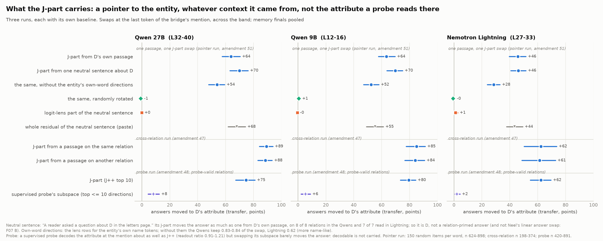
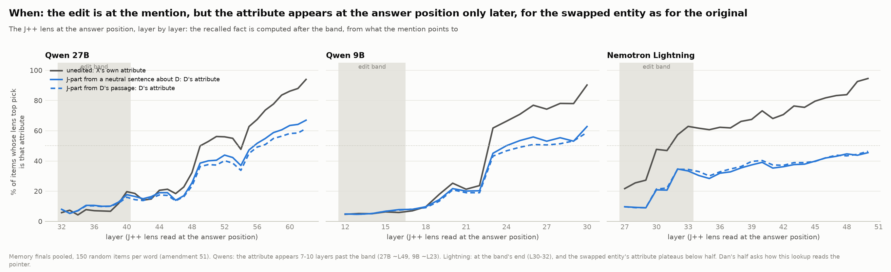
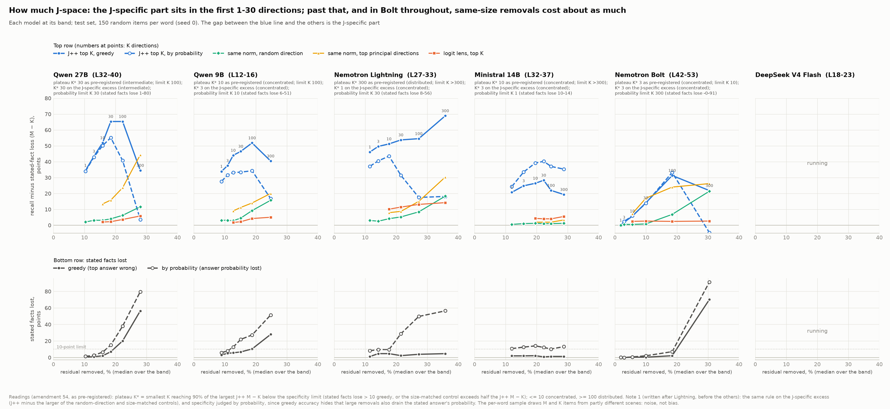
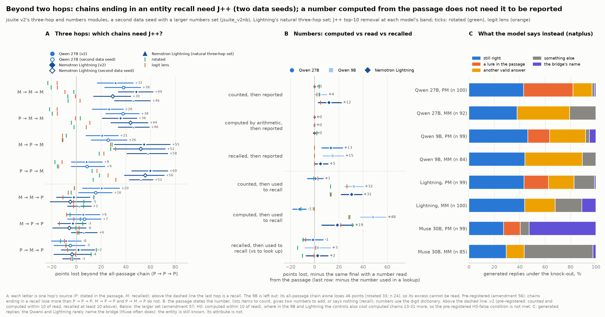
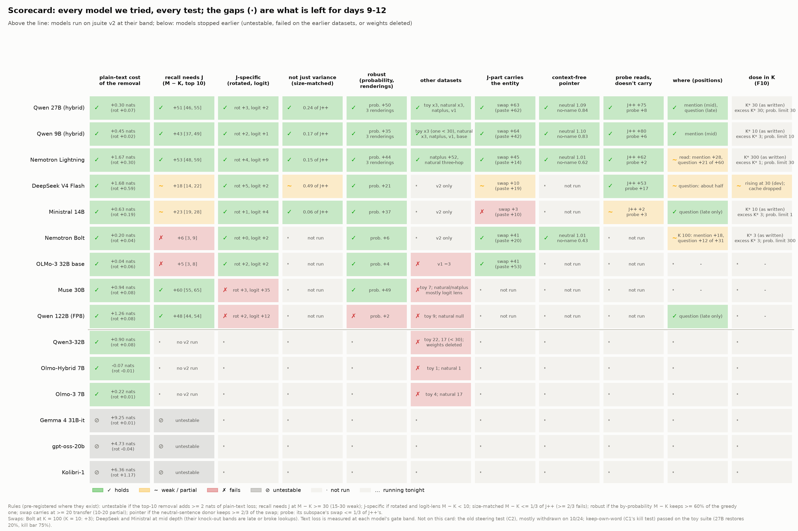

<!-- Generated by scripts/report_breadth.py from docs/breadth/README.template.md and data.csv; edit the template. -->
# Recall goes through the lens: what a model needs from the bridge's mention, across models

*When a model answers a two-step question about an entity, does it need the directions the J++ lens reads at that
entity, does that depend on whether the final fact is recalled or stated, and in which models?*

## In one minute

- **Recall needs a handful of lens-readable directions; reading the same fact does not.**
  - In Qwen3.6-27B, Qwen3.5-9B and Nemotron 3.5 Lightning (two families), we remove the top 10 J++ directions at one
    band.
  - Recall then loses 51, 43 and 53 points more than the same question with the
    fact stated.
  - This holds under controls fixed before the run.
- **At the entity's mention, those directions carry which entity it is, not its fact.** Taken from one neutral sentence
  about another entity, they move the answer as much as when taken from that entity's own passage. A probe that reads
  the fact there does not carry it.
- **Across models it is graded.**
  - Of nine models we could test, three show it strongly.
  - The rest are weak, carry the entity without needing it, share it with the logit lens, or lose it by probability.
  - Bolt (Lightning's larger sibling) and DeepSeek depend on their J++ directions little more than on any removal of
    the same size, at every number of directions.
  - Three more models cannot be tested: any lens removal breaks them.
- **Beyond two hops, what matters is whether the last step is recalled.**
  - A three-hop chain needs the directions when its last hop is recalled: Lightning loses
    36 to 60 points beyond an all-passage chain.
    When the last hop is read it loses -3 to +2,
    even if earlier hops were recalled. It holds on a second data seed. The 27B shows it on three of the four chains
    ending in a recall.
  - Reporting a number computed from the passage by arithmetic costs nothing in all three models; a recalled one costs
    the Qwens +13 and +15.
  - Using a number to recall something (the month at that position) needs no J++ beyond a lookup in the passage, in
    any model. The rule is about recalling facts about entities.
- **For monitoring:** at the entity's mention the lens shows which entity the model will recall from, in every model.
  Whether the model depends on those directions is a separate, model-specific question.

**Status.** This is Zach's half (breadth): nine models on our dataset jsuite v2, plus the Qwens on every earlier dataset,
as of 27 Oct 2026. All numbers are unverified until hand-checked (Section 9). Built at 9da1a0c6 from the run files.

## Setup

*Fig. 0.*

- **The question.** "The composer who wrote The Magic Flute was of which nationality?" The bridge (Mozart) is:
  - read from the passage (**P**);
  - tracked through it (**T**);
  - or described, and so recalled (**M**).
- **The two finals.** The final fact is either **stated** in the passage (**K**: "Mozart was Austrian by birth") or
  left to **memory** (**M**). Same question, same answer, same passage otherwise.
  - Controls: **P** (a new made-up fact is stated), **A** (the answer word appears once, on another entity), **N**
    (nothing stated, no lures).
- **Dataset.** jsuite v2: 8 relations; 179 bridge facts on test and a disjoint 171 on dev (dev is used only to choose
  bands); 15 start × final words; 5,370 test items. An item counts only if the model gets every part of it right
  unedited.
- **The knock-out.** At every token, at each layer of one mid-depth band, project out the 10 directions the J++ lens
  reads most there.
  - **M − K**: recall answers lost minus stated-fact answers lost, in points.
- **Controls of the same size.**
  - The removal **rotated** to a random direction.
  - The **logit lens**'s own top 10.
  - The same norm along the residual's **top principal directions**.
- **The swap.** Replace the J-part (the span of the top-10 J++ directions) of the bridge's last token with another
  entity's (D).
  - **Transfer**: the share answering D's fact minus the share answering a third entity's.
- **Fixed in advance** = pre-registered in docs/prereg_replication_1022.md (amendments 1-57) before the run.
  **After the data** = chosen after seeing results. Brackets: 95% bootstrap over bridges.

## 1. Recall needs the J++ directions; reading the stated fact does not

*Fixed in advance (amendments 33, 39, 42, 48).*

Does removing what the lens reads cost recall more than reading?

- **Three models, two families.**
  - M − K is +51 [46, 55] (27B), +43 [37, 49] (9B) and +53 [48, 59] (Lightning).
  - Stated facts lose 3, 5 and 4 points.

*Fig. 1.*

- **It is specific to the lens's directions.**
  - Rotated: +3 / +2 / +4.
  - Logit lens: +2 / +1 / +9.
  - The same norm along the residual's top principal directions costs 0.24, 0.17 and
    0.15 of the effect.
- **It is not a threshold effect.** Scored by the answer's probability, M − K is +50 /
  +35 / +44.
- **What is lost tracks where the answer is.** Points lost on the 27B, by final:

  | Final | Lost |
  |---|---|
  | Fact stated (K) | 3 |
  | New made-up fact stated (P) | 9 |
  | Answer word once, on another entity (A) | 30 |
  | Nothing stated, no lures (N) | 45 |
  | Recall (M) | 54 |

  Under the knock-out, the models rarely name the bridge: 1% (27B), 5% (9B)
  and 1% (Lightning) of replies. They still know which entity it is, but not its fact.
- **The other six models are in the grid (Section 7).** All six fail to show it cleanly:
  - DeepSeek and Ministral are weak (+18, +23); more directions do not rescue DeepSeek
    (Section 5);
  - Bolt shows little: +6 at 10 directions, and at 100 a same-size removal along the top principal
    directions costs nearly as much as J++ (+24 vs +31);
  - OLMo does not need it (+5);
  - Muse shares more than half of it with the logit lens (+35 of +60);
  - the 122B loses it by probability (+2 vs +48).

## 2. It is not one dataset, relation, rendering or checkout

*Fixed in advance (amendments 6, 11, 14, 20, 23, 29, 33, 35, 38, 50, 55, 56).*

Does the split survive everything we could vary?

- **Every dataset we built since day 1 (the two Qwens).** Each dataset has its own contrast: memory-final minus
  prompt-final words on the earlier sets, M − P on v1.

  | Dataset | 27B | 9B |
  |---|---|---|
  | Toy puzzles, data seeds 1 / 2 / 3 | +36 / +34 / +40 | +38 / +23 / +31 |
  | Natural fact chains, seeds 1 / 2 / 3 | +51 / +44 / +42 | +37 / +38 / +37 |
  | natplus | +52 [47, 58] | +40 [34, 47] |
  | jsuite v1 | +50 [43, 57] | +42 [34, 50] |

  The logit lens stays near zero wherever it was run:

  | Logit lens on | 27B | 9B |
  |---|---|---|
  | Toy puzzles | 0 | -3 |
  | Natural fact chains | 0 | -5 |
  | natplus | 0 | -5 |
  | jsuite v1 | -1 | -4 |

- **Lightning on natplus** (amendment 55): +52 [46, 58], with rotated -1 and logit lens
  +8. Its only other datasets are v2 and the natural three-hop set (Section 6).

*Fig. 2.*

- **Every relation.**
  - On the 27B, M − K runs from +36 (languages) to +72 (dishes).
  - Animals is the weakest everywhere (6 answers): 9B +14 [0, 36], Lightning +18 [9, 29].
- **Every start, both test halves, three renderings.**
  - Renderings: 27B +49 and +50; 9B +42 and +43; Lightning
    +49 and +50.
  - A rendering redraws passages, distractors and wording over the same facts.

*Fig. 3.*

- **A clean checkout reproduces it.** Rerun from a fresh worktree:
  - the 27B's and 9B's knock-outs match row for row (0 of 22325 and
    0 of 14100 rows differ);
  - Lightning's headline reproduces (+52 [47, 58] vs +53 [48, 59]) but not row for row:
    9 of 14075 rows differ.
  - Lightning is deterministic: rerun at HEAD with the clean rerun's eligibility and batch size, it matches the clean
    rerun on 14275 of 14275 rows (amendment 56).
  - So the differences come from inputs, not kernels: the clean competence rerun covered more prompts, which changed a
    few items' eligibility and which prompts shared a batch. Code changes since the record run are not ruled out.
- **It is not the bridge's own word (the plan's kill test).** Keeping the bridge's own-word directions restores only:

  | | Share restored |
  |---|---|
  | 27B (v2) | 0.06 |
  | 9B (v2) | 0.17 |
  | Lightning (v2) | 0.22 |
  | Ministral (v2) | 0.06 |
  | 27B (toy suite) | 0.20 |
  | 9B (toy suite) | 0.26 |

  The kill bar is 0.75.
- **Rare bridges lose as much as popular ones**, so Neel's narrow-concept prediction is not supported. natplus,
  popular vs rare: 27B +50 vs +56; 9B +39 vs
  +44; Lightning +48 vs +61.
- **It is mostly from pretraining.** The 9B base model gives +34 against the instruct model's
  +41 (same Q&A format, same lens).
- **The lens matters; who fitted it does not.**
  - On the 27B (v1), the plain J-lens finds +24 against J++'s +50.
  - The Qwens use published J++ lenses; the other models use our own fits. On the 9B, our own fit gives
    +45 [40, 50] against the published lens's +43 [37, 49].
- **A bridge never named.** Deleting the bridge's one passing mention adds recall loss: +18 [10, 26] (27B),
  +12 [5, 19] (9B) and +4 [-3, 11] (Lightning).

## 3. Where: at the bridge's mention at mid depth, in the question late

*Fixed in advance (amendments 30, 36, 37); Lightning's and Bolt's split in amendment 54; the 9B's and Lightning's late
bands in amendment 57.*

Where in the prompt must the removal act?

- **In the Qwens, a read bridge needs the directions at its own mention.**
  - Mention alone: +38 of +51 (27B) and +48 of
    +50 (9B).
  - Question alone: +5 and +4.
- **Lightning needs them at both the mention and the question.** Mention +28 and question
  +21, of +60. Its lookup happens inside its band (Section 4); the Qwens' happens
  after theirs.
- **Bolt splits the same way as Lightning**, with 100 directions: mention +18 and question
  +12, of +31. The two Nemotrons split; the Qwens' read bridges sit at the mention.
- **A recalled bridge needs them at several places at once.** No single region carries it: on the 27B, mention
  +6 and question +11, of +45.
- **Late in depth, the dependence moves to the question, in both families.** M − K, all starts:

  | Model (late band, depth) | All tokens | Question only | Mention only |
  |---|---|---|---|
  | 27B (L52-60, 81-94%) | +50 | +47 | +3 |
  | 9B (L26-29, 81-91%) | +53 | +53 | 0 |
  | Lightning (L33-39, 64-75%) | +62 | +53 | +0 |
  | Ministral (L32-37) | +23 | +24 | 0 |
  | 122B (L39-45) | +48 | +28 | +10 |

  - The 9B's and Lightning's late bands were picked on dev (amendment 57): the latest window where stated facts still
    lose at most 10. Lightning's is shallower than the 27B's because past 69% depth its removal breaks stated facts too.
  - At these bands more of the effect is shared with the logit lens: 9B +28, Lightning
    +23 (mid band: +1, +9).

*Fig. 4.*

## 4. What the directions carry at the mention: which entity it is

*Fixed in advance (amendments 32, 34, 38A, 47, 48, 51, 55 note 1).*

If the mention's J-part is swapped for another entity's, does the answer follow, and what is being moved?

- **The answer follows a swapped J-part.**
  - Transfer: +63 [57, 69] (27B), +64 [58, 69] (9B), +45 [39, 50] (Lightning).
  - Rotated or logit-lens parts move nothing (27B: 0 and 0).
  - Pasting the whole residual moves less in Lightning (+14), because it also overwrites position and
    binding.
- **It is not just the answer token (Neel's linear answer swap).**
  - Without D's answer direction, the swap is unchanged: +66 vs +66 (27B) and
    +70 vs +69 (9B), on the PM final.
  - The answer direction alone moves +29.

*Fig. 5.*

- **It is a pointer, whatever context it came from.**
  - From one neutral sentence about D ("A reader asked a question about D in the letters page"), the J-part moves the
    answer 1.09, 1.10 and 1.01 times as much as from D's own passage.
    It holds on 8 of 8 relations on the 27B.
  - Bolt, with 100 directions (amendment 55 note 1): 1.01, on 6 of
    6 relations.
  - From a passage on another relation it moves 0.99 / 0.99 / 0.98 as much.
- **In the Qwens it is more than the name; in the Nemotrons, less so.** Without the entity's own-word directions, the
  swap keeps 0.84 / 0.83 / 0.62. Bolt's keeps 0.43, below the
  2/3 bar: its pointer is mostly the name's own directions.
- **Decodable is not carried.** A supervised probe reads the fact at the mention about as well as J++. Swapping the
  probe's subspace moves +8 / +6 / +2, against J++'s
  +75 / +80 / +62.

*Fig. 6.*

- **The fact is looked up later.** At the answer position, the lens first reads X's fact on half the items at:
  - layer 50 on the 27B (band ends at L40);
  - layer 23 on the 9B (L16);
  - layer 32 on Lightning (L33).
  For a swapped entity it reads D's fact at the same layers.

*Fig. 7.*

- **Readable, carried and needed come apart.**
  - OLMo carries the entity (swap +41), but the knock-out costs only +5.
  - Ministral's lens reads the fact at mid depth, but its J-part carries only +3, and
    +5 with 100 directions.

*Fig. 8.*

## 5. How much J-space

*Fixed in advance (amendments 52-55); the excess and probability readings after Lightning's grid, before the others
(amendment 54 note 1).*

How many directions does the dependence need, and when does the removal stop being specific?

- **In the 9B, Lightning and Ministral, most of the J-specific part is there in the first few directions; the 27B needs
  about 30.** M − K at 1, 10 and 100 directions:

  | Model | 1 | 10 | 100 |
  |---|---|---|---|
  | 27B | +34 | +52 | +65 |
  | 9B | +34 | +44 | +52 |
  | Lightning | +46 | +51 | +54 |
  | Ministral | +21 | +26 | +22 |
  | DeepSeek | +12 | +18 | +29 |

  The 27B keeps rising to 30 directions (+65).
- **More directions add damage that is not specific.** Greedy answers hide it: the stated answer usually stays on top
  while losing much of its probability.
  - Lightning: stated facts lose 4 points by greedy answer at 100 directions, but
    50 by probability.
  - The plateau rule as pre-registered calls Lightning distributed (K\* 300). On the J-specific excess
    it is concentrated (K\* 1).
- **Bolt is weak, not spread out.** Its J++ effect grows with the number of directions, but a removal of the same
  size along the residual's top principal directions costs about as much:

  | Directions | J++ | Same size, top principal directions |
  |---|---|---|
  | 10 | +6 | +7 |
  | 30 | +14 | +17 |
  | 100 | +31 | +24 |

  - By probability, J++ keeps an edge only at 100 directions: +33 vs +18.
  - Bolt's 100 directions remove 18% of the residual. Lightning's top 10 remove about the same
    (18%) and give +51.
  - The pre-registered limit stops Bolt's readings at K 10, where the size-matched control already
    exceeds half the J++ effect; below it the effect is about 0 (+2 at 3).
  - Its J-part swap still carries the entity at 100 directions, as a context-free pointer (Section 4). Bolt's mention
    holds the entity in J-space, but its recall does not depend on those directions more than on any same-size removal.

- **DeepSeek is weak at every dose, not under-dosed** (amendment 56 D):

  | Directions | J++ | Same size, top principal directions | Rotated |
  |---|---|---|---|
  | 10 | +18 | +13 | +5 |
  | 30 | +22 | +19 | +5 |
  | 100 | +29 | +26 | +8 |

  - The pre-registered limit stops it at K 10; its J-specific excess peaks at 1 direction
    (+8).
  - Its top direction alone removes 11% of the residual; all 100 remove 21%.
  - At 100 directions stated facts lose 17 points.

*Fig. 9.*

- **Swapping more directions.**
  - The 9B's swap grows: +64 → +76.
  - The 27B's and Lightning's are saturated (under the +10 bar): +64 → +71 and
    +46 → +55.
  - Bolt's carries only at 100: +3 → +41.
  - Ministral's never carries (at mid depth, L20-25): +3 → +5.

## 6. Beyond two hops: longer chains, and numbers computed from the passage

*Fixed in advance (amendments 21, 24, 25 on the earlier dataset; 56 on v2 and Lightning; 57 on a second seed and a
larger numbers set).*

Does the rule hold for longer chains, and for intermediates the model computes from the passage? This is the
proposal's own question (H0: J-space carries recalled words, not computed variables).

- **A three-hop chain needs J++ when its last hop is recalled.** Points lost beyond the all-passage chain
  (P → P → P); each letter is one hop's source. The second seed is jsuite_v2nb (amendment 57: new chains, same design):

  | Chain | 27B (v2) | 27B (second seed) | Lightning (v2) | Lightning (second seed) | Lightning (natural set) |
  |---|---|---|---|---|---|
  | M → M → M | +32 [17, 46] | +38 [23, 52] | +49 [34, 62] | +30 [14, 44] | +46 [31, 60] |
  | P → M → M | +26 [13, 38] | +38 [24, 51] | +36 [21, 49] | +44 [28, 58] | +46 [34, 59] |
  | M → P → M | +21 [8, 34] | +26 [12, 41] | +55 [31, 76] | +52 [30, 72] | +58 [41, 74] |
  | P → P → M | +8 [-4, 21] | +9 [-4, 23] | +60 [45, 74] | +56 [39, 71] | +52 [43, 62] |
  | M → M → P | +20 [5, 35] | +16 [2, 29] | -2 [-16, 11] | -5 [-21, 12] | +2 [-7, 12] |
  | M → P → P | +6 [-8, 19] | +7 [-7, 20] | -3 [-15, 8] | -6 [-19, 8] | +6 [-4, 17] |
  | P → M → P | -8 [-20, 4] | -5 [-18, 7] | +2 [-12, 15] | -4 [-18, 12] | -3 [-11, 3] |

  - **Pre-registered:** the four chains ending in a recall lose more than P → P → P; M → P → P and P → M → P do not.
    Lightning meets all of it, on v2, on the second seed and on the natural set. The 27B meets it except P → P → M,
    on both seeds (+8 [-4, 21] and +9 [-4, 23]).
  - **Not predicted:** the 27B's M → M → P also loses; Lightning's does not.
  - **Controls.**
    - On the 27B, the rotated and logit-lens removals cost no chain more than P → P → P. P → P → P itself loses
      20 points under J++ and 23 rotated,
      so only the excess is read.
    - In Lightning the controls explain part of two cells, on every set. M → P → M: rotated
      +29 and logit lens +28 on v2 (n
      22), +28 and
      +32 on the second seed (n 26).
      P → P → M: logit lens +32 on the natural set, +26 on
      the second seed.
  - **The 9B cannot be read.** Its all-passage chain alone loses 46 points (rotated
    33; n 24).
  - **The earlier dataset agrees** (27B, v1): M → M → M +35 [21, 49] and P → M → M +33 [22, 46];
    M → P → P -3 and P → M → P -3.
- **A number computed from the passage does not need J++ to be reported.** Points lost reporting the
  number, minus a number read from the passage (digit tokens included in the removal):

  | The number is | 27B | 9B | Lightning |
  |---|---|---|---|
  | Counted from a list | 0 [0, 0] | +4 [0, 10] | +12 [3, 22] |
  | Computed by adding or subtracting | 0 [0, 0] | 0 [0, 0] | 0 [0, 0] |
  | Recalled | +13 [6, 23] | +15 [7, 24] | +5 [0, 11] |

  - **Pre-registered:** counted and computed within 10 of read; recalled at least 10 above.
    - The Qwens meet all three.
    - Lightning misses two: counting costs it +12, and reporting a recalled number only
      +5.
    - Rotated and logit-lens controls cost recalled numbers nothing (0 in every
      model).
  - **A recalled number feeding another recall needs J++ no more than one feeding a lookup.** On the larger set
    (amendment 57; n 128 to 253 per word), the
    month or planet at that position minus the locker with that number: 27B -1 [-10, 7], 9B
    +3 [-8, 13], Lightning +2 [-7, 11].
    - Amendment 24's final-hop rule for numbers (each start's recall final >= 20 above its lookup final) fails for
      every start in all three models.
    - On v2, Lightning's +47 (n 17 and 13) looked
      like the rule; at ten times the items it does not replicate.
  - **The earlier dataset agrees** (v1): 9B counted +7, computed +1, recalled
    +26 [18, 34]; 27B recalled +15.
- **H0 head-on: does a number computed from the passage need J++ when it keys a recall?** Points lost, minus the same
  recall keyed by a number read from the passage (larger set, amendment 57):

  | | 27B | 9B | Lightning |
  |---|---|---|---|
  | Counted, then recalled | +1 [-6, 7] | +32 [25, 40] | +31 [22, 39] |
  | Computed, then recalled | -13 [-18, -7] | +48 [38, 59] | +19 [6, 32] |
  | Counted / computed, rotated removal | -1 / -11 | +13 / +29 | +13 / +31 |
  | Counted / computed, logit lens | +3 / 0 | +27 / +28 | +14 / +22 |

  - **Pre-registered:** within 10 of read means the computed number needs no more J++ (H0 holds for numbers). At least
    15 above, with the rotated control within 10, means it routes through J++ (H0 false).
  - **The 27B:** no more than a read number. Counted is within 10; computed loses less, outside the band on that side.
  - **The 9B and Lightning: neither outcome.** Computed chains lose more under J++, but the rotated and logit-lens
    removals also cost them more (rows 3-4), so the pre-registered "H0 false" condition is not met. Composing a computed
    number with a recall is fragile under any edit at the band; part of the gap may still be J-specific.
- **What this says about H0.**
  - J++ is needed where the last step recalls a fact about an entity, whatever the earlier steps were. It is not
    needed for a recall keyed by a number (a month or planet at a position).
  - Recalled intermediates followed by a read step lose little in Lightning; the 27B's M → M → P is the exception.
  - A number computed from the passage needs no J++ to be reported (all three models), nor, in the 27B, to key a
    recall. In the 9B and Lightning that last test cannot be read.
  - We have not tested, on v2, a bridge entity that the model computes rather than reads or recalls.

*Fig. 10.*

## 7. Every model, every test

| Model | plain-text cost | M − K (top 10) | rotated / logit lens | size-matched (share) | by probability | renderings | clean rerun | keep-own restores | J-part swap / paste | neutral donor | probe swap (J++ / probe) | dose: K* (excess) |
|---|---|---|---|---|---|---|---|---|---|---|---|---|
| Qwen3.6-27B (L32-40) | +0.30 nats | +51 [46, 55] | +3 / +2 | 0.24 | +50 | +49, +50 | 0 of 22325 differ | 0.06 | +63 / +62 | 1.09 | +75 / +8 | 30 (30) |
| Qwen3.5-9B (L12-16) | +0.46 nats | +43 [37, 49] | +2 / +1 | 0.17 | +35 | +42, +43 | 0 of 14100 differ | 0.17 | +64 / +42 | 1.10 | +80 / +6 | 10 (3) |
| Nemotron 3.5 Lightning (L27-33) | +1.67 nats | +53 [48, 59] | +4 / +9 | 0.15 | +44 | +49, +50 | 9 of 14075 differ | 0.22 | +45 / +14 | 1.01 | +62 / +2 | 300 (1) |
| DeepSeek-V4-Flash (L18-23) | +1.68 nats | +18 [14, 22] | +5 / +2 | 0.49 | +21 | · | · | · | +10 / +19 (mid depth) | · | · | 1 (1) |
| Ministral-3-14B (L32-37) | +0.62 nats | +23 [19, 28] | +1 / +4 | 0.06 | +37 | · | · | 0.06 | +3 / +10 (mid depth) | · | · | 10 (3) |
| Nemotron 3.5 Bolt (L42-53) | +0.20 nats | +6 [3, 9] | +0 / +2 | 1.28 | +6 | · | · | · | +3 / +20; K 100: +41 | 1.01 | · | 3 (3) |
| OLMo-3-32B base (L12-20) | +0.04 nats | +5 [3, 8] | +2 / +2 | · | +4 | · | · | · | +41 / +53 | · | · | · |
| Muse Glimmer 30B (L36-42) | +0.94 nats | +60 [55, 65] | +3 / +35 | · | +49 | · | · | · | · | · | · | · |
| Qwen3.5-122B (FP8) (L39-45) | +1.26 nats | +48 [44, 54] | +2 / +12 | · | +2 | · | · | · | · | · | · | · |

Size-matched for Bolt: from the dose run (150 items per word), where no stand-alone run exists. Dose column: K\* as
pre-registered (on the J-specific excess). Bolt's readings stop at its specificity limit (K 10), so its
K\* covers only 1-3 directions, where its effect is about 0.

*Fig. 11.*

Untestable: removing the top 10 lens directions adds more plain text loss than the 2-nat bar:

| Model | Plain-text loss added |
|---|---|
| Gemma 4 31B-it | +9.25 nats |
| gpt-oss-20b | +4.73 nats |
| Kolibri-1 | +6.36 nats |

Three more models stopped on the earlier datasets, below the 30-point bar:

| Model | Earlier datasets |
|---|---|
| Qwen3-32B | +22 and +17 |
| Olmo-Hybrid 7B | +1 |
| Olmo-3 7B | +4 |

## 8. What did not hold

- **Failed when fixed in advance.**
  - The 9B's second toy data seed: +23, below the 30-point bar; pooled over seeds it passed.
  - The steering test (the plan's second claim, C2): most cells broke more than 10% of answers, and it was withdrawn on
    the 24 Oct re-score. The swap replaced it as the sufficiency test.
  - The 27B with the plain J-lens: +24, below 30.
  - The never-named bridge, predicted to cost nothing extra: it costs the 27B +18 and the 9B +12.
  - The 122B by probability (+2). Muse's share with the logit lens. Bolt at 10 directions. OLMo.
  - The 27B's P → P → M three-hop chain: +8 [-4, 21], predicted to lose more than
    P → P → P.
  - Lightning's numbers: counting costs +12 (predicted within 10), and reporting a
    recalled number +5 (predicted at least +10).
  - The 9B's three-hop chains: unreadable, because the all-passage chain itself breaks.
  - Numbers on the larger set (amendment 57):
    - The final-hop rule for numbers (amendment 24): fails for every start in all three models.
    - Lightning's v2 recall-keyed-by-a-recalled-number result (+47, n
      13) did not replicate (+2).
    - H0 head-on: no reading in the 9B and Lightning (controls also cost computed chains more); in the 27B the
      computed chain loses 13 less than a read one, outside the within-10 band.
    - Computation feeding a lookup within 10 of a read number (amendment 24): holds on the 9B
      (+9, +10), not on the 27B
      (+16, +18) or Lightning
      (+19, +18).
  - Bolt's "distributed" reading (amendment 52, against the rotated control only) does not survive the size-matched
    control: at 100 directions J++ costs +31 and the same size along the top principal directions
    +24.
- **Design errors.**
  - **A fixed number of directions is not a fixed dose.** The top 10 remove 6% of the residual in Bolt and 13-20%
    elsewhere.
  - **The dose plateau rule (amendment 54) judged specificity by greedy answers**, which hide the stated facts' lost
    probability; note 1 adds the excess and probability readings.
  - **The dev depth profiles first covered countries only.** Redone on all relations, the bands held.
- **Limits.**
  - Templated passages over one fact set per dataset; English only.
  - One band per model.
  - Greedy answers with thinking off.
  - The Qwens use published J++ lenses; the Nemotrons, Ministral and Muse use our own fits (the same fit on the 9B
    gives the same effect; Section 2).
  - The removal also costs plain text: +0.30 nats (27B) to +1.67 nats (Lightning).
  - One bootstrap seed.
  - The 122B in FP8.
  - The dose and swap-dose runs use 150 random items per word.

## 9. How we checked

- **Hand-checked numbers.** None yet; docs/verify_kit.md recomputes the headline M − K from the per-item rows and lists
  20 random items per model.
- **Clean-checkout reruns**: row-identical for the 27B and 9B. Lightning reproduces its headline, not row for row; a
  determinism check traces that to its inputs, not its kernels (Section 2).
  - Amendment 57's results (the larger numbers set, the second three-hop seed, the late bands) reran from a clean
    checkout identical in 11 of 11 comparisons (122394 rows and items; every
    read and log-probability equal), Lightning's late band included.
- **Pre-registration**: docs/prereg_replication_1022.md, amendments 1-57 (with notes). EXPERIMENTS.md has one line per run, with
  its W&B link.

## 10. Next

- OLMo and Muse through the dose grid. Each needs a cache drop (Muse's weights are gone; only its lens is cached), so
  each needs approval.
- H0 head-on: a bridge computed from the passage, on v2.
- Hand-checking.

## Appendix. Links

Every number on this page comes from [docs/breadth/data.csv](data.csv), each row with its source file;
scripts/report_breadth.py builds it and this page. The figures ([figures/](figures/)) are drawn by scripts/fig_neel.py from
the same result files; they will be redrawn with the shared plot style after the code merge.
