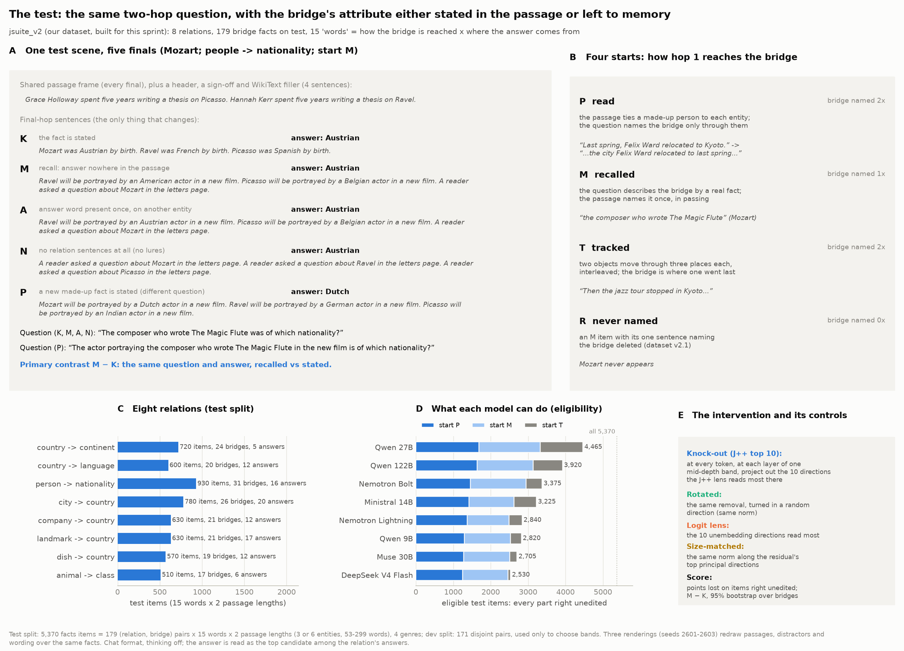
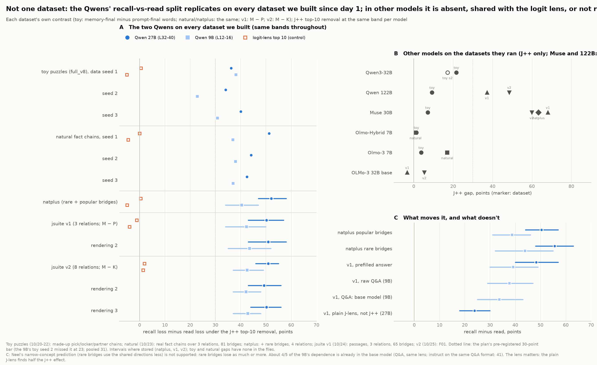
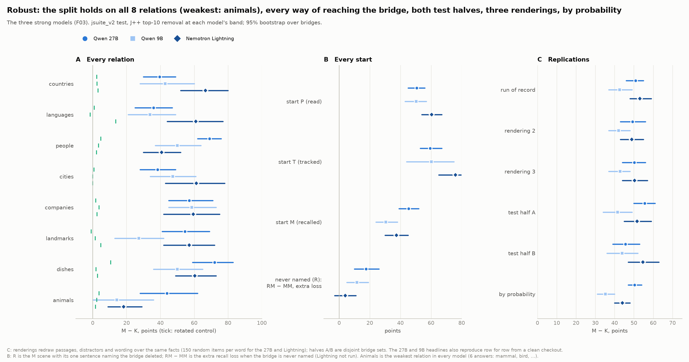
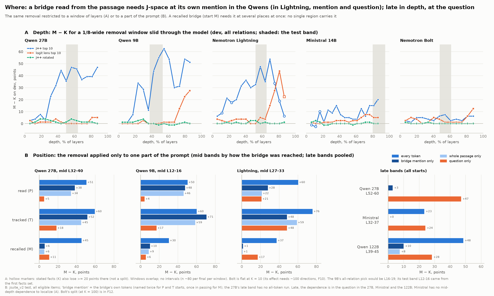
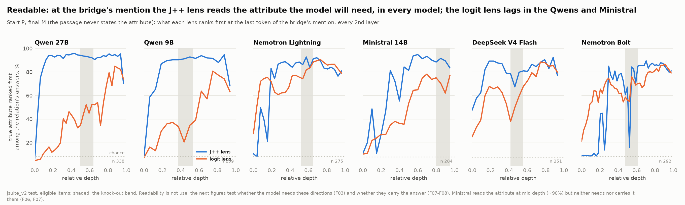
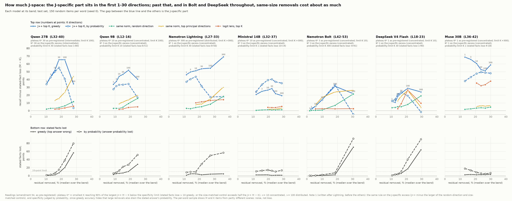
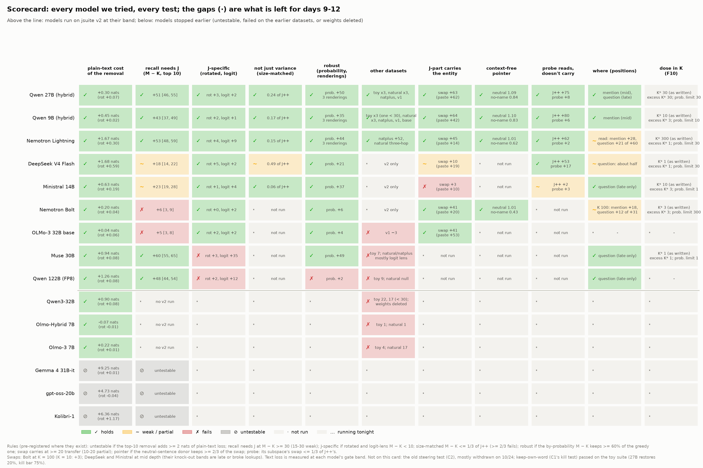

# Recall goes through the lens: what a model needs from the bridge's mention, across models

*When a model answers a two-step question about an entity, does it need the directions the J++ lens reads at that
entity, does that depend on whether the final fact is recalled or stated, and in which models?*

## In one minute

- **Recall needs a handful of lens-readable directions; reading the same fact does not.**
  - In Qwen3.6-27B, Qwen3.5-9B and Nemotron 3.5 Lightning (two families), we remove the top 10 J++ directions at one
    band.
  - Recall then loses {{a|ko.q27.mk}}, {{a|ko.q9.mk}} and {{a|ko.nl.mk}} points more than the same question with the
    fact stated.
  - This holds under controls fixed before the run.
- **At the entity's mention, those directions carry which entity it is, not its fact.** Taken from one neutral sentence
  about another entity, they move the answer as much as when taken from that entity's own passage. A probe that reads
  the fact there does not carry it.
- **Across models it is graded.**
  - Of nine models we could test, three show it strongly.
  - The rest are weak, carry the entity without needing it, share it with the logit lens, or lose it by probability.
  - Bolt (Lightning's larger sibling) and DeepSeek depend on their J++ directions little more than on any removal of
    the same size, at every number of directions.
  - Three more models cannot be tested: any lens removal breaks them.
- **Beyond two hops, what matters is whether the last step is recalled.**
  - A three-hop chain needs the directions when its last hop is recalled: Lightning loses
    {{a|mod.nl.threehop.paper10.PMM-PPP}} to {{a|mod.nl.threehop.paper10.PPM-PPP}} points beyond an all-passage chain.
    When the last hop is read it loses {{v|mod.nl.threehop.paper10.MPP-PPP}} to {{v|mod.nl.threehop.paper10.PMP-PPP}},
    even if earlier hops were recalled. It holds on a second data seed. The 27B shows it on three of the four chains
    ending in a recall.
  - Reporting a number computed from the passage by arithmetic costs nothing in all three models; a recalled one costs
    the Qwens {{v|mod.q27.numbers.paper10.MR-PR}} and {{v|mod.q9.numbers.paper10.MR-PR}}.
  - Using a number to recall something (the month at that position) needs no J++ beyond a lookup in the passage, in
    any model. The rule is about recalling facts about entities.
- **For monitoring:** at the entity's mention the lens shows which entity the model will recall from, in every model.
  Whether the model depends on those directions is a separate, model-specific question.

**Status.** This is Zach's half (breadth): nine models on our dataset jsuite v2, plus the Qwens on every earlier dataset,
as of 27 Oct 2026. All numbers are unverified until hand-checked (Section 9). Built at {{head}} from the run files.

## Setup

*Fig. 0.*

- **The question.** "The composer who wrote The Magic Flute was of which nationality?" The bridge (Mozart) is:
  - read from the passage (**P**);
  - tracked through it (**T**);
  - or described, and so recalled (**M**).
- **The two finals.** The final fact is either **stated** in the passage (**K**: "Mozart was Austrian by birth") or
  left to **memory** (**M**). Same question, same answer, same passage otherwise.
  - Controls: **P** (a new made-up fact is stated), **A** (the answer word appears once, on another entity), **N**
    (nothing stated, no lures).
- **Dataset.** jsuite v2: 8 relations; 179 bridge facts on test and a disjoint 171 on dev (dev is used only to choose
  bands); 15 start × final words; 5,370 test items. An item counts only if the model gets every part of it right
  unedited.
- **The knock-out.** At every token, at each layer of one mid-depth band, project out the 10 directions the J++ lens
  reads most there.
  - **M − K**: recall answers lost minus stated-fact answers lost, in points.
- **Controls of the same size.**
  - The removal **rotated** to a random direction.
  - The **logit lens**'s own top 10.
  - The same norm along the residual's **top principal directions**.
- **The swap.** Replace the J-part (the span of the top-10 J++ directions) of the bridge's last token with another
  entity's (D).
  - **Transfer**: the share answering D's fact minus the share answering a third entity's.
- **Fixed in advance** = pre-registered in docs/breadth/prereg_replication_1022.md (amendments 1-57) before the run.
  **After the data** = chosen after seeing results. Brackets: 95% bootstrap over bridges.

## 1. Recall needs the J++ directions; reading the stated fact does not

*Fixed in advance (amendments 33, 39, 42, 48).*

Does removing what the lens reads cost recall more than reading?

- **Three models, two families.**
  - M − K is {{vci|ko.q27.mk}} (27B), {{vci|ko.q9.mk}} (9B) and {{vci|ko.nl.mk}} (Lightning).
  - Stated facts lose {{v|ko.q27.klost}}, {{v|ko.q9.klost}} and {{v|ko.nl.klost}} points.

*Fig. 1.*

- **It is specific to the lens's directions.**
  - Rotated: {{v|ko.q27.rot}} / {{v|ko.q9.rot}} / {{v|ko.nl.rot}}.
  - Logit lens: {{v|ko.q27.u}} / {{v|ko.q9.u}} / {{v|ko.nl.u}}.
  - The same norm along the residual's top principal directions costs {{v|ko.q27.pcr}}, {{v|ko.q9.pcr}} and
    {{v|ko.nl.pcr}} of the effect.
- **It is not a threshold effect.** Scored by the answer's probability, M − K is {{v|ko.q27.soft}} /
  {{v|ko.q9.soft}} / {{v|ko.nl.soft}}.
- **What is lost tracks where the answer is.** Points lost on the 27B, by final:

  | Final | Lost |
  |---|---|
  | Fact stated (K) | {{v|ko.q27.lostK}} |
  | New made-up fact stated (P) | {{v|ko.q27.lostP}} |
  | Answer word once, on another entity (A) | {{v|ko.q27.lostA}} |
  | Nothing stated, no lures (N) | {{v|ko.q27.lostN}} |
  | Recall (M) | {{v|ko.q27.lostM}} |

  Under the knock-out, the models rarely name the bridge: {{v|gen.q27.PM.bridge}} (27B), {{v|gen.q9.PM.bridge}} (9B)
  and {{v|gen.nl.PM.bridge}} (Lightning) of replies. They still know which entity it is, but not its fact.
- **The other six models are in the grid (Section 7).** All six fail to show it cleanly:
  - DeepSeek and Ministral are weak ({{v|ko.ds.mk}}, {{v|ko.mi.mk}}); more directions do not rescue DeepSeek
    (Section 5);
  - Bolt shows little: {{v|ko.nb.mk}} at 10 directions, and at 100 a same-size removal along the top principal
    directions costs nearly as much as J++ ({{v|dose.nb.k100.pc}} vs {{v|dose.nb.k100}});
  - OLMo does not need it ({{v|ko.ol.mk}});
  - Muse shares more than half of it with the logit lens ({{v|ko.mu.u}} of {{v|ko.mu.mk}});
  - the 122B loses it by probability ({{v|ko.q122.soft}} vs {{v|ko.q122.mk}}).

## 2. It is not one dataset, relation, rendering or checkout

*Fixed in advance (amendments 6, 11, 14, 20, 23, 29, 33, 35, 38, 50, 55, 56).*

Does the split survive everything we could vary?

- **Every dataset we built since day 1 (the two Qwens).** Each dataset has its own contrast: memory-final minus
  prompt-final words on the earlier sets, M − P on v1.

  | Dataset | 27B | 9B |
  |---|---|---|
  | Toy puzzles, data seeds 1 / 2 / 3 | {{v|toy.q27.s1}} / {{v|toy.q27.s2}} / {{v|toy.q27.s3}} | {{v|toy.q9.s1}} / {{v|toy.q9.s2}} / {{v|toy.q9.s3}} |
  | Natural fact chains, seeds 1 / 2 / 3 | {{v|nat.q27.s1}} / {{v|nat.q27.s2}} / {{v|nat.q27.s3}} | {{v|nat.q9.s1}} / {{v|nat.q9.s2}} / {{v|nat.q9.s3}} |
  | natplus | {{vci|natplus.q27}} | {{vci|natplus.q9}} |
  | jsuite v1 | {{vci|v1.q27}} | {{vci|v1.q9}} |

  The logit lens stays near zero wherever it was run:

  | Logit lens on | 27B | 9B |
  |---|---|---|
  | Toy puzzles | {{v|toy.q27.u}} | {{v|toy.q9.u}} |
  | Natural fact chains | {{v|nat.q27.u}} | {{v|nat.q9.u}} |
  | natplus | {{v|natplus.q27.u}} | {{v|natplus.q9.u}} |
  | jsuite v1 | {{v|v1.q27.u}} | {{v|v1.q9.u}} |

- **Lightning on natplus** (amendment 55): {{vci|natplus.nl}}, with rotated {{v|natplus.nl.rot}} and logit lens
  {{v|natplus.nl.u}}. Its only other datasets are v2 and the natural three-hop set (Section 6).

*Fig. 2.*

- **Every relation.**
  - On the 27B, M − K runs from {{v|ko.q27.rel.languages}} (languages) to {{v|ko.q27.rel.dishes}} (dishes).
  - Animals is the weakest everywhere (6 answers): 9B {{vci|ko.q9.rel.animals}}, Lightning {{vci|ko.nl.rel.animals}}.
- **Every start, both test halves, three renderings.**
  - Renderings: 27B {{v|ko.q27.r2}} and {{v|ko.q27.r3}}; 9B {{v|ko.q9.r2}} and {{v|ko.q9.r3}}; Lightning
    {{v|ko.nl.r2}} and {{v|ko.nl.r3}}.
  - A rendering redraws passages, distractors and wording over the same facts.

*Fig. 3.*

- **A clean checkout reproduces it.** Rerun from a fresh worktree:
  - the 27B's and 9B's knock-outs match row for row ({{v|clean.q27.diff}} of {{v|clean.q27.rows}} and
    {{v|clean.q9.diff}} of {{v|clean.q9.rows}} rows differ);
  - Lightning's headline reproduces ({{vci|clean.nl.mk_rerun}} vs {{vci|ko.nl.mk}}) but not row for row:
    {{v|clean.nl.diff}} of {{v|clean.nl.rows}} rows differ.
  - Lightning is deterministic: rerun at HEAD with the clean rerun's eligibility and batch size, it matches the clean
    rerun on {{v|det.nl.same}} of {{v|det.nl.rows}} rows (amendment 56).
  - So the differences come from inputs, not kernels: the clean competence rerun covered more prompts, which changed a
    few items' eligibility and which prompts shared a batch. Code changes since the record run are not ruled out.
- **It is not the bridge's own word (the plan's kill test).** Keeping the bridge's own-word directions restores only:

  | | Share restored |
  |---|---|
  | 27B (v2) | {{v|keepown.q27}} |
  | 9B (v2) | {{v|keepown.q9}} |
  | Lightning (v2) | {{v|keepown.nl}} |
  | Ministral (v2) | {{v|keepown.mi}} |
  | 27B (toy suite) | {{v|keepown.toy.q27}} |
  | 9B (toy suite) | {{v|keepown.toy.q9}} |

  The kill bar is 0.75.
- **Rare bridges lose as much as popular ones**, so Neel's narrow-concept prediction is not supported. natplus,
  popular vs rare: 27B {{v|natplus.q27.pop}} vs {{v|natplus.q27.rare}}; 9B {{v|natplus.q9.pop}} vs
  {{v|natplus.q9.rare}}; Lightning {{v|natplus.nl.pop}} vs {{v|natplus.nl.rare}}.
- **It is mostly from pretraining.** The 9B base model gives {{v|v1.q9base.qa}} against the instruct model's
  {{v|v1.q9inst.qa}} (same Q&A format, same lens).
- **The lens matters; who fitted it does not.**
  - On the 27B (v1), the plain J-lens finds {{v|v1.q27.jlens}} against J++'s {{v|v1.q27}}.
  - The Qwens use published J++ lenses; the other models use our own fits. On the 9B, our own fit gives
    {{vci|ko.q9oj.mk}} against the published lens's {{vci|ko.q9.mk}}.
- **A bridge never named.** Deleting the bridge's one passing mention adds recall loss: {{vci|r.q27}} (27B),
  {{vci|r.q9}} (9B) and {{vci|r.nl}} (Lightning).

## 3. Where: at the bridge's mention at mid depth, in the question late

*Fixed in advance (amendments 30, 36, 37); Lightning's and Bolt's split in amendment 54; the 9B's and Lightning's late
bands in amendment 57.*

Where in the prompt must the removal act?

- **In the Qwens, a read bridge needs the directions at its own mention.**
  - Mention alone: {{v|pos.q27.P.bridge}} of {{v|pos.q27.P.all}} (27B) and {{v|pos.q9.P.bridge}} of
    {{v|pos.q9.P.all}} (9B).
  - Question alone: {{v|pos.q27.P.question}} and {{v|pos.q9.P.question}}.
- **Lightning needs them at both the mention and the question.** Mention {{v|pos.nl.P.bridge}} and question
  {{v|pos.nl.P.question}}, of {{v|pos.nl.P.all}}. Its lookup happens inside its band (Section 4); the Qwens' happens
  after theirs.
- **Bolt splits the same way as Lightning**, with 100 directions: mention {{v|pos.nb.bridge}} and question
  {{v|pos.nb.question}}, of {{v|dose.nb.k100}}. The two Nemotrons split; the Qwens' read bridges sit at the mention.
- **A recalled bridge needs them at several places at once.** No single region carries it: on the 27B, mention
  {{v|pos.q27.M.bridge}} and question {{v|pos.q27.M.question}}, of {{v|pos.q27.M.all}}.
- **Late in depth, the dependence moves to the question, in both families.** M − K, all starts:

  | Model (late band, depth) | All tokens | Question only | Mention only |
  |---|---|---|---|
  | 27B (L52-60, 81-94%) | {{v|late.q27.all}} | {{v|late.q27.question}} | {{v|late.q27.bridge}} |
  | 9B (L26-29, 81-91%) | {{v|late.q9.all}} | {{v|late.q9.question}} | {{v|late.q9.bridge}} |
  | Lightning (L33-39, 64-75%) | {{v|late.nl.all}} | {{v|late.nl.question}} | {{v|late.nl.bridge}} |
  | Ministral (L32-37) | {{v|ko.mi.mk}} | {{v|pos.mi.question}} | {{v|pos.mi.bridge}} |
  | 122B (L39-45) | {{v|ko.q122.mk}} | {{v|pos.q122.question}} | {{v|pos.q122.bridge}} |
  | Muse (L36-42) | {{v|ko.mu.mk}} | {{v|pos.mu.question}} | {{v|pos.mu.bridge}} |

  - The 9B's and Lightning's late bands were picked on dev (amendment 57): the latest window where stated facts still
    lose at most 10. Lightning's is shallower than the 27B's because past 69% depth its removal breaks stated facts too.
  - At these bands more of the effect is shared with the logit lens: 9B {{v|late.q9.all.u}}, Lightning
    {{v|late.nl.all.u}} (mid band: {{v|ko.q9.u}}, {{v|ko.nl.u}}).

*Fig. 4.*

## 4. What the directions carry at the mention: which entity it is

*Fixed in advance (amendments 32, 34, 38A, 47, 48, 51, 55 note 1).*

If the mention's J-part is swapped for another entity's, does the answer follow, and what is being moved?

- **The answer follows a swapped J-part.**
  - Transfer: {{vci|swap.q27.swap}} (27B), {{vci|swap.q9.swap}} (9B), {{vci|swap.nl.swap}} (Lightning).
  - Rotated or logit-lens parts move nothing (27B: {{v|swap.q27.swap_rot}} and {{v|swap.q27.swap_u}}).
  - Pasting the whole residual moves less in Lightning ({{v|swap.nl.paste}}), because it also overwrites position and
    binding.
- **It is not just the answer token (Neel's linear answer swap).**
  - Without D's answer direction, the swap is unchanged: {{v|ans.q27.swap_noans}} vs {{v|ans.q27.swap}} (27B) and
    {{v|ans.q9.swap_noans}} vs {{v|ans.q9.swap}} (9B), on the PM final.
  - The answer direction alone moves {{v|ans.q27.swap_ans}}.

*Fig. 5.*

- **It is a pointer, whatever context it came from.**
  - From one neutral sentence about D ("A reader asked a question about D in the letters page"), the J-part moves the
    answer {{v|ptr.q27.neutral}}, {{v|ptr.q9.neutral}} and {{v|ptr.nl.neutral}} times as much as from D's own passage.
    It holds on {{v|ptr.q27.rel_held}} of {{v|ptr.q27.rel_read}} relations on the 27B.
  - Bolt, with 100 directions (amendment 55 note 1): {{v|ptr.nb.neutral}}, on {{v|ptr.nb.rel_held}} of
    {{v|ptr.nb.rel_read}} relations.
  - From a passage on another relation it moves {{v|xrel.q27}} / {{v|xrel.q9}} / {{v|xrel.nl}} as much.
- **In the Qwens it is more than the name; in the Nemotrons, less so.** Without the entity's own-word directions, the
  swap keeps {{v|ptr.q27.noown}} / {{v|ptr.q9.noown}} / {{v|ptr.nl.noown}}. Bolt's keeps {{v|ptr.nb.noown}}, below the
  2/3 bar: its pointer is mostly the name's own directions.
- **Decodable is not carried.** A supervised probe reads the fact at the mention about as well as J++. Swapping the
  probe's subspace moves {{v|probe.q27.probe}} / {{v|probe.q9.probe}} / {{v|probe.nl.probe}}, against J++'s
  {{v|probe.q27.swap}} / {{v|probe.q9.swap}} / {{v|probe.nl.swap}}.

*Fig. 6.*

- **The fact is looked up later.** At the answer position, the lens first reads X's fact on half the items at:
  - layer {{v|ptr.q27.lookup}} on the 27B (band ends at L40);
  - layer {{v|ptr.q9.lookup}} on the 9B (L16);
  - layer {{v|ptr.nl.lookup}} on Lightning (L33).
  For a swapped entity it reads D's fact at the same layers.

*Fig. 7.*

- **Readable, carried and needed come apart.**
  - OLMo carries the entity (swap {{v|swap.ol.swap}}), but the knock-out costs only {{v|ko.ol.mk}}.
  - Ministral's lens reads the fact at mid depth, but its J-part carries only {{v|swap.mi.mid.swap}}, and
    {{v|swap.mi.mid.k100.swap}} with 100 directions.

*Fig. 8.*

## 5. How much J-space

*Fixed in advance (amendments 52-55); the excess and probability readings after Lightning's grid, before the others
(amendment 54 note 1).*

How many directions does the dependence need, and when does the removal stop being specific?

- **In the 9B, Lightning and Ministral, most of the J-specific part is there in the first few directions; the 27B needs
  about 30.** M − K at 1, 10 and 100 directions:

  | Model | 1 | 10 | 100 |
  |---|---|---|---|
  | 27B | {{v|dose.q27.k1}} | {{v|dose.q27.k10}} | {{v|dose.q27.k100}} |
  | 9B | {{v|dose.q9.k1}} | {{v|dose.q9.k10}} | {{v|dose.q9.k100}} |
  | Lightning | {{v|dose.nl.k1}} | {{v|dose.nl.k10}} | {{v|dose.nl.k100}} |
  | Ministral | {{v|dose.mi.k1}} | {{v|dose.mi.k10}} | {{v|dose.mi.k100}} |
  | DeepSeek | {{v|dose.ds.k1}} | {{v|dose.ds.k10}} | {{v|dose.ds.k100}} |
  | Muse | {{v|dose.mu.k1}} | {{v|dose.mu.k10}} | {{v|dose.mu.k100}} |

  The 27B keeps rising to 30 directions ({{v|dose.q27.k30}}).
  Muse (amendment 57 note 1) is specific at every K: at 10 directions the size-matched control costs
  {{v|dose.mu.k10.pc}} and the rotated one {{v|dose.mu.k10.rot}}, but the logit lens's own 10 directions cost {{v|dose.mu.k10.u}}.
- **More directions add damage that is not specific.** Greedy answers hide it: the stated answer usually stays on top
  while losing much of its probability.
  - Lightning: stated facts lose {{a|dose.nl.k100.K}} points by greedy answer at 100 directions, but
    {{a|dose.nl.k100.sK}} by probability.
  - The plateau rule as pre-registered calls Lightning distributed (K\* {{v|dose.nl.kstar}}). On the J-specific excess
    it is concentrated (K\* {{v|dose.nl.ekstar}}).
- **Bolt is weak, not spread out.** Its J++ effect grows with the number of directions, but a removal of the same
  size along the residual's top principal directions costs about as much:

  | Directions | J++ | Same size, top principal directions |
  |---|---|---|
  | 10 | {{v|dose.nb.k10}} | {{v|dose.nb.k10.pc}} |
  | 30 | {{v|dose.nb.k30}} | {{v|dose.nb.k30.pc}} |
  | 100 | {{v|dose.nb.k100}} | {{v|dose.nb.k100.pc}} |

  - By probability, J++ keeps an edge only at 100 directions: {{v|dose.nb.k100.smk}} vs {{v|dose.nb.k100.spc}}.
  - Bolt's 100 directions remove {{v|dose.nb.k100.share}} of the residual. Lightning's top 10 remove about the same
    ({{v|dose.nl.k10.share}}) and give {{v|dose.nl.k10}}.
  - The pre-registered limit stops Bolt's readings at K {{v|dose.nb.limit}}, where the size-matched control already
    exceeds half the J++ effect; below it the effect is about 0 ({{v|dose.nb.k3}} at 3).
  - Its J-part swap still carries the entity at 100 directions, as a context-free pointer (Section 4). Bolt's mention
    holds the entity in J-space, but its recall does not depend on those directions more than on any same-size removal.

- **DeepSeek is weak at every dose, not under-dosed** (amendment 56 D):

  | Directions | J++ | Same size, top principal directions | Rotated |
  |---|---|---|---|
  | 10 | {{v|dose.ds.k10}} | {{v|dose.ds.k10.pc}} | {{v|dose.ds.k10.rot}} |
  | 30 | {{v|dose.ds.k30}} | {{v|dose.ds.k30.pc}} | {{v|dose.ds.k30.rot}} |
  | 100 | {{v|dose.ds.k100}} | {{v|dose.ds.k100.pc}} | {{v|dose.ds.k100.rot}} |

  - The pre-registered limit stops it at K {{v|dose.ds.limit}}; its J-specific excess peaks at 1 direction
    ({{v|dose.ds.k1.exc}}).
  - Its top direction alone removes {{v|dose.ds.k1.share}} of the residual; all 100 remove {{v|dose.ds.k100.share}}.
  - At 100 directions stated facts lose {{a|dose.ds.k100.K}} points.

*Fig. 9.*

- **Swapping more directions.**
  - The 9B's swap grows: {{v|swapk.q9.k10}} → {{v|swapk.q9.k100}}.
  - The 27B's and Lightning's are saturated (under the +10 bar): {{v|swapk.q27.k10}} → {{v|swapk.q27.k100}} and
    {{v|swapk.nl.k10}} → {{v|swapk.nl.k100}}.
  - Bolt's carries only at 100: {{v|swapk.nb.k10}} → {{v|swapk.nb.k100}}.
  - Ministral's never carries (at mid depth, L20-25): {{v|swapk.mi.k10}} → {{v|swapk.mi.k100}}.

## 6. Beyond two hops: longer chains, and numbers computed from the passage

*Fixed in advance (amendments 21, 24, 25 on the earlier dataset; 56 on v2 and Lightning; 57 on a second seed and a
larger numbers set).*

Does the rule hold for longer chains, and for intermediates the model computes from the passage? This is the
proposal's own question (H0: J-space carries recalled words, not computed variables).

- **A three-hop chain needs J++ when its last hop is recalled.** Points lost beyond the all-passage chain
  (P → P → P); each letter is one hop's source. The second seed is jsuite_v2nb (amendment 57: new chains, same design):

  | Chain | 27B (v2) | 27B (second seed) | Lightning (v2) | Lightning (second seed) | Lightning (natural set) |
  |---|---|---|---|---|---|
  | M → M → M | {{vci|mod.q27.threehop.paper10.MMM-PPP}} | {{vci|mod2.q27.threehop.paper10.MMM-PPP}} | {{vci|mod.nl.threehop.paper10.MMM-PPP}} | {{vci|mod2.nl.threehop.paper10.MMM-PPP}} | {{vci|nat3.nl.paper10.MMM}} |
  | P → M → M | {{vci|mod.q27.threehop.paper10.PMM-PPP}} | {{vci|mod2.q27.threehop.paper10.PMM-PPP}} | {{vci|mod.nl.threehop.paper10.PMM-PPP}} | {{vci|mod2.nl.threehop.paper10.PMM-PPP}} | {{vci|nat3.nl.paper10.PMM}} |
  | M → P → M | {{vci|mod.q27.threehop.paper10.MPM-PPP}} | {{vci|mod2.q27.threehop.paper10.MPM-PPP}} | {{vci|mod.nl.threehop.paper10.MPM-PPP}} | {{vci|mod2.nl.threehop.paper10.MPM-PPP}} | {{vci|nat3.nl.paper10.MPM}} |
  | P → P → M | {{vci|mod.q27.threehop.paper10.PPM-PPP}} | {{vci|mod2.q27.threehop.paper10.PPM-PPP}} | {{vci|mod.nl.threehop.paper10.PPM-PPP}} | {{vci|mod2.nl.threehop.paper10.PPM-PPP}} | {{vci|nat3.nl.paper10.PPM}} |
  | M → M → P | {{vci|mod.q27.threehop.paper10.MMP-PPP}} | {{vci|mod2.q27.threehop.paper10.MMP-PPP}} | {{vci|mod.nl.threehop.paper10.MMP-PPP}} | {{vci|mod2.nl.threehop.paper10.MMP-PPP}} | {{vci|nat3.nl.paper10.MMP}} |
  | M → P → P | {{vci|mod.q27.threehop.paper10.MPP-PPP}} | {{vci|mod2.q27.threehop.paper10.MPP-PPP}} | {{vci|mod.nl.threehop.paper10.MPP-PPP}} | {{vci|mod2.nl.threehop.paper10.MPP-PPP}} | {{vci|nat3.nl.paper10.MPP}} |
  | P → M → P | {{vci|mod.q27.threehop.paper10.PMP-PPP}} | {{vci|mod2.q27.threehop.paper10.PMP-PPP}} | {{vci|mod.nl.threehop.paper10.PMP-PPP}} | {{vci|mod2.nl.threehop.paper10.PMP-PPP}} | {{vci|nat3.nl.paper10.PMP}} |

  - **Pre-registered:** the four chains ending in a recall lose more than P → P → P; M → P → P and P → M → P do not.
    Lightning meets all of it, on v2, on the second seed and on the natural set. The 27B meets it except P → P → M,
    on both seeds ({{vci|mod.q27.threehop.paper10.PPM-PPP}} and {{vci|mod2.q27.threehop.paper10.PPM-PPP}}).
  - **Not predicted:** the 27B's M → M → P also loses; Lightning's does not.
  - **Controls.**
    - On the 27B, the rotated and logit-lens removals cost no chain more than P → P → P. P → P → P itself loses
      {{v|mod.q27.threehop.paper10.loss.PPP}} points under J++ and {{v|mod.q27.threehop.paper10_rot.loss.PPP}} rotated,
      so only the excess is read.
    - In Lightning the controls explain part of two cells, on every set. M → P → M: rotated
      {{v|mod.nl.threehop.paper10_rot.MPM-PPP}} and logit lens {{v|mod.nl.threehop.unembed10.MPM-PPP}} on v2 (n
      {{n|mod.nl.threehop.paper10.loss.MPM}}), {{v|mod2.nl.threehop.paper10_rot.MPM-PPP}} and
      {{v|mod2.nl.threehop.unembed10.MPM-PPP}} on the second seed (n {{n|mod2.nl.threehop.paper10.loss.MPM}}).
      P → P → M: logit lens {{v|nat3.nl.unembed10.PPM}} on the natural set, {{v|mod2.nl.threehop.unembed10.PPM-PPP}} on
      the second seed.
  - **The 9B cannot be read.** Its all-passage chain alone loses {{v|mod.q9.threehop.paper10.loss.PPP}} points (rotated
    {{v|mod.q9.threehop.paper10_rot.loss.PPP}}; n {{n|mod.q9.threehop.paper10.loss.PPP}}).
  - **The earlier dataset agrees** (27B, v1): M → M → M {{vci|hop3.q27.MMM}} and P → M → M {{vci|hop3.q27.PMM}};
    M → P → P {{v|hop3.q27.MPP}} and P → M → P {{v|hop3.q27.PMP}}.
- **A number computed from the passage does not need J++ to be reported.** Points lost reporting the
  number, minus a number read from the passage (digit tokens included in the removal):

  | The number is | 27B | 9B | Lightning |
  |---|---|---|---|
  | Counted from a list | {{vci|mod.q27.numbers.paper10.KR-PR}} | {{vci|mod.q9.numbers.paper10.KR-PR}} | {{vci|mod.nl.numbers.paper10.KR-PR}} |
  | Computed by adding or subtracting | {{vci|mod.q27.numbers.paper10.AR-PR}} | {{vci|mod.q9.numbers.paper10.AR-PR}} | {{vci|mod.nl.numbers.paper10.AR-PR}} |
  | Recalled | {{vci|mod.q27.numbers.paper10.MR-PR}} | {{vci|mod.q9.numbers.paper10.MR-PR}} | {{vci|mod.nl.numbers.paper10.MR-PR}} |

  - **Pre-registered:** counted and computed within 10 of read; recalled at least 10 above.
    - The Qwens meet all three.
    - Lightning misses two: counting costs it {{v|mod.nl.numbers.paper10.KR-PR}}, and reporting a recalled number only
      {{v|mod.nl.numbers.paper10.MR-PR}}.
    - Rotated and logit-lens controls cost recalled numbers nothing ({{v|mod.q27.numbers.paper10_rot.MR-PR}} in every
      model).
  - **A recalled number feeding another recall needs J++ no more than one feeding a lookup.** On the larger set
    (amendment 57; n {{n|mod2.q9.numbers.paper10.loss.ML}} to {{n|mod2.q27.numbers.paper10.loss.ML}} per word), the
    month or planet at that position minus the locker with that number: 27B {{vci|mod2.q27.numbers.paper10.MM-ML}}, 9B
    {{vci|mod2.q9.numbers.paper10.MM-ML}}, Lightning {{vci|mod2.nl.numbers.paper10.MM-ML}}.
    - Amendment 24's final-hop rule for numbers (each start's recall final >= 20 above its lookup final) fails for
      every start in all three models.
    - On v2, Lightning's +47 (n {{n|mod.nl.numbers.paper10.loss.MM}} and {{n|mod.nl.numbers.paper10.loss.ML}}) looked
      like the rule; at ten times the items it does not replicate.
  - **The earlier dataset agrees** (v1): 9B counted {{v|num.q9.KR-PR}}, computed {{v|num.q9.AR-PR}}, recalled
    {{vci|num.q9.MR-PR}}; 27B recalled {{v|num.q27.MR-PR}}.
- **H0 head-on: does a number computed from the passage need J++ when it keys a recall?** Points lost, minus the same
  recall keyed by a number read from the passage (larger set, amendment 57):

  | | 27B | 9B | Lightning |
  |---|---|---|---|
  | Counted, then recalled | {{vci|mod2.q27.numbers.paper10.KM-PM}} | {{vci|mod2.q9.numbers.paper10.KM-PM}} | {{vci|mod2.nl.numbers.paper10.KM-PM}} |
  | Computed, then recalled | {{vci|mod2.q27.numbers.paper10.AM-PM}} | {{vci|mod2.q9.numbers.paper10.AM-PM}} | {{vci|mod2.nl.numbers.paper10.AM-PM}} |
  | Counted / computed, rotated removal | {{v|mod2.q27.numbers.paper10_rot.KM-PM}} / {{v|mod2.q27.numbers.paper10_rot.AM-PM}} | {{v|mod2.q9.numbers.paper10_rot.KM-PM}} / {{v|mod2.q9.numbers.paper10_rot.AM-PM}} | {{v|mod2.nl.numbers.paper10_rot.KM-PM}} / {{v|mod2.nl.numbers.paper10_rot.AM-PM}} |
  | Counted / computed, logit lens | {{v|mod2.q27.numbers.unembed10.KM-PM}} / {{v|mod2.q27.numbers.unembed10.AM-PM}} | {{v|mod2.q9.numbers.unembed10.KM-PM}} / {{v|mod2.q9.numbers.unembed10.AM-PM}} | {{v|mod2.nl.numbers.unembed10.KM-PM}} / {{v|mod2.nl.numbers.unembed10.AM-PM}} |

  - **Pre-registered:** within 10 of read means the computed number needs no more J++ (H0 holds for numbers). At least
    15 above, with the rotated control within 10, means it routes through J++ (H0 false).
  - **The 27B:** no more than a read number. Counted is within 10; computed loses less, outside the band on that side.
  - **The 9B and Lightning: neither outcome.** Computed chains lose more under J++, but the rotated and logit-lens
    removals also cost them more (rows 3-4), so the pre-registered "H0 false" condition is not met. Composing a computed
    number with a recall is fragile under any edit at the band; part of the gap may still be J-specific.
- **What this says about H0.**
  - J++ is needed where the last step recalls a fact about an entity, whatever the earlier steps were. It is not
    needed for a recall keyed by a number (a month or planet at a position).
  - Recalled intermediates followed by a read step lose little in Lightning; the 27B's M → M → P is the exception.
  - A number computed from the passage needs no J++ to be reported (all three models), nor, in the 27B, to key a
    recall. In the 9B and Lightning that last test cannot be read.
  - We have not tested, on v2, a bridge entity that the model computes rather than reads or recalls.

*Fig. 10.*

## 7. Every model, every test

{{grid}}

Size-matched for Bolt: from the dose run (150 items per word), where no stand-alone run exists. Dose column: K\* as
pre-registered (on the J-specific excess). Bolt's readings stop at its specificity limit (K {{v|dose.nb.limit}}), so its
K\* covers only 1-3 directions, where its effect is about 0.

*Fig. 11.*

Untestable: removing the top 10 lens directions adds more plain text loss than the 2-nat bar:

| Model | Plain-text loss added |
|---|---|
| Gemma 4 31B-it | {{v|text.gemma}} |
| gpt-oss-20b | {{v|text.gptoss}} |
| Kolibri-1 | {{v|text.kol}} |

Three more models stopped on the earlier datasets, below the 30-point bar:

| Model | Earlier datasets |
|---|---|
| Qwen3-32B | {{v|old.q32.qwen3_32b_full2_ko_v1}} and {{v|old.q32.qwen3_32b_fresh2_ko_v1}} |
| Olmo-Hybrid 7B | {{v|old.oh7.olmoh7_big2_ko_v1}} |
| Olmo-3 7B | {{v|old.o7.olmo3d7_big2_ko_v1}} |

## 8. What did not hold

- **Failed when fixed in advance.**
  - The 9B's second toy data seed: {{v|toy.q9.s2}}, below the 30-point bar; pooled over seeds it passed.
  - The steering test (the plan's second claim, C2): most cells broke more than 10% of answers, and it was withdrawn on
    the 24 Oct re-score. The swap replaced it as the sufficiency test.
  - The 27B with the plain J-lens: {{v|v1.q27.jlens}}, below 30.
  - The never-named bridge, predicted to cost nothing extra: it costs the 27B {{v|r.q27}} and the 9B {{v|r.q9}}.
  - The 122B by probability ({{v|ko.q122.soft}}). Muse's share with the logit lens. Bolt at 10 directions. OLMo.
  - The 27B's P → P → M three-hop chain: {{vci|mod.q27.threehop.paper10.PPM-PPP}}, predicted to lose more than
    P → P → P.
  - Lightning's numbers: counting costs {{v|mod.nl.numbers.paper10.KR-PR}} (predicted within 10), and reporting a
    recalled number {{v|mod.nl.numbers.paper10.MR-PR}} (predicted at least +10).
  - The 9B's three-hop chains: unreadable, because the all-passage chain itself breaks.
  - Numbers on the larger set (amendment 57):
    - The final-hop rule for numbers (amendment 24): fails for every start in all three models.
    - Lightning's v2 recall-keyed-by-a-recalled-number result ({{v|mod.nl.numbers.paper10.MM-ML}}, n
      {{n|mod.nl.numbers.paper10.loss.ML}}) did not replicate ({{v|mod2.nl.numbers.paper10.MM-ML}}).
    - H0 head-on: no reading in the 9B and Lightning (controls also cost computed chains more); in the 27B the
      computed chain loses {{a|mod2.q27.numbers.paper10.AM-PM}} less than a read one, outside the within-10 band.
    - Computation feeding a lookup within 10 of a read number (amendment 24): holds on the 9B
      ({{v|mod2.q9.numbers.paper10.KL-PL}}, {{v|mod2.q9.numbers.paper10.AL-PL}}), not on the 27B
      ({{v|mod2.q27.numbers.paper10.KL-PL}}, {{v|mod2.q27.numbers.paper10.AL-PL}}) or Lightning
      ({{v|mod2.nl.numbers.paper10.KL-PL}}, {{v|mod2.nl.numbers.paper10.AL-PL}}).
  - Bolt's "distributed" reading (amendment 52, against the rotated control only) does not survive the size-matched
    control: at 100 directions J++ costs {{v|dose.nb.k100}} and the same size along the top principal directions
    {{v|dose.nb.k100.pc}}.
- **Design errors.**
  - **A fixed number of directions is not a fixed dose.** The top 10 remove 6% of the residual in Bolt and 13-20%
    elsewhere.
  - **The dose plateau rule (amendment 54) judged specificity by greedy answers**, which hide the stated facts' lost
    probability; note 1 adds the excess and probability readings.
  - **The dev depth profiles first covered countries only.** Redone on all relations, the bands held.
- **Limits.**
  - Templated passages over one fact set per dataset; English only.
  - One band per model.
  - Greedy answers with thinking off.
  - The Qwens use published J++ lenses; the Nemotrons, Ministral and Muse use our own fits (the same fit on the 9B
    gives the same effect; Section 2).
  - The removal also costs plain text: {{v|text.q27}} (27B) to {{v|text.nl}} (Lightning).
  - One bootstrap seed.
  - The 122B in FP8.
  - The dose and swap-dose runs use 150 random items per word.

## 9. How we checked

- **Hand-checked numbers.** None yet; docs/breadth/verify_kit.md recomputes the headline M − K from the per-item rows and lists
  20 random items per model.
- **Clean-checkout reruns**: row-identical for the 27B and 9B. Lightning reproduces its headline, not row for row; a
  determinism check traces that to its inputs, not its kernels (Section 2).
  - Amendment 57's results (the larger numbers set, the second three-hop seed, the late bands) reran from a clean
    checkout identical in {{v|clean57.same}} of {{v|clean57.n}} comparisons ({{v|clean57.rows}} rows and items; every
    read and log-probability equal), Lightning's late band included.
- **Pre-registration**: docs/breadth/prereg_replication_1022.md, amendments 1-57 (with notes). EXPERIMENTS.md has one line per run, with
  its W&B link.

## 10. Next

- OLMo through the dose grid. It needs a cache drop, so it needs approval. (Muse's ran on 27 Oct, amendment 57
  notes 1 and 5.)
- H0 head-on: a bridge computed from the passage, on v2.
- Hand-checking.

## Appendix. Links

Every number on this page comes from [docs/breadth/data.csv](data.csv), each row with its source file;
scripts/report_breadth.py builds it and this page. The figures ([figures/](../../figures/breadth/)) are drawn by scripts/fig_neel.py from
the same result files; they will be redrawn with the shared plot style after the code merge.
