# Experiments ledger (depth)

Every opened test, so nothing is lost (Dan, 29 Oct ~01:10), written to be read without the runs, like the README's Part I (Dan, 01:15). Internal doc: test ids in the card headings only. Sections by status; inside each, the story's order (two readers → identity → address → where and when → other datasets). Each card follows the README's template: Question, Why we asked, Data, Method, Rule fixed in advance (quoted), one figure, Result (one column per model, 95% intervals, every number with its source), Read, Caveats. No interpretation beyond the verdict. Opened times are the opening commit's time (Paris, 28 Oct unless stated); box times are UTC. Every result here is UNVERIFIED until a human adds it to VERIFIED.md (said once, here). `uv run python scripts/check_ledger.py` checks every cited path, anchor, field and the coverage table (tests/test_experiments_ledger.py).

Each card's figure follows its rule; the checks made on every figure are listed at the bottom (Figure checks).

## Flagged for Dan

**Contradicts a main-page card: README E12 (the anatomy by depth), the 27B.** On the 27B's full grid (every 4th layer), rule (a), "the lookup drops J++ by the time it takes up the address", says no: l_J L40<!-- src: results/x47_anatomy/x52_anatomy-20261029T013405Z/x47_8.md \| qwen3.6-27b :: -12 (<= 2) :: 40 --> comes after l_P L28<!-- src: results/x47_anatomy/x52_anatomy-20261029T013405Z/x47_8.md \| qwen3.6-27b :: -12 (<= 2) :: 28 --> (gap -12). The reduced grid behind E12 said yes (l_J L16<!-- src: results/x47_anatomy/x47_8-20261028T154518Z/x47_8.md \| qwen3.6-27b :: 14 (> 6) :: 16 -->, l_P L30<!-- src: results/x47_anatomy/x47_8-20261028T154518Z/x47_8.md \| qwen3.6-27b :: 14 (> 6) :: 30 -->). l_J is the first layer from which the lookup's loss without the lens part stays under 0.10 at every later sampled layer; the full grid samples L36, which the reduced grid skipped, and there that loss is 0.12 [0.05, 0.24]<!-- src: results/x47_anatomy/x52_anatomy-20261029T013405Z/x47_8.md \| qwen3.6-27b :: 0.61 [0.48, 0.74] :: 0.12 [0.05, 0.24] -->. (b) yes (l_probe L8), (c) no and (d) yes are unchanged; the recall window is L4-L32. E12's 27B reading must change ([47.8](#t47-8)).

1. Lightning's gate (○ gate chosen after the 60-scene pre-check was seen): the main test's gate on all 516 scenes decides; the 60-scene pre-check had failed (lookup 0.883, recall 0.783) before the choice. Accepted by Dan 01:10; layer L14 stands. See [Lightning's layer](#lightning-layer).
2. Lightning's `layer.json` "rule" field (and prereq.md's "Pick rule" line) holds the prerequisite rule text, not the amendment-1 pick rule; the pick itself follows amendment 1 (earliest passing layer at relative depth >= 0.25): prereq.md lists the candidates at depth >= 0.25 and marks L14 as the pick.
3. 51.11's wording: no row of Dan's wording table matches the labels (9B: in between / in between / none of the three; Muse: one per slot / in between / none of the three; 27B: part 2 in between only). The README claim waits for Dan. See [51.11](#t51-11).
4. Z1 is not the made-up-fact rerun: Z1 ran Zach's K passages, which state true facts; the P-item reruns were never specced or run. See [Z1](#z1).
5. Bolt is out of scope: only a J-lens exists, no J++ lens (batch 52 amendment 2); the Bolt row in docs/digest.md is a J-lens result and is not cited on the depth side.
6. The varied-scene count for Muse: Fig. 9a's per-format n sum to 1389, docs/x0_numbers.json's `x0b_n_muse` says 1,388 (not traced).
7. The ladder on Lightning: not tested. It runs on the clean one-pick design, whose gate fails on Lightning (recall 0.751), the same reason as the copy test; no spec.
8. The routes test's sanity swap on Lightning uses Muse's C0 rule (switch rate >= 0.50): Lightning has no one-pick reference.
9. Attention under the swap on Lightning needs a NemotronH port (in progress); if it does not land: "not tested: port missing".
10. Lightning's GPU0 lane (probe, routes, swap, lens readout) now runs on speedup, not mats, so it starts sooner.
11. The previous ledger said Z1's order pattern replicates on the 9B and 27B; its verdict says it replicates on all three (Muse L26 too). Corrected in the Z1 card.
12. Test suite (coordinator, 01:30): six figure-test failures are left for the README pass (they need figure rebuilds or a root-README decision; nothing changed overnight): test_story_b47a's routes-lens (on planted data Fig. 5d's "random" label overlaps the panel titles; the real figure has a ~5 px gap; fix: more headroom above the top row); test_readme_phase2_figures' Fig. 3c x2 (the test expects a 122B "not run" panel, which Fig. 3c dropped in b4211951, the README restructure); test_joint_figures' quoting (the root README's joint figures still quote the frog scene, which left readme_story_figures.py with the carbon Fig. 0, 884b0576; the root README is Zach and Dan's); test_figs_lens x2 (failing before tonight). Fixed: the x49 prediction-block tests follow Dan's rewording of Q49.3 and Q49.6 (970b39a1).
13. Z1, Muse L26: the verdict labels the lookup "the lookup follows the lens here" (0.60 [0.38, 0.81]), but its lookup switches on 25 passages under the whole change, under the 30 that every other cell needs (z1.json: valid false). The ledger's figure leaves the cell out; the card shows the verdict's number and label. Lightning's L27, beside its L14, is the same case: its lookup switches on 1 of 200 passages (S_whole 0.01) and the verdict labels it "the lookup follows the lens here"; the card shows only L14's numbers.
14. Batch 52 B on our scenes: the write cells of the 27B's lookup (the last token, L0) and Muse's lookup (the question, L14) were picked because nothing else was readable, and the whole change switches 0.00 there; their "not usable" is uninformative (cannot tell), not a negative. The card reports the verdict's labels with that caveat. B's proposal, writing at the most readable non-last-token cell, waits for Dan.
15. The coverage matrix's row 4 (address swap by dose) gives the 9B 0.05 / 0.52 / 0.52 and Muse 0.02 / 0.46 / 0.73; the verdicts say the reverse (9B 0.02 / 0.46 / 0.73, Muse 0.05 / 0.52 / 0.52). The coverage table mirrors the matrix and carries the swap; the address-swap card follows the verdicts.
16. README E6 says the swap hypothesis was fixed in advance; the rule fixed in advance (Q44.1-3, s = 1) says no on the 9B, 27B and Muse, and E6's 0.46 / 0.25 / 0.52 are at s = 2 (mean over slot pairs). The s = 1 failure is known (joint_story_draft: a design error), but E6 does not say it ([address swap](#swap)).
17. Fixed (0866f22b, on danorel): scripts/x0_details.py (tier0_numbers) read the newest split-by-order folder; Lightning's one-model split is now the newest, so a rerun of it would break the same way the figure reader did (fixed in readme_story_figures by order_split_path(); x0_details not touched).
18. Reminder, no tension: the recall at the last token is "readable" in 51.10 and "not readable" in 52 B because they read different words: 51.10 ranks the bridge entity among the letter tokens, 52 B the answer word (the number word's one-letter-token variants). Wherever the README says "readable", it should name which word is read ([51.10](#t51-10), [52 B](#b52-b)).
19. Token map on Lightning: the run's in-job verdict crashed (KeyError) because x47_depthmap.LEAD, the margin of D1 rule (b), had no Lightning entry. The coordinator added LEAD = 4 (as Muse, one sampling step) after the run and ran the verdict on CPU (092f5579). The margin was set after the data, but (b)'s answer does not depend on it: Lightning's lead is 0 ([token map](#d1)).
20. Ladder reruns: the 27B's full ladder (x52_ladder_27b_a) and Muse's rerun (muse30_x52_ladder) redo every step on the same scene counts, and the steps shared with the first runs move by up to 0.02 (the 27B's locker-after step 2: 0.24 [0.17, 0.32] against 0.26 [0.19, 0.34]; Muse's step 5, all scenes: 0.19 against 0.21). No label changes. The README's 27B and Muse ladder numbers come from the first runs; the ledger's 27B column now comes from the full ladder ([ladder](#t49-2)).
21. Fixed here: the README figure build (scripts/readme_story_figures.py) read the newest D4 folder for Fig. 6c; the 27B's one-model run (persistence-20261029T013614Z, 709b3de6) became the newest and the build stopped at the scorecard check (no 9B / Muse D4 rows). Fig. 6c's folder is now pinned to persistence-20261028T115530Z; the README figures are unchanged. Any other build on danorel since 709b3de6 hits the same stop.
22. Muse's 47.16 (the swap after neutral sentences): the coverage matrix and scripts/x52_coverage.py mark it done from x47_16-20261028T131501Z, but that verdict lists Muse as "pending (no run given)", and muse30_x47_16 holds no outcomes (cases, gate and manifest only; its gate passed). Muse has no 47.16 result ([47.16](#t47-16)).

## README changes waiting for Dan

Overnight rule (Dan 01:10): no README edits until Dan returns. One line each:

- "In one minute" and claim 8: "one code per locker" is not what 51.11 supports on the 9B (d* 2/2/>7/2, in between; the methods agree only in part; midpoint swaps fail); reword and regrade claim 8 ([51.11](#t51-11)).
- Status line: 51.11 is opened, not sealed; add Lightning's layer L14 and its rule (amendment 1, Dan ~00:50: earliest passing layer at relative depth >= 0.25; tie-break the bridge word's lens readability) ([Lightning's layer](#lightning-layer)).
- Part V: replace "reruns with made-up-fact passages are queued" by the truth: Z1 ran the true-fact K passages; no P-item rerun was specced or run ([Z1](#z1)).
- New card, Part IV next to the address at the last token: the recall's entity at the last token is readable but not used, all three models; figure figures/story/fig17_jspace_last_token.png ([51.10](#t51-10)).
- Claim 1: add the full-carrier limit (fact-after lookups follow the lens, 0.51 on the 9B and 27B) ([51.7](#t51-7)).
- Claim 12: add the last-token result (the address is not at the last token on the 9B and 27B; it travels on Muse) ([51.4](#t51-4)).
- Claim 1, models: the conflict test is confirmed on Lightning at L14 (coverage run, no prediction; gate chosen after the 60-scene pre-check was seen) ([Lightning's conflict test](#lightning-conflict)).
- E6: say the rule fixed in advance was at s = 1 and said no (below a real change's size); the swap numbers are at s = 2; Lightning moves 0.50 at s = 2 (coverage run, no prediction) ([address swap](#swap)).
- E10 and claim 10, models: Lightning splits the same way (locker first 0.86 of lookups switch, after 0.15; descriptive, coverage run) ([order split](#order)).
- E11: "Not shown: the 27B" is out of date: the 27B's map fails D1 (a), (b), (c) on both designs and passes D2 (the recall's read-out layer L52 at the start of Zach's late band), as the 9B; Lightning's main-design map fails D1 too ([token map](#d1)).
- E7 and claim 8, models: Lightning is slot-specific at dose 2, as the 9B and Muse (coverage run, no prediction) ([six lockers](#six)).
- E3 and the dose card, models: Lightning's identity route runs outside the lens ((c)); its lookup is blind to the lens part, its recall misses rule (ii) at 0.19 against 0.2 (coverage runs, no prediction) ([47.1](#t47-1), [51.1](#t51-1)).
- Ladder card (Part I, "Does the recall need the lens part, or only follow it?"): the 27B column "not run (bridge-word steps only)" can now be filled from the full ladder (x52_ladder_27b_a, n 574): (a) no, (b) no, (c) yes; note that Muse's step 6 ran inside Zach's band (L36-42) with the same labels; Fig. 1d's grey 27B columns too ([ladder](#t49-2)).
- Claim 12 and the 51.4 card, models: Lightning is in between at L14 and L18 (the slot not yet readable at the last token; coverage run, no prediction) ([51.4](#t51-4)).
- E12: the 27B's rule (a) is no on its full grid (l_J L40 after l_P L28); E12's reading and Fig. 6b's 27B panel come from the reduced grid. Restate (a) as holding on the 9B and Muse (and Lightning), not on the 27B; add the 27B's D4 overlap (0.256, mixed) beside 0.28 / 0.21 ([47.8](#t47-8)).
- Part V, models: on Lightning Z1 is in between at L14 and Z3 in between at L14 (no position route at L27); coverage runs, no prediction ([Z1](#z1), [Z3](#z3)).
- Part I card "Does the split hold in other texts?" and claim 1, models: Lightning's varied scenes hold pooled (gap 0.24 [0.17, 0.32], lookup 0.03; 42 of 57 cells, 1,105 scenes); its natural passages are not tested (gate). Lightning's carrier before L (51.7) as on the 9B and 27B ([varied scenes](#x0b), [51.7](#t51-7)).
- Claim 11, models: with the locker after, the 27B's lookups too are carried by the bridge word before L (1.00, main test) ([47.4](#t47-4)).
- E6: the swap after 50 neutral sentences is distance-robust on the 27B and Lightning as on the 9B; Muse has no run (Flagged 22) ([47.16](#t47-16)).
- Part VI, models: the 27B also fails the person mark (48.3), the formation block (47.6) and the any-kind-of-item address (47.11: fruits neither U nor the refit, names slot x type) ([48.3](#t48-3), [47.6](#t47-6), [47.11](#t47-11)).
- Part V (Z3), models: the 27B takes no position route on Zach's passages at L32 (0.04), the 9B, Muse and Lightning in between ([Z3](#z3)).
- E8, E12 and the 51.10 card, models: Lightning reads the same (lens readout not verbalizable; anatomy (a), (b), (d) yes, (c) no; recall at the last token readable, not used); coverage runs, no prediction ([47.0](#t47-0), [47.8](#t47-8), [51.10](#t51-10)).

## Coverage

Which test ran on which model, from the committed coverage matrix (results/x52_coverage/matrix-20261029T000836Z/matrix.json, built 00:08 UTC 29 Oct; each cell's source is in that file). A linked test has a card below. Status words are the matrix's: done / partial / running / queued / missing / not tested (reason) / not designed. Lightning's gate (all cells): the main test's gate on all 516 scenes, ○ chosen after the 60-scene pre-check was seen; layer L14 (see [Lightning's layer](#lightning-layer)). Nemotron 3.5 Bolt: out of scope, only a J-lens exists, no J++ lens.

As of the matrix at 00:08 UTC. Landed since (see the cards): on Lightning the conflict test, answer control, routes test, address swap, order split, anatomy by layer, lens readout, last-token read, 52 A and 52 B (main set); on the 27B six lockers and the token map; on Lightning also six lockers, the token map (main design), dose curves, the identity route outside the lens and the address at the last token; the 27B's full ladder and Muse's ladder with step 6 in Zach's band; the 27B's full anatomy grid and its D4; Lightning's attention under the swap, Z1, Z3, the carrier before L, the varied scenes, joint heads, D4 and the gain map; 47.14, 47.16 and 47.4 on the 27B (47.16 on Lightning too; 47.14 not tested on Lightning, gate); 47.11, 47.6, 48.3 and Z3 on the 27B. Not in a card: Lightning on natural passages is **not tested**: the gate failed (the lookup right on 0.77<!-- src: results/x5_natural/nem35l_x52_natural/gate.json \| "PP" :: 0.77 --> of the 87<!-- src: results/x5_natural/nem35l_x52_natural/gate.json \| "cases" :: 87 --> cases, under 0.80; 36<!-- src: results/x5_natural/nem35l_x52_natural/gate.json \| "eligible" :: 36 --> eligible), and by the spec's rule there is no lowered rerun. Lightning's described bridge (47.3) is **not tested**: the gate failed (the lookup right on 0.72<!-- src: results/x47_cue/x52_cue-20261029T023827Z/x47_3.md \| nem35l_x52_cue :: 0.72 --> of its prompts, under 0.80). Lightning's report prompt (47.10) is **not tested**: the gate failed for the report at the last token (right on 0.488<!-- src: results/x47_report/x52_report-20261029T023828Z/x47_10.md \| last: gate :: 0.488 -->) and for the recall and the report at the first (0.572<!-- src: results/x47_report/x52_report-20261029T023828Z/x47_10.md \| first: gate :: 0.572 --> and 0.702<!-- src: results/x47_report/x52_report-20261029T023828Z/x47_10.md \| first: gate :: 0.702 -->).

<!-- coverage:start (scripts/ledger_coverage.py; do not edit by hand) -->
| test | 27B | Lightning | 9B | Muse |
|---|---|---|---|---|
| [1. Conflict test (main test, at L)](#lightning-conflict) | **done**: not confirmed (lookup 0.14 > 0.10; recall 0.74) | **queued**: x52_lightning_conflict, speedup first: 3 arms at all 13 swept layers, decided at L14 | **done**: confirmed | **done**: confirmed |
| [2. Answer control (51.12 E1)](#t51-12) | **done**: recall: the entity | **missing**: Lightning chain, spec in Dan's order (reads the committed L14) | **done**: recall: the entity | **done**: answer word not read |
| [3. Routes test (identity / position / value; no address; address alone)](#routes) | **done**: 0.66 / 0.34 / 0.00; alone fails | **missing**: Lightning chain, spec in Dan's order (reads the committed L14) | **done** | **done** |
| [4. Address swap by dose (x8_write, s = 1 / 2 / 4)](#swap) | **done**: 0.01 / 0.24 / 0.50 | **missing**: Lightning chain, spec in Dan's order (reads the committed L14); needs the routes test's items | **done**: 0.05 / 0.52 / 0.52 | **done**: 0.02 / 0.46 / 0.73 |
| [5a. Order split (descriptive)](#order) | **done** | **missing**: CPU from the conflict test's outcomes once it lands | **done** | **done** |
| 5b. Copy test (45q) | **done**: holds | **not tested**: the clean one-pick design's gate fails on Lightning (recall 0.751 < 0.80; amendment 1: no gate change) | **done**: holds | **done**: holds |
| [6. Anatomy by layer (47.8)](#t47-8) | **queued**: on record a reduced grid (9 of 15 layers); full grid x47_8_27b on mats (run x47_anatomy_27b) | **missing**: Lightning chain, spec in Dan's order (reads the committed L14) | **done** | **done** |
| [7. Ladder (49.2, rungs 1-6)](#t49-2) | **queued**: on record rungs 1-2 only; rungs 1-6 (rung 6 at Zach's L32-40) x52_ladder_27b on another (the speedup copy was stopped after 2 min) | **not tested**: the clean one-pick design's gate fails on Lightning (recall 0.751 < 0.80; amendment 1: no gate change) | **done** | **queued**: on record, rung 6 at L23-29; rung 6 in Zach's L36-42: x52_ladder_muse on mats (behind part B) |
| [8. Lens readout with the item-change control (47.0)](#t47-0) | **done** | **missing**: Lightning chain, spec in Dan's order (reads the committed L14); needs x8_write's items | **done** | **done** |
| [9. Last-token read / write (51.10)](#t51-10) | **done** | **missing**: Lightning chain, spec in Dan's order (reads the committed L14) | **done** | **done** |
| [10. Attention under the swap (49.7)](#t49-7) | **done** | **missing**: Lightning chain, spec in Dan's order (reads the committed L14); full attention at 6 of 52 blocks only | **done** | **done** |
| [Split in other texts: varied scenes (x0b)](#x0b) | **done** | **missing**: Lightning, after the 10 key rows | **done** | **done** |
| Split in other texts: natural passages (x5) | **done** | **missing**: Lightning, after the 10 key rows | **done**: gate lowered after the data | **done** |
| [Dose curves, a part alone (51.1)](#t51-1) | **done** | **missing**: Lightning, after the 10 key rows | **done** | **done** |
| Zeroing at one layer (47.5) | **done** | **missing**: Lightning, after the 10 key rows | **done** | **done** |
| Earlier mention (45p) | **done** | **not tested**: the clean one-pick design's gate fails on Lightning (recall 0.751 < 0.80; amendment 1: no gate change) | **done** | **done** |
| [E3: identity route outside the lens (47.1 atom slices)](#t47-1) | **done** | **missing**: Lightning, after the 10 key rows | **done** | **done** |
| E6: the address probe (x0_probe v4) | **done** | **missing**: Lightning, after the 10 key rows | **done** | **done** |
| [E6: the swap after neutral sentences (47.16 distance)](#t47-16) | **missing**: 27B gap: spec to write (mats) | **missing**: Lightning, after the 10 key rows | **done** | **done** |
| [E7: six lockers, one code per slot (47.2)](#six) | **queued**: x47_2_27b on another (behind part B and the 27B ladder) | **missing**: Lightning, after the 10 key rows | **done** | **done** |
| E8: the report prompt (47.10) | **done** | **missing**: Lightning, after the 10 key rows | **done** | **done** |
| [E11: token by layer map (47.D1)](#d1) | **queued**: x47_d1_27b on mats (run x47_depthmap_27b) | **not tested**: the clean one-pick design's gate fails on Lightning (recall 0.751 < 0.80; amendment 1: no gate change) | **done** | **done** |
| [E11: lookups carried before L (47.4 cumulative)](#t47-4) | **missing**: 27B gap: spec to write (mats) | **missing**: Lightning, after the 10 key rows | **done** | **done** |
| [E12: address persistence across depth (D4, CPU)](#t47-8) | **missing**: CPU from x47_anatomy_27b's cache once it lands | **missing**: CPU after Lightning's anatomy | **done** | **done** |
| [Part V: Zach's passages Z1 / Z2 (x50)](#z1) | **done** | **missing**: Lightning, after the 10 key rows | **done** | **done** |
| [Part V: Zach's passages Z3 (routes on his passages)](#z3) | **missing**: 27B gap: spec to write | **missing**: Lightning, after the 10 key rows | **done** | **done** |
| Described bridge (47.3, and 51.12's cue r2) | **done** | **missing**: Lightning, after the 10 key rows | **done** | **partial**: 47.3 done; 51.12's cue r2 not run on Muse (9B / 27B only by design) |
| One question, two instructions (49.6) | **done** | **missing**: Lightning, after the 10 key rows | **not tested**: ran; the gate failed (README: the others miss the gate) | **missing**: 9B / Muse gap: not run on Muse |
| Address refit per text format (x45d) | **done** | **missing**: Lightning, after the 10 key rows | **done** | **done** |
| The lookup's errors are not address errors (47.13) | **done** | **missing**: Lightning, after the 10 key rows | **done** | **done** |
| Failed: the J++ part keys the attribute; late MLPs (48.2 enrichment) | **missing**: 27B gap: spec to write | **missing**: Lightning, after the 10 key rows | **done** | **done** |
| [Failed: a person mark at the locker sentence (48.3 bind)](#t48-3) | **missing**: 27B gap: spec to write | **missing**: Lightning, after the 10 key rows | **done** | **done** |
| Failed: copying heads pass the rest (48 heads) | **missing**: 27B gap: spec to write | **missing**: Lightning, after the 10 key rows | **done** | **done** |
| Failed: the address as the recall's second route (48 route2) | **done** | **missing**: Lightning, after the 10 key rows | **done** | **done** |
| [Failed: blocking the pick sentence (47.6 edges)](#t47-6) | **missing**: 27B gap: spec to write | **missing**: Lightning, after the 10 key rows | **done** | **done** |
| Failed: the second hop's key token (47.15 source) | **done** | **missing**: Lightning, after the 10 key rows | **done** | **done** |
| [Failed: the address is the same for any kind of item (47.11 agnostic)](#t47-11) | **missing**: 27B gap: spec to write | **missing**: Lightning, after the 10 key rows | **done** | **done** |
| [Chained addresses (47.14)](#t47-14) | **missing**: 27B gap: spec to write | **missing**: Lightning, after the 10 key rows | **done** | **done** |
| What is left of the route; the value (47.7) | **done** | **missing**: Lightning, after the 10 key rows | **done** | **done** |
| [Gain map (49.1)](#t49-1) | **done** | **missing**: Lightning, after the 10 key rows | **done** | **done** |
| Pooled person probe (49.3) | **missing**: 27B gap: spec to write | **missing**: Lightning, after the 10 key rows | **done** | **done** |
| DAS by position (49.x das_pos) | **not designed**: 9B only by design | **not designed**: 9B only by design | **done** | **not designed**: 9B only by design |
| [Learned subspaces (48 DAS; 51.3 DAS at scale)](#t51-3) | **partial**: 51.3 done; 48's DAS not run on the 27B (51.3 supersedes it) | **missing**: Lightning, after the 10 key rows | **done** | **done** |
| [Joint head ablation under the swap (51.2)](#t51-2) | **done** | **missing**: Lightning, after the 10 key rows | **done** | **done** |
| [The address at the last token (51.4)](#t51-4) | **done** | **missing**: Lightning, after the 10 key rows | **done** | **done** |
| [Anatomy on Zach's passages (51.5)](#t51-5) | **done** | **missing**: Lightning, after the 10 key rows | **done** | **missing**: 9B / Muse gap (51.5 designed for the 9B and 27B) |
| [Z1 on the full carrier (51.7)](#t51-7) | **done** | **missing**: Lightning, after the 10 key rows | **done** | **missing**: 9B / Muse gap (51.7 designed for the 9B and 27B) |
| [What is the address: dimension, methods, geometry (51.11)](#t51-11) | **partial**: part 2 only by design (parts 1, 3 not designed for the 27B) | **missing**: Lightning, after the 10 key rows | **done** | **done** |
| [Answer-direction control on Zach's Z2 (51.12 Z2)](#z2) | **done** | **missing**: Lightning, after the 10 key rows | **done** | **missing**: 9B / Muse gap (Z2 designed for the 9B and 27B) |
<!-- coverage:end -->

## Changes a README claim (README must be updated)

### Does the split survive when the bridge is changed at every layer up to L? (51.7, opened 28 Oct 18:21; Lightning's coverage run 29 Oct) 

*Used in: README claims table row 1, its limit (waiting for Dan). Story: two readers.*

- **Question.** On Zach's named-bridge passages, does changing the bridge token at every layer up to L (the full carrier) explain the one-layer result, and does the split hold there?
- **Why we asked.** At one layer his fact-after lookups barely switch; the link may be carried by the bridge token over several layers.
- **Data.** Z1's passages: 200 per model (9B: 100 fact-first, 100 fact-after; 27B: 97 / 103; Lightning, at L14: 103<!-- src: results/x51_carrier/x52_carrier-20261029T014338Z/verdict.md \| fact-first :: 103 (87) :: 103 --> / 97<!-- src: results/x51_carrier/x52_carrier-20261029T014338Z/verdict.md \| fact-after :: 97 (80) :: 97 -->); 9B, 27B and Lightning.
- **Method.** The change at the bridge name's last token at every block output up to L; the conflict test on it: without the lens part, against without a random part of the same share; the one-layer change beside.
- **Rule, fixed in advance.** "(i) "The slice explanation": the whole before-L raises the lookup's switch on fact-after items by >= 0.3 over the one-layer whole, and on fact-first brings the lookup within 0.10 of the recall. (ii) On the full carrier, per model and reported per stratum with fact-first decisive: recall extra loss - lookup extra loss >= 0.3 and lookup <= 0.10 -> "the split holds on the full carrier"; lookup >= 0.20 -> "the lookup follows the lens on the full carrier"; else in between." (verdict.md) Lightning: a coverage run on this rule, no prediction.

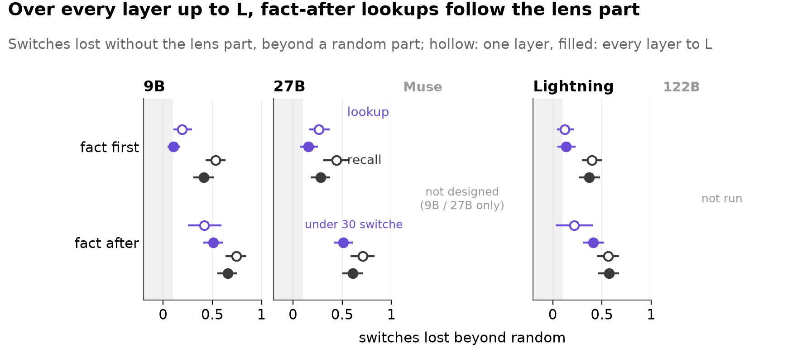
*Lookups (purple) and recalls (dark) lost without the lens part beyond a random part, fact first and fact after; hollow: the change at one layer, filled: at every layer up to L. Zach's named passages, 200 per model (9B, 27B, Lightning). Grey band: the lookup's 0.10 bar; whiskers 95%.*

- **Result.**

  | | 9B | 27B | Muse | Lightning |
  |---|---|---|---|---|
  | fact-after lookups switched: one layer → full carrier, rise | 0.54 [0.44, 0.64]<!-- src: results/x51_carrier/x51_7-20261028T171646Z/verdict.md \| qwen35_9b_x51_7 :: 0.54 [0.44, 0.64] --> | 0.73 [0.64, 0.81]<!-- src: results/x51_carrier/x51_7-20261028T171646Z/verdict.md \| x51_7_27b :: 0.73 [0.64, 0.81] --> | not run | 0.49 [0.39, 0.60]<!-- src: results/x51_carrier/x52_carrier-20261029T014338Z/verdict.md \| nem35l_x52_carrier :: 0.49 [0.39, 0.60] --> |
  | fact-first: lookup switches lost beyond a random part | 0.10 [0.05, 0.17]<!-- src: results/x51_carrier/x51_7-20261028T171646Z/verdict.md \| in between :: 0.10 [0.05, 0.17] --> | 0.16 [0.07, 0.25]<!-- src: results/x51_carrier/x51_7-20261028T171646Z/verdict.md \| in between :: 0.16 [0.07, 0.25] --> | | 0.14 [0.05, 0.23]<!-- src: results/x51_carrier/x52_carrier-20261029T014338Z/verdict.md \| in between :: 0.14 [0.05, 0.23] --> |
  | fact-first: recall switches lost beyond a random part | 0.41 [0.31, 0.52]<!-- src: results/x51_carrier/x51_7-20261028T171646Z/verdict.md \| in between :: 0.41 [0.31, 0.52] --> | 0.28 [0.18, 0.38]<!-- src: results/x51_carrier/x51_7-20261028T171646Z/verdict.md \| in between :: 0.28 [0.18, 0.38] --> | | 0.37 [0.27, 0.48]<!-- src: results/x51_carrier/x52_carrier-20261029T014338Z/verdict.md \| in between :: 0.37 [0.27, 0.48] --> |
  | fact-after: lookup switches lost beyond a random part | 0.51 [0.41, 0.61]<!-- src: results/x51_carrier/x51_7-20261028T171646Z/verdict.md \| the lookup follows the lens on the full carrier :: 0.51 [0.41, 0.61] --> | 0.51 [0.42, 0.61]<!-- src: results/x51_carrier/x51_7-20261028T171646Z/verdict.md \| the lookup follows the lens on the full carrier :: 0.51 [0.42, 0.61] --> | | 0.41 [0.31, 0.52]<!-- src: results/x51_carrier/x52_carrier-20261029T014338Z/verdict.md \| the lookup follows the lens on the full carrier :: 0.41 [0.31, 0.52] --> |
  | rule (i) / (ii), fact-first | holds / in between | holds / in between | | holds / in between; (iii) no (no prediction) |

- **Read.**
  - Carried over every layer up to L, the fact-after lookups switch as often as the fact-first ones, so the one-layer result was a slice; the same on Lightning.
  - On the full carrier the fact-first split is in between; fact-after lookups follow the lens part.
- **Caveats.**
  - Zach's lookup passages state true facts (see [Z1](#z1)).
  - Muse not run (designed for the 9B and 27B).

### What is the address, independent of how we built it? (51.11, opened 28 Oct 22:51) 

*Used in: README "In one minute", claims table row 8, Status line (waiting for Dan). Story: the address.*

- **Question.** Is the address one code per locker, one shared code, or an order line, by methods that do not use our construction?
- **Why we asked.** Our address was built from means of four slots; its size and shape could be an artefact of that build.
- **Data.** Routes-style scenes with 3, 4, 6 and 8 lockers; held-out entities only (9B and Muse, all three parts; 27B part 2 only).
- **Method.** Part 1: the smallest learned subspace dimension d* that carries the position switch, per number of lockers, against random subspaces. Part 2: the address swap through our code, a probe's code and a learned code, each with the others removed, against a random direction. Part 3: swaps to the midpoint between two slots, against a random vector of the same norm.
- **Rule, fixed in advance.** Part 1: "One dimension per slot: d*(S) ≥ S − 2 for every S and d*(8) ≥ 5"; "An ordinal (low-dimensional) code: d*(S) ≤ 2 for every S up to 8"; else in between. Part 2: "One code, three bases: every projected swap reaches ≥ 0.6 of the whole swap's effect, and each cross-removal cuts the other's swap by ≥ 0.6." Part 3: "Categories: midpoint swaps send < 0.1 to the midpoint slot while the full swaps reach ≥ 0.4 of the target"; "A metric order: midpoint swaps send ≥ 0.3 of lookups to the midpoint slot, from both ends." (jobs/c3/batch51.yaml, addendum 3)

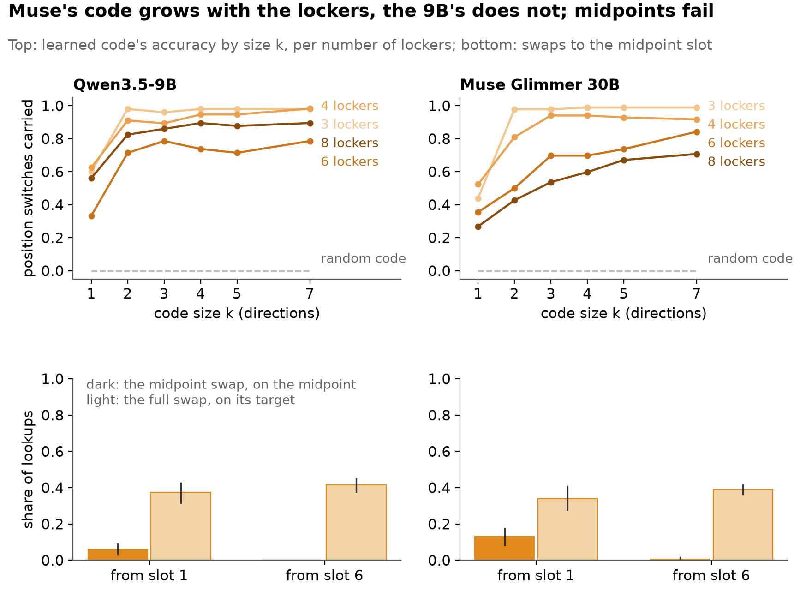
*Top: share of position switches carried by a learned code of k directions, one line per number of lockers (held-out entities, 42 to 91 test pairs per line); dashed: a random code of the same size. Bottom: at dose 2, the midpoint swap's share landing on the midpoint slot (dark) and the full swap's share landing on its target (light), from slot 1 and slot 6, 200 items each; whiskers 95%. 9B and Muse.*

- **Result.**

  | | 9B | 27B | Muse | Lightning |
  |---|---|---|---|---|
  | part 1, d* at 3 / 4 / 6 / 8 lockers | 2<!-- src: results/x51_addr/verdict-20261028T215138Z/verdict.md \| {'train': 213, 'select': 95, 'test': 50} :: 2 --> / 2<!-- src: results/x51_addr/verdict-20261028T215138Z/verdict.md \| {'select': 59, 'train': 191, 'test': 56} :: 2 --> / > 7<!-- src: results/x51_addr/verdict-20261028T215138Z/verdict.md \| {'select': 61, 'train': 200, 'test': 42} :: > 7 --> / 2<!-- src: results/x51_addr/verdict-20261028T215138Z/verdict.md \| {'train': 174, 'select': 73, 'test': 57} :: 2 -->: **in between** | not designed | 2<!-- src: results/x51_addr/verdict-20261028T215138Z/verdict.md \| {'train': 200, 'test': 91, 'select': 82} :: 2 --> / 2<!-- src: results/x51_addr/verdict-20261028T215138Z/verdict.md \| {'select': 72, 'train': 191, 'test': 84} :: 2 --> / 7<!-- src: results/x51_addr/verdict-20261028T215138Z/verdict.md \| {'select': 60, 'train': 192, 'test': 76} :: 7 --> / > 7<!-- src: results/x51_addr/verdict-20261028T215138Z/verdict.md \| {'train': 169, 'select': 64, 'test': 82} :: > 7 -->: **one dimension per slot** | not run |
  | part 2: swap through the learned code with ours removed | 0.39 [0.37, 0.40]<!-- src: results/x51_addr/verdict-20261028T215138Z/verdict.md \| 0.03 [0.01, 0.05] :: 0.39 [0.37, 0.40] --> | **in between** | **in between** | |
  | part 2: the whole swap with ours removed | 0.03 [0.01, 0.05]<!-- src: results/x51_addr/verdict-20261028T215138Z/verdict.md \| 0.39 [0.37, 0.40] :: 0.03 [0.01, 0.05] --> | | | |
  | part 3: midpoint swap from slot 1 lands on the midpoint | 0.06 [0.03, 0.09]<!-- src: results/x51_addr/verdict-20261028T215138Z/verdict.md \| 9.0243 :: 0.06 [0.03, 0.09] --> (none of the three) | not designed | none of the three | |

- **Read.**
  - No row of the wording table matches the labels; the methods agree only in part, and midpoint swaps do not land between slots.
- **Caveats.**
  - The 9B's d* at 6 lockers was not found below 8; Muse's "one per slot" rests on the literal rule (d*(8) not found counts as > 7).
  - The 27B ran part 2 only.

### Does the address travel to the last token? (51.4, opened 28 Oct 18:36; Lightning's coverage run 29 Oct) 

*Used in: README claims table row 12 (waiting for Dan). Story: where and when.*

- **Question.** Does the address swap work at the last token, with the bridge word's slot means or with means refit there?
- **Why we asked.** The answer is read at the last token; the address could be copied there or re-encoded.
- **Data.** Routes scenes without a move, 300 per model (read half 145 / 150 / 144 / 132<!-- src: results/x51_travel/x52_travel-20261029T012517Z/verdict.md \| nem35l_x52_travel :: 300 (132) :: 132 -->; Lightning at L14 and L18).
- **Method.** The address swap added at the last token at L and L+4, at doses 1 and 2, with the bridge word's means and with last-token means; each against a random vector of its norm; a slot probe at the last token beside.
- **Rule, fixed in advance.** "The code travels: the bridge-fit swap sends >= 0.3 of lookups to slot k (random <= 0.05). Re-encoded on copy: bridge-fit <= 0.10 while last-token-fit >= 0.3. Not at the last token: both <= 0.10 while the probe reads the slot there >= 0.8. Otherwise in between." Lightning: a coverage run on this rule, no prediction.

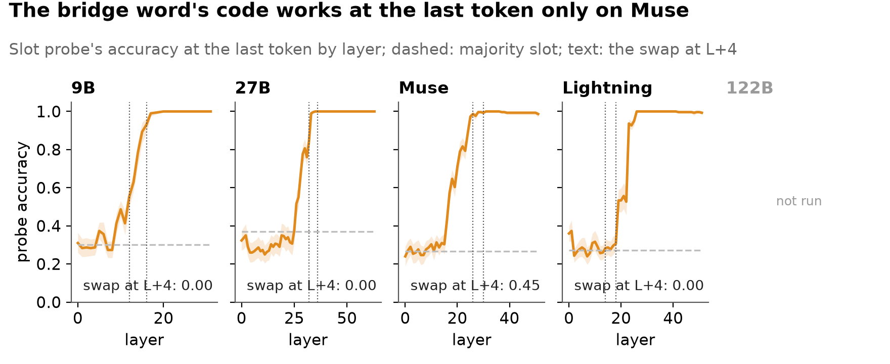
*The slot probe's held-out accuracy at the last token by layer (band 95%), routes scenes, 300 per model (9B, 27B, Muse, Lightning); dashed: the majority slot; dotted: L and L+4; text: the bridge-fit swap's share sent to the target at L+4, dose 2.*

- **Result.**

  | | 9B | 27B | Muse | Lightning |
  |---|---|---|---|---|
  | bridge-fit swap at L+4, dose 2: lookups sent to the target | 0.00 [0.00, 0.00]<!-- src: results/x51_travel/x51_4-20261028T173333Z/verdict.md \| bridge_swap :: 1.00 [1.00, 1.00] :: 0.00 [0.00, 0.00] --> | 0.00 [0.00, 0.01]<!-- src: results/x51_travel/x51_4-20261028T173333Z/verdict.md \| 0.99 [0.99, 1.00] :: 0.00 [0.00, 0.01] --> | 0.45 [0.43, 0.48]<!-- src: results/x51_travel/x51_4-20261028T173333Z/verdict.md \| bridge_swap :: 0.45 [0.43, 0.48] --> | 0.00 [0.00, 0.00]<!-- src: results/x51_travel/x52_travel-20261029T012517Z/verdict.md \| bridge_swap :: L+4 :: 600 :: 1.00 [1.00, 1.00] :: 0.00 [0.00, 0.00] --> |
  | slot probe at the last token, L / L+4 | 0.55 [0.50, 0.61]<!-- src: results/x51_travel/x51_4-20261028T173333Z/verdict.md \| qwen35_9b_x51_4 :: 0.55 [0.50, 0.61] --> / 0.93 [0.89, 0.96]<!-- src: results/x51_travel/x51_4-20261028T173333Z/verdict.md \| qwen35_9b_x51_4 :: 0.93 [0.89, 0.96] --> | 0.85 [0.80, 0.89]<!-- src: results/x51_travel/x51_4-20261028T173333Z/verdict.md \| x51_4_27b :: 0.85 [0.80, 0.89] --> / 1.00 [1.00, 1.00]<!-- src: results/x51_travel/x51_4-20261028T173333Z/verdict.md \| x51_4_27b :: 1.00 [1.00, 1.00] --> | 0.99 [0.97, 1.00]<!-- src: results/x51_travel/x51_4-20261028T173333Z/verdict.md \| muse30_x51_4 :: 0.99 [0.97, 1.00] --> / 0.99 [0.98, 1.00]<!-- src: results/x51_travel/x51_4-20261028T173333Z/verdict.md \| muse30_x51_4 :: 0.99 [0.98, 1.00] --> | 0.28 [0.24, 0.33]<!-- src: results/x51_travel/x52_travel-20261029T012517Z/verdict.md \| nem35l_x52_travel :: 0.28 [0.24, 0.33] --> / 0.31 [0.27, 0.35]<!-- src: results/x51_travel/x52_travel-20261029T012517Z/verdict.md \| nem35l_x52_travel :: 0.31 [0.27, 0.35] --> |
  | the rule | **not at the last token** | **not at the last token** | **the code travels** | **(d) in between<!-- src: results/x51_travel/x52_travel-20261029T012517Z/verdict.md \| nem35l_x52_travel :: (d) in between -->**, at L14 and L18 (no prediction) |

- **Read.**
  - On the 9B and 27B the slot is readable at the last token but the bridge word's code does not work there; on Muse it does.
  - On Lightning the slot is not yet readable at the last token at L and L+4 (the probe sits near the majority slot) and the swap moves nothing there, so the rule says in between; the probe reads the slot only after L+4.
- **Caveats.**
  - "Not at the last token" means not usable there by this swap, not absent: the probe reads the slot there.
  - Doses 1 and 2 only.

### Is the recall's bridge entity read through the lens at the last token? (51.10, opened 28 Oct 20:06; Lightning's coverage run 29 Oct) 

*Used in: README new card, Part IV (waiting for Dan). Story: where and when.*

- **Question.** At the last token and at the question's pick token, is the bridge entity readable through the lens, and does writing it through the lens move the answer?
- **Why we asked.** The bridge word's lens part is followed by the recall; the answer is computed later, at the last token.
- **Data.** Main test, the scenes whose locker sentences come first: 75 / 69 / 68 / 59<!-- src: results/x51_jread/x52_jread-20261029T005707Z/verdict.md \| n = 59 locker-first :: 59 --> (9B / 27B / Muse / Lightning; Lightning at L14, a coverage run on the same rule, no prediction).
- **Method.** Read: a probe on the lens part of the state, layer by layer, against the full state and chance. Write: at the read peak, Zach's swap or the lens part of the change (gain up to 2), against a random part and his rotated control; the whole-state patch as reference.
- **Rule, fixed in advance.** "read: through-the-lens probe >= 0.8 and lens top-5 >= 0.5 at some layer before the answer digit's layer, while the full-residual probe >= 0.9 there. write: at the layer of the read peak, his swap or the J++ part of the change (gain <= 2) switches >= 0.5 of what the whole-state patch switches at that layer, with the random part <= 0.10."

*Read: a probe's accuracy on the lens part of the last token's state (dotted: chance); swap: the lens swap's switches as a share of the whole-state patch's at the same layer; 75 / 69 / 68 locker-first scenes; whiskers 95%.*

- **Result.** (recall, last token)

  | | 9B | 27B | Muse | Lightning |
  |---|---|---|---|---|
  | read peak layer (answer layer) | L24 (L29) | L56 (L61) | L40 (L46) | L36<!-- src: results/x51_jread/x52_jread-20261029T005707Z/verdict.md \| recall :: answer L49 :: 36 --> (L49<!-- src: results/x51_jread/x52_jread-20261029T005707Z/verdict.md \| recall :: answer L49 :: L36: 0.14 / 0.97 :: 49 -->) |
  | through-the-lens probe at the peak | 0.97 [0.94, 0.99]<!-- src: results/x51_jread/x51_10-20261028T190608Z/verdict.md \| 0.87 :: 0.97 [0.94, 0.99] --> | 0.95 [0.89, 0.99]<!-- src: results/x51_jread/x51_10-20261028T190608Z/verdict.md \| 0.80 :: 0.95 [0.89, 0.99] --> | 0.95 [0.91, 0.98]<!-- src: results/x51_jread/x51_10-20261028T190608Z/verdict.md \| 0.73 :: 0.95 [0.91, 0.98] --> | 0.98 [0.96, 1.00]<!-- src: results/x51_jread/x52_jread-20261029T005707Z/verdict.md \| 0.82 :: 0.98 [0.96, 1.00] --> |
  | swap / whole-state patch, switches | 0.00 / 0.95<!-- src: results/x51_jread/x51_10-20261028T190608Z/verdict.md \| L24: 0.00 / 0.95 :: 0.00 / 0.95 --> | 0.01 / 0.97<!-- src: results/x51_jread/x51_10-20261028T190608Z/verdict.md \| L56: 0.01 / 0.97 :: 0.01 / 0.97 --> | 0.01 / 1.00<!-- src: results/x51_jread/x51_10-20261028T190608Z/verdict.md \| L40: 0.01 / 1.00 :: 0.01 / 1.00 --> | 0.14 / 0.97<!-- src: results/x51_jread/x52_jread-20261029T005707Z/verdict.md \| L36: 0.14 / 0.97 :: 0.14 / 0.97 --> |
  | the rule (recall, last token) | **readable, not used** | **readable, not used** | **readable, not used** | **readable, not used** (no prediction) |

- **Read.**
  - At the last token the recall's bridge entity is readable through the lens on all four models, Lightning included, but writing it through the lens does not move the answer.
- **Caveats.**
  - The lookup's cells: routes around J-space (9B) or none of the four (27B, Muse, Lightning); the question's pick token: not represented or none of the four on almost every cell.
  - Locker-first scenes only.

### Does the lookup drop the lens part before it takes up the address? (anatomy by layer, 47.8; Lightning's coverage run and the 27B's full grid 29 Oct) 

*Used in: README Part IV card "The anatomy by depth" (9B, 27B, Muse): the 27B's full grid contradicts its rule (a) (Flagged, top); Lightning not in the README yet. Story: where and when.*

- **Question.** Layer by layer, when does the lookup stop needing the lens part, when does it start using the address, when is the address readable, and is the value ever used?
- **Why we asked.** At L the lookup takes an identity route and a position route; depth says which comes first and whether the address is written before it is read.
- **Data.** Routes scenes (another item moved), locker first, the test half: 200 per model (27B 150, on its full grid: every 4th layer); the fit half for the per-layer refits and probes.
- **Method.** At each sampled layer, the whole change and its parts (the lens part; the address part refit at that layer; the identity outside the lens), each added alone or taken out, against random parts of the same share; a slot probe at the bridge word. A layer counts only where the whole change switches 0.30 or more. D4: the angles between the address subspaces (and the identity subspaces) refit at every pair of layers in the probe's window.
- **Rule, fixed in advance.** "Define l_J = the first layer from which the lookup's extra loss without J++ stays <= 0.10; l_P = the first layer where the position share under the whole change is >= 0.20; l_probe = the first layer where the slot probe is >= 0.80. (a) "Handoff": l_P >= l_J [...] (b) "The address forms before it is used": l_probe <= l_P on every model [...] (c) "Identity leaves the lens": identity share with only-J++ is >= 0.5 at the earliest interpretable layer and <= 0.1 by L, while identity with only-I_l rises to >= 0.3 by L, on >= 2 of 3 models [...] (d) "Never the value, at any depth": value <= 0.05 at every interpretable layer." D4: "persistent if the mean cos^2 of the principal angles >= 0.5 across the window where the slot probe is >= 0.8; re-encoded if it drops below 0.2 between adjacent sampled layers." The 27B's full grid and Lightning: coverage runs on this rule, no prediction.

*Per sampled layer, the lookup's answers under the whole change at that layer (identity blue, position orange, the original grey) and the recall's switches (line); dashed: the slot probe reaches 0.8; solid: position answers begin; hatched: too few switches to read. 9B, 27B, Muse; the 27B panel is the reduced grid behind README E12. Their own figures: [the 27B's full grid](../../results/x47_anatomy/x52_anatomy-20261029T013405Z/x47_anatomy.png), [Lightning](../../results/x47_anatomy/x52_anatomy-20261029T010517Z/x47_anatomy.png).*

- **Result.**

  | | 9B | 27B | Muse | Lightning |
  |---|---|---|---|---|
  | l_J: the lookup no longer needs the lens part | L12<!-- src: results/x47_anatomy/x47_8-20261028T154518Z/x47_8.md \| qwen3.5-9b :: 0 (<= 2) :: 12 --> | L40<!-- src: results/x47_anatomy/x52_anatomy-20261029T013405Z/x47_8.md \| qwen3.6-27b :: -12 (<= 2) :: 40 --> | L2<!-- src: results/x47_anatomy/x47_8-20261028T154518Z/x47_8.md \| muse-glimmer-30b :: 20 (> 6) :: 2 --> | L14<!-- src: results/x47_anatomy/x52_anatomy-20261029T010517Z/x47_8.md \| nemotron-3.5-lightning :: 0 (<= 2) :: 14 --> |
  | l_P: position answers begin | L12<!-- src: results/x47_anatomy/x47_8-20261028T154518Z/x47_8.md \| qwen3.5-9b :: 0 (<= 2) :: 12 --> | L28<!-- src: results/x47_anatomy/x52_anatomy-20261029T013405Z/x47_8.md \| qwen3.6-27b :: -12 (<= 2) :: 28 --> | L22<!-- src: results/x47_anatomy/x47_8-20261028T154518Z/x47_8.md \| muse-glimmer-30b :: 20 (> 6) :: 22 --> | L14<!-- src: results/x47_anatomy/x52_anatomy-20261029T010517Z/x47_8.md \| nemotron-3.5-lightning :: 0 (<= 2) :: 14 --> |
  | l_probe: the address is readable | L4<!-- src: results/x47_anatomy/x47_8-20261028T154518Z/x47_8.md \| qwen3.5-9b :: 0 (<= 2) :: 4 --> | L8<!-- src: results/x47_anatomy/x52_anatomy-20261029T013405Z/x47_8.md \| qwen3.6-27b :: -12 (<= 2) :: 8 --> | L6<!-- src: results/x47_anatomy/x47_8-20261028T154518Z/x47_8.md \| muse-glimmer-30b :: 20 (> 6) :: 6 --> | L6<!-- src: results/x47_anatomy/x52_anatomy-20261029T010517Z/x47_8.md \| nemotron-3.5-lightning :: 0 (<= 2) :: 6 --> |
  | (a) handoff, l_P >= l_J (gap) | yes, gap 0 (<= 2)<!-- src: results/x47_anatomy/x47_8-20261028T154518Z/x47_8.md \| (a) qwen3.5-9b :: yes, gap 0 (<= 2) --> | no, gap -12 (<= 2)<!-- src: results/x47_anatomy/x52_anatomy-20261029T013405Z/x47_8.md \| Q47.8 :: no, gap -12 (<= 2) --> (full grid) | yes, gap 20 (> 6)<!-- src: results/x47_anatomy/x47_8-20261028T154518Z/x47_8.md \| Q47.8 :: yes, gap 20 (> 6) --> | yes, gap 0 (<= 2)<!-- src: results/x47_anatomy/x52_anatomy-20261029T010517Z/x47_8.md \| Q47.8 :: yes, gap 0 (<= 2) --> (no prediction) |
  | (b) the address readable before it is used | yes<!-- src: results/x47_anatomy/x47_8-20261028T154518Z/x47_8.md \| qwen3.5-9b :: (cross :: yes --> | yes<!-- src: results/x47_anatomy/x52_anatomy-20261029T013405Z/x47_8.md \| qwen3.6-27b :: (cross :: yes --> | yes<!-- src: results/x47_anatomy/x47_8-20261028T154518Z/x47_8.md \| muse-glimmer-30b :: (cross :: yes --> | yes<!-- src: results/x47_anatomy/x52_anatomy-20261029T010517Z/x47_8.md \| nemotron-3.5-lightning :: (cross :: yes --> |
  | (c) identity leaves the lens (crossing layer) | no (cross 12)<!-- src: results/x47_anatomy/x47_8-20261028T154518Z/x47_8.md \| qwen3.5-9b :: no (cross 12) :: no (cross 12) --> | no (cross 4)<!-- src: results/x47_anatomy/x52_anatomy-20261029T013405Z/x47_8.md \| qwen3.6-27b :: no (cross 4) :: no (cross 4) --> | no (cross 2)<!-- src: results/x47_anatomy/x47_8-20261028T154518Z/x47_8.md \| muse-glimmer-30b :: no (cross 2) :: no (cross 2) --> | no (cross 2)<!-- src: results/x47_anatomy/x52_anatomy-20261029T010517Z/x47_8.md \| nemotron-3.5-lightning :: no (cross 2) :: no (cross 2) --> |
  | (d) never the value | yes (max 0.00)<!-- src: results/x47_anatomy/x47_8-20261028T154518Z/x47_8.md \| qwen3.5-9b :: yes (max 0.00) :: yes (max 0.00) --> | yes (max 0.00)<!-- src: results/x47_anatomy/x52_anatomy-20261029T013405Z/x47_8.md \| qwen3.6-27b :: yes (max 0.00) :: yes (max 0.00) --> | yes (max 0.00)<!-- src: results/x47_anatomy/x47_8-20261028T154518Z/x47_8.md \| muse-glimmer-30b :: yes (max 0.00) :: yes (max 0.00) --> | yes (max 0.00)<!-- src: results/x47_anatomy/x52_anatomy-20261029T010517Z/x47_8.md \| nemotron-3.5-lightning :: yes (max 0.00) :: yes (max 0.00) --> |
  | the recall switches 0.5 or more (window) | L2-L14<!-- src: results/x47_anatomy/x47_8-20261028T154518Z/x47_8.md \| qwen3.5-9b :: L2-L14 :: L2-L14 --> | L4-L32<!-- src: results/x47_anatomy/x52_anatomy-20261029T013405Z/x47_8.md \| qwen3.6-27b :: L4-L32 :: L4-L32 --> | L2-L22<!-- src: results/x47_anatomy/x47_8-20261028T154518Z/x47_8.md \| muse-glimmer-30b :: L2-L22 :: L2-L22 --> | L2-L22<!-- src: results/x47_anatomy/x52_anatomy-20261029T010517Z/x47_8.md \| nemotron-3.5-lightning :: L2-L22 :: L2-L22 --> |
  | D4: the address code across depth, mean cos^2 (label) | 0.279<!-- src: results/x47_depth_cpu/persistence-20261028T115530Z/persistence.md \| qwen3.5-9b :: U :: 0.279 -->, re-encoded<!-- src: results/x47_depth_cpu/persistence-20261028T115530Z/persistence.md \| qwen3.5-9b :: U :: 0.279 :: re-encoded --> | 0.256<!-- src: results/x47_depth_cpu/persistence-20261029T013614Z/persistence.md \| qwen3.6-27b :: U :: 0.256 -->, mixed<!-- src: results/x47_depth_cpu/persistence-20261029T013614Z/persistence.md \| qwen3.6-27b :: U :: 0.256 :: mixed --> | 0.213<!-- src: results/x47_depth_cpu/persistence-20261028T115530Z/persistence.md \| muse-glimmer-30b :: U :: 0.213 -->, re-encoded<!-- src: results/x47_depth_cpu/persistence-20261028T115530Z/persistence.md \| muse-glimmer-30b :: U :: 0.213 :: re-encoded --> | 0.341<!-- src: results/x47_depth_cpu/persistence-20261029T015607Z/persistence.md \| nemotron-3.5-lightning :: U :: 0.341 -->, mixed<!-- src: results/x47_depth_cpu/persistence-20261029T015607Z/persistence.md \| nemotron-3.5-lightning :: U :: 0.341 :: mixed --> |
  | D4: the identity code across depth, mean cos^2 (label) | 0.432<!-- src: results/x47_depth_cpu/persistence-20261028T115530Z/persistence.md \| qwen3.5-9b :: Id :: 0.432 -->, mixed<!-- src: results/x47_depth_cpu/persistence-20261028T115530Z/persistence.md \| qwen3.5-9b :: Id :: 0.432 :: mixed --> | 0.386<!-- src: results/x47_depth_cpu/persistence-20261029T013614Z/persistence.md \| qwen3.6-27b :: Id :: 0.386 -->, mixed<!-- src: results/x47_depth_cpu/persistence-20261029T013614Z/persistence.md \| qwen3.6-27b :: Id :: 0.386 :: mixed --> | 0.365<!-- src: results/x47_depth_cpu/persistence-20261028T115530Z/persistence.md \| muse-glimmer-30b :: Id :: 0.365 -->, mixed<!-- src: results/x47_depth_cpu/persistence-20261028T115530Z/persistence.md \| muse-glimmer-30b :: Id :: 0.365 :: mixed --> | 0.419<!-- src: results/x47_depth_cpu/persistence-20261029T015607Z/persistence.md \| nemotron-3.5-lightning :: Id :: 0.419 -->, mixed<!-- src: results/x47_depth_cpu/persistence-20261029T015607Z/persistence.md \| nemotron-3.5-lightning :: Id :: 0.419 :: mixed --> |

- **Read.**
  - On the 9B, Muse and Lightning the lookup stops needing the lens part no later than position answers begin; on the 27B's full grid it still needs it after they begin, so (a) fails there. On all four the address is readable before position answers begin and the value is never used; (c) fails on every model.
  - Lightning's handoff and first position answers fall at L14 (L), as on the 9B. The address code does not persist across depth on any of the four (re-encoded on the 9B and Muse, mixed on the 27B and Lightning).
- **Caveats.**
  - The 27B's column is its full grid. The reduced grid behind README E12 (9 layers) gave l_J L16, l_P L30, (a) yes; l_J needs the loss to stay under the bar at every later sampled layer, and the full grid samples L36, which the reduced grid skipped (Flagged, top).
  - Each layer's address part and probe are refit on the fit half; early-layer refits read less well (the verdicts give their held-out accuracy).

### Does the split hold on Zach's passages with a named bridge? (Z1, opened 28 Oct 17:17; Lightning's coverage run 29 Oct) 

*Used in: README Part V (Fig. 12's "his passages" cells); the wording about reruns waits for Dan. Story: other datasets.*

- **Question.** On Zach's passages with a named bridge, does the lookup let go of the lens part while the recall follows it?
- **Why we asked.** Our scenes are short lists; his passages scatter the facts in prose.
- **Data.** His passages (named bridge; the lookup's passage states the true final fact, the recall's leaves it out): 200 per model (Lightning at L14, which decides, and L27 beside).
- **Method.** The conflict test at the bridge name's last token at L: without the lens part, against without a random part; each reader gets its own change.
- **Rule, fixed in advance.** "Per model: gap >= 0.3 and lookup extra loss <= 0.10 → the split holds on his passages; lookup >= 0.20 → the lookup follows the lens here; else in between. The order pattern replicates if the lookup's switch under the whole change is >= 2x higher fact-first than fact-after (both CIs)." Lightning: a coverage run on this rule, no prediction.

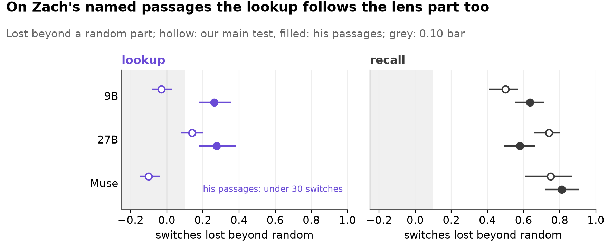
*Switches lost without the lens part beyond a random part, per reader: our main test (hollow, 200 per model) and Zach's named passages (filled, 200 per model), both at L; grey band: the lookup's 0.10 bar; whiskers 95%. 9B, 27B, Muse; Lightning in the table.*

- **Result.**

  | | 9B | 27B | Muse (L26) | Lightning (L14) |
  |---|---|---|---|---|
  | lookup: switches lost beyond a random part | 0.26 [0.18, 0.36]<!-- src: results/x50_zach/z1-20261028T161649Z/z1.md \| qwen35_9b_x50_z1 :: 0.26 [0.18, 0.36] --> | 0.28 [0.18, 0.38]<!-- src: results/x50_zach/z1-20261028T161649Z/z1.md \| x50_z1_27b :: 0.28 [0.18, 0.38] --> | 0.60 [0.38, 0.81]<!-- src: results/x50_zach/z1-20261028T161649Z/z1.md \| muse30_x50_z1 :: 0.60 [0.38, 0.81] --> | 0.15 [0.07, 0.25]<!-- src: results/x50_zach/x52_z1-20261029T013035Z/z1.md \| nem35l_x52_z1 :: 0.48 [0.40, 0.55] :: 0.15 [0.07, 0.25] --> |
  | recall: switches lost beyond a random part | 0.64 [0.56, 0.71]<!-- src: results/x50_zach/z1-20261028T161649Z/z1.md \| qwen35_9b_x50_z1 :: 0.64 [0.56, 0.71] --> | 0.58 [0.49, 0.66]<!-- src: results/x50_zach/z1-20261028T161649Z/z1.md \| x50_z1_27b :: 0.58 [0.49, 0.66] --> | 0.81 [0.72, 0.90]<!-- src: results/x50_zach/z1-20261028T161649Z/z1.md \| muse30_x50_z1 :: 0.81 [0.72, 0.90] --> | 0.48 [0.40, 0.55]<!-- src: results/x50_zach/x52_z1-20261029T013035Z/z1.md \| nem35l_x52_z1 :: 0.15 [0.07, 0.25] :: 0.48 [0.40, 0.55] --> |
  | lookups switched, fact-first / fact-after | 0.78 [0.68, 0.86]<!-- src: results/x50_zach/z1-20261028T161649Z/z1.md \| L12 order :: 0.78 [0.68, 0.86] --> / 0.36 [0.27, 0.46]<!-- src: results/x50_zach/z1-20261028T161649Z/z1.md \| L12 order :: 0.36 [0.27, 0.46] --> | 0.67 [0.57, 0.76]<!-- src: results/x50_zach/z1-20261028T161649Z/z1.md \| L32 order :: 0.67 [0.57, 0.76] --> / 0.11 [0.05, 0.17]<!-- src: results/x50_zach/z1-20261028T161649Z/z1.md \| L32 order :: 0.11 [0.05, 0.17] --> | 0.20 [0.12, 0.29]<!-- src: results/x50_zach/z1-20261028T161649Z/z1.md \| L26 order :: 0.20 [0.12, 0.29] --> / 0.05 [0.01, 0.10]<!-- src: results/x50_zach/z1-20261028T161649Z/z1.md \| L26 order :: 0.05 [0.01, 0.10] --> | 0.71 [0.61, 0.80]<!-- src: results/x50_zach/x52_z1-20261029T013035Z/z1.md \| L14 order :: 0.71 [0.61, 0.80] --> / 0.38 [0.27, 0.49]<!-- src: results/x50_zach/x52_z1-20261029T013035Z/z1.md \| L14 order :: 0.38 [0.27, 0.49] --> |
  | the rule | **the lookup follows the lens here** | **the lookup follows the lens here** | **the lookup follows the lens here** | **in between<!-- src: results/x50_zach/x52_z1-20261029T013035Z/z1.md \| nem35l_x52_z1 :: 0.32 [0.21, 0.44] :: in between -->** (gap 0.32 [0.21, 0.44]<!-- src: results/x50_zach/x52_z1-20261029T013035Z/z1.md \| nem35l_x52_z1 :: 0.32 [0.21, 0.44] -->; no prediction) |

- **Read.**
  - On his named-bridge passages the lookup follows the lens part too on the 9B and 27B; Muse's lookup switches too rarely to tell (see Flagged for Dan). The order pattern replicates on all three.
  - On Lightning at L14 the split is in between: the lookup loses more than the 0.10 bar but far less than the recall; its order pattern does not replicate (fact-first under twice fact-after).
- **Caveats.**
  - Not the made-up-fact rerun: his lookup passages state true facts; the P-item reruns were never specced or run.
  - Muse's lookup switches under the whole change on 0.12 of passages; at L36 it cannot tell. Lightning's L27 (beside) likewise: its lookup switches on 1<!-- src: results/x50_zach/x52_z1-20261029T013035Z/z1.md \| L27: routes :: "original": 198, "switch": 1 :: 1 --> of 200 passages there, so the verdict's "follows the lens here" at L27 is not valid (Flagged 13).

## Supports a README claim

### Is it the bridge item or its answer that moves through the lens? (51.12, opened 28 Oct 21:18) 

*Used in: README Part I card "In a conflict, which part of the bridge word does each reader follow?" (specificity); README Part VI, Withdrawn (Z2). Story: two readers.*

- **Question.** On the main test, is the recall's loss without the lens part about the bridge item or about its answer word?
- **Why we asked.** At a described bridge the lens reads the answer about as well as the item; the same could hold at our bridge word.
- **Data.** Main test, 200 per model (Lightning at L14: a coverage run, no prediction).
- **Method.** At the bridge word at L: (1) without the lens part; (2) without the lens part but keeping its directions for both readers' answer words (number words); (3) without those answer directions only; each against a random part of its share; the lens's rank of the answer word at the bridge word first.
- **Rule, fixed in advance.** (Amended 20:20, before opening.) "The lens effect is the entity: arm 2 keeps >= 0.7 of arm 1's extra loss and arm 3 costs <= 0.10 beyond random. The lens effect is the answer: arm 2 falls to <= 0.3 of arm 1 and arm 3 alone costs >= 0.5 of arm 1. Else: mixed." First: "the answer word is not read at the bridge word (lens rank > 50 on >= 90 % of items)".

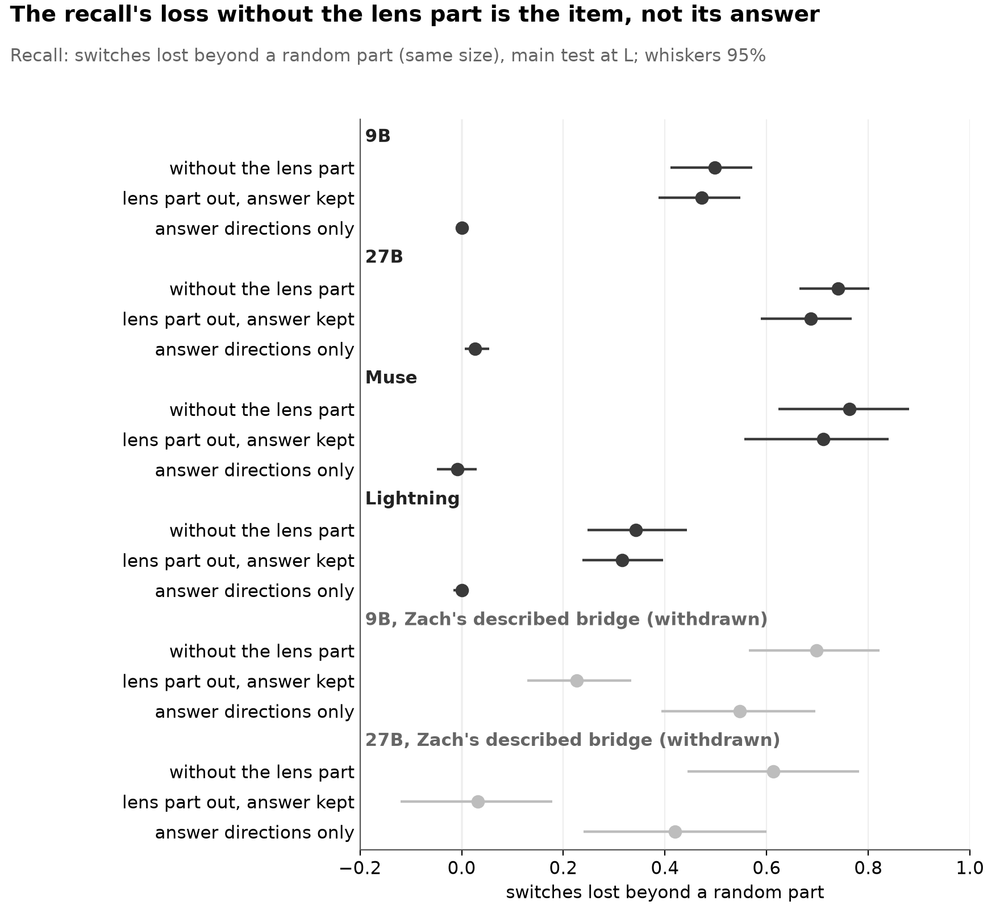
*The recall's switches lost beyond a random part under the three arms, main test at L (200 per model; Lightning at L14); grey: Zach's described bridge (9B, 27B), withdrawn; whiskers 95%.*

- **Result.** (recall)

  | | 9B | 27B | Muse | Lightning |
  |---|---|---|---|---|
  | (1) switches lost beyond a random part | 0.50 [0.41, 0.57]<!-- src: results/x51_answer/x51_12-20261028T201842Z/verdict.md \| the lens effect is the entity :: 0.50 [0.41, 0.57] --> | 0.74 [0.66, 0.80]<!-- src: results/x51_answer/x51_12-20261028T201842Z/verdict.md \| the lens effect is the entity :: 0.74 [0.66, 0.80] --> | 0.76 [0.62, 0.88]<!-- src: results/x51_answer/x51_12-20261028T201842Z/verdict.md \| arms beside: the lens effect is the entity :: 0.76 [0.62, 0.88] --> | 0.34 [0.25, 0.44]<!-- src: results/x51_answer/x52_answer-20261029T002056Z/verdict.md \| nemotron-3.5-lightning :: 0.34 [0.25, 0.44] --> |
  | (2) / (1): loss kept with the answer directions kept | 0.95 [0.90, 0.99]<!-- src: results/x51_answer/x51_12-20261028T201842Z/verdict.md \| the lens effect is the entity :: 0.95 [0.90, 0.99] --> | 0.93 [0.85, 0.99]<!-- src: results/x51_answer/x51_12-20261028T201842Z/verdict.md \| the lens effect is the entity :: 0.93 [0.85, 0.99] --> | 0.93 [0.85, 1.00]<!-- src: results/x51_answer/x51_12-20261028T201842Z/verdict.md \| arms beside: the lens effect is the entity :: 0.93 [0.85, 1.00] --> | 0.92 [0.83, 1.03]<!-- src: results/x51_answer/x52_answer-20261029T002056Z/verdict.md \| nemotron-3.5-lightning :: 0.92 [0.83, 1.03] --> |
  | (3) without the answer directions only, beyond random | 0.00 [0.00, 0.00]<!-- src: results/x51_answer/x51_12-20261028T201842Z/verdict.md \| 0.47 [0.39, 0.55] :: 0.00 [0.00, 0.00] --> | 0.03 [0.01, 0.05]<!-- src: results/x51_answer/x51_12-20261028T201842Z/verdict.md \| 0.69 [0.59, 0.77] :: 0.03 [0.01, 0.05] --> | -0.01 [-0.05, 0.03]<!-- src: results/x51_answer/x51_12-20261028T201842Z/verdict.md \| 0.71 [0.56, 0.84] :: -0.01 [-0.05, 0.03] --> | 0.00 [-0.02, 0.01]<!-- src: results/x51_answer/x52_answer-20261029T002056Z/verdict.md \| nemotron-3.5-lightning :: 0.00 [-0.02, 0.01] --> |
  | answer word outside the lens's top 50 | 0.56 [0.47, 0.66]<!-- src: results/x51_answer/x51_12-20261028T201842Z/verdict.md \| 0.50 [0.41, 0.57] :: 0.56 [0.47, 0.66] --> | 0.79 [0.72, 0.86]<!-- src: results/x51_answer/x51_12-20261028T201842Z/verdict.md \| 0.74 [0.66, 0.80] :: 0.79 [0.72, 0.86] --> | 0.99 [0.98, 1.00]<!-- src: results/x51_answer/x51_12-20261028T201842Z/verdict.md \| 0.76 [0.62, 0.88] :: 0.99 [0.98, 1.00] --> | 0.95 [0.90, 0.99]<!-- src: results/x51_answer/x52_answer-20261029T002056Z/verdict.md \| nemotron-3.5-lightning :: 0.95 [0.90, 0.99] --> |
  | the rule | **the entity** | **the entity** | **the answer word is not read** | **the answer word is not read** (arms beside: the entity) |

- **Read.**
  - The recall's loss without the lens part is the item's: keeping the answer's lens directions keeps almost all of it, and those directions alone cost nothing.
  - On Lightning the answer word is not read at the bridge word for either reader; its lookup loses too little without the lens part to split into arms.
- **Caveats.**
  - Digits are not in the lens dictionary, so the answer directions are number words; the pre-amendment runs are kept, superseded.
  - On Zach's described bridge the same control finds the answer, not the item (see [Z2](#z2)).

### Does the conflict test hold on Lightning? (Lightning conflict test, opened 29 Oct 01:16 UTC) 

*Used in: not in the README yet (waiting for Dan). Story: two readers.*

- **Question.** On Nemotron 3.5 Lightning, at its committed layer L14, does the recall follow the lens part while the lookup goes around it?
- **Why we asked.** A fourth model, of another family, under the main test's rule unchanged.
- **Data.** Main test, 200 scenes (the 60 scenes used to pick the layer excluded); ○ gate chosen after the 60-scene pre-check was seen: the main test's gate on all 516 scenes passed (lookup 0.957, recall 0.816).
- **Method.** The conflict test at the bridge word at each of 13 swept layers (L2 to L50), decided at L14: without the lens part, against without a random part of the same share.
- **Rule, fixed in advance.** The main test's: "confirmed if the lookup loses at most 0.10 beyond random and the recall loses at least 0.30 of its switches without the lens part; killed if the lookup loses at least 0.20 or the recall under 0.20." Coverage run on an already-scored rule: no prediction.

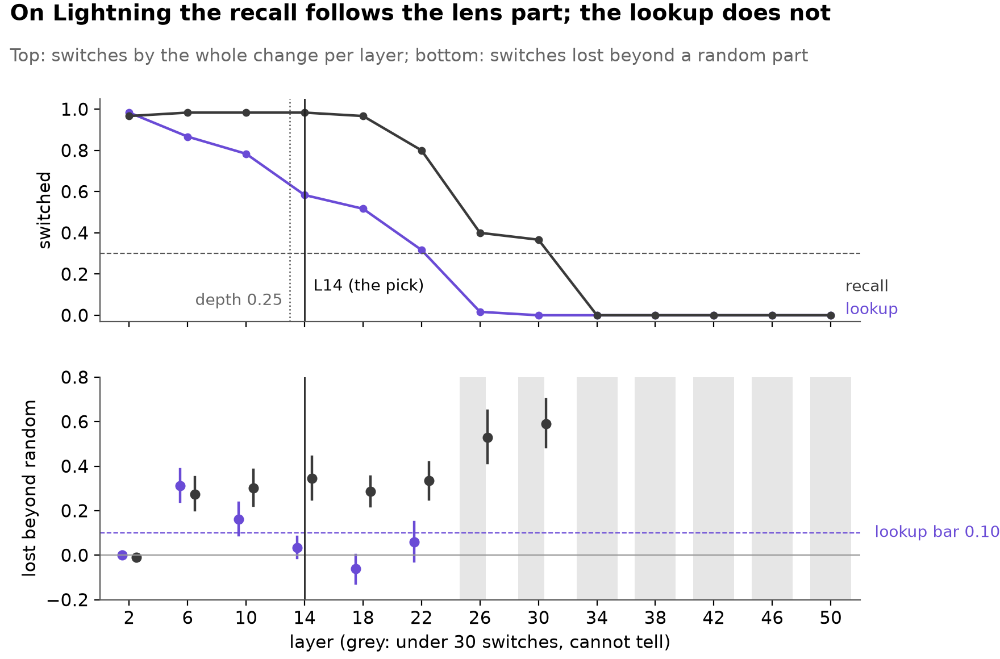
*Top: share switched by the whole change per swept layer (60 dev scenes); dashed: the pick rule's 0.3; dotted: relative depth 0.25; solid line: L14. Bottom: switches lost without the lens part beyond a random part per layer (200 scenes), lookup purple, recall dark; dashed: the lookup's 0.10 bar; grey: under 30 switches, cannot tell; whiskers 95%.*

- **Result.** (L14)

  | | 9B | 27B | Muse | Lightning |
  |---|---|---|---|---|
  | recall: switches lost beyond a random part | see the README | | | 0.34 [0.25, 0.44]<!-- src: results/x0_necessity/nem35l_x52_conflict/verdict-20261029T001612Z/verdict.md \| 0.94 :: 0.34 [0.25, 0.44] --> |
  | recall: switches lost, not net of random | | | | 0.41 [0.32, 0.50]<!-- src: results/x0_necessity/nem35l_x52_conflict/verdict-20261029T001612Z/verdict.md \| 0.94 :: 0.41 [0.32, 0.50] --> |
  | lookup: switches lost beyond a random part | | | | 0.03 [-0.01, 0.08]<!-- src: results/x0_necessity/nem35l_x52_conflict/verdict-20261029T001612Z/verdict.md \| 0.45 :: 0.03 [-0.01, 0.08] --> |
  | lookup: switches under the whole change | | | | 0.45<!-- src: results/x0_necessity/nem35l_x52_conflict/verdict-20261029T001612Z/verdict.md \| 0.03 [-0.01, 0.08] :: 0.45 --> |
  | the rule | | | | **confirmed** (lookup around, recall through) |

- **Read.**
  - At L14 the recall follows the lens part and the lookup does not; the same split stands at L18 and L22.
- **Caveats.**
  - The gate was chosen after the 60-scene pre-check had failed (accepted by Dan 01:10).
  - From L26 on the lookup switches on 0.02 of scenes or fewer, so those layers cannot tell.

### Does each part, added by itself, move its reader? (51.1, opened 28 Oct 18:03; Lightning's coverage run 29 Oct) 

*Used in: README Part I card of the same name (Fig. 16). Story: two readers.*

- **Question.** Added by itself at a dose, does the lens part move the recall more than a random part of its share, and leave the lookup?
- **Why we asked.** The conflict test takes a part away; a reader that follows a part should also move when only that part is added.
- **Data.** Main test, the scenes whose locker sentences come first: 75 / 69 / 68 / 59<!-- src: results/x51_dose/x52_dose-20261029T011635Z/verdict.md \| nem35l_x52_dose :: 59 --> (9B / 27B / Muse / Lightning; Lightning at L14, a coverage run on the same rule, no prediction).
- **Method.** At the bridge word at L: the lens part alone at doses 0.5 to 3, against a random part of the same share at the same dose; the rest alone at doses 0.25 to 1.5, with and without the address.
- **Rule, fixed in advance.** "(i) the lookup is blind to the J++ part: switch minus random <= 0.10 at every α whose plain-text loss stays under 2x the whole change's, on all three. (ii) the recall reads the J++ part above its share: at the first α where the J++ part alone switches >= 0.3, J minus random >= 0.2, per model. (iii) together only (Muse): (1,1) >= 0.8 while the best single-part dose under the loss bar stays <= 0.3."

*Left: switches with the lens part alone minus a random part of the same size, by dose; rings: the dose rule (ii) reads; dotted: the lookup's 0.10 bar. Right: lookups switched by the rest alone, without the address, and without a random part of the address's share. 75 / 69 / 68 scenes; whiskers 95%. Lightning is not drawn here (the README's figure); its own curves: [the verdict folder](../../results/x51_dose/x52_dose-20261029T011635Z/dose_curves.png).*

- **Result.**

  | | 9B | 27B | Muse | Lightning |
  |---|---|---|---|---|
  | recall: lens part alone minus random, dose 1.5 | 0.31 [0.20, 0.42]<!-- src: results/x51_dose/x51_1-20261028T170335Z/verdict.md \| J(1.5,0) - R(1.5,0) :: 0.31 [0.20, 0.42] --> | 0.12 [0.05, 0.19]<!-- src: results/x51_dose/x51_1-20261028T170335Z/verdict.md \| J(1.5,0) - R(1.5,0) :: 0.12 [0.05, 0.19] --> | 0.13 [0.04, 0.24]<!-- src: results/x51_dose/x51_1-20261028T170335Z/verdict.md \| J(1.5,0) - R(1.5,0) :: 0.13 [0.04, 0.24] --> | 0.19 [0.08, 0.31]<!-- src: results/x51_dose/x52_dose-20261029T011635Z/verdict.md \| J(1.5,0) - R(1.5,0) :: 0.19 [0.08, 0.31] --> |
  | recall: the same at dose 3 | -0.05 [-0.16, 0.05]<!-- src: results/x51_dose/x51_1-20261028T170335Z/verdict.md \| J(3,0) - R(3,0) :: -0.05 [-0.16, 0.05] --> | 0.42 [0.28, 0.54]<!-- src: results/x51_dose/x51_1-20261028T170335Z/verdict.md \| J(3,0) - R(3,0) :: 0.42 [0.28, 0.54] --> | 0.22 [0.07, 0.37]<!-- src: results/x51_dose/x51_1-20261028T170335Z/verdict.md \| J(3,0) - R(3,0) :: 0.22 [0.07, 0.37] --> | -0.10 [-0.21, 0.00]<!-- src: results/x51_dose/x52_dose-20261029T011635Z/verdict.md \| J(3,0) - R(3,0) :: -0.10 [-0.21, 0.00] --> |
  | lookup: lens part alone minus random, dose 3 | -0.63 [-0.72, -0.52]<!-- src: results/x51_dose/x51_1-20261028T170335Z/verdict.md \| J(3,0) - R(3,0) :: -0.63 [-0.72, -0.52] --> | 0.13 [0.00, 0.26]<!-- src: results/x51_dose/x51_1-20261028T170335Z/verdict.md \| J(3,0) - R(3,0) :: 0.13 [0.00, 0.26] --> | -0.22 [-0.32, -0.13]<!-- src: results/x51_dose/x51_1-20261028T170335Z/verdict.md \| J(3,0) - R(3,0) :: -0.22 [-0.32, -0.13] --> | -0.46 [-0.64, -0.28]<!-- src: results/x51_dose/x52_dose-20261029T011635Z/verdict.md \| J(3,0) - R(3,0) :: -0.46 [-0.64, -0.28] --> |
  | rule (i) / (ii) | yes / yes | **no** / yes | yes / yes; (iii) no | yes<!-- src: results/x51_dose/x52_dose-20261029T011635Z/verdict.md \| lookup blind :: yes --> / **no** (first dose 1.5<!-- src: results/x51_dose/x52_dose-20261029T011635Z/verdict.md \| nem35l_x52_dose :: **no** (1.5) :: 1.5 -->: 0.19<!-- src: results/x51_dose/x52_dose-20261029T011635Z/verdict.md \| J(1.5,0) - R(1.5,0) :: 0.19 --> against 0.2); (iii) is Muse's rule, not read; no prediction |

- **Read.**
  - Added by itself, the lens part moves the recall more than a random part on all three models, and the 9B's and Muse's lookups no more than random; the 27B's lookup moves at the highest dose.
  - Lightning's lookup is blind to the lens part as on the 9B and Muse; its recall misses rule (ii)'s bar by a hair at the first dose that switches 0.3 of recalls.
- **Caveats.**
  - At high doses random parts switch readers too (the 9B's random part at dose 3 switches most lookups).
  - Scenes with the lockers first only.

### Does the recall need the lens part once its other copies are gone? (49.2, opened 28 Oct 17:16) 

*Used in: README Part I card "Does the recall need the lens part, or only follow it?" (Fig. 1d); claims table row 2. Story: two readers.*

- **Question.** Taking the lens part out of the changed prompt step by step (more layers, the earlier mention, the question, every token), when does the recall start to need it, and does the lookup ever?
- **Why we asked.** At one layer the recall barely needs the lens part; it may have copies elsewhere.
- **Data.** Clean one-pick scenes: 417 / 574 / 409. The 27B: its full ladder (x52_ladder_27b_a; the first run had steps 1-2 only); Muse: the first run (step 6 at L23-29) and a rerun with step 6 inside Zach's band (L36-42).
- **Method.** In the changed prompt's own run, the lens part's 25 directions taken out at each step's tokens and layers, against a random subspace of the same share of the state; step 6 is Zach's definition (each token's own top-10 lens directions over his band).
- **Rule, fixed in advance.** "second_copy: rung (3) costs the recall >= 0.3 more than rung (2) in locker-first scenes (paired CI excluding 0) and rung (2) already costs >= 0.3 in locker-after scenes; only_everything: rungs (1)-(4) each <= 0.2 and rung (5) or (6) >= 0.5; lookup: <= 0.1 beyond random at every rung." The 27B's full ladder and Muse's rerun: coverage runs on this rule, no prediction.

*Answers lost beyond a random part as the lens part's directions are taken out of the changed prompt, step by step (the figure's 'rungs'); recall by sentence order, lookup over every scene; 417 / 574 / 409 scenes; ticks: what the random part itself costs; dashed: 10 points; grey columns: not run when the README figure was drawn (the 27B's steps 3-6 and Muse's in-band step 6 are in the table).*

- **Result.**

  | | 9B | 27B | Muse | Lightning |
  |---|---|---|---|---|
  | recall, locker first: step 3 minus step 2 | 0.32 [0.24, 0.39]<!-- src: results/x49_ladder/x49_2-20261028T161612Z/x49_2.md \| locker-first :: 0.32 [0.24, 0.39] --> | 0.13 [0.08, 0.19]<!-- src: results/x49_ladder/x52_ladder-20261029T012701Z/x49_2.md \| qwen3.6-27b :: locker-first :: 0.13 [0.08, 0.19] --> | 0.10 [0.05, 0.15]<!-- src: results/x49_ladder/x49_2-20261028T161612Z/x49_2.md \| locker-first :: 0.10 [0.05, 0.15] --> | not tested (gate) |
  | recall, all scenes: step 5, answers lost beyond random | 0.44 [0.37, 0.52]<!-- src: results/x49_ladder/x49_2-20261028T161612Z/x49_2.md \| 0.51 / 0.95 / 0.44 [0.37, 0.52] :: 0.44 [0.37, 0.52] --> | 0.25 [0.20, 0.32]<!-- src: results/x49_ladder/x52_ladder-20261029T012701Z/x49_2.md \| qwen3.6-27b :: 0.74 / 0.99 / 0.25 [0.20, 0.32] :: 0.25 [0.20, 0.32] --> | 0.21 [0.15, 0.26]<!-- src: results/x49_ladder/x49_2-20261028T161612Z/x49_2.md \| 0.78 / 0.99 / 0.21 [0.15, 0.26] :: 0.21 [0.15, 0.26] --> | |
  | recall, locker after: step 2 | 0.40 [0.31, 0.51]<!-- src: results/x49_ladder/x49_2-20261028T161612Z/x49_2.md \| locker-after :: 0.40 [0.31, 0.51] --> | 0.24 [0.17, 0.32]<!-- src: results/x49_ladder/x52_ladder-20261029T012701Z/x49_2.md \| qwen3.6-27b :: locker-after :: 0.76 / 1.00 / 0.24 [0.17, 0.32] :: 0.24 [0.17, 0.32] --> | 0.15 [0.10, 0.22]<!-- src: results/x49_ladder/x49_2-20261028T161612Z/x49_2.md \| locker-after :: 0.15 [0.10, 0.22] --> | |
  | recall, all scenes: step 6 (Zach's definition), answers lost beyond random | 0.30 [0.25, 0.37]<!-- src: results/x49_ladder/x49_2-20261028T161612Z/x49_2.md \| qwen3.5-9b :: 0.66 / 0.96 / 0.30 [0.25, 0.37] :: 0.30 [0.25, 0.37] --> | 0.45 [0.37, 0.55]<!-- src: results/x49_ladder/x52_ladder-20261029T012701Z/x49_2.md \| qwen3.6-27b :: 0.51 / 0.95 / 0.45 [0.37, 0.55] :: 0.45 [0.37, 0.55] --> | -0.00 [-0.03, 0.03]<!-- src: results/x49_ladder/x49_2-20261028T161612Z/x49_2.md \| muse-glimmer-30b :: 0.97 / 0.97 / -0.00 [-0.03, 0.03] :: -0.00 [-0.03, 0.03] --> at L23-29; 0.09 [0.05, 0.14]<!-- src: results/x49_ladder/x52_ladder-20261029T012701Z/x49_2.md \| muse-glimmer-30b :: 0.84 / 0.93 / 0.09 [0.05, 0.14] :: 0.09 [0.05, 0.14] --> in Zach's band, L36-42 | |
  | rules: second copy / only everything / lookup never | yes / no / yes | no<!-- src: results/x49_ladder/x52_ladder-20261029T012701Z/x49_2.md \| x52_ladder_27b_a :: 574 :: no --> / no / yes (no prediction) | no / no / yes; in Zach's band no<!-- src: results/x49_ladder/x52_ladder-20261029T012701Z/x49_2.md \| muse30_x52_ladder :: 409 :: no --> / no / yes | |

- **Read.**
  - The recall needs the lens part once its copies over four layers and at the earlier mention go (9B); on Muse every step costs less. The lookup never needs it, on all three.
  - The 27B's recall loses most at step 6 (Zach's definition over his band); neither the earlier mention as its second copy (a) nor "only when everything goes" (b) holds there, and its lookup never needs the lens part (c).
- **Caveats.**
  - The reruns redraw every step: shared steps move by up to 0.02 against the first runs (Flagged 20); Muse's column keeps the first run, as the README.
  - Lightning: not tested, the clean one-pick design's gate fails there (recall 0.751).

### Does the lookup's identity route run outside the lens, or in lens directions beyond the recall's 25? (identity route outside the lens, 47.1; Lightning's coverage run 29 Oct) 

*Used in: README Part II card "The lookup's identity route runs outside the lens" (9B, 27B, Muse); Lightning not in the README yet. Story: identity.*

- **Question.** The lookup barely needs the lens part's 25 directions; does its identity route sit in the next 75 lens directions, or outside the lens altogether?
- **Why we asked.** On the 27B, taking out 100 lens directions cut identity answers far more than a random part, so "outside the lens" might only mean "outside the recall's 25".
- **Data.** Routes scenes (another item moved), 300 per model, for identity answers; the main test, 200 per model, for the readers' switches.
- **Method.** The change's 100 best lens directions in order; directions 1-25, 26-100 or all 100 taken out at the bridge word at L, each against a random part of the same share.
- **Rule, fixed in advance.** "(a) "the lookup's identity route sits in lens atoms beyond the recall's 25": without 26-100, identity answers fall >= 0.30 beyond the random part (paired CI excluding 0) and the recall's extra loss without 26-100 is <= 0.10, on >= 2 of 3 models; (b) "continuum": both readers lose >= 0.20 beyond random without 26-100; (c) "outside the lens": without 26-100, identity answers fall < 0.10 beyond random." Lightning: a coverage run on this rule, no prediction.

*Per model, identity-route and position-route answers lost without lens directions 1-25, 26-100 and both, beyond a random part of the same size (grey: what the random part itself costs; light band: the 0.10 bar); 300 routes scenes per model. 9B, 27B, Muse; Lightning's numbers in the table.*

- **Result.**

  | | 9B | 27B | Muse | Lightning |
  |---|---|---|---|---|
  | identity answers lost without lens directions 1-25, beyond random | 0.06 [0.02, 0.09]<!-- src: results/x47_atoms/x47_1-20261028T113101Z/x47_1.md \| qwen3.5-9b :: 1-25 :: 0.06 [0.02, 0.09] --> | 0.25 [0.21, 0.29]<!-- src: results/x47_atoms/x47_1-20261028T113101Z/x47_1.md \| qwen3.6-27b :: 1-25 :: 0.25 [0.21, 0.29] --> | 0.00 [-0.02, 0.02]<!-- src: results/x47_atoms/x47_1-20261028T113101Z/x47_1.md \| muse-glimmer-30b :: 1-25 :: 0.00 [-0.02, 0.02] --> | 0.04 [0.01, 0.06]<!-- src: results/x47_atoms/x52_atoms47-20261029T011717Z/x47_1.md \| nemotron-3.5-lightning :: 1-25 :: 0.04 [0.01, 0.06] --> |
  | the same without directions 26-100 | 0.05 [0.02, 0.08]<!-- src: results/x47_atoms/x47_1-20261028T113101Z/x47_1.md \| qwen3.5-9b :: 26-100 :: 0.05 [0.02, 0.08] --> | 0.05 [0.03, 0.08]<!-- src: results/x47_atoms/x47_1-20261028T113101Z/x47_1.md \| qwen3.6-27b :: 26-100 :: 0.05 [0.03, 0.08] --> | 0.02 [-0.00, 0.04]<!-- src: results/x47_atoms/x47_1-20261028T113101Z/x47_1.md \| muse-glimmer-30b :: 26-100 :: 0.02 [-0.00, 0.04] --> | 0.05 [0.01, 0.08]<!-- src: results/x47_atoms/x52_atoms47-20261029T011717Z/x47_1.md \| nemotron-3.5-lightning :: 26-100 :: 0.05 [0.01, 0.08] --> |
  | the same without directions 1-100 | 0.09 [0.05, 0.13]<!-- src: results/x47_atoms/x47_1-20261028T113101Z/x47_1.md \| qwen3.5-9b :: 1-100 :: 0.09 [0.05, 0.13] --> | 0.55 [0.50, 0.60]<!-- src: results/x47_atoms/x47_1-20261028T113101Z/x47_1.md \| qwen3.6-27b :: 1-100 :: 0.55 [0.50, 0.60] --> | 0.02 [0.00, 0.03]<!-- src: results/x47_atoms/x47_1-20261028T113101Z/x47_1.md \| muse-glimmer-30b :: 1-100 :: 0.02 [0.00, 0.03] --> | -0.08 [-0.12, -0.04]<!-- src: results/x47_atoms/x52_atoms47-20261029T011717Z/x47_1.md \| nemotron-3.5-lightning :: 1-100 :: -0.08 [-0.12, -0.04] --> |
  | recall: switches lost without 26-100, beyond random (main test) | 0.03 [0.00, 0.06]<!-- src: results/x47_atoms/x47_1-20261028T113101Z/x47_1.md \| qwen35_9b_x47_1_main :: 0.03 [0.00, 0.06] --> | 0.05 [0.01, 0.10]<!-- src: results/x47_atoms/x47_1-20261028T113101Z/x47_1.md \| x47_1_main_27b :: 0.05 [0.01, 0.10] --> | 0.01 [-0.05, 0.08]<!-- src: results/x47_atoms/x47_1-20261028T113101Z/x47_1.md \| muse30_x47_1_main :: 0.01 [-0.05, 0.08] --> | 0.01 [-0.02, 0.04]<!-- src: results/x47_atoms/x52_atoms47-20261029T011717Z/x47_1.md \| nem35l_x52_x47_1_main :: 0.01 [-0.02, 0.04] --> |
  | the rule's label | **(c) outside the lens<!-- src: results/x47_atoms/x47_1-20261028T113101Z/x47_1.md \| qwen35_9b_x47_1_main :: (c) outside the lens -->** | **(c) outside the lens<!-- src: results/x47_atoms/x47_1-20261028T113101Z/x47_1.md \| x47_1_main_27b :: (c) outside the lens -->** | **(c) outside the lens<!-- src: results/x47_atoms/x47_1-20261028T113101Z/x47_1.md \| muse30_x47_1_main :: (c) outside the lens -->** | **(c) outside the lens<!-- src: results/x47_atoms/x52_atoms47-20261029T011717Z/x47_1.md \| nem35l_x52_x47_1_main :: (c) outside the lens -->** (no prediction) |

- **Read.**
  - On all four models the lookup's identity answers survive the loss of lens directions 26-100 (under 0.10 beyond random): its identity route runs outside the lens, not in the lens beyond the recall's 25.
  - Only the 27B loses identity answers to directions 1-25 or to all 100 (redundant copies); on Lightning taking out all 100 costs less than a random part of their share.
- **Caveats.**
  - Lightning's verdict prints "(a) for the batch: does not hold (0 of 1 models; at least 2 needed)": that applies the across-models clause to one model and is not a result; the per-model label is the result.
  - Identity is read on routes scenes, the recall's switches on the main test: two scene sets.

### Which route does the lookup take, and does the address carry the position route? (routes test; Lightning's coverage run opened 29 Oct 01:47) 

*Used in: README Part II and III cards on the routes test and the address (9B, 27B, Muse); Lightning not in the README yet. Story: identity and the address.*

- **Question.** When another item's locker sentence moves and takes a new number, does the lookup follow the item's identity, its locker's position, or the number, and is the position route carried by the address?
- **Why we asked.** The conflict test says the lookup follows the rest of the bridge word; the routes test says what in it the lookup reads.
- **Data.** Routes scenes, 300 per model (Lightning at L14, its gate chosen after the 60-scene pre-check was seen, ○).
- **Method.** The change from a prompt where another item's locker sentence moved and took a new number; each route predicts a different locker. Arms: the whole change; without the address, against without a random part of its share; the address added by itself, against a random part. A sanity swap (two picks swap, no move) first.
- **Rule, fixed in advance.** "A route counts as used if its share is >= 0.20 with lower CI >= 0.10." The sanity swap must reproduce the one-pick lookup switch rate within 0.10; Lightning has no one-pick reference, so it takes Muse's rule (switch rate >= 0.50).

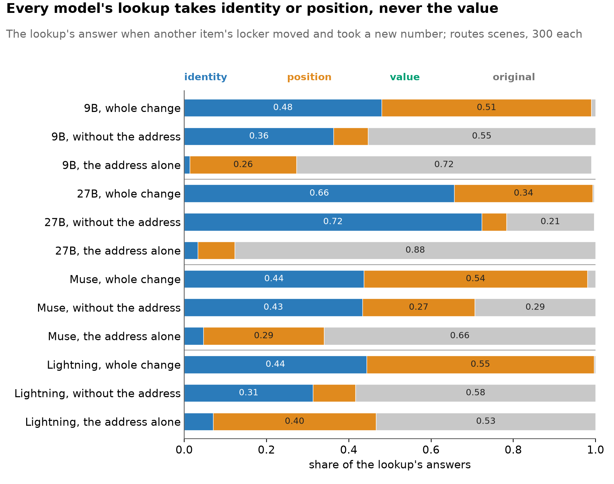
*The lookup's answers under the whole change, without the address, and with the address added by itself, per model: identity (blue), position (orange), value (none), the original answer (grey); routes scenes, 300 per model; the 9B's and 27B's "address alone" rows from their add-only runs.*

- **Result.** (another item moved)

  | | 9B | 27B | Muse | Lightning |
  |---|---|---|---|---|
  | whole change: identity | 0.48 [0.43, 0.53]<!-- src: results/x6_routes/qwen35_9b_x6_routes/verdict-20261025T104535Z/verdict.md \| 0.51 [0.46, 0.56] :: 0.48 [0.43, 0.53] --> | 0.66 [0.60, 0.71]<!-- src: results/x6_routes/x6_routes_27b/verdict-20261025T105901Z/verdict.md \| 0.34 [0.28, 0.39] :: 0.66 [0.60, 0.71] --> | 0.44 [0.38, 0.49]<!-- src: results/x6_routes/muse30b_x6_routes/verdict-20261026T004455Z/verdict.md \| 0.54 [0.49, 0.60] :: 0.44 [0.38, 0.49] --> | 0.44 [0.38, 0.51]<!-- src: results/x6_routes/nem35l_x52_routes/verdict-20261029T004324Z/verdict.md \| 0.55 [0.49, 0.62] :: 0.44 [0.38, 0.51] --> |
  | whole change: position | 0.51 [0.46, 0.56]<!-- src: results/x6_routes/qwen35_9b_x6_routes/verdict-20261025T104535Z/verdict.md \| 0.48 [0.43, 0.53] :: 0.51 [0.46, 0.56] --> | 0.34 [0.28, 0.39]<!-- src: results/x6_routes/x6_routes_27b/verdict-20261025T105901Z/verdict.md \| 0.66 [0.60, 0.71] :: 0.34 [0.28, 0.39] --> | 0.54 [0.49, 0.60]<!-- src: results/x6_routes/muse30b_x6_routes/verdict-20261026T004455Z/verdict.md \| 0.44 [0.38, 0.49] :: 0.54 [0.49, 0.60] --> | 0.55 [0.49, 0.62]<!-- src: results/x6_routes/nem35l_x52_routes/verdict-20261029T004324Z/verdict.md \| 0.44 [0.38, 0.51] :: 0.55 [0.49, 0.62] --> |
  | position without the address | 0.08 [0.05, 0.12]<!-- src: results/x6_routes/qwen35_9b_x6_routes/verdict-20261025T104535Z/verdict.md \| 0.55 [0.50, 0.61] :: 0.08 [0.05, 0.12] --> | 0.06 [0.03, 0.09]<!-- src: results/x6_routes/x6_routes_27b/verdict-20261025T105901Z/verdict.md \| 0.21 [0.18, 0.25] :: 0.06 [0.03, 0.09] --> | 0.27 [0.23, 0.32]<!-- src: results/x6_routes/muse30b_x6_routes/verdict-20261026T004455Z/verdict.md \| 0.29 [0.25, 0.35] :: 0.27 [0.23, 0.32] --> | 0.10 [0.07, 0.14]<!-- src: results/x6_routes/nem35l_x52_routes/verdict-20261029T004324Z/verdict.md \| 0.58 [0.53, 0.64] :: 0.10 [0.07, 0.14] --> |
  | the same without a random part | 0.54 [0.49, 0.59]<!-- src: results/x6_routes/qwen35_9b_x6_routes/verdict-20261025T104535Z/verdict.md \| 0.06 [0.03, 0.08] :: 0.54 [0.49, 0.59] --> | 0.25 [0.19, 0.31]<!-- src: results/x6_routes/x6_routes_27b/verdict-20261025T105901Z/verdict.md \| 0.70 [0.64, 0.76] :: 0.25 [0.19, 0.31] --> | 0.55 [0.50, 0.60]<!-- src: results/x6_routes/muse30b_x6_routes/verdict-20261026T004455Z/verdict.md \| 0.41 [0.36, 0.46] :: 0.55 [0.50, 0.60] --> | 0.56 [0.49, 0.63]<!-- src: results/x6_routes/nem35l_x52_routes/verdict-20261029T004324Z/verdict.md \| 0.42 [0.35, 0.48] :: 0.56 [0.49, 0.63] --> |
  | position, the address alone | 0.26 [0.20, 0.32]<!-- src: results/x6_routes/qwen35_9b_x6_routes_keeponly/verdict-20261025T152603Z/verdict.md \| 0.72 [0.65, 0.78] :: 0.26 [0.20, 0.32] --> | 0.09 [0.06, 0.12]<!-- src: results/x6_routes/x6_routes_keeponly_27b/verdict-20261025T153505Z/verdict.md \| 0.88 [0.84, 0.91] :: 0.09 [0.06, 0.12] --> | 0.29 [0.25, 0.34]<!-- src: results/x6_routes/muse30b_x6_routes/verdict-20261026T004455Z/verdict.md \| 0.66 [0.61, 0.71] :: 0.29 [0.25, 0.34] --> | 0.40 [0.35, 0.45]<!-- src: results/x6_routes/nem35l_x52_routes/verdict-20261029T004324Z/verdict.md \| 0.53 [0.48, 0.58] :: 0.40 [0.35, 0.45] --> |

  Lightning's sanity swap switches 0.99<!-- src: results/x6_routes/nem35l_x52_routes/verdict-20261029T004324Z/verdict.md \| | C0 | PP | jpp | 300 | :: 0.99 --> of lookups (rule: at least 0.50); removing the lens part there costs the lookup -0.00 [-0.02, 0.01]<!-- src: results/x6_routes/nem35l_x52_routes/verdict-20261029T004324Z/verdict.md \| | C0 | PP | jpp | 300 | 0.99 | :: -0.00 [-0.02, 0.01] --> beyond random, removing the address 0.54 [0.48, 0.61]<!-- src: results/x6_routes/nem35l_x52_routes/verdict-20261029T004324Z/verdict.md \| | C0 | PP | alf | 300 | 0.99 | :: 0.54 [0.48, 0.61] -->; the value: 0.00 on every model.

- **Read.**
  - On all four models the lookup answers by the item's identity or its locker's position, never by the new number; removing the address takes the position route away beyond a random part of its share.
- **Caveats.**
  - Added by itself, the address brings position answers back on the 9B, Muse and Lightning, not on the 27B.
  - Lightning's gate was chosen after the 60-scene pre-check was seen; its sanity swap uses Muse's rule.

### Does a learned subspace carry the readers' codes, and is the learned address ours? (51.3, opened 28 Oct 20:46) 

*Used in: README Appendix (Fig. 14 link); planned Part II / III cards. Story: identity and the address.*

- **Question.** Does a learned (DAS) subspace of at most 128 directions carry the recall's identity switch, where does the lookup's learned subspace lie, and does the learned 4-direction address overlap ours?
- **Why we asked.** Our parts are hand-built (lens directions, slot means); a trained subspace tests them without that choice.
- **Data.** Identity pairs from the main, clean and routes scenes (9B: 514 recall pairs; 27B 374; Muse 300), test entities held out; routes position pairs for the address.
- **Method.** Distributed alignment search: a subspace trained to carry the switch, its own interchange accuracy on test pairs, against a random subspace and a shuffled-target subspace of the same size.
- **Rule, fixed in advance.** "Q51.3 (i) 'found' = >= 300 recall pairs and test own-IIA >= 0.5 at some k <= 128; (ii) the lookup subspace (R_lookup at its chosen k) on the test pairs: the share of R R^T Delta inside U, the J++-25 atoms, the W_E-25 atoms and outside their union, each part >= 0.5 named 'mostly' (descriptive; the parts overlap); (iii) U's energy in R_pos at k = 4 = ||R_pos^T U||_F^2 / rank U >= 0.6" (verdict.md, as computed)

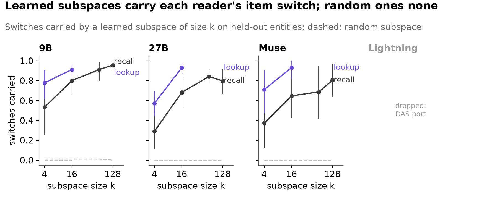
*Share of item switches carried by a learned subspace of k directions on held-out test pairs (recall 90 / 69 / 51, lookup 90 / 98 / 100), recall dark, lookup purple; dashed: a random subspace of the same size; whiskers 95%.*

- **Result.**

  | | 9B | 27B | Muse | Lightning |
  |---|---|---|---|---|
  | (i) recall, test own-IIA at k = 128 | 0.96 [0.91, 0.99]<!-- src: results/x51_das/verdict-20261028T194630Z/verdict.md \| recall pairs 514 :: 0.96 [0.91, 0.99] --> | 0.80 [0.67, 0.91]<!-- src: results/x51_das/verdict-20261028T194630Z/verdict.md \| recall pairs 374 :: 0.80 [0.67, 0.91] --> | 0.80 [0.64, 0.96]<!-- src: results/x51_das/verdict-20261028T194630Z/verdict.md \| recall pairs 300 :: 0.80 [0.64, 0.96] --> | not run |
  | (ii) the lookup subspace (k = 4) outside our parts | 0.62<!-- src: results/x51_das/verdict-20261028T194630Z/verdict.md \| in U 0.36 :: in outside 0.62 :: 0.62 --> | 0.62<!-- src: results/x51_das/verdict-20261028T194630Z/verdict.md \| U's energy in R_lookup 0.2509 :: 0.62 --> | 0.72<!-- src: results/x51_das/verdict-20261028T194630Z/verdict.md \| in outside 0.72 :: 0.72 --> | |
  | (iii) our address's energy in the learned address | 0.246<!-- src: results/x51_das/verdict-20261028T194630Z/verdict.md \| overlaps U >= 0.6: no :: 0.246 --> | 0.226<!-- src: results/x51_das/verdict-20261028T194630Z/verdict.md \| overlaps U >= 0.6: no :: 0.226 --> | 0.193<!-- src: results/x51_das/verdict-20261028T194630Z/verdict.md \| overlaps U >= 0.6: no :: 0.193 --> | |
  | the rule (i) / (ii) / (iii) | found / mostly outside / no | found / mostly outside / no | found / mostly outside / no | |

- **Read.**
  - A learned subspace carries the recall's identity on all three; the lookup's lies mostly outside our parts, and the learned address holds about a quarter of ours.
- **Caveats.**
  - Few test entities (9 on the 9B's identity pairs).
  - (ii) and (iii) have no interval in the verdict's summary lines.

### Does swapping the address send the lookup to the swapped-in locker? (address swap by dose; Lightning's coverage run opened 29 Oct 01:51) 

*Used in: README Part III card "The address: probe, remove, add, swap" (9B, 27B, Muse); Lightning not in the README yet. Story: the address.*

- **Question.** Adding the difference between two slots' address codes at the bridge word, does the lookup go to the locker of the slot swapped in, and how much does the recall change with it?
- **Why we asked.** Removing the address stops position answers; a swap tests whether the address is read as a pointer to a place.
- **Data.** Routes scenes without a move, 300 per model, each swapped to two target lockers (600 swaps); Lightning at L14 (gate chosen after the 60-scene pre-check, ○).
- **Method.** At the bridge word at L: the difference of two slot means, at one, two and four times its size; control: a random vector of the same size. Read: the lookup's answer (target locker, original, the third), and whether the recall's answer changes (the collateral).
- **Rule, fixed in advance.** "at s = 1 the target share minus the random direction's >= 0.15 with lower CI > 0; [...] among writes that move the lookup to another locker target / (target + third) >= 0.80, a model counting only with >= 30 such writes, fewer than two counting = can't tell; [...] target minus random >= 0.10 in each of the 6 (j, k) pairs" (jobs/c3/x8_a_9b.yaml; each over the 9B, the 27B, the 122B and Muse). Lightning: a coverage run on that rule, no prediction.

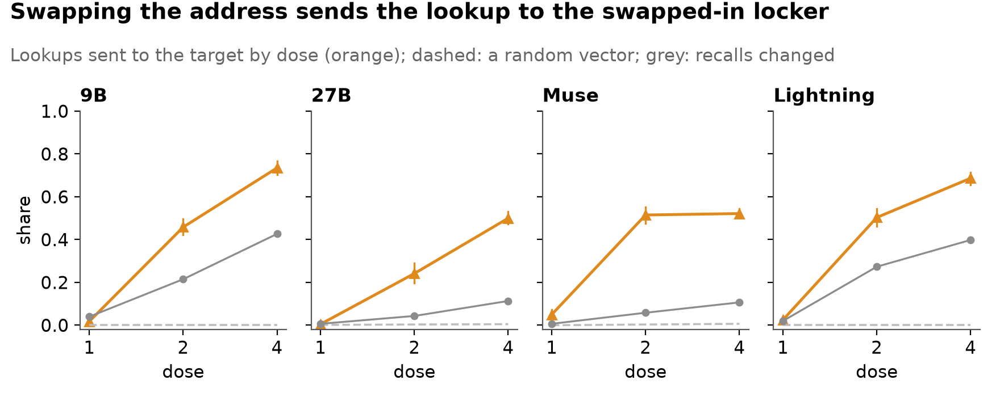
*Per model, the share of lookups sent to the swapped-in locker at doses 1, 2 and 4 (orange triangles, whiskers 95%), a random vector of the same size (dashed), and the recalls changed by the same swap (grey). 600 swaps per model.*

- **Result.** (all 600 swaps pooled; README E6 quotes the mean over the six slot pairs at s = 2 instead; a random vector sends 0.00 to 0.01 at every dose on every model)

  | | 9B | 27B | Muse | Lightning |
  |---|---|---|---|---|
  | lookups sent to the swapped-in locker, dose 1 | 0.02 [0.01, 0.03]<!-- src: results/x8_write/qwen35_9b_x8_write/verdict-20261026T110254Z/verdict.md \| 0.98 [0.97, 0.99] :: 0.02 [0.01, 0.03] --> | 0.01 [0.00, 0.01]<!-- src: results/x8_write/x8_write_27b/verdict-20261026T125548Z/verdict.md \| 0.99 [0.98, 1.00] :: 0.01 [0.00, 0.01] --> | 0.05 [0.03, 0.07]<!-- src: results/x8_write/muse30b_x8_write/verdict-20261026T141141Z/verdict.md \| 0.94 [0.91, 0.96] :: 0.05 [0.03, 0.07] --> | 0.03 [0.01, 0.04]<!-- src: results/x8_write/nem35l_x52_write/verdict-20261029T005021Z/verdict.md \| 0.96 [0.94, 0.98] :: 0.03 [0.01, 0.04] --> |
  | lookups sent to the swapped-in locker, dose 2 | 0.46 [0.42, 0.50]<!-- src: results/x8_write/qwen35_9b_x8_write/verdict-20261026T110254Z/verdict.md \| 0.06 [0.04, 0.08] :: 0.46 [0.42, 0.50] --> | 0.24 [0.20, 0.29]<!-- src: results/x8_write/x8_write_27b/verdict-20261026T125548Z/verdict.md \| 0.71 [0.66, 0.76] :: 0.24 [0.20, 0.29] --> | 0.52 [0.48, 0.55]<!-- src: results/x8_write/muse30b_x8_write/verdict-20261026T141141Z/verdict.md \| 0.38 [0.33, 0.42] :: 0.52 [0.48, 0.55] --> | 0.50 [0.46, 0.54]<!-- src: results/x8_write/nem35l_x52_write/verdict-20261029T005021Z/verdict.md \| 0.43 [0.38, 0.47] :: 0.50 [0.46, 0.54] --> |
  | lookups sent to the swapped-in locker, dose 4 | 0.73 [0.70, 0.77]<!-- src: results/x8_write/qwen35_9b_x8_write/verdict-20261026T110254Z/verdict.md \| 0.17 [0.13, 0.21] :: 0.73 [0.70, 0.77] --> | 0.50 [0.47, 0.53]<!-- src: results/x8_write/x8_write_27b/verdict-20261026T125548Z/verdict.md \| 0.37 [0.34, 0.40] :: 0.50 [0.47, 0.53] --> | 0.52 [0.50, 0.54]<!-- src: results/x8_write/muse30b_x8_write/verdict-20261026T141141Z/verdict.md \| 0.23 [0.20, 0.26] :: 0.52 [0.50, 0.54] --> | 0.69 [0.66, 0.71]<!-- src: results/x8_write/nem35l_x52_write/verdict-20261029T005021Z/verdict.md \| 0.25 [0.22, 0.28] :: 0.69 [0.66, 0.71] --> |
  | recalls changed by the swap, dose 1 / 2 / 4 | 0.04<!-- src: results/x8_write/qwen35_9b_x8_write/verdict-20261026T110254Z/verdict.md \| 0.02 [0.01, 0.03] :: 0.04 --> / 0.21<!-- src: results/x8_write/qwen35_9b_x8_write/verdict-20261026T110254Z/verdict.md \| 0.46 [0.42, 0.50] :: 0.21 --> / 0.43<!-- src: results/x8_write/qwen35_9b_x8_write/verdict-20261026T110254Z/verdict.md \| 0.73 [0.70, 0.77] :: 0.43 --> | 0.01<!-- src: results/x8_write/x8_write_27b/verdict-20261026T125548Z/verdict.md \| 0.01 [0.00, 0.01] :: 0.01 --> / 0.04<!-- src: results/x8_write/x8_write_27b/verdict-20261026T125548Z/verdict.md \| 0.24 [0.20, 0.29] :: 0.04 --> / 0.11<!-- src: results/x8_write/x8_write_27b/verdict-20261026T125548Z/verdict.md \| 0.50 [0.47, 0.53] :: 0.11 --> | 0.01<!-- src: results/x8_write/muse30b_x8_write/verdict-20261026T141141Z/verdict.md \| 0.05 [0.03, 0.07] :: 0.01 --> / 0.06<!-- src: results/x8_write/muse30b_x8_write/verdict-20261026T141141Z/verdict.md \| 0.52 [0.48, 0.55] :: 0.06 --> / 0.11<!-- src: results/x8_write/muse30b_x8_write/verdict-20261026T141141Z/verdict.md \| 0.52 [0.50, 0.54] :: 0.11 --> | 0.02<!-- src: results/x8_write/nem35l_x52_write/verdict-20261029T005021Z/verdict.md \| 0.03 [0.01, 0.04] :: 0.02 --> / 0.27<!-- src: results/x8_write/nem35l_x52_write/verdict-20261029T005021Z/verdict.md \| 0.50 [0.46, 0.54] :: 0.27 --> / 0.40<!-- src: results/x8_write/nem35l_x52_write/verdict-20261029T005021Z/verdict.md \| 0.69 [0.66, 0.71] :: 0.40 --> |

- **Read.**
  - At s = 1, the dose fixed in advance, the rule says no on the 9B, 27B and Muse (target minus random 0.02 [0.01, 0.03]<!-- src: results/x8_write/qwen35_9b_x8_write/verdict-20261026T110254Z/verdict.md \| Q44.1: target minus random at s = 1 :: 0.02 [0.01, 0.03] --> / 0.00 [0.00, 0.01]<!-- src: results/x8_write/x8_write_27b/verdict-20261026T125548Z/verdict.md \| Q44.1: target minus random at s = 1 :: 0.00 [0.00, 0.01] --> / 0.05 [0.03, 0.07]<!-- src: results/x8_write/muse30b_x8_write/verdict-20261026T141141Z/verdict.md \| Q44.1: target minus random at s = 1 :: 0.05 [0.03, 0.07] -->; bar 0.15): s = 1 is below a real change's size, a design error (docs/shared/joint_story_draft.md).
  - At s = 2 (about a real change's size) and s = 4 the swap sends a quarter to three quarters of lookups to the swapped-in locker on every model, Lightning included, against none for a random vector.
- **Caveats.**
  - The swap also changes the recall's answer, most on the 9B and Lightning (the collateral).
  - Pooled over pairs: some pairs move no lookup at all (Lightning: two of six at dose 2).

### Does the address survive neutral sentences between the lockers and the picks? (the swap after neutral sentences, 47.16; the 27B's and Lightning's coverage runs 29 Oct) 

*Used in: README Part III card "The address: probe, remove, add, swap" ("0.35 after 50 neutral sentences", 9B); the 27B and Lightning not in the README yet. Story: the address.*

- **Question.** With 5, 20 or 50 neutral sentences between the lockers and the picks, does the address still carry position answers, and does the address swap still work?
- **Why we asked.** An address read at the bridge word could be a short-range effect of the sentences next to it.
- **Data.** Routes scenes (another item moved), the same base scenes at every distance: 218<!-- src: results/x47_distance/x47_16-20261028T131501Z/x47_16.md \| qwen3.5-9b :: 218 --> / 300<!-- src: results/x47_distance/x52_distance-20261029T023426Z/x47_16.md \| qwen3.6-27b :: 300 --> / 199<!-- src: results/x47_distance/x52_distance-20261029T023426Z/x47_16.md \| nemotron-3.5-lightning :: 199 --> (9B / 27B / Lightning); Muse has no outcomes (Flagged 22).
- **Method.** At each distance, at the bridge word at L: the routes test's whole change, and without the address against a random part of its share; the address swap at dose 2 against a random vector of its size; a slot probe beside.
- **Rule, fixed in advance.** "breaks = the gate failed at some k (the test stops there); distance-robust = position share and probe within 0.1 of k = 0 at every k, swap success within 0.15; address near, identity far = position falls >= 0.2 and identity rises >= 0.2 by k = 50 with accuracy >= 0.8". The 27B and Lightning: coverage runs on this rule, no prediction.

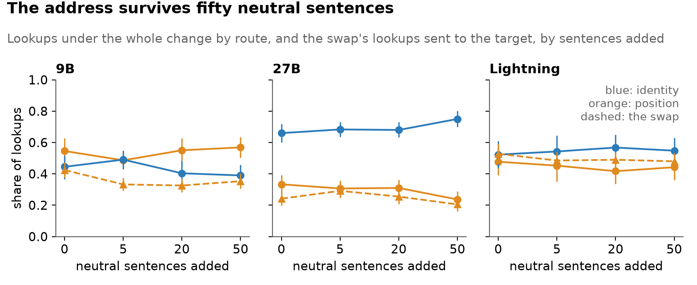
*Per model, by the number of neutral sentences added: lookups under the whole change by route (identity blue, position orange) and the swap's lookups sent to the target (dashed); whiskers 95%; 218 / 300 / 199 scenes.*

- **Result.**

  | | 9B | 27B | Muse | Lightning |
  |---|---|---|---|---|
  | position under the whole change, 0 / 50 sentences | 0.55 [0.48, 0.62]<!-- src: results/x47_distance/x47_16-20261028T131501Z/x47_16.md \| qwen3.5-9b :: 218 :: 0.55 [0.48, 0.62] --> / 0.57 [0.51, 0.63]<!-- src: results/x47_distance/x47_16-20261028T131501Z/x47_16.md \| qwen3.5-9b :: 218 :: 0.57 [0.51, 0.63] --> | 0.33 [0.28, 0.39]<!-- src: results/x47_distance/x52_distance-20261029T023426Z/x47_16.md \| qwen3.6-27b :: 300 :: 0.33 [0.28, 0.39] --> / 0.24 [0.19, 0.28]<!-- src: results/x47_distance/x52_distance-20261029T023426Z/x47_16.md \| qwen3.6-27b :: 300 :: 0.24 [0.19, 0.28] --> | no outcomes | 0.48 [0.40, 0.56]<!-- src: results/x47_distance/x52_distance-20261029T023426Z/x47_16.md \| nemotron-3.5-lightning :: 199 :: 0.48 [0.40, 0.56] --> / 0.44 [0.36, 0.52]<!-- src: results/x47_distance/x52_distance-20261029T023426Z/x47_16.md \| nemotron-3.5-lightning :: 199 :: 0.44 [0.36, 0.52] --> |
  | the swap: lookups sent to the target, 0 / 50 sentences | 0.42 [0.38, 0.47]<!-- src: results/x47_distance/x47_16-20261028T131501Z/x47_16.md \| qwen3.5-9b :: 218 :: 0.42 [0.38, 0.47] --> / 0.35 [0.31, 0.40]<!-- src: results/x47_distance/x47_16-20261028T131501Z/x47_16.md \| qwen3.5-9b :: 218 :: 0.35 [0.31, 0.40] --> | 0.24 [0.20, 0.28]<!-- src: results/x47_distance/x52_distance-20261029T023426Z/x47_16.md \| qwen3.6-27b :: 300 :: 0.24 [0.20, 0.28] --> / 0.20 [0.17, 0.25]<!-- src: results/x47_distance/x52_distance-20261029T023426Z/x47_16.md \| qwen3.6-27b :: 300 :: 0.20 [0.17, 0.25] --> | | 0.53 [0.47, 0.59]<!-- src: results/x47_distance/x52_distance-20261029T023426Z/x47_16.md \| nemotron-3.5-lightning :: 199 :: 0.53 [0.47, 0.59] --> / 0.48 [0.43, 0.53]<!-- src: results/x47_distance/x52_distance-20261029T023426Z/x47_16.md \| nemotron-3.5-lightning :: 199 :: 0.48 [0.43, 0.53] --> |
  | the rule | **distance-robust address<!-- src: results/x47_distance/x47_16-20261028T131501Z/x47_16.md \| qwen3.5-9b :: distance-robust address -->** | **distance-robust address<!-- src: results/x47_distance/x52_distance-20261029T023426Z/x47_16.md \| qwen3.6-27b :: distance-robust address -->** (no prediction) | | **distance-robust address<!-- src: results/x47_distance/x52_distance-20261029T023426Z/x47_16.md \| nemotron-3.5-lightning :: distance-robust address -->** (no prediction) |

- **Read.**
  - On the 9B, 27B and Lightning the address keeps carrying position answers and the swap keeps working with up to 50 neutral sentences before the picks.
- **Caveats.**
  - Muse has no outcomes for this test, though the coverage matrix marks it done (Flagged 22).
  - The 27B's position share falls by 0.09 at 50 sentences, just inside the rule's 0.1.

### With six lockers, does each locker have its own code? (six lockers; the 27B's coverage run opened 29 Oct 01:49, Lightning's 29 Oct) 

*Used in: README Part III card "Six lockers" and claims table row 8 (9B, Muse); the 27B and Lightning not in the README yet. Story: the address.*

- **Question.** With six locker sentences, is the address a line over slots (one shift steps the lookup one slot), a first-versus-rest marker, or one code per slot?
- **Why we asked.** With three lockers a line and a first-versus-rest marker look the same.
- **Data.** Six-locker scenes: the test half, 300 per model (9B, 27B, Muse, Lightning at L14), the other 300 fit the slot means.
- **Method.** At the bridge word at L: one fixed shift (the mean step between neighbouring slot means) from each start slot, and swaps between given slots, each at doses 1 and 2, against a random vector of the same size; the slot means' first principal component beside.
- **Rule, fixed in advance.** "Ordinal: the first PCA component is monotone in slot (|Spearman| >= 0.9) and v sends >= 0.25 of lookups to slot k+1 from >= 4 of 5 start slots, the random vector <= 0.05; Categorical, first vs rest: v works only from slot 1 (others < 0.10) and U's removal on 2-6 moves is within 0.10 of random; Slot-specific: pairwise writes reach >= 0.25 on most pairs but no single v does." Dose 2 decides. The 27B and Lightning: coverage runs on this rule, no prediction.

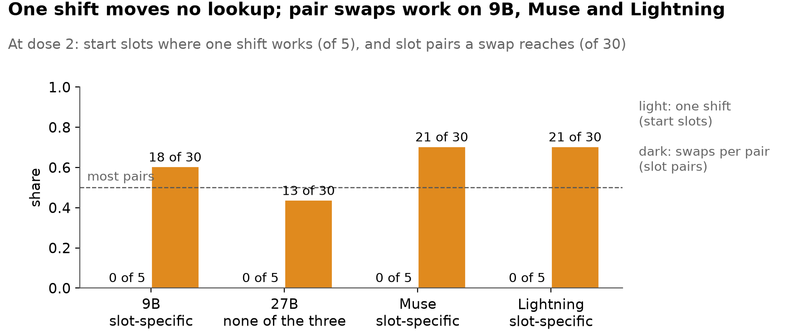
*At dose 2, per model: start slots from which one shift sends at least 0.25 of lookups one slot on (light, of 5; none anywhere), and slot pairs a given-slot swap reaches (dark, of 30); dashed: "most pairs"; the rule's label under each model. 300 test scenes per model; 9B, 27B, Muse, Lightning.*

- **Result.**

  | | 9B | 27B | Muse | Lightning |
  |---|---|---|---|---|
  | position share under the whole change | 0.32 [0.28, 0.37]<!-- src: results/x47_six/x47_2-20261028T113102Z/x47_2.md \| qwen35_9b_x47_2 :: 0.32 [0.28, 0.37] --> | 0.25 [0.19, 0.31]<!-- src: results/x47_six/x52_six-20261029T004919Z/x47_2.md \| 0.70 [0.64, 0.76] :: 0.25 [0.19, 0.31] --> | 0.37 [0.31, 0.43]<!-- src: results/x47_six/x47_2-20261028T113102Z/x47_2.md \| muse30_x47_2 :: 0.37 [0.31, 0.43] --> | 0.40 [0.33, 0.46]<!-- src: results/x47_six/x52_six-20261029T011006Z/x47_2.md \| nem35l_x52_six :: whole :: 0.40 [0.33, 0.46] --> |
  | first component monotone in slot (Spearman) | 1.00<!-- src: results/x47_six/x47_2-20261028T113102Z/x47_2.md \| 8.15, 5.59, 3.08 :: 1.00 --> | 1.00<!-- src: results/x47_six/x52_six-20261029T004919Z/x47_2.md \| 26.79, 16.42, 11.83 :: 1.00 --> | 1.00<!-- src: results/x47_six/x47_2-20261028T113102Z/x47_2.md \| 84.27, 58.15, 38.31 :: 1.00 --> | 1.00<!-- src: results/x47_six/x52_six-20261029T011006Z/x47_2.md \| 6.40, 4.93, 2.50 :: 1.00 --> |
  | given-slot swaps reaching 0.25 at dose 2 | 18 of 30<!-- src: results/x47_six/x47_2-20261028T113102Z/x47_2.md \| -0.025 :: 18 of 30 --> | 13 of 30<!-- src: results/x47_six/x52_six-20261029T004919Z/x47_2.md \| 0.004 :: 13 of 30 --> | 21 of 30<!-- src: results/x47_six/x47_2-20261028T113102Z/x47_2.md \| -0.055 :: 21 of 30 --> | 21 of 30<!-- src: results/x47_six/x52_six-20261029T011006Z/x47_2.md \| -0.020 :: 21 of 30 --> |
  | the rule at dose 2 | **slot-specific** | **none of the three** | **slot-specific** | **slot-specific** (no prediction) |

- **Read.**
  - No single shift moves the lookup on any model; given-slot swaps work on most pairs on the 9B, Muse and Lightning, so each slot is its own target there; on the 27B neither the line nor the per-slot pattern holds.
- **Caveats.**
  - The 27B's shift writes move 0.00 at every start slot, though its slot means lie in order.
  - A different test of the code's size (see [51.11](#t51-11)) does not find one dimension per slot on the 9B.

### Can the lens read the address? (lens readout of an address swap, 47.0; Lightning's coverage run 29 Oct) 

*Used in: README Part III card "The lens is blind to the address" (9B, 27B, Muse); Lightning not in the README yet. Story: the address.*

- **Question.** Read through the lens, does an address swap at a real change's size show up as a position word, get rebuilt by the lens's own directions, or move the lens's readout more than a random vector of the same size?
- **Why we asked.** Neel's question: is the pointer verbalizable? A lens monitor would have to see it.
- **Data.** Routes scenes, 100 items per model, each swapped to both other lockers (200 cases); null: 200 random vectors of the same size.
- **Method.** At the bridge word at L, the swap h + 2 (mu_k - mu_j): (a) the best rank of a position word (first, second, third, 1, 2, 3, ...) in the lens readout; (b) the share the lens's 25 best directions rebuild; (c) how far the readout moves (KL). Positive control: an item change of the same size.
- **Rule, fixed in advance.** Descriptive, with the reading fixed in advance: ""Not verbalizable": reconstruction at k = 25 within 2x the random null's share, no ordinal token in the top-20 beyond the null's 5th-percentile rank, and the KL under the write within the null's 95th percentile, on all three models." Lightning: a coverage run on that reading, no prediction.

*Per model, how far above 200 random vectors of the same size the lens ranks a position word (left) and rebuilds the change with 25 directions (right): the address swap (orange) and an item change (blue); grey: the random vectors' 95%. 9B, 27B, Muse; Lightning's numbers in the table.*

- **Result.**

  | | 9B | 27B | Muse | Lightning |
  |---|---|---|---|---|
  | best position-word rank after the swap, median (random's 5th percentile) | 27 (null 5th pct 20)<!-- src: results/x47_verbal/summary-20261028T033646Z/verbal.md \| (a) best ordinal-token rank, h + write (median) :: 27 (null 5th pct 20) --> | 30 (null 5th pct 22)<!-- src: results/x47_verbal/summary-20261028T033646Z/verbal.md \| (a) best ordinal-token rank, h + write (median) :: 30 (null 5th pct 22) --> | 94 (null 5th pct 58)<!-- src: results/x47_verbal/summary-20261028T033646Z/verbal.md \| (a) best ordinal-token rank, h + write (median) :: 94 (null 5th pct 58) --> | 220 (null 5th pct 49)<!-- src: results/x47_verbal/summary-20261029T005548Z/verbal.md \| (a) best ordinal-token rank, h + write (median) :: 220 (null 5th pct 49) --> |
  | cases whose rank beats their own null | 0.03 [0.01, 0.06]<!-- src: results/x47_verbal/summary-20261028T033646Z/verbal.md \| (a) cases with the ordinal rank beyond their own null :: 0.03 [0.01, 0.06] --> | 0.13 [0.08, 0.19]<!-- src: results/x47_verbal/summary-20261028T033646Z/verbal.md \| (a) cases with the ordinal rank beyond their own null :: 0.13 [0.08, 0.19] --> | 0.18 [0.14, 0.24]<!-- src: results/x47_verbal/summary-20261028T033646Z/verbal.md \| (a) cases with the ordinal rank beyond their own null :: 0.18 [0.14, 0.24] --> | 0.00 [0.00, 0.00]<!-- src: results/x47_verbal/summary-20261029T005548Z/verbal.md \| (a) cases with the ordinal rank beyond their own null :: 0.00 [0.00, 0.00] --> |
  | share rebuilt by 25 lens directions, swap over random | 1.16x<!-- src: results/x47_verbal/summary-20261028T033646Z/verbal.md \| (b) pointer / random, k = 25 (every token; letters) :: 1.16x --> | 0.94x<!-- src: results/x47_verbal/summary-20261028T033646Z/verbal.md \| (b) pointer / random, k = 25 (every token; letters) :: 0.94x --> | 1.22x<!-- src: results/x47_verbal/summary-20261028T033646Z/verbal.md \| (b) pointer / random, k = 25 (every token; letters) :: 1.22x --> | 1.44x<!-- src: results/x47_verbal/summary-20261029T005548Z/verbal.md \| (b) pointer / random, k = 25 (every token; letters) :: 1.44x --> |
  | cases whose readout moves beyond their own null (KL) | 0.15 [0.09, 0.23]<!-- src: results/x47_verbal/summary-20261028T033646Z/verbal.md \| (c) cases with KL beyond their own null :: 0.15 [0.09, 0.23] --> | 0.01 [0.00, 0.05]<!-- src: results/x47_verbal/summary-20261028T033646Z/verbal.md \| (c) cases with KL beyond their own null :: 0.01 [0.00, 0.05] --> | 0.28 [0.19, 0.39]<!-- src: results/x47_verbal/summary-20261028T033646Z/verbal.md \| (c) cases with KL beyond their own null :: 0.28 [0.19, 0.39] --> | 0.00 [0.00, 0.00]<!-- src: results/x47_verbal/summary-20261029T005548Z/verbal.md \| (c) cases with KL beyond their own null :: 0.00 [0.00, 0.00] --> |
  | control: the new item's name rank after an item change | 50 (null 5th pct 2220)<!-- src: results/x47_verbal/summary-20261028T033646Z/verbal.md \| (a) positive control: new item's name rank, h + identity :: 50 (null 5th pct 2220) --> | 14 (null 5th pct 5014)<!-- src: results/x47_verbal/summary-20261028T033646Z/verbal.md \| (a) positive control: new item's name rank, h + identity :: 14 (null 5th pct 5014) --> | 25 (null 5th pct 3636)<!-- src: results/x47_verbal/summary-20261028T033646Z/verbal.md \| (a) positive control: new item's name rank, h + identity :: 25 (null 5th pct 3636) --> | 19 (null 5th pct 4844)<!-- src: results/x47_verbal/summary-20261029T005548Z/verbal.md \| (a) positive control: new item's name rank, h + identity :: 19 (null 5th pct 4844) --> |
  | reading | not verbalizable<!-- src: results/x47_verbal/summary-20261028T033646Z/verbal.md \| reading :: not verbalizable --> | not verbalizable | not verbalizable | not verbalizable<!-- src: results/x47_verbal/summary-20261029T005548Z/verbal.md \| reading :: not verbalizable --> |

- **Read.**
  - On all four models the address swap reads through the lens like a random vector of its size, while an item change of the same size stands far outside the random range.
  - Lightning's swap moves its lookup to the written locker in 0.50<!-- src: results/x47_verbal/summary-20261029T005548Z/verbal.md \| x8's lookup on these writes at s = 2: to the written locker :: 0.50 --> of these cases, yet none of the lens's three readings leaves the null.
- **Caveats.**
  - Descriptive: the reading is the spec's, not a pre-registered claim.
  - The reading uses medians; per case, some readouts do move beyond their own null on the 9B and Muse.

### Does the bridge word redirect the lookup only when its locker sentence came first? (the split by sentence order; Lightning's opened 29 Oct 01:54) 

*Used in: README Part IV card "Sentence order: where the link is made" and claims table row 10 (9B, 27B, Muse); Lightning not in the README yet. Story: where and when.*

- **Question.** On the main test, does the change at the bridge word switch the lookup when the item's locker sentence came before the asked pick, and when it came after?
- **Why we asked.** The bridge word can only point back: if the locker sentence comes after it, the link must be made elsewhere.
- **Data.** Main test, 200 per model, split by where the item's locker sentence sits: before the pick 100 / 101 / 92 / 85, after it 100 / 99 / 108 / 115 (9B / 27B / Muse / Lightning).
- **Method.** The conflict test's cells, split by sentence order: the lookup's switch under the whole change, and each reader's switches lost without the lens part beyond a random part.
- **Rule, fixed in advance.** None: the split was read after the data (descriptive); Lightning's is a coverage run, no prediction.

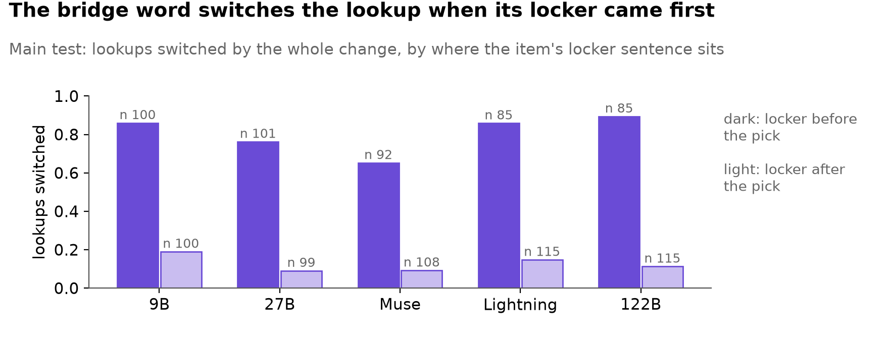
*Per model, lookups switched by the whole change at the bridge word, locker sentence before the asked pick (dark) or after it (light); n per bar.*

- **Result.**

  | | 9B | 27B | Muse | Lightning |
  |---|---|---|---|---|
  | lookups switched by the whole change, locker first | 0.86<!-- src: results/x0_composition/split-by-order-20261026T173323Z/split.md \| 0.35 [0.26, 0.43] :: 0.86 --> | 0.76<!-- src: results/x0_composition/split-by-order-20261026T173323Z/split.md \| 0.67 [0.58, 0.76] :: 0.76 --> | 0.65<!-- src: results/x0_composition/split-by-order-20261026T173323Z/split.md \| 0.68 [0.46, 0.88] :: 0.65 --> | 0.86<!-- src: results/x0_composition/split-by-order-20261029T005451Z/split.md \| 0.12 [0.04, 0.20] :: 0.86 --> |
  | lookups switched by the whole change, locker after | 0.19<!-- src: results/x0_composition/split-by-order-20261026T173323Z/split.md \| 0.65 [0.57, 0.73] :: 0.19 --> | 0.09<!-- src: results/x0_composition/split-by-order-20261026T173323Z/split.md \| 0.81 [0.71, 0.91] :: 0.09 --> | 0.09<!-- src: results/x0_composition/split-by-order-20261026T173323Z/split.md \| 0.80 [0.65, 0.92] :: 0.09 --> | 0.15<!-- src: results/x0_composition/split-by-order-20261029T005451Z/split.md \| 0.53 [0.40, 0.65] :: 0.15 --> |
  | lookup: switches lost beyond a random part, locker first | 0.01 [-0.04, 0.07]<!-- src: results/x0_composition/split-by-order-20261026T173323Z/split.md \| 0.35 [0.26, 0.43] :: 0.01 [-0.04, 0.07] --> | 0.14 [0.07, 0.22]<!-- src: results/x0_composition/split-by-order-20261026T173323Z/split.md \| 0.67 [0.58, 0.76] :: 0.14 [0.07, 0.22] --> | -0.07 [-0.12, -0.02]<!-- src: results/x0_composition/split-by-order-20261026T173323Z/split.md \| 0.68 [0.46, 0.88] :: -0.07 [-0.12, -0.02] --> | 0.01 [-0.03, 0.07]<!-- src: results/x0_composition/split-by-order-20261029T005451Z/split.md \| 0.12 [0.04, 0.20] :: 0.01 [-0.03, 0.07] --> |
  | lookup: switches lost beyond a random part, locker after (under 30 switches on every model: not usable) | -0.21 [-0.43, -0.05]<!-- src: results/x0_composition/split-by-order-20261026T173323Z/split.md \| 0.65 [0.57, 0.73] :: -0.21 [-0.43, -0.05] --> | 0.11 [0.00, 0.40]<!-- src: results/x0_composition/split-by-order-20261026T173323Z/split.md \| 0.81 [0.71, 0.91] :: 0.11 [0.00, 0.40] --> | -0.30 [-0.44, 0.00]<!-- src: results/x0_composition/split-by-order-20261026T173323Z/split.md \| 0.80 [0.65, 0.92] :: -0.30 [-0.44, 0.00] --> | 0.12 [0.00, 0.29]<!-- src: results/x0_composition/split-by-order-20261029T005451Z/split.md \| 0.53 [0.40, 0.65] :: 0.12 [0.00, 0.29] --> |
  | recall: switches lost beyond a random part, locker first | 0.35 [0.26, 0.43]<!-- src: results/x0_composition/split-by-order-20261026T173323Z/split.md \| 0.01 [-0.04, 0.07] :: 0.35 [0.26, 0.43] --> | 0.67 [0.58, 0.76]<!-- src: results/x0_composition/split-by-order-20261026T173323Z/split.md \| 0.14 [0.07, 0.22] :: 0.67 [0.58, 0.76] --> | 0.68 [0.46, 0.88]<!-- src: results/x0_composition/split-by-order-20261026T173323Z/split.md \| -0.07 [-0.12, -0.02] :: 0.68 [0.46, 0.88] --> | 0.12 [0.04, 0.20]<!-- src: results/x0_composition/split-by-order-20261029T005451Z/split.md \| 0.01 [-0.03, 0.07] :: 0.12 [0.04, 0.20] --> |
  | recall: switches lost beyond a random part, locker after | 0.65 [0.57, 0.73]<!-- src: results/x0_composition/split-by-order-20261026T173323Z/split.md \| -0.21 [-0.43, -0.05] :: 0.65 [0.57, 0.73] --> | 0.81 [0.71, 0.91]<!-- src: results/x0_composition/split-by-order-20261026T173323Z/split.md \| 0.11 [0.00, 0.40] :: 0.81 [0.71, 0.91] --> | 0.80 [0.65, 0.92]<!-- src: results/x0_composition/split-by-order-20261026T173323Z/split.md \| -0.30 [-0.44, 0.00] :: 0.80 [0.65, 0.92] --> | 0.53 [0.40, 0.65]<!-- src: results/x0_composition/split-by-order-20261029T005451Z/split.md \| 0.12 [0.00, 0.29] :: 0.53 [0.40, 0.65] --> |

- **Read.**
  - On every model, Lightning included, the change at the bridge word switches most lookups when the locker sentence came first and few when it came after.
  - The recall loses more switches without the lens part when the locker came after, on every model.
- **Caveats.**
  - Locker after, the whole change switches 0.09 to 0.19 of 99 to 115 lookups, under the 30 switches a cell needs; the lookup's loss there is not usable (the split's own note: measurable only where switches are many).
  - Descriptive: the split was chosen after the data.

### Which token and layer carry each reader's switch, and when does the bridge word stop being read? (token-by-layer map and window patching, D1 / D2; the 27B's and Lightning's coverage runs 29 Oct) 

*Used in: README Part IV card "Token by token, layer by layer" (9B, Muse); the 27B and Lightning not in the README yet. Story: where and when.*

- **Question.** With the changed prompt's state placed in one token group at one layer, which cell switches each reader, and after which layer does nothing downstream read the bridge word?
- **Why we asked.** With the locker sentence after the pick the bridge word cannot point back; the map says where the link sits instead.
- **Data.** Clean one-pick scenes (the main test beside them), split by sentence order: locker first 151 / 202 / 143, locker after 166 / 236 / 170 (9B / 27B / Muse). Lightning: the main test only, locker first 59<!-- src: results/x47_depthmap/x52_depthmap-20261029T011452Z/depth.md \| nemotron-3.5-lightning :: main :: locker-first :: 59 -->, locker after 79<!-- src: results/x47_depthmap/x52_depthmap-20261029T011452Z/depth.md \| nemotron-3.5-lightning :: main :: locker-after :: 79 -->; its clean design is not tested (the clean one-pick gate fails on it).
- **Method.** D1: the changed state placed at one token group (the bridge word, the rest of the pick sentence, the asked person, each locker sentence's item and number, the question, the last token) at one layer, every 2nd (9B) or 4th (27B, Muse). D2: the changed state at the bridge word at every layer from l on; the read-out layer l_R is the first where this switches 0.1 or fewer.
- **Rule, fixed in advance.** D1: "(a) In locker-after scenes the lookup's mass sits at the locker sentences, not at the bridge word, at every layer (bridge-word cells <= 0.25 everywhere; some locker-sentence cell >= 0.5). (b) In locker-first scenes the lookup's bridge-word mass ends before the recall's does (the last layer with bridge-word switch >= 0.3 is earlier for the lookup, by >= 2 layers on the 9B, >= 4 on Muse). (c) The recall's map has a second hot token, the item's earlier mention, in locker-first scenes (>= 0.3 at some layer), absent in locker-after." D2: ""The handover from the mention to the question" if l_R(recall) lies at or below the start of his late band on the 9B and 27B." The 27B and Lightning: coverage runs on these rules, no prediction.

*The 9B, clean one-pick scenes: lookups (upper row, purple) and recalls (lower row, grey) switched when the changed state is placed in one token group at one layer, locker before and after the pick; bottom: the bridge word replaced at every layer up to l, and from l on. The 27B's and Muse's maps are tables in their verdicts.*

- **Result.** (clean design; the main test gives the same D1 and D2 answers on the 9B, 27B and Muse; Lightning: the main test)

  | | 9B | 27B | Muse | Lightning (main) |
  |---|---|---|---|---|
  | D1 (a) locker after: a locker-sentence cell carries the lookup | no<!-- src: results/x47_depthmap/depth-20261028T120525Z/depth.md \| qwen3.5-9b :: clean :: glk_org_num@18 :: no --> | no<!-- src: results/x47_depthmap/x52_depthmap-20261029T010426Z/depth.md \| qwen3.6-27b :: clean :: glk_cf_item@28 :: no --> | no<!-- src: results/x47_depthmap/depth-20261028T120525Z/depth.md \| muse-glimmer-30b :: clean :: glk_cf_item@16 :: no --> | no<!-- src: results/x47_depthmap/x52_depthmap-20261029T011452Z/depth.md \| nemotron-3.5-lightning :: main :: glk_cf_item@12 :: no --> |
  | D1 (b) locker first: the lookup leaves the bridge word first | no<!-- src: results/x47_depthmap/depth-20261028T120525Z/depth.md \| qwen3.5-9b :: clean :: lead -2 of 2 :: no --> | no<!-- src: results/x47_depthmap/x52_depthmap-20261029T010426Z/depth.md \| qwen3.6-27b :: clean :: lead -4 of 4 :: no --> | no<!-- src: results/x47_depthmap/depth-20261028T120525Z/depth.md \| muse-glimmer-30b :: clean :: lead 0 of 4 :: no --> | no<!-- src: results/x47_depthmap/x52_depthmap-20261029T011452Z/depth.md \| nemotron-3.5-lightning :: main :: lead 0 of 4 :: no --> |
  | D1 (c) the recall's second hot token, locker first only | no<!-- src: results/x47_depthmap/depth-20261028T120525Z/depth.md \| qwen3.5-9b :: clean :: peaks first :: no --> | no<!-- src: results/x47_depthmap/x52_depthmap-20261029T010426Z/depth.md \| qwen3.6-27b :: clean :: peaks first :: no --> | no<!-- src: results/x47_depthmap/depth-20261028T120525Z/depth.md \| muse-glimmer-30b :: clean :: peaks first :: no --> | no<!-- src: results/x47_depthmap/x52_depthmap-20261029T011452Z/depth.md \| nemotron-3.5-lightning :: main :: peaks first 0.0169 :: no --> |
  | read-out layer l_R, lookup / recall, locker first | L18<!-- src: results/x47_depthmap/depth-20261028T120525Z/depth.md \| qwen3.5-9b :: clean :: locker-first :: 151 :: 18 --> / L20<!-- src: results/x47_depthmap/depth-20261028T120525Z/depth.md \| qwen3.5-9b :: clean :: locker-first :: 151 :: 20 --> | L44<!-- src: results/x47_depthmap/x52_depthmap-20261029T010426Z/depth.md \| qwen3.6-27b :: clean :: locker-first :: 202 :: 44 --> / L40<!-- src: results/x47_depthmap/x52_depthmap-20261029T010426Z/depth.md \| qwen3.6-27b :: clean :: locker-first :: 202 :: 40 --> | L32<!-- src: results/x47_depthmap/depth-20261028T120525Z/depth.md \| muse-glimmer-30b :: clean :: locker-first :: 143 :: 32 --> / L32<!-- src: results/x47_depthmap/depth-20261028T120525Z/depth.md \| muse-glimmer-30b :: clean :: locker-first :: 143 :: 32 --> | L28<!-- src: results/x47_depthmap/x52_depthmap-20261029T011452Z/depth.md \| nemotron-3.5-lightning :: main :: locker-first :: 59 :: 28 --> / L28<!-- src: results/x47_depthmap/x52_depthmap-20261029T011452Z/depth.md \| nemotron-3.5-lightning :: main :: locker-first :: 59 :: 28 --> |
  | read-out layer l_R, lookup / recall, locker after | L12<!-- src: results/x47_depthmap/depth-20261028T120525Z/depth.md \| qwen3.5-9b :: clean :: locker-after :: 166 :: 12 --> / L24<!-- src: results/x47_depthmap/depth-20261028T120525Z/depth.md \| qwen3.5-9b :: clean :: locker-after :: 166 :: 24 --> | L28<!-- src: results/x47_depthmap/x52_depthmap-20261029T010426Z/depth.md \| qwen3.6-27b :: clean :: locker-after :: 236 :: 28 --> / L52<!-- src: results/x47_depthmap/x52_depthmap-20261029T010426Z/depth.md \| qwen3.6-27b :: clean :: locker-after :: 236 :: 52 --> | L16<!-- src: results/x47_depthmap/depth-20261028T120525Z/depth.md \| muse-glimmer-30b :: clean :: locker-after :: 170 :: 16 --> / L36<!-- src: results/x47_depthmap/depth-20261028T120525Z/depth.md \| muse-glimmer-30b :: clean :: locker-after :: 170 :: 36 --> | L12<!-- src: results/x47_depthmap/x52_depthmap-20261029T011452Z/depth.md \| nemotron-3.5-lightning :: main :: locker-after :: 79 :: 12 --> / L36<!-- src: results/x47_depthmap/x52_depthmap-20261029T011452Z/depth.md \| nemotron-3.5-lightning :: main :: locker-after :: 79 :: 36 --> |
  | D2: the recall's read-out layer at or below the start of Zach's late band | yes<!-- src: results/x47_depthmap/depth-20261028T120525Z/depth.md \| qwen3.5-9b :: clean :: l_R recall 24, band 26 :: yes --> (band from L26) | yes<!-- src: results/x47_depthmap/x52_depthmap-20261029T010426Z/depth.md \| qwen3.6-27b :: clean :: l_R recall 52, band 52 :: yes --> (band from L52) | not designed: band None<!-- src: results/x47_depthmap/depth-20261028T120525Z/depth.md \| muse-glimmer-30b :: clean :: band None --> | not designed: band None<!-- src: results/x47_depthmap/x52_depthmap-20261029T011452Z/depth.md \| nemotron-3.5-lightning :: main :: l_R recall 36, band None :: band None --> |

- **Read.**
  - On the 27B as on the 9B and Muse, all three D1 readings fail on both designs (Lightning: on the main test): no locker-sentence cell carries the locker-after lookup, the lookup does not leave the bridge word before the recall by the margin fixed in advance, and the recall has no second hot token.
  - With the locker after the pick, the lookup stops reading the bridge word far earlier than the recall on all four; the 27B's recall reads it up to the start of Zach's late band, as on the 9B.
- **Caveats.**
  - The 27B, Muse and Lightning were sampled every 4th layer, so their read-out layers are known to 4 layers; Lightning's in-job verdict crashed on a missing margin for rule (b), added after the run (Flagged 19).
  - Muse and Lightning have no late band of Zach's, so D2 is scored on the 9B and 27B only.

### When the change at L misses a lookup, where is the rest read? (cumulative patches, 47.4; the 27B's coverage run 29 Oct) 

*Used in: README claims table row 11 (9B, Muse); the 27B not in the README yet. Story: where and when.*

- **Question.** When the change at the bridge word at L leaves a lookup unswitched, is the rest read from the bridge word before L, from the pick sentence's other tokens, or from outside the pick sentence?
- **Why we asked.** The conflict test changes one layer; the lookups it misses may read the bridge word earlier.
- **Data.** The main test and clean one-pick scenes, by sentence order: locker first 75 / 69 / 68 (main) and 151 / 202 / 143 (clean), locker after 68 / 61 / 69 (main) (9B / 27B / Muse). Lightning: its main design pending, its clean design not tested (gate).
- **Method.** Four arms on the original prompt: (a) the change at the bridge word at L; (b) the bridge word replaced at every layer up to L; (c) at every layer; (d) the whole asked pick sentence at every layer. The lookups (a) leaves unswitched split into before L (b minus a), the pick sentence's other tokens (d minus c) and outside the pick sentence (1 minus d).
- **Rule, fixed in advance.** None: descriptive, no bar; the verdict reads which part is largest in locker-first scenes. The 27B: a coverage run, no prediction.

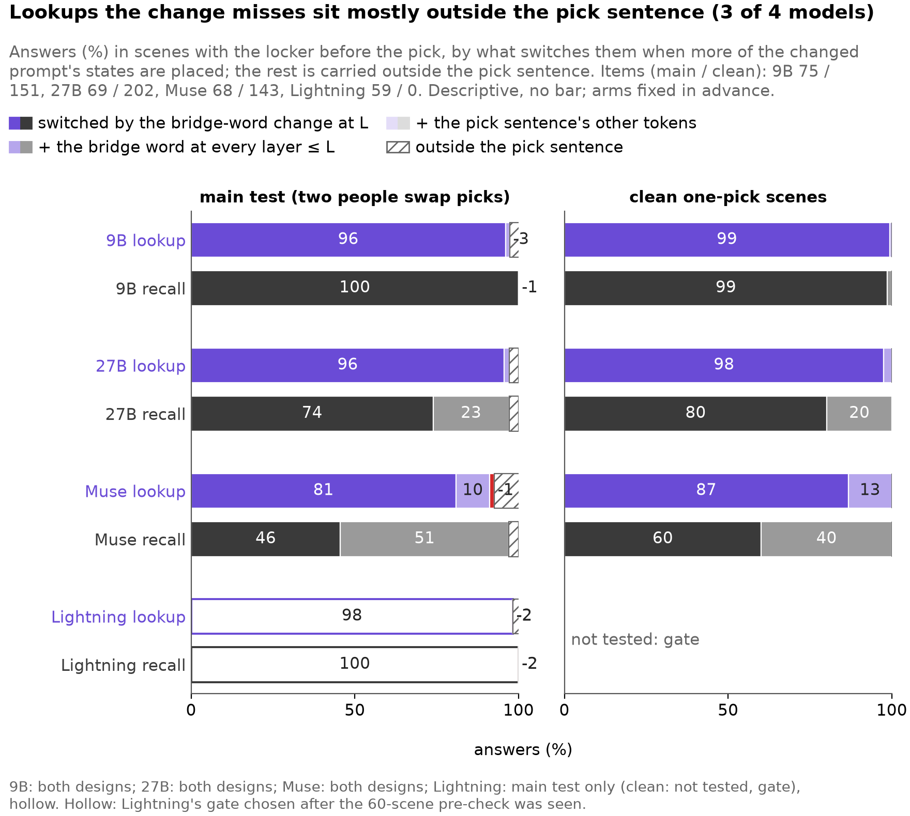
*Locker-first scenes: answers by what switches them as more of the changed prompt's states are placed (the change at L; the bridge word at every layer up to L; the pick sentence's other tokens; outside the pick sentence), main test and clean scenes; 9B and Muse (the README's supplementary figure); the 27B in the table.*

- **Result.**

  | | 9B | 27B | Muse | Lightning |
  |---|---|---|---|---|
  | locker first: lookups the change at L leaves unswitched (main) | 0.04 [0.00, 0.09]<!-- src: results/x47_cumulative/x47_4-20261028T113105Z/x47_4.md \| qwen3.5-9b :: main :: 75 :: 0.04 [0.00, 0.09] --> | 0.04 [0.00, 0.09]<!-- src: results/x47_cumulative/x52_cumulative-20261029T023427Z/x47_4.md \| qwen3.6-27b :: main :: 69 :: 0.04 [0.00, 0.09] --> | 0.19 [0.10, 0.28]<!-- src: results/x47_cumulative/x47_4-20261028T113105Z/x47_4.md \| muse-glimmer-30b :: main :: 68 :: 0.19 [0.10, 0.28] --> | pending |
  | locker first: where most of that rest is read, main / clean | outside<!-- src: results/x47_cumulative/x47_4-20261028T113105Z/x47_4.md \| qwen3.5-9b :: main :: 75 :: outside --> / before_L<!-- src: results/x47_cumulative/x47_4-20261028T113105Z/x47_4.md \| qwen3.5-9b :: clean :: 151 :: before_L --> | outside<!-- src: results/x47_cumulative/x52_cumulative-20261029T023427Z/x47_4.md \| qwen3.6-27b :: main :: 69 :: outside --> / before_L<!-- src: results/x47_cumulative/x52_cumulative-20261029T023427Z/x47_4.md \| qwen3.6-27b :: clean :: 202 :: before_L --> | before_L<!-- src: results/x47_cumulative/x47_4-20261028T113105Z/x47_4.md \| muse-glimmer-30b :: main :: 68 :: before_L --> / before_L<!-- src: results/x47_cumulative/x47_4-20261028T113105Z/x47_4.md \| muse-glimmer-30b :: clean :: 143 :: before_L --> | |
  | locker after: lookups carried by the bridge word before L (main) | 0.93 [0.85, 0.98]<!-- src: results/x47_cumulative/x47_4-20261028T113105Z/x47_4.md \| qwen3.5-9b :: main :: lookup :: locker-after :: 68 :: 0.93 [0.85, 0.98] --> | 1.00 [1.00, 1.00]<!-- src: results/x47_cumulative/x52_cumulative-20261029T023427Z/x47_4.md \| qwen3.6-27b :: main :: lookup :: locker-after :: 61 :: 1.00 [1.00, 1.00] --> | 0.99 [0.95, 1.00]<!-- src: results/x47_cumulative/x47_4-20261028T113105Z/x47_4.md \| muse-glimmer-30b :: main :: lookup :: locker-after :: 69 :: 0.99 [0.95, 1.00] --> | |

- **Read.**
  - With the locker first the change at L misses few lookups on every model, the 27B included; with the locker after, almost all lookups are carried by the bridge word before L, on the 27B too.
- **Caveats.**
  - Descriptive: no rule fixed in advance.
  - In the main test the rest of a locker-first miss sits outside the pick sentence on the 9B and 27B (the other person's pick also changes there); in clean scenes it is before L on all three.

### Does the split hold in prose, JSON and tables? (varied scenes, x0b; Lightning's coverage run 29 Oct) 

*Used in: README Part I card "Does the split hold in other texts?" and Fig. 9a (9B, 27B, Muse); Lightning not in the README yet. Story: other datasets.*

- **Question.** In scenes written as prose, JSON or a table, at three nesting levels and in several domains, does the lookup let go of the lens part while the recall follows it?
- **Why we asked.** The main test is one template; the split could belong to that layout rather than to the two readers.
- **Data.** Varied scenes, at most 40 per cell, only cells that pass the gate: 36 of 51<!-- src: results/x0b_generalize/qwen35_9b_x0b_v2/verdict-20261024T182331Z/verdict.md \| Gate per cell :: 36 of 51 --> / 49 of 51<!-- src: results/x0b_generalize/x0b_v2_27b/verdict-20261024T192113Z/verdict.md \| Gate per cell :: 49 of 51 --> / 44 of 57<!-- src: results/x0b_generalize/muse30b_x0b_v2/verdict-20261026T022534Z/verdict.md \| Gate per cell :: 44 of 57 --> / 42 of 57<!-- src: results/x0b_generalize/nem35l_x52_x0b/verdict-20261029T014520Z/verdict.md \| Gate per cell :: 42 of 57 --> cells, 1010<!-- src: results/x0b_generalize/qwen35_9b_x0b_v2/verdict-20261024T182331Z/verdict.md \| Gate per cell :: 1010 --> / 1635<!-- src: results/x0b_generalize/x0b_v2_27b/verdict-20261024T192113Z/verdict.md \| Gate per cell :: 1635 --> / 1388<!-- src: results/x0b_generalize/muse30b_x0b_v2/verdict-20261026T022534Z/verdict.md \| Gate per cell :: 1388 --> / 1105<!-- src: results/x0b_generalize/nem35l_x52_x0b/verdict-20261029T014520Z/verdict.md \| Gate per cell :: 1105 --> scenes (9B / 27B / Muse / Lightning).
- **Method.** The conflict test unchanged, at L: without the lens part (25 directions), against without a random part of the same share; pooled over the cells.
- **Rule, fixed in advance.** "Holds iff lookup excess <= 0.1 (upper CI <= 0.2) and C >= 0.2 (lower CI >= 0.1); fails iff lookup excess >= 0.2 or C's upper CI < 0.1." (C: the recall's extra loss minus the lookup's.) Lightning: a coverage run on this rule, no prediction.

*Switches lost without the lens part beyond a random part, by text format, for the recall (dark) and the lookup (purple); grey band: the lookup's 0.10 bar. 9B, 27B, Muse (the README's figure); Lightning's strata: [its verdict figure](../../results/x0b_generalize/nem35l_x52_x0b/verdict-20261029T014520Z/x0b_strata.png).*

- **Result.** (pooled over the cells, at L)

  | | 9B | 27B | Muse | Lightning |
  |---|---|---|---|---|
  | lookup: switches lost beyond a random part | 0.01 [-0.01, 0.03]<!-- src: results/x0b_generalize/qwen35_9b_x0b_v2/verdict-20261024T182331Z/verdict.md \| 1010 :: around :: 0.01 [-0.01, 0.03] --> | 0.08 [0.06, 0.10]<!-- src: results/x0b_generalize/x0b_v2_27b/verdict-20261024T192113Z/verdict.md \| 1635 :: around :: 0.08 [0.06, 0.10] --> | 0.06 [0.03, 0.10]<!-- src: results/x0b_generalize/muse30b_x0b_v2/verdict-20261026T022534Z/verdict.md \| 1388 :: around :: 0.06 [0.03, 0.10] --> | 0.03 [0.00, 0.05]<!-- src: results/x0b_generalize/nem35l_x52_x0b/verdict-20261029T014520Z/verdict.md \| 1105 :: around :: 0.03 [0.00, 0.05] --> |
  | recall: the same | 0.23 [0.14, 0.33]<!-- src: results/x0b_generalize/qwen35_9b_x0b_v2/verdict-20261024T182331Z/verdict.md \| 1010 :: mixed :: 0.23 [0.14, 0.33] --> | 0.56 [0.50, 0.61]<!-- src: results/x0b_generalize/x0b_v2_27b/verdict-20261024T192113Z/verdict.md \| 1635 :: through :: 0.56 [0.50, 0.61] --> | 0.56 [0.48, 0.66]<!-- src: results/x0b_generalize/muse30b_x0b_v2/verdict-20261026T022534Z/verdict.md \| 1388 :: through :: 0.56 [0.48, 0.66] --> | 0.26 [0.20, 0.34]<!-- src: results/x0b_generalize/nem35l_x52_x0b/verdict-20261029T014520Z/verdict.md \| 1105 :: mixed :: 0.26 [0.20, 0.34] --> |
  | the gap, recall minus lookup | 0.22 [0.14, 0.31]<!-- src: results/x0b_generalize/qwen35_9b_x0b_v2/verdict-20261024T182331Z/verdict.md \| pooled: HOLDS :: 0.22 [0.14, 0.31] --> | 0.47 [0.42, 0.53]<!-- src: results/x0b_generalize/x0b_v2_27b/verdict-20261024T192113Z/verdict.md \| pooled: HOLDS :: 0.47 [0.42, 0.53] --> | 0.50 [0.40, 0.61]<!-- src: results/x0b_generalize/muse30b_x0b_v2/verdict-20261026T022534Z/verdict.md \| pooled: HOLDS :: 0.50 [0.40, 0.61] --> | 0.24 [0.17, 0.32]<!-- src: results/x0b_generalize/nem35l_x52_x0b/verdict-20261029T014520Z/verdict.md \| pooled: HOLDS :: 0.24 [0.17, 0.32] --> |
  | the rule, pooled | **HOLDS<!-- src: results/x0b_generalize/qwen35_9b_x0b_v2/verdict-20261024T182331Z/verdict.md \| pooled :: HOLDS -->** | **HOLDS<!-- src: results/x0b_generalize/x0b_v2_27b/verdict-20261024T192113Z/verdict.md \| pooled :: HOLDS -->** | **HOLDS<!-- src: results/x0b_generalize/muse30b_x0b_v2/verdict-20261026T022534Z/verdict.md \| pooled :: HOLDS -->** | **HOLDS<!-- src: results/x0b_generalize/nem35l_x52_x0b/verdict-20261029T014520Z/verdict.md \| pooled :: HOLDS -->** (no prediction) |

- **Read.**
  - In prose, JSON and tables the recall follows the lens part and the lookup does not, on all four models, Lightning included.
- **Caveats.**
  - Only cells that pass the gate count; about a quarter of Lightning's and Muse's cells fail it.
  - Muse's scene count is 1,388 here and 1,389 in the README (Flagged 6).

### Is the person who picked an item marked at its locker sentence? (person mark, 48.3; the 27B's coverage run 29 Oct) 

*Used in: README Part VI, "What did not hold" (a person mark at the locker sentence; 9B, Muse); the 27B not in the README yet. Story: what did not hold.*

- **Question.** Is the person who picked an item written into the item's locker sentence, readable by a probe there, outside the lens, and able to move the lookup when written?
- **Why we asked.** A forward binding at the locker sentence would let the lookup find the pick's locker without reading the bridge word through the lens.
- **Data.** Main-test scenes split by sentence order; the probe's rule cell, locker after: 266<!-- src: results/x48_bind/x48_bind-20261028T113120Z/x48_bind.md \| qwen3.5-9b :: item :: 266 --> / 335<!-- src: results/x48_bind/x52_bind-20261029T023827Z/x48_bind.md \| qwen3.6-27b :: item :: 335 --> / 278<!-- src: results/x48_bind/x48_bind-20261028T113120Z/x48_bind.md \| muse-glimmer-30b :: item :: 278 --> sentences (9B / 27B / Muse).
- **Method.** A probe for which of the scene's three people picked the item, at the item and number tokens of the locker sentence; the person contrast's share in the lens part against random directions; the contrast written at both tokens at doses 1 and 2, against a random vector of its size.
- **Rule, fixed in advance.** "forward binding at the locker sentence, outside the lens: probe >= 0.85 in locker-after and <= 0.5 in locker-first; the person contrast's J++ share (k = 25) <= 2x a random direction's; the write sends >= 0.3 of lookups to the written item's locker (random <= 0.05); on both models." The 27B: a coverage run on this rule, no prediction.

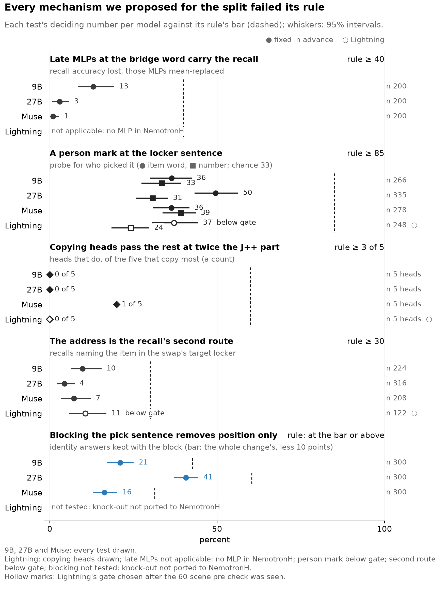
*Each mechanism test's deciding number per model against its rule's bar (dashed), whiskers 95%; this test is the second panel (the probe for who picked the item, chance 33%); 9B and Muse (the README's figure); the 27B in the table.*

- **Result.**

  | | 9B | 27B | Muse | Lightning |
  |---|---|---|---|---|
  | probe for who picked it, locker after, item token (bar >= 0.85) | 0.36 [0.30, 0.42]<!-- src: results/x48_bind/x48_bind-20261028T113120Z/x48_bind.md \| qwen3.5-9b :: item :: 0.36 [0.30, 0.42] --> | 0.50 [0.43, 0.56]<!-- src: results/x48_bind/x52_bind-20261029T023827Z/x48_bind.md \| qwen3.6-27b :: item :: 0.50 [0.43, 0.56] --> | 0.36 [0.31, 0.42]<!-- src: results/x48_bind/x48_bind-20261028T113120Z/x48_bind.md \| muse-glimmer-30b :: item :: 0.36 [0.31, 0.42] --> | not run |
  | the same, number token | 0.33 [0.27, 0.39]<!-- src: results/x48_bind/x48_bind-20261028T113120Z/x48_bind.md \| qwen3.5-9b :: number :: 0.33 [0.27, 0.39] --> | 0.31 [0.26, 0.35]<!-- src: results/x48_bind/x52_bind-20261029T023827Z/x48_bind.md \| qwen3.6-27b :: number :: 0.31 [0.26, 0.35] --> | 0.39 [0.34, 0.44]<!-- src: results/x48_bind/x48_bind-20261028T113120Z/x48_bind.md \| muse-glimmer-30b :: number :: 0.39 [0.34, 0.44] --> | |
  | the write: lookups sent to the written item's locker, dose 2 (bar >= 0.3) | 0.000<!-- src: results/x48_bind/x48_bind-20261028T113120Z/x48_bind.md \| qwen35_9b_x48_bind :: s = 2: target 0.000 :: 0.000 --> | 0.010<!-- src: results/x48_bind/x52_bind-20261029T023827Z/x48_bind.md \| x48_bind_27b :: s = 2: target 0.010 :: 0.010 --> | 0.015<!-- src: results/x48_bind/x48_bind-20261028T113120Z/x48_bind.md \| muse30_x48_bind :: s = 2: target 0.015 :: 0.015 --> | |
  | the rule | **does not hold<!-- src: results/x48_bind/x48_bind-20261028T113120Z/x48_bind.md \| Verdict :: does not hold -->** | **does not hold<!-- src: results/x48_bind/x52_bind-20261029T023827Z/x48_bind.md \| Verdict :: does not hold -->** (no prediction) | **does not hold<!-- src: results/x48_bind/x48_bind-20261028T113120Z/x48_bind.md \| Verdict :: does not hold -->** | |

- **Read.**
  - On all three models the person who picked an item cannot be read at its locker sentence (near the 0.33 chance, far under 0.85), and writing a person contrast there moves almost no lookup.
- **Caveats.**
  - The 27B's item-token probe reads 0.50, above chance but far under the bar.
  - The lens-share clause holds on the 27B and Muse and fails on the 9B; it does not decide alone.

### Is the address formed by the pick sentence reading the lockers? (blocking the pick sentence, 47.6; the 27B's coverage run 29 Oct) 

*Used in: README Part VI, "What did not hold" (blocking the pick sentence; 9B, Muse); the 27B not in the README yet. Story: what did not hold.*

- **Question.** Blocking the pick sentence from reading the locker sentences at every layer up to L, are only position answers lost, with identity answers and the recall's switch kept?
- **Why we asked.** If the pick token forms the address by reading the lockers, blocking those reads should remove position answers alone.
- **Data.** Routes scenes (another item moved, a filler sentence first): 300 per model (9B / 27B / Muse).
- **Method.** Attention from the pick sentence to the locker sentences blocked at layers 0 to L, in both forward passes that make the change; control: the same number of edges to the filler sentence; the lookup's routes and the recall's switch.
- **Rule, fixed in advance.** ""the pointer is formed by the pick token reading the lockers" if position answers fall to <= 0.10 (from 0.51 / 0.54) while identity answers stay within 0.10 and the recall's switch within 0.10, on Muse and the 9B; the control within 0.10 of none." The 27B: a coverage run on this rule, no prediction.

*Each mechanism test's deciding number per model against its rule's bar (dashed), whiskers 95%; this test is the bottom panel (identity answers kept with the block); 9B and Muse (the README's figure); the 27B in the table.*

- **Result.** (paired, the block minus no block)

  | | 9B | 27B | Muse | Lightning |
  |---|---|---|---|---|
  | position answers, block minus none | -0.43 [-0.48, -0.37]<!-- src: results/x47_edges/x47_6-20261028T113107Z/verdict.md \| block/sentence/all :: -0.43 [-0.48, -0.37] --> | -0.25 [-0.30, -0.21]<!-- src: results/x47_edges/x52_edges-20261029T023820Z/verdict.md \| block/sentence/all :: -0.25 [-0.30, -0.21] --> | -0.39 [-0.44, -0.33]<!-- src: results/x47_edges/x47_6-20261028T113107Z/verdict.md \| block/sentence/all :: -0.39 [-0.44, -0.33] --> | not run |
  | identity answers, block minus none (bar: within 0.10) | -0.32 [-0.37, -0.27]<!-- src: results/x47_edges/x47_6-20261028T113107Z/verdict.md \| block/sentence/all :: -0.32 [-0.37, -0.27] --> | -0.30 [-0.34, -0.24]<!-- src: results/x47_edges/x52_edges-20261029T023820Z/verdict.md \| block/sentence/all :: -0.30 [-0.34, -0.24] --> | -0.25 [-0.31, -0.19]<!-- src: results/x47_edges/x47_6-20261028T113107Z/verdict.md \| block/sentence/all :: -0.25 [-0.31, -0.19] --> | |
  | the recall's switch, block minus none (bar: within 0.10) | -0.23 [-0.29, -0.18]<!-- src: results/x47_edges/x47_6-20261028T113107Z/verdict.md \| block/sentence/all :: -0.23 [-0.29, -0.18] --> | -0.22 [-0.27, -0.17]<!-- src: results/x47_edges/x52_edges-20261029T023820Z/verdict.md \| block/sentence/all :: -0.22 [-0.27, -0.17] --> | -0.15 [-0.20, -0.09]<!-- src: results/x47_edges/x47_6-20261028T113107Z/verdict.md \| block/sentence/all :: -0.15 [-0.20, -0.09] --> | |
  | the rule | **does not hold<!-- src: results/x47_edges/x47_6-20261028T113107Z/verdict.md \| Formation :: does not hold -->** | **does not hold<!-- src: results/x47_edges/x52_edges-20261029T023820Z/verdict.md \| Formation :: does not hold -->** (no prediction) | **does not hold<!-- src: results/x47_edges/x47_6-20261028T113107Z/verdict.md \| Formation :: does not hold -->** | |

- **Read.**
  - On all three models the block removes position answers, but identity answers and the recall's switch fall too, by more than 0.10: blocking the pick sentence does not single out the address.
- **Caveats.**
  - Part (c), blocking the question's reads, was dropped before any run.
  - The control (edges to the filler sentence) stays within 0.10 of no block on all three.

### Is the address the same for any kind of item? (other kinds of item, 47.11; the 27B's coverage run 29 Oct) 

*Used in: README Part VI, "What did not hold" (the address is the same for any kind of item; 9B, Muse); the 27B not in the README yet. Story: what did not hold.*

- **Question.** With fruits or names as the items instead of animals, does the address fit on animal scenes still carry the lookup's position answers?
- **Why we asked.** An address, not an animal code, should work for any kind of item.
- **Data.** Routes scenes (another item moved) with animals, fruits and names as the items, matched digits, people and slots: 300 per kind per model (9B / 27B / Muse).
- **Method.** At the bridge word at L: the address fit on animal scenes, not refit, taken out of the change against a random part of its share, and kept alone; where that fails, the address refit per kind on a fit half and read on the other half.
- **Rule, fixed in advance.** ""An address, not an animal code" if without U cuts position answers >= 0.3 beyond random on both new item types (within 0.1 of the animal result), and only-U gives position >= 0.15. If it fails, refit U per item type and report both: the code is slot x type." The 27B: a coverage run on this rule, no prediction.

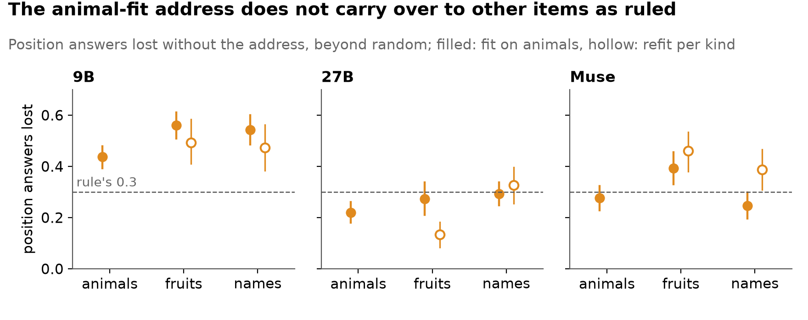
*Per model, position answers lost without the address beyond a random part of its share, by kind of item: the address fit on animals (filled) and refit per kind (hollow); dashed: the rule's 0.3; whiskers 95%; 300 scenes per kind (150 for the refit's read).*

- **Result.**

  | | 9B | 27B | Muse | Lightning |
  |---|---|---|---|---|
  | position lost without the animal-fit address, beyond random: animals / fruits / names (bar >= 0.3) | 0.44 [0.39, 0.48]<!-- src: results/x47_agnostic/x47_11-20261028T143952Z/x47_11.md \| qwen3.5-9b :: animals :: 0.44 [0.39, 0.48] --> / 0.56 [0.51, 0.61]<!-- src: results/x47_agnostic/x47_11-20261028T143952Z/x47_11.md \| qwen3.5-9b :: fruits :: 0.56 [0.51, 0.61] --> / 0.54 [0.48, 0.60]<!-- src: results/x47_agnostic/x47_11-20261028T143952Z/x47_11.md \| qwen3.5-9b :: names :: 0.54 [0.48, 0.60] --> | 0.22 [0.18, 0.26]<!-- src: results/x47_agnostic/x52_agnostic-20261029T023820Z/x47_11.md \| qwen3.6-27b :: animals :: 0.22 [0.18, 0.26] --> / 0.27 [0.21, 0.34]<!-- src: results/x47_agnostic/x52_agnostic-20261029T023820Z/x47_11.md \| qwen3.6-27b :: fruits :: 0.27 [0.21, 0.34] --> / 0.29 [0.25, 0.34]<!-- src: results/x47_agnostic/x52_agnostic-20261029T023820Z/x47_11.md \| qwen3.6-27b :: names :: 0.29 [0.25, 0.34] --> | 0.28 [0.23, 0.32]<!-- src: results/x47_agnostic/x47_11-20261028T143952Z/x47_11.md \| muse-glimmer-30b :: animals :: 0.28 [0.23, 0.32] --> / 0.39 [0.33, 0.46]<!-- src: results/x47_agnostic/x47_11-20261028T143952Z/x47_11.md \| muse-glimmer-30b :: fruits :: 0.39 [0.33, 0.46] --> / 0.25 [0.20, 0.30]<!-- src: results/x47_agnostic/x47_11-20261028T143952Z/x47_11.md \| muse-glimmer-30b :: names :: 0.25 [0.20, 0.30] --> | pending |
  | only the address kept, position: fruits / names (bar >= 0.15) | 0.35 [0.30, 0.40]<!-- src: results/x47_agnostic/x47_11-20261028T143952Z/x47_11.md \| qwen3.5-9b :: fruits :: 0.35 [0.30, 0.40] --> / 0.35 [0.30, 0.41]<!-- src: results/x47_agnostic/x47_11-20261028T143952Z/x47_11.md \| qwen3.5-9b :: names :: 0.35 [0.30, 0.41] --> | 0.08 [0.04, 0.11]<!-- src: results/x47_agnostic/x52_agnostic-20261029T023820Z/x47_11.md \| qwen3.6-27b :: fruits :: 0.08 [0.04, 0.11] --> / 0.14 [0.10, 0.18]<!-- src: results/x47_agnostic/x52_agnostic-20261029T023820Z/x47_11.md \| qwen3.6-27b :: names :: 0.14 [0.10, 0.18] --> | 0.29 [0.24, 0.35]<!-- src: results/x47_agnostic/x47_11-20261028T143952Z/x47_11.md \| muse-glimmer-30b :: fruits :: 0.29 [0.24, 0.35] --> / 0.27 [0.21, 0.32]<!-- src: results/x47_agnostic/x47_11-20261028T143952Z/x47_11.md \| muse-glimmer-30b :: names :: 0.27 [0.21, 0.32] --> | |
  | label: fruits / names | slot x type<!-- src: results/x47_agnostic/x47_11-20261028T143952Z/x47_11.md \| qwen3.5-9b :: fruits :: slot x type --> / slot x type<!-- src: results/x47_agnostic/x47_11-20261028T143952Z/x47_11.md \| qwen3.5-9b :: names :: slot x type --> | neither U nor the refit<!-- src: results/x47_agnostic/x52_agnostic-20261029T023820Z/x47_11.md \| qwen3.6-27b :: fruits :: neither U nor the refit --> / slot x type<!-- src: results/x47_agnostic/x52_agnostic-20261029T023820Z/x47_11.md \| qwen3.6-27b :: names :: slot x type --> | slot x type<!-- src: results/x47_agnostic/x47_11-20261028T143952Z/x47_11.md \| muse-glimmer-30b :: fruits :: slot x type --> / slot x type<!-- src: results/x47_agnostic/x47_11-20261028T143952Z/x47_11.md \| muse-glimmer-30b :: names :: slot x type --> | |
  | the rule | **no<!-- src: results/x47_agnostic/x47_11-20261028T143952Z/x47_11.md \| Q47.11 per model :: no -->** | **no<!-- src: results/x47_agnostic/x52_agnostic-20261029T023820Z/x47_11.md \| Q47.11 per model :: no -->** (no prediction) | **no<!-- src: results/x47_agnostic/x47_11-20261028T143952Z/x47_11.md \| Q47.11 per model :: no -->** | |

- **Read.**
  - On all three models the animal-fit address does not carry over as the rule asks: on the 9B it cuts fruits and names more than animals, on Muse names fall short, and on the 27B it cuts no kind by 0.3 and kept alone gives few position answers. Refit per kind, it passes for names on all three and for fruits on the 9B and Muse.
- **Caveats.**
  - Lightning's run has no outcomes in the coverage folder yet (pending).
  - The refit is read on half the scenes (150 per kind).

## Ledger only (opened, not in README)

### Does each reader follow the lens part by weight, or by route? (gain map, 49.1; Lightning's coverage run 29 Oct) 

*Used in: ledger only. Story: two readers.*

- **Question.** Scaling the lens part and the rest of the change separately, does the recall move with either part at enough gain (weights), or only with one of them (routes), and does the lookup ignore the lens part?
- **Why we asked.** Removing a part shows what a reader needs; adding each part at several gains shows whether it reads that part at all.
- **Data.** Main test, locker first: 75<!-- src: results/x49_gain/x49_1-20261028T154510Z/x49_1.md \| qwen35_9b_x49_1 :: 75 --> / 69<!-- src: results/x49_gain/x49_1-20261028T154510Z/x49_1.md \| x49_1_27b :: 69 --> / 68<!-- src: results/x49_gain/x49_1-20261028T154510Z/x49_1.md \| muse30_x49_1 :: 68 --> / 59<!-- src: results/x49_gain/x52_gain-20261029T021814Z/x49_1.md \| nem35l_x52_gain :: 59 --> (9B / 27B / Muse / Lightning).
- **Method.** At the bridge word at L: the lens part times α plus the rest times β, α and β from 0 to 2; the rest also without the address; random parts of the lens part's share at the same gains.
- **Rule, fixed in advance.** "(a) "weights, not routes": the recall's switch at (2,0) >= 0.5 and at (0,2, no U) >= 0.5, random corners <= 0.15; the lookup's switch at (2,0) <= 0.10 and at (0,1) >= 0.6. (b) "routes": the recall's switch at (0,2) <= 0.2 while (2,0) >= 0.5. (a') "the rest moves the recall only through the address": (0,2) >= 0.5 but (0,2, no U) <= 0.2. (c) "neither": report the two heatmaps." Lightning: a coverage run on this rule, no prediction.

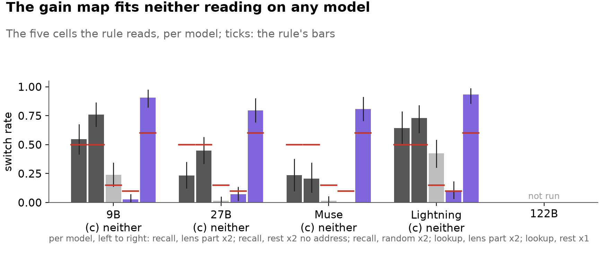
*Per model, the five cells the rule reads, each with the rule's bar as a red tick: the recall with the lens part alone at twice its size, with the rest at twice its size without the address, and with a random part at the lens part's share (grey); the lookup with the lens part alone at twice its size and with the rest alone; whiskers 95%.*

- **Result.** (switch rates)

  | | 9B | 27B | Muse | Lightning |
  |---|---|---|---|---|
  | recall, the lens part alone at twice its size (bar >= 0.5) | 0.55 [0.42, 0.67]<!-- src: results/x49_gain/x49_1-20261028T154510Z/x49_1.md \| qwen35_9b_x49_1 :: 0.55 [0.42, 0.67] --> | 0.23 [0.13, 0.35]<!-- src: results/x49_gain/x49_1-20261028T154510Z/x49_1.md \| x49_1_27b :: 0.23 [0.13, 0.35] --> | 0.24 [0.10, 0.37]<!-- src: results/x49_gain/x49_1-20261028T154510Z/x49_1.md \| muse30_x49_1 :: 0.24 [0.10, 0.37] --> | 0.64 [0.51, 0.78]<!-- src: results/x49_gain/x52_gain-20261029T021814Z/x49_1.md \| nem35l_x52_gain :: 0.64 [0.51, 0.78] --> |
  | recall, the rest alone at twice its size | 0.97 [0.93, 1.00]<!-- src: results/x49_gain/x49_1-20261028T154510Z/x49_1.md \| qwen35_9b_x49_1 :: 0.97 [0.93, 1.00] --> | 0.64 [0.54, 0.74]<!-- src: results/x49_gain/x49_1-20261028T154510Z/x49_1.md \| x49_1_27b :: 0.64 [0.54, 0.74] --> | 0.18 [0.08, 0.29]<!-- src: results/x49_gain/x49_1-20261028T154510Z/x49_1.md \| muse30_x49_1 :: 0.18 [0.08, 0.29] --> | 0.90 [0.81, 0.97]<!-- src: results/x49_gain/x52_gain-20261029T021814Z/x49_1.md \| nem35l_x52_gain :: 0.90 [0.81, 0.97] --> |
  | recall, the same without the address (bar >= 0.5) | 0.76 [0.66, 0.86]<!-- src: results/x49_gain/x49_1-20261028T154510Z/x49_1.md \| qwen35_9b_x49_1 :: 0.76 [0.66, 0.86] --> | 0.45 [0.34, 0.56]<!-- src: results/x49_gain/x49_1-20261028T154510Z/x49_1.md \| x49_1_27b :: 0.45 [0.34, 0.56] --> | 0.21 [0.09, 0.34]<!-- src: results/x49_gain/x49_1-20261028T154510Z/x49_1.md \| muse30_x49_1 :: 0.21 [0.09, 0.34] --> | 0.73 [0.60, 0.84]<!-- src: results/x49_gain/x52_gain-20261029T021814Z/x49_1.md \| nem35l_x52_gain :: 0.73 [0.60, 0.84] --> |
  | recall, a random part at the lens part's share, twice (bar <= 0.15) | 0.24 [0.14, 0.34]<!-- src: results/x49_gain/x49_1-20261028T154510Z/x49_1.md \| qwen35_9b_x49_1 :: 0.24 [0.14, 0.34] --> | 0.01 [0.00, 0.05]<!-- src: results/x49_gain/x49_1-20261028T154510Z/x49_1.md \| x49_1_27b :: 0.01 [0.00, 0.05] --> | 0.01 [0.00, 0.05]<!-- src: results/x49_gain/x49_1-20261028T154510Z/x49_1.md \| muse30_x49_1 :: 0.01 [0.00, 0.05] --> | 0.42 [0.31, 0.54]<!-- src: results/x49_gain/x52_gain-20261029T021814Z/x49_1.md \| nem35l_x52_gain :: 0.42 [0.31, 0.54] --> |
  | lookup, the lens part alone at twice its size (bar <= 0.10) | 0.03 [0.00, 0.07]<!-- src: results/x49_gain/x49_1-20261028T154510Z/x49_1.md \| qwen35_9b_x49_1 :: 0.03 [0.00, 0.07] --> | 0.07 [0.02, 0.13]<!-- src: results/x49_gain/x49_1-20261028T154510Z/x49_1.md \| x49_1_27b :: 0.07 [0.02, 0.13] --> | 0.00 [0.00, 0.00]<!-- src: results/x49_gain/x49_1-20261028T154510Z/x49_1.md \| muse30_x49_1 :: 0.00 [0.00, 0.00] --> | 0.10 [0.04, 0.18]<!-- src: results/x49_gain/x52_gain-20261029T021814Z/x49_1.md \| nem35l_x52_gain :: 0.10 [0.04, 0.18] --> |
  | lookup, the rest alone (bar >= 0.6) | 0.91 [0.82, 0.97]<!-- src: results/x49_gain/x49_1-20261028T154510Z/x49_1.md \| qwen35_9b_x49_1 :: 0.91 [0.82, 0.97] --> | 0.80 [0.70, 0.90]<!-- src: results/x49_gain/x49_1-20261028T154510Z/x49_1.md \| x49_1_27b :: 0.80 [0.70, 0.90] --> | 0.81 [0.71, 0.91]<!-- src: results/x49_gain/x49_1-20261028T154510Z/x49_1.md \| muse30_x49_1 :: 0.81 [0.71, 0.91] --> | 0.93 [0.86, 0.98]<!-- src: results/x49_gain/x52_gain-20261029T021814Z/x49_1.md \| nem35l_x52_gain :: 0.93 [0.86, 0.98] --> |
  | the rule | **(c) neither<!-- src: results/x49_gain/x49_1-20261028T154510Z/x49_1.md \| qwen35_9b_x49_1 :: (c) neither -->** | **(c) neither<!-- src: results/x49_gain/x49_1-20261028T154510Z/x49_1.md \| x49_1_27b :: (c) neither -->** | **(c) neither<!-- src: results/x49_gain/x49_1-20261028T154510Z/x49_1.md \| muse30_x49_1 :: (c) neither -->** | **(c) neither<!-- src: results/x49_gain/x52_gain-20261029T021814Z/x49_1.md \| nem35l_x52_gain :: (c) neither -->** (no prediction) |

- **Read.**
  - The gain map fits neither reading fixed in advance on any model: on the 9B and Lightning a random part at the lens part's share also moves the recall; on the 27B and Muse the lens part alone moves the recall little even at twice its size. The rest alone moves the lookup on all four.
- **Caveats.**
  - Lightning's lookup with the lens part at twice its size sits at the rule's 0.10 bar, its point estimate just above it.
  - Locker-first main-test scenes only.

### What is inside the lens part's 25 directions? (batch 52 A, landed 29 Oct 01:01; Lightning's 01:06) 

*Used in: ledger only. Story: two readers.*

- **Question.** Which words do the 25 lens directions of the change stand for: the two bridge items, the answer words, or other words?
- **Why we asked.** The answer control tests the answer words only; the rest of the lens part was never looked at.
- **Data.** Main test, 50 locker-first items per model (Lightning at L14, main test only); Zach's described passages, 50 per model (9B, 27B, Muse).
- **Method.** Each of the 25 lens directions labelled by a word classifier (the bridge words with their spellings, the answer words, other classes); the share of the rebuilt energy per class, against a chance baseline.
- **Rule, fixed in advance.** None: descriptive inventory, no rule.

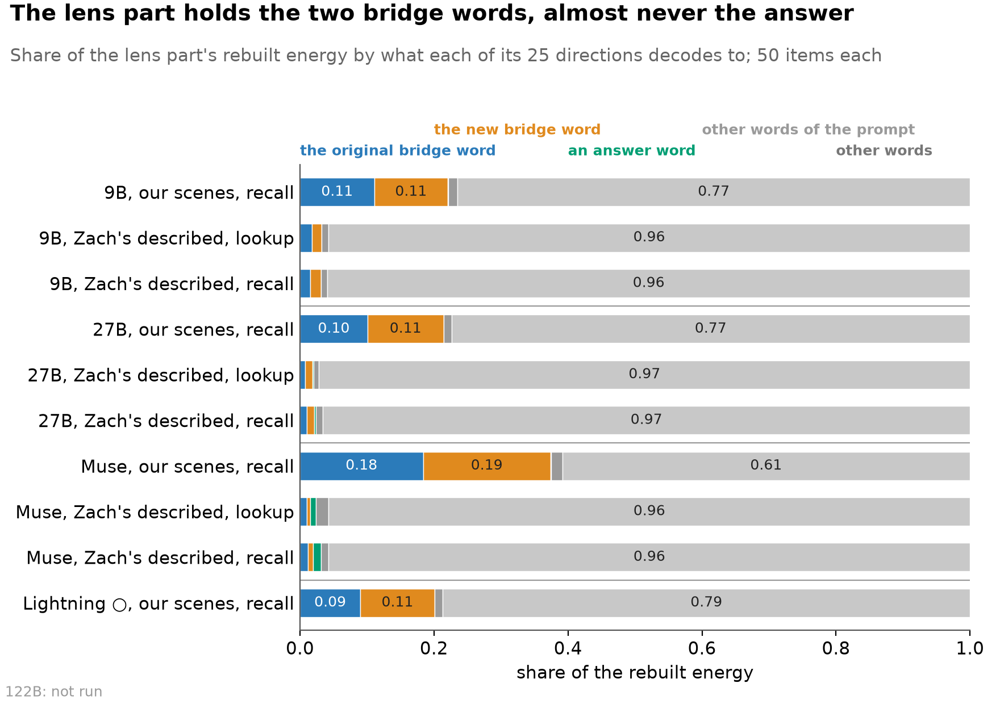
*Share of the lens part's rebuilt energy by what each of its 25 directions decodes to, per model: our main test (the recall's view) and Zach's described passages (each reader's own change); 50 items each. The report's own figure, with examples: [the verdict folder](../../results/x52_atoms/report-20261029T000125Z/fig_atoms.png).*

- **Result.** (main test, recall's view)

  | | 9B | 27B | Muse | Lightning |
  |---|---|---|---|---|
  | rebuilt energy in the original bridge word | 0.111 [0.091, 0.130]<!-- src: results/x52_atoms/report-20261029T000125Z/verdict.md \| 9B e1 (recall's view :: 0.111 [0.091, 0.130] --> | 0.101 [0.075, 0.126]<!-- src: results/x52_atoms/report-20261029T000125Z/verdict.md \| 27B e1 (recall's view :: 0.101 [0.075, 0.126] --> | 0.184 [0.165, 0.198]<!-- src: results/x52_atoms/report-20261029T000125Z/verdict.md \| Muse e1 (recall's view :: 0.184 [0.165, 0.198] --> | 0.090 [0.073, 0.104]<!-- src: results/x52_atoms/report-20261029T010648Z/verdict.md \| Lightning e1 (recall's view :: 0.090 [0.073, 0.104] --> |
  | in the new bridge word | 0.110 [0.093, 0.124]<!-- src: results/x52_atoms/report-20261029T000125Z/verdict.md \| 9B e1 (recall's view :: 0.110 [0.093, 0.124] --> | 0.113 [0.096, 0.134]<!-- src: results/x52_atoms/report-20261029T000125Z/verdict.md \| 27B e1 (recall's view :: 0.113 [0.096, 0.134] --> | 0.190 [0.168, 0.212]<!-- src: results/x52_atoms/report-20261029T000125Z/verdict.md \| Muse e1 (recall's view :: 0.190 [0.168, 0.212] --> | 0.111 [0.089, 0.131]<!-- src: results/x52_atoms/report-20261029T010648Z/verdict.md \| Lightning e1 (recall's view :: 0.111 [0.089, 0.131] --> |
  | in the recall's answer word | 0.001 [0.000, 0.002]<!-- src: results/x52_atoms/report-20261029T000125Z/verdict.md \| 9B e1 (recall's view :: 0.001 [0.000, 0.002] --> | 0.001 [0.000, 0.002]<!-- src: results/x52_atoms/report-20261029T000125Z/verdict.md \| 27B e1 (recall's view :: 0.001 [0.000, 0.002] --> | 0.001 [0.000, 0.003]<!-- src: results/x52_atoms/report-20261029T000125Z/verdict.md \| Muse e1 (recall's view :: 0.001 [0.000, 0.003] --> | 0.000 [0.000, 0.000]<!-- src: results/x52_atoms/report-20261029T010648Z/verdict.md \| Lightning e1 (recall's view :: 0.000 [0.000, 0.000] --> |
  | in other words | 0.765 [0.739, 0.796]<!-- src: results/x52_atoms/report-20261029T000125Z/verdict.md \| 9B e1 (recall's view :: 0.765 [0.739, 0.796] --> | 0.774 [0.739, 0.808]<!-- src: results/x52_atoms/report-20261029T000125Z/verdict.md \| 27B e1 (recall's view :: 0.774 [0.739, 0.808] --> | 0.609 [0.584, 0.642]<!-- src: results/x52_atoms/report-20261029T000125Z/verdict.md \| Muse e1 (recall's view :: 0.609 [0.584, 0.642] --> | 0.787 [0.758, 0.818]<!-- src: results/x52_atoms/report-20261029T010648Z/verdict.md \| Lightning e1 (recall's view :: 0.787 [0.758, 0.818] --> |

- **Read.**
  - On the main test the two bridge words carry about a fifth (9B, 27B, Lightning) to two fifths (Muse) of the rebuilt energy, the answer words almost none (none at all on Lightning).
- **Caveats.**
  - The classifier was hand-checked on 5 items per model (blind on Muse's main test only) and misses non-English answer words.
  - On Zach's described passages the bridge names carry 0.02-0.03 and the descriptions' words dominate (see the report).

### Where is the answer readable through the lens, and can it be written there? (batch 52 B, landed 29 Oct 01:46; Lightning's main set 29 Oct) 

*Used in: ledger only. Story: two readers.*

- **Question.** For each reader, on our scenes and on Zach's described passages, is the answer word readable through the lens before the answer is computed, and does writing its lens directions change the answer?
- **Why we asked.** The answer control found the answer word not read at our bridge word but read at Zach's description; where else is it readable, and is it used there?
- **Data.** Our main test, 200 per model (Lightning at L14, a coverage run, no prediction); Zach's described passages, 158 / 166 / 157 (Lightning's read pending).
- **Method.** Read: the answer word's rank in the lens readout at the bridge word, its earlier mention, the question and the last token, every second layer before the answer layer. Write: at the most readable cell, the answer word's lens directions at one and two times a real change's size, against a random part and a frequency-matched part of the same size; the whole change at that cell as the reference.
- **Rule, fixed in advance.** "“Readable”: the answer word in the lens top-5 on ≥ 0.5 of items at some layer before the answer layer. “Usable”: writing its directions changes the answer on ≥ 0.3 of items with the random control ≤ 0.10. Report the four combinations per reader, per dataset." No prediction.

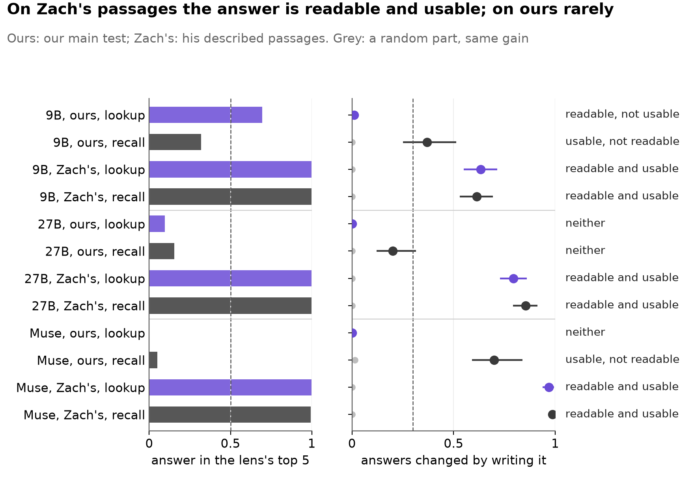
*Per model, dataset and reader: left, the best share of items with the answer word in the lens's top 5 before the answer layer (dashed: the rule's 0.5); right, the answers changed by writing its lens directions at that cell, the better of the two sizes (whiskers 95%), a random part of the same size in grey (dashed: the rule's 0.3); at the right, the rule's combination. Per-layer maps: [9B](../../results/x52_answer_map/x52-20261029T004559Z/map_9b.png), [27B](../../results/x52_answer_map/x52-20261029T004559Z/map_27b.png), [Muse](../../results/x52_answer_map/x52-20261029T004559Z/map_muse.png).*

- **Result.** (the combination; answers changed by the write at one / two times a real change's size)

  | | 9B | 27B | Muse | Lightning |
  |---|---|---|---|---|
  | ours, lookup | **readable, not usable**: 0.01 [0.00, 0.02] / 0.01 [0.00, 0.02]<!-- src: results/x52_answer_map/x52-20261029T004559Z/verdict.md \| best T L24 0.69 :: 0.01 [0.00, 0.02] / 0.01 [0.00, 0.02] --> | **neither**: 0.00 [0.00, 0.00] / 0.00 [0.00, 0.00]<!-- src: results/x52_answer_map/x52-20261029T004559Z/verdict.md \| best T L0 0.10 :: 0.00 [0.00, 0.00] / 0.00 [0.00, 0.00] --> (cannot tell) | **neither**: 0.00 [0.00, 0.00] / 0.00 [0.00, 0.00]<!-- src: results/x52_answer_map/x52-20261029T004559Z/verdict.md \| best T L34 0.00 :: 0.00 [0.00, 0.00] / 0.00 [0.00, 0.00] --> (cannot tell) | **readable, not usable**: 0.01 [0.00, 0.02] / 0.10 [0.05, 0.14]<!-- src: results/x52_answer_map/x52cov-20261029T005848Z/verdict.md \| best T L38 0.91 :: 0.01 [0.00, 0.02] / 0.10 [0.05, 0.14] --> |
  | ours, recall | **usable, not readable**: 0.37 [0.25, 0.51] / 0.03 [0.01, 0.06]<!-- src: results/x52_answer_map/x52-20261029T004559Z/verdict.md \| best T L28 0.32 :: 0.37 [0.25, 0.51] / 0.03 [0.01, 0.06] --> | **neither**: 0.08 [0.04, 0.14] / 0.20 [0.12, 0.31]<!-- src: results/x52_answer_map/x52-20261029T004559Z/verdict.md \| best T L46 0.15 :: 0.08 [0.04, 0.14] / 0.20 [0.12, 0.31] --> | **usable, not readable**: 0.70 [0.59, 0.84] / 0.09 [0.03, 0.15]<!-- src: results/x52_answer_map/x52-20261029T004559Z/verdict.md \| best T L36 0.05 :: 0.70 [0.59, 0.84] / 0.09 [0.03, 0.15] --> | **usable, not readable**: 0.65 [0.57, 0.74] / 0.01 [0.00, 0.03]<!-- src: results/x52_answer_map/x52cov-20261029T005848Z/verdict.md \| best T L46 0.41 :: 0.65 [0.57, 0.74] / 0.01 [0.00, 0.03] --> |
  | Zach's described, lookup | **readable and usable**: 0.63 [0.55, 0.72] / 0.55 [0.46, 0.64]<!-- src: results/x52_answer_map/x52-20261029T004559Z/verdict.md \| ['E', 10] :: 0.63 [0.55, 0.72] / 0.55 [0.46, 0.64] --> | **readable and usable**: 0.17 [0.11, 0.23] / 0.80 [0.73, 0.86]<!-- src: results/x52_answer_map/x52-20261029T004559Z/verdict.md \| best T L62 1.00 :: 0.17 [0.11, 0.23] / 0.80 [0.73, 0.86] --> | **readable and usable**: 0.97 [0.94, 0.99] / 0.92 [0.87, 0.96]<!-- src: results/x52_answer_map/x52-20261029T004559Z/verdict.md \| best T L48 1.00 :: 0.97 [0.94, 0.99] / 0.92 [0.87, 0.96] --> | read pending |
  | Zach's described, recall | **readable and usable**: 0.61 [0.53, 0.69] / 0.55 [0.46, 0.64]<!-- src: results/x52_answer_map/x52-20261029T004559Z/verdict.md \| ['E', 16] :: 0.61 [0.53, 0.69] / 0.55 [0.46, 0.64] --> | **readable and usable**: 0.86 [0.79, 0.91] / 0.84 [0.78, 0.90]<!-- src: results/x52_answer_map/x52-20261029T004559Z/verdict.md \| best T L60 1.00 :: 0.86 [0.79, 0.91] / 0.84 [0.78, 0.90] --> | **readable and usable**: 0.99 [0.97, 1.00] / 0.85 [0.79, 0.91]<!-- src: results/x52_answer_map/x52-20261029T004559Z/verdict.md \| best T L48 0.99 :: 0.99 [0.97, 1.00] / 0.85 [0.79, 0.91] --> | read pending |

- **Read.**
  - On Zach's described passages the answer word is readable and writing it changes the answer, for both readers on all three models.
  - On our scenes the recall's answer is never readable before the answer layer, yet writing it at the last token moves the 9B's, Muse's and Lightning's recall; the lookup's is readable only on the 9B and Lightning, where writing it moves a tenth of answers or fewer.
- **Caveats.**
  - The 27B's and Muse's lookup cells on our scenes were written where nothing was readable and where the whole change itself switches nothing, so their "not usable" cannot tell (see Flagged for Dan).
  - Only the most readable cell was written; writing at the most readable cell other than the last token waits for Dan.

### At which layer does Lightning get the conflict test? (Lightning's layer, committed 29 Oct 01:02) 

*Used in: the Lightning conflict test; README Status line (waiting for Dan). Story: two readers.*

- **Question.** At which layer does Nemotron 3.5 Lightning get the conflict test?
- **Why we asked.** A new model needs its layer L fixed before any scored run.
- **Data.** 60 dev scenes of the main test (excluded from the conflict test).
- **Method.** The whole change at the bridge word at every 4th layer (L2 to L50); each reader's switch rate; the bridge word's lens readability recorded as the tie-break.
- **Rule, fixed in advance.** Batch 52 amendment 1 (Dan ~00:50, before the sweep): "earliest layer passing the gate at relative depth ≥ 0.25; tie-break = highest lens readability of the bridge word." Passing = both readers switch on at least 0.3 (the published rule). ○ Gate chosen after the 60-scene pre-check was seen.

*The same figure as the conflict test's card; its top panel is this sweep: share switched by the whole change per layer (60 dev scenes); dashed: 0.3; dotted: relative depth 0.25; solid: L14.*

- **Result.**

  | | 9B | 27B | Muse | Lightning |
  |---|---|---|---|---|
  | the layer | L12 | L32 | L26 | **L14** (depth 0.27) |
  | lookup switch at L14 | | | | 0.58 [0.45, 0.73]<!-- src: results/x51_lightning/nem35l_x52_layer_r2/prereq.md \| L14 (pick) :: 0.58 [0.45, 0.73] --> |
  | recall switch at L14 | | | | 0.98 [0.94, 1.00]<!-- src: results/x51_lightning/nem35l_x52_layer_r2/prereq.md \| L14 (pick) :: 0.98 [0.94, 1.00] --> |

- **Read.**
  - L14 is the earliest layer at depth 0.25 or more where both readers switch on at least 0.3 of scenes.
- **Caveats.**
  - The 60-scene pre-check failed (lookup 0.883, recall 0.783); the main test's gate on all 516 scenes decided (accepted by Dan 01:10).
  - `layer.json`'s "rule" field holds the prerequisite text, not amendment 1's pick rule.

### Does the second hop, hall to locker, run through an address too? (chained addresses, 47.14; the 27B's coverage run 29 Oct) 

*Used in: ledger only. Story: the address.*

- **Question.** With hall sentences before the locker sentences, is the hall of the pick's locker read through an address at the locker digit, as the locker is read through one at the bridge word?
- **Why we asked.** If the address is a general pointer, the next hop (locker to hall) should use one too.
- **Data.** Hall scenes, the test half: 147<!-- src: results/x47_chain/x47_14-20261028T115841Z/x47_14.md \| qwen35_9b_x47_14 :: 147 --> / 146<!-- src: results/x47_chain/x52_chain-20261029T023424Z/x47_14.md \| x47_14_27b :: 146 --> / 153<!-- src: results/x47_chain/x47_14-20261028T115841Z/x47_14.md \| muse30_x47_14 :: 153 --> (9B / 27B / Muse). Lightning not tested: its gate failed (the hall question right on 0.736<!-- src: results/x47_chain/nem35l_x52_chain/gate.json \| "PPP" :: 0.736 --> of 500<!-- src: results/x47_chain/nem35l_x52_chain/gate.json \| "cases" :: 500 --> cases, under 0.80).
- **Method.** The change at the digit token of the bridge's locker sentence at L: the hall address (U_num) taken out or kept alone, against random parts of its share; the hall question's answers sorted into identity, position and value; the locker question's answer as the collateral.
- **Rule, fixed in advance.** "probe >= 0.8 with the layout baseline <= 0.6; without U_num the hall question's position share falls >= 0.3 below the share without its random part; only U_num gives position >= 0.15; the locker question's kept share within 0.05 of unedited under every arm; on both models." The 27B: a coverage run on this rule, no prediction.

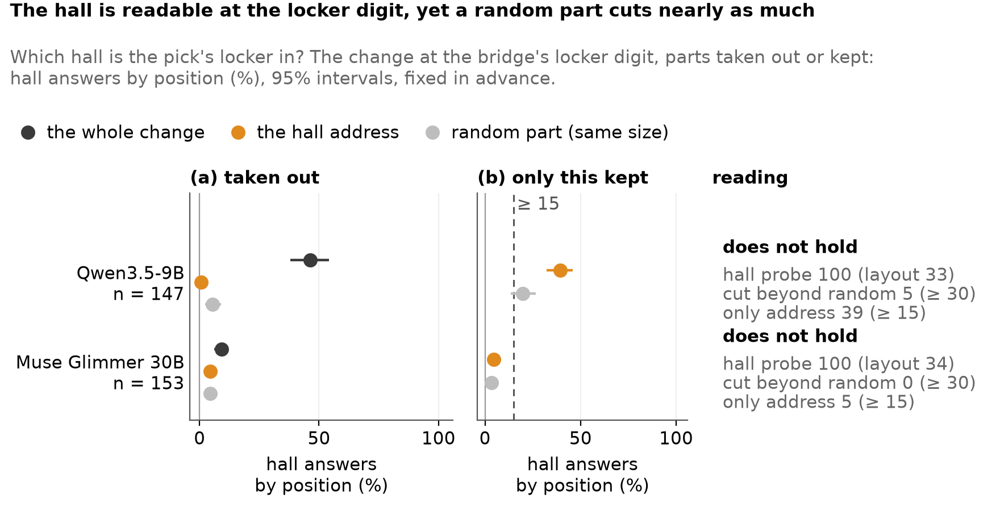
*Hall answers by position (%) with the change at the bridge's locker digit taken out (a) or kept alone (b): the whole change, the hall address, a random part of the same size; 9B and Muse (the README's figure); the 27B in the table.*

- **Result.**

  | | 9B | 27B | Muse | Lightning |
  |---|---|---|---|---|
  | the hall readable at the locker digit: slot probe (layout baseline) | 1.00 [1.00, 1.00]<!-- src: results/x47_chain/x47_14-20261028T115841Z/x47_14.md \| qwen35_9b_x47_14 :: 1.00 [1.00, 1.00] --> (0.33 [0.28, 0.38]<!-- src: results/x47_chain/x47_14-20261028T115841Z/x47_14.md \| qwen35_9b_x47_14 :: 0.33 [0.28, 0.38] -->) | 1.00 [1.00, 1.00]<!-- src: results/x47_chain/x52_chain-20261029T023424Z/x47_14.md \| x47_14_27b :: 1.00 [1.00, 1.00] --> (0.34 [0.29, 0.40]<!-- src: results/x47_chain/x52_chain-20261029T023424Z/x47_14.md \| x47_14_27b :: 0.34 [0.29, 0.40] -->) | 1.00 [1.00, 1.00]<!-- src: results/x47_chain/x47_14-20261028T115841Z/x47_14.md \| muse30_x47_14 :: 1.00 [1.00, 1.00] --> (0.34 [0.28, 0.41]<!-- src: results/x47_chain/x47_14-20261028T115841Z/x47_14.md \| muse30_x47_14 :: 0.34 [0.28, 0.41] -->) | not tested |
  | hall answers cut by taking out the hall address, beyond random (bar >= 0.3) | 0.05 [0.02, 0.08]<!-- src: results/x47_chain/x47_14-20261028T115841Z/x47_14.md \| qwen35_9b_x47_14 :: 0.05 [0.02, 0.08] --> | 0.00 [0.00, 0.00]<!-- src: results/x47_chain/x52_chain-20261029T023424Z/x47_14.md \| x47_14_27b :: 0.00 [0.00, 0.00] --> | 0.00 [0.00, 0.00]<!-- src: results/x47_chain/x47_14-20261028T115841Z/x47_14.md \| muse30_x47_14 :: 0.00 [0.00, 0.00] --> | |
  | position answers with only the hall address kept (bar >= 0.15) | 0.39 [0.32, 0.46]<!-- src: results/x47_chain/x47_14-20261028T115841Z/x47_14.md \| qwen35_9b_x47_14 :: 0.39 [0.32, 0.46] --> | 0.23 [0.17, 0.28]<!-- src: results/x47_chain/x52_chain-20261029T023424Z/x47_14.md \| x47_14_27b :: 0.23 [0.17, 0.28] --> | 0.05 [0.01, 0.08]<!-- src: results/x47_chain/x47_14-20261028T115841Z/x47_14.md \| muse30_x47_14 :: 0.05 [0.01, 0.08] --> | |
  | the rule, per model | **no<!-- src: results/x47_chain/x47_14-20261028T115841Z/x47_14.md \| qwen35_9b_x47_14 :: no -->** | **no<!-- src: results/x47_chain/x52_chain-20261029T023424Z/x47_14.md \| x47_14_27b :: no -->** | **no<!-- src: results/x47_chain/x47_14-20261028T115841Z/x47_14.md \| muse30_x47_14 :: no -->** | |

- **Read.**
  - On the 9B, 27B and Muse the hall is readable at the locker digit, but taking out the hall address cuts no more hall answers than a random part: the second hop does not run through an address the way the first does.
- **Caveats.**
  - The verdicts' batch line ("0 of 2 models hold; the rule needs both") applies the across-models clause; the per-model labels are the result.
  - Kept alone, the hall address gives position answers above the 0.15 bar on the 9B and 27B; only its removal fails.

### Do a few heads read the swapped address? (51.2, opened 28 Oct 20:04; Lightning's coverage run 29 Oct) 

*Used in: ledger only; planned Part III ("who reads it"). Story: the address.*

- **Question.** Does a small set of attention heads carry the address swap's effect at the last token, or is it spread over heads?
- **Why we asked.** Attention follows the swapped address; a few heads could be the readers.
- **Data.** The attention test's items and swap (routes scenes): read pairs 330 / 300 / 284 / 250<!-- src: results/x51_heads/x52_heads-20261029T015136Z/verdict.md \| read pairs 250 :: 250 --> (9B / 27B / Muse / Lightning, at L14).
- **Method.** Heads ranked by their attention move on the fit half, mean-ablated together on the read half at the last token (and the question tokens), against random head sets of the same size in the same layers.
- **Rule, fixed in advance.** "small_set: some top-k set, k in {1, 3, 5, 10}, cuts >= 0.5 while the identity answers (...) change <= 0.10 and the recall's answer changes <= 0.10 (...), and the matched random sets of k heads (same layers) cut <= 0.15 (mean over the draws). distributed: every head of the best layer together cuts < 0.3." Lightning: a coverage run on this rule, no prediction.

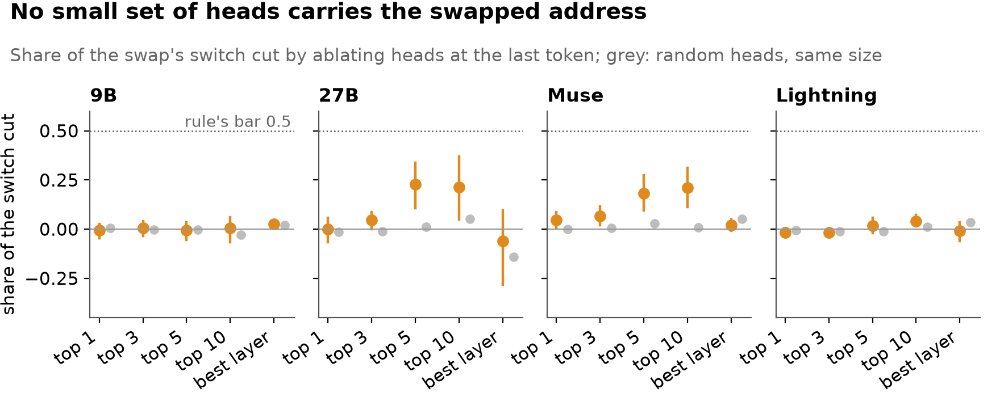
*Share of the swap's switch cut by mean-ablating the top 1 to 10 heads and every head of the best layer at the last token (orange, whiskers 95%), beside the mean of five random head sets of the same size (grey); dotted: the rule's 0.5 bar; read pairs 330 / 300 / 284 / 250 (9B, 27B, Muse, Lightning).*

- **Result.** (last token)

  | | 9B | 27B | Muse | Lightning |
  |---|---|---|---|---|
  | the best layer's heads together: share of the swap's switch cut | 0.027 [0.008, 0.044]<!-- src: results/x51_heads/x51_2-20261028T190358Z/verdict.md \| 0.448 -> 0.436 :: 0.027 [0.008, 0.044] --> | -0.061 [-0.283, 0.095]<!-- src: results/x51_heads/x51_2-20261028T190358Z/verdict.md \| 0.220 -> 0.233 :: -0.061 [-0.283, 0.095] --> | 0.020 [-0.007, 0.048]<!-- src: results/x51_heads/x51_2-20261028T190358Z/verdict.md \| 0.539 -> 0.528 :: 0.020 [-0.007, 0.048] --> | -0.008 [-0.061, 0.035]<!-- src: results/x51_heads/x52_heads-20261029T015136Z/verdict.md \| 0.500 -> 0.504 :: -0.008 [-0.061, 0.035] --> |
  | the top 10 heads: cut | 0.007 [-0.065, 0.060]<!-- src: results/x51_heads/x51_2-20261028T190358Z/verdict.md \| 0.448 -> 0.445 :: 0.007 [-0.065, 0.060] --> | | | 0.040 [0.015, 0.071]<!-- src: results/x51_heads/x52_heads-20261029T015136Z/verdict.md \| 0.500 -> 0.480 :: 0.040 [0.015, 0.071] --> |
  | the rule | **distributed** | **distributed** | **distributed** | **distributed<!-- src: results/x51_heads/x52_heads-20261029T015136Z/verdict.md \| Question tokens beside: distributed :: distributed -->** (the question tokens too; no prediction) |

- **Read.**
  - No small set of heads carries the swap's effect on any of the four models; even all heads of the best layer together cut almost none of it.
- **Caveats.**
  - Linear-attention layers have no heads: Gated DeltaNet on the 9B and 27B, Mamba-2 on Lightning (its verdict says Gated DeltaNet, a wording inherited from Muse's run).
  - Mean ablation at the last token and the question tokens only.

### Do attention heads follow the swapped address to its locker? (attention under the swap, 49.7; Lightning's coverage run 29 Oct) 

*Used in: ledger only. Story: the address.*

- **Question.** When the address swap sends the lookup to another locker, does some attention head at the last token move its weight to that locker on the pairs that switched, and only there?
- **Why we asked.** A head that reads the address should move with the swap where the lookup switches and stay put where it does not.
- **Data.** The address swap's routes items at dose 2, heads chosen on one half and read on the other: 330<!-- src: results/x49_attn/x49_7-20261028T154511Z/verdict.md \| Read pairs 330, switched 148 :: 330 --> / 300<!-- src: results/x49_attn/x49_7-20261028T154511Z/verdict.md \| Read pairs 300, switched 66 :: 300 --> / 286<!-- src: results/x49_attn/x49_7-20261028T154511Z/verdict.md \| Read pairs 286, switched 149 :: 286 --> / 250<!-- src: results/x49_attn/x52_attn-20261029T013321Z/verdict.md \| Read pairs 250, switched 125 :: 250 --> read pairs, of which 148<!-- src: results/x49_attn/x49_7-20261028T154511Z/verdict.md \| Read pairs 330, switched 148 :: 148 --> / 66<!-- src: results/x49_attn/x49_7-20261028T154511Z/verdict.md \| Read pairs 300, switched 66 :: 66 --> / 149<!-- src: results/x49_attn/x49_7-20261028T154511Z/verdict.md \| Read pairs 286, switched 149 :: 149 --> / 125<!-- src: results/x49_attn/x52_attn-20261029T013321Z/verdict.md \| Read pairs 250, switched 125 :: 125 --> switched (9B / 27B / Muse / Lightning).
- **Method.** At every full-attention layer after L, every head: the attention mass moved from the original locker to the swapped-in one at the last token (the question tokens beside), on switched and non-switched pairs and under a random vector of the swap's size; the best head zeroed as a necessity check.
- **Rule, fixed in advance.** "follows: on read-half pairs where the lookup switched to slot k's locker under the swap, >= 1 of the five candidate heads has mean move >= 0.30 (cluster-bootstrap CI excluding 0), its mean move under the random vector on the same pairs <= 0.05, and its mean move on the non-switched swap pairs <= 0.10. elsewhere: the lookup switches to slot k on >= 0.3 of the read-half swap pairs and no recorded head [...] reaches a mean move of 0.15 on the switched pairs. distributed: the summed mean move over the five candidate heads, or over every head of the best head's layer, is >= 0.30 while no single candidate head reaches 0.30." Lightning: a coverage run on this rule, no prediction.

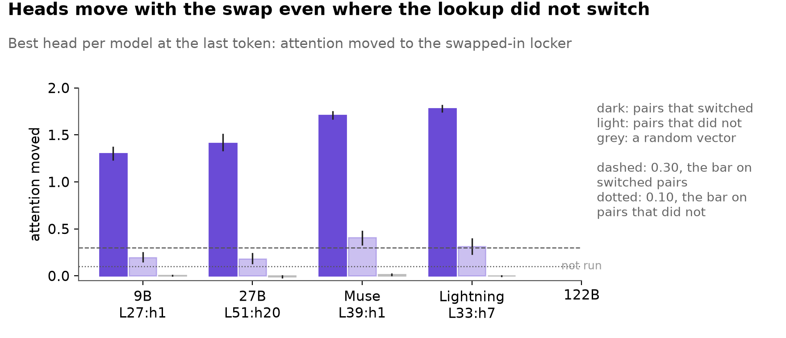
*Per model, the best head at the last token (chosen on the fit half): attention moved to the swapped-in locker on read pairs where the lookup switched (dark), where it did not (light), and under a random vector of the swap's size (grey); whiskers 95%; dashed and dotted: the rule's 0.30 and 0.10.*

- **Result.**

  | | 9B | 27B | Muse | Lightning |
  |---|---|---|---|---|
  | best head (chosen on the fit half) | L27:h1<!-- src: results/x49_attn/x49_7-20261028T154511Z/verdict.md \| 1.301 [1.237, 1.370] :: L27:h1 --> | L51:h20<!-- src: results/x49_attn/x49_7-20261028T154511Z/verdict.md \| 1.412 [1.334, 1.507] :: L51:h20 --> | L39:h1<!-- src: results/x49_attn/x49_7-20261028T154511Z/verdict.md \| 1.710 [1.670, 1.748] :: L39:h1 --> | L33:h7<!-- src: results/x49_attn/x52_attn-20261029T013321Z/verdict.md \| 1.779 [1.746, 1.812] :: L33:h7 --> |
  | its attention moved, pairs that switched | 1.301 [1.237, 1.370]<!-- src: results/x49_attn/x49_7-20261028T154511Z/verdict.md \| L27:h1 :: 1.301 [1.237, 1.370] --> | 1.412 [1.334, 1.507]<!-- src: results/x49_attn/x49_7-20261028T154511Z/verdict.md \| L51:h20 :: 1.412 [1.334, 1.507] --> | 1.710 [1.670, 1.748]<!-- src: results/x49_attn/x49_7-20261028T154511Z/verdict.md \| L39:h1 :: 1.710 [1.670, 1.748] --> | 1.779 [1.746, 1.812]<!-- src: results/x49_attn/x52_attn-20261029T013321Z/verdict.md \| L33:h7 :: 1.779 [1.746, 1.812] --> |
  | the same, pairs that did not switch (bar 0.10) | 0.196 [0.154, 0.247]<!-- src: results/x49_attn/x49_7-20261028T154511Z/verdict.md \| L27:h1 :: 0.196 [0.154, 0.247] --> | 0.183 [0.135, 0.237]<!-- src: results/x49_attn/x49_7-20261028T154511Z/verdict.md \| L51:h20 :: 0.183 [0.135, 0.237] --> | 0.409 [0.334, 0.473]<!-- src: results/x49_attn/x49_7-20261028T154511Z/verdict.md \| L39:h1 :: 0.409 [0.334, 0.473] --> | 0.312 [0.233, 0.394]<!-- src: results/x49_attn/x52_attn-20261029T013321Z/verdict.md \| L33:h7 :: 0.312 [0.233, 0.394] --> |
  | the same under a random vector, switched pairs (bar 0.05) | 0.004 [0.000, 0.008]<!-- src: results/x49_attn/x49_7-20261028T154511Z/verdict.md \| L27:h1 :: 0.004 [0.000, 0.008] --> | -0.010 [-0.018, -0.000]<!-- src: results/x49_attn/x49_7-20261028T154511Z/verdict.md \| L51:h20 :: -0.010 [-0.018, -0.000] --> | 0.015 [0.007, 0.021]<!-- src: results/x49_attn/x49_7-20261028T154511Z/verdict.md \| L39:h1 :: 0.015 [0.007, 0.021] --> | -0.001 [-0.005, 0.003]<!-- src: results/x49_attn/x52_attn-20261029T013321Z/verdict.md \| L33:h7 :: -0.001 [-0.005, 0.003] --> |
  | the head zeroed: lookups switched, swap -> zeroed | 0.448 -> 0.448<!-- src: results/x49_attn/x49_7-20261028T154511Z/verdict.md \| 330 :: 0.448 -> 0.448 --> | 0.220 -> 0.217<!-- src: results/x49_attn/x49_7-20261028T154511Z/verdict.md \| 300 :: 0.220 -> 0.217 --> | 0.535 -> 0.517<!-- src: results/x49_attn/x49_7-20261028T154511Z/verdict.md \| 286 :: 0.535 -> 0.517 --> | 0.500 -> 0.516<!-- src: results/x49_attn/x52_attn-20261029T013321Z/verdict.md \| 250 :: 0.500 -> 0.516 --> |
  | the rule | **neither<!-- src: results/x49_attn/x49_7-20261028T154511Z/verdict.md \| distributed: no :: neither -->** | **neither<!-- src: results/x49_attn/x49_7-20261028T154511Z/verdict.md \| distributed: no :: neither -->** | **neither<!-- src: results/x49_attn/x49_7-20261028T154511Z/verdict.md \| distributed: no :: neither -->** | **neither<!-- src: results/x49_attn/x52_attn-20261029T013321Z/verdict.md \| distributed: no :: neither -->** (no prediction) |

- **Read.**
  - On all four models the best head moves its attention to the swapped-in locker where the lookup switched, but also, above the 0.10 bar, where it did not; zeroing it leaves the switch in place. No head follows the address by the rule: neither, on all four.
- **Caveats.**
  - Only full-attention layers after L are recorded. Lightning's verdict calls its skipped blocks "Gated DeltaNet", a wording inherited from Muse's run; on Lightning they are Mamba-2 blocks.
  - The 27B's lookup switches on 0.220<!-- src: results/x49_attn/x49_7-20261028T154511Z/verdict.md \| switch share 0.220 :: 0.220 --> of read pairs, under the 0.3 that "elsewhere" needs.

### Does Zach's read window match ours? (51.5, opened 28 Oct 19:14) 

*Used in: ledger only; planned Part V. Story: other datasets.*

- **Question.** On Zach's named-bridge passages, does each reader's read window end within 4 layers of ours?
- **Why we asked.** His swap works up to about L20; ours up to L16 on the 9B; the windows decide where the two operations can be compared.
- **Data.** Z1's passages, 200 per model (9B, 27B).
- **Method.** The whole change at the bridge name's last token, one layer at a time; the window's end is the last layer where a reader switches on at least 0.3.
- **Rule, fixed in advance.** "The same read window as ours if the last layer where each reader's switch >= 0.3 lies within 4 layers of ours."

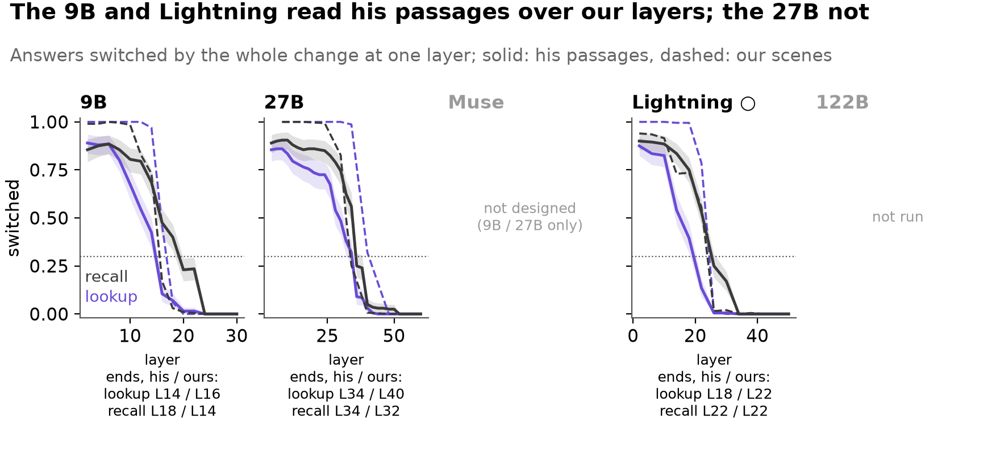
*Share of each reader's answers switched by the whole change at one layer at a time: Zach's named passages (solid, band 95%, 200 per model) and our routes scenes (dashed); dotted: 0.3, where a window ends; the ends under each panel. The verdict's own figure: [the verdict folder](../../results/x51_depth/x51_5-20261028T181100Z/x51_5_depth.png).*

- **Result.** (window ends, his / ours)

  | | 9B | 27B | Muse | Lightning |
  |---|---|---|---|---|
  | lookup | L14 / L16 (-2)<!-- src: results/x51_depth/x51_5-20261028T181100Z/verdict.md \| qwen35_9b_x51_5 :: L14 / L16 (-2) --> | L34 / L40 (-6)<!-- src: results/x51_depth/x51_5-20261028T181100Z/verdict.md \| x51_5_27b :: L34 / L40 (-6) --> | not designed | not run |
  | recall | L18 / L14 (4)<!-- src: results/x51_depth/x51_5-20261028T181100Z/verdict.md \| qwen35_9b_x51_5 :: L18 / L14 (4) --> | L34 / L32 (2)<!-- src: results/x51_depth/x51_5-20261028T181100Z/verdict.md \| x51_5_27b :: L34 / L32 (2) --> | | |
  | the rule | **the same window** | **not the same** | | |

- **Read.**
  - On the 9B his passages are read over the same layers as our scenes; on the 27B the lookup's window ends 6 layers earlier.
- **Caveats.**
  - Our 27B window comes from a coarser grid (every 8th layer with L30-34).
  - Layer ends carry no interval.

### Does the lookup take a position route on Zach's passages? (Z3, opened 28 Oct 17:31; the 27B's and Lightning's coverage runs 29 Oct) 

*Used in: ledger only; planned Part V. Story: other datasets.*

- **Question.** On Zach's passages with scattered facts, does the lookup take a position route besides the identity route?
- **Why we asked.** The address codes where a locker sentence sits in a list; his passages have no list.
- **Data.** His level-0 passages with all three facts before the pointer: 60 (9B), 81<!-- src: results/x50_zach/x52_z3-20261029T024151Z/z3.md \| x50_z3_27b :: 81 (72) :: 81 --> (27B, at L32: X0's layer and the start of Zach's band), 48 (Muse), 52<!-- src: results/x50_zach/x52_z3-20261029T013329Z/z3.md \| nem35l_x52_z3 :: 52 (47) :: 52 --> (Lightning, at L14 and L27).
- **Method.** The routes test: the change comes from a passage where another item's fact sentence moved and took a new value; the lookup's answer is sorted into identity, position, value or original.
- **Rule, fixed in advance.** "Value <= 0.05; if position >= 0.2: the address exists in scattered-fact passages; if position <= 0.05: no position route in his layout." The 27B and Lightning: coverage runs on this rule, no prediction.

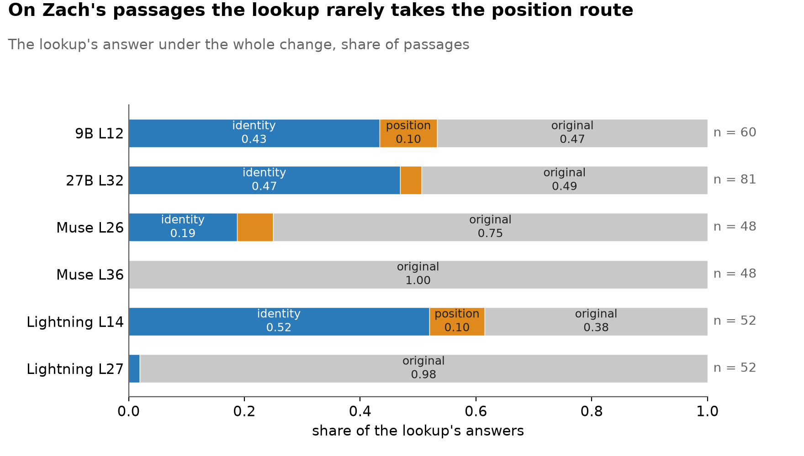
*The lookup's answer under the whole change on Zach's scattered-fact passages: identity (blue), position (orange), value (none), original (grey); n per row; all four models.*

- **Result.**

  | | 9B | 27B (L32) | Muse (L26) | Lightning (L14) |
  |---|---|---|---|---|
  | identity | 0.43 [0.30, 0.56]<!-- src: results/x50_zach/z3-20261028T163053Z/z3.md \| qwen35_9b_x50_z3 :: 0.43 [0.30, 0.56] --> | 0.47 [0.35, 0.59]<!-- src: results/x50_zach/x52_z3-20261029T024151Z/z3.md \| x50_z3_27b :: 0.47 [0.35, 0.59] --> | 0.19 [0.08, 0.31]<!-- src: results/x50_zach/z3-20261028T163053Z/z3.md \| muse30_x50_z3 :: 0.19 [0.08, 0.31] --> | 0.52 [0.37, 0.66]<!-- src: results/x50_zach/x52_z3-20261029T013329Z/z3.md \| nem35l_x52_z3 :: 52 (47) :: 0.52 [0.37, 0.66] --> |
  | position | 0.10 [0.02, 0.19]<!-- src: results/x50_zach/z3-20261028T163053Z/z3.md \| qwen35_9b_x50_z3 :: 0.10 [0.02, 0.19] --> | 0.04 [0.00, 0.09]<!-- src: results/x50_zach/x52_z3-20261029T024151Z/z3.md \| x50_z3_27b :: 0.04 [0.00, 0.09] --> | 0.06 [0.00, 0.14]<!-- src: results/x50_zach/z3-20261028T163053Z/z3.md \| muse30_x50_z3 :: 0.06 [0.00, 0.14] --> | 0.10 [0.02, 0.19]<!-- src: results/x50_zach/x52_z3-20261029T013329Z/z3.md \| nem35l_x52_z3 :: 0.52 [0.37, 0.66] :: 0.10 [0.02, 0.19] --> |
  | value | 0.00 [0.00, 0.00]<!-- src: results/x50_zach/z3-20261028T163053Z/z3.md \| qwen35_9b_x50_z3 :: 0.00 [0.00, 0.00] --> | 0.00 [0.00, 0.00]<!-- src: results/x50_zach/x52_z3-20261029T024151Z/z3.md \| x50_z3_27b :: 0.04 [0.00, 0.09] :: 0.00 [0.00, 0.00] --> | 0.00 [0.00, 0.00]<!-- src: results/x50_zach/z3-20261028T163053Z/z3.md \| muse30_x50_z3 :: 0.00 [0.00, 0.00] --> | 0.00 [0.00, 0.00]<!-- src: results/x50_zach/x52_z3-20261029T013329Z/z3.md \| nem35l_x52_z3 :: 0.52 [0.37, 0.66] :: 0.00 [0.00, 0.00] --> |
  | the rule | **in between** | **no position route in his layout<!-- src: results/x50_zach/x52_z3-20261029T024151Z/z3.md \| x50_z3_27b :: no position route in his layout -->** (no prediction) | **in between** (L36: no position route) | **in between<!-- src: results/x50_zach/x52_z3-20261029T013329Z/z3.md \| nem35l_x52_z3 :: 0.10 [0.02, 0.19] :: in between -->** (L27: no position route; no prediction) |

- **Read.**
  - On his passages the lookup rarely takes the position route: in between on the 9B, Muse and Lightning at L, and almost none on the 27B (no position route in his layout); it never takes the value.
- **Caveats.**
  - Small n (60 / 81 / 48 / 52); the lookup only.
  - The 27B is read at L32 only (X0's layer and the start of Zach's band).

### Do the 9B's headline runs reproduce from a clean checkout? (49.5, landed 28 Oct 17:11) 

*Used in: ledger only (a candidate for "How we checked"). Story: checks.*

- **Question.** Run again from one committed, clean tree, do the 9B's headline runs give the same stored answers?
- **Why we asked.** Every run of record ran from a dirty tree.
- **Data.** The 9B's main test (200), routes (300), only-U (300), zeroing (200) and the depth anatomy at L10 and L12 (200).
- **Method.** The same five commands in a fresh checkout; the stored per-item answers compared row by row.
- **Rule, fixed in advance.** None: descriptive, no prediction.

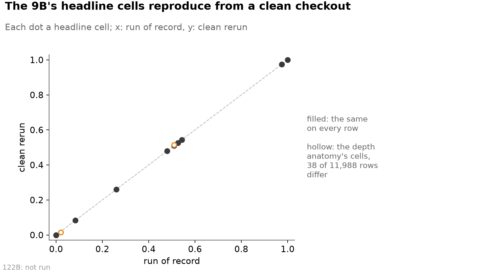
*The 9B's 12 headline cells: the run of record (x) against the clean-checkout rerun (y); dashed: the identity line; hollow: the depth anatomy's two cells.*

- **Result.** (9B; record / clean rerun)

  | | 9B | 27B | Muse | Lightning |
  |---|---|---|---|---|
  | main-test gap | 0.53<!-- src: docs/handcheck_clean49.md \| Main test gap :: 0.53 --> / 0.53<!-- src: docs/handcheck_clean49.md \| Main test gap :: 0.53 --> | not run | not run | not run |
  | depth anatomy: position share at L12 | 0.51<!-- src: docs/handcheck_clean49.md \| position share under the whole change at L12 :: 0.51 --> / 0.52<!-- src: docs/handcheck_clean49.md \| position share under the whole change at L12 :: 0.52 --> | | | |
  | rows compared, record / clean | main test 37600<!-- src: docs/handcheck_clean49.md \| qwen35_9b_clean49_x0_necessity :: 37600 -->, routes 10800<!-- src: docs/handcheck_clean49.md \| qwen35_9b_clean49_x6_routes` :: 10800 -->, only-U 12000<!-- src: docs/handcheck_clean49.md \| qwen35_9b_clean49_x6_routes_keeponly :: 12000 -->, zeroing 2000<!-- src: docs/handcheck_clean49.md \| qwen35_9b_clean49_x47_5 :: 2000 -->: all identical; anatomy: 38<!-- src: docs/handcheck_clean49.md \| route 36, switched 18, top 38 :: 38 --> of 11988<!-- src: docs/handcheck_clean49.md \| qwen35_9b_clean49_x47_anatomy :: 11988 --> differ | | | |

- **Read.**
  - Four of the five runs reproduce row for row; the anatomy differs on a few rows.
- **Caveats.**
  - The clean runs' own commit is marked dirty in the pack (90210687).
  - Source: docs/handcheck_clean49.md and results/checks/clean49_9b.json (point values, no intervals).

## Withdrawn

### Does the split hold when Zach's bridge is described? (Z2, opened 28 Oct 17:27; withdrawn 21:18) 

*Used in: README Part VI, Withdrawn. Story: other datasets.*

- **Question.** On Zach's passages with a described (never named) bridge, does the lookup let go of the lens part?
- **Why we asked.** A described bridge must be computed before it can be used; the computed item could travel through the lens.
- **Data.** His described-bridge passages: 158 / 166 / 157 (below the 200 aimed for).
- **Method.** The conflict test at the description's last token at L, each reader its own change, against a random part.
- **Rule, fixed in advance.** "Per model, the 47.3 rule: (a) the split holds: gap >= 0.3, lookup <= 0.10; (a') the computed bridge is handed through the lens: lookup >= 0.20; (d) in between." Withdrawn by the answer control's rule ([51.12](#t51-12)): the lens effect there is the answer or mixed in all four cells.

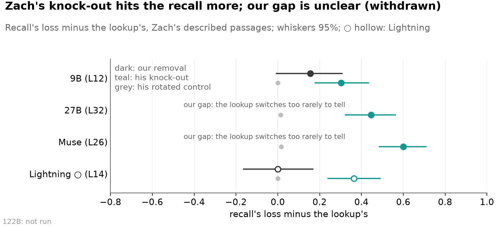
*The recall's loss minus the lookup's on Zach's described passages: our removal (dark, where the lookup switches enough to tell; whiskers 95%) and his knock-out of the top-10 lens directions (teal), with his rotated-direction control (grey). The verdict's own figure: [the verdict folder](../../results/x50_zach/z2-20261028T162710Z/z2_beside.png).*

- **Result.**

  | | 9B | 27B | Muse (L26) | Lightning |
  |---|---|---|---|---|
  | lookup: switches lost beyond a random part | 0.54 [0.43, 0.66]<!-- src: results/x50_zach/z2-20261028T162710Z/z2.md \| qwen35_9b_x50_z2 :: 0.54 [0.43, 0.66] --> | 0.69 [0.52, 0.87]<!-- src: results/x50_zach/z2-20261028T162710Z/z2.md \| x50_z2_27b :: 0.69 [0.52, 0.87] --> | 0.67 [0.00, 1.00]<!-- src: results/x50_zach/z2-20261028T162710Z/z2.md \| muse30_x50_z2 :: 0.67 [0.00, 1.00] --> | not run |
  | the rule (before withdrawal) | (a') through the lens | (a') through the lens | (a') through the lens | |

- **Read.**
  - Withdrawn: at the description's last token the lens part moves the answer, so removing it is not a test of the bridge.
- **Caveats.**
  - Muse's lookup switches under the whole change on 0.02 of passages.
  - n below the 200 aimed for.

## Running or sealed

Box times UTC, from `make queue-stats QUEUE=all` at 00:06 UTC on 29 Oct (low-high ends of the queue's estimate); the Lightning lanes follow batch 52 amendment 3.

### Batch 52 C: the rest of the coverage grid (running) 

- **Question.** Fill the coverage table's missing cells on the 27B, Lightning, 9B and Muse.
- **Status.** Running: the 27B anatomy full grid (`jobs/c3/x47_8_27b.yaml`), the 27B token map (`jobs/c3/x47_d1_27b.yaml`), the 27B ladder steps 3-6 (`jobs/c3/x52_ladder_27b_a.yaml`), the 27B six lockers (`jobs/c3/x47_2_27b_r3.yaml`), the Muse ladder with step 6 inside Zach's band (`jobs/c3/x52_ladder_muse_r2.yaml`); Lightning's lanes per amendment 3 (the probe, routes, swap and lens readout now on speedup). Bolt: out of scope, only a J-lens exists, no J++ lens.
- **Where used.** The coverage table above.

## Figure checks

Every PNG was opened after rendering (29 Oct ~02:00) and checked for: readable at the page width (880 px), no overlapping labels, axis names in words, the finding visible without the caption. New figures: `scripts/ledger_figures.py` into figures/ledger/, every plotted number recorded in figures/story/data.csv (figure ids `ledger_*`), not on the README's contact sheet.

| figure | page width | labels | axes in words | finding visible | note |
|---|---|---|---|---|---|
| figures/ledger/ledger_full_carrier.png | yes | no overlap | yes | yes | the 27B's one-layer fact-after lookup is left out (11 switches, under 30); Lightning added 29 Oct, re-opened |
| figures/ledger/ledger_address_shape.png | yes | no overlap | yes | yes | d* is read off the lines, not drawn |
| figures/ledger/ledger_last_token_address.png | yes | no overlap | yes | yes | L and L+4 are unlabelled dotted lines (the caption names them); Lightning added 29 Oct, re-opened; title now names Muse only |
| figures/story/fig17_jspace_last_token.png | yes | no overlap | yes | yes | reused; drawn by the README pass |
| figures/ledger/ledger_zach_named.png | yes | no overlap | yes | yes | Muse's lookup on his passages is left out (25 switches, under 30) |
| figures/ledger/ledger_answer_control.png | yes | no overlap | yes | yes | Lightning column included |
| figures/ledger/ledger_lightning_layers.png | yes | no overlap (after moving two labels) | yes | yes | top: 60 dev scenes; bottom: 200 scenes |
| figures/story/fig16_dose.png | yes | no overlap | yes | yes | reused; its labels say "J++ part" |
| figures/story/fig01d_ladder.png | yes | no overlap | yes | yes | reused; its labels say "J++ part" |
| figures/ledger/ledger_learned.png | yes | no overlap (after a wider right margin) | yes | yes | |
| figures/ledger/ledger_atoms.png | yes | no overlap (a two-row key) | yes | yes | restyled from the report's figure (which kept the test ids); the key's two greys are close |
| figures/ledger/ledger_heads.png | yes | no overlap | yes | yes | per-head effects are not stored, so the sets (top 1 to 10, best layer) stand in for "per head sorted"; Lightning added 29 Oct, re-opened |
| figures/ledger/ledger_read_window.png | yes | no overlap (window ends moved under the axes) | yes | yes | restyled from the verdict's figure (which kept the test ids) |
| figures/ledger/ledger_zach_routes.png | yes | no overlap | yes | yes | Muse's position share (0.06) is too narrow for its label; the 27B and Lightning added 29 Oct, re-opened |
| figures/ledger/ledger_clean_reruns.png | yes | no overlap | yes | yes | |
| figures/ledger/ledger_answer_map.png | yes | no overlap (after a wider left margin) | yes | yes | the per-layer maps stay in the verdict folder, linked from the caption |
| figures/ledger/ledger_routes.png | yes | no overlap | yes | yes | four models; the value never appears, so its colour shows only in the key |
| figures/ledger/ledger_six_lockers.png | yes | no overlap (after moving two labels) | yes | yes | the one-shift bars are zero on every model; Lightning added 29 Oct, re-opened |
| figures/ledger/ledger_described.png | yes | no overlap | yes | yes | restyled from the verdict's figure (which kept the test id); our gap drawn only where the lookup switches enough |
| figures/ledger/ledger_address_swap.png | yes | no overlap | yes | yes | all 600 swaps pooled per dose; the random vector's dashed line sits at 0.00 to 0.01 |
| figures/ledger/ledger_order_split.png | yes | no overlap | yes | yes | only the lookup's switch share is drawn; the extra losses stay in the card's table (locker after: under 30 switches) |
| figures/ledger/ledger_attention.png | yes | no overlap | yes | yes | best head per model only; the random bars are near zero and thin |
| figures/story/fig09a_transfer.png | yes | no overlap | yes | yes | reused; drawn by the README pass; three models |
| figures/ledger/ledger_distance.png | yes | no overlap | yes | yes | Muse has no outcomes, so three panels |
| figures/ledger/ledger_gain.png | yes | no overlap | yes | yes | the rule's bars as red ticks; Muse's lookup cell at zero shows no bar |
| figures/story/fig09d_chain.png | yes | no overlap | yes | yes | reused; drawn by the README pass; 9B and Muse |
| figures/supp/s03e_cumulative.png | yes | no overlap | yes | yes | reused; the README's supplementary figure; 9B and Muse; its 27B rows read "not run" |
| figures/ledger/ledger_agnostic.png | yes | no overlap | yes | yes | the 27B's fruits refit falls below the animal fit |
| figures/story/fig15_mechanisms.png | yes | no overlap | yes | yes | reused; drawn by the README pass; a stray grey dot sits at the top right (a README figure, left as is) |
| figures/story/fig07b_verbal.png | yes | no overlap | yes | yes | reused; drawn by the README pass; three models |
| figures/story/fig03d_depth_map.png | yes | no overlap | yes | yes | reused; drawn by the README pass; the 9B only |
| figures/story/fig06b_anatomy.png | yes | the 27B panel's "identity route" label sits on thin bars and is hard to read | yes | yes | reused; drawn by the README pass; three models |
| figures/story/fig05d_routes_lens.png | yes | no overlap | yes | yes | reused; drawn by the README pass; three models |
