# Experiments ledger (depth)

*Every opened test of the depth report, on four models, in the README's order: what was asked, what the rule fixed in advance said on each model, and where the README uses it.*

## In one minute

- **What it holds:** 59 test cards in the README's Parts I-VI, today's batch 53 results among them, on five models (the 27B, Lightning, the 9B, Muse, and the 122B, FP8, where it has a verdict), each tagged by how the README uses it; one check, one withdrawn card and the one-model rows. All UNVERIFIED, pending the hand-check.
- **The lookup goes around the lens part on every model run:** on Lightning at L14 it is blocked at 0.03 [-0.01, 0.08]<!-- src: results/x0_necessity/nem35l_x52_conflict/verdict-20261029T001612Z/verdict.md \| 0.45 :: 0.03 [-0.01, 0.08] --> of its switches beyond a random part while the recall is blocked at 0.34 [0.25, 0.44]<!-- src: results/x0_necessity/nem35l_x52_conflict/verdict-20261029T001612Z/verdict.md \| 0.94 :: 0.34 [0.25, 0.44] -->; on the 122B at L33, 0.00 [-0.06, 0.06]<!-- src: results/x0_necessity/qwen35_122b_x0_necessity_r2/verdict-20261024T171509Z/verdict.md \| 33 :: PP :: 0.00 [-0.06, 0.06] --> against 0.32 [0.22, 0.41]<!-- src: results/x0_necessity/qwen35_122b_x0_necessity_r2/verdict-20261024T171509Z/verdict.md \| 33 :: PM :: 0.32 [0.22, 0.41] --> ([conflict test](#lightning-conflict)). It reads an address a probe finds at the bridge word ([probe](#probe)) and a swap at dose 2 moves ([swap](#swap)); the swap's rule fixed in advance (dose 1) said no on every model. At the last token a probe on the lens part reads that address worse than random directions of the same energy, on all four models it ran on: the address is under-represented in the lens directions ([53.2](#b53-2)).
- **The recall follows the item, not its answer:** the answer control finds the item, or the answer word not read, on every model it ran on ([51.12](#t51-12)); pulled two ways by the lens part and the address, every model reads "both", the 27B and Muse barely ([53.6](#b53-6)).
- **Question order:** a small order effect on the 27B (lower bound +0.01<!-- src: results/x53_2x2/x53_2x2-20261029T113335Z/verdict.md \| Paired difference (Dan 11:25) :: +0.01 -->, of the order of the 122B's rerun noise), none on the 122B; the other three missed the question-first gate ([53.1](#b53-1)).
- **Open after today:** near the output the last-token test is uninformative ([53.3](#b53-3), [53.3b](#b53-3b)); the pre-specified identity code says no on the 9B and the 27B and in between on Muse ([53.8](#b53-8)); two attention blocks carry part of Lightning's lookup, in between ([53.4](#b53-4)).
- **Withdrawn and rechecked:** Zach's described bridge is withdrawn ([Z2](#z2)); his named passages with made-up facts split on the 9B, also without the 60 passages that state the bridge's true value ([Z1](#z1)).

**Which test ran on which model, and what its rule said.** One table per Part, a row per test card, in the README's order; "in part" covers in between or in part; "–": not tested on that model (not run, not designed, or below its gate: the coverage table below says which). Lightning ○: its gate chosen after the 60-scene pre-check; ○ in a cell: post hoc (the 122B's gate lowered to 0.75, or its lookup-only gate, Dan 30 Oct). The 122B's cells from its coverage runs (FP8; MoE, ~10B active; L33), the agent's reading, pending hand-check.

<!-- verdicts:start (scripts/ledger_coverage.py verdicts; do not edit by hand) -->
**Part I. The two readers**

| test | 9B | 27B | Muse | Lightning ○ | 122B |
|---|---|---|---|---|---|
| [Conflict test, main test](#lightning-conflict) | holds | in part: not confirmed | holds | holds | holds |
| [Item or answer, main test](#t51-12) | holds: the entity | holds: the entity | holds: answer not read | holds: answer not read | holds: answer not read |
| [Item or answer, his true facts](#t51-12) | in part: mixed | in part: mixed | – | in part: mixed | – |
| [Item or answer, his made-up facts](#t51-12) | in part: mixed | in part: mixed | – | – | – |
| [Split in prose, JSON, tables](#x0b) | holds | holds | holds | holds | in part: mixed |
| [Split in natural passages](#x5) | holds ○ | in part: mixed | holds | – | holds |
| [Each part added by itself](#t51-1) | holds: (i), (ii) yes | in part: (i) no | holds: (i), (ii) yes | in part: (ii) no | holds: (i), (ii) yes |
| [Zeroing at one layer](#t47-5) | holds: not needed | holds: not needed | holds: not needed | holds: not needed | holds: not needed |
| [Ladder: other copies taken out](#t49-2) | in part: (b) no | in part: (a), (b) no | in part: (a), (b) no | – | in part: (a), (b) no |
| [The item's earlier mention](#t45p) | holds: yes | holds: yes | holds: yes | – | **fails: no** |
| [Lens identity vs address](#b53-6) | in part: both | in part: both | in part: both | in part: both | – |
| [Question order, number answer](#b53-1) | – | **fails: order matters** | – | – | holds: order-free |
| [Gain map: weight or route](#t49-1) | **fails: neither** | **fails: neither** | **fails: neither** | **fails: neither** | **fails: neither** |
| [Two learned subspaces](#t48-1) | **fails: no** | **fails: no** | **fails: no** | – | – |
| [Inside the lens part](#b52-a) | descriptive: bridge words | descriptive: bridge words | descriptive: bridge words | descriptive: bridge words | descriptive: bridge words |
| [Answer readable, usable](#b52-b) | descriptive | descriptive | descriptive | descriptive: ours only | descriptive |

**Part II. Identity**

| test | 9B | 27B | Muse | Lightning ○ | 122B |
|---|---|---|---|---|---|
| [Identity route outside the lens](#t47-1) | holds: outside | holds: outside | holds: outside | holds: outside | – |
| [Routes test and the address](#routes) | holds: both routes | in part: adding: no | holds: both routes | holds: both routes | – |
| [Never the value, by format](#t47-7c) | in part: incomplete | in part: incomplete | in part: incomplete | in part: incomplete | – |
| [Learned subspaces at scale](#t51-3) | in part: (iii) no | in part: (iii) no | in part: (iii) no | – | – |
| [Shared identity code](#b53-8) | **fails: no** | **fails: no** | in part: in between | – | – |

**Part III. The address**

| test | 9B | 27B | Muse | Lightning ○ | 122B |
|---|---|---|---|---|---|
| [Address probe](#probe) | descriptive: readable | descriptive: readable | descriptive: readable | descriptive: readable | descriptive: readable |
| [Address swap, rule at dose 1](#swap) | **fails: no** | **fails: no** | **fails: no** | **fails: no** | – |
| [Swap after neutral sentences](#t47-16) | holds: robust | holds: robust | holds: robust | holds: robust | **fails: none of three ○** |
| [Six lockers, own code each](#six) | holds: own code | **fails: none of three** | holds: own code | holds: own code | holds: own code |
| [What the address is](#t51-11) | in part: in between | in part: part 2 only | in part: mixed | – | – |
| [Address, 27B position scenes](#b53-5) | holds: pattern holds | **fails: differs** | – | – | – |
| [Lens readout of the swap](#t47-0) | holds: lens blind | holds: lens blind | holds: lens blind | holds: lens blind | holds: lens blind ○ |
| [Probes on the lens subspace](#b53-2) | holds: lens blind | in part: in between | holds: lens blind | in part: in between | holds: lens blind |
| [Report prompt](#t47-10) | – | **fails: neither** | – | – | – |
| [Report of slot 1, reworded](#t49-6) | **fails: recovers** | **fails: recovers** | – | **fails: recovers** | – |
| [A few heads take the swap](#t51-2) | **fails: distributed** | **fails: distributed** | **fails: distributed** | **fails: distributed** | – |
| [Attention follows the swap](#t49-7) | **fails: neither** | **fails: neither** | **fails: neither** | **fails: neither** | – |
| [Chained addresses](#t47-14) | **fails: no** | **fails: no** | **fails: no** | – | **fails: no** |
| [Address refit per format](#x45d) | holds: refit works | in part: neither | holds: refit works | holds: refit works | – |
| [Address in code, tool output](#b53-7) | in part | in part | – | – | descriptive: readable ○ |

**Part IV. Where and when**

| test | 9B | 27B | Muse | Lightning ○ | 122B |
|---|---|---|---|---|---|
| [Split by sentence order](#order) | descriptive: by order | descriptive: by order | descriptive: by order | descriptive: by order | descriptive: by order |
| [Copy test, locker after](#t45q) | holds: yes | holds: yes | holds: yes | – | – |
| [Token-by-layer map](#d1) | **fails: (a)-(c) no** | **fails: (a)-(c) no** | **fails: (a)-(c) no** | **fails: (a)-(c) no** | – |
| [Lookups read before L](#t47-4) | descriptive: before L | descriptive: before L | descriptive: before L | descriptive: before L | descriptive: before L |
| [Anatomy by depth, handoff](#t47-8) | holds: (a) yes | **fails: (a) no** | holds: (a) yes | holds: (a) yes | holds: (a) yes ○ |
| [Address at the last token](#t51-4) | **fails: not there** | **fails: not there** | holds: travels | in part: in between | – |
| [Entity at the last token](#t51-10) | in part: read, not used | in part: read, not used | in part: read, not used | in part: read, not used | in part: read, not used |
| [Last token: the lookup's read](#b53-3) | descriptive: in between | descriptive: in between | descriptive: outside | descriptive: outside | descriptive: in between |
| [Last token, word answers](#b53-3b) | in part: in between | in part: in between | – | – | – |
| [Lightning's attention blocks](#b53-4) | – | – | – | in part: in between | – |

**Part V. Other datasets**

| test | 9B | 27B | Muse | Lightning ○ | 122B |
|---|---|---|---|---|---|
| [Zach's passages, true facts](#z1) | **fails: lookup follows** | **fails: lookup follows** | **fails: follows, few** | in part: in between | in part: in between |
| [Zach's passages, made-up facts](#z1) | holds | in part: in between | – | – | holds |
| [Named vs described bridge](#b53-1b) | – | descriptive: mixed / answer | – | – | – |
| [Full carrier up to L](#t51-7) | in part: in between | in part: in between | – | in part: in between | – |
| [Position route, his passages](#z3) | in part: in between | **fails: no position** | in part: in between | in part: in between | **fails: no position** |
| [Read window, his passages](#t51-5) | holds: same window | **fails: not the same** | – | holds: same window | – |

**Part VI. What did not hold**

| test | 9B | 27B | Muse | Lightning ○ | 122B |
|---|---|---|---|---|---|
| [Described bridge](#t47-3) | holds | **fails: through lens** | holds | – | – |
| [One question, two instructions](#t47-15) | – | **fails: neither** | – | – | – |
| [Errors are address errors](#t47-13) | **fails: no** | – | **fails: no** | **fails: no** | – |
| [Lens part keys the attribute](#t48-2) | **fails: no** | **fails: no** | **fails: no** | **fails: no** | – |
| [Person mark at the locker](#t48-3) | **fails: no** | **fails: no** | **fails: no** | – | – |
| [Pooled person probe](#t49-3) | **fails: neither** | in part: in between | **fails: neither** | – | – |
| [Copying heads pass the rest](#t48-4) | **fails: no** | **fails: no** | **fails: no** | **fails: no** | – |
| [Address as the recall's route](#t48-5) | **fails: no** | **fails: no** | **fails: no** | – | – |
| [Blocking the pick sentence](#t47-6) | **fails: no** | **fails: no** | **fails: no** | – | – |
| [Same address, any item](#t47-11) | **fails: no** | **fails: no** | **fails: no** | **fails: no** | – |
<!-- verdicts:end -->

## How to read

The README's [methods, measures and figure marks](README.md#how-to-read-this-page) hold here unchanged: the change, the lens part, a random part, switches blocked beyond a random part, L, the identity and position routes, the address, whiskers 95%, hollow = after the data. Each card follows the README's card template (Question, Why we asked, Data, Method, the figure, Rule fixed in advance quoted, Result with one column per model, Read, Caveats), with no interpretation beyond the verdict. Internal test ids appear in the card headings only. Opened times are the opening commit's time (Paris, 28 Oct unless stated); box times are UTC.

New in this ledger:

- **Tags** on the line under each heading: `in README` (a README card or claim uses it as is), `changes README` (the README must change; the change waits in [Appendix B](#readme-changes)), `ledger only` (not in the README), `below gate: <model>` (that model's readers missed the test's gate, so its column is not tested, or later an exploratory run shown hollow).
- **Below gate**: a test runs on a model only if both readers answer the original prompts right often enough (usually 0.80); a failed gate is not lowered after the data (the spec's rule). Lightning's below-gate runs (Dan, 29 Oct morning) are exploratory: hollow marks, never in claims or grades.
- **Adapted design**: where a model needed a changed design (Lightning: attention blocks only after L14, no per-block MLP; the 27B's grids), the card's Data or Method says so.
- **The 122B** (Qwen3.5-122B-A10B; FP8; MoE, ~10B active): a fifth column where a verdict exists, from its source files, no reruns (Dan, 29 Oct 11:30); "not run" elsewhere; a fifth slot only in the figures of those cards. Its L33 is the 27B's relative depth carried over (33/48), not the other models' rule; its J++ lens was fit on the bf16 weights; FP8; MoE, ~10B active.
- **Coverage run**: a test run on a model it was not designed for (the 27B or Lightning, 28-29 Oct), on the same rule fixed in advance, with no prediction committed.
- **Lightning's gate**: the main test's gate on all 516 scenes, chosen after the 60-scene pre-check was seen (○ in the tables; hollow marks on its figures); layer L14 ([Lightning's layer](#lightning-layer)). Nemotron 3.5 Bolt is out of scope (only a J-lens exists, no J++ lens).

`uv run python scripts/check_ledger.py` checks every cited path, anchor, field, tag, figure position and the coverage table, and that every sourced number stands on one line of its file (tests/test_experiments_ledger.py).

## Part I. The two readers: lookup and recall

### Does the conflict test hold on Lightning? (Lightning conflict test, opened 29 Oct 01:16 UTC) 

`in README` *Used in: README Part I card "In a conflict, which part of the bridge word does each reader follow?" (Lightning's and the 122B's columns).*

- **Question.** On Nemotron 3.5 Lightning, at its committed layer L14, does the recall follow the lens part while the lookup goes around it?
- **Why we asked.** A fourth model, of another family, under the main test's rule unchanged. The 122B (FP8; MoE, ~10B active) beside: the largest model, its conflict test from its r2 run (24 Oct; Dan 11:30, the 122B as a fifth model).
- **Data.** Main test, 200 scenes (the 60 scenes used to pick the layer excluded); ○ gate chosen after the 60-scene pre-check was seen: the main test's gate on all 516 scenes passed (lookup 0.957, recall 0.816). The 122B: the main test at L33, 200 scenes, its gate passed.
- **Method.** The conflict test at the bridge word at each of 13 swept layers (L2 to L50), decided at L14: without the lens part, against without a random part of the same share.

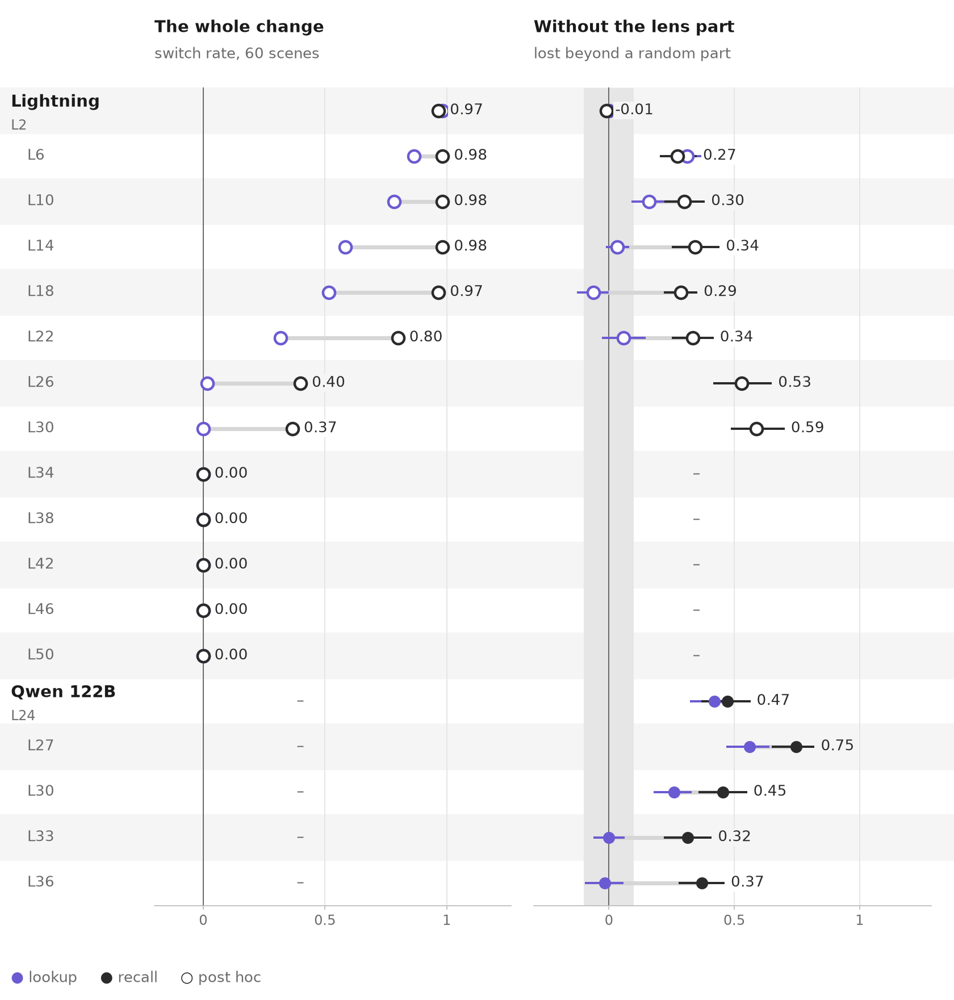
*Lightning, one row per swept layer. Left: the whole change's switch rate, both readers (60 scenes). Right: switches blocked without the lens part beyond a random part, the conflict test (200 scenes); –: under 30 switches, so the test cannot tell. whiskers: 95% intervals over bridge items; grey band: within 0.10 of random. Lightning's layer L14 was picked by the rule fixed before its sweep was read; its gate post hoc (○). The 122B's sweep: its card below.*

- **Rule, fixed in advance.** The main test's: "confirmed if the lookup has at most 0.10 blocked beyond random and the recall has at least 0.30 blocked of its switches without the lens part; killed if the lookup has at least 0.20 blocked or the recall under 0.20." Coverage run on an already-scored rule: no prediction.

- **Result.** (L14)

  | | 9B | 27B | Muse | Lightning | 122B |
  |---|---|---|---|---|---|
  | recall: switches blocked beyond a random part | see the README | | | 0.34 [0.25, 0.44]<!-- src: results/x0_necessity/nem35l_x52_conflict/verdict-20261029T001612Z/verdict.md \| 0.94 :: 0.34 [0.25, 0.44] --> | 0.32 [0.22, 0.41]<!-- src: results/x0_necessity/qwen35_122b_x0_necessity_r2/verdict-20261024T171509Z/verdict.md \| 33 :: PM :: 0.32 [0.22, 0.41] --> (L33) |
  | recall: switches blocked, not net of random | | | | 0.41 [0.32, 0.50]<!-- src: results/x0_necessity/nem35l_x52_conflict/verdict-20261029T001612Z/verdict.md \| 0.94 :: 0.41 [0.32, 0.50] --> | 0.40 [0.30, 0.49]<!-- src: results/x0_necessity/qwen35_122b_x0_necessity_r2/verdict-20261024T171509Z/verdict.md \| 33 :: PM :: 0.40 [0.30, 0.49] --> |
  | lookup: switches blocked beyond a random part | | | | 0.03 [-0.01, 0.08]<!-- src: results/x0_necessity/nem35l_x52_conflict/verdict-20261029T001612Z/verdict.md \| 0.45 :: 0.03 [-0.01, 0.08] --> | 0.00 [-0.06, 0.06]<!-- src: results/x0_necessity/qwen35_122b_x0_necessity_r2/verdict-20261024T171509Z/verdict.md \| 33 :: PP :: 0.00 [-0.06, 0.06] --> |
  | lookup: switches under the whole change | | | | 0.45<!-- src: results/x0_necessity/nem35l_x52_conflict/verdict-20261029T001612Z/verdict.md \| 0.03 [-0.01, 0.08] :: 0.45 --> | 0.45<!-- src: results/x0_necessity/qwen35_122b_x0_necessity_r2/verdict-20261024T171509Z/verdict.md \| 33 :: PP :: 200 :: 0.45 --> |
  | the rule | | | | **confirmed** (lookup around, recall through) | **CONFIRMED at layer 33<!-- src: results/x0_necessity/qwen35_122b_x0_necessity_r2/verdict-20261024T171509Z/verdict.md \| chat :: CONFIRMED at layer 33 -->** (lookup around, recall through) |
  | lookup with the lens part at k = 25 / 50 / 100 directions (descriptive) | | | | | 0.00 [-0.06, 0.06]<!-- src: results/x0_necessity/qwen35_122b_x0_necessity_r2/verdict-20261024T171509Z/verdict.md \| jpp :: signed :: PP :: 0.00 [-0.06, 0.06] --> / -0.02 [-0.09, 0.05]<!-- src: results/x0_necessity/qwen35_122b_x0_necessity_r2/verdict-20261024T171509Z/verdict.md \| jpp :: signed :: PP :: -0.02 [-0.09, 0.05] --> / -0.12 [-0.22, -0.04]<!-- src: results/x0_necessity/qwen35_122b_x0_necessity_r2/verdict-20261024T171509Z/verdict.md \| jpp :: signed :: PP :: -0.12 [-0.22, -0.04] --> |

  On the clean one-pick scenes Lightning misses the gate (recall 0.751<!-- src: results/x0_necessity/nem35l_x52_fresh/coverage.txt | (recall 0.751 :: 0.751 --> < 0.80), so it is not tested there; the below-gate run on the eligible scenes (295 at L14; the source of Lightning's below-gate runs) is descriptive only, hollow ○: recall ○ 0.39 [0.33, 0.45]<!-- src: results/x0_necessity/nem35l_x52_fresh/verdict-20261029T083122Z/verdict.md | PM | 295 :: 0.39 [0.33, 0.45] -->, lookup ○ 0.03 [-0.02, 0.08]<!-- src: results/x0_necessity/nem35l_x52_fresh/verdict-20261029T083122Z/verdict.md | PP | 295 :: 0.03 [-0.02, 0.08] --> blocked beyond a random part, the pattern the rule calls confirmed.

- **Read.**
  - The rank check (Dan 13:15, range per model Dan 18:10; every item of the conflict test and the routes test, docs/review/verify_pack_jspace.md; no flag): what the lens can read about the item sits in the J++ part; the rest puts the new bridge word in the lens's top 50 on 0.00-0.14 of items (conflict test: 9B 0.00<!-- src: docs/review/verify_pack_jspace.md \| Qwen3.5-9B :: S's bridge (word or symbol) :: 0.00 -->, 27B 0.02<!-- src: docs/review/verify_pack_jspace.md \| Qwen3.6-27B :: S's bridge (word or symbol) :: 0.02 -->, Muse 0.01, Lightning 0.06, 122B 0.05; the routes test's highest condition, Lightning C0: 0.14), against about 0.5 for a random part (0.52 / 0.53 / 0.66 / 0.65 / 0.83) and about 0.8 for the J++ part (0.81 / 0.81 / 0.89 / 0.93 / 0.93); the random part reads the bridge because it keeps part of Δ itself.
  - On the 122B, at its L33, the lookup has nothing blocked beyond random and the recall has about a third blocked: confirmed; with more lens directions (k = 50, 100) the lookup still has nothing blocked beyond random.
  - At L14 the recall follows the lens part and the lookup does not; the same split stands at L18 and L22.
- **Caveats.**
  - The 122B: its L33 is the 27B's relative depth carried over (33/48), not the other models' rule; its J++ lens was fit on the bf16 weights; FP8; MoE, ~10B active.
  - The clean one-pick numbers are below gate, exploratory: never in claims or grades (Dan, 09:15 and 09:50).
  - The gate was chosen after the 60-scene pre-check had failed (accepted by Dan 01:10).
  - From L26 on the lookup switches on 0.02 of scenes or fewer, so those layers cannot tell.

### Is it the bridge item or its answer that moves through the lens? (51.12, opened 28 Oct 21:18) 

`in README` *Used in: README Part I card "In a conflict, which part of the bridge word does each reader follow?" (the specificity rows); README "Tested and dropped" ("The described bridge on Zach's passages").*

- **Question.** On the main test, is the recall's drop without the lens part about the bridge item or about its answer word?
- **Why we asked.** At a described bridge the lens reads the answer about as well as the item; the same could hold at our bridge word.
- **Data.** Main test, 200 per model (Lightning at L14: a coverage run, no prediction; the 122B (FP8; MoE, ~10B active) at L33: a coverage run on the same rule, Dan 11:30, no prediction).
- **Method.** At the bridge word at L: (1) without the lens part; (2) without the lens part but keeping its directions for both readers' answer words (number words); (3) without those answer directions only; each against a random part of its share; the lens's rank of the answer word at the bridge word first.

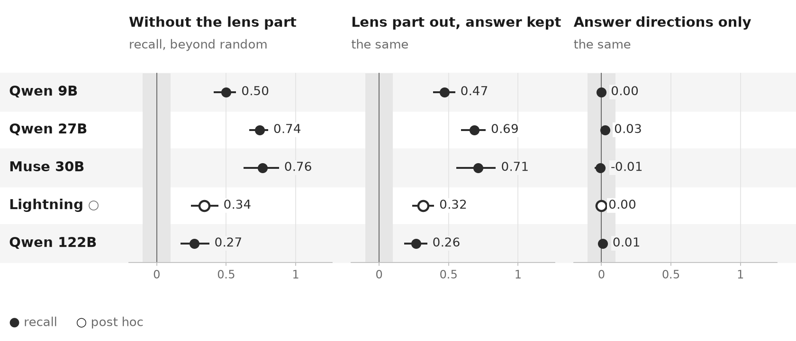
*The recall's switches blocked without the lens part beyond a random part, main test at L: the whole lens part, the lens part with the answer word's directions retained, and the answer word's directions alone. whiskers: 95% intervals over bridge items; grey band: within 0.10 of random; Lightning ○. Zach's described-bridge rows (withdrawn) are in the table only.*

- **Rule, fixed in advance.** (Amended 20:20, before opening.) "The lens effect is the entity: arm 2 keeps >= 0.7 of arm 1's extra drop and arm 3 costs <= 0.10 beyond random. The lens effect is the answer: arm 2 falls to <= 0.3 of arm 1 and arm 3 alone costs >= 0.5 of arm 1. Else: mixed." First: "the answer word is not read at the bridge word (lens rank > 50 on >= 90 % of items)".

- **Result.** (recall)

  | | 9B | 27B | Muse | Lightning | 122B |
  |---|---|---|---|---|---|
  | (1) switches blocked beyond a random part | 0.50 [0.41, 0.57]<!-- src: results/x51_answer/x51_12-20261028T201842Z/verdict.md \| the lens effect is the entity :: 0.50 [0.41, 0.57] --> | 0.74 [0.66, 0.80]<!-- src: results/x51_answer/x51_12-20261028T201842Z/verdict.md \| the lens effect is the entity :: 0.74 [0.66, 0.80] --> | 0.76 [0.62, 0.88]<!-- src: results/x51_answer/x51_12-20261028T201842Z/verdict.md \| arms beside: the lens effect is the entity :: 0.76 [0.62, 0.88] --> | 0.34 [0.25, 0.44]<!-- src: results/x51_answer/x52_answer-20261029T002056Z/verdict.md \| nemotron-3.5-lightning :: 0.34 [0.25, 0.44] --> | 0.27 [0.17, 0.38]<!-- src: results/x51_answer/x52_answer-20261029T112359Z/verdict.md \| qwen3.5-122b-a10b :: recall :: 0.27 [0.17, 0.38] --> (L33) |
  | (2) / (1): effect remaining with the answer directions retained | 0.95 [0.90, 0.99]<!-- src: results/x51_answer/x51_12-20261028T201842Z/verdict.md \| the lens effect is the entity :: 0.95 [0.90, 0.99] --> | 0.93 [0.85, 0.99]<!-- src: results/x51_answer/x51_12-20261028T201842Z/verdict.md \| the lens effect is the entity :: 0.93 [0.85, 0.99] --> | 0.93 [0.85, 1.00]<!-- src: results/x51_answer/x51_12-20261028T201842Z/verdict.md \| arms beside: the lens effect is the entity :: 0.93 [0.85, 1.00] --> | 0.92 [0.83, 1.03]<!-- src: results/x51_answer/x52_answer-20261029T002056Z/verdict.md \| nemotron-3.5-lightning :: 0.92 [0.83, 1.03] --> | 0.98 [0.86, 1.18]<!-- src: results/x51_answer/x52_answer-20261029T112359Z/verdict.md \| qwen3.5-122b-a10b :: recall :: 0.98 [0.86, 1.18] --> |
  | (3) without the answer directions only, beyond random | 0.00 [0.00, 0.00]<!-- src: results/x51_answer/x51_12-20261028T201842Z/verdict.md \| 0.47 [0.39, 0.55] :: 0.00 [0.00, 0.00] --> | 0.03 [0.01, 0.05]<!-- src: results/x51_answer/x51_12-20261028T201842Z/verdict.md \| 0.69 [0.59, 0.77] :: 0.03 [0.01, 0.05] --> | -0.01 [-0.05, 0.03]<!-- src: results/x51_answer/x51_12-20261028T201842Z/verdict.md \| 0.71 [0.56, 0.84] :: -0.01 [-0.05, 0.03] --> | 0.00 [-0.02, 0.01]<!-- src: results/x51_answer/x52_answer-20261029T002056Z/verdict.md \| nemotron-3.5-lightning :: 0.00 [-0.02, 0.01] --> | 0.01 [-0.01, 0.04]<!-- src: results/x51_answer/x52_answer-20261029T112359Z/verdict.md \| qwen3.5-122b-a10b :: recall :: 0.01 [-0.01, 0.04] --> |
  | answer word outside the lens's top 50 | 0.56 [0.47, 0.66]<!-- src: results/x51_answer/x51_12-20261028T201842Z/verdict.md \| 0.50 [0.41, 0.57] :: 0.56 [0.47, 0.66] --> | 0.79 [0.72, 0.86]<!-- src: results/x51_answer/x51_12-20261028T201842Z/verdict.md \| 0.74 [0.66, 0.80] :: 0.79 [0.72, 0.86] --> | 0.99 [0.98, 1.00]<!-- src: results/x51_answer/x51_12-20261028T201842Z/verdict.md \| 0.76 [0.62, 0.88] :: 0.99 [0.98, 1.00] --> | 0.95 [0.90, 0.99]<!-- src: results/x51_answer/x52_answer-20261029T002056Z/verdict.md \| nemotron-3.5-lightning :: 0.95 [0.90, 0.99] --> | 1.00 [1.00, 1.00]<!-- src: results/x51_answer/x52_answer-20261029T112359Z/verdict.md \| qwen3.5-122b-a10b :: recall :: 1.00 [1.00, 1.00] --> |
  | the rule | **the entity** | **the entity** (post hoc: mixed, (a) +0.040 [0.006, 0.082]<!-- src: results/answer_control_translated/20261030T222840Z/tables.md \| qwen3.6-27b :: arm3 any language :: +0.040 [0.006, 0.082] -->) | **the answer word is not read** (arms beside, post hoc: mixed; answer in any language (single-token translations); 9B, 27B, Muse; Lightning and 122B not run; (a) +0.085 [0.018, 0.154]<!-- src: results/answer_control_translated/20261030T222840Z/tables.md \| muse-glimmer-30b :: arm3 any language :: +0.085 [0.018, 0.154] -->) | **the answer word is not read** (arms beside: the entity) | **the answer word is not read at the bridge word<!-- src: results/x51_answer/x52_answer-20261029T112359Z/verdict.md \| qwen3.5-122b-a10b :: recall :: the answer word is not read at the bridge word -->** (arms beside: the entity; the lookup's answer word not read either, its effect 0.01 [-0.06, 0.08]<!-- src: results/x51_answer/x52_answer-20261029T112359Z/verdict.md \| qwen3.5-122b-a10b :: lookup :: 0.01 [-0.06, 0.08] -->) |

- **Read.**
  - On the 122B, as on Lightning and Muse, the recall's answer word is not read at the bridge word, so that is its label; the arms beside give the entity pattern (post hoc, with the answer directions in any language: mixed on the 27B and Muse, the item on the 9B; the shift of the retained-directions arm is explained by the number of directions).
  - The recall's drop without the lens part is the item's: keeping the answer's lens directions keeps almost all of it, and those directions alone cost nothing.
  - On Lightning the answer word is not read at the bridge word for either reader; its lookup has too little blocked without the lens part to split into arms.
  - On Zach's named passages with true facts (coverage runs, no prediction) the same arms say mixed for both readers on the 9B, the 27B and Lightning: keeping the answer's directions keeps 0.21<!-- src: results/x51_answer/x52_answer-20261029T081754Z/verdict.md | z1k :: qwen3.5-9b :: recall :: 0.21 --> (9B), 0.29<!-- src: results/x51_answer/x52_answer-20261029T081240Z/verdict.md | z1k :: qwen3.6-27b :: recall :: 0.29 --> (27B) and 0.29<!-- src: results/x51_answer/x52_answer-20261029T081239Z/verdict.md | z1k :: nemotron-3.5-lightning :: recall :: 0.29 --> (Lightning) of the recall's drop. On his made-up-fact passages the 9B's lookup cannot tell (no extra drop beyond random) and its recall is mixed; on the 27B the answer word is not read at the bridge word for the lookup (rank above 50 on 0.91 [0.86, 0.94]<!-- src: results/x51_answer/x52_answer-20261029T082432Z/verdict.md | z1p :: qwen3.6-27b :: lookup :: 0.91 [0.86, 0.94] --> of items) and the recall is mixed (results/x51_answer/x52_answer-20261029T082417Z/verdict.md). Muse not run; the made-up-fact half on Lightning is not tested (its source run missed the gate; results/x51_answer/x52_answer-20261029T081355Z/verdict.md).
- **Caveats.**
  - The 122B: a coverage run (results/x51_answer/x52_answer-20261029T112359Z, Dan 11:30), no prediction; its L33 carried over from the 27B's relative depth, FP8 weights, its J++ lens fit in bf16 (see How to read).
  - Digits are not in the lens dictionary, so the answer directions are number words; the pre-amendment runs are kept, superseded.
  - On Zach's described bridge the same control finds the answer, not the item (see [Z2](#z2)).

### At which layer does Lightning get the conflict test? (Lightning's layer, committed 29 Oct 01:02) 

`in README` *Used in: README "The question and the setup" (Lightning's layer).*

- **Question.** At which layer does Nemotron 3.5 Lightning get the conflict test?
- **Why we asked.** A new model needs its layer L fixed before any scored run.
- **Data.** 60 dev scenes of the main test (excluded from the conflict test).
- **Method.** The whole change at the bridge word at every 4th layer (L2 to L50); each reader's switch rate; the bridge word's lens readability recorded as the tie-break.

*As in the conflict card: Lightning, one row per swept layer; left the whole change's switch rate, right switches blocked without the lens part beyond a random part; –: under 30 switches. whiskers: 95% intervals over bridge items; grey band: within 0.10 of random.*

- **Rule, fixed in advance.** Batch 52 amendment 1 (Dan ~00:50, before the sweep): "earliest layer passing the gate at relative depth ≥ 0.25; tie-break = highest lens readability of the bridge word." Passing = both readers switch on at least 0.3 (the published rule). ○ Gate chosen after the 60-scene pre-check was seen.

- **Result.**

  | | 9B | 27B | Muse | Lightning | 122B |
  |---|---|---|---|---|---|
  | the layer | L12 | L32 | L26 | **L14** (depth 0.27) | L33 (the 27B's relative depth carried over, 33/48; its conflict test per layer in the figure's bottom panel) |
  | lookup switch at L14 | | | | 0.58 [0.45, 0.73]<!-- src: results/x51_lightning/nem35l_x52_layer_r2/prereq.md \| L14 (pick) :: 0.58 [0.45, 0.73] --> | |
  | recall switch at L14 | | | | 0.98 [0.94, 1.00]<!-- src: results/x51_lightning/nem35l_x52_layer_r2/prereq.md \| L14 (pick) :: 0.98 [0.94, 1.00] --> | |

- **Read.**
  - L14 is the earliest layer at depth 0.25 or more where both readers switch on at least 0.3 of scenes.
- **Caveats.**
  - The 60-scene pre-check failed (lookup 0.883, recall 0.783); the main test's gate on all 516 scenes decided (accepted by Dan 01:10).
  - `layer.json`'s "rule" field holds the prerequisite text, not amendment 1's pick rule.

### Does the split hold in prose, JSON and tables? (varied scenes, x0b; Lightning's coverage run 29 Oct) 

`in README` *Used in: README Part I card "Does the split hold in other texts?" (the varied scenes).*

- **Question.** In scenes written as prose, JSON or a table, at three nesting levels and in several domains, does the lookup let go of the lens part while the recall follows it?
- **Why we asked.** The main test is one template; the split could belong to that layout rather than to the two readers.
- **Data.** Varied scenes, at most 40 per cell, only cells that pass the gate: 36 of 51<!-- src: results/x0b_generalize/qwen35_9b_x0b_v2/verdict-20261024T182331Z/verdict.md \| Gate per cell :: 36 of 51 --> / 49 of 51<!-- src: results/x0b_generalize/x0b_v2_27b/verdict-20261024T192113Z/verdict.md \| Gate per cell :: 49 of 51 --> / 44 of 57<!-- src: results/x0b_generalize/muse30b_x0b_v2/verdict-20261026T022534Z/verdict.md \| Gate per cell :: 44 of 57 --> / 42 of 57<!-- src: results/x0b_generalize/nem35l_x52_x0b/verdict-20261029T014520Z/verdict.md \| Gate per cell :: 42 of 57 --> cells, 1010<!-- src: results/x0b_generalize/qwen35_9b_x0b_v2/verdict-20261024T182331Z/verdict.md \| Gate per cell :: 1010 --> / 1635<!-- src: results/x0b_generalize/x0b_v2_27b/verdict-20261024T192113Z/verdict.md \| Gate per cell :: 1635 --> / 1388<!-- src: results/x0b_generalize/muse30b_x0b_v2/verdict-20261026T022534Z/verdict.md \| Gate per cell :: 1388 --> / 1105<!-- src: results/x0b_generalize/nem35l_x52_x0b/verdict-20261029T014520Z/verdict.md \| Gate per cell :: 1105 --> scenes (9B / 27B / Muse / Lightning).
- **Method.** The conflict test unchanged, at L: without the lens part (25 directions), against without a random part of the same share; pooled over the cells.

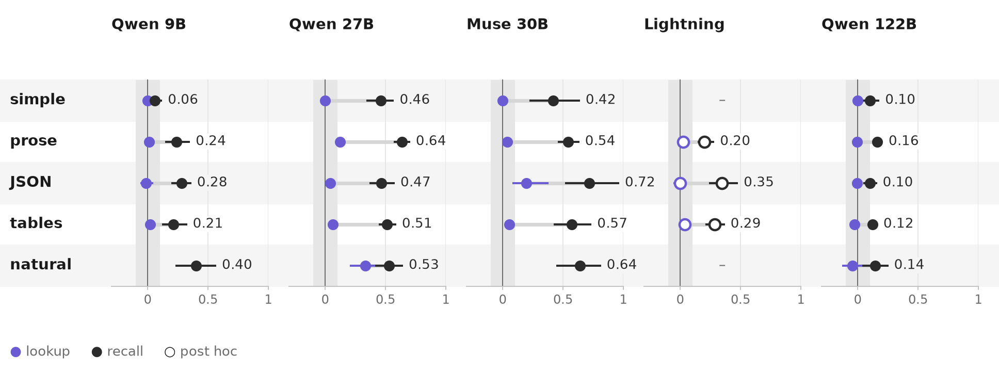
*Per model (columns) and scene set (rows), lookup and recall switches blocked without the lens part beyond a random part. whiskers: 95% intervals over bridge items; grey band: within 0.10 of random; Lightning ○; –: not run, or under 30 switches (Lightning's simple and natural sets; the 9B's and Muse's natural lookups).*

- **Rule, fixed in advance.** "Holds iff lookup excess <= 0.1 (upper CI <= 0.2) and C >= 0.2 (lower CI >= 0.1); fails iff lookup excess >= 0.2 or C's upper CI < 0.1." (C: the recall's extra drop minus the lookup's.) Lightning: a coverage run on this rule, no prediction.

- **Result.** (pooled over the cells, at L)

  | | 9B | 27B | Muse | Lightning | 122B |
  |---|---|---|---|---|---|
  | lookup: switches blocked beyond a random part | 0.01 [-0.01, 0.03]<!-- src: results/x0b_generalize/qwen35_9b_x0b_v2/verdict-20261024T182331Z/verdict.md \| 1010 :: around :: 0.01 [-0.01, 0.03] --> | 0.08 [0.06, 0.10]<!-- src: results/x0b_generalize/x0b_v2_27b/verdict-20261024T192113Z/verdict.md \| 1635 :: around :: 0.08 [0.06, 0.10] --> | 0.06 [0.03, 0.10]<!-- src: results/x0b_generalize/muse30b_x0b_v2/verdict-20261026T022534Z/verdict.md \| 1388 :: around :: 0.06 [0.03, 0.10] --> | 0.03 [0.00, 0.05]<!-- src: results/x0b_generalize/nem35l_x52_x0b/verdict-20261029T014520Z/verdict.md \| 1105 :: around :: 0.03 [0.00, 0.05] --> | -0.02 [-0.03, -0.00]<!-- src: results/x0b_generalize/qwen35_122b_x0b_v2/verdict-20261025T015139Z/verdict.md \| 33 :: PP :: 852 :: -0.02 [-0.03, -0.00] --> |
  | recall: the same | 0.23 [0.14, 0.33]<!-- src: results/x0b_generalize/qwen35_9b_x0b_v2/verdict-20261024T182331Z/verdict.md \| 1010 :: mixed :: 0.23 [0.14, 0.33] --> | 0.56 [0.50, 0.61]<!-- src: results/x0b_generalize/x0b_v2_27b/verdict-20261024T192113Z/verdict.md \| 1635 :: through :: 0.56 [0.50, 0.61] --> | 0.56 [0.48, 0.66]<!-- src: results/x0b_generalize/muse30b_x0b_v2/verdict-20261026T022534Z/verdict.md \| 1388 :: through :: 0.56 [0.48, 0.66] --> | 0.26 [0.20, 0.34]<!-- src: results/x0b_generalize/nem35l_x52_x0b/verdict-20261029T014520Z/verdict.md \| 1105 :: mixed :: 0.26 [0.20, 0.34] --> | 0.13 [0.11, 0.16]<!-- src: results/x0b_generalize/qwen35_122b_x0b_v2/verdict-20261025T015139Z/verdict.md \| 33 :: PM :: 852 :: 0.13 [0.11, 0.16] --> |
  | the gap, recall minus lookup | 0.22 [0.14, 0.31]<!-- src: results/x0b_generalize/qwen35_9b_x0b_v2/verdict-20261024T182331Z/verdict.md \| pooled: HOLDS :: 0.22 [0.14, 0.31] --> | 0.47 [0.42, 0.53]<!-- src: results/x0b_generalize/x0b_v2_27b/verdict-20261024T192113Z/verdict.md \| pooled: HOLDS :: 0.47 [0.42, 0.53] --> | 0.50 [0.40, 0.61]<!-- src: results/x0b_generalize/muse30b_x0b_v2/verdict-20261026T022534Z/verdict.md \| pooled: HOLDS :: 0.50 [0.40, 0.61] --> | 0.24 [0.17, 0.32]<!-- src: results/x0b_generalize/nem35l_x52_x0b/verdict-20261029T014520Z/verdict.md \| pooled: HOLDS :: 0.24 [0.17, 0.32] --> | 0.15 [0.12, 0.18]<!-- src: results/x0b_generalize/qwen35_122b_x0b_v2/verdict-20261025T015139Z/verdict.md \| 33 :: PM :: 852 :: 0.15 [0.12, 0.18] --> |
  | the rule, pooled | **HOLDS<!-- src: results/x0b_generalize/qwen35_9b_x0b_v2/verdict-20261024T182331Z/verdict.md \| pooled :: HOLDS -->** | **HOLDS<!-- src: results/x0b_generalize/x0b_v2_27b/verdict-20261024T192113Z/verdict.md \| pooled :: HOLDS -->** | **HOLDS<!-- src: results/x0b_generalize/muse30b_x0b_v2/verdict-20261026T022534Z/verdict.md \| pooled :: HOLDS -->** | **HOLDS<!-- src: results/x0b_generalize/nem35l_x52_x0b/verdict-20261029T014520Z/verdict.md \| pooled :: HOLDS -->** (no prediction) | **MIXED<!-- src: results/x0b_generalize/qwen35_122b_x0b_v2/verdict-20261025T015139Z/verdict.md \| X0b's rule at layer 33, pooled :: MIXED -->** (852 scenes) |

- **Read.**
  - The 122B (FP8; MoE, ~10B active; its L33 carried over from the 27B): mixed, its recall's drop beyond random small (the rule's C under 0.2).
  - In prose, JSON and tables the recall follows the lens part and the lookup does not, on all four models, Lightning included.
- **Caveats.**
  - Only cells that pass the gate count; about a quarter of Lightning's and Muse's cells fail it.
  - Muse's scene count is 1,388 here and 1,389 in the README (Flagged 6).

### Does the split hold in natural passages? (natural passages, x5, opened 25-26 Oct; Lightning's gate 29 Oct) 

`in README` `below gate: Lightning` *Used in: README Part I card "Does the split hold in other texts?" (the natural passages).*

- **Question.** In natural passages, where a fact sentence names the bridge, does the lookup let go of the lens part while the recall follows it?
- **Why we asked.** Our scenes are templates; natural passages test the split outside them.
- **Data.** Natural passages: 83<!-- src: results/x5_natural/qwen35_9b_x5_natural_g75/verdict-20261025T135050Z/verdict.md \| 83 items :: 83 --> / 137<!-- src: results/x5_natural/x5_natural_27b/verdict-20261024T232738Z/verdict.md \| 137 items :: 137 --> / 60<!-- src: results/x5_natural/muse30b_x5_natural/verdict-20261026T023226Z/verdict.md \| 60 items :: 60 --> items (9B / 27B / Muse); the 9B's gate was lowered after the data. Lightning not tested: its gate failed, and by the spec's rule there is no lowered rerun.
- **Method.** The conflict test unchanged, at L: without the lens part, against without a random part of its share; the gap is the recall's drop minus the lookup's.

*As in the varied-scenes card; the natural row is this card's. whiskers: 95% intervals over bridge items; grey band: within 0.10 of random; Lightning ○; –: not run, or under 30 switches.*

- **Rule, fixed in advance.** "gap >= 0.3 with lower CI >= 0.15 holds; <= 0.1 fails; otherwise mixed."

- **Result.**

  | | 9B | 27B | Muse | Lightning | 122B |
  |---|---|---|---|---|---|
  | lookup: switches blocked beyond a random part | 0.03 [-0.08, 0.15]<!-- src: results/x5_natural/qwen35_9b_x5_natural_g75/verdict-20261025T135050Z/verdict.md \| Lookup excess :: 0.03 [-0.08, 0.15] --> | 0.32 [0.20, 0.45]<!-- src: results/x5_natural/x5_natural_27b/verdict-20261024T232738Z/verdict.md \| Lookup excess :: 0.32 [0.20, 0.45] --> | -0.20 [-0.55, 0.00]<!-- src: results/x5_natural/muse30b_x5_natural/verdict-20261026T023226Z/verdict.md \| Lookup excess :: -0.20 [-0.55, 0.00] --> | ○ -0.08 [-0.27, 0.00]<!-- src: results/x5_natural/nem35l_x52_natural_below/verdict-20261029T082128Z/verdict.md \| Lookup excess :: -0.08 [-0.27, 0.00] --> | -0.11 [-0.20, -0.03]<!-- src: results/x5_natural/qwen35_122b_x5_natural/verdict-20261025T005420Z/verdict.md \| Lookup excess :: -0.11 [-0.20, -0.03] --> |
  | recall: the same | 0.56 [0.45, 0.66]<!-- src: results/x5_natural/qwen35_9b_x5_natural_g75/verdict-20261025T135050Z/verdict.md \| recall excess :: 0.56 [0.45, 0.66] --> | 0.59 [0.50, 0.67]<!-- src: results/x5_natural/x5_natural_27b/verdict-20261024T232738Z/verdict.md \| recall excess :: 0.59 [0.50, 0.67] --> | 0.75 [0.62, 0.86]<!-- src: results/x5_natural/muse30b_x5_natural/verdict-20261026T023226Z/verdict.md \| recall excess :: 0.75 [0.62, 0.86] --> | ○ 0.49 [0.31, 0.67]<!-- src: results/x5_natural/nem35l_x52_natural_below/verdict-20261029T082128Z/verdict.md \| recall excess :: 0.49 [0.31, 0.67] --> | 0.34 [0.24, 0.43]<!-- src: results/x5_natural/qwen35_122b_x5_natural/verdict-20261025T005420Z/verdict.md \| recall excess :: 0.34 [0.24, 0.43] --> |
  | the gap | 0.52 [0.36, 0.68]<!-- src: results/x5_natural/qwen35_9b_x5_natural_g75/verdict-20261025T135050Z/verdict.md \| Rule:  :: 0.52 [0.36, 0.68] --> | 0.27 [0.13, 0.41]<!-- src: results/x5_natural/x5_natural_27b/verdict-20261024T232738Z/verdict.md \| Rule:  :: 0.27 [0.13, 0.41] --> | 0.95 [0.64, 1.33]<!-- src: results/x5_natural/muse30b_x5_natural/verdict-20261026T023226Z/verdict.md \| Rule:  :: 0.95 [0.64, 1.33] --> | ○ 0.56 [0.35, 0.82]<!-- src: results/x5_natural/nem35l_x52_natural_below/verdict-20261029T082128Z/verdict.md \| Rule: HOLDS :: 0.56 [0.35, 0.82] --> | 0.44 [0.32, 0.58]<!-- src: results/x5_natural/qwen35_122b_x5_natural/verdict-20261025T005420Z/verdict.md \| Rule :: gap :: 0.44 [0.32, 0.58] --> |
  | the rule | **HOLDS<!-- src: results/x5_natural/qwen35_9b_x5_natural_g75/verdict-20261025T135050Z/verdict.md \| Rule:  :: HOLDS -->** | **MIXED<!-- src: results/x5_natural/x5_natural_27b/verdict-20261024T232738Z/verdict.md \| Rule:  :: MIXED -->** | **HOLDS<!-- src: results/x5_natural/muse30b_x5_natural/verdict-20261026T023226Z/verdict.md \| Rule:  :: HOLDS -->** | not tested (gate 0.77<!-- src: results/x5_natural/nem35l_x52_natural/gate.json \| "PP" :: 0.77 --> < 0.80); below gate, descriptive only: HOLDS<!-- src: results/x5_natural/nem35l_x52_natural_below/verdict-20261029T082128Z/verdict.md \| Rule: HOLDS :: HOLDS --> (36 passages) | **HOLDS<!-- src: results/x5_natural/qwen35_122b_x5_natural/verdict-20261025T005420Z/verdict.md \| Rule :: gap :: HOLDS -->** (114 passages, 68 bridge entities) |

- **Read.**
  - The 122B (FP8; MoE, ~10B active): holds, at its L33.
  - In natural passages the recall follows the lens part on all three tested models; the 27B's lookup follows it too, so its split is mixed.
- **Caveats.**
  - Lightning: its gate failed, so it is not tested; the below-gate run (Dan's morning queue, 29 Oct; 36 eligible passages) is exploratory, hollow ○, never in claims or grades.
  - The 9B's gate was lowered after the data; Muse's lookup switches rarely under the whole change, so its lookup effect is wide.
  - Few items (60 to 137).

### Does each part, added by itself, move its reader? (51.1, opened 28 Oct 18:03; Lightning's coverage run 29 Oct) 

`ledger only` *Used in: README Part I, a one-line link to this card (the dose curves).*

- **Question.** Added by itself at a dose, does the lens part move the recall more than a random part of its share, and leave the lookup?
- **Why we asked.** The conflict test takes a part away; a reader that follows a part should also move when only that part is added.
- **Data.** Main test, the scenes whose locker sentences come first: 75 / 69 / 68 / 59<!-- src: results/x51_dose/x52_dose-20261029T011635Z/verdict.md \| nem35l_x52_dose :: 59 --> (9B / 27B / Muse / Lightning; Lightning at L14, a coverage run on the same rule, no prediction).
- **Method.** At the bridge word at L: the lens part alone at doses 0.5 to 3, against a random part of the same share at the same dose; the rest alone at doses 0.25 to 1.5, with and without the address.

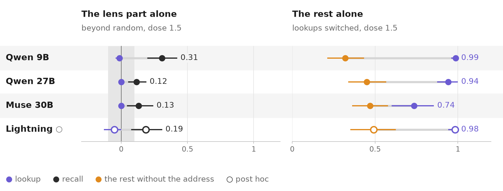
*At the rule's dose 1.5. Left: switches with the lens part added by itself, minus a random part of the same size, per reader (grey band: within 0.10). Right: lookups switched with the rest added by itself, and with the rest without the address. Whiskers: 95% intervals; Lightning ○. The full dose curves are the verdict's.*

- **Rule, fixed in advance.** "(i) the lookup is blind to the J++ part: switch minus random <= 0.10 at every α whose plain-text cross-entropy stays under 2x the whole change's, on all three. (ii) the recall reads the J++ part above its share: at the first α where the J++ part alone switches >= 0.3, J minus random >= 0.2, per model. (iii) together only (Muse): (1,1) >= 0.8 while the best single-part dose under the cross-entropy bar stays <= 0.3."

- **Result.**

  | | 9B | 27B | Muse | Lightning | 122B |
  |---|---|---|---|---|---|
  | recall: lens part alone minus random, dose 1.5 | 0.31 [0.20, 0.42]<!-- src: results/x51_dose/x51_1-20261028T170335Z/verdict.md \| J(1.5,0) - R(1.5,0) :: 0.31 [0.20, 0.42] --> | 0.12 [0.05, 0.19]<!-- src: results/x51_dose/x51_1-20261028T170335Z/verdict.md \| J(1.5,0) - R(1.5,0) :: 0.12 [0.05, 0.19] --> | 0.13 [0.04, 0.24]<!-- src: results/x51_dose/x51_1-20261028T170335Z/verdict.md \| J(1.5,0) - R(1.5,0) :: 0.13 [0.04, 0.24] --> | 0.19 [0.08, 0.31]<!-- src: results/x51_dose/x52_dose-20261029T011635Z/verdict.md \| J(1.5,0) - R(1.5,0) :: 0.19 [0.08, 0.31] --> | 0.30 [0.15, 0.45]<!-- src: results/x51_dose/x52_dose-20261029T181109Z/verdict.md \| J(1.5,0) - R(1.5,0) :: -0.02 [-0.07, 0.00] :: 0.30 [0.15, 0.45] --> |
  | recall: the same at dose 3 | -0.05 [-0.16, 0.05]<!-- src: results/x51_dose/x51_1-20261028T170335Z/verdict.md \| J(3,0) - R(3,0) :: -0.05 [-0.16, 0.05] --> | 0.42 [0.28, 0.54]<!-- src: results/x51_dose/x51_1-20261028T170335Z/verdict.md \| J(3,0) - R(3,0) :: 0.42 [0.28, 0.54] --> | 0.22 [0.07, 0.37]<!-- src: results/x51_dose/x51_1-20261028T170335Z/verdict.md \| J(3,0) - R(3,0) :: 0.22 [0.07, 0.37] --> | -0.10 [-0.21, 0.00]<!-- src: results/x51_dose/x52_dose-20261029T011635Z/verdict.md \| J(3,0) - R(3,0) :: -0.10 [-0.21, 0.00] --> | -0.02 [-0.13, 0.09]<!-- src: results/x51_dose/x52_dose-20261029T181109Z/verdict.md \| J(3,0) - R(3,0) :: -0.60 [-0.77, -0.47] :: -0.02 [-0.13, 0.09] --> |
  | lookup: lens part alone minus random, dose 3 | -0.63 [-0.72, -0.52]<!-- src: results/x51_dose/x51_1-20261028T170335Z/verdict.md \| J(3,0) - R(3,0) :: -0.63 [-0.72, -0.52] --> | 0.13 [0.00, 0.26]<!-- src: results/x51_dose/x51_1-20261028T170335Z/verdict.md \| J(3,0) - R(3,0) :: 0.13 [0.00, 0.26] --> | -0.22 [-0.32, -0.13]<!-- src: results/x51_dose/x51_1-20261028T170335Z/verdict.md \| J(3,0) - R(3,0) :: -0.22 [-0.32, -0.13] --> | -0.46 [-0.64, -0.28]<!-- src: results/x51_dose/x52_dose-20261029T011635Z/verdict.md \| J(3,0) - R(3,0) :: -0.46 [-0.64, -0.28] --> | -0.60 [-0.77, -0.47]<!-- src: results/x51_dose/x52_dose-20261029T181109Z/verdict.md \| J(3,0) - R(3,0) :: -0.60 [-0.77, -0.47] --> |
  | rule (i) / (ii) | yes / yes | **no** / yes | yes / yes; (iii) no | yes<!-- src: results/x51_dose/x52_dose-20261029T011635Z/verdict.md \| lookup blind :: yes --> / **no** (first dose 1.5<!-- src: results/x51_dose/x52_dose-20261029T011635Z/verdict.md \| nem35l_x52_dose :: **no** (1.5) :: 1.5 -->: 0.19<!-- src: results/x51_dose/x52_dose-20261029T011635Z/verdict.md \| J(1.5,0) - R(1.5,0) :: 0.19 --> against 0.2); (iii) is Muse's rule, not read; no prediction | yes<!-- src: results/x51_dose/x52_dose-20261029T181109Z/verdict.md \| qwen35_122b_x51_1 :: yes --> / yes (no prediction) |

- **Read.**
  - Added by itself, the lens part moves the recall more than a random part on all three models, and the 9B's and Muse's lookups no more than random; the 27B's lookup moves at the highest dose.
  - Lightning's lookup is blind to the lens part as on the 9B and Muse; its recall misses rule (ii)'s bar by a hair at the first dose that switches 0.3 of recalls.
- **Caveats.**
  - At high doses random parts switch readers too (the 9B's random part at dose 3 switches most lookups).
  - Scenes with the lockers first only.

### Does the recall need the lens part, or only follow it? (zeroing at one layer, 47.5; Lightning's coverage run 29 Oct) 

`in README` *Used in: README Part I card "Does the recall need the lens part, or only follow it?" (zeroing).*

- **Question.** Taking the lens part out of the changed prompt's own state at the bridge word, does the recall drop the changed answer (needed) or leave it unchanged (followed)?
- **Why we asked.** The conflict test removes the lens part from the change; zeroing it in the changed prompt's own state asks whether the recall needs it there.
- **Data.** Main test, 200 per model.
- **Method.** In the changed prompt's state at the bridge word: its projection on the change's 25 lens directions removed at L (and at L to L+3), against a random subspace of the same share of the state.

*No figure: on every model 0.94-0.97 of its recall answers stay unchanged, so the four numbers per model are the Result's table (the zeroing figure drew every dot near 1.0).*

- **Rule, fixed in advance.** ""followed, not needed at one layer" if 0.80 or more of the recall's answers stay unchanged under the zeroing, within 0.10 of the random arm; "needed" if it has >= 0.30 blocked beyond random. The lookup reported beside." Lightning and the 122B: coverage runs on this rule, no prediction.

- **Result.**

  | | 9B | 27B | Muse | Lightning | 122B |
  |---|---|---|---|---|---|
  | recall: answers unchanged, the lens part zeroed at L (bar >= 0.80) | 0.97 [0.95, 0.99]<!-- src: results/x47_zero/x47_5-20261028T113106Z/x47_5.md \| qwen35_9b_x47_5 :: 0.97 [0.95, 0.99] --> | 0.97 [0.94, 0.99]<!-- src: results/x47_zero/x47_5-20261028T113106Z/x47_5.md \| x47_5_27b :: 0.97 [0.94, 0.99] --> | 0.94 [0.89, 0.98]<!-- src: results/x47_zero/x47_5-20261028T113106Z/x47_5.md \| muse30_x47_5 :: 0.94 [0.89, 0.98] --> | 0.97 [0.95, 0.99]<!-- src: results/x47_zero/x52_zero-20261029T032056Z/x47_5.md \| nem35l_x52_zero :: 0.97 [0.95, 0.99] --> | 0.95 [0.91, 0.99]<!-- src: results/x47_zero/x52_zero-20261029T183120Z/x47_5.md \| qwen35_122b_x47_5 :: 0.95 [0.91, 0.99] --> |
  | recall: blocked beyond a random part, at L (bar for needed >= 0.30) | 0.03 [0.01, 0.05]<!-- src: results/x47_zero/x47_5-20261028T113106Z/x47_5.md \| qwen35_9b_x47_5 :: 0.03 [0.01, 0.05] --> | 0.03 [0.01, 0.06]<!-- src: results/x47_zero/x47_5-20261028T113106Z/x47_5.md \| x47_5_27b :: 0.03 [0.01, 0.06] --> | 0.06 [0.02, 0.11]<!-- src: results/x47_zero/x47_5-20261028T113106Z/x47_5.md \| muse30_x47_5 :: 0.06 [0.02, 0.11] --> | 0.03 [0.01, 0.05]<!-- src: results/x47_zero/x52_zero-20261029T032056Z/x47_5.md \| nem35l_x52_zero :: 0.03 [0.01, 0.05] --> | 0.04 [0.00, 0.09]<!-- src: results/x47_zero/x52_zero-20261029T183120Z/x47_5.md \| qwen35_122b_x47_5 :: 0.04 [0.00, 0.09] --> |
  | recall: blocked beyond a random part, at L to L+3 (descriptive) | 0.25 [0.17, 0.32]<!-- src: results/x47_zero/x47_5-20261028T113106Z/x47_5.md \| qwen3.5-9b :: recall :: 0.25 [0.17, 0.32] --> | 0.11 [0.06, 0.16]<!-- src: results/x47_zero/x47_5-20261028T113106Z/x47_5.md \| qwen3.6-27b :: recall :: 0.11 [0.06, 0.16] --> | 0.08 [0.04, 0.13]<!-- src: results/x47_zero/x47_5-20261028T113106Z/x47_5.md \| muse-glimmer-30b :: recall :: 0.08 [0.04, 0.13] --> | 0.18 [0.12, 0.24]<!-- src: results/x47_zero/x52_zero-20261029T032056Z/x47_5.md \| nemotron-3.5-lightning :: recall :: 0.18 [0.12, 0.24] --> | 0.08 [0.04, 0.14]<!-- src: results/x47_zero/x52_zero-20261029T183120Z/x47_5.md \| qwen3.5-122b-a10b :: recall :: 0.08 [0.04, 0.14] --> |
  | the rule | **followed, not needed at one layer<!-- src: results/x47_zero/x47_5-20261028T113106Z/x47_5.md \| qwen35_9b_x47_5 :: followed, not needed at one layer -->** | **followed, not needed at one layer<!-- src: results/x47_zero/x47_5-20261028T113106Z/x47_5.md \| x47_5_27b :: followed, not needed at one layer -->** | **followed, not needed at one layer<!-- src: results/x47_zero/x47_5-20261028T113106Z/x47_5.md \| muse30_x47_5 :: followed, not needed at one layer -->** | **followed, not needed at one layer<!-- src: results/x47_zero/x52_zero-20261029T032056Z/x47_5.md \| nem35l_x52_zero :: followed, not needed at one layer -->** (no prediction) | **followed, not needed at one layer<!-- src: results/x47_zero/x52_zero-20261029T183120Z/x47_5.md \| qwen35_122b_x47_5 :: followed, not needed at one layer -->** (no prediction) |

- **Read.**
  - Zeroing the lens part in the changed prompt's own state at L costs the recall at most 0.06 of its answers beyond random on all five models: the recall follows the lens part but does not need it at one layer.
- **Caveats.**
  - Over L to L+3 the recall has more blocked (0.08 to 0.25 beyond random), between the bars (descriptive).
  - The lookup's answers stay unchanged in every arm on all five.
  - The 122B: a coverage run (FP8, L33; no prediction; pending hand-check).

### Does the recall need the lens part once its other copies are gone? (49.2, opened 28 Oct 17:16) 

`in README` `below gate: Lightning` *Used in: README Part I card "Does the recall need the lens part, or only follow it?" (the ladder).*

- **Question.** Taking the lens part out of the changed prompt step by step (more layers, the earlier mention, the question, every token), when does the recall start to need it, and does the lookup ever?
- **Why we asked.** At one layer the recall barely needs the lens part; it may have copies elsewhere.
- **Data.** Clean one-pick scenes: 417 / 574 / 409. The 27B: its full ladder (x52_ladder_27b_a; the first run had steps 1-2 only); Muse: the first run (step 6 at L23-29) and a rerun with step 6 inside Zach's band (L36-42).
- **Method.** In the changed prompt's own run, the lens part's 25 directions taken out at each step's tokens and layers, against a random subspace of the same share of the state; step 6 is Zach's definition (each token's own top-10 lens directions over his band).

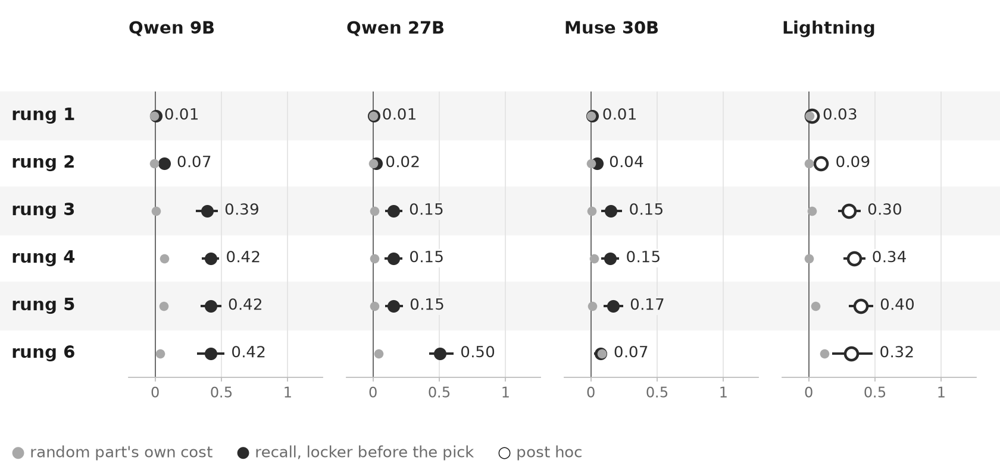
*Per model (columns) and rung of the ladder (rows): the recall's accuracy drop beyond random with the locker before the pick, and the random part's own cost (grey). The lookup's accuracy drop is at most 0.02 at any rung on every model (the table). Whiskers: 95% intervals; Lightning ○.*

- **Rule, fixed in advance.** "second_copy: rung (3) costs the recall >= 0.3 more than rung (2) in locker-first scenes (paired CI excluding 0) and rung (2) already costs >= 0.3 in locker-after scenes; only_everything: rungs (1)-(4) each <= 0.2 and rung (5) or (6) >= 0.5; lookup: <= 0.1 beyond random at every rung." The 27B's full ladder and Muse's rerun: coverage runs on this rule, no prediction.

- **Result.**

  | | 9B | 27B | Muse | Lightning | 122B |
  |---|---|---|---|---|---|
  | recall, locker first: step 3 minus step 2 | 0.32 [0.24, 0.39]<!-- src: results/x49_ladder/x49_2-20261028T161612Z/x49_2.md \| locker-first :: 0.32 [0.24, 0.39] --> | 0.13 [0.08, 0.19]<!-- src: results/x49_ladder/x52_ladder-20261029T012701Z/x49_2.md \| qwen3.6-27b :: locker-first :: 0.13 [0.08, 0.19] --> | 0.10 [0.05, 0.15]<!-- src: results/x49_ladder/x49_2-20261028T161612Z/x49_2.md \| locker-first :: 0.10 [0.05, 0.15] --> | ○ step 3: 0.33 [0.24, 0.42]<!-- src: results/x49_ladder/x52_ladder_below-20261029T091146Z/x49_2.md \| recall :: locker-first :: 0.03 [0.00, 0.07] :: 0.33 [0.24, 0.42] -->, step 2: 0.09 [0.04, 0.15]<!-- src: results/x49_ladder/x52_ladder_below-20261029T091146Z/x49_2.md \| recall :: locker-first :: 0.03 [0.00, 0.07] :: 0.09 [0.04, 0.15] --> | 0.07 [0.02, 0.13]<!-- src: results/x49_ladder/x52_ladder-20261029T192919Z/x49_2.md \| qwen3.5-122b-a10b :: locker-first :: 0.82 / 0.92 / 0.10 [0.01, 0.21] :: 0.07 [0.02, 0.13] --> |
  | recall, all scenes: step 5, accuracy drop beyond random | 0.44 [0.37, 0.52]<!-- src: results/x49_ladder/x49_2-20261028T161612Z/x49_2.md \| 0.51 / 0.95 / 0.44 [0.37, 0.52] :: 0.44 [0.37, 0.52] --> | 0.25 [0.20, 0.32]<!-- src: results/x49_ladder/x52_ladder-20261029T012701Z/x49_2.md \| qwen3.6-27b :: 0.74 / 0.99 / 0.25 [0.20, 0.32] :: 0.25 [0.20, 0.32] --> | 0.21 [0.15, 0.26]<!-- src: results/x49_ladder/x49_2-20261028T161612Z/x49_2.md \| 0.78 / 0.99 / 0.21 [0.15, 0.26] :: 0.21 [0.15, 0.26] --> | ○ 0.49 [0.41, 0.56]<!-- src: results/x49_ladder/x52_ladder_below-20261029T091146Z/x49_2.md \| recall :: all :: 0.03 [0.01, 0.05] :: 0.49 [0.41, 0.56] --> | 0.77 / 0.94 / 0.17 [0.12, 0.22]<!-- src: results/x49_ladder/x52_ladder-20261029T192919Z/x49_2.md \| qwen3.5-122b-a10b :: recall :: all :: 0.77 / 0.94 / 0.17 [0.12, 0.22] --> |
  | recall, locker after: step 2 | 0.40 [0.31, 0.51]<!-- src: results/x49_ladder/x49_2-20261028T161612Z/x49_2.md \| locker-after :: 0.40 [0.31, 0.51] --> | 0.24 [0.17, 0.32]<!-- src: results/x49_ladder/x52_ladder-20261029T012701Z/x49_2.md \| qwen3.6-27b :: locker-after :: 0.76 / 1.00 / 0.24 [0.17, 0.32] :: 0.24 [0.17, 0.32] --> | 0.15 [0.10, 0.22]<!-- src: results/x49_ladder/x49_2-20261028T161612Z/x49_2.md \| locker-after :: 0.15 [0.10, 0.22] --> | ○ 0.36 [0.27, 0.45]<!-- src: results/x49_ladder/x52_ladder_below-20261029T091146Z/x49_2.md \| recall :: locker-after :: 0.02 [0.00, 0.06] :: 0.36 [0.27, 0.45] --> | 0.85 / 0.98 / 0.13 [0.08, 0.19]<!-- src: results/x49_ladder/x52_ladder-20261029T192919Z/x49_2.md \| qwen3.5-122b-a10b :: locker-after :: 0.85 / 0.98 / 0.13 [0.08, 0.19] --> |
  | recall, all scenes: step 6 (Zach's definition), accuracy drop beyond random | 0.30 [0.25, 0.37]<!-- src: results/x49_ladder/x49_2-20261028T161612Z/x49_2.md \| qwen3.5-9b :: 0.66 / 0.96 / 0.30 [0.25, 0.37] :: 0.30 [0.25, 0.37] --> | 0.45 [0.37, 0.55]<!-- src: results/x49_ladder/x52_ladder-20261029T012701Z/x49_2.md \| qwen3.6-27b :: 0.51 / 0.95 / 0.45 [0.37, 0.55] :: 0.45 [0.37, 0.55] --> | -0.00 [-0.03, 0.03]<!-- src: results/x49_ladder/x49_2-20261028T161612Z/x49_2.md \| muse-glimmer-30b :: 0.97 / 0.97 / -0.00 [-0.03, 0.03] :: -0.00 [-0.03, 0.03] --> at L23-29; 0.09 [0.05, 0.14]<!-- src: results/x49_ladder/x52_ladder-20261029T012701Z/x49_2.md \| muse-glimmer-30b :: 0.84 / 0.93 / 0.09 [0.05, 0.14] :: 0.09 [0.05, 0.14] --> in Zach's band, L36-42 | ○ 0.36 [0.29, 0.46]<!-- src: results/x49_ladder/x52_ladder_below-20261029T091146Z/x49_2.md \| recall :: all :: 0.03 [0.01, 0.05] :: 0.36 [0.29, 0.46] --> in Zach's band (L27-33) | 0.87 / 0.92 / 0.06 [0.00, 0.13]<!-- src: results/x49_ladder/x52_ladder-20261029T192919Z/x49_2.md \| qwen3.5-122b-a10b :: recall :: all :: 0.87 / 0.92 / 0.06 [0.00, 0.13] --> (in Zach's band L39-45) |
  | rules: second copy / only everything / lookup never | yes / no / yes | no<!-- src: results/x49_ladder/x52_ladder-20261029T012701Z/x49_2.md \| x52_ladder_27b_a :: 574 :: no --> / no / yes (no prediction) | no / no / yes; in Zach's band no<!-- src: results/x49_ladder/x52_ladder-20261029T012701Z/x49_2.md \| muse30_x52_ladder :: 409 :: no --> / no / yes | not tested (gate 0.751<!-- src: results/x52_coverage/matrix-20261029T062909Z/matrix.json \| clean one-pick design's gate fails on Lightning (recall 0.751 :: 0.751 --> < 0.80); below gate, descriptive only: no<!-- src: results/x49_ladder/x52_ladder_below-20261029T091146Z/x49_2.md \| nem35l_x52_ladder_below :: 295 :: no --> / no / yes<!-- src: results/x49_ladder/x52_ladder_below-20261029T091146Z/x49_2.md \| nem35l_x52_ladder_below :: 295 :: yes --> | no<!-- src: results/x49_ladder/x52_ladder-20261029T192919Z/x49_2.md \| qwen35_122b_x49_2 :: no --> / no / yes (no prediction) |

- **Read.**
  - The recall needs the lens part once its copies over four layers and at the earlier mention go (9B); on Muse every step costs less. The lookup never needs it, on all three.
  - The 27B's recall has most blocked at step 6 (Zach's definition over his band); neither the earlier mention as its second copy (a) nor "only when everything goes" (b) holds there, and its lookup never needs the lens part (c).
- **Caveats.**
  - Lightning: below the clean one-pick gate, so not tested; its below-gate run (295 eligible scenes, step 6 in Zach's band L27-33) is exploratory, hollow ○, never in claims or grades.
  - The reruns redraw every step: shared steps move by up to 0.02 against the first runs (Flagged 20); Muse's column keeps the first run, as the README.
  - Lightning: not tested, the clean one-pick design's gate fails there (recall 0.751).

### Does the recall also read the item's earlier mention? (the earlier mention, 45p, opened 27 Oct) 

`in README` `below gate: Lightning` *Used in: README Part I card "Does the recall also read the item's earlier mention?".*

- **Question.** When the new item's locker sentence comes before the asked pick, does the recall also read the item's lens part at that earlier mention, beyond the bridge word?
- **Why we asked.** The ladder's third step points to a second copy where the locker sentence comes first; the earlier mention is the item's own word there.
- **Data.** Clean one-pick scenes whose new item's locker sentence comes before the asked pick: 186<!-- src: results/x45p/x45p-20261027T012017Z/x45p.md \| qwen35_9b_x45p :: 186 --> / 254<!-- src: results/x45p/x45p-20261027T012017Z/x45p.md \| x45p_27b :: 254 --> / 178<!-- src: results/x45p/x45p-20261027T012017Z/x45p.md \| muse30b_x45p :: 178 --> (9B / 27B / Muse). Lightning not tested: the clean one-pick design's gate fails on it.
- **Method.** On the original prompt, the switches' drop loss_k = 1 - S_k / S_1 under: (1) the base edit, the whole change at the bridge word minus its lens part; (2) (1), and the new item's tokens in its locker sentence without their own lens part; (3) (1), and the same tokens without a random part of the same share; (4) (1), and another item's tokens without their own lens part.

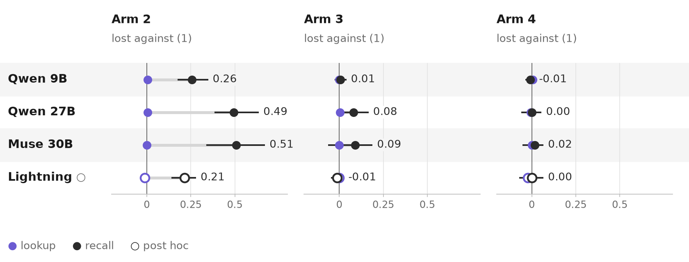
*Per model and arm: lookup and recall switches blocked against arm (1); arm 2 strips the new item's token at its earlier mention too. Whiskers: 95% intervals; Lightning ○ (below its gate, descriptive).*

- **Rule, fixed in advance.** "the recall reads the earlier mention if the recall's switch drop in (2) exceeds (3) by at least 0.2 and (4) by at least 0.15 (loss_k = 1 - S_k / S_1, point estimates), on at least 2 of 3 models; a model whose base edit switches fewer than 30 recalls is not tested."

- **Result.**

  | | 9B | 27B | Muse | Lightning | 122B |
  |---|---|---|---|---|---|
  | recalls switched by the base edit (1) | 0.74 [0.66, 0.82]<!-- src: results/x45p/x45p-20261027T012017Z/x45p.md \| qwen35_9b_x45p :: 0.74 [0.66, 0.82] --> | 0.30 [0.23, 0.37]<!-- src: results/x45p/x45p-20261027T012017Z/x45p.md \| x45p_27b :: 0.30 [0.23, 0.37] --> | 0.31 [0.21, 0.40]<!-- src: results/x45p/x45p-20261027T012017Z/x45p.md \| muse30b_x45p :: 0.31 [0.21, 0.40] --> | ○ 0.75 [0.68, 0.82]<!-- src: results/x45p/x52_45p_below-20261029T090351Z/x45p.md \| nem35l_x52_45p_below :: 119 :: 0.75 [0.68, 0.82] --> | 0.75 [0.66, 0.83]<!-- src: results/x45p/x53_45p_coverage-20261030T002915Z/x45p.md \| qwen35_122b_x45p_r2 :: 0.75 [0.66, 0.83] --> |
  | extra drop at the earlier mention: (2) minus (3) (bar >= 0.2) | 0.25 [0.16, 0.34]<!-- src: results/x45p/x45p-20261027T012017Z/x45p.md \| qwen35_9b_x45p :: 0.25 [0.16, 0.34] --> | 0.41 [0.32, 0.53]<!-- src: results/x45p/x45p-20261027T012017Z/x45p.md \| x45p_27b :: 0.41 [0.32, 0.53] --> | 0.42 [0.26, 0.63]<!-- src: results/x45p/x45p-20261027T012017Z/x45p.md \| muse30b_x45p :: 0.42 [0.26, 0.63] --> | ○ 0.22 [0.15, 0.30]<!-- src: results/x45p/x52_45p_below-20261029T090351Z/x45p.md \| nem35l_x52_45p_below :: 119 :: 0.22 [0.15, 0.30] --> | 0.15 [0.10, 0.22]<!-- src: results/x45p/x53_45p_coverage-20261030T002915Z/x45p.md \| qwen35_122b_x45p_r2 :: 0.15 [0.10, 0.22] --> |
  | (2) minus (4) (bar >= 0.15) | 0.26 [0.18, 0.35]<!-- src: results/x45p/x45p-20261027T012017Z/x45p.md \| qwen35_9b_x45p :: 0.26 [0.18, 0.35] --> | 0.49 [0.38, 0.64]<!-- src: results/x45p/x45p-20261027T012017Z/x45p.md \| x45p_27b :: 0.49 [0.38, 0.64] --> | 0.49 [0.31, 0.69]<!-- src: results/x45p/x45p-20261027T012017Z/x45p.md \| muse30b_x45p :: 0.49 [0.31, 0.69] --> | ○ 0.21 [0.14, 0.29]<!-- src: results/x45p/x52_45p_below-20261029T090351Z/x45p.md \| nem35l_x52_45p_below :: 119 :: 0.21 [0.14, 0.29] --> | 0.20 [0.15, 0.27]<!-- src: results/x45p/x53_45p_coverage-20261030T002915Z/x45p.md \| qwen35_122b_x45p_r2 :: 0.20 [0.15, 0.27] --> |
  | holds | **yes<!-- src: results/x45p/x45p-20261027T012017Z/x45p.md \| qwen35_9b_x45p :: 186 :: yes -->** | **yes<!-- src: results/x45p/x45p-20261027T012017Z/x45p.md \| x45p_27b :: 254 :: yes -->** | **yes<!-- src: results/x45p/x45p-20261027T012017Z/x45p.md \| muse30b_x45p :: 178 :: yes -->** | not tested (gate 0.751<!-- src: results/x52_coverage/matrix-20261029T062909Z/matrix.json \| clean one-pick design's gate fails on Lightning (recall 0.751 :: 0.751 --> < 0.80); below gate, descriptive only: yes (119 items) | **no<!-- src: results/x45p/x53_45p_coverage-20261030T002915Z/x45p.md \| qwen35_122b_x45p_r2 :: 0.20 [0.15, 0.27] :: no -->** (no prediction) |

- **Read.**
  - On all three models the recall has more blocked switches when the lens part also goes at the item's earlier mention than when a random part or another item's lens part goes: the recall reads the earlier mention too.
- **Caveats.**
  - Lightning: below the clean one-pick gate, so not tested; its below-gate run (119 locker-first items) is exploratory, hollow ○, never in claims or grades.
  - The base edit switches few recalls on the 27B and Muse (75 and 55 switches), so the losses rest on few switches there.
  - Only scenes with the locker first; after the pick there is no earlier mention.

### When the lens part points the recall to one item and the address to another, which does it follow? (53.6, opened 29 Oct ~10:35-10:45; joint four-model verdict 11:51) 

`in README` *Used in: README Part I card "When the lens part points the recall to one item and the address to another, which does it follow?".*

- **Question.** When the lens part of the change points the recall to one item and the address points it to another, which does the recall follow?
- **Why we asked.** The address swap redirects part of the recall ([swap](#swap)); the lens part carries the item's identity to the recall. Set against each other, the two show which the recall weights.
- **Data.** Routes scenes of the condition without a move whose three items have distinct leg counts: 300 per model (9B at L12, the 27B at L32, Muse at L26, Lightning at L14); all four pass the gate.
- **Method.** At the bridge word: the lens part of the change toward item B plus the address swap toward item C's slot (dose 2); read the recall's answer: B's, C's or the original; each part alone beside, and the lens part with a random direction of the address's norm.

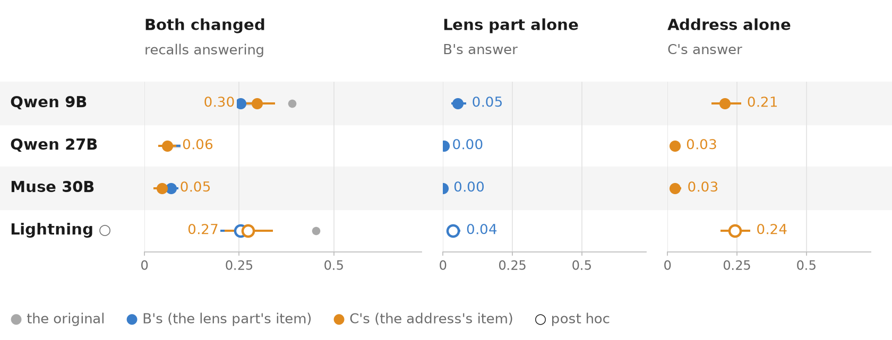
*Recalls answering with B's item (the lens part's), C's (the address's) or the original (grey), with both changed; then each part alone. Whiskers: 95% intervals; Lightning ○.*

- **Rule, fixed in advance.** "Rule: "the recall follows the lens identity" if B's share >= 2x C's; "follows the address" if C's >= 2x B's; else both." (jobs/c3/batch53.yaml, Dan 29 Oct 09:30; no prediction) Across models: "the recall's pointer use tracks the swap's collateral" if the models whose recall the address swap moved (9B, Lightning) give "both" and the others give "follows the lens identity". (jobs/c3/batch53.yaml, critic_1125, Dan 11:25; no prediction)

- **Result.**

  | | 9B | 27B | Muse | Lightning | 122B |
  |---|---|---|---|---|---|
  | both parts: the recall answers B's / C's / the original | 0.25 [0.20, 0.32]<!-- src: results/x53_identity_address/x53_identity_address-20261029T105132Z/verdict.md \| qwen3.5-9b :: 300 :: 0.25 [0.20, 0.32] --> / 0.30 [0.25, 0.35]<!-- src: results/x53_identity_address/x53_identity_address-20261029T105132Z/verdict.md \| qwen3.5-9b :: 300 :: 0.30 [0.25, 0.35] --> / 0.39 [0.31, 0.46]<!-- src: results/x53_identity_address/x53_identity_address-20261029T105132Z/verdict.md \| qwen3.5-9b :: 300 :: 0.39 [0.31, 0.46] --> | 0.11 [0.07, 0.16]<!-- src: results/x53_identity_address/x53_identity_address-20261029T105132Z/verdict.md \| qwen3.6-27b :: 300 :: 0.11 [0.07, 0.16] --> / 0.06 [0.04, 0.08]<!-- src: results/x53_identity_address/x53_identity_address-20261029T105132Z/verdict.md \| qwen3.6-27b :: 300 :: 0.06 [0.04, 0.08] --> / 0.81 [0.75, 0.86]<!-- src: results/x53_identity_address/x53_identity_address-20261029T105132Z/verdict.md \| qwen3.6-27b :: 300 :: 0.81 [0.75, 0.86] --> | 0.07 [0.04, 0.11]<!-- src: results/x53_identity_address/x53_identity_address-20261029T105132Z/verdict.md \| muse-glimmer-30b :: 300 :: 0.07 [0.04, 0.11] --> / 0.05 [0.02, 0.08]<!-- src: results/x53_identity_address/x53_identity_address-20261029T105132Z/verdict.md \| muse-glimmer-30b :: 300 :: 0.05 [0.02, 0.08] --> / 0.85 [0.77, 0.90]<!-- src: results/x53_identity_address/x53_identity_address-20261029T105132Z/verdict.md \| muse-glimmer-30b :: 300 :: 0.85 [0.77, 0.90] --> | 0.25 [0.19, 0.32]<!-- src: results/x53_identity_address/x53_identity_address-20261029T105132Z/verdict.md \| nemotron-3.5-lightning :: 300 :: 0.25 [0.19, 0.32] --> / 0.27 [0.21, 0.34]<!-- src: results/x53_identity_address/x53_identity_address-20261029T105132Z/verdict.md \| nemotron-3.5-lightning :: 300 :: 0.27 [0.21, 0.34] --> / 0.45 [0.39, 0.52]<!-- src: results/x53_identity_address/x53_identity_address-20261029T105132Z/verdict.md \| nemotron-3.5-lightning :: 300 :: 0.45 [0.39, 0.52] --> | not tested (gate: the recall reads 0.73<!-- src: results/x53_identity_address/qwen35_122b_x53_6/gate.json \| "PM": 0.732421875 :: 0.73 --> < 0.80) |
  | each part alone: the lens part, B's / the address, C's | 0.05 [0.03, 0.08]<!-- src: results/x53_identity_address/x53_identity_address-20261029T105132Z/verdict.md \| qwen3.5-9b :: recall :: lens :: 0.05 [0.03, 0.08] --> / 0.21 [0.16, 0.27]<!-- src: results/x53_identity_address/x53_identity_address-20261029T105132Z/verdict.md \| qwen3.5-9b :: recall :: addr :: 0.21 [0.16, 0.27] --> | 0.00 [0.00, 0.01]<!-- src: results/x53_identity_address/x53_identity_address-20261029T105132Z/verdict.md \| qwen3.6-27b :: recall :: lens :: 0.00 [0.00, 0.01] --> / 0.03 [0.01, 0.05]<!-- src: results/x53_identity_address/x53_identity_address-20261029T105132Z/verdict.md \| qwen3.6-27b :: recall :: addr :: 0.03 [0.01, 0.05] --> | 0.00 [0.00, 0.00]<!-- src: results/x53_identity_address/x53_identity_address-20261029T105132Z/verdict.md \| muse-glimmer-30b :: recall :: lens :: 0.00 [0.00, 0.00] --> / 0.03 [0.01, 0.05]<!-- src: results/x53_identity_address/x53_identity_address-20261029T105132Z/verdict.md \| muse-glimmer-30b :: recall :: addr :: 0.03 [0.01, 0.05] --> | 0.04 [0.01, 0.06]<!-- src: results/x53_identity_address/x53_identity_address-20261029T105132Z/verdict.md \| nemotron-3.5-lightning :: recall :: lens :: 0.04 [0.01, 0.06] --> / 0.24 [0.19, 0.30]<!-- src: results/x53_identity_address/x53_identity_address-20261029T105132Z/verdict.md \| nemotron-3.5-lightning :: recall :: addr :: 0.24 [0.19, 0.30] --> | |
  | the rule | **both<!-- src: results/x53_identity_address/x53_identity_address-20261029T105132Z/verdict.md \| qwen3.5-9b :: 300 :: both -->** | **both<!-- src: results/x53_identity_address/x53_identity_address-20261029T105132Z/verdict.md \| qwen3.6-27b :: 300 :: both -->** | **both<!-- src: results/x53_identity_address/x53_identity_address-20261029T105132Z/verdict.md \| muse-glimmer-30b :: 300 :: both -->** | **both<!-- src: results/x53_identity_address/x53_identity_address-20261029T105132Z/verdict.md \| nemotron-3.5-lightning :: 300 :: both -->** | |
  | across models (Dan 11:25): wanted | both | follows the lens identity | follows the lens identity | both | |
  | across models | **does not hold<!-- src: results/x53_identity_address/x53_identity_address-20261029T105132Z/verdict.md \| Across models :: does not hold --> as written (every model "both")** (Dan 12:10); beside, descriptive: the recall moves under both levers on the 9B and Lightning (0.25-0.30<!-- src: jobs/c3/batch53.yaml \| Lightning (0.25-0.30 each) :: 0.25-0.30 --> each), barely on the 27B and Muse (<= 0.11<!-- src: jobs/c3/batch53.yaml \| barely on the 27B and Muse (<= 0.11) :: 0.11 -->), the same split as the address swap's collateral | | | | |

- **Read.**
  - By the rule all four models give both. On the 9B and Lightning the recall splits between B's and C's answers, about a quarter each; on the 27B and Muse it mostly stays on the original answer, and the little that moves goes slightly more to B than to C.
  - Across models: does not hold as written (every model "both"; Dan 12:10). The 9B and Lightning give both as wanted; the 27B and Muse give both where the rule wanted the lens identity. Descriptive, beside (Dan 12:10): the recall moves under both levers on the 9B and Lightning (0.25-0.30<!-- src: jobs/c3/batch53.yaml \| Lightning (0.25-0.30 each) :: 0.25-0.30 --> each), barely on the 27B and Muse (<= 0.11<!-- src: jobs/c3/batch53.yaml \| barely on the 27B and Muse (<= 0.11) :: 0.11 -->), the same split as the address swap's collateral.
  - Each part alone moves the recall little on the 27B and Muse; on the 9B and Lightning the address alone moves about a fifth to C.
- **Caveats.**
  - The 27B sits just under the identity bar: B's share 0.11<!-- src: results/x53_identity_address/x53_identity_address-20261029T105132Z/verdict.md \| qwen3.6-27b :: 300 :: 0.11 --> against twice C's 0.06<!-- src: results/x53_identity_address/x53_identity_address-20261029T105132Z/verdict.md \| qwen3.6-27b :: 300 :: 0.06 -->.
  - On the 27B and Muse the recall mostly stays on the original answer, so their "both" rests on small shares. The labels ignore magnitude (flag [30](#flagged)).
  - One joint verdict (results/x53_identity_address/x53_identity_address-20261029T105132Z); exploratory (batch 53), no prediction; UNVERIFIED.

### Does the lens effect follow the question's position or the answer's type? (53.1, five models, combined verdict 29 Oct; the word cells not tested) 

`in README` *Used in: README Part I card "Does asking the question before the scene change how the lookup uses the lens part?"; README "Tested and dropped" ("The question's position decides item or answer").*

- **Question.** On our locker scenes, does the recall's lens effect (the item or its answer, by 51.12's arms) change when the question comes before the scene instead of after it, or when the recall's answer is a word instead of a number?
- **Why we asked.** On Zach's passages the answer word is readable and usable through the lens ([52 B](#b52-b)); on our scenes it is not. His questions and answers differ from ours in two ways at once: where the question sits and what kind of answer it asks for.
- **Data.** Our locker scenes (the main test), four cells: the question after the scene with a number answer (the main test as is), the question before the scene with a number answer, and the same two with a word answer: the animal's class (mammal, bird, insect, ...), the only relation that passed the 9B's coverage rule, on 191<!-- src: jobs/c3/x53_2x2_words_9b.yaml | Animal class passes coverage on the 9B :: 191 --> animal scenes, not the 600 of the number cells. Lightning: 516 scenes (84 dropped: the bridge word is not one token at one position), its word cells stopped (Dan 11:10: the wording fails). The 122B (FP8; MoE, ~10B active) at L33: 200 scenes in each number cell, its gate passed in both (lookup / recall 0.9917 / 0.85<!-- src: results/x53_2x2/x53_2x2-20261029T113335Z/verdict.md \| (Q-after, number) :: 0.9917 / 0.85 --> and 0.9983 / 0.84<!-- src: results/x53_2x2/x53_2x2-20261029T113335Z/verdict.md \| (Q-before, number) :: 0.9983 / 0.84 -->); its word cells stopped too.
- **Method.** Per cell: the main gate; the conflict test at L; 51.12's arms with the readout check first (without the lens part; without it but keeping the answer's directions; without the answer directions only, each beyond random); the inventory of the lens part's directions on 50 items.

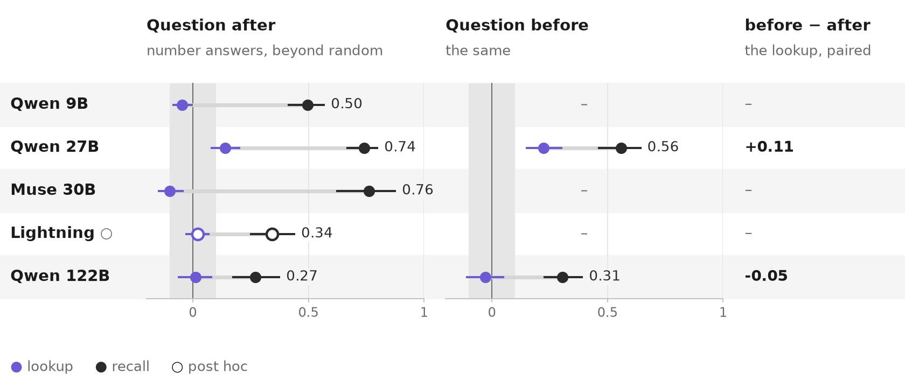
*Number answers: lookup and recall switches blocked without the lens part beyond a random part, the question after the scene (the main test) and before it; right: the lookup's paired difference, before minus after. whiskers: 95% intervals over bridge items; grey band: within 0.10 of random; Lightning ○; –: the question-first gate missed. The word-answer cells were not tested (the card).*

- **Rule, fixed in advance.** "Rule per cell: 51.12's labels (entity / answer / mixed / answer word not read). Rule across cells: "position": (Q-before, number) is answer or mixed and (Q-after, word) is entity; "readability": (Q-after, word) is answer or mixed and (Q-before, number) is entity; "both": each single change gives mixed and (Q-before, word) gives answer; "neither": all four entity. Cross-check, decisive for the story: the conflict test's lookup has <= 0.10 blocked beyond random in all four cells ("the pointer does not depend on the question"); report per cell." Models: 9B, then 27B, then Lightning if its gate passes. Dan 11:10, across the number cells: "the pointer does not depend on the question's position" if the lookup has <= 0.10 blocked in both cells on a model. Dan 11:25: the paired difference (Q-before minus Q-after) with its cluster-bootstrap CI; "order dependence" only if that CI excludes 0. (jobs/c3/batch53.yaml, next_1110 and critic_1125; no prediction)

- **Result.**

  | | 9B | 27B | Muse | Lightning | 122B |
  |---|---|---|---|---|---|
  | question after, number: the recall's label | **the lens effect is the entity<!-- src: results/x53_2x2/x53_2x2-20261029T113335Z/verdict.md \| (Q-after, number) :: the lens effect is the entity -->** | **the lens effect is the entity<!-- src: results/x53_2x2/x53_2x2-20261029T113335Z/verdict.md \| (Q-after, number) :: the lens effect is the entity -->** | **the answer word is not read at the bridge word<!-- src: results/x53_2x2/x53_2x2-20261029T113335Z/verdict.md \| (Q-after, number) :: the answer word is not read at the bridge word :: the answer word is not read at the bridge word -->** (not read on 0.99 [0.98, 1.00]<!-- src: results/x53_2x2/x53_2x2-20261029T113335Z/verdict.md \| (Q-after, number) :: 0.99 [0.98, 1.00] :: 0.99 [0.98, 1.00] --> of items; the arms beside say entity) | **the answer word is not read at the bridge word<!-- src: results/x53_2x2/x53_2x2-20261029T113335Z/verdict.md \| (Q-after, number) :: the answer word is not read at the bridge word :: the answer word is not read at the bridge word -->** (not read on 0.95 [0.90, 0.99]<!-- src: results/x53_2x2/x53_2x2-20261029T113335Z/verdict.md \| (Q-after, number) :: 0.95 [0.90, 0.99] :: 0.95 [0.90, 0.99] --> of items; the arms beside say entity) | **the answer word is not read at the bridge word<!-- src: results/x53_2x2/x53_2x2-20261029T113335Z/verdict.md \| (Q-after, number) :: 0.9917 / 0.85 :: the answer word is not read at the bridge word -->** (not read on 1.00 [1.00, 1.00]<!-- src: results/x53_2x2/x53_2x2-20261029T113335Z/verdict.md \| (Q-after, number) :: 0.9917 / 0.85 :: 1.00 [1.00, 1.00] --> of items; the arms beside say entity) |
  | question after, number: recall blocked without the lens part, beyond random / share remaining with the answer directions retained / without the answer directions only | 0.50 [0.41, 0.57]<!-- src: results/x53_2x2/x53_2x2-20261029T113335Z/verdict.md \| (Q-after, number) :: 0.50 [0.41, 0.57] --> / 0.95 [0.90, 0.99]<!-- src: results/x53_2x2/x53_2x2-20261029T113335Z/verdict.md \| (Q-after, number) :: 0.95 [0.90, 0.99] --> / 0.00 [0.00, 0.00]<!-- src: results/x53_2x2/x53_2x2-20261029T113335Z/verdict.md \| (Q-after, number) :: 0.00 [0.00, 0.00] --> | 0.74 [0.66, 0.80]<!-- src: results/x53_2x2/x53_2x2-20261029T113335Z/verdict.md \| (Q-after, number) :: 0.74 [0.66, 0.80] --> / 0.93 [0.85, 0.99]<!-- src: results/x53_2x2/x53_2x2-20261029T113335Z/verdict.md \| (Q-after, number) :: 0.93 [0.85, 0.99] --> / 0.03 [0.01, 0.05]<!-- src: results/x53_2x2/x53_2x2-20261029T113335Z/verdict.md \| (Q-after, number) :: 0.03 [0.01, 0.05] --> | 0.76 [0.62, 0.88]<!-- src: results/x53_2x2/x53_2x2-20261029T113335Z/verdict.md \| (Q-after, number) :: 0.76 [0.62, 0.88] --> / 0.93 [0.85, 1.01]<!-- src: results/x53_2x2/x53_2x2-20261029T113335Z/verdict.md \| (Q-after, number) :: 0.93 [0.85, 1.01] --> / -0.01 [-0.05, 0.03]<!-- src: results/x53_2x2/x53_2x2-20261029T113335Z/verdict.md \| (Q-after, number) :: -0.01 [-0.05, 0.03] --> (beside the label) | 0.34 [0.25, 0.44]<!-- src: results/x53_2x2/x53_2x2-20261029T113335Z/verdict.md \| (Q-after, number) :: 0.34 [0.25, 0.44] --> / 0.92 [0.83, 1.03]<!-- src: results/x53_2x2/x53_2x2-20261029T113335Z/verdict.md \| (Q-after, number) :: 0.92 [0.83, 1.03] --> / 0.00 [-0.02, 0.01]<!-- src: results/x53_2x2/x53_2x2-20261029T113335Z/verdict.md \| (Q-after, number) :: 0.00 [-0.02, 0.01] --> (beside the label) | 0.27 [0.17, 0.38]<!-- src: results/x53_2x2/x53_2x2-20261029T113335Z/verdict.md \| (Q-after, number) :: 0.9917 / 0.85 :: 0.27 [0.17, 0.38] --> / 0.98 [0.86, 1.18]<!-- src: results/x53_2x2/x53_2x2-20261029T113335Z/verdict.md \| (Q-after, number) :: 0.9917 / 0.85 :: 0.98 [0.86, 1.18] --> / 0.01 [-0.01, 0.04]<!-- src: results/x53_2x2/x53_2x2-20261029T113335Z/verdict.md \| (Q-after, number) :: 0.9917 / 0.85 :: 0.01 [-0.01, 0.04] --> (beside the label) |
  | question after, number: the conflict test's lookup, blocked beyond random | -0.05 [-0.09, 0.00]<!-- src: results/x53_2x2/x53_2x2-20261029T113335Z/verdict.md \| (Q-after, number) :: -0.05 [-0.09, 0.00] --> (around; its 51.12 label: can't tell) | 0.14 [0.08, 0.20]<!-- src: results/x53_2x2/x53_2x2-20261029T113335Z/verdict.md \| (Q-after, number) :: 0.14 [0.08, 0.20] --> (mixed; its 51.12 label: the entity) | -0.10 [-0.15, -0.04]<!-- src: results/x53_2x2/x53_2x2-20261029T113335Z/verdict.md \| (Q-after, number) :: -0.10 [-0.15, -0.04] --> (around; its 51.12 label: the answer word is not read at the bridge word) | 0.02 [-0.03, 0.07]<!-- src: results/x53_2x2/x53_2x2-20261029T113335Z/verdict.md \| (Q-after, number) :: 0.02 [-0.03, 0.07] --> (around; its 51.12 label: the answer word is not read at the bridge word) | 0.01 [-0.06, 0.08]<!-- src: results/x53_2x2/x53_2x2-20261029T113335Z/verdict.md \| (Q-after, number) :: 0.01 [-0.06, 0.08] --> (around; its 51.12 label: the answer word is not read at the bridge word) |
  | question before, number: the recall's label | not tested (gate 0.763<!-- src: results/x53_2x2/x53_2x2-20261029T113335Z/verdict.md \| (Q-before, number) :: 0.7633 :: 0.763 --> < 0.80: the recall's read on the original prompts) | **the lens effect is the entity<!-- src: results/x53_2x2/x53_2x2-20261029T113335Z/verdict.md \| (Q-before, number) :: the lens effect is the entity -->** | not tested (gate 0.7189<!-- src: results/x53_2x2/x53_2x2-20261029T113335Z/verdict.md \| (Q-before, number) :: 0.7189 --> < 0.80: the recall's read on the original prompts) | not tested (gate 0.647<!-- src: results/x53_2x2/x53_2x2-20261029T113335Z/verdict.md \| (Q-before, number) :: 0.6473 :: 0.647 --> < 0.80: the recall's read on the original prompts) | **the answer word is not read at the bridge word<!-- src: results/x53_2x2/x53_2x2-20261029T113335Z/verdict.md \| (Q-before, number) :: 0.9983 / 0.84 :: the answer word is not read at the bridge word -->** (not read on 1.00 [1.00, 1.00]<!-- src: results/x53_2x2/x53_2x2-20261029T113335Z/verdict.md \| (Q-before, number) :: 0.9983 / 0.84 :: 1.00 [1.00, 1.00] --> of items; the arms beside say entity) |
  | question before, number: recall switches blocked / share remaining with the answer directions retained / answer directions only | | 0.56 [0.46, 0.65]<!-- src: results/x53_2x2/x53_2x2-20261029T113335Z/verdict.md \| (Q-before, number) :: 0.56 [0.46, 0.65] --> / 0.91 [0.81, 0.98]<!-- src: results/x53_2x2/x53_2x2-20261029T113335Z/verdict.md \| (Q-before, number) :: 0.91 [0.81, 0.98] --> / 0.01 [0.00, 0.02]<!-- src: results/x53_2x2/x53_2x2-20261029T113335Z/verdict.md \| (Q-before, number) :: 0.01 [0.00, 0.02] --> | | | 0.31 [0.22, 0.39]<!-- src: results/x53_2x2/x53_2x2-20261029T113335Z/verdict.md \| (Q-before, number) :: 0.9983 / 0.84 :: 0.31 [0.22, 0.39] --> / 0.87 [0.73, 1.02]<!-- src: results/x53_2x2/x53_2x2-20261029T113335Z/verdict.md \| (Q-before, number) :: 0.9983 / 0.84 :: 0.87 [0.73, 1.02] --> / 0.03 [0.00, 0.06]<!-- src: results/x53_2x2/x53_2x2-20261029T113335Z/verdict.md \| (Q-before, number) :: 0.9983 / 0.84 :: 0.03 [0.00, 0.06] --> (beside the label) |
  | question before, number: the conflict test's lookup, blocked beyond random | | 0.22 [0.15, 0.31]<!-- src: results/x53_2x2/x53_2x2-20261029T113335Z/verdict.md \| (Q-before, number) :: 0.22 [0.15, 0.31] --> (through; its 51.12 label: the answer word is not read at the bridge word) | | | -0.03 [-0.11, 0.05]<!-- src: results/x53_2x2/x53_2x2-20261029T113335Z/verdict.md \| (Q-before, number) :: -0.03 [-0.11, 0.05] --> (around; its 51.12 label: the answer word is not read at the bridge word) |
  | across the number cells (Dan 11:10: the lookup <= 0.10 in both) | can't tell: (Q-before, number) not tested | **does not hold<!-- src: results/x53_2x2/x53_2x2-20261029T113335Z/verdict.md \| Across the number cells (Dan 11:10) :: (Q-after, number) (0.14), (Q-before, number) (0.22) :: does not hold -->** (0.14 and 0.22 > 0.10) | can't tell: (Q-before, number) not tested | can't tell: (Q-before, number) not tested | **the pointer does not depend on the question's position<!-- src: results/x53_2x2/x53_2x2-20261029T113335Z/verdict.md \| Across the number cells (Dan 11:10) :: the pointer does not depend on the question's position -->** (the lookup <= 0.10 beyond random in both number cells) |
  | the lookup, question before minus after (paired, cluster CI; "order dependence" only if the CI excludes 0) | can't tell: a number cell not tested | **order dependence<!-- src: results/x53_2x2/x53_2x2-20261029T113335Z/verdict.md \| Paired difference (Dan 11:25) :: order dependence -->**: +0.11 [+0.01, +0.22]<!-- src: results/x53_2x2/x53_2x2-20261029T113335Z/verdict.md \| Paired difference (Dan 11:25) :: +0.11 [+0.01, +0.22] --> on the 162<!-- src: results/x53_2x2/x53_2x2-20261029T113335Z/verdict.md \| Paired difference (Dan 11:25) :: 162 --> scenes both number cells read | can't tell: a number cell not tested | can't tell: a number cell not tested | **the CI includes 0<!-- src: results/x53_2x2/x53_2x2-20261029T113335Z/verdict.md \| Paired difference (Dan 11:25) :: the CI includes 0 -->**: -0.05 [-0.17, +0.05]<!-- src: results/x53_2x2/x53_2x2-20261029T113335Z/verdict.md \| Paired difference (Dan 11:25) :: -0.05 [-0.17, +0.05] --> on the 148<!-- src: results/x53_2x2/x53_2x2-20261029T113335Z/verdict.md \| Paired difference (Dan 11:25) :: 148 scenes :: 148 --> scenes both number cells read; no order dependence claimed |
  | across models (Dan 11:55; the denominator as Dan worded it at 12:40: the models where both number cells passed their gates) | **order dependence on 1 of the 2<!-- src: jobs/c3/batch53.yaml \| order dependence on 1 of the 2 :: 1 of the 2 --> models where both number cells passed their gates**: 27B yes (+0.11 [+0.01, +0.22]<!-- src: results/x53_2x2/x53_2x2-20261029T113335Z/verdict.md \| Muse: can't tell :: +0.11 [+0.01, +0.22] -->), 122B no (the CI includes 0: -0.05 [-0.17, +0.05]<!-- src: results/x53_2x2/x53_2x2-20261029T113335Z/verdict.md \| Muse: can't tell :: -0.05 [-0.17, +0.05] -->); 9B / Muse / Lightning: Q-before gate failed (Dan 12:40; the verdict counts order dependence on 1 of 3 models<!-- src: results/x53_2x2/x53_2x2-20261029T113335Z/verdict.md \| Muse: can't tell :: order dependence on 1 of 3 models -->) | | | | |
  | question after / before, word (the animal's class) | not tested (the relation's 9B accuracy 0.382<!-- src: results/x53_2x2/qwen35_9b_x53_2x2_words/relation.json \| accuracy_recall_qa_word :: 0.382 --> < 0.80) | not tested (the same rule: the relation is chosen on the 9B) | not run: stopped (Dan 11:10: the wording fails) | not run: stopped (Dan 11:10: the wording fails) | not run: stopped (Dan 11:10: the wording fails) |
  | the word cells' gates beside (descriptive): question after / before, lookup / recall read on the original prompts | 0.9476<!-- src: results/x53_2x2/x53_2x2-20261029T113335Z/verdict.md \| (Q-after, word) :: 0.9476 --> / 0.3822<!-- src: results/x53_2x2/x53_2x2-20261029T113335Z/verdict.md \| (Q-after, word) :: 0.3822 -->; 0.9686<!-- src: results/x53_2x2/x53_2x2-20261029T113335Z/verdict.md \| (Q-before, word) :: 0.9686 --> / 0.9162<!-- src: results/x53_2x2/x53_2x2-20261029T113335Z/verdict.md \| (Q-before, word) :: 0.9162 --> | 1.0<!-- src: results/x53_2x2/x53_2x2-20261029T113335Z/verdict.md \| (Q-after, word) :: 1.0 --> / 0.7592<!-- src: results/x53_2x2/x53_2x2-20261029T113335Z/verdict.md \| (Q-after, word) :: 0.7592 -->; 1.0<!-- src: results/x53_2x2/x53_2x2-20261029T113335Z/verdict.md \| (Q-before, word) :: 1.0 --> / 0.9895<!-- src: results/x53_2x2/x53_2x2-20261029T113335Z/verdict.md \| (Q-before, word) :: 0.9895 --> | not run | not run | not run |
  | across cells; the cross-check (the lookup <= 0.10 in all four) | **can't tell<!-- src: results/x53_2x2/x53_2x2-20261029T113335Z/verdict.md \| Rule across cells :: position, readability, both, neither :: can't tell -->** (no label in three cells; all four patterns left open); cross-check **can't tell (a cell without numbers; the tested ones <= 0.10)<!-- src: results/x53_2x2/x53_2x2-20261029T113335Z/verdict.md \| Cross-check :: can't tell (a cell without numbers; the tested ones <= 0.10) -->** | **can't tell<!-- src: results/x53_2x2/x53_2x2-20261029T113335Z/verdict.md \| Rule across cells :: leave open: readability, neither :: can't tell -->** (no label in the two word cells; left open: readability, neither); cross-check **does not hold<!-- src: results/x53_2x2/x53_2x2-20261029T113335Z/verdict.md \| Cross-check :: (Q-after, number) (0.14), (Q-before, number) (0.22) :: does not hold -->** (the lookup has more than 0.10 blocked beyond random in both number cells) | **can't tell<!-- src: results/x53_2x2/x53_2x2-20261029T113335Z/verdict.md \| Rule across cells :: position, readability, both) :: can't tell -->** (no label in three cells; left open: position, readability, both); cross-check **can't tell (a cell without numbers; the tested ones <= 0.10)<!-- src: results/x53_2x2/x53_2x2-20261029T113335Z/verdict.md \| Cross-check :: can't tell (a cell without numbers; the tested ones <= 0.10) -->** | **can't tell<!-- src: results/x53_2x2/x53_2x2-20261029T113335Z/verdict.md \| Rule across cells :: position, readability, both) :: can't tell -->** (no label in three cells; left open: position, readability, both); cross-check **can't tell (a cell without numbers; the tested ones <= 0.10)<!-- src: results/x53_2x2/x53_2x2-20261029T113335Z/verdict.md \| Cross-check :: can't tell (a cell without numbers; the tested ones <= 0.10) -->** | **can't tell<!-- src: results/x53_2x2/x53_2x2-20261029T113335Z/verdict.md \| Rule across cells :: leave open: none :: can't tell -->** (both number cells "not read": no pattern left open); cross-check **can't tell (a cell without numbers; the tested ones <= 0.10)<!-- src: results/x53_2x2/x53_2x2-20261029T113335Z/verdict.md \| Cross-check :: can't tell (a cell without numbers; the tested ones <= 0.10) -->** |

- **Read.**
  - With a number answer the recall follows the entity wherever the question sits: on the 9B with the question after the scene, on the 27B with it after and before; keeping the answer's directions keeps almost all of the recall's drop, and the answer directions alone cost little. On Lightning and Muse (question after) and on the 122B (both cells) the recall's answer word is not read at the bridge word, so that is their label; the arms beside give the entity pattern.
  - The conflict test's lookup has nothing blocked beyond random on the 9B, Lightning and Muse (question after) and on the 122B in both cells, so on the 122B the pointer does not depend on the question's position by Dan's 11:10 rule; on the 27B it has some blocked with the question after the scene and more with it before. On the 27B Dan's 11:10 rule ("the pointer does not depend on the question's position") and the cross-check do not hold, and the paired difference on the scenes both cells read excludes 0: order dependence by Dan's 11:25 wording. On the 9B, Lightning and Muse the question-before cell missed its gate, so they read can't tell.
  - Order dependence (Dan, 13:15): a small order effect on the 27B (lower bound +0.01<!-- src: results/x53_2x2/x53_2x2-20261029T113335Z/verdict.md \| Paired difference (Dan 11:25) :: +0.01 -->, of the order of the 122B's rerun noise), none on the 122B.
  - Across models (Dan 11:55; wording 12:40): order dependence on 1 of the 2 models where both number cells passed their gates: 27B yes, 122B no (the paired difference's CI includes 0); 9B / Muse / Lightning: Q-before gate failed.
  - Across cells no model gets a label: the word cells have none. On the 27B the question-before number cell is the entity, which rules out "position" and "both"; "readability" and "neither" stay open and only the word cells could decide between them. On the 9B all four patterns stay open; on Lightning and Muse "position", "readability" and "both" (their question-after label is not the entity, so "neither" is out); on the 122B none (both number cells "not read"). The word cells are not tested: the animal-class relation's recall reads too few of the 9B's answers with the question after the scene (Dan's 10:20 rule); with the question before the scene the 9B's recall misses the number cell's gate.
- **Caveats.**
  - The word cells used the animal-class relation on 191 animal scenes, the only relation that passed the coverage rule (Dan's 10:20 decision: words read by their first token); it then missed the accuracy bar, so neither word cell is tested.
  - The question-after word prompt mostly gets the animal's name, not its class (236<!-- src: results/x53_2x2/diag_words-20261029T095338Z/note.md | the asked pick itself (the animal) 236 :: 236 --> of 382), so the 0.382 reflects the answer format; the cells stay not tested under Dan's rule (a CPU check, descriptive).
  - The (question after, number) cell repeats our main test (on the 9B the rerun agrees with the stored run on the recall's whole change, 200 of 200; the 122B below).
  - The evaluation logic was clarified after the data (3dae749f): the cross-check reads "does not hold" once a tested cell exceeds 0.10, and a "can't tell" across cells lists the patterns still open. Dan (11:25) confirmed it as the correct reading of "in all four cells"; on the 27B it changes nothing, since the Q-after cell is the main test (0.14<!-- src: results/x53_2x2/x53_2x2-20261029T113335Z/verdict.md \| Cross-check :: (Q-after, number) (0.14) :: 0.14 -->, already failing) (record line [29](#flagged)).
  - Gates just under 0.80 stay not tested (Dan, 11:25): on the harder variants the eligible items are the easier ones (the 9B's question-before cell, 0.763<!-- src: results/x53_2x2/x53_2x2-20261029T113335Z/verdict.md \| (Q-before, number) :: 0.7633 :: 0.763 -->).
  - The 122B, the verdict's flags: L33 carried over (relative depth 0.69); FP8 weights (MoE, ~10B active); the J++ lens fit in bf16.
  - The 122B (Dan 12:40): the rerun of its main cells matches the stored run on 193<!-- src: results/x53_2x2/x53_2x2-20261029T113335Z/verdict.md \| qwen35_122b_x0_necessity_r2 :: recall: whole 193/200 :: 193 -->-194<!-- src: results/x53_2x2/x53_2x2-20261029T113335Z/verdict.md \| qwen35_122b_x0_necessity_r2 :: lookup: whole 194/200 :: 194 --> of 200 items and arm 1's recall effect moves 0.315<!-- src: results/x53_2x2/x53_2x2-20261029T113335Z/verdict.md \| qwen35_122b_x0_necessity_r2 :: vs stored 0.315 :: 0.315 --> → 0.270<!-- src: results/x53_2x2/x53_2x2-20261029T113335Z/verdict.md \| qwen35_122b_x0_necessity_r2 :: arm 1 extra loss rerun 0.270 :: 0.270 --> (likely FP8 / MoE numerics, unchecked); its numbers carry ~±0.04<!-- src: jobs/c3/batch53.yaml \| run-to-run noise beyond the bootstrap :: 0.04 --> run-to-run noise beyond the bootstrap (per item: results/x53_2x2/qwen35_122b_x53_2x2/qa_num/agreement.json).
  - Exploratory (batch 53): no prediction; UNVERIFIED.

### Does each reader follow the lens part by weight, or by route? (gain map, 49.1; Lightning's coverage run 29 Oct) 

`ledger only` *Used in: not in the README (its 12:50 rebuild).*

- **Question.** Scaling the lens part and the rest of the change separately, does the recall move with either part at enough gain (weights), or only with one of them (routes), and does the lookup ignore the lens part?
- **Why we asked.** Removing a part shows what a reader needs; adding each part at several gains shows whether it reads that part at all.
- **Data.** Main test, locker first: 75<!-- src: results/x49_gain/x49_1-20261028T154510Z/x49_1.md \| qwen35_9b_x49_1 :: 75 --> / 69<!-- src: results/x49_gain/x49_1-20261028T154510Z/x49_1.md \| x49_1_27b :: 69 --> / 68<!-- src: results/x49_gain/x49_1-20261028T154510Z/x49_1.md \| muse30_x49_1 :: 68 --> / 59<!-- src: results/x49_gain/x52_gain-20261029T021814Z/x49_1.md \| nem35l_x52_gain :: 59 --> (9B / 27B / Muse / Lightning). The 122B (coverage, 30 Oct; FP8, L33): 53<!-- src: results/x49_gain/x52_gain-20261030T094553Z/x49_1.md | qwen35_122b_gain :: 53 --> scenes.
- **Method.** At the bridge word at L: the lens part times α plus the rest times β, α and β from 0 to 2; the rest also without the address; random parts of the lens part's share at the same gains.

*No figure: five cells per model, each against its bar: the Result's table (the bars-and-ticks figure carried the verdict "(c) neither" on every model).*

- **Rule, fixed in advance.** "(a) "weights, not routes": the recall's switch at (2,0) >= 0.5 and at (0,2, no U) >= 0.5, random corners <= 0.15; the lookup's switch at (2,0) <= 0.10 and at (0,1) >= 0.6. (b) "routes": the recall's switch at (0,2) <= 0.2 while (2,0) >= 0.5. (a') "the rest moves the recall only through the address": (0,2) >= 0.5 but (0,2, no U) <= 0.2. (c) "neither": report the two heatmaps." Lightning: a coverage run on this rule, no prediction.

- **Result.** (switch rates)

  | | 9B | 27B | Muse | Lightning | 122B |
  |---|---|---|---|---|---|
  | recall, the lens part alone at twice its size (bar >= 0.5) | 0.55 [0.42, 0.67]<!-- src: results/x49_gain/x49_1-20261028T154510Z/x49_1.md \| qwen35_9b_x49_1 :: 0.55 [0.42, 0.67] --> | 0.23 [0.13, 0.35]<!-- src: results/x49_gain/x49_1-20261028T154510Z/x49_1.md \| x49_1_27b :: 0.23 [0.13, 0.35] --> | 0.24 [0.10, 0.37]<!-- src: results/x49_gain/x49_1-20261028T154510Z/x49_1.md \| muse30_x49_1 :: 0.24 [0.10, 0.37] --> | 0.64 [0.51, 0.78]<!-- src: results/x49_gain/x52_gain-20261029T021814Z/x49_1.md \| nem35l_x52_gain :: 0.64 [0.51, 0.78] --> | 0.55 [0.38, 0.69]<!-- src: results/x49_gain/x52_gain-20261030T094553Z/x49_1.md \| qwen35_122b_gain :: 0.55 [0.38, 0.69] --> |
  | recall, the rest alone at twice its size | 0.97 [0.93, 1.00]<!-- src: results/x49_gain/x49_1-20261028T154510Z/x49_1.md \| qwen35_9b_x49_1 :: 0.97 [0.93, 1.00] --> | 0.64 [0.54, 0.74]<!-- src: results/x49_gain/x49_1-20261028T154510Z/x49_1.md \| x49_1_27b :: 0.64 [0.54, 0.74] --> | 0.18 [0.08, 0.29]<!-- src: results/x49_gain/x49_1-20261028T154510Z/x49_1.md \| muse30_x49_1 :: 0.18 [0.08, 0.29] --> | 0.90 [0.81, 0.97]<!-- src: results/x49_gain/x52_gain-20261029T021814Z/x49_1.md \| nem35l_x52_gain :: 0.90 [0.81, 0.97] --> | 0.87 [0.76, 0.95]<!-- src: results/x49_gain/x52_gain-20261030T094553Z/x49_1.md \| qwen35_122b_gain :: 0.87 [0.76, 0.95] --> |
  | recall, the same without the address (bar >= 0.5) | 0.76 [0.66, 0.86]<!-- src: results/x49_gain/x49_1-20261028T154510Z/x49_1.md \| qwen35_9b_x49_1 :: 0.76 [0.66, 0.86] --> | 0.45 [0.34, 0.56]<!-- src: results/x49_gain/x49_1-20261028T154510Z/x49_1.md \| x49_1_27b :: 0.45 [0.34, 0.56] --> | 0.21 [0.09, 0.34]<!-- src: results/x49_gain/x49_1-20261028T154510Z/x49_1.md \| muse30_x49_1 :: 0.21 [0.09, 0.34] --> | 0.73 [0.60, 0.84]<!-- src: results/x49_gain/x52_gain-20261029T021814Z/x49_1.md \| nem35l_x52_gain :: 0.73 [0.60, 0.84] --> | 0.85 [0.73, 0.94]<!-- src: results/x49_gain/x52_gain-20261030T094553Z/x49_1.md \| qwen35_122b_gain :: 0.85 [0.73, 0.94] --> |
  | recall, a random part at the lens part's share, twice (bar <= 0.15) | 0.24 [0.14, 0.34]<!-- src: results/x49_gain/x49_1-20261028T154510Z/x49_1.md \| qwen35_9b_x49_1 :: 0.24 [0.14, 0.34] --> | 0.01 [0.00, 0.05]<!-- src: results/x49_gain/x49_1-20261028T154510Z/x49_1.md \| x49_1_27b :: 0.01 [0.00, 0.05] --> | 0.01 [0.00, 0.05]<!-- src: results/x49_gain/x49_1-20261028T154510Z/x49_1.md \| muse30_x49_1 :: 0.01 [0.00, 0.05] --> | 0.42 [0.31, 0.54]<!-- src: results/x49_gain/x52_gain-20261029T021814Z/x49_1.md \| nem35l_x52_gain :: 0.42 [0.31, 0.54] --> | 0.23 [0.13, 0.34]<!-- src: results/x49_gain/x52_gain-20261030T094553Z/x49_1.md \| qwen35_122b_gain :: 0.23 [0.13, 0.34] --> |
  | lookup, the lens part alone at twice its size (bar <= 0.10) | 0.03 [0.00, 0.07]<!-- src: results/x49_gain/x49_1-20261028T154510Z/x49_1.md \| qwen35_9b_x49_1 :: 0.03 [0.00, 0.07] --> | 0.07 [0.02, 0.13]<!-- src: results/x49_gain/x49_1-20261028T154510Z/x49_1.md \| x49_1_27b :: 0.07 [0.02, 0.13] --> | 0.00 [0.00, 0.00]<!-- src: results/x49_gain/x49_1-20261028T154510Z/x49_1.md \| muse30_x49_1 :: 0.00 [0.00, 0.00] --> | 0.10 [0.04, 0.18]<!-- src: results/x49_gain/x52_gain-20261029T021814Z/x49_1.md \| nem35l_x52_gain :: 0.10 [0.04, 0.18] --> | 0.09 [0.00, 0.19]<!-- src: results/x49_gain/x52_gain-20261030T094553Z/x49_1.md \| qwen35_122b_gain :: 0.09 [0.00, 0.19] --> |
  | lookup, the rest alone (bar >= 0.6) | 0.91 [0.82, 0.97]<!-- src: results/x49_gain/x49_1-20261028T154510Z/x49_1.md \| qwen35_9b_x49_1 :: 0.91 [0.82, 0.97] --> | 0.80 [0.70, 0.90]<!-- src: results/x49_gain/x49_1-20261028T154510Z/x49_1.md \| x49_1_27b :: 0.80 [0.70, 0.90] --> | 0.81 [0.71, 0.91]<!-- src: results/x49_gain/x49_1-20261028T154510Z/x49_1.md \| muse30_x49_1 :: 0.81 [0.71, 0.91] --> | 0.93 [0.86, 0.98]<!-- src: results/x49_gain/x52_gain-20261029T021814Z/x49_1.md \| nem35l_x52_gain :: 0.93 [0.86, 0.98] --> | 0.81 [0.66, 0.94]<!-- src: results/x49_gain/x52_gain-20261030T094553Z/x49_1.md \| qwen35_122b_gain :: 0.81 [0.66, 0.94] --> |
  | the rule | **(c) neither<!-- src: results/x49_gain/x49_1-20261028T154510Z/x49_1.md \| qwen35_9b_x49_1 :: (c) neither -->** | **(c) neither<!-- src: results/x49_gain/x49_1-20261028T154510Z/x49_1.md \| x49_1_27b :: (c) neither -->** | **(c) neither<!-- src: results/x49_gain/x49_1-20261028T154510Z/x49_1.md \| muse30_x49_1 :: (c) neither -->** | **(c) neither<!-- src: results/x49_gain/x52_gain-20261029T021814Z/x49_1.md \| nem35l_x52_gain :: (c) neither -->** (no prediction) | **(c) neither<!-- src: results/x49_gain/x52_gain-20261030T094553Z/x49_1.md \| qwen35_122b_gain :: (c) neither -->** (no prediction) |

- **Read.**
  - The gain map fits neither reading fixed in advance on any model: on the 9B and Lightning a random part at the lens part's share also moves the recall; on the 27B and Muse the lens part alone moves the recall little even at twice its size. The rest alone moves the lookup on all five; the 122B (coverage, pending hand-check) reads like the 9B: a random part at the lens part's share moves its recall too.
- **Caveats.**
  - Lightning's lookup with the lens part at twice its size sits at the rule's 0.10 bar, its point estimate just above it.
  - Locker-first main-test scenes only.

### Do the two readers read two separate learned subspaces? (DAS at the bridge word, 48.1; the 27B's coverage run 29 Oct) 

`ledger only` *Used in: README Appendix A, a figure link ("Muse's learned subspaces", figures/depth/supp/s12_das_muse.png).*

- **Question.** At the bridge word at L, does each reader's switch run through its own small learned subspace, the recall's inside the lens part and the lookup's holding the address or a third identity code?
- **Why we asked.** Our parts are hand-built; a subspace trained for each reader tests the two-reader picture without that choice.
- **Data.** Pairs from the main test's locker-first scenes the whole change switches, split by bridge entity 60 / 20 / 20; the 27B's test pairs: lookup 10<!-- src: results/x48_das/x52_das-20261029T040955Z/verdict.md \| 10 (7) :: 10 -->, recall 8<!-- src: results/x48_das/x52_das-20261029T040955Z/verdict.md \| 8 (4) :: 8 -->.
- **Method.** Distributed alignment search per reader at k = 1, 4, 16, 64 directions; k chosen on the select split; own and cross interchange accuracy (IIA) on the test entities' pairs, against random and shuffled-target subspaces; the subspaces' energy inside the lens part, the address and the embedding directions.

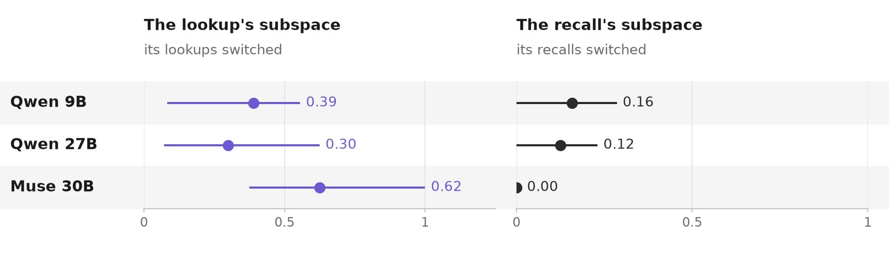
*Each reader's learned subspace: the share of its own reader's switches it moves. Whiskers: 95% intervals.*

- **Rule, fixed in advance.** "(a) "two readers, two subspaces": own-IIA >= 0.7 at some k <= 16 for both readers, and cross-IIA <= 0.25 in both directions (paired CI excluding overlap with own-IIA). (b) "the recall's subspace is the lens's part": R_recall's energy inside the J++-25 part >= 0.5 (random R <= 0.15); R_lookup's <= 0.2. (c) "the address is part of the lookup's subspace": ||R_lookup^T U||_F^2 / 4 >= 0.5 (random R ~ k/d). (d) "a third identity code": R_lookup's energy outside (J++-25 u U u W_E-25) >= 0.5 while its own-IIA >= 0.7, and R_lookup alone gives identity answers >= 0.3 in the routes read." The 27B: a coverage run on this rule, no prediction.

- **Result.**

  | | 9B | 27B | Muse | Lightning | 122B |
  |---|---|---|---|---|---|
  | the lookup's learned subspace: k chosen, held-out own-IIA (bar >= 0.7 at k <= 16) | k 1: 0.39 [0.08, 0.56]<!-- src: results/x48_das/verdict-20261028T134153Z/verdict.md \| 1 (chosen) :: 0.39 [0.08, 0.56] --> | k 16: 0.30 [0.07, 0.62]<!-- src: results/x48_das/x52_das-20261029T040955Z/verdict.md \| 16 (chosen) :: 0.30 [0.07, 0.62] --> | k 16: 0.62 [0.38, 1.00]<!-- src: results/x48_das/verdict-20261028T134153Z/verdict.md \| 16 (chosen) :: 0.62 [0.38, 1.00] --> | not run | not run |
  | the recall's learned subspace: k chosen, held-out own-IIA | k 4: 0.16 [0.00, 0.29]<!-- src: results/x48_das/verdict-20261028T134153Z/verdict.md \| 4 (chosen) :: 0.16 [0.00, 0.29] --> | k 16: 0.12 [0.00, 0.23]<!-- src: results/x48_das/x52_das-20261029T040955Z/verdict.md \| 16 (chosen) :: 0.12 [0.00, 0.23] --> | k 16: 0.00 [0.00, 0.00]<!-- src: results/x48_das/verdict-20261028T134153Z/verdict.md \| 16 (chosen) :: 0.00 [0.00, 0.00] --> | | |
  | the rules (a) / (b) / (c) / (d) | (a) no, (b) no, (c) no, (d) no<!-- src: results/x48_das/verdict-20261028T134153Z/verdict.md \| qwen35_9b_x48_das_r2 :: (a) no, (b) no, (c) no, (d) no --> | (a) no, (b) no, (c) no, (d) no<!-- src: results/x48_das/x52_das-20261029T040955Z/verdict.md \| x48_das_27b :: (a) no, (b) no, (c) no, (d) no --> | (a) no, (b) no, (c) no, (d) no<!-- src: results/x48_das/verdict-20261028T134153Z/verdict.md \| muse30_x48_das :: (a) no, (b) no, (c) no, (d) no --> | | |

- **Read.**
  - On none of the three models does each reader run through its own small learned subspace: at the chosen k neither reader's subspace carries 0.7 of its switches on held-out pairs, and (a) to (d) all fail.
- **Caveats.**
  - The 27B's run (r2) used BJ_DAS_GDN=torch, a run fix for the backward pass, as in 51.3 on the 27B.
  - Few test pairs (the 27B: 10 lookup, 8 recall).

### What is inside the lens part's 25 directions? (batch 52 A, landed 29 Oct 01:01; Lightning's 01:06) 

`in README` *Used in: README Part I card "What do the lens part's 25 directions stand for?".*

- **Question.** Which words do the 25 lens directions of the change stand for: the two bridge items, the answer words, or other words?
- **Why we asked.** The answer control tests the answer words only; the rest of the lens part was never looked at.
- **Data.** Main test, 50 locker-first items per model (Lightning at L14, main test only); Zach's described passages, 50 per model (9B, 27B, Muse).
- **Method.** Each of the 25 lens directions labelled by a word classifier (the bridge words with their spellings, the answer words, other classes); the share of the rebuilt energy per class, against a chance baseline.

*The README's figure: the lens part's rebuilt energy at the bridge word, by the word each of its 25 directions decodes to; right: the reader's answer word's share. Main test at L; Lightning tinted (○); the 122B at L33 (coverage, pending hand-check).*

- **Rule, fixed in advance.** None: descriptive inventory, no rule.

- **Result.** (main test, recall's view)

  | | 9B | 27B | Muse | Lightning | 122B |
  |---|---|---|---|---|---|
  | rebuilt energy in the original bridge word | 0.111 [0.091, 0.130]<!-- src: results/x52_atoms/report-20261029T000125Z/verdict.md \| 9B e1 (recall's view :: 0.111 [0.091, 0.130] --> | 0.101 [0.075, 0.126]<!-- src: results/x52_atoms/report-20261029T000125Z/verdict.md \| 27B e1 (recall's view :: 0.101 [0.075, 0.126] --> | 0.184 [0.165, 0.198]<!-- src: results/x52_atoms/report-20261029T000125Z/verdict.md \| Muse e1 (recall's view :: 0.184 [0.165, 0.198] --> | 0.090 [0.073, 0.104]<!-- src: results/x52_atoms/report-20261029T010648Z/verdict.md \| Lightning e1 (recall's view :: 0.090 [0.073, 0.104] --> | 0.152 [0.128, 0.176]<!-- src: results/x52_atoms/report-20261030T094628Z/verdict.md \| 122B e1 (recall's view :: 0.152 [0.128, 0.176] --> |
  | in the new bridge word | 0.110 [0.093, 0.124]<!-- src: results/x52_atoms/report-20261029T000125Z/verdict.md \| 9B e1 (recall's view :: 0.110 [0.093, 0.124] --> | 0.113 [0.096, 0.134]<!-- src: results/x52_atoms/report-20261029T000125Z/verdict.md \| 27B e1 (recall's view :: 0.113 [0.096, 0.134] --> | 0.190 [0.168, 0.212]<!-- src: results/x52_atoms/report-20261029T000125Z/verdict.md \| Muse e1 (recall's view :: 0.190 [0.168, 0.212] --> | 0.111 [0.089, 0.131]<!-- src: results/x52_atoms/report-20261029T010648Z/verdict.md \| Lightning e1 (recall's view :: 0.111 [0.089, 0.131] --> | 0.153 [0.130, 0.179]<!-- src: results/x52_atoms/report-20261030T094628Z/verdict.md \| 122B e1 (recall's view :: 0.153 [0.130, 0.179] --> |
  | in the recall's answer word | 0.001 [0.000, 0.002]<!-- src: results/x52_atoms/report-20261029T000125Z/verdict.md \| 9B e1 (recall's view :: 0.001 [0.000, 0.002] --> | 0.001 [0.000, 0.002]<!-- src: results/x52_atoms/report-20261029T000125Z/verdict.md \| 27B e1 (recall's view :: 0.001 [0.000, 0.002] --> | 0.001 [0.000, 0.003]<!-- src: results/x52_atoms/report-20261029T000125Z/verdict.md \| Muse e1 (recall's view :: 0.001 [0.000, 0.003] --> | 0.000 [0.000, 0.000]<!-- src: results/x52_atoms/report-20261029T010648Z/verdict.md \| Lightning e1 (recall's view :: 0.000 [0.000, 0.000] --> | 0.000 [0.000, 0.000]<!-- src: results/x52_atoms/report-20261030T094628Z/verdict.md \| 122B e1 (recall's view :: 0.000 [0.000, 0.000] --> |
  | in other words | 0.765 [0.739, 0.796]<!-- src: results/x52_atoms/report-20261029T000125Z/verdict.md \| 9B e1 (recall's view :: 0.765 [0.739, 0.796] --> | 0.774 [0.739, 0.808]<!-- src: results/x52_atoms/report-20261029T000125Z/verdict.md \| 27B e1 (recall's view :: 0.774 [0.739, 0.808] --> | 0.609 [0.584, 0.642]<!-- src: results/x52_atoms/report-20261029T000125Z/verdict.md \| Muse e1 (recall's view :: 0.609 [0.584, 0.642] --> | 0.787 [0.758, 0.818]<!-- src: results/x52_atoms/report-20261029T010648Z/verdict.md \| Lightning e1 (recall's view :: 0.787 [0.758, 0.818] --> | 0.688 [0.651<!-- src: results/x52_atoms/report-20261030T094628Z/verdict.md \| 122B e1 (recall's view :: 0.688 [0.651 --> |

- **Read.**
  - On the main test the two bridge words carry about a fifth (9B, 27B, Lightning) to two fifths (Muse) of the rebuilt energy, the answer words almost none (none at all on Lightning).
- **Caveats.**
  - The classifier was hand-checked on 5 items per model (blind on Muse's main test only) and misses non-English answer words.
  - On Zach's described passages the bridge names carry 0.02-0.03 and the descriptions' words dominate (see the report).

### Where is the answer readable through the lens, and can it be written there? (batch 52 B, landed 29 Oct 01:46; Lightning's main set 29 Oct) 

`ledger only` *Used in: not in the README (its 12:50 rebuild).*

- **Question.** For each reader, on our scenes and on Zach's described passages, is the answer word readable through the lens before the answer is computed, and does writing its lens directions change the answer?
- **Why we asked.** The answer control found the answer word not read at our bridge word but read at Zach's description; where else is it readable, and is it used there?
- **Data.** Our main test, 200 per model (Lightning at L14, a coverage run, no prediction); Zach's described passages, 158 / 166 / 157 (Lightning's read pending).
- **Method.** Read: the answer word's rank in the lens readout at the bridge word, its earlier mention, the question and the last token, every second layer before the answer layer. Write: at the most readable cell, the answer word's lens directions at one and two times a real change's size, against a random part and a frequency-matched part of the same size; the whole change at that cell as the reference.

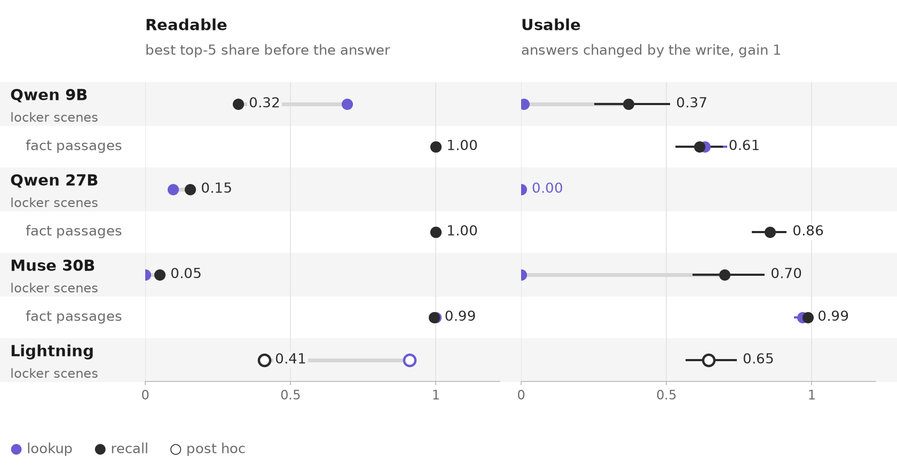
*Per model and dataset: the best top-5 share of the reader's answer through the lens before the answer layer (readable), and answers changed by writing it there at gain 1 (usable), lookup and recall. whiskers: 95% intervals over bridge items; Lightning ○; –: not run, not tested or under 30 switches.*

- **Rule, fixed in advance.** "“Readable”: the answer word in the lens top-5 on ≥ 0.5 of items at some layer before the answer layer. “Usable”: writing its directions changes the answer on ≥ 0.3 of items with the random control ≤ 0.10. Report the four combinations per reader, per dataset." No prediction.

- **Result.** (the combination; answers changed by the write at one / two times a real change's size)

  | | 9B | 27B | Muse | Lightning | 122B |
  |---|---|---|---|---|---|
  | ours, lookup | **readable, not usable**: 0.01 [0.00, 0.02] / 0.01 [0.00, 0.02]<!-- src: results/x52_answer_map/x52-20261029T004559Z/verdict.md \| best T L24 0.69 :: 0.01 [0.00, 0.02] / 0.01 [0.00, 0.02] --> | **neither**: 0.00 [0.00, 0.00] / 0.00 [0.00, 0.00]<!-- src: results/x52_answer_map/x52-20261029T004559Z/verdict.md \| best T L0 0.10 :: 0.00 [0.00, 0.00] / 0.00 [0.00, 0.00] --> (cannot tell) | **neither**: 0.00 [0.00, 0.00] / 0.00 [0.00, 0.00]<!-- src: results/x52_answer_map/x52-20261029T004559Z/verdict.md \| best T L34 0.00 :: 0.00 [0.00, 0.00] / 0.00 [0.00, 0.00] --> (cannot tell) | **readable, not usable**: 0.01 [0.00, 0.02] / 0.10 [0.05, 0.14]<!-- src: results/x52_answer_map/x52cov-20261029T005848Z/verdict.md \| best T L38 0.91 :: 0.01 [0.00, 0.02] / 0.10 [0.05, 0.14] --> | **readable, not usable<!-- src: results/x52_answer_map/x52cov-20261030T045919Z/verdict.md \| qwen3.5-122b-a10b :: main :: lookup :: readable, not usable -->**: best top-5 0.95 at the last token, L44 |
  | ours, recall | **usable, not readable**: 0.37 [0.25, 0.51] / 0.03 [0.01, 0.06]<!-- src: results/x52_answer_map/x52-20261029T004559Z/verdict.md \| best T L28 0.32 :: 0.37 [0.25, 0.51] / 0.03 [0.01, 0.06] --> | **neither**: 0.08 [0.04, 0.14] / 0.20 [0.12, 0.31]<!-- src: results/x52_answer_map/x52-20261029T004559Z/verdict.md \| best T L46 0.15 :: 0.08 [0.04, 0.14] / 0.20 [0.12, 0.31] --> | **usable, not readable**: 0.70 [0.59, 0.84] / 0.09 [0.03, 0.15]<!-- src: results/x52_answer_map/x52-20261029T004559Z/verdict.md \| best T L36 0.05 :: 0.70 [0.59, 0.84] / 0.09 [0.03, 0.15] --> | **usable, not readable**: 0.65 [0.57, 0.74] / 0.01 [0.00, 0.03]<!-- src: results/x52_answer_map/x52cov-20261029T005848Z/verdict.md \| best T L46 0.41 :: 0.65 [0.57, 0.74] / 0.01 [0.00, 0.03] --> | **usable, not readable<!-- src: results/x52_answer_map/x52cov-20261030T045919Z/verdict.md \| qwen3.5-122b-a10b :: main :: recall :: usable, not readable -->** |
  | Zach's described, lookup | **readable and usable**: 0.63 [0.55, 0.72] / 0.55 [0.46, 0.64]<!-- src: results/x52_answer_map/x52-20261029T004559Z/verdict.md \| ['E', 10] :: 0.63 [0.55, 0.72] / 0.55 [0.46, 0.64] --> | **readable and usable**: 0.17 [0.11, 0.23] / 0.80 [0.73, 0.86]<!-- src: results/x52_answer_map/x52-20261029T004559Z/verdict.md \| best T L62 1.00 :: 0.17 [0.11, 0.23] / 0.80 [0.73, 0.86] --> | **readable and usable**: 0.97 [0.94, 0.99] / 0.92 [0.87, 0.96]<!-- src: results/x52_answer_map/x52-20261029T004559Z/verdict.md \| best T L48 1.00 :: 0.97 [0.94, 0.99] / 0.92 [0.87, 0.96] --> | read pending | – |
  | Zach's described, recall | **readable and usable**: 0.61 [0.53, 0.69] / 0.55 [0.46, 0.64]<!-- src: results/x52_answer_map/x52-20261029T004559Z/verdict.md \| ['E', 16] :: 0.61 [0.53, 0.69] / 0.55 [0.46, 0.64] --> | **readable and usable**: 0.86 [0.79, 0.91] / 0.84 [0.78, 0.90]<!-- src: results/x52_answer_map/x52-20261029T004559Z/verdict.md \| best T L60 1.00 :: 0.86 [0.79, 0.91] / 0.84 [0.78, 0.90] --> | **readable and usable**: 0.99 [0.97, 1.00] / 0.85 [0.79, 0.91]<!-- src: results/x52_answer_map/x52-20261029T004559Z/verdict.md \| best T L48 0.99 :: 0.99 [0.97, 1.00] / 0.85 [0.79, 0.91] --> | read pending | – |

  The recall's write at twice a real change's size, what the model outputs (a CPU check after the data, descriptive; results/x52_answer_map/x52_write2x-20261029T074907Z/write2x.md): the table counts the changed prompt's answer token, but at twice the size the recall's top token is mostly one of the written answer word's own tokens ("Four", "Six", ...), on 0.76<!-- src: results/x52_answer_map/x52_write2x-20261029T074907Z/write2x.md | 'Four' 35 :: 0.76 --> / 0.84<!-- src: results/x52_answer_map/x52_write2x-20261029T074907Z/write2x.md | 'Four' 39 :: 0.84 --> / 0.96<!-- src: results/x52_answer_map/x52_write2x-20261029T074907Z/write2x.md | 'Four' 40 :: 0.96 --> of items (9B / Muse / Lightning); the changed prompt's answer token on 0.03<!-- src: results/x52_answer_map/x52_write2x-20261029T074907Z/write2x.md | 'Four' 35 :: 0.03 --> / 0.09<!-- src: results/x52_answer_map/x52_write2x-20261029T074907Z/write2x.md | 'Four' 39 :: 0.09 --> / 0.01<!-- src: results/x52_answer_map/x52_write2x-20261029T074907Z/write2x.md | 'Four' 40 :: 0.01 -->, the original answer on 0.04<!-- src: results/x52_answer_map/x52_write2x-20261029T074907Z/write2x.md | 'Four' 35 :: 0.04 --> / 0.03<!-- src: results/x52_answer_map/x52_write2x-20261029T074907Z/write2x.md | 'Four' 39 :: 0.03 --> / 0.00<!-- src: results/x52_answer_map/x52_write2x-20261029T074907Z/write2x.md | 'Four' 40 :: 0.00 -->. The 27B differs: its top token stays the original answer on 0.74<!-- src: results/x52_answer_map/x52_write2x-20261029T074907Z/write2x.md | recall | ans2 | 200 | 0.20 | 0.74 :: 0.74 -->.

- **Read.**
  - On Zach's described passages the answer word is readable and writing it changes the answer, for both readers on all three models.
  - On our scenes the recall's answer is never readable before the answer layer, yet writing it at the last token moves the 9B's, Muse's and Lightning's recall; the lookup's is readable only on the 9B and Lightning, where writing it moves a tenth of answers or fewer.
- **Caveats.**
  - The 27B's and Muse's lookup cells on our scenes were written where nothing was readable and where the whole change itself switches nothing, so their "not usable" cannot tell (see Flagged for Dan).
  - Only the most readable cell was written; writing at the most readable cell other than the last token waits for Dan.
  - The output classes at twice the size are a CPU check read after the data; B stays out of the README (Dan).

## Part II. Identity: which item the lookup reads

### Does the lookup's identity route run outside the lens, or in lens directions beyond the recall's 25? (identity route outside the lens, 47.1; Lightning's coverage run 29 Oct) 

`in README` *Used in: README Part II card "Does the lookup's identity route run outside the lens?".*

- **Question.** The lookup barely needs the lens part's 25 directions; does its identity route sit in the next 75 lens directions, or outside the lens altogether?
- **Why we asked.** On the 27B, taking out 100 lens directions cut identity answers far more than a random part, so "outside the lens" might only mean "outside the recall's 25".
- **Data.** Routes scenes (another item moved), 300 per model, for identity answers; the main test, 200 per model, for the readers' switches.
- **Method.** The change's 100 best lens directions in order; directions 1-25, 26-100 or all 100 taken out at the bridge word at L, each against a random part of the same share.

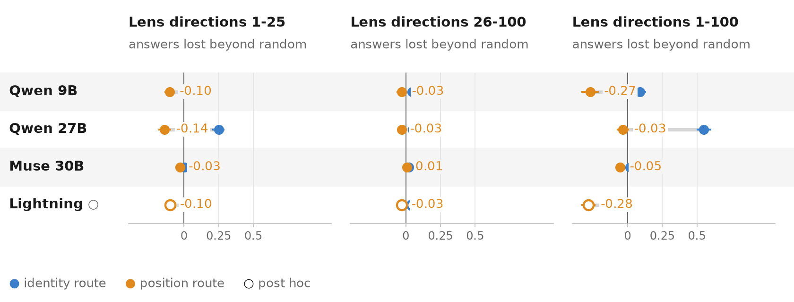
*Answers blocked beyond random on each route without lens directions 1-25, 26-100 and 1-100. whiskers: 95% intervals over bridge items; Lightning ○; –: not run, not tested or under 30 switches.*

- **Rule, fixed in advance.** "(a) "the lookup's identity route sits in lens atoms beyond the recall's 25": without 26-100, identity answers fall >= 0.30 beyond the random part (paired CI excluding 0) and the recall's extra drop without 26-100 is <= 0.10, on >= 2 of 3 models; (b) "continuum": both readers has >= 0.20 blocked beyond random without 26-100; (c) "outside the lens": without 26-100, identity answers fall < 0.10 beyond random." Lightning: a coverage run on this rule, no prediction.

- **Result.**

  | | 9B | 27B | Muse | Lightning | 122B |
  |---|---|---|---|---|---|
  | identity answers blocked without lens directions 1-25, beyond random | 0.06 [0.02, 0.09]<!-- src: results/x47_atoms/x47_1-20261028T113101Z/x47_1.md \| qwen3.5-9b :: 1-25 :: 0.06 [0.02, 0.09] --> | 0.25 [0.21, 0.29]<!-- src: results/x47_atoms/x47_1-20261028T113101Z/x47_1.md \| qwen3.6-27b :: 1-25 :: 0.25 [0.21, 0.29] --> | 0.00 [-0.02, 0.02]<!-- src: results/x47_atoms/x47_1-20261028T113101Z/x47_1.md \| muse-glimmer-30b :: 1-25 :: 0.00 [-0.02, 0.02] --> | 0.04 [0.01, 0.06]<!-- src: results/x47_atoms/x52_atoms47-20261029T011717Z/x47_1.md \| nemotron-3.5-lightning :: 1-25 :: 0.04 [0.01, 0.06] --> | not tested (routes gate: the recall reads 0.797<!-- src: results/x6_routes/qwen35_122b_routes_x47_1/gate.json \| "PM": 0.7971428571428572 :: 0.797 --> < 0.80) |
  | the same without directions 26-100 | 0.05 [0.02, 0.08]<!-- src: results/x47_atoms/x47_1-20261028T113101Z/x47_1.md \| qwen3.5-9b :: 26-100 :: 0.05 [0.02, 0.08] --> | 0.05 [0.03, 0.08]<!-- src: results/x47_atoms/x47_1-20261028T113101Z/x47_1.md \| qwen3.6-27b :: 26-100 :: 0.05 [0.03, 0.08] --> | 0.02 [-0.00, 0.04]<!-- src: results/x47_atoms/x47_1-20261028T113101Z/x47_1.md \| muse-glimmer-30b :: 26-100 :: 0.02 [-0.00, 0.04] --> | 0.05 [0.01, 0.08]<!-- src: results/x47_atoms/x52_atoms47-20261029T011717Z/x47_1.md \| nemotron-3.5-lightning :: 26-100 :: 0.05 [0.01, 0.08] --> | |
  | the same without directions 1-100 | 0.09 [0.05, 0.13]<!-- src: results/x47_atoms/x47_1-20261028T113101Z/x47_1.md \| qwen3.5-9b :: 1-100 :: 0.09 [0.05, 0.13] --> | 0.55 [0.50, 0.60]<!-- src: results/x47_atoms/x47_1-20261028T113101Z/x47_1.md \| qwen3.6-27b :: 1-100 :: 0.55 [0.50, 0.60] --> | 0.02 [0.00, 0.03]<!-- src: results/x47_atoms/x47_1-20261028T113101Z/x47_1.md \| muse-glimmer-30b :: 1-100 :: 0.02 [0.00, 0.03] --> | -0.08 [-0.12, -0.04]<!-- src: results/x47_atoms/x52_atoms47-20261029T011717Z/x47_1.md \| nemotron-3.5-lightning :: 1-100 :: -0.08 [-0.12, -0.04] --> | |
  | recall: switches blocked without 26-100, beyond random (main test) | 0.03 [0.00, 0.06]<!-- src: results/x47_atoms/x47_1-20261028T113101Z/x47_1.md \| qwen35_9b_x47_1_main :: 0.03 [0.00, 0.06] --> | 0.05 [0.01, 0.10]<!-- src: results/x47_atoms/x47_1-20261028T113101Z/x47_1.md \| x47_1_main_27b :: 0.05 [0.01, 0.10] --> | 0.01 [-0.05, 0.08]<!-- src: results/x47_atoms/x47_1-20261028T113101Z/x47_1.md \| muse30_x47_1_main :: 0.01 [-0.05, 0.08] --> | 0.01 [-0.02, 0.04]<!-- src: results/x47_atoms/x52_atoms47-20261029T011717Z/x47_1.md \| nem35l_x52_x47_1_main :: 0.01 [-0.02, 0.04] --> | – |
  | the rule's label | **(c) outside the lens<!-- src: results/x47_atoms/x47_1-20261028T113101Z/x47_1.md \| qwen35_9b_x47_1_main :: (c) outside the lens -->** | **(c) outside the lens<!-- src: results/x47_atoms/x47_1-20261028T113101Z/x47_1.md \| x47_1_main_27b :: (c) outside the lens -->** | **(c) outside the lens<!-- src: results/x47_atoms/x47_1-20261028T113101Z/x47_1.md \| muse30_x47_1_main :: (c) outside the lens -->** | **(c) outside the lens<!-- src: results/x47_atoms/x52_atoms47-20261029T011717Z/x47_1.md \| nem35l_x52_x47_1_main :: (c) outside the lens -->** (no prediction) | not tested (gate) |

- **Read.**
  - On all four models the lookup's identity answers survive taking out lens directions 26-100 (under 0.10 beyond random): its identity route runs outside the lens, not in the lens beyond the recall's 25.
  - Only the 27B drops identity answers to directions 1-25 or to all 100 (redundant copies); on Lightning taking out all 100 costs less than a random part of their share.
- **Caveats.**
  - The 122B (coverage, 30 Oct): the routes part not tested at its gate; on the main test without lens directions 26-100 its recall is blocked at 0.00 [-0.03, 0.03]<!-- src: results/x0_necessity/qwen35_122b_x47_1_main/verdict-20261029T212308Z/verdict.md | jpp26_100 :: PM :: 0.00 [-0.03, 0.03] --> and its lookup -0.02 [-0.09, 0.04]<!-- src: results/x0_necessity/qwen35_122b_x47_1_main/verdict-20261029T212308Z/verdict.md | jpp26_100 :: PP :: -0.02 [-0.09, 0.04] --> beyond random (both around the lens part; descriptive).
  - Lightning's verdict prints "(a) for the batch: does not hold (0 of 1 models; at least 2 needed)": that applies the across-models clause to one model and is not a result; the per-model label is the result.
  - Identity is read on routes scenes, the recall's switches on the main test: two scene sets.

### Which route does the lookup take, and does the address carry the position route? (routes test; Lightning's coverage run opened 29 Oct 01:47) 

`in README` `below gate: 122B` *Used in: README Part II card "Which route does the lookup take: the item's identity, its locker's position, or the number?"; README Part III card "Can the address be read, removed, added and swapped?" (removing and adding the address).*

- **Question.** When another item's locker sentence moves and takes a new number, does the lookup follow the item's identity, its locker's position, or the number, and is the position route carried by the address?
- **Why we asked.** The conflict test says the lookup follows the rest of the bridge word; the routes test says what in it the lookup reads.
- **Data.** Routes scenes, 300 per model (Lightning at L14, its gate chosen after the 60-scene pre-check was seen, ○).
- **Method.** The change from a prompt where another item's locker sentence moved and took a new number; each route predicts a different locker. Arms: the whole change; without the address, against without a random part of its share; the address added by itself, against a random part. A sanity swap (two picks swap, no move) first.

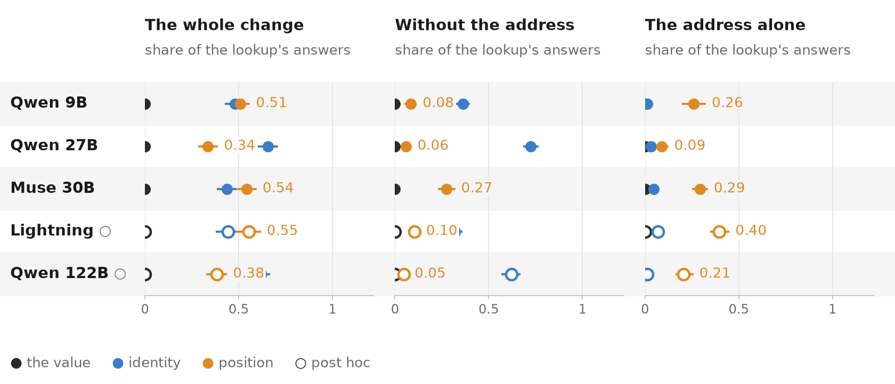
*Shares of the lookup's answers by route when another item moves: the whole change, without the address, and the address alone. whiskers: 95% intervals over bridge items; Lightning ○; –: not run, not tested or under 30 switches; the 122B ○ (gate lowered to 0.75 post hoc).*

- **Rule, fixed in advance.** "A route counts as used if its share is >= 0.20 with lower CI >= 0.10." The sanity swap must reproduce the one-pick lookup switch rate within 0.10; Lightning has no one-pick reference, so it takes Muse's rule (switch rate >= 0.50).

- **Result.** (another item moved)

  | | 9B | 27B | Muse | Lightning | 122B |
  |---|---|---|---|---|---|
  | whole change: identity | 0.48 [0.43, 0.53]<!-- src: results/x6_routes/qwen35_9b_x6_routes/verdict-20261025T104535Z/verdict.md \| 0.51 [0.46, 0.56] :: 0.48 [0.43, 0.53] --> | 0.66 [0.60, 0.71]<!-- src: results/x6_routes/x6_routes_27b/verdict-20261025T105901Z/verdict.md \| 0.34 [0.28, 0.39] :: 0.66 [0.60, 0.71] --> | 0.44 [0.38, 0.49]<!-- src: results/x6_routes/muse30b_x6_routes/verdict-20261026T004455Z/verdict.md \| 0.54 [0.49, 0.60] :: 0.44 [0.38, 0.49] --> | 0.44 [0.38, 0.51]<!-- src: results/x6_routes/nem35l_x52_routes/verdict-20261029T004324Z/verdict.md \| 0.55 [0.49, 0.62] :: 0.44 [0.38, 0.51] --> | ○ 0.61 [0.56, 0.67]<!-- src: results/x6_routes/qwen35_122b_x6_routes_g75/verdict-20261025T134214Z/verdict.md \| C2 :: whole :: 300 :: 0.61 [0.56, 0.67] --> |
  | whole change: position | 0.51 [0.46, 0.56]<!-- src: results/x6_routes/qwen35_9b_x6_routes/verdict-20261025T104535Z/verdict.md \| 0.48 [0.43, 0.53] :: 0.51 [0.46, 0.56] --> | 0.34 [0.28, 0.39]<!-- src: results/x6_routes/x6_routes_27b/verdict-20261025T105901Z/verdict.md \| 0.66 [0.60, 0.71] :: 0.34 [0.28, 0.39] --> | 0.54 [0.49, 0.60]<!-- src: results/x6_routes/muse30b_x6_routes/verdict-20261026T004455Z/verdict.md \| 0.44 [0.38, 0.49] :: 0.54 [0.49, 0.60] --> | 0.55 [0.49, 0.62]<!-- src: results/x6_routes/nem35l_x52_routes/verdict-20261029T004324Z/verdict.md \| 0.44 [0.38, 0.51] :: 0.55 [0.49, 0.62] --> | ○ 0.38 [0.33, 0.44]<!-- src: results/x6_routes/qwen35_122b_x6_routes_g75/verdict-20261025T134214Z/verdict.md \| C2 :: whole :: 300 :: 0.38 [0.33, 0.44] --> |
  | position without the address | 0.08 [0.05, 0.12]<!-- src: results/x6_routes/qwen35_9b_x6_routes/verdict-20261025T104535Z/verdict.md \| 0.55 [0.50, 0.61] :: 0.08 [0.05, 0.12] --> | 0.06 [0.03, 0.09]<!-- src: results/x6_routes/x6_routes_27b/verdict-20261025T105901Z/verdict.md \| 0.21 [0.18, 0.25] :: 0.06 [0.03, 0.09] --> | 0.27 [0.23, 0.32]<!-- src: results/x6_routes/muse30b_x6_routes/verdict-20261026T004455Z/verdict.md \| 0.29 [0.25, 0.35] :: 0.27 [0.23, 0.32] --> | 0.10 [0.07, 0.14]<!-- src: results/x6_routes/nem35l_x52_routes/verdict-20261029T004324Z/verdict.md \| 0.58 [0.53, 0.64] :: 0.10 [0.07, 0.14] --> | ○ 0.05 [0.02, 0.07]<!-- src: results/x6_routes/qwen35_122b_x6_routes_g75/verdict-20261025T134214Z/verdict.md \| C2 :: no_alf :: 300 :: 0.05 [0.02, 0.07] --> |
  | the same without a random part | 0.54 [0.49, 0.59]<!-- src: results/x6_routes/qwen35_9b_x6_routes/verdict-20261025T104535Z/verdict.md \| 0.06 [0.03, 0.08] :: 0.54 [0.49, 0.59] --> | 0.25 [0.19, 0.31]<!-- src: results/x6_routes/x6_routes_27b/verdict-20261025T105901Z/verdict.md \| 0.70 [0.64, 0.76] :: 0.25 [0.19, 0.31] --> | 0.55 [0.50, 0.60]<!-- src: results/x6_routes/muse30b_x6_routes/verdict-20261026T004455Z/verdict.md \| 0.41 [0.36, 0.46] :: 0.55 [0.50, 0.60] --> | 0.56 [0.49, 0.63]<!-- src: results/x6_routes/nem35l_x52_routes/verdict-20261029T004324Z/verdict.md \| 0.42 [0.35, 0.48] :: 0.56 [0.49, 0.63] --> | ○ 0.36 [0.31, 0.41]<!-- src: results/x6_routes/qwen35_122b_x6_routes_g75/verdict-20261025T134214Z/verdict.md \| C2 :: no_alf_rand :: 300 :: 0.36 [0.31, 0.41] --> |
  | position, the address alone | 0.26 [0.20, 0.32]<!-- src: results/x6_routes/qwen35_9b_x6_routes_keeponly/verdict-20261025T152603Z/verdict.md \| 0.72 [0.65, 0.78] :: 0.26 [0.20, 0.32] --> | 0.09 [0.06, 0.12]<!-- src: results/x6_routes/x6_routes_keeponly_27b/verdict-20261025T153505Z/verdict.md \| 0.88 [0.84, 0.91] :: 0.09 [0.06, 0.12] --> | 0.29 [0.25, 0.34]<!-- src: results/x6_routes/muse30b_x6_routes/verdict-20261026T004455Z/verdict.md \| 0.66 [0.61, 0.71] :: 0.29 [0.25, 0.34] --> | 0.40 [0.35, 0.45]<!-- src: results/x6_routes/nem35l_x52_routes/verdict-20261029T004324Z/verdict.md \| 0.53 [0.48, 0.58] :: 0.40 [0.35, 0.45] --> | ○ 0.21 [0.16, 0.26]<!-- src: results/x6_routes/qwen35_122b_x6_routes_keeponly_g75/verdict-20261025T202506Z/verdict.md \| C2 :: keep_alf :: 300 :: 0.21 [0.16, 0.26] --> |

  Lightning's sanity swap switches 0.99<!-- src: results/x6_routes/nem35l_x52_routes/verdict-20261029T004324Z/verdict.md \| | C0 | PP | jpp | 300 | :: 0.99 --> of lookups (rule: at least 0.50); removing the lens part there costs the lookup -0.00 [-0.02, 0.01]<!-- src: results/x6_routes/nem35l_x52_routes/verdict-20261029T004324Z/verdict.md \| | C0 | PP | jpp | 300 | 0.99 | :: -0.00 [-0.02, 0.01] --> beyond random, removing the address 0.54 [0.48, 0.61]<!-- src: results/x6_routes/nem35l_x52_routes/verdict-20261029T004324Z/verdict.md \| | C0 | PP | alf | 300 | 0.99 | :: 0.54 [0.48, 0.61] -->; the value: 0.00 on every model.

- **Read.**
  - On all four models the lookup answers by the item's identity or its locker's position, never by the new number; removing the address takes the position route away beyond a random part of its share.
- **Caveats.**
  - The 122B (FP8; MoE, ~10B active): not tested (gate 0.797<!-- src: results/x6_routes/qwen35_122b_x6_routes_c0/gate.json \| "PM" :: 0.797 --> < 0.80) on the routes scenes; its g75 runs lowered the gate to 0.75 after the data (the README's °): below gate, exploratory, hollow ○, never in claims or grades. Gates just under 0.80 stay not tested (Dan, 11:25): on the harder variants the eligible items are the easier ones.
  - Added by itself, the address brings position answers back on the 9B, Muse and Lightning, not on the 27B.
  - Lightning's gate was chosen after the 60-scene pre-check was seen; its sanity swap uses Muse's rule.

### Does the lookup never take the value, in prose, JSON and tables too? (never the value by format, 47.7 (c); Lightning's coverage run 29 Oct) 

`ledger only` `below gate: 9B, Muse, Lightning` *Used in: not in the README (its 12:50 rebuild).*

- **Question.** In varied scenes (prose, JSON, tables) where another item moved and took a new number, does the lookup's answer ever follow the number (the value route)?
- **Why we asked.** On simple scenes the lookup never takes the value; "in any format" needs the formats.
- **Data.** Varied scenes, locker first, question last, per format that passes the gate (the recall right on at least 0.80 of the original prompts); n per cell in the verdicts.
- **Method.** The routes test's whole change at the bridge word at L, per format; the lookup's answer sorted into identity, position, value and original; the per-format refit address taken out against a random part (9B, Muse, Lightning).

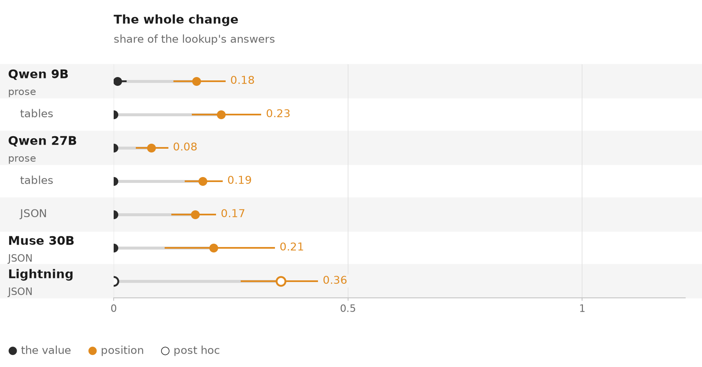
*Per model and format: the lookup's value and position shares under the whole change. whiskers: 95% intervals over bridge items; Lightning ○; –: not run, not tested or under 30 switches; formats that missed their gate are not drawn.*

- **Rule, fixed in advance.** "never the value generalizes if value <= 0.05 in every format on every model; a position route in JSON / table if the position share >= 0.2 and the refit pointer's removal cuts it >= 0.3 beyond random." Lightning: a coverage run on this rule, no prediction.

- **Result.**

  | | 9B | 27B | Muse | Lightning | 122B |
  |---|---|---|---|---|---|
  | value share, prose (bar <= 0.05) | 0.01 [0.00, 0.03]<!-- src: results/x47_value/x47_7c-20261028T123632Z/x47_7c.md \| qwen3.5-9b :: prose :: 119 :: 0.01 [0.00, 0.03] --> | 0.00 [0.00, 0.00]<!-- src: results/x47_value/x47_7c-20261028T123632Z/x47_7c.md \| qwen3.6-27b :: prose :: 300 :: 0.00 [0.00, 0.00] --> | not tested (gate 0.74<!-- src: results/x47_value/x47_7c-20261028T123632Z/x47_7c.md \| muse-glimmer-30b :: prose :: 0.74 --> < 0.80) | not tested (gate 0.786<!-- src: results/x47_value/x52_valuec-20261029T040037Z/x47_7c.md \| nemotron-3.5-lightning :: prose :: 0.786 --> < 0.80) | not run |
  | value share, JSON (bar <= 0.05) | not tested (gate 0.7857<!-- src: results/x47_value/x47_7c-20261028T123632Z/x47_7c.md \| qwen3.5-9b :: json :: 0.7857 --> < 0.80) | 0.00 [0.00, 0.00]<!-- src: results/x47_value/x47_7c-20261028T123632Z/x47_7c.md \| qwen3.6-27b :: json :: 155 :: 0.00 [0.00, 0.00] --> | 0.00 [0.00, 0.00]<!-- src: results/x47_value/x47_7c-20261028T123632Z/x47_7c.md \| muse-glimmer-30b :: json :: 75 :: 0.00 [0.00, 0.00] --> | 0.00 [0.00, 0.00]<!-- src: results/x47_value/x52_valuec-20261029T040037Z/x47_7c.md \| nemotron-3.5-lightning :: json :: 56 :: 0.00 [0.00, 0.00] --> | |
  | value share, table (bar <= 0.05) | 0.00 [0.00, 0.00]<!-- src: results/x47_value/x47_7c-20261028T123632Z/x47_7c.md \| qwen3.5-9b :: table :: 118 :: 0.00 [0.00, 0.00] --> | 0.00 [0.00, 0.00]<!-- src: results/x47_value/x47_7c-20261028T123632Z/x47_7c.md \| qwen3.6-27b :: table :: 300 :: 0.00 [0.00, 0.00] --> | not tested (gate 0.776978<!-- src: results/x47_value/x47_7c-20261028T123632Z/x47_7c.md \| muse-glimmer-30b :: table :: 0.776978 --> < 0.80) | not tested (gate 0.788<!-- src: results/x47_value/x52_valuec-20261029T040037Z/x47_7c.md \| nemotron-3.5-lightning :: table :: 0.788 --> < 0.80) | |
  | the verdict | **incomplete<!-- src: results/x47_value/x47_7c-20261028T123632Z/x47_7c.md \| Verdict :: incomplete -->** | **incomplete<!-- src: results/x47_value/x47_7c-20261028T123632Z/x47_7c.md \| Verdict :: incomplete -->** | **incomplete<!-- src: results/x47_value/x47_7c-20261028T123632Z/x47_7c.md \| Verdict :: incomplete -->** | **incomplete<!-- src: results/x47_value/x52_valuec-20261029T040037Z/x47_7c.md \| Verdict :: incomplete -->** (no prediction) | |

- **Read.**
  - Wherever a format passes the gate, the lookup never takes the value, on all four models; the verdict stays incomplete because some formats fail the gate.
- **Caveats.**
  - The gate reads the recall on question-last prompts: prose and tables fail it on Muse and Lightning, JSON on the 9B.
  - Gates just under 0.80 stay not tested (Dan, 11:25): on the harder variants the eligible items are the easier ones (Muse's and Lightning's table gates).
  - No format shows a position route by the rule: Lightning's JSON position share 0.36 [0.27, 0.44]<!-- src: results/x47_value/x52_valuec-20261029T040037Z/x47_7c.md \| nemotron-3.5-lightning :: json :: 56 :: 0.36 [0.27, 0.44] --> is cut by 0.18 [0.11, 0.26]<!-- src: results/x47_value/x52_valuec-20261029T040037Z/x47_7c.md \| nemotron-3.5-lightning :: json :: 56 :: 0.18 [0.11, 0.26] --> by the refit address, under 0.3.

### Does a learned subspace carry the readers' codes, and is the learned address ours? (51.3, opened 28 Oct 20:46) 

`ledger only` *Used in: README Appendix A, a figure link ("learned subspaces", figures/depth/fig14_learned.png).*

- **Question.** Does a learned (DAS) subspace of at most 128 directions carry the recall's identity switch, where does the lookup's learned subspace lie, and does the learned 4-direction address overlap ours?
- **Why we asked.** Our parts are hand-built (lens directions, slot means); a trained subspace tests them without that choice.
- **Data.** Identity pairs from the main, clean and routes scenes (9B: 514 recall pairs; 27B 374; Muse 300), test entities held out; routes position pairs for the address.
- **Method.** Distributed alignment search: a subspace trained to carry the switch, its own interchange accuracy on test pairs, against a random subspace and a shuffled-target subspace of the same size.

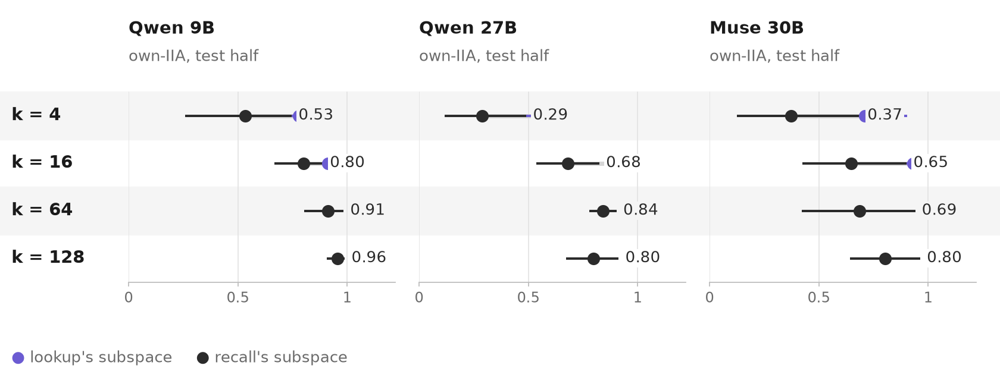
*Per model (columns) and subspace size k (rows): each reader's own-IIA on the test half. Whiskers: 95% intervals.*

- **Rule, fixed in advance.** "Q51.3 (i) 'found' = >= 300 recall pairs and test own-IIA >= 0.5 at some k <= 128; (ii) the lookup subspace (R_lookup at its chosen k) on the test pairs: the share of R R^T Delta inside U, the J++-25 atoms, the W_E-25 atoms and outside their union, each part >= 0.5 named 'mostly' (descriptive; the parts overlap); (iii) U's energy in R_pos at k = 4 = ||R_pos^T U||_F^2 / rank U >= 0.6" (verdict.md, as computed)

- **Result.**

  | | 9B | 27B | Muse | Lightning | 122B |
  |---|---|---|---|---|---|
  | (i) recall, test own-IIA at k = 128 | 0.96 [0.91, 0.99]<!-- src: results/x51_das/verdict-20261028T194630Z/verdict.md \| recall pairs 514 :: 0.96 [0.91, 0.99] --> | 0.80 [0.67, 0.91]<!-- src: results/x51_das/verdict-20261028T194630Z/verdict.md \| recall pairs 374 :: 0.80 [0.67, 0.91] --> | 0.80 [0.64, 0.96]<!-- src: results/x51_das/verdict-20261028T194630Z/verdict.md \| recall pairs 300 :: 0.80 [0.64, 0.96] --> | not run | not run |
  | (ii) the lookup subspace (k = 4) outside our parts | 0.62<!-- src: results/x51_das/verdict-20261028T194630Z/verdict.md \| in U 0.36 :: in outside 0.62 :: 0.62 --> | 0.62<!-- src: results/x51_das/verdict-20261028T194630Z/verdict.md \| U's energy in R_lookup 0.2509 :: 0.62 --> | 0.72<!-- src: results/x51_das/verdict-20261028T194630Z/verdict.md \| in outside 0.72 :: 0.72 --> | | |
  | (iii) our address's energy in the learned address | 0.246<!-- src: results/x51_das/verdict-20261028T194630Z/verdict.md \| overlaps U >= 0.6: no :: 0.246 --> | 0.226<!-- src: results/x51_das/verdict-20261028T194630Z/verdict.md \| overlaps U >= 0.6: no :: 0.226 --> | 0.193<!-- src: results/x51_das/verdict-20261028T194630Z/verdict.md \| overlaps U >= 0.6: no :: 0.193 --> | | |
  | the rule (i) / (ii) / (iii) | found / mostly outside / no | found / mostly outside / no | found / mostly outside / no | | |

- **Read.**
  - A learned subspace carries the recall's identity on all three; the lookup's lies mostly outside our parts, and the learned address holds about a quarter of ours.
- **Caveats.**
  - Few test entities (9 on the 9B's identity pairs).
  - (ii) and (iii) have no interval in the verdict's summary lines.

### Is the item's identity at its locker sentence the code the lookup reads at the bridge word? (53.8, a binding-ID test; the 9B, the 27B and Muse, 29 Oct) 

`ledger only` *Used in: not in the README (its 12:50 rebuild).*

- **Question.** Is the item's identity at its mention in its locker sentence a code the lookup reads at the bridge word: added there, does it send lookups to that item's locker?
- **Why we asked.** The lookup reads an identity code outside the lens part beside the address ([47.1](#t47-1), [routes](#routes)); a binding-ID code would be one vector shared by the item's mention and the bridge word.
- **Data.** Routes scenes without a move, 300 test scenes per model (the 9B at L12, 31 bridge items; the 27B at L32, 32; Muse at L26, 32), every gate passed; the vectors from 300 held-out scenes. Lightning not designed.
- **Method.** At L, the state at item X's mention in its locker sentence minus X's token embedding (mean over the held-out scenes, X fixed by slot), added at the bridge word at 1x and 2x the size of a real identity change; controls: a random vector of the same norm, and Y's version (another item's mention). Read: lookups sent to X's locker. Beside (Dan 12:10, before any run): a centered arm, each slot's vector minus the mean over slots, same doses and controls; and (Dan 13:15, CPU) how much of each centered slot vector lies in the address U.

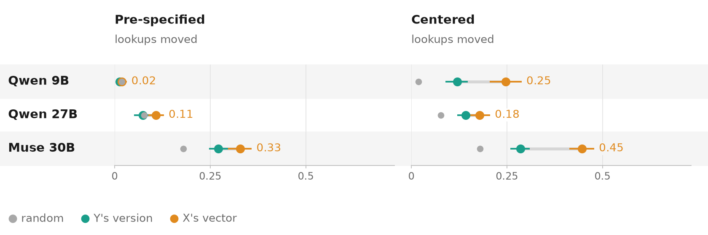
*Lookups moved by X's vector, Y's version and a random vector (grey), with the pre-specified and the centered code. Whiskers: 95% intervals.*

- **Rule, fixed in advance.** "Rule: "a shared identity code" if X's share minus random >= 0.25 at 2x and minus Y's version >= 0.15; "no" if <= 0.05; else in between." (jobs/c3/batch53.yaml, critic_1125 item 6, Dan 11:25; no prediction) The centered arm (decisions_1210b item 1, Dan 12:10, before any run): "the same rule thresholds reported for it beside"; the headline stays the uncentered arm's (Dan 13:15).

- **Result.**

  | | 9B | 27B | Muse | Lightning | 122B |
  |---|---|---|---|---|---|
  | pre-specified (uncentered), at 2x: X's locker under X's vector / Y's version / random | 0.02 [0.01, 0.03]<!-- src: results/x53_bindid/x53_bindid-20261029T122650Z/verdict.md \| 600 (300 scenes, 31 items) :: 0.00 [-0.00, 0.01] :: 0.02 [0.01, 0.03] --> / 0.01 [0.01, 0.02]<!-- src: results/x53_bindid/x53_bindid-20261029T122650Z/verdict.md \| 600 (300 scenes, 31 items) :: 0.00 [-0.00, 0.01] :: 0.01 [0.01, 0.02] --> / 0.02 [0.01, 0.03]<!-- src: results/x53_bindid/x53_bindid-20261029T122650Z/verdict.md \| 600 (300 scenes, 31 items) :: 0.00 [-0.00, 0.01] :: 0.02 [0.01, 0.03] --> | 0.11 [0.09, 0.13]<!-- src: results/x53_bindid/x53_bindid-20261029T122650Z/verdict.md \| 27B :: 0.04 [0.02, 0.05] :: 0.11 [0.09, 0.13] --> / 0.07 [0.05, 0.10]<!-- src: results/x53_bindid/x53_bindid-20261029T122650Z/verdict.md \| 27B :: 0.04 [0.02, 0.05] :: 0.07 [0.05, 0.10] --> / 0.08 [0.06, 0.09]<!-- src: results/x53_bindid/x53_bindid-20261029T122650Z/verdict.md \| 27B :: 0.04 [0.02, 0.05] :: 0.08 [0.06, 0.09] --> | 0.33 [0.30, 0.36]<!-- src: results/x53_bindid/x53_bindid-20261029T122650Z/verdict.md \| 600 (300 scenes, 32 items) :: 0.06 [0.03, 0.08] :: 0.33 [0.30, 0.36] --> / 0.27 [0.25, 0.30]<!-- src: results/x53_bindid/x53_bindid-20261029T122650Z/verdict.md \| 600 (300 scenes, 32 items) :: 0.06 [0.03, 0.08] :: 0.27 [0.25, 0.30] --> / 0.18 [0.16, 0.20]<!-- src: results/x53_bindid/x53_bindid-20261029T122650Z/verdict.md \| 600 (300 scenes, 32 items) :: 0.06 [0.03, 0.08] :: 0.18 [0.16, 0.20] --> | not designed | not run |
  | the same: X minus random / X minus Y | 0.00 [-0.01, 0.01]<!-- src: results/x53_bindid/x53_bindid-20261029T122650Z/verdict.md \| 600 (300 scenes, 31 items) :: 0.00 [-0.00, 0.01] :: 0.00 [-0.01, 0.01] --> / 0.00 [-0.00, 0.01]<!-- src: results/x53_bindid/x53_bindid-20261029T122650Z/verdict.md \| 600 (300 scenes, 31 items) :: 0.00 [-0.00, 0.01] :: 0.00 [-0.00, 0.01] --> | 0.03 [0.01, 0.05]<!-- src: results/x53_bindid/x53_bindid-20261029T122650Z/verdict.md \| 27B :: 0.04 [0.02, 0.05] :: 0.03 [0.01, 0.05] --> / 0.04 [0.02, 0.05]<!-- src: results/x53_bindid/x53_bindid-20261029T122650Z/verdict.md \| 27B :: 0.04 [0.02, 0.05] :: 0.04 [0.02, 0.05] --> | 0.15 [0.12, 0.18]<!-- src: results/x53_bindid/x53_bindid-20261029T122650Z/verdict.md \| 600 (300 scenes, 32 items) :: 0.06 [0.03, 0.08] :: 0.15 [0.12, 0.18] --> / 0.06 [0.03, 0.08]<!-- src: results/x53_bindid/x53_bindid-20261029T122650Z/verdict.md \| 600 (300 scenes, 32 items) :: 0.06 [0.03, 0.08] :: 0.06 [0.03, 0.08] --> | | |
  | the rule (the headline) | **no<!-- src: results/x53_bindid/x53_bindid-20261029T122650Z/verdict.md \| 600 (300 scenes, 31 items) :: 0.00 [-0.00, 0.01] :: no -->** | **no<!-- src: results/x53_bindid/x53_bindid-20261029T122650Z/verdict.md \| 27B :: 0.04 [0.02, 0.05] :: no -->** | **in between<!-- src: results/x53_bindid/x53_bindid-20261029T122650Z/verdict.md \| 600 (300 scenes, 32 items) :: 0.06 [0.03, 0.08] :: in between -->** | | |
  | centered (beside, Dan 12:10), at 2x: X / Y's version / random | 0.25 [0.21, 0.29]<!-- src: results/x53_bindid/x53_bindid-20261029T122650Z/verdict.md \| 600 (300 scenes, 31 items) :: 0.13 [0.08, 0.17] :: 0.25 [0.21, 0.29] --> / 0.12 [0.09, 0.15]<!-- src: results/x53_bindid/x53_bindid-20261029T122650Z/verdict.md \| 600 (300 scenes, 31 items) :: 0.13 [0.08, 0.17] :: 0.12 [0.09, 0.15] --> / 0.02 [0.01, 0.03]<!-- src: results/x53_bindid/x53_bindid-20261029T122650Z/verdict.md \| 600 (300 scenes, 31 items) :: 0.13 [0.08, 0.17] :: 0.02 [0.01, 0.03] --> | 0.18 [0.15, 0.21]<!-- src: results/x53_bindid/x53_bindid-20261029T122650Z/verdict.md \| 27B :: 0.04 [0.00, 0.07] :: 0.18 [0.15, 0.21] --> / 0.14 [0.12, 0.16]<!-- src: results/x53_bindid/x53_bindid-20261029T122650Z/verdict.md \| 27B :: 0.04 [0.00, 0.07] :: 0.14 [0.12, 0.16] --> / 0.08 [0.06, 0.09]<!-- src: results/x53_bindid/x53_bindid-20261029T122650Z/verdict.md \| 27B :: 0.04 [0.00, 0.07] :: 0.08 [0.06, 0.09] --> | 0.45 [0.41, 0.48]<!-- src: results/x53_bindid/x53_bindid-20261029T122650Z/verdict.md \| 600 (300 scenes, 32 items) :: 0.16 [0.13, 0.19] :: 0.45 [0.41, 0.48] --> / 0.28 [0.26, 0.31]<!-- src: results/x53_bindid/x53_bindid-20261029T122650Z/verdict.md \| 600 (300 scenes, 32 items) :: 0.16 [0.13, 0.19] :: 0.28 [0.26, 0.31] --> / 0.18 [0.16, 0.20]<!-- src: results/x53_bindid/x53_bindid-20261029T122650Z/verdict.md \| 600 (300 scenes, 32 items) :: 0.16 [0.13, 0.19] :: 0.18 [0.16, 0.20] --> | | |
  | the same: X minus random / X minus Y | 0.23 [0.19, 0.27]<!-- src: results/x53_bindid/x53_bindid-20261029T122650Z/verdict.md \| 600 (300 scenes, 31 items) :: 0.13 [0.08, 0.17] :: 0.23 [0.19, 0.27] --> / 0.13 [0.08, 0.17]<!-- src: results/x53_bindid/x53_bindid-20261029T122650Z/verdict.md \| 600 (300 scenes, 31 items) :: 0.13 [0.08, 0.17] :: 0.13 [0.08, 0.17] --> | 0.10 [0.08, 0.13]<!-- src: results/x53_bindid/x53_bindid-20261029T122650Z/verdict.md \| 27B :: 0.04 [0.00, 0.07] :: 0.10 [0.08, 0.13] --> / 0.04 [0.00, 0.07]<!-- src: results/x53_bindid/x53_bindid-20261029T122650Z/verdict.md \| 27B :: 0.04 [0.00, 0.07] :: 0.04 [0.00, 0.07] --> | 0.27 [0.24, 0.29]<!-- src: results/x53_bindid/x53_bindid-20261029T122650Z/verdict.md \| 600 (300 scenes, 32 items) :: 0.16 [0.13, 0.19] :: 0.27 [0.24, 0.29] --> / 0.16 [0.13, 0.19]<!-- src: results/x53_bindid/x53_bindid-20261029T122650Z/verdict.md \| 600 (300 scenes, 32 items) :: 0.16 [0.13, 0.19] :: 0.16 [0.13, 0.19] --> | | |
  | centered, by the same thresholds | in between<!-- src: results/x53_bindid/x53_bindid-20261029T122650Z/verdict.md \| 600 (300 scenes, 31 items) :: 0.13 [0.08, 0.17] :: in between --> | in between<!-- src: results/x53_bindid/x53_bindid-20261029T122650Z/verdict.md \| 27B :: 0.04 [0.00, 0.07] :: in between --> | a shared identity code<!-- src: results/x53_bindid/x53_bindid-20261029T122650Z/verdict.md \| 600 (300 scenes, 32 items) :: 0.16 [0.13, 0.19] :: a shared identity code --> | | |
  | the centered slot vectors in U (Dan 13:15): cos² per slot / a random vector's mean (99th percentile) | 0.0036<!-- src: results/x53_bindid/x53_bindid-20261029T122650Z/verdict.md \| qwen35_9b_x0_probe_v4 :: 4 / 4096 :: 0.0036 --> / 0.0336<!-- src: results/x53_bindid/x53_bindid-20261029T122650Z/verdict.md \| qwen35_9b_x0_probe_v4 :: 4 / 4096 :: 0.0336 --> / 0.0054<!-- src: results/x53_bindid/x53_bindid-20261029T122650Z/verdict.md \| qwen35_9b_x0_probe_v4 :: 4 / 4096 :: 0.0054 --> / 0.00100<!-- src: results/x53_bindid/x53_bindid-20261029T122650Z/verdict.md \| qwen35_9b_x0_probe_v4 :: 4 / 4096 :: 0.00100 --> (0.00330<!-- src: results/x53_bindid/x53_bindid-20261029T122650Z/verdict.md \| qwen35_9b_x0_probe_v4 :: 4 / 4096 :: 0.00330 -->) | 0.0047<!-- src: results/x53_bindid/x53_bindid-20261029T122650Z/verdict.md \| x0_probe_v4_27b :: 4 / 5120 :: 0.0047 --> / 0.0044<!-- src: results/x53_bindid/x53_bindid-20261029T122650Z/verdict.md \| x0_probe_v4_27b :: 4 / 5120 :: 0.0044 --> / 0.0078<!-- src: results/x53_bindid/x53_bindid-20261029T122650Z/verdict.md \| x0_probe_v4_27b :: 4 / 5120 :: 0.0078 --> / 0.00080<!-- src: results/x53_bindid/x53_bindid-20261029T122650Z/verdict.md \| x0_probe_v4_27b :: 4 / 5120 :: 0.00080 --> (0.00257<!-- src: results/x53_bindid/x53_bindid-20261029T122650Z/verdict.md \| x0_probe_v4_27b :: 4 / 5120 :: 0.00257 -->) | 0.0449<!-- src: results/x53_bindid/x53_bindid-20261029T122650Z/verdict.md \| muse30b_x0_probe_v4 :: 4 / 6656 :: 0.0449 --> / 0.0186<!-- src: results/x53_bindid/x53_bindid-20261029T122650Z/verdict.md \| muse30b_x0_probe_v4 :: 4 / 6656 :: 0.0186 --> / 0.0455<!-- src: results/x53_bindid/x53_bindid-20261029T122650Z/verdict.md \| muse30b_x0_probe_v4 :: 4 / 6656 :: 0.0455 --> / 0.00061<!-- src: results/x53_bindid/x53_bindid-20261029T122650Z/verdict.md \| muse30b_x0_probe_v4 :: 4 / 6656 :: 0.00061 --> (0.00197<!-- src: results/x53_bindid/x53_bindid-20261029T122650Z/verdict.md \| muse30b_x0_probe_v4 :: 4 / 6656 :: 0.00197 -->) | | |
  | the raw slot vectors' cosines / the slot-specific part's share of the norm | 0.8656<!-- src: results/x53_bindid/x53_bindid-20261029T122650Z/verdict.md \| - 9B: cosines between slot vectors :: 0.8656 --> to 0.9743<!-- src: results/x53_bindid/x53_bindid-20261029T122650Z/verdict.md \| - 9B: cosines between slot vectors :: 0.9743 --> / 0.178<!-- src: results/x53_bindid/x53_bindid-20261029T122650Z/verdict.md \| 33.65 :: 5.98 :: 0.178 --> to 0.315<!-- src: results/x53_bindid/x53_bindid-20261029T122650Z/verdict.md \| 34.16 :: 10.75 :: 0.315 --> | 0.8554<!-- src: results/x53_bindid/x53_bindid-20261029T122650Z/verdict.md \| - 27B: cosines between slot vectors :: 0.8554 --> to 0.9587<!-- src: results/x53_bindid/x53_bindid-20261029T122650Z/verdict.md \| - 27B: cosines between slot vectors :: 0.9587 --> / 0.206<!-- src: results/x53_bindid/x53_bindid-20261029T122650Z/verdict.md \| 79.42 :: 16.40 :: 0.206 --> to 0.331<!-- src: results/x53_bindid/x53_bindid-20261029T122650Z/verdict.md \| 79.37 :: 26.24 :: 0.331 --> | 0.8169<!-- src: results/x53_bindid/x53_bindid-20261029T122650Z/verdict.md \| - Muse: cosines between slot vectors :: 0.8169 --> to 0.9632<!-- src: results/x53_bindid/x53_bindid-20261029T122650Z/verdict.md \| - Muse: cosines between slot vectors :: 0.9632 --> / 0.196<!-- src: results/x53_bindid/x53_bindid-20261029T122650Z/verdict.md \| 305.67 :: 60.04 :: 0.196 --> to 0.447<!-- src: results/x53_bindid/x53_bindid-20261029T122650Z/verdict.md \| 246.33 :: 110.15 :: 0.447 --> | | |

- **Read.**
  - The pre-specified vectors: no on the 9B and the 27B (about as many lookups to X's locker as a random vector); in between on Muse, where X's vector beats random but Y's version comes close.
  - The slot vectors are nearly parallel on both models: a shared component dominates them. Centered, the slot-specific part sends lookups to X's locker: in between on the 9B and the 27B, a shared identity code by the same thresholds on Muse.
  - The centered slot vectors lie in the address U above a random vector's 99th percentile on every slot of the three models, but at most a few percent of their energy (cos² at most 0.0455 on Muse): "not high" (Dan 18:10, decisions_1810 item 1).
  - In Dan's words (18:10): the centered arm moves lookups in between (X 0.25, Y 0.12, random 0.02; the 9B's cells) and its vector lies mostly outside the address U, consistent with [51.3](#t51-3) (the lookup's code mostly outside U); the uncentered pre-specified arm says no.
- **Caveats.**
  - The centered arm was added by Dan (12:10) before any run; the headline is the uncentered arm.
  - On Muse a random vector alone sends 0.18 [0.16, 0.20]<!-- src: results/x53_bindid/x53_bindid-20261029T122650Z/verdict.md \| 600 (300 scenes, 32 items) :: 0.06 [0.03, 0.08] :: 0.18 [0.16, 0.20] --> of lookups to X's locker at 2x.
  - Whether "the centered arm re-finds the address" (Dan 13:15: "if high") waits for Dan's bar; the cos² are reported as they are.
  - Centered at 2x, the clean answers suffer: the lookup's answer stays unchanged on 0.63 [0.58, 0.69]<!-- src: results/x53_bindid/x53_bindid-20261029T122650Z/verdict.md \| 9B :: ccode_x2 :: 600 :: 0.63 [0.58, 0.69] --> of scenes on the 9B and 0.27 [0.22, 0.32]<!-- src: results/x53_bindid/x53_bindid-20261029T122650Z/verdict.md \| Muse :: ccode_x2 :: 600 :: 0.27 [0.22, 0.32] --> on Muse; on the 27B the lookup keeps it on 0.68 [0.64, 0.71]<!-- src: results/x53_bindid/x53_bindid-20261029T122650Z/verdict.md \| 27B :: ccode_x2 :: 600 :: 0.68 [0.64, 0.71] --> and the recall on 0.98 [0.95, 1.00]<!-- src: results/x53_bindid/x53_bindid-20261029T122650Z/verdict.md \| 27B :: ccode_x2 :: 600 :: 0.98 [0.95, 1.00] -->, where a real identity change sends the lookup to B's locker 0.98 [0.96, 1.00]<!-- src: results/x53_bindid/x53_bindid-20261029T122650Z/verdict.md \| 27B :: whole: lookup sent to B :: 0.98 [0.96, 1.00] -->.
  - Exploratory (batch 53), no prediction; UNVERIFIED.

## Part III. The address: where the item's locker sits

### Is the address readable at the bridge word? (the address probe, x0_probe v4; Lightning's coverage run 29 Oct) 

`in README` *Used in: README Part III card "Can the address be read, removed, added and swapped?" (the probe).*

- **Question.** At the bridge word at L, can a probe read which locker sentence holds the item's locker, beyond what the layout of the scene gives away, and does it read the answer digit itself?
- **Why we asked.** If the bridge word stores an address rather than the answer, the locker sentence should be readable and the digit should not.
- **Data.** Every scene of the topic scenes, split by whether the item's locker sentence comes before or after the asked pick (see the table's n in the verdicts).
- **Method.** Probes on the bridge word's state at L, cross-validated by bridge entity: the locker sentence's place, the answer digit and the bridge's identity; baselines: the majority class, the pick's sentence index, the visible layout.

*The README's address figure; this card is its first column: the probe at the bridge word against the layout-only baseline (grey tick), locker before the pick. whiskers: 95% intervals; Lightning ○; the 122B ○ where its gate was lowered post hoc or lookup-only.*

- **Rule, fixed in advance.** None: descriptive, added after the data (Dan, 24 Oct evening). The reading stated beside: "(b) high in locker-before with (a) at chance -> the word stores an address. Locker-after: the locker sentence follows the word, so the stratum is a control by construction." Lightning: a coverage run, no prediction.

- **Result.**

  | | 9B | 27B | Muse | Lightning | 122B |
  |---|---|---|---|---|---|
  | which locker sentence, locker before the pick (chance 0.20) | 0.97 [0.96, 0.98]<!-- src: results/x0_probe/qwen35_9b_x0_probe_v4/probe-20261024T172340Z/probe.md \| before :: locker sentence :: 758 :: 0.97 [0.96, 0.98] --> | 0.99 [0.98, 1.00]<!-- src: results/x0_probe/x0_probe_v4_27b/probe-20261024T172424Z/probe.md \| before :: locker sentence :: 758 :: 0.99 [0.98, 1.00] --> | 0.97 [0.95, 0.98]<!-- src: results/x0_probe/muse30b_x0_probe_v4/probe-20261026T000115Z/probe.md \| before :: locker sentence :: 657 :: 0.97 [0.95, 0.98] --> | 0.85 [0.81, 0.88]<!-- src: results/x0_probe/nem35l_x52_probe/probe-20261029T002432Z/probe.md \| before :: locker sentence :: 636 :: 0.85 [0.81, 0.88] --> | 0.92 [0.90, 0.94]<!-- src: results/x0_probe/qwen35_122b_x0_probe_v4/probe-20261024T230718Z/probe.md \| before :: locker sentence :: 0.92 [0.90, 0.94] --> |
  | the same from the layout alone (best baseline) | 0.53 [0.50, 0.56]<!-- src: results/x0_probe/qwen35_9b_x0_probe_v4/probe-20261024T172340Z/probe.md \| before :: locker sentence :: 758 :: 0.53 [0.50, 0.56] --> | 0.53 [0.50, 0.56]<!-- src: results/x0_probe/x0_probe_v4_27b/probe-20261024T172424Z/probe.md \| before :: locker sentence :: 758 :: 0.53 [0.50, 0.56] --> | 0.53 [0.49, 0.56]<!-- src: results/x0_probe/muse30b_x0_probe_v4/probe-20261026T000115Z/probe.md \| before :: locker sentence :: 657 :: 0.53 [0.49, 0.56] --> | 0.52 [0.49, 0.54]<!-- src: results/x0_probe/nem35l_x52_probe/probe-20261029T002432Z/probe.md \| before :: locker sentence :: 636 :: 0.52 [0.49, 0.54] --> | 0.53 [0.50, 0.56]<!-- src: results/x0_probe/qwen35_122b_x0_probe_v4/probe-20261024T230718Z/probe.md \| before :: locker sentence :: 0.53 [0.50, 0.56] --> |
  | which locker sentence, locker after the pick (the control) | 0.34 [0.30, 0.37]<!-- src: results/x0_probe/qwen35_9b_x0_probe_v4/probe-20261024T172340Z/probe.md \| after :: locker sentence :: 742 :: 0.34 [0.30, 0.37] --> | 0.34 [0.31, 0.37]<!-- src: results/x0_probe/x0_probe_v4_27b/probe-20261024T172424Z/probe.md \| after :: locker sentence :: 742 :: 0.34 [0.31, 0.37] --> | 0.34 [0.31, 0.37]<!-- src: results/x0_probe/muse30b_x0_probe_v4/probe-20261026T000115Z/probe.md \| after :: locker sentence :: 669 :: 0.34 [0.31, 0.37] --> | 0.36 [0.33, 0.39]<!-- src: results/x0_probe/nem35l_x52_probe/probe-20261029T002432Z/probe.md \| after :: locker sentence :: 658 :: 0.36 [0.33, 0.39] --> | 0.33 [0.31, 0.35]<!-- src: results/x0_probe/qwen35_122b_x0_probe_v4/probe-20261024T230718Z/probe.md \| after :: locker sentence :: 0.33 [0.31, 0.35] --> |
  | the answer digit, locker before (chance 0.11) | 0.27 [0.24, 0.31]<!-- src: results/x0_probe/qwen35_9b_x0_probe_v4/probe-20261024T172340Z/probe.md \| before :: answer digit :: 758 :: 0.27 [0.24, 0.31] --> | 0.40 [0.36, 0.44]<!-- src: results/x0_probe/x0_probe_v4_27b/probe-20261024T172424Z/probe.md \| before :: answer digit :: 758 :: 0.40 [0.36, 0.44] --> | 0.33 [0.28, 0.37]<!-- src: results/x0_probe/muse30b_x0_probe_v4/probe-20261026T000115Z/probe.md \| before :: answer digit :: 657 :: 0.33 [0.28, 0.37] --> | 0.25 [0.21, 0.28]<!-- src: results/x0_probe/nem35l_x52_probe/probe-20261029T002432Z/probe.md \| before :: answer digit :: 636 :: 0.25 [0.21, 0.28] --> | 0.25 [0.21, 0.28]<!-- src: results/x0_probe/qwen35_122b_x0_probe_v4/probe-20261024T230718Z/probe.md \| before :: answer digit :: 0.25 [0.21, 0.28] --> |

- **Read.**
  - The 122B reads the locker sentence at its bridge word too (locker first), near chance with the locker after.
  - With the locker before the pick, the bridge word holds which locker sentence the item's locker sits in, far above the layout baseline, on all four models; with the locker after, it does not (the control). The answer digit itself is read only weakly.
- **Caveats.**
  - Descriptive, chosen after the data.
  - Lightning's probe reads the place less well than the other three.

### Does swapping the address send the lookup to the swapped-in locker? (address swap by dose; Lightning's coverage run opened 29 Oct 01:51) 

`in README` `below gate: 122B` *Used in: README Part III card "Can the address be read, removed, added and swapped?" (the swap).*

- **Question.** Adding the difference between two slots' address codes at the bridge word, does the lookup go to the locker of the slot swapped in, and how much does the recall change with it?
- **Why we asked.** Removing the address stops position answers; a swap tests whether the address is read as a pointer to a place.
- **Data.** Routes scenes without a move, 300 per model, each swapped to two target lockers (600 swaps); Lightning at L14 (gate chosen after the 60-scene pre-check, ○).
- **Method.** At the bridge word at L: the difference of two slot means, at one, two and four times its size; control: a random vector of the same size. Read: the lookup's answer (target locker, original, the third), and whether the recall's answer changes (the collateral).

*The README's address figure; this card is its third column: lookups sent to the swapped-in locker at about a real change's size, against a random vector (grey). whiskers: 95% intervals; Lightning ○; the 122B ○ where its gate was lowered post hoc or lookup-only. The dose curves are in the verdicts.*

- **Rule, fixed in advance.** "at s = 1 the target share minus the random direction's >= 0.15 with lower CI > 0; [...] among writes that move the lookup to another locker target / (target + third) >= 0.80, a model counting only with >= 30 such writes, fewer than two counting = can't tell; [...] target minus random >= 0.10 in each of the 6 (j, k) pairs" (jobs/c3/x8_a_9b.yaml; each over the 9B, the 27B, the 122B and Muse). Lightning: a coverage run on that rule, no prediction.

- **Result.** (all 600 swaps pooled; README E6 quotes the mean over the six slot pairs at s = 2 instead; a random vector sends 0.00 to 0.01 at every dose on every model)

  | | 9B | 27B | Muse | Lightning | 122B |
  |---|---|---|---|---|---|
  | lookups sent to the swapped-in locker, dose 1 | 0.02 [0.01, 0.03]<!-- src: results/x8_write/qwen35_9b_x8_write/verdict-20261026T110254Z/verdict.md \| 0.98 [0.97, 0.99] :: 0.02 [0.01, 0.03] --> | 0.01 [0.00, 0.01]<!-- src: results/x8_write/x8_write_27b/verdict-20261026T125548Z/verdict.md \| 0.99 [0.98, 1.00] :: 0.01 [0.00, 0.01] --> | 0.05 [0.03, 0.07]<!-- src: results/x8_write/muse30b_x8_write/verdict-20261026T141141Z/verdict.md \| 0.94 [0.91, 0.96] :: 0.05 [0.03, 0.07] --> | 0.03 [0.01, 0.04]<!-- src: results/x8_write/nem35l_x52_write/verdict-20261029T005021Z/verdict.md \| 0.96 [0.94, 0.98] :: 0.03 [0.01, 0.04] --> | ○ 0.01 [0.00, 0.01]<!-- src: results/x8_write/qwen35_122b_x8_write_g75/verdict-20261026T125705Z/verdict.md \| write :: 1 :: all :: 600 :: 0.01 [0.00, 0.01] --> |
  | lookups sent to the swapped-in locker, dose 2 | 0.46 [0.42, 0.50]<!-- src: results/x8_write/qwen35_9b_x8_write/verdict-20261026T110254Z/verdict.md \| 0.06 [0.04, 0.08] :: 0.46 [0.42, 0.50] --> | 0.24 [0.20, 0.29]<!-- src: results/x8_write/x8_write_27b/verdict-20261026T125548Z/verdict.md \| 0.71 [0.66, 0.76] :: 0.24 [0.20, 0.29] --> | 0.52 [0.48, 0.55]<!-- src: results/x8_write/muse30b_x8_write/verdict-20261026T141141Z/verdict.md \| 0.38 [0.33, 0.42] :: 0.52 [0.48, 0.55] --> | 0.50 [0.46, 0.54]<!-- src: results/x8_write/nem35l_x52_write/verdict-20261029T005021Z/verdict.md \| 0.43 [0.38, 0.47] :: 0.50 [0.46, 0.54] --> | ○ 0.50 [0.46, 0.54]<!-- src: results/x8_write/qwen35_122b_x8_write_g75/verdict-20261026T125705Z/verdict.md \| write :: 2 :: all :: 600 :: 0.50 [0.46, 0.54] --> |
  | lookups sent to the swapped-in locker, dose 4 | 0.73 [0.70, 0.77]<!-- src: results/x8_write/qwen35_9b_x8_write/verdict-20261026T110254Z/verdict.md \| 0.17 [0.13, 0.21] :: 0.73 [0.70, 0.77] --> | 0.50 [0.47, 0.53]<!-- src: results/x8_write/x8_write_27b/verdict-20261026T125548Z/verdict.md \| 0.37 [0.34, 0.40] :: 0.50 [0.47, 0.53] --> | 0.52 [0.50, 0.54]<!-- src: results/x8_write/muse30b_x8_write/verdict-20261026T141141Z/verdict.md \| 0.23 [0.20, 0.26] :: 0.52 [0.50, 0.54] --> | 0.69 [0.66, 0.71]<!-- src: results/x8_write/nem35l_x52_write/verdict-20261029T005021Z/verdict.md \| 0.25 [0.22, 0.28] :: 0.69 [0.66, 0.71] --> | ○ 0.66 [0.63, 0.69]<!-- src: results/x8_write/qwen35_122b_x8_write_g75/verdict-20261026T125705Z/verdict.md \| write :: 4 :: all :: 600 :: 0.66 [0.63, 0.69] --> |
  | recalls changed by the swap, dose 1 / 2 / 4 | 0.04<!-- src: results/x8_write/qwen35_9b_x8_write/verdict-20261026T110254Z/verdict.md \| 0.02 [0.01, 0.03] :: 0.04 --> / 0.21<!-- src: results/x8_write/qwen35_9b_x8_write/verdict-20261026T110254Z/verdict.md \| 0.46 [0.42, 0.50] :: 0.21 --> / 0.43<!-- src: results/x8_write/qwen35_9b_x8_write/verdict-20261026T110254Z/verdict.md \| 0.73 [0.70, 0.77] :: 0.43 --> | 0.01<!-- src: results/x8_write/x8_write_27b/verdict-20261026T125548Z/verdict.md \| 0.01 [0.00, 0.01] :: 0.01 --> / 0.04<!-- src: results/x8_write/x8_write_27b/verdict-20261026T125548Z/verdict.md \| 0.24 [0.20, 0.29] :: 0.04 --> / 0.11<!-- src: results/x8_write/x8_write_27b/verdict-20261026T125548Z/verdict.md \| 0.50 [0.47, 0.53] :: 0.11 --> | 0.01<!-- src: results/x8_write/muse30b_x8_write/verdict-20261026T141141Z/verdict.md \| 0.05 [0.03, 0.07] :: 0.01 --> / 0.06<!-- src: results/x8_write/muse30b_x8_write/verdict-20261026T141141Z/verdict.md \| 0.52 [0.48, 0.55] :: 0.06 --> / 0.11<!-- src: results/x8_write/muse30b_x8_write/verdict-20261026T141141Z/verdict.md \| 0.52 [0.50, 0.54] :: 0.11 --> | 0.02<!-- src: results/x8_write/nem35l_x52_write/verdict-20261029T005021Z/verdict.md \| 0.03 [0.01, 0.04] :: 0.02 --> / 0.27<!-- src: results/x8_write/nem35l_x52_write/verdict-20261029T005021Z/verdict.md \| 0.50 [0.46, 0.54] :: 0.27 --> / 0.40<!-- src: results/x8_write/nem35l_x52_write/verdict-20261029T005021Z/verdict.md \| 0.69 [0.66, 0.71] :: 0.40 --> | ○ 0.03<!-- src: results/x8_write/qwen35_122b_x8_write_g75/verdict-20261026T125705Z/verdict.md \| write :: 1 :: all :: 600 :: 0.03 --> / 0.23<!-- src: results/x8_write/qwen35_122b_x8_write_g75/verdict-20261026T125705Z/verdict.md \| write :: 2 :: all :: 600 :: 0.23 --> / 0.45<!-- src: results/x8_write/qwen35_122b_x8_write_g75/verdict-20261026T125705Z/verdict.md \| write :: 4 :: all :: 600 :: 0.45 --> |

  What the recall changes to (a CPU check after the data, descriptive; results/x8_write/x52_swaprecall-20261029T080538Z/swaprecall.md): of the recalls the swap changes at dose 2, 0.84<!-- src: results/x8_write/x52_swaprecall-20261029T080538Z/swaprecall.md | write | 2 | 600 | 0.21 | 129 | 0.84 :: 0.84 --> (9B) / 0.85<!-- src: results/x8_write/x52_swaprecall-20261029T080538Z/swaprecall.md | write | 2 | 600 | 0.27 | 164 | 0.85 :: 0.85 --> (Lightning) name the swapped-in item's legs, 0.09<!-- src: results/x8_write/x52_swaprecall-20261029T080538Z/swaprecall.md | 129 | 0.84 | 0.09 :: 0.09 --> / 0.07<!-- src: results/x8_write/x52_swaprecall-20261029T080538Z/swaprecall.md | 164 | 0.85 | 0.07 :: 0.07 --> the third item's, 0.06<!-- src: results/x8_write/x52_swaprecall-20261029T080538Z/swaprecall.md | 129 | 0.84 | 0.09 | 0.06 :: 0.06 --> / 0.08<!-- src: results/x8_write/x52_swaprecall-20261029T080538Z/swaprecall.md | 164 | 0.85 | 0.07 | 0.08 :: 0.08 --> another digit, 0.00<!-- src: results/x8_write/x52_swaprecall-20261029T080538Z/swaprecall.md | 129 | 0.84 | 0.09 | 0.06 | 0.00 :: 0.00 --> / 0.00<!-- src: results/x8_write/x52_swaprecall-20261029T080538Z/swaprecall.md | 164 | 0.85 | 0.07 | 0.08 | 0.00 :: 0.00 --> a non-answer.

- **Read.**
  - At s = 1, the dose fixed in advance, the rule says no on the 9B, 27B and Muse (target minus random 0.02 [0.01, 0.03]<!-- src: results/x8_write/qwen35_9b_x8_write/verdict-20261026T110254Z/verdict.md \| Q44.1: target minus random at s = 1 :: 0.02 [0.01, 0.03] --> / 0.00 [0.00, 0.01]<!-- src: results/x8_write/x8_write_27b/verdict-20261026T125548Z/verdict.md \| Q44.1: target minus random at s = 1 :: 0.00 [0.00, 0.01] --> / 0.05 [0.03, 0.07]<!-- src: results/x8_write/muse30b_x8_write/verdict-20261026T141141Z/verdict.md \| Q44.1: target minus random at s = 1 :: 0.05 [0.03, 0.07] -->; bar 0.15): s = 1 is below a real change's size, a design error (docs/shared/joint_story_draft.md). Lightning's coverage run says no there too (target minus random 0.03 [0.01, 0.04]<!-- src: results/x8_write/nem35l_x52_write/verdict-20261029T005021Z/verdict.md | Q44.1 :: 0.03 [0.01, 0.04] -->).
  - At s = 2 (about a real change's size) and s = 4 the swap sends a quarter to three quarters of lookups to the swapped-in locker on every model, Lightning included, against none for a random vector.
- **Caveats.**
  - The 122B (FP8; MoE, ~10B active): not tested (gate 0.797<!-- src: results/x6_routes/qwen35_122b_x6_routes_c0/gate.json \| "PM" :: 0.797 --> < 0.80) on the routes scenes; its g75 runs lowered the gate to 0.75 after the data (the README's °): below gate, exploratory, hollow ○, never in claims or grades. Gates just under 0.80 stay not tested (Dan, 11:25): on the harder variants the eligible items are the easier ones.
  - The swap also changes the recall's answer, most on the 9B and Lightning (the collateral).
  - Pooled over pairs: some pairs move no lookup at all (Lightning: two of six at dose 2).
  - The recall's collateral is mostly the recall following the swapped-in item (the CPU check above; 9B and Lightning only).

### Does the address survive neutral sentences between the lockers and the picks? (the swap after neutral sentences, 47.16; the 27B's and Lightning's coverage runs 29 Oct) 

`in README` *Used in: README Part III card "Can the address be read, removed, added and swapped?" (the swap with no / 50 neutral sentences: the 9B, 27B, Muse (its rerun r2) and Lightning).*

- **Question.** With 5, 20 or 50 neutral sentences between the lockers and the picks, does the address still carry position answers, and does the address swap still work?
- **Why we asked.** An address read at the bridge word could be a short-range effect of the sentences next to it.
- **Data.** Routes scenes (another item moved), the same base scenes at every distance: 218<!-- src: results/x47_distance/x47_16-20261028T131501Z/x47_16.md \| qwen3.5-9b :: 218 --> / 300<!-- src: results/x47_distance/x52_distance-20261029T023426Z/x47_16.md \| qwen3.6-27b :: 300 --> / 199<!-- src: results/x47_distance/x52_distance-20261029T023426Z/x47_16.md \| nemotron-3.5-lightning :: 199 --> (9B / 27B / Lightning); Muse: its rerun r2 (Dan, 09:05), 279<!-- src: results/x47_distance/x52_distance-20261029T090323Z/x47_16.md \| muse-glimmer-30b :: 0.98 :: 279 --> scenes.
- **Method.** At each distance, at the bridge word at L: the routes test's whole change, and without the address against a random part of its share; the address swap at dose 2 against a random vector of its size; a slot probe beside.

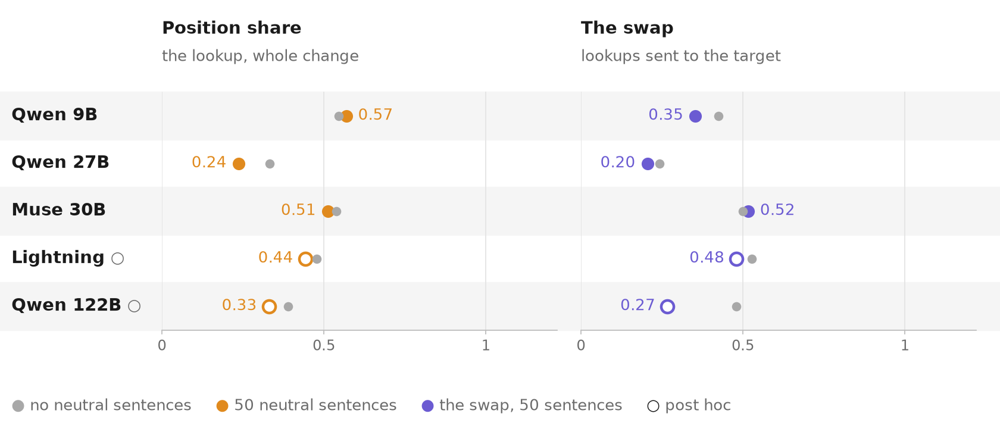
*The lookup's position share and the swap's lookups sent to the target, with no neutral sentences (grey) and with 50. whiskers: 95% intervals over bridge items; Lightning ○; –: not run, not tested or under 30 switches; the 122B ○ (lookup-only gate).*

- **Rule, fixed in advance.** "breaks = the gate failed at some k (the test stops there); distance-robust = position share and probe within 0.1 of k = 0 at every k, swap success within 0.15; address near, identity far = position falls >= 0.2 and identity rises >= 0.2 by k = 50 with accuracy >= 0.8". The 27B and Lightning: coverage runs on this rule, no prediction.

- **Result.**

  | | 9B | 27B | Muse | Lightning | 122B |
  |---|---|---|---|---|---|
  | position under the whole change, 0 / 50 sentences | 0.55 [0.48, 0.62]<!-- src: results/x47_distance/x47_16-20261028T131501Z/x47_16.md \| qwen3.5-9b :: 218 :: 0.55 [0.48, 0.62] --> / 0.57 [0.51, 0.63]<!-- src: results/x47_distance/x47_16-20261028T131501Z/x47_16.md \| qwen3.5-9b :: 218 :: 0.57 [0.51, 0.63] --> | 0.33 [0.28, 0.39]<!-- src: results/x47_distance/x52_distance-20261029T023426Z/x47_16.md \| qwen3.6-27b :: 300 :: 0.33 [0.28, 0.39] --> / 0.24 [0.19, 0.28]<!-- src: results/x47_distance/x52_distance-20261029T023426Z/x47_16.md \| qwen3.6-27b :: 300 :: 0.24 [0.19, 0.28] --> | 0.54 [0.48, 0.59]<!-- src: results/x47_distance/x52_distance-20261029T090323Z/x47_16.md \| muse-glimmer-30b :: 0.44 [0.39, 0.50] :: 0.54 [0.48, 0.59] --> / 0.51 [0.45, 0.57]<!-- src: results/x47_distance/x52_distance-20261029T090323Z/x47_16.md \| muse-glimmer-30b :: 0.47 [0.41, 0.53] :: 0.51 [0.45, 0.57] --> | 0.48 [0.40, 0.56]<!-- src: results/x47_distance/x52_distance-20261029T023426Z/x47_16.md \| nemotron-3.5-lightning :: 199 :: 0.48 [0.40, 0.56] --> / 0.44 [0.36, 0.52]<!-- src: results/x47_distance/x52_distance-20261029T023426Z/x47_16.md \| nemotron-3.5-lightning :: 199 :: 0.44 [0.36, 0.52] --> | 0.39 [0.33, 0.44]<!-- src: results/x47_distance/x52_distance-20261030T094552Z/x47_16.md \| qwen3.5-122b-a10b :: 0.61 [0.55, 0.67] :: 0.39 [0.33, 0.44] --> / 0.33 [0.27, 0.39]<!-- src: results/x47_distance/x52_distance-20261030T094552Z/x47_16.md \| qwen3.5-122b-a10b :: 0.66 [0.60, 0.72] :: 0.33 [0.27, 0.39] --> ○ |
  | the swap: lookups sent to the target, 0 / 50 sentences | 0.42 [0.38, 0.47]<!-- src: results/x47_distance/x47_16-20261028T131501Z/x47_16.md \| qwen3.5-9b :: 218 :: 0.42 [0.38, 0.47] --> / 0.35 [0.31, 0.40]<!-- src: results/x47_distance/x47_16-20261028T131501Z/x47_16.md \| qwen3.5-9b :: 218 :: 0.35 [0.31, 0.40] --> | 0.24 [0.20, 0.28]<!-- src: results/x47_distance/x52_distance-20261029T023426Z/x47_16.md \| qwen3.6-27b :: 300 :: 0.24 [0.20, 0.28] --> / 0.20 [0.17, 0.25]<!-- src: results/x47_distance/x52_distance-20261029T023426Z/x47_16.md \| qwen3.6-27b :: 300 :: 0.20 [0.17, 0.25] --> | 0.50 [0.46, 0.54]<!-- src: results/x47_distance/x52_distance-20261029T090323Z/x47_16.md \| muse-glimmer-30b :: 0.44 [0.39, 0.50] :: 0.50 [0.46, 0.54] --> / 0.52 [0.49, 0.55]<!-- src: results/x47_distance/x52_distance-20261029T090323Z/x47_16.md \| muse-glimmer-30b :: 0.47 [0.41, 0.53] :: 0.52 [0.49, 0.55] --> | 0.53 [0.47, 0.59]<!-- src: results/x47_distance/x52_distance-20261029T023426Z/x47_16.md \| nemotron-3.5-lightning :: 199 :: 0.53 [0.47, 0.59] --> / 0.48 [0.43, 0.53]<!-- src: results/x47_distance/x52_distance-20261029T023426Z/x47_16.md \| nemotron-3.5-lightning :: 199 :: 0.48 [0.43, 0.53] --> | 0.48 [0.44, 0.52]<!-- src: results/x47_distance/x52_distance-20261030T094552Z/x47_16.md \| qwen3.5-122b-a10b :: 0.38 [0.33, 0.43] :: 0.48 [0.44, 0.52] --> / 0.27 [0.23, 0.31]<!-- src: results/x47_distance/x52_distance-20261030T094552Z/x47_16.md \| qwen3.5-122b-a10b :: 0.31 [0.26, 0.37] :: 0.27 [0.23, 0.31] --> ○ |
  | the rule | **distance-robust address<!-- src: results/x47_distance/x47_16-20261028T131501Z/x47_16.md \| qwen3.5-9b :: distance-robust address -->** | **distance-robust address<!-- src: results/x47_distance/x52_distance-20261029T023426Z/x47_16.md \| qwen3.6-27b :: distance-robust address -->** (no prediction) | **distance-robust address<!-- src: results/x47_distance/x52_distance-20261029T090323Z/x47_16.md \| muse30_x47_16_r2 :: distance-robust address -->** (no prediction) | **distance-robust address<!-- src: results/x47_distance/x52_distance-20261029T023426Z/x47_16.md \| nemotron-3.5-lightning :: distance-robust address -->** (no prediction) | **none of the three<!-- src: results/x47_distance/x52_distance-20261030T094552Z/x47_16.md \| qwen35_122b_distance :: none of the three -->** (no prediction; lookup-only gate) |

- **Read.**
  - On the 9B, 27B and Lightning the address keeps carrying position answers and the swap keeps working with up to 50 neutral sentences before the picks.
- **Caveats.**
  - The 122B (coverage, 30 Oct; the lookup-only gate, ○; pending hand-check) reads "none of the three": its swap sends fewer lookups to the target with 50 neutral sentences than with none.
  - Muse's first run had no outcomes (Flagged 22); its rerun r2 (29 Oct, a coverage run on the same rule, no prediction) gives the column here.
  - The 27B's position share falls by 0.09 at 50 sentences, just inside the rule's 0.1.

### With six lockers, does each locker have its own code? (six lockers; the 27B's coverage run opened 29 Oct 01:49, Lightning's 29 Oct) 

`in README` *Used in: README Part III card "With six lockers, does each locker have its own code?".*

- **Question.** With six locker sentences, is the address a line over slots (one shift steps the lookup one slot), a first-versus-rest marker, or one code per slot?
- **Why we asked.** With three lockers a line and a first-versus-rest marker look the same.
- **Data.** Six-locker scenes: the test half, 300 per model (9B, 27B, Muse, Lightning at L14, the 122B at L33 as a coverage run, 30 Oct), the other 300 fit the slot means.
- **Method.** At the bridge word at L: one fixed shift (the mean step between neighbouring slot means) from each start slot, and swaps between given slots, each at doses 1 and 2, against a random vector of the same size; the slot means' first principal component beside.

*No figure: two counts per model (one shift: 0 of 5 start slots everywhere; given-slot swaps of 30) and a label: the Result's table.*

- **Rule, fixed in advance.** "Ordinal: the first PCA component is monotone in slot (|Spearman| >= 0.9) and v sends >= 0.25 of lookups to slot k+1 from >= 4 of 5 start slots, the random vector <= 0.05; Categorical, first vs rest: v works only from slot 1 (others < 0.10) and U's removal on 2-6 moves is within 0.10 of random; Slot-specific: pairwise writes reach >= 0.25 on most pairs but no single v does." Dose 2 decides. The 27B and Lightning: coverage runs on this rule, no prediction.

- **Result.**

  | | 9B | 27B | Muse | Lightning | 122B |
  |---|---|---|---|---|---|
  | position share under the whole change | 0.32 [0.28, 0.37]<!-- src: results/x47_six/x47_2-20261028T113102Z/x47_2.md \| qwen35_9b_x47_2 :: 0.32 [0.28, 0.37] --> | 0.25 [0.19, 0.31]<!-- src: results/x47_six/x52_six-20261029T004919Z/x47_2.md \| 0.70 [0.64, 0.76] :: 0.25 [0.19, 0.31] --> | 0.37 [0.31, 0.43]<!-- src: results/x47_six/x47_2-20261028T113102Z/x47_2.md \| muse30_x47_2 :: 0.37 [0.31, 0.43] --> | 0.40 [0.33, 0.46]<!-- src: results/x47_six/x52_six-20261029T011006Z/x47_2.md \| nem35l_x52_six :: whole :: 0.40 [0.33, 0.46] --> | 0.32 [0.26, 0.38]<!-- src: results/x47_six/x52_six-20261029T231821Z/x47_2.md \| qwen35_122b_x47_2 :: whole :: 0.32 [0.26, 0.38] --> |
  | first component monotone in slot (Spearman) | 1.00<!-- src: results/x47_six/x47_2-20261028T113102Z/x47_2.md \| 8.15, 5.59, 3.08 :: 1.00 --> | 1.00<!-- src: results/x47_six/x52_six-20261029T004919Z/x47_2.md \| 26.79, 16.42, 11.83 :: 1.00 --> | 1.00<!-- src: results/x47_six/x47_2-20261028T113102Z/x47_2.md \| 84.27, 58.15, 38.31 :: 1.00 --> | 1.00<!-- src: results/x47_six/x52_six-20261029T011006Z/x47_2.md \| 6.40, 4.93, 2.50 :: 1.00 --> | 1.00<!-- src: results/x47_six/x52_six-20261029T231821Z/x47_2.md \| 1.75, 1.28, 0.74 :: 1.00 --> |
  | given-slot swaps reaching 0.25 at dose 2 | 18 of 30<!-- src: results/x47_six/x47_2-20261028T113102Z/x47_2.md \| -0.025 :: 18 of 30 --> | 13 of 30<!-- src: results/x47_six/x52_six-20261029T004919Z/x47_2.md \| 0.004 :: 13 of 30 --> | 21 of 30<!-- src: results/x47_six/x47_2-20261028T113102Z/x47_2.md \| -0.055 :: 21 of 30 --> | 21 of 30<!-- src: results/x47_six/x52_six-20261029T011006Z/x47_2.md \| -0.020 :: 21 of 30 --> | 21 of 30<!-- src: results/x47_six/x52_six-20261029T231821Z/x47_2.md \| qwen3.5-122b-a10b :: 0 of 5 :: 21 of 30 --> |
  | the rule at dose 2 | **slot-specific** | **none of the three** | **slot-specific** | **slot-specific** (no prediction) | **slot-specific<!-- src: results/x47_six/x52_six-20261029T231821Z/x47_2.md \| qwen35_122b_x47_2 :: tested :: slot-specific -->** (no prediction) |

- **Read.**
  - No single shift moves the lookup on any model; given-slot swaps work on most pairs on the 9B, Muse, Lightning and the 122B (pending hand-check), so each slot is its own target there; on the 27B neither the line nor the per-slot pattern holds.
- **Caveats.**
  - The 27B's shift writes move 0.00 at every start slot, though its slot means lie in order.
  - A different test of the code's size (see [51.11](#t51-11)) does not find one dimension per slot on the 9B.

### What is the address, independent of how we built it? (51.11, opened 28 Oct 22:51) 

`in README` *Used in: README Part III card "With six lockers, does each locker have its own code?" (the held-out code); README "Tested and dropped" ("One code per locker").*

- **Question.** Is the address one code per locker, one shared code, or an order line, by methods that do not use our construction?
- **Why we asked.** Our address was built from means of four slots; its size and shape could be an artefact of that build.
- **Data.** Routes-style scenes with 3, 4, 6 and 8 lockers; held-out entities only (9B and Muse, all three parts; 27B part 2 only).
- **Method.** Part 1: the smallest learned subspace dimension d* that carries the position switch, per number of lockers, against random subspaces. Part 2: the address swap through our code, a probe's code and a learned code, each with the others removed, against a random direction. Part 3: swaps to the midpoint between two slots, against a random vector of the same norm.

*No figure: the code's shape per number of lockers is supplementary ([figure](../../figures/depth/ledger/ledger_address_shape.png)); the table has the rule's numbers.*

- **Rule, fixed in advance.** Part 1: "One dimension per slot: d*(S) ≥ S − 2 for every S and d*(8) ≥ 5"; "An ordinal (low-dimensional) code: d*(S) ≤ 2 for every S up to 8"; else in between. Part 2: "One code, three bases: every projected swap reaches ≥ 0.6 of the whole swap's effect, and each cross-removal cuts the other's swap by ≥ 0.6." Part 3: "Categories: midpoint swaps send < 0.1 to the midpoint slot while the full swaps reach ≥ 0.4 of the target"; "A metric order: midpoint swaps send ≥ 0.3 of lookups to the midpoint slot, from both ends." (jobs/c3/batch51.yaml, addendum 3)

- **Result.**

  | | 9B | 27B | Muse | Lightning | 122B |
  |---|---|---|---|---|---|
  | part 1, d* at 3 / 4 / 6 / 8 lockers | 2<!-- src: results/x51_addr/verdict-20261028T215138Z/verdict.md \| {'train': 213, 'select': 95, 'test': 50} :: 2 --> / 2<!-- src: results/x51_addr/verdict-20261028T215138Z/verdict.md \| {'select': 59, 'train': 191, 'test': 56} :: 2 --> / > 7<!-- src: results/x51_addr/verdict-20261028T215138Z/verdict.md \| {'select': 61, 'train': 200, 'test': 42} :: > 7 --> / 2<!-- src: results/x51_addr/verdict-20261028T215138Z/verdict.md \| {'train': 174, 'select': 73, 'test': 57} :: 2 -->: **in between** | not designed | 2<!-- src: results/x51_addr/verdict-20261028T215138Z/verdict.md \| {'train': 200, 'test': 91, 'select': 82} :: 2 --> / 2<!-- src: results/x51_addr/verdict-20261028T215138Z/verdict.md \| {'select': 72, 'train': 191, 'test': 84} :: 2 --> / 7<!-- src: results/x51_addr/verdict-20261028T215138Z/verdict.md \| {'select': 60, 'train': 192, 'test': 76} :: 7 --> / > 7<!-- src: results/x51_addr/verdict-20261028T215138Z/verdict.md \| {'train': 169, 'select': 64, 'test': 82} :: > 7 -->: **one dimension per slot** | not run | not run |
  | part 2: swap through the learned code with ours removed | 0.39 [0.37, 0.40]<!-- src: results/x51_addr/verdict-20261028T215138Z/verdict.md \| 0.03 [0.01, 0.05] :: 0.39 [0.37, 0.40] --> | **in between** | **in between** | | |
  | part 2: the whole swap with ours removed | 0.03 [0.01, 0.05]<!-- src: results/x51_addr/verdict-20261028T215138Z/verdict.md \| 0.39 [0.37, 0.40] :: 0.03 [0.01, 0.05] --> | | | | |
  | part 3: midpoint swap from slot 1 lands on the midpoint | 0.06 [0.03, 0.09]<!-- src: results/x51_addr/verdict-20261028T215138Z/verdict.md \| 9.0243 :: 0.06 [0.03, 0.09] --> (none of the three) | not designed | none of the three | | |

- **Read.**
  - No row of the wording table matches the labels; the methods agree only in part, and midpoint swaps do not land between slots.
- **Caveats.**
  - The 9B's d* at 6 lockers was not found below 8; Muse's "one per slot" rests on the literal rule (d*(8) not found counts as > 7).
  - The 27B ran part 2 only.

### On the scenes where the 27B's lookup goes by position, does the address work as on the 9B? (53.5, opened 29 Oct ~10:00; CPU, existing outcomes) 

`ledger only` *Used in: not in the README (its 12:50 rebuild).*

- **Question.** On the scenes where the 27B's lookup goes by position, does the address work as it does on the 9B?
- **Why we asked.** Added by itself, the 27B's address brings few position answers back overall ([routes](#routes)); the 27B takes the position route less often, so its address could be the same mechanism, used less.
- **Data.** Routes scenes of the two conditions that have a position answer, selected where the lookup answers by position under the whole change: 232 on the 27B (31 bridge items), 340 on the 9B beside; the swap on those scenes of the second condition (101 / 153).
- **Method.** On existing outcomes (CPU): position answers without the address against without a random part of its share; the address alone against a random part alone; the address swap at dose 2.

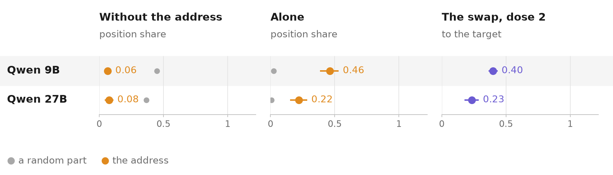
*On the 27B's position scenes (and the 9B's for comparison): position share without the address and alone, each against a random part (grey), and the swap at dose 2. Whiskers: 95% intervals.*

- **Rule, fixed in advance.** "Rule: "same mechanism, used less" if the address alone brings >= 0.25 of position answers back and its removal leaves <= 0.10 (the 9B's pattern); "the 27B differs" otherwise. Same subset on the 9B beside." (jobs/c3/batch53.yaml, Dan 29 Oct 09:30; no prediction)

- **Result.**

  | | 9B (beside) | 27B | Muse | Lightning | 122B |
  |---|---|---|---|---|---|
  | position answers back with the address alone (bar >= 0.25) | 0.46 [0.39, 0.53]<!-- src: results/x53_subset27b/x53_subset27b-20261029T085435Z/verdict.md \| Qwen3.5-9B :: C1 + C2 :: 0.46 [0.39, 0.53] --> | 0.22 [0.15, 0.29]<!-- src: results/x53_subset27b/x53_subset27b-20261029T085435Z/verdict.md \| Qwen3.6-27B :: C1 + C2 :: 0.22 [0.15, 0.29] --> | not designed | not designed | not run |
  | position answers left without the address (bar <= 0.10) | 0.06 [0.04, 0.09]<!-- src: results/x53_subset27b/x53_subset27b-20261029T085435Z/verdict.md \| Qwen3.5-9B :: C1 + C2 :: 0.06 [0.04, 0.09] --> | 0.08 [0.04, 0.11]<!-- src: results/x53_subset27b/x53_subset27b-20261029T085435Z/verdict.md \| Qwen3.6-27B :: C1 + C2 :: 0.08 [0.04, 0.11] --> | | | |
  | the same without a random part of its share | 0.45 [0.41, 0.50]<!-- src: results/x53_subset27b/x53_subset27b-20261029T085435Z/verdict.md \| Qwen3.5-9B :: C1 + C2 :: 0.45 [0.41, 0.50] --> | 0.37 [0.30, 0.42]<!-- src: results/x53_subset27b/x53_subset27b-20261029T085435Z/verdict.md \| Qwen3.6-27B :: C1 + C2 :: 0.37 [0.30, 0.42] --> | | | |
  | the swap at dose 2: lookups sent to the target | 0.40 [0.36, 0.43]<!-- src: results/x53_subset27b/x53_subset27b-20261029T085435Z/verdict.md \| Qwen3.5-9B :: position-route subset :: 0.40 [0.36, 0.43] --> | 0.23 [0.18, 0.29]<!-- src: results/x53_subset27b/x53_subset27b-20261029T085435Z/verdict.md \| Qwen3.6-27B :: position-route subset :: 0.23 [0.18, 0.29] --> | | | |
  | the rule | the pattern holds | **the 27B differs<!-- src: results/x53_subset27b/x53_subset27b-20261029T085435Z/verdict.md \| 27B: the 27B differs :: the 27B differs -->** | | | |

- **Read.**
  - On its own position-route scenes the 27B's address, added by itself, brings back fewer position answers than the rule's bar, and its removal leaves few: by the rule the 27B differs; the 9B's subset shows its pattern.
- **Caveats.**
  - The 27B's interval for the address alone ([0.15, 0.29]) contains the 0.25 bar.
  - The 9B's pattern holds only with the two conditions pooled: per condition, the first holds and the second does not, on both models.
  - In the first condition, removing a random part of the address's share also leaves few position answers (0.07 [0.03, 0.11]<!-- src: results/x53_subset27b/x53_subset27b-20261029T085435Z/verdict.md | Without a random part of the address's share, C1 keeps :: 0.07 [0.03, 0.11] --> on the 27B), so there the removal clause cannot tell the address from a random part.
  - CPU on existing outcomes; exploratory (batch 53); no prediction; UNVERIFIED.

### Can the lens read the address? (lens readout of an address swap, 47.0; Lightning's coverage run 29 Oct) 

`in README` *Used in: README Part III card "Can the lens read the address?" (the lens readout of the swap).*

- **Question.** Read through the lens, does an address swap at a real change's size show up as a position word, get rebuilt by the lens's own directions, or move the lens's readout more than a random vector of the same size?
- **Why we asked.** Neel's question: is the pointer verbalizable? A lens monitor would have to see it.
- **Data.** Routes scenes, 100 items per model, each swapped to both other lockers (200 cases); null: 200 random vectors of the same size.
- **Method.** At the bridge word at L, the swap h + 2 (mu_k - mu_j): (a) the best rank of a position word (first, second, third, 1, 2, 3, ...) in the lens readout; (b) the share the lens's 25 best directions rebuild; (c) how far the readout moves (KL). Positive control: an item change of the same size.

*The README's address figure; this card is its fourth column: how far above 200 random vectors the lens's 25 directions rebuild the address swap and, as the positive control, an item change of the same size (z; grey band: the random vectors' range). whiskers: 95% intervals; Lightning ○; the 122B ○ where its gate was lowered post hoc or lookup-only.*

- **Rule, fixed in advance.** Descriptive, with the reading fixed in advance: ""Not verbalizable": reconstruction at k = 25 within 2x the random null's share, no ordinal token in the top-20 beyond the null's 5th-percentile rank, and the KL under the write within the null's 95th percentile, on all three models." Lightning: a coverage run on that reading, no prediction.

- **Result.**

  | | 9B | 27B | Muse | Lightning | 122B |
  |---|---|---|---|---|---|
  | best position-word rank after the swap, median (random's 5th percentile) | 27 (null 5th pct 20)<!-- src: results/x47_verbal/summary-20261028T033646Z/verbal.md \| (a) best ordinal-token rank, h + write (median) :: 27 (null 5th pct 20) --> | 30 (null 5th pct 22)<!-- src: results/x47_verbal/summary-20261028T033646Z/verbal.md \| (a) best ordinal-token rank, h + write (median) :: 30 (null 5th pct 22) --> | 94 (null 5th pct 58)<!-- src: results/x47_verbal/summary-20261028T033646Z/verbal.md \| (a) best ordinal-token rank, h + write (median) :: 94 (null 5th pct 58) --> | 220 (null 5th pct 49)<!-- src: results/x47_verbal/summary-20261029T005548Z/verbal.md \| (a) best ordinal-token rank, h + write (median) :: 220 (null 5th pct 49) --> | 993 (null 5th pct 523)<!-- src: results/x47_verbal/summary-20261029T180530Z/verbal.md \| (a) best ordinal-token rank, h + write (median) :: 993 (null 5th pct 523) --> ○ |
  | cases whose rank beats their own null | 0.03 [0.01, 0.06]<!-- src: results/x47_verbal/summary-20261028T033646Z/verbal.md \| (a) cases with the ordinal rank beyond their own null :: 0.03 [0.01, 0.06] --> | 0.13 [0.08, 0.19]<!-- src: results/x47_verbal/summary-20261028T033646Z/verbal.md \| (a) cases with the ordinal rank beyond their own null :: 0.13 [0.08, 0.19] --> | 0.18 [0.14, 0.24]<!-- src: results/x47_verbal/summary-20261028T033646Z/verbal.md \| (a) cases with the ordinal rank beyond their own null :: 0.18 [0.14, 0.24] --> | 0.00 [0.00, 0.00]<!-- src: results/x47_verbal/summary-20261029T005548Z/verbal.md \| (a) cases with the ordinal rank beyond their own null :: 0.00 [0.00, 0.00] --> | 0.00 [0.00, 0.00]<!-- src: results/x47_verbal/summary-20261029T180530Z/verbal.md \| (a) cases with the ordinal rank beyond their own null :: 0.00 [0.00, 0.00] --> ○ |
  | share rebuilt by 25 lens directions, swap over random | 1.16x<!-- src: results/x47_verbal/summary-20261028T033646Z/verbal.md \| (b) pointer / random, k = 25 (every token; letters) :: 1.16x --> | 0.94x<!-- src: results/x47_verbal/summary-20261028T033646Z/verbal.md \| (b) pointer / random, k = 25 (every token; letters) :: 0.94x --> | 1.22x<!-- src: results/x47_verbal/summary-20261028T033646Z/verbal.md \| (b) pointer / random, k = 25 (every token; letters) :: 1.22x --> | 1.44x<!-- src: results/x47_verbal/summary-20261029T005548Z/verbal.md \| (b) pointer / random, k = 25 (every token; letters) :: 1.44x --> | 1.14x<!-- src: results/x47_verbal/summary-20261029T180530Z/verbal.md \| (b) pointer / random, k = 25 (every token; letters) :: 1.14x --> ○ |
  | cases whose readout moves beyond their own null (KL) | 0.15 [0.09, 0.23]<!-- src: results/x47_verbal/summary-20261028T033646Z/verbal.md \| (c) cases with KL beyond their own null :: 0.15 [0.09, 0.23] --> | 0.01 [0.00, 0.05]<!-- src: results/x47_verbal/summary-20261028T033646Z/verbal.md \| (c) cases with KL beyond their own null :: 0.01 [0.00, 0.05] --> | 0.28 [0.19, 0.39]<!-- src: results/x47_verbal/summary-20261028T033646Z/verbal.md \| (c) cases with KL beyond their own null :: 0.28 [0.19, 0.39] --> | 0.00 [0.00, 0.00]<!-- src: results/x47_verbal/summary-20261029T005548Z/verbal.md \| (c) cases with KL beyond their own null :: 0.00 [0.00, 0.00] --> | 0.02 [0.00, 0.06]<!-- src: results/x47_verbal/summary-20261029T180530Z/verbal.md \| (c) cases with KL beyond their own null :: 0.02 [0.00, 0.06] --> ○ |
  | control: the new item's name rank after an item change | 50 (null 5th pct 2220)<!-- src: results/x47_verbal/summary-20261028T033646Z/verbal.md \| (a) positive control: new item's name rank, h + identity :: 50 (null 5th pct 2220) --> | 14 (null 5th pct 5014)<!-- src: results/x47_verbal/summary-20261028T033646Z/verbal.md \| (a) positive control: new item's name rank, h + identity :: 14 (null 5th pct 5014) --> | 25 (null 5th pct 3636)<!-- src: results/x47_verbal/summary-20261028T033646Z/verbal.md \| (a) positive control: new item's name rank, h + identity :: 25 (null 5th pct 3636) --> | 19 (null 5th pct 4844)<!-- src: results/x47_verbal/summary-20261029T005548Z/verbal.md \| (a) positive control: new item's name rank, h + identity :: 19 (null 5th pct 4844) --> | 2 (null 5th pct 1137)<!-- src: results/x47_verbal/summary-20261029T180530Z/verbal.md \| (a) positive control: new item's name rank, h + identity :: 2 (null 5th pct 1137) --> ○ |
  | reading | not verbalizable<!-- src: results/x47_verbal/summary-20261028T033646Z/verbal.md \| reading :: not verbalizable --> | not verbalizable | not verbalizable | not verbalizable<!-- src: results/x47_verbal/summary-20261029T005548Z/verbal.md \| reading :: not verbalizable --> | not verbalizable<!-- src: results/x47_verbal/summary-20261029T180530Z/verbal.md \| reading :: not verbalizable --> ○ (lookup-only gate) |

- **Read.**
  - On all four models the address swap reads through the lens like a random vector of its size, while an item change of the same size stands far outside the random range.
  - Lightning's swap moves its lookup to the written locker in 0.50<!-- src: results/x47_verbal/summary-20261029T005548Z/verbal.md \| x8's lookup on these writes at s = 2: to the written locker :: 0.50 --> of these cases, yet none of the lens's three readings leaves the null.
- **Caveats.**
  - Descriptive: the reading is the spec's, not a pre-registered claim.
  - The reading uses medians; per case, some readouts do move beyond their own null on the 9B and Muse.

### What can a probe on the lens subspace decode, against the full state? (53.2, the monitor test; four models, 29 Oct; the 122B's coverage run 29 Oct) 

`in README` *Used in: README Part III card "Can a monitor on the lens part read the address where the lookup uses it?".*

- **Question.** What can a probe on the lens subspace decode, against the full state: the bridge item's locker slot (the address) and the lookup's answer digit, with which item and the recall's answer as positive controls?
- **Why we asked.** The lens readout does not show the address ([47.0](#t47-0)); a trained probe on the lens part's coordinates asks whether the address is there but not verbalized, or absent from the lens directions.
- **Data.** The main test (400 rows, 43 to 45 bridge entities per model) and the JSON scenes (620 to 830 rows), the bridge word and the last token, every second layer; the 9B, the 27B, Muse and Lightning; the 122B running.
- **Method.** Logistic probes (5 seeds of 5-fold CV, held-out entities) on the full state, on the lens part's coordinates (k = 25 and 100), on a random subspace of the same k, on a fixed lens subspace, and on an energy-matched random subspace (Dan 11:25, 13:15, before the verdict); the lens readout (top words) cited from 47.0, unchanged.

*The README's figure: probes for which locker sentence holds the bridge's locker at the last token, at the layer where the full state peaks: the lens part against a random part of the same energy (grey) and the full state (tick), with 25 and 100 lens directions. Whiskers: 95% intervals; Lightning ○. The bridge word and the JSON scenes: the table.*

- **Rule, fixed in advance.** "Rule (verbatim): "J-space blind to X" if the J++ probe is within 0.10 of the random subspace at every layer while the full residual reaches >= 0.8 at some layer; "J-space carries X" if J++ >= 0.8 and >= 0.3 above random; else in between." (jobs/c3/batch53.yaml, 53.2; no prediction) Before scoring (Dan 11:25, 11:40, 13:15, verbatim in the verdict): the headline targets are the slot and the lookup's digit; "random reads it too" is worded "the address is linearly decodable from many subspaces, J++ included; the lens readout does not show it"; and "if J++ is >= 0.10 below the energy-matched random while the full state is >= 0.8, the label is "the address is under-represented in the lens directions" (stronger than blind)".

- **Result.** (main test, the last token, at the layer where the full state peaks)

  | | 9B | 27B | Muse | Lightning | 122B |
  |---|---|---|---|---|---|
  | (a) the lens readout (47.0) | not verbalizable | not verbalizable | not verbalizable | not verbalizable | not verbalizable<!-- src: results/x47_verbal/summary-20261029T180530Z/verbal.md \| reading :: not verbalizable --> ○ (lookup-only gate) |
  | the locker slot, k = 25: lens part / random / energy-matched random | 0.60 [0.56, 0.64]<!-- src: results/x53_monitor/x53_monitor-20261029T124428Z/verdict.md \| Qwen3.5-9B :: main :: T :: (b) its locker slot :: 25 :: L20 :: 0.60 [0.56, 0.64] --> / 0.65 [0.62, 0.68]<!-- src: results/x53_monitor/x53_monitor-20261029T124428Z/verdict.md \| Qwen3.5-9B :: main :: T :: (b) its locker slot :: 25 :: L20 :: 0.65 [0.62, 0.68] --> / 0.83 [0.80, 0.86]<!-- src: results/x53_monitor/x53_monitor-20261029T124428Z/verdict.md \| Qwen3.5-9B :: main :: T :: (b) its locker slot :: 25 :: L20 :: 0.83 [0.80, 0.86] --> | 0.77 [0.73, 0.80]<!-- src: results/x53_monitor/x53_monitor-20261029T124428Z/verdict.md \| Qwen3.6-27B :: main :: T :: (b) its locker slot :: 25 :: L48 :: 0.77 [0.73, 0.80] --> / 0.81 [0.79, 0.84]<!-- src: results/x53_monitor/x53_monitor-20261029T124428Z/verdict.md \| Qwen3.6-27B :: main :: T :: (b) its locker slot :: 25 :: L48 :: 0.81 [0.79, 0.84] --> / 0.95 [0.94, 0.96]<!-- src: results/x53_monitor/x53_monitor-20261029T124428Z/verdict.md \| Qwen3.6-27B :: main :: T :: (b) its locker slot :: 25 :: L48 :: 0.95 [0.94, 0.96] --> | 0.68 [0.65, 0.71]<!-- src: results/x53_monitor/x53_monitor-20261029T124428Z/verdict.md \| Muse-Glimmer-30B :: main :: T :: (b) its locker slot :: 25 :: L34 :: 0.68 [0.65, 0.71] --> / 0.69 [0.66, 0.72]<!-- src: results/x53_monitor/x53_monitor-20261029T124428Z/verdict.md \| Muse-Glimmer-30B :: main :: T :: (b) its locker slot :: 25 :: L34 :: 0.69 [0.66, 0.72] --> / 0.89 [0.86, 0.91]<!-- src: results/x53_monitor/x53_monitor-20261029T124428Z/verdict.md \| Muse-Glimmer-30B :: main :: T :: (b) its locker slot :: 25 :: L34 :: 0.89 [0.86, 0.91] --> | 0.65 [0.61, 0.69]<!-- src: results/x53_monitor/x53_monitor-20261029T124428Z/verdict.md \| Nemotron-3.5-Lightning :: main :: T :: (b) its locker slot :: 25 :: L34 :: 0.65 [0.61, 0.69] --> / 0.64 [0.61, 0.66]<!-- src: results/x53_monitor/x53_monitor-20261029T124428Z/verdict.md \| Nemotron-3.5-Lightning :: main :: T :: (b) its locker slot :: 25 :: L34 :: 0.64 [0.61, 0.66] --> / 0.88 [0.86, 0.90]<!-- src: results/x53_monitor/x53_monitor-20261029T124428Z/verdict.md \| Nemotron-3.5-Lightning :: main :: T :: (b) its locker slot :: 25 :: L34 :: 0.88 [0.86, 0.90] --> | 0.73 [0.69, 0.77]<!-- src: results/x53_monitor/x53_monitor_122b-20261029T175223Z/verdict.md \| Qwen3.5-122B-A10B :: main :: T :: (b) its locker slot :: 25 :: L40 :: 0.73 [0.69, 0.77] --> / 0.71 [0.69, 0.73]<!-- src: results/x53_monitor/x53_monitor_122b-20261029T175223Z/verdict.md \| Qwen3.5-122B-A10B :: main :: T :: (b) its locker slot :: 25 :: L40 :: 0.71 [0.69, 0.73] --> / 0.91 [0.89, 0.93]<!-- src: results/x53_monitor/x53_monitor_122b-20261029T175223Z/verdict.md \| Qwen3.5-122B-A10B :: main :: T :: (b) its locker slot :: 25 :: L40 :: 0.91 [0.89, 0.93] --> |
  | the locker slot, k = 100: the same | 0.72 [0.69, 0.76]<!-- src: results/x53_monitor/x53_monitor-20261029T124428Z/verdict.md \| Qwen3.5-9B :: main :: T :: (b) its locker slot :: 100 :: L20 :: 0.72 [0.69, 0.76] --> / 0.77 [0.74, 0.81]<!-- src: results/x53_monitor/x53_monitor-20261029T124428Z/verdict.md \| Qwen3.5-9B :: main :: T :: (b) its locker slot :: 100 :: L20 :: 0.77 [0.74, 0.81] --> / 0.86 [0.83, 0.89]<!-- src: results/x53_monitor/x53_monitor-20261029T124428Z/verdict.md \| Qwen3.5-9B :: main :: T :: (b) its locker slot :: 100 :: L20 :: 0.86 [0.83, 0.89] --> | 0.85 [0.82, 0.88]<!-- src: results/x53_monitor/x53_monitor-20261029T124428Z/verdict.md \| Qwen3.6-27B :: main :: T :: (b) its locker slot :: 100 :: L48 :: 0.85 [0.82, 0.88] --> / 0.92 [0.90, 0.94]<!-- src: results/x53_monitor/x53_monitor-20261029T124428Z/verdict.md \| Qwen3.6-27B :: main :: T :: (b) its locker slot :: 100 :: L48 :: 0.92 [0.90, 0.94] --> / 0.98 [0.96, 0.99]<!-- src: results/x53_monitor/x53_monitor-20261029T124428Z/verdict.md \| Qwen3.6-27B :: main :: T :: (b) its locker slot :: 100 :: L48 :: 0.98 [0.96, 0.99] --> | 0.80 [0.76, 0.83]<!-- src: results/x53_monitor/x53_monitor-20261029T124428Z/verdict.md \| Muse-Glimmer-30B :: main :: T :: (b) its locker slot :: 100 :: L34 :: 0.80 [0.76, 0.83] --> / 0.83 [0.80, 0.86]<!-- src: results/x53_monitor/x53_monitor-20261029T124428Z/verdict.md \| Muse-Glimmer-30B :: main :: T :: (b) its locker slot :: 100 :: L34 :: 0.83 [0.80, 0.86] --> / 0.92 [0.90, 0.94]<!-- src: results/x53_monitor/x53_monitor-20261029T124428Z/verdict.md \| Muse-Glimmer-30B :: main :: T :: (b) its locker slot :: 100 :: L34 :: 0.92 [0.90, 0.94] --> | 0.79 [0.75, 0.83]<!-- src: results/x53_monitor/x53_monitor-20261029T124428Z/verdict.md \| Nemotron-3.5-Lightning :: main :: T :: (b) its locker slot :: 100 :: L34 :: 0.79 [0.75, 0.83] --> / 0.80 [0.78, 0.84]<!-- src: results/x53_monitor/x53_monitor-20261029T124428Z/verdict.md \| Nemotron-3.5-Lightning :: main :: T :: (b) its locker slot :: 100 :: L34 :: 0.80 [0.78, 0.84] --> / 0.94 [0.92, 0.95]<!-- src: results/x53_monitor/x53_monitor-20261029T124428Z/verdict.md \| Nemotron-3.5-Lightning :: main :: T :: (b) its locker slot :: 100 :: L34 :: 0.94 [0.92, 0.95] --> | 0.85 [0.83, 0.88]<!-- src: results/x53_monitor/x53_monitor_122b-20261029T175223Z/verdict.md \| Qwen3.5-122B-A10B :: main :: T :: (b) its locker slot :: 100 :: L40 :: 0.85 [0.83, 0.88] --> / 0.85 [0.83, 0.87]<!-- src: results/x53_monitor/x53_monitor_122b-20261029T175223Z/verdict.md \| Qwen3.5-122B-A10B :: main :: T :: (b) its locker slot :: 100 :: L40 :: 0.85 [0.83, 0.87] --> / 0.94 [0.93, 0.96]<!-- src: results/x53_monitor/x53_monitor_122b-20261029T175223Z/verdict.md \| Qwen3.5-122B-A10B :: main :: T :: (b) its locker slot :: 100 :: L40 :: 0.94 [0.93, 0.96] --> |
  | the locker slot: the full state | 0.88 [0.84, 0.91]<!-- src: results/x53_monitor/x53_monitor-20261029T124428Z/verdict.md \| Qwen3.5-9B :: main :: T :: (b) its locker slot :: 25 :: L20 :: 0.88 [0.84, 0.91] --> (L20) | 0.99 [0.98, 1.00]<!-- src: results/x53_monitor/x53_monitor-20261029T124428Z/verdict.md \| Qwen3.6-27B :: main :: T :: (b) its locker slot :: 25 :: L48 :: 0.99 [0.98, 1.00] --> (L48) | 0.94 [0.92, 0.95]<!-- src: results/x53_monitor/x53_monitor-20261029T124428Z/verdict.md \| Muse-Glimmer-30B :: main :: T :: (b) its locker slot :: 25 :: L34 :: 0.94 [0.92, 0.95] --> (L34) | 0.96 [0.94, 0.97]<!-- src: results/x53_monitor/x53_monitor-20261029T124428Z/verdict.md \| Nemotron-3.5-Lightning :: main :: T :: (b) its locker slot :: 25 :: L34 :: 0.96 [0.94, 0.97] --> (L34) | 0.96 [0.95, 0.98]<!-- src: results/x53_monitor/x53_monitor_122b-20261029T175223Z/verdict.md \| Qwen3.5-122B-A10B :: main :: T :: (b) its locker slot :: 25 :: L40 :: 0.96 [0.95, 0.98] --> (L40) |
  | the rule, k = 25 / k = 100 | **J-space blind to X<!-- src: results/x53_monitor/x53_monitor-20261029T124428Z/verdict.md \| Qwen3.5-9B :: main :: T :: (b) its locker slot :: 25 :: L20 :: J-space blind to X -->** / in between | **in between<!-- src: results/x53_monitor/x53_monitor-20261029T124428Z/verdict.md \| Qwen3.6-27B :: main :: T :: (b) its locker slot :: 25 :: L48 :: in between -->** / in between | **J-space blind to X<!-- src: results/x53_monitor/x53_monitor-20261029T124428Z/verdict.md \| Muse-Glimmer-30B :: main :: T :: (b) its locker slot :: 25 :: L34 :: J-space blind to X -->** / in between | **in between<!-- src: results/x53_monitor/x53_monitor-20261029T124428Z/verdict.md \| Nemotron-3.5-Lightning :: main :: T :: (b) its locker slot :: 25 :: L34 :: in between -->** / in between | **J-space blind to X<!-- src: results/x53_monitor/x53_monitor_122b-20261029T175223Z/verdict.md \| Qwen3.5-122B-A10B :: main :: T :: (b) its locker slot :: 25 :: L40 :: J-space blind to X -->** / in between<!-- src: results/x53_monitor/x53_monitor_122b-20261029T175223Z/verdict.md \| Qwen3.5-122B-A10B :: main :: T :: (b) its locker slot :: 100 :: L40 :: in between --> |
  | Dan's energy rule (13:15), k = 25 and 100 | the address is under-represented in the lens directions | the address is under-represented in the lens directions | the address is under-represented in the lens directions | the address is under-represented in the lens directions | the address is under-represented in the lens directions |
  | the locker slot at the bridge word, and on JSON scenes | in between (the full state under 0.8) | in between (the full state under 0.8) | in between (the full state under 0.8) | in between (the full state under 0.8) | in between at the bridge word; on JSON scenes J-space blind at the last token |
  | the lookup's digit at the last token, k = 100: lens part / random | 0.99 [0.98, 1.00]<!-- src: results/x53_monitor/x53_monitor-20261029T124428Z/verdict.md \| Qwen3.5-9B :: main :: T :: (c) lookup's digit :: 100 :: L30 :: 0.99 [0.98, 1.00] --> / 0.99 [0.99, 1.00]<!-- src: results/x53_monitor/x53_monitor-20261029T124428Z/verdict.md \| Qwen3.5-9B :: main :: T :: (c) lookup's digit :: 100 :: L30 :: 0.99 [0.99, 1.00] --> (L30; many subspaces) | 1.00 [1.00, 1.00]<!-- src: results/x53_monitor/x53_monitor-20261029T124428Z/verdict.md \| Qwen3.6-27B :: main :: T :: (c) lookup's digit :: 100 :: L52 :: 1.00 [1.00, 1.00] --> / 1.00 [1.00, 1.00]<!-- src: results/x53_monitor/x53_monitor-20261029T124428Z/verdict.md \| Qwen3.6-27B :: main :: T :: (c) lookup's digit :: 100 :: L52 :: 1.00 [1.00, 1.00] --> (L52; in between) | 1.00 [0.99, 1.00]<!-- src: results/x53_monitor/x53_monitor-20261029T124428Z/verdict.md \| Muse-Glimmer-30B :: main :: T :: (c) lookup's digit :: 100 :: L40 :: 1.00 [0.99, 1.00] --> / 0.99 [0.99, 1.00]<!-- src: results/x53_monitor/x53_monitor-20261029T124428Z/verdict.md \| Muse-Glimmer-30B :: main :: T :: (c) lookup's digit :: 100 :: L40 :: 0.99 [0.99, 1.00] --> (L40; many subspaces) | 1.00 [0.99, 1.00]<!-- src: results/x53_monitor/x53_monitor-20261029T124428Z/verdict.md \| Nemotron-3.5-Lightning :: main :: T :: (c) lookup's digit :: 100 :: L34 :: 1.00 [0.99, 1.00] --> / 0.99 [0.99, 1.00]<!-- src: results/x53_monitor/x53_monitor-20261029T124428Z/verdict.md \| Nemotron-3.5-Lightning :: main :: T :: (c) lookup's digit :: 100 :: L34 :: 0.99 [0.99, 1.00] --> (L34; many subspaces) | 1.00 [1.00, 1.00]<!-- src: results/x53_monitor/x53_monitor_122b-20261029T175223Z/verdict.md \| Qwen3.5-122B-A10B :: main :: T :: (c) lookup's digit :: 100 :: L46 :: 1.00 [1.00, 1.00] --> / 1.00 [0.99, 1.00]<!-- src: results/x53_monitor/x53_monitor_122b-20261029T175223Z/verdict.md \| Qwen3.5-122B-A10B :: main :: T :: (c) lookup's digit :: 100 :: L46 :: 1.00 [0.99, 1.00] --> |

- **Read.**
  - The lens readout does not show the address (47.0). At the last token the full state reads the locker slot, and at that layer a probe on the lens part's coordinates reads it no better than a random subspace of the same size on all four models. The rule, over every layer: "J-space blind" on the 9B and Muse at k = 25; in between on the 27B and Lightning, and on all four at k = 100.
  - Against random directions of the same energy the lens part reads the slot worse on all four models, at both sizes: the address is under-represented in the lens directions, not an energy artefact.
  - At the bridge word and on JSON scenes the full state reads the slot under 0.8, so the rule can't tell there. The lookup's answer digit at the last token, k = 100, is decodable from many subspaces, the lens part included (7 of the 8 model and dataset cells; the 27B's main test in between); at the bridge word even the full state reads it near chance (the 9B: 0.13 [0.11, 0.16]<!-- src: results/x53_monitor/x53_monitor-20261029T124428Z/verdict.md \| Qwen3.5-9B :: main :: B :: (c) lookup's digit :: 25 :: L0 :: 0.13 [0.11, 0.16] --> vs chance 0.12 [0.09, 0.15]<!-- src: results/x53_monitor/x53_monitor-20261029T124428Z/verdict.md \| Qwen3.5-9B :: main :: B :: (c) lookup's digit :: 25 :: L0 :: 0.12 [0.09, 0.15] -->).
  - The positive controls work: at the bridge word the full state reads which item is the bridge and the recall's answer at 0.99 or more at its best layer, on every model and dataset. The recall's answer there is "J-space carries X" at k = 25 on 7 of the 8 cells (the 9B: lens part 0.98 [0.96, 0.99]<!-- src: results/x53_monitor/x53_monitor-20261029T124428Z/verdict.md \| Qwen3.5-9B :: main :: B :: (d) recall's answer :: 25 :: L14 :: 0.98 [0.96, 0.99] --> vs random 0.68 [0.63, 0.71]<!-- src: results/x53_monitor/x53_monitor-20261029T124428Z/verdict.md \| Qwen3.5-9B :: main :: B :: (d) recall's answer :: 25 :: L14 :: 0.68 [0.63, 0.71] -->), but no different from random directions of the same energy (0.97 [0.95, 0.98]<!-- src: results/x53_monitor/x53_monitor-20261029T124428Z/verdict.md \| Qwen3.5-9B :: main :: B :: (d) recall's answer :: 25 :: L14 :: 0.97 [0.95, 0.98] -->). The controls' full labels are in the verdict, under their own heading.
- **Caveats.**
  - The verdict flags its readings of Dan's wordings: "while" read as at some layer where the full state reaches 0.8, "within 0.10" as at every layer, "random is under 0.8" as at every layer, and the target named in the "many subspaces" wording for the digit.
  - The lens part is fit to each state and keeps more of its energy than a fixed random subspace of the same k; the energy-matched random subspace and a fixed lens subspace are the verdict's check on that.
  - One regularisation for every probe (the brief's): a low ceiling for the full state, as for the slot at the bridge word, can be the probe rather than the state (not checked). The positive controls are probed on held-out scenes, not held-out entities, so the recall's answer at the bridge word can be the bridge's identity mapped to its answer (not checked).
  - Exploratory (batch 53), no prediction; UNVERIFIED.
- **The 122B (addendum; coverage, not hand-checked; Dan 12:20 / 18:20).** [verdict](../../results/x53_monitor/x53_monitor_122b-20261029T175223Z/verdict.md), L33 carried over, FP8, the same rule, not part of the four models' verdict. At the last token, main test: the locker slot "J-space blind to X" at k = 25 (in between at k = 100), and under the energy rule "the address is under-represented in the lens directions" at both sizes, as on the four models. JSON scenes, last token: the slot "J-space blind to X" at both sizes and under-represented by the energy rule (the full state reaches 0.80 there, at the bar). The lookup's digit at the last token, both datasets, k = 25 and 100: decodable from many subspaces, J++ included (random reads it too; energy rule: no different from random directions of the same energy). At the bridge word the full state reads the slot and the digit under 0.8: can't tell.

### Asked for the position, does the address surface in the lens? (the report prompt, 47.10, opened 28 Oct; Lightning's gate 29 Oct) 

`in README` `below gate: 9B, Muse, Lightning` *Used in: README Part III card "Can the lens read the address?" (the report prompt).*

- **Question.** When the prompt asks which locker sentence holds the item (a report reader), does the lens at the bridge word show the right ordinal, and does the report need the lens part or the address?
- **Why we asked.** The lens cannot read the address under the lookup's prompt; asked for it directly, the model might surface it into the lens.
- **Data.** Routes scenes without a move, four readers as separate prompts over the same context, question last or first: the 27B, question last, 200<!-- src: results/x47_report/x47_10-20261028T113109Z/x47_10.md \| qwen3.6-27b :: last :: 200 --> scenes. Every other cell failed its gate (the report reader below 0.80): the 9B, Muse, the 27B with the question first, and Lightning (its report right on 0.488<!-- src: results/x47_report/x52_report-20261029T023828Z/x47_10.md \| last: gate :: 0.488 --> with the question last).
- **Method.** At the bridge word at L: the lens readout's top five under the report prompt and under the lookup prompt; the report's switches blocked without the lens part and without the address, each beyond a random part.

*No figure: one model tested (the 27B), three numbers: the Result's table.*

- **Rule, fixed in advance.** ""Surfaced on demand": under the report prompt the lens ranks the correct ordinal in its top-5 in >= 0.4 of items (under the lookup prompt <= 0.1), and the report has >= 0.3 blocked of its switches without J++ beyond random, while the lookup on the same scenes has <= 0.10 blocked (as before). "Reported late, not surfaced": the lens stays <= 0.1 at the bridge word under the report prompt and the report has <= 0.1 blocked without J++ but >= 0.3 without U [...]"

- **Result.**

  | | 9B | 27B | Muse | Lightning | 122B |
  |---|---|---|---|---|---|
  | lens top-5 holds the right ordinal, under the report prompt (bar >= 0.4) | not tested (gate 0.568<!-- src: results/x47_report/x47_10-20261028T113109Z/x47_10.md \| qwen35_9b_x47_report, L12), last :: 0.568 --> < 0.80) | 0.00 [0.00, 0.00]<!-- src: results/x47_report/x47_10-20261028T113109Z/x47_10.md \| qwen3.6-27b :: last :: 200 :: 0.00 [0.00, 0.00] --> | not tested (gate 0.498<!-- src: results/x47_report/x47_10-20261028T113109Z/x47_10.md \| muse30_x47_report, L26), last :: 0.498 --> < 0.80) | not tested (gate 0.488<!-- src: results/x47_report/x52_report-20261029T023828Z/x47_10.md \| nem35l_x52_report, L14), last :: 0.488 --> < 0.80) | not run |
  | the report: switches blocked without the lens part, beyond random | | 0.06 [0.02, 0.11]<!-- src: results/x47_report/x47_10-20261028T113109Z/x47_10.md \| qwen3.6-27b :: last :: 200 :: 0.06 [0.02, 0.11] --> | | | |
  | the report: switches blocked without the address, beyond random | | 0.28 [0.21, 0.34]<!-- src: results/x47_report/x47_10-20261028T113109Z/x47_10.md \| qwen3.6-27b :: last :: 200 :: 0.28 [0.21, 0.34] --> | | | |
  | the label (question last) | | **neither<!-- src: results/x47_report/x47_10-20261028T113109Z/x47_10.md \| qwen3.6-27b :: last :: 200 :: neither -->** | | | |

- **Read.**
  - Asked for the position, the 27B's lens never shows the right ordinal at the bridge word, and the report needs the address more than the lens part, but not by the 0.3 the rule asks: neither reading holds.
- **Caveats.**
  - One cell tested (the 27B, question last); every other cell failed its gate.
  - The report is blocked at 0.28 without the address, just under the rule's 0.3.

### Reworded, does the report read slot 1? (the report of slot 1 reworded, 49.6, opened 28 Oct; Lightning's coverage run 29 Oct) 

`ledger only` *Used in: not in the README (its 12:50 rebuild).*

- **Question.** Asked for the position of the asked item's locker, the report reads slot 1 badly ([47.10](#t47-10)); asked in other words, does it read slot 1?
- **Why we asked.** If slot 1 stays unread under any wording, the report's gap is about slot 1 itself; if it recovers, it was the wording.
- **Data.** The report prompt's scenes without a move, the original prompt only, question last: 500 scenes, 147 with the asked item in slot 1 on the 9B and the 27B, 168 on Lightning.
- **Method.** Two new wordings of the report question: position (a digit: "Was the locker of 
's pick listed in position 1, 2 or 3 of the list?") and sentence (a word: "Which of the three locker sentences - the first, the second or the third - gives the locker of 
's pick?"); the share of scenes whose asked item sits in slot 1 that the report reads right, with the earlier report wording beside.

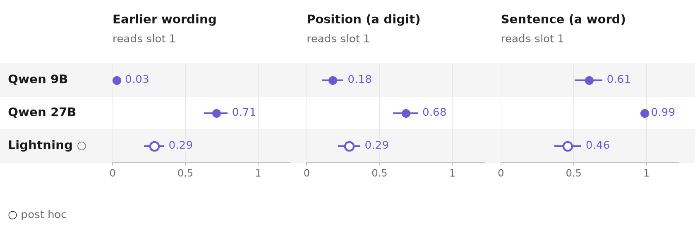
*The report reading slot 1 under three wordings. whiskers: 95% intervals over bridge items; Lightning ○; –: not run, not tested or under 30 switches.*

- **Rule, fixed in advance.** "if slot 1 stays <= 0.2 on the 9B under both wordings, keep as an appendix curiosity; if it recovers, drop." (results/x49_report/x49_6-20261028T154511Z/x49_6.md; Q49.6, Dan: 60%; Lightning a coverage run, no prediction)

- **Result.**

  | | 9B | 27B | Muse | Lightning | 122B |
  |---|---|---|---|---|---|
  | slot 1 read right, the earlier report wording | 0.03 [0.01, 0.05]<!-- src: results/x49_report/x49_6-20261028T154511Z/x49_6.md \| qwen3.5-9b :: 47.10 report :: read :: 0.03 [0.01, 0.05] --> | 0.71 [0.63, 0.79]<!-- src: results/x49_report/x49_6-20261028T154511Z/x49_6.md \| qwen3.6-27b :: 47.10 report :: read :: 0.71 [0.63, 0.79] --> | not designed | 0.29 [0.22, 0.35]<!-- src: results/x49_report/x52_report49-20261029T082508Z/x49_6.md \| nemotron-3.5-lightning :: 47.10 report :: read :: 0.29 [0.22, 0.35] --> | not run |
  | slot 1 read right, the position wording (bar 0.2) | 0.18 [0.11, 0.25]<!-- src: results/x49_report/x49_6-20261028T154511Z/x49_6.md \| qwen3.5-9b :: position :: read :: 0.18 [0.11, 0.25] --> | 0.68 [0.59, 0.76]<!-- src: results/x49_report/x49_6-20261028T154511Z/x49_6.md \| qwen3.6-27b :: position :: read :: 0.68 [0.59, 0.76] --> | | 0.29 [0.21, 0.37]<!-- src: results/x49_report/x52_report49-20261029T082508Z/x49_6.md \| nemotron-3.5-lightning :: position :: read :: 0.29 [0.21, 0.37] --> | |
  | slot 1 read right, the sentence wording (bar 0.2) | 0.61 [0.51, 0.70]<!-- src: results/x49_report/x49_6-20261028T154511Z/x49_6.md \| qwen3.5-9b :: sentence :: read :: 0.61 [0.51, 0.70] --> | 0.99 [0.96, 1.00]<!-- src: results/x49_report/x49_6-20261028T154511Z/x49_6.md \| qwen3.6-27b :: sentence :: read :: 0.99 [0.96, 1.00] --> | | 0.46 [0.37, 0.55]<!-- src: results/x49_report/x52_report49-20261029T082508Z/x49_6.md \| nemotron-3.5-lightning :: sentence :: read :: 0.46 [0.37, 0.55] --> | |
  | the label | **recovers<!-- src: results/x49_report/x49_6-20261028T154511Z/x49_6.md \| ['sentence'] :: recovers -->** (decides: drop) | **recovers<!-- src: results/x49_report/x49_6-20261028T154511Z/x49_6.md \| qwen3.6-27b :: recovers -->** | | **recovers<!-- src: results/x49_report/x52_report49-20261029T082508Z/x49_6.md \| nemotron-3.5-lightning :: recovers -->** (no prediction) | |

- **Read.**
  - Under the sentence wording the 9B reads slot 1 right on most slot-1 scenes, against almost none under the earlier wording; by the rule, slot 1 recovers and the test is dropped. The 27B and Lightning recover under both new wordings.
- **Caveats.**
  - On the 9B the position wording stays just under the bar (0.18); the recovery rests on the sentence wording.
  - The 06:29 coverage matrix named this row "One question, two instructions" and marked the 9B's cell as a gate miss; the verdict scores the 9B. Fixed in the 09:45 matrix (fb9667eb; Appendix A, flag 28).
  - Lightning: a coverage run with the 9B / 27B design, no prediction.

### Do a few heads read the swapped address? (51.2, opened 28 Oct 20:04; Lightning's coverage run 29 Oct) 

`ledger only` *Used in: not in the README (its 12:50 rebuild).*

- **Question.** Does a small set of attention heads carry the address swap's effect at the last token, or is it spread over heads?
- **Why we asked.** Attention follows the swapped address; a few heads could be the readers.
- **Data.** The attention test's items and swap (routes scenes): read pairs 330 / 300 / 284 / 250<!-- src: results/x51_heads/x52_heads-20261029T015136Z/verdict.md \| read pairs 250 :: 250 --> (9B / 27B / Muse / Lightning, at L14).
- **Method.** Heads ranked by their attention move on the fit half, mean-ablated together on the read half at the last token (and the question tokens), against random head sets of the same size in the same layers.

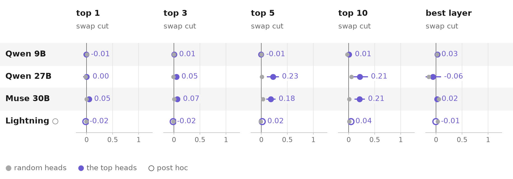
*Share of the swap's switch cut by blocking the top 1, 3, 5 and 10 heads and the best layer, against random head sets (grey). whiskers: 95% intervals over bridge items; Lightning ○; –: not run, not tested or under 30 switches.*

- **Rule, fixed in advance.** "small_set: some top-k set, k in {1, 3, 5, 10}, cuts >= 0.5 while the identity answers (...) change <= 0.10 and the recall's answer changes <= 0.10 (...), and the matched random sets of k heads (same layers) cut <= 0.15 (mean over the draws). distributed: every head of the best layer together cuts < 0.3." Lightning: a coverage run on this rule, no prediction.

- **Result.** (last token)

  | | 9B | 27B | Muse | Lightning | 122B |
  |---|---|---|---|---|---|
  | the best layer's heads together: share of the swap's switch cut | 0.027 [0.008, 0.044]<!-- src: results/x51_heads/x51_2-20261028T190358Z/verdict.md \| 0.448 -> 0.436 :: 0.027 [0.008, 0.044] --> | -0.061 [-0.283, 0.095]<!-- src: results/x51_heads/x51_2-20261028T190358Z/verdict.md \| 0.220 -> 0.233 :: -0.061 [-0.283, 0.095] --> | 0.020 [-0.007, 0.048]<!-- src: results/x51_heads/x51_2-20261028T190358Z/verdict.md \| 0.539 -> 0.528 :: 0.020 [-0.007, 0.048] --> | -0.008 [-0.061, 0.035]<!-- src: results/x51_heads/x52_heads-20261029T015136Z/verdict.md \| 0.500 -> 0.504 :: -0.008 [-0.061, 0.035] --> | not run |
  | the top 10 heads: cut | 0.007 [-0.065, 0.060]<!-- src: results/x51_heads/x51_2-20261028T190358Z/verdict.md \| 0.448 -> 0.445 :: 0.007 [-0.065, 0.060] --> | | | 0.040 [0.015, 0.071]<!-- src: results/x51_heads/x52_heads-20261029T015136Z/verdict.md \| 0.500 -> 0.480 :: 0.040 [0.015, 0.071] --> | |
  | the rule | **distributed** | **distributed** | **distributed** | **distributed<!-- src: results/x51_heads/x52_heads-20261029T015136Z/verdict.md \| Question tokens beside: distributed :: distributed -->** (the question tokens too; no prediction) | |

- **Read.**
  - No small set of heads carries the swap's effect on any of the four models; even all heads of the best layer together cut almost none of it.
- **Caveats.**
  - Linear-attention layers have no heads: Gated DeltaNet on the 9B and 27B, Mamba-2 on Lightning (its verdict says Gated DeltaNet, a wording inherited from Muse's run).
  - Mean ablation at the last token and the question tokens only.

### Do attention heads follow the swapped address to its locker? (attention under the swap, 49.7; Lightning's coverage run 29 Oct) 

`ledger only` *Used in: not in the README (its 12:50 rebuild).*

- **Question.** When the address swap sends the lookup to another locker, does some attention head at the last token move its weight to that locker on the pairs that switched, and only there?
- **Why we asked.** A head that reads the address should move with the swap where the lookup switches and stay put where it does not.
- **Data.** The address swap's routes items at dose 2, heads chosen on one half and read on the other: 330<!-- src: results/x49_attn/x49_7-20261028T154511Z/verdict.md \| Read pairs 330, switched 148 :: 330 --> / 300<!-- src: results/x49_attn/x49_7-20261028T154511Z/verdict.md \| Read pairs 300, switched 66 :: 300 --> / 286<!-- src: results/x49_attn/x49_7-20261028T154511Z/verdict.md \| Read pairs 286, switched 149 :: 286 --> / 250<!-- src: results/x49_attn/x52_attn-20261029T013321Z/verdict.md \| Read pairs 250, switched 125 :: 250 --> read pairs, of which 148<!-- src: results/x49_attn/x49_7-20261028T154511Z/verdict.md \| Read pairs 330, switched 148 :: 148 --> / 66<!-- src: results/x49_attn/x49_7-20261028T154511Z/verdict.md \| Read pairs 300, switched 66 :: 66 --> / 149<!-- src: results/x49_attn/x49_7-20261028T154511Z/verdict.md \| Read pairs 286, switched 149 :: 149 --> / 125<!-- src: results/x49_attn/x52_attn-20261029T013321Z/verdict.md \| Read pairs 250, switched 125 :: 125 --> switched (9B / 27B / Muse / Lightning).
- **Method.** At every full-attention layer after L, every head: the attention mass moved from the original locker to the swapped-in one at the last token (the question tokens beside), on switched and non-switched pairs and under a random vector of the swap's size; the best head zeroed as a necessity check.

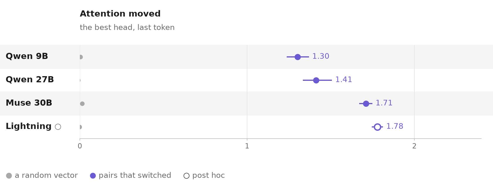
*The best head's attention moved at the last token on pairs that switched, against a random vector (grey); pairs that did not switch: the table. whiskers: 95% intervals over bridge items; Lightning ○; –: not run, not tested or under 30 switches.*

- **Rule, fixed in advance.** "follows: on read-half pairs where the lookup switched to slot k's locker under the swap, >= 1 of the five candidate heads has mean move >= 0.30 (cluster-bootstrap CI excluding 0), its mean move under the random vector on the same pairs <= 0.05, and its mean move on the non-switched swap pairs <= 0.10. elsewhere: the lookup switches to slot k on >= 0.3 of the read-half swap pairs and no recorded head [...] reaches a mean move of 0.15 on the switched pairs. distributed: the summed mean move over the five candidate heads, or over every head of the best head's layer, is >= 0.30 while no single candidate head reaches 0.30." Lightning: a coverage run on this rule, no prediction.

- **Result.**

  | | 9B | 27B | Muse | Lightning | 122B |
  |---|---|---|---|---|---|
  | best head (chosen on the fit half) | L27:h1<!-- src: results/x49_attn/x49_7-20261028T154511Z/verdict.md \| 1.301 [1.237, 1.370] :: L27:h1 --> | L51:h20<!-- src: results/x49_attn/x49_7-20261028T154511Z/verdict.md \| 1.412 [1.334, 1.507] :: L51:h20 --> | L39:h1<!-- src: results/x49_attn/x49_7-20261028T154511Z/verdict.md \| 1.710 [1.670, 1.748] :: L39:h1 --> | L33:h7<!-- src: results/x49_attn/x52_attn-20261029T013321Z/verdict.md \| 1.779 [1.746, 1.812] :: L33:h7 --> | not run |
  | its attention moved, pairs that switched | 1.301 [1.237, 1.370]<!-- src: results/x49_attn/x49_7-20261028T154511Z/verdict.md \| L27:h1 :: 1.301 [1.237, 1.370] --> | 1.412 [1.334, 1.507]<!-- src: results/x49_attn/x49_7-20261028T154511Z/verdict.md \| L51:h20 :: 1.412 [1.334, 1.507] --> | 1.710 [1.670, 1.748]<!-- src: results/x49_attn/x49_7-20261028T154511Z/verdict.md \| L39:h1 :: 1.710 [1.670, 1.748] --> | 1.779 [1.746, 1.812]<!-- src: results/x49_attn/x52_attn-20261029T013321Z/verdict.md \| L33:h7 :: 1.779 [1.746, 1.812] --> | |
  | the same, pairs that did not switch (bar 0.10) | 0.196 [0.154, 0.247]<!-- src: results/x49_attn/x49_7-20261028T154511Z/verdict.md \| L27:h1 :: 0.196 [0.154, 0.247] --> | 0.183 [0.135, 0.237]<!-- src: results/x49_attn/x49_7-20261028T154511Z/verdict.md \| L51:h20 :: 0.183 [0.135, 0.237] --> | 0.409 [0.334, 0.473]<!-- src: results/x49_attn/x49_7-20261028T154511Z/verdict.md \| L39:h1 :: 0.409 [0.334, 0.473] --> | 0.312 [0.233, 0.394]<!-- src: results/x49_attn/x52_attn-20261029T013321Z/verdict.md \| L33:h7 :: 0.312 [0.233, 0.394] --> | |
  | the same under a random vector, switched pairs (bar 0.05) | 0.004 [0.000, 0.008]<!-- src: results/x49_attn/x49_7-20261028T154511Z/verdict.md \| L27:h1 :: 0.004 [0.000, 0.008] --> | -0.010 [-0.018, -0.000]<!-- src: results/x49_attn/x49_7-20261028T154511Z/verdict.md \| L51:h20 :: -0.010 [-0.018, -0.000] --> | 0.015 [0.007, 0.021]<!-- src: results/x49_attn/x49_7-20261028T154511Z/verdict.md \| L39:h1 :: 0.015 [0.007, 0.021] --> | -0.001 [-0.005, 0.003]<!-- src: results/x49_attn/x52_attn-20261029T013321Z/verdict.md \| L33:h7 :: -0.001 [-0.005, 0.003] --> | |
  | the head zeroed: lookups switched, swap -> zeroed | 0.448 -> 0.448<!-- src: results/x49_attn/x49_7-20261028T154511Z/verdict.md \| 330 :: 0.448 -> 0.448 --> | 0.220 -> 0.217<!-- src: results/x49_attn/x49_7-20261028T154511Z/verdict.md \| 300 :: 0.220 -> 0.217 --> | 0.535 -> 0.517<!-- src: results/x49_attn/x49_7-20261028T154511Z/verdict.md \| 286 :: 0.535 -> 0.517 --> | 0.500 -> 0.516<!-- src: results/x49_attn/x52_attn-20261029T013321Z/verdict.md \| 250 :: 0.500 -> 0.516 --> | |
  | the rule | **neither<!-- src: results/x49_attn/x49_7-20261028T154511Z/verdict.md \| distributed: no :: neither -->** | **neither<!-- src: results/x49_attn/x49_7-20261028T154511Z/verdict.md \| distributed: no :: neither -->** | **neither<!-- src: results/x49_attn/x49_7-20261028T154511Z/verdict.md \| distributed: no :: neither -->** | **neither<!-- src: results/x49_attn/x52_attn-20261029T013321Z/verdict.md \| distributed: no :: neither -->** (no prediction) | |

- **Read.**
  - On all four models the best head moves its attention to the swapped-in locker where the lookup switched, but also, above the 0.10 bar, where it did not; zeroing it leaves the switch in place. No head follows the address by the rule: neither, on all four.
- **Caveats.**
  - Only full-attention layers after L are recorded. Lightning's verdict calls its skipped blocks "Gated DeltaNet", a wording inherited from Muse's run; on Lightning they are Mamba-2 blocks.
  - The 27B's lookup switches on 0.220<!-- src: results/x49_attn/x49_7-20261028T154511Z/verdict.md \| switch share 0.220 :: 0.220 --> of read pairs, under the 0.3 that "elsewhere" needs.

### Does the second hop, hall to locker, run through an address too? (chained addresses, 47.14; the 27B's coverage run 29 Oct) 

`in README` `below gate: Lightning` *Used in: README Part VI, one line with a link ("the second hop's key token").*

- **Question.** With hall sentences before the locker sentences, is the hall of the pick's locker read through an address at the locker digit, as the locker is read through one at the bridge word?
- **Why we asked.** If the address is a general pointer, the next hop (locker to hall) should use one too.
- **Data.** Hall scenes, the test half: 147<!-- src: results/x47_chain/x47_14-20261028T115841Z/x47_14.md \| qwen35_9b_x47_14 :: 147 --> / 146<!-- src: results/x47_chain/x52_chain-20261029T023424Z/x47_14.md \| x47_14_27b :: 146 --> / 153<!-- src: results/x47_chain/x47_14-20261028T115841Z/x47_14.md \| muse30_x47_14 :: 153 --> (9B / 27B / Muse). Lightning not tested: its gate failed (the hall question right on 0.736<!-- src: results/x47_chain/nem35l_x52_chain/gate.json \| "PPP" :: 0.736 --> of 500<!-- src: results/x47_chain/nem35l_x52_chain/gate.json \| "cases" :: 500 --> cases, under 0.80).
- **Method.** The change at the digit token of the bridge's locker sentence at L: the hall address (U_num) taken out or retained alone, against random parts of its share; the hall question's answers sorted into identity, position and value; the locker question's answer as the collateral.

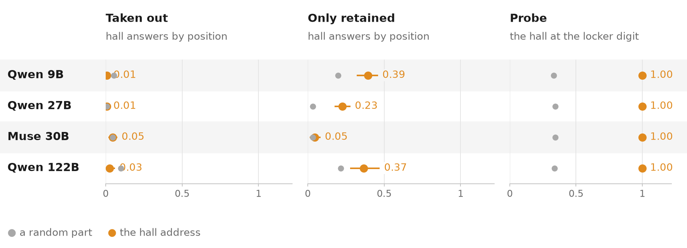
*Hall answers by position with the hall address taken out or retained alone, each against a random part of the same size (grey); right: the hall probe at the locker digit against its layout baseline (grey). Whiskers: 95% intervals.*

- **Rule, fixed in advance.** "probe >= 0.8 with the layout baseline <= 0.6; without U_num the hall question's position share falls >= 0.3 below the share without its random part; only U_num gives position >= 0.15; the locker question's unchanged share within 0.05 of unedited under every arm; on both models." The 27B: a coverage run on this rule, no prediction.

- **Result.**

  | | 9B | 27B | Muse | Lightning | 122B |
  |---|---|---|---|---|---|
  | the hall readable at the locker digit: slot probe (layout baseline) | 1.00 [1.00, 1.00]<!-- src: results/x47_chain/x47_14-20261028T115841Z/x47_14.md \| qwen35_9b_x47_14 :: 1.00 [1.00, 1.00] --> (0.33 [0.28, 0.38]<!-- src: results/x47_chain/x47_14-20261028T115841Z/x47_14.md \| qwen35_9b_x47_14 :: 0.33 [0.28, 0.38] -->) | 1.00 [1.00, 1.00]<!-- src: results/x47_chain/x52_chain-20261029T023424Z/x47_14.md \| x47_14_27b :: 1.00 [1.00, 1.00] --> (0.34 [0.29, 0.40]<!-- src: results/x47_chain/x52_chain-20261029T023424Z/x47_14.md \| x47_14_27b :: 0.34 [0.29, 0.40] -->) | 1.00 [1.00, 1.00]<!-- src: results/x47_chain/x47_14-20261028T115841Z/x47_14.md \| muse30_x47_14 :: 1.00 [1.00, 1.00] --> (0.34 [0.28, 0.41]<!-- src: results/x47_chain/x47_14-20261028T115841Z/x47_14.md \| muse30_x47_14 :: 0.34 [0.28, 0.41] -->) | not tested (gate 0.736<!-- src: results/x47_chain/nem35l_x52_chain/gate.json \| "PPP" :: 0.736 --> < 0.80) | 1.00 [1.00, 1.00]<!-- src: results/x47_chain/x52_chain-20261030T094553Z/x47_14.md \| qwen35_122b_chain :: 1.00 [1.00, 1.00] --> (0.34 [0.29, 0.39]<!-- src: results/x47_chain/x52_chain-20261030T094553Z/x47_14.md \| qwen35_122b_chain :: 0.34 [0.29, 0.39] -->) |
  | hall answers cut by taking out the hall address, beyond random (bar >= 0.3) | 0.05 [0.02, 0.08]<!-- src: results/x47_chain/x47_14-20261028T115841Z/x47_14.md \| qwen35_9b_x47_14 :: 0.05 [0.02, 0.08] --> | 0.00 [0.00, 0.00]<!-- src: results/x47_chain/x52_chain-20261029T023424Z/x47_14.md \| x47_14_27b :: 0.00 [0.00, 0.00] --> | 0.00 [0.00, 0.00]<!-- src: results/x47_chain/x47_14-20261028T115841Z/x47_14.md \| muse30_x47_14 :: 0.00 [0.00, 0.00] --> | | 0.07 [0.02, 0.13]<!-- src: results/x47_chain/x52_chain-20261030T094553Z/x47_14.md \| qwen35_122b_chain :: 0.07 [0.02, 0.13] --> |
  | position answers with only the hall address retained (bar >= 0.15) | 0.39 [0.32, 0.46]<!-- src: results/x47_chain/x47_14-20261028T115841Z/x47_14.md \| qwen35_9b_x47_14 :: 0.39 [0.32, 0.46] --> | 0.23 [0.17, 0.28]<!-- src: results/x47_chain/x52_chain-20261029T023424Z/x47_14.md \| x47_14_27b :: 0.23 [0.17, 0.28] --> | 0.05 [0.01, 0.08]<!-- src: results/x47_chain/x47_14-20261028T115841Z/x47_14.md \| muse30_x47_14 :: 0.05 [0.01, 0.08] --> | | 0.37 [0.28, 0.47]<!-- src: results/x47_chain/x52_chain-20261030T094553Z/x47_14.md \| qwen35_122b_chain :: 0.37 [0.28, 0.47] --> |
  | the rule, per model | **no<!-- src: results/x47_chain/x47_14-20261028T115841Z/x47_14.md \| qwen35_9b_x47_14 :: no -->** | **no<!-- src: results/x47_chain/x52_chain-20261029T023424Z/x47_14.md \| x47_14_27b :: no -->** | **no<!-- src: results/x47_chain/x47_14-20261028T115841Z/x47_14.md \| muse30_x47_14 :: no -->** | | **no** (no prediction) |

- **Read.**
  - On the 9B, 27B and Muse the hall is readable at the locker digit, but taking out the hall address cuts no more hall answers than a random part: the second hop does not run through an address the way the first does.
- **Caveats.**
  - The verdicts' batch line ("0 of 2 models hold; the rule needs both") applies the across-models clause; the per-model labels are the result.
  - Retained alone, the hall address gives position answers above the 0.15 bar on the 9B and 27B; only its removal fails.

### Must the address be refit for each text format? (address refit per format, x45d; Lightning's coverage run 29 Oct) 

`in README` *Used in: README Part III card "Must the address be refit for each text format?".*

- **Question.** On varied scenes (prose, JSON, tables), does an address refit on each format's own scenes carry the lookup's position answers, where the address fit on simple scenes does little?
- **Why we asked.** The address was fit on one template; in other formats the code may sit elsewhere.
- **Data.** The held-out half of the varied scenes per format, the bridge items not used for the fit; Lightning prose / JSON / table: 191<!-- src: results/x0b_generalize/nem35l_x52_x45d/x45d-20261029T035250Z/verdict.md \| prose :: the refit basis (rank 4, the other half) :: lookup :: 191 --> / 40<!-- src: results/x0b_generalize/nem35l_x52_x45d/x45d-20261029T035250Z/verdict.md \| json :: the refit basis (rank 4, the other half) :: lookup :: 40 --> / 187<!-- src: results/x0b_generalize/nem35l_x52_x45d/x45d-20261029T035250Z/verdict.md \| table :: the refit basis (rank 4, the other half) :: lookup :: 187 --> (the other models' n in the verdicts).
- **Method.** The address refit per format on one half (rank 4) and taken out of the change at the bridge word at L on the other half, against a random part of its share; the address fit on simple scenes beside.

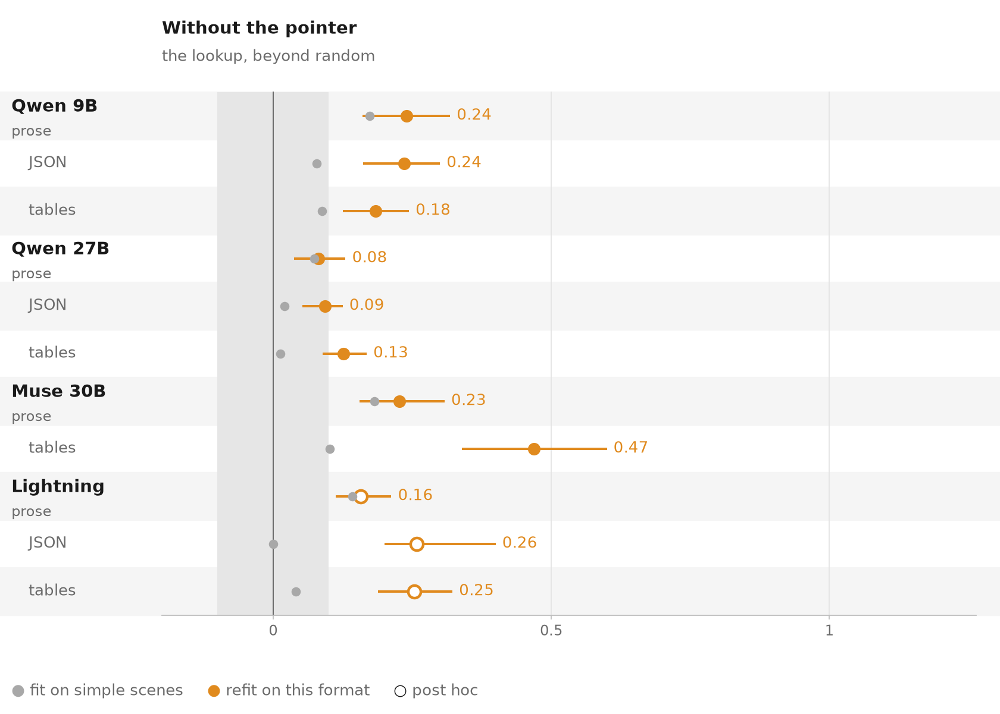
*Per model and format: the lookup's drop beyond random without the pointer refit on that format, against the pointer fit on simple scenes (grey). whiskers: 95% intervals over bridge items; Lightning ○; –: not run, not tested or under 30 switches; grey band: within 0.10 of random.*

- **Rule, fixed in advance.** ""Pointer elsewhere" if the refit basis gives a lookup extra drop of at least 0.2, with lower CI above 0.1, in 2 of 3 formats; "No linear pointer found" if all three formats are below 0.1 (point estimate); otherwise neither." Added after the first results (Dan, 26 Oct ~21:20): a format whose lookup has fewer than 30 switches under the whole change does not count. Lightning: a coverage run, no prediction.

- **Result.**

  | | 9B | 27B | Muse | Lightning | 122B |
  |---|---|---|---|---|---|
  | prose: lookup blocked without the refit address, beyond random | 0.24 [0.16, 0.32]<!-- src: results/x0b_generalize/qwen35_9b_x45d/x45d-20261026T202025Z/verdict.md \| prose :: the refit basis (rank 4, the other half) :: lookup :: 223 :: 0.24 [0.16, 0.32] --> | 0.08 [0.04, 0.13]<!-- src: results/x0b_generalize/x45d_27b/x45d-20261026T202026Z/verdict.md \| prose :: the refit basis (rank 4, the other half) :: lookup :: 383 :: 0.08 [0.04, 0.13] --> | 0.23 [0.16, 0.31]<!-- src: results/x0b_generalize/muse30b_x45d/x45d-20261026T202027Z/verdict.md \| prose :: the refit basis (rank 4, the other half) :: lookup :: 270 :: 0.23 [0.16, 0.31] --> | 0.16 [0.11, 0.21]<!-- src: results/x0b_generalize/nem35l_x52_x45d/x45d-20261029T035250Z/verdict.md \| prose :: the refit basis (rank 4, the other half) :: lookup :: 191 :: 0.16 [0.11, 0.21] --> | not run |
  | json: lookup blocked without the refit address, beyond random | 0.24 [0.16, 0.30]<!-- src: results/x0b_generalize/qwen35_9b_x45d/x45d-20261026T202025Z/verdict.md \| json :: the refit basis (rank 4, the other half) :: lookup :: 70 :: 0.24 [0.16, 0.30] --> | 0.09 [0.05, 0.12]<!-- src: results/x0b_generalize/x45d_27b/x45d-20261026T202026Z/verdict.md \| json :: the refit basis (rank 4, the other half) :: lookup :: 143 :: 0.09 [0.05, 0.12] --> | 0.38 [0.16, 0.65]<!-- src: results/x0b_generalize/muse30b_x45d/x45d-20261026T202027Z/verdict.md \| json :: the refit basis (rank 4, the other half) :: lookup :: 89 :: 0.38 [0.16, 0.65] --> (29 switches: does not count) | 0.26 [0.20, 0.40]<!-- src: results/x0b_generalize/nem35l_x52_x45d/x45d-20261029T035250Z/verdict.md \| json :: the refit basis (rank 4, the other half) :: lookup :: 40 :: 0.26 [0.20, 0.40] --> | |
  | table: lookup blocked without the refit address, beyond random | 0.18 [0.13, 0.24]<!-- src: results/x0b_generalize/qwen35_9b_x45d/x45d-20261026T202025Z/verdict.md \| table :: the refit basis (rank 4, the other half) :: lookup :: 138 :: 0.18 [0.13, 0.24] --> | 0.13 [0.09, 0.17]<!-- src: results/x0b_generalize/x45d_27b/x45d-20261026T202026Z/verdict.md \| table :: the refit basis (rank 4, the other half) :: lookup :: 322 :: 0.13 [0.09, 0.17] --> | 0.47 [0.34, 0.60]<!-- src: results/x0b_generalize/muse30b_x45d/x45d-20261026T202027Z/verdict.md \| table :: the refit basis (rank 4, the other half) :: lookup :: 238 :: 0.47 [0.34, 0.60] --> | 0.25 [0.19, 0.32]<!-- src: results/x0b_generalize/nem35l_x52_x45d/x45d-20261029T035250Z/verdict.md \| table :: the refit basis (rank 4, the other half) :: lookup :: 187 :: 0.25 [0.19, 0.32] --> | |
  | the outcome | **pointer elsewhere<!-- src: results/x0b_generalize/qwen35_9b_x45d/x45d-20261026T202025Z/verdict.md \| Outcome :: pointer elsewhere -->** | **neither<!-- src: results/x0b_generalize/x45d_27b/x45d-20261026T202026Z/verdict.md \| Outcome :: neither -->** | **pointer elsewhere<!-- src: results/x0b_generalize/muse30b_x45d/x45d-20261026T202027Z/verdict.md \| Outcome :: pointer elsewhere -->** | **pointer elsewhere<!-- src: results/x0b_generalize/nem35l_x52_x45d/x45d-20261029T035250Z/verdict.md \| Outcome :: pointer elsewhere -->** (no prediction) | |

- **Read.**
  - Refit on each format, the address carries the lookup again on the 9B, Muse and Lightning (pointer elsewhere); on the 27B it stays under 0.2 in every format (neither).
- **Caveats.**
  - The 30-switch bar was set after the first results; it drops Muse's JSON (29 switches).
  - Lightning's JSON rests on 40 scenes from 4 bridge items.

### Does the address carry over to code and tool output? (53.7, adapted design; the 9B and the 27B, code and tool output, 29 Oct) 

`in README` *Used in: README Part III card "Is the address readable, and used, in Python code and tool output?"; adapted design: lookup-only gate, the recall is not part of this test.*

- **Question.** Does the address carry over to code and tool output: does a probe read it at the bridge word, and does the routes test find the lookup using it, when the scene is rendered as Python or as a tool's response?
- **Why we asked.** The address is found in prose, JSON and tables ([probe](#probe), [routes](#routes), [refit](#x45d)); code and tool output are where a pointer would matter in practice.
- **Data.** Our locker scenes rendered as Python (one assignment per statement) and as the response of a declared tool (the scene's text verbatim). Routes test: 300 scenes per condition and format on the 9B (L12) and the 27B (L32), every gate passed. Probe: the 9B in tool output, 1500 scenes; the 27B in code (682 scenes) and in tool output (1500); the 9B in code is not tested (gate 0.669<!-- src: results/x0_probe/x53_7_probe-20261029T130251Z/verdict.md \| Qwen3.5-9B :: code :: lookup says and reads O and S right :: 0.669 --> < 0.80). Monitor (53.2's probes): the 9B in tool output, 400 rows; the 9B in code not tested (gate 0.702<!-- src: results/x53_monitor/x53_7_monitor-20261029T130113Z/verdict.md \| Qwen3.5-9B :: code :: d1_topics_v3 (272 scenes) :: 0.702 --> < 0.80); the 27B running.
- **Method.** The routes test's arms (the whole change, without the address against a random part of its share, the address alone) at the bridge word at L, as in prose; the address probe (x0_probe v4) at the bridge word at L, which locker sentence holds the item's locker, locker first and locker after (the control); the monitor test (53.2's probes on the lens part, a random subspace, an energy-matched random subspace and the full state) in tool output. The address U is carried over from prose, not refit: the same layout-free mass-mean of the bridge word's prose probe states at L in every format (the verdict says so; each run's manifest records it as alf_from).

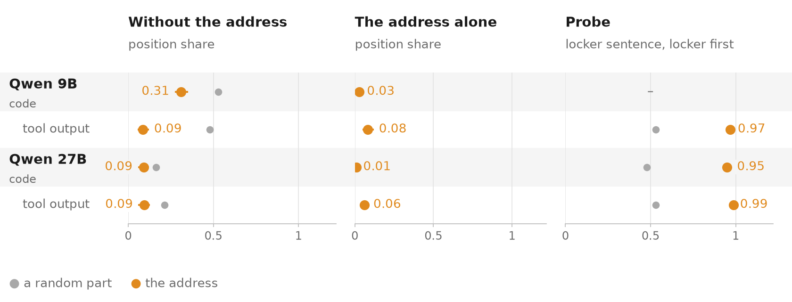
*Per model and format: position share without the address against a random part (grey), the address alone, and the probe against the layout alone (grey). Whiskers: 95% intervals.*

- **Rule, fixed in advance.** The routes test's, verbatim: "A route counts as used if its share is >= 0.2 with lower CI >= 0.1." The probe: none (descriptive, as x0_probe v4). The gate (Dan 12:10, decisions_1210, before any routes or probe result was opened): "use a lookup-only gate (the lookup says and reads O and S right, >= 0.80) [...] label "adapted design: lookup-only gate; the recall is not part of this test". The recall columns are reported descriptively." (jobs/c3/batch53.yaml; no prediction)

- **Result.** (condition C2, another item moved; each cell code; tool output)

  | | 9B | 27B | Muse | Lightning | 122B |
  |---|---|---|---|---|---|
  | routes, the whole change: position | 0.54 [0.50, 0.59]<!-- src: results/x6_routes/x53_7_routes-20261029T122509Z/verdict.md \| Qwen3.5-9B :: code :: C2 :: the whole change :: 0.54 [0.50, 0.59] -->; 0.46 [0.41, 0.51]<!-- src: results/x6_routes/x53_7_routes-20261029T122509Z/verdict.md \| Qwen3.5-9B :: tool :: C2 :: the whole change :: 0.46 [0.41, 0.51] --> | 0.20 [0.16, 0.25]<!-- src: results/x6_routes/x53_7_routes-20261029T122509Z/verdict.md \| Qwen3.6-27B :: code :: C2 :: the whole change :: 0.20 [0.16, 0.25] -->; 0.27 [0.22, 0.32]<!-- src: results/x6_routes/x53_7_routes-20261029T122509Z/verdict.md \| Qwen3.6-27B :: tool :: C2 :: the whole change :: 0.27 [0.22, 0.32] --> | not designed | not designed | not designed (adapted design: the probe only, lookup-only gate) |
  | routes, the whole change: identity | 0.38 [0.32, 0.43]<!-- src: results/x6_routes/x53_7_routes-20261029T122509Z/verdict.md \| Qwen3.5-9B :: code :: C2 :: the whole change :: 0.38 [0.32, 0.43] -->; 0.50 [0.45, 0.54]<!-- src: results/x6_routes/x53_7_routes-20261029T122509Z/verdict.md \| Qwen3.5-9B :: tool :: C2 :: the whole change :: 0.50 [0.45, 0.54] --> | 0.77 [0.73, 0.82]<!-- src: results/x6_routes/x53_7_routes-20261029T122509Z/verdict.md \| Qwen3.6-27B :: code :: C2 :: the whole change :: 0.77 [0.73, 0.82] -->; 0.72 [0.67, 0.77]<!-- src: results/x6_routes/x53_7_routes-20261029T122509Z/verdict.md \| Qwen3.6-27B :: tool :: C2 :: the whole change :: 0.72 [0.67, 0.77] --> | | | |
  | routes: position without the address | 0.31 [0.27, 0.35]<!-- src: results/x6_routes/x53_7_routes-20261029T122509Z/verdict.md \| Qwen3.5-9B :: code :: C2 :: without the address :: 0.31 [0.27, 0.35] -->; 0.09 [0.05, 0.12]<!-- src: results/x6_routes/x53_7_routes-20261029T122509Z/verdict.md \| Qwen3.5-9B :: tool :: C2 :: without the address :: 0.09 [0.05, 0.12] --> | 0.09 [0.06, 0.12]<!-- src: results/x6_routes/x53_7_routes-20261029T122509Z/verdict.md \| Qwen3.6-27B :: code :: C2 :: without the address :: 0.09 [0.06, 0.12] -->; 0.09 [0.06, 0.13]<!-- src: results/x6_routes/x53_7_routes-20261029T122509Z/verdict.md \| Qwen3.6-27B :: tool :: C2 :: without the address :: 0.09 [0.06, 0.13] --> | | | |
  | routes: the same without a random part of its share | 0.53 [0.49, 0.58]<!-- src: results/x6_routes/x53_7_routes-20261029T122509Z/verdict.md \| Qwen3.5-9B :: code :: C2 :: without a random part (the address's share) :: 0.53 [0.49, 0.58] -->; 0.48 [0.42, 0.53]<!-- src: results/x6_routes/x53_7_routes-20261029T122509Z/verdict.md \| Qwen3.5-9B :: tool :: C2 :: without a random part (the address's share) :: 0.48 [0.42, 0.53] --> | 0.16 [0.13, 0.20]<!-- src: results/x6_routes/x53_7_routes-20261029T122509Z/verdict.md \| Qwen3.6-27B :: code :: C2 :: without a random part (the address's share) :: 0.16 [0.13, 0.20] -->; 0.21 [0.17, 0.26]<!-- src: results/x6_routes/x53_7_routes-20261029T122509Z/verdict.md \| Qwen3.6-27B :: tool :: C2 :: without a random part (the address's share) :: 0.21 [0.17, 0.26] --> | | | |
  | routes: position, the address alone | 0.03 [0.01, 0.04]<!-- src: results/x6_routes/x53_7_routes-20261029T122509Z/verdict.md \| Qwen3.5-9B :: code :: C2 :: the address alone :: 0.03 [0.01, 0.04] -->; 0.08 [0.05, 0.12]<!-- src: results/x6_routes/x53_7_routes-20261029T122509Z/verdict.md \| Qwen3.5-9B :: tool :: C2 :: the address alone :: 0.08 [0.05, 0.12] --> | 0.01 [0.00, 0.02]<!-- src: results/x6_routes/x53_7_routes-20261029T122509Z/verdict.md \| Qwen3.6-27B :: code :: C2 :: the address alone :: 0.01 [0.00, 0.02] -->; 0.06 [0.04, 0.08]<!-- src: results/x6_routes/x53_7_routes-20261029T122509Z/verdict.md \| Qwen3.6-27B :: tool :: C2 :: the address alone :: 0.06 [0.04, 0.08] --> | | | |
  | routes used: the whole change / the address alone | identity, position / original | identity, position / original | | | |
  | probe in code: which locker sentence, locker first / the layout alone / locker after (the control) | ○ not tested (gate 0.669<!-- src: results/x0_probe/x53_7_probe-20261029T130251Z/verdict.md \| Qwen3.5-9B :: code :: lookup says and reads O and S right :: 0.669 --> < 0.80; gate changed after the data, Dan 12:25) | 0.95 [0.92, 0.98]<!-- src: results/x0_probe/x53_7_probe-20261029T130251Z/verdict.md \| Qwen3.6-27B :: code :: before :: locker sentence :: 0.95 [0.92, 0.98] --> / 0.48 [0.42, 0.53]<!-- src: results/x0_probe/x53_7_probe-20261029T130251Z/verdict.md \| Qwen3.6-27B :: code :: before :: locker sentence :: 0.95 [0.92, 0.98] :: 0.48 [0.42, 0.53] --> / 0.38 [0.34, 0.43]<!-- src: results/x0_probe/x53_7_probe-20261029T130251Z/verdict.md \| Qwen3.6-27B :: code :: after :: locker sentence :: 0.38 [0.34, 0.43] --> (the prose probe beside: 0.99 [0.98, 1.00]<!-- src: results/x0_probe/x53_7_probe-20261029T130251Z/verdict.md \| Qwen3.6-27B :: code :: before :: locker sentence :: 0.95 [0.92, 0.98] :: 0.48 [0.42, 0.53] :: 0.99 [0.98, 1.00] -->) | | | 0.92 [0.88, 0.95]<!-- src: results/x0_probe/x53_7_probe-20261030T002257Z/verdict.md \| qwen3.5-122b-a10b :: code :: before :: locker sentence :: 0.92 [0.88, 0.95] --> / 0.44 [0.38, 0.50]<!-- src: results/x0_probe/x53_7_probe-20261030T002257Z/verdict.md \| qwen3.5-122b-a10b :: code :: before :: locker sentence :: 0.44 [0.38, 0.50] --> / 0.40 [0.36, 0.44]<!-- src: results/x0_probe/x53_7_probe-20261030T002257Z/verdict.md \| qwen3.5-122b-a10b :: code :: after :: locker sentence :: 0.40 [0.36, 0.44] --> ○ |
  | probe in tool output: which locker sentence, locker first / the layout alone / locker after (the control) | 0.97 [0.95, 0.98]<!-- src: results/x0_probe/x53_7_probe-20261029T130251Z/verdict.md \| Qwen3.5-9B :: tool :: before :: locker sentence :: 0.97 [0.95, 0.98] --> / 0.53 [0.50, 0.56]<!-- src: results/x0_probe/x53_7_probe-20261029T130251Z/verdict.md \| Qwen3.5-9B :: tool :: before :: locker sentence :: 0.53 [0.50, 0.56] --> / 0.31 [0.28, 0.34]<!-- src: results/x0_probe/x53_7_probe-20261029T130251Z/verdict.md \| Qwen3.5-9B :: tool :: after :: locker sentence :: 0.31 [0.28, 0.34] --> (the prose probe beside: 0.97 [0.96, 0.98]<!-- src: results/x0_probe/x53_7_probe-20261029T130251Z/verdict.md \| Qwen3.5-9B :: tool :: before :: locker sentence :: 0.97 [0.96, 0.98] -->) | 0.99 [0.98, 0.99]<!-- src: results/x0_probe/x53_7_probe-20261029T130251Z/verdict.md \| Qwen3.6-27B :: tool :: before :: locker sentence :: 0.99 [0.98, 0.99] --> / 0.53 [0.50, 0.56]<!-- src: results/x0_probe/x53_7_probe-20261029T130251Z/verdict.md \| Qwen3.6-27B :: tool :: before :: locker sentence :: 0.99 [0.98, 0.99] :: 0.53 [0.50, 0.56] --> / 0.34 [0.31, 0.37]<!-- src: results/x0_probe/x53_7_probe-20261029T130251Z/verdict.md \| Qwen3.6-27B :: tool :: after :: locker sentence :: 0.34 [0.31, 0.37] --> (the prose probe beside: 0.99 [0.98, 1.00]<!-- src: results/x0_probe/x53_7_probe-20261029T130251Z/verdict.md \| Qwen3.6-27B :: tool :: before :: locker sentence :: 0.99 [0.98, 0.99] :: 0.53 [0.50, 0.56] :: 0.99 [0.98, 1.00] -->) | | | 0.93 [0.91, 0.95]<!-- src: results/x0_probe/x53_7_probe-20261030T002257Z/verdict.md \| qwen3.5-122b-a10b :: tool :: before :: locker sentence :: 0.93 [0.91, 0.95] --> / 0.40 [0.37, 0.44]<!-- src: results/x0_probe/x53_7_probe-20261030T002257Z/verdict.md \| qwen3.5-122b-a10b :: tool :: before :: locker sentence :: 0.40 [0.37, 0.44] --> / 0.34 [0.32, 0.37]<!-- src: results/x0_probe/x53_7_probe-20261030T002257Z/verdict.md \| qwen3.5-122b-a10b :: tool :: after :: locker sentence :: 0.34 [0.32, 0.37] --> ○ |
  | probe: the answer digit, locker first, code; tool output (chance 0.11<!-- src: results/x0_probe/x53_7_probe-20261029T130251Z/verdict.md \| Qwen3.5-9B :: tool :: before :: answer digit :: 0.26 [0.23, 0.30] :: 0.11 -->) | ○ not tested; 0.26 [0.23, 0.30]<!-- src: results/x0_probe/x53_7_probe-20261029T130251Z/verdict.md \| Qwen3.5-9B :: tool :: before :: answer digit :: 0.26 [0.23, 0.30] --> | 0.30 [0.23, 0.35]<!-- src: results/x0_probe/x53_7_probe-20261029T130251Z/verdict.md \| Qwen3.6-27B :: code :: before :: answer digit :: 0.30 [0.23, 0.35] -->; 0.40 [0.37, 0.43]<!-- src: results/x0_probe/x53_7_probe-20261029T130251Z/verdict.md \| Qwen3.6-27B :: tool :: before :: answer digit :: 0.40 [0.37, 0.43] --> | | | 0.19 [0.15, 0.23]<!-- src: results/x0_probe/x53_7_probe-20261030T002257Z/verdict.md \| qwen3.5-122b-a10b :: code :: before :: answer digit :: 0.19 [0.15, 0.23] -->; 0.25 [0.21, 0.28]<!-- src: results/x0_probe/x53_7_probe-20261030T002257Z/verdict.md \| qwen3.5-122b-a10b :: tool :: before :: answer digit :: 0.25 [0.21, 0.28] --> ○ |
  | monitor in tool output: the slot at the last token, k = 25 / 100 (53.2's rule) | in between / in between: the full state 0.93<!-- src: results/x53_monitor/x53_7_monitor-20261029T130113Z/verdict.md \| Qwen3.5-9B :: tool_l (n 400 rows, 46 entities) :: T :: (b) the bridge item's locker slot (the address) :: 0.93 -->, the lens part 0.62<!-- src: results/x53_monitor/x53_7_monitor-20261029T130113Z/verdict.md \| Qwen3.5-9B :: tool_l (n 400 rows, 46 entities) :: T :: (b) the bridge item's locker slot (the address) :: 0.93 :: 0.62 --> at k = 25; against energy-matched random: under-represented in the lens directions (code: not tested, gate 0.702<!-- src: results/x53_monitor/x53_7_monitor-20261029T130113Z/verdict.md \| Qwen3.5-9B :: code :: d1_topics_v3 (272 scenes) :: 0.702 --> < 0.80) | running | | | |
  | monitor in tool output: the lookup's digit at the bridge word | not decodable: the full state 0.12<!-- src: results/x53_monitor/x53_7_monitor-20261029T130113Z/verdict.md \| Qwen3.5-9B :: tool_l (n 400 rows, 46 entities) :: B :: (c) the lookup's answer digit :: 0.12 --> | running | | | |

- **Read.**
  - In code and in tool output the lookup takes the item's identity or its locker's position, never the value, on the 9B and the 27B; removing the address cuts position answers beyond a random part of its share in both formats on both models.
  - Added by itself, the address brings few position answers back in either format (in prose it brought them back on the 9B, [routes](#routes)); the only route it uses is the original answer.
  - The probe reads which locker sentence holds the item's locker, locker first, as in prose: the 9B in tool output and the 27B in code and in tool output; locker after it reads no better than the baselines. The answer digit, locker first, reads above chance but far below the locker sentence.
  - On the 9B in tool output the monitor test reads as in prose: the full state reads the slot at the last token, the lens part in between, and worse than random directions of the same energy (under-represented in the lens directions); the lookup's digit at the bridge word is not decodable even from the full state.
- **Caveats.**
  - Dan (12:10b), verbatim: tool output as prose (JSON is covered by x0b_v2), and the bridge ~250 tokens later in the tool format, not separated from the format (47.16's distance robustness beside). The probe only shows the address is readable; the routes test decides whether the lookup uses it.
  - In condition C1 (two picks swap) in tool output a random part of the address's share already cuts position to 0.06 [0.03, 0.08]<!-- src: results/x6_routes/x53_7_routes-20261029T122509Z/verdict.md \| Qwen3.5-9B :: tool :: C1 :: without a random part (the address's share) :: 0.06 [0.03, 0.08] --> on the 9B and 0.02 [0.01, 0.04]<!-- src: results/x6_routes/x53_7_routes-20261029T122509Z/verdict.md \| Qwen3.6-27B :: tool :: C1 :: without a random part (the address's share) :: 0.02 [0.01, 0.04] --> on the 27B: there the removal cannot tell the address from a random part.
  - Adapted design: the lookup-only gate replaces X0's two-reader gate; the recall's rates are descriptive. The 27B's probes and the 9B tool probe pass either gate or were computed after the decision; the 9B code probe is not tested (hollow: its gate was changed after the data, Dan 12:25).
  - U is carried over from prose, not refit in code or tool output (Dan 13:15 asked): the address fit on prose scenes is the one removed and added. The monitor on the 27B is running; the CH2 code-pointer add-on (descriptive) is left out.
  - Exploratory (batch 53): no prediction; UNVERIFIED.

## Part IV. Where and when the link is made

### Does the bridge word redirect the lookup only when its locker sentence came first? (the split by sentence order; Lightning's opened 29 Oct 01:54) 

`in README` *Used in: README Part IV card "Does the bridge word redirect the lookup only when its locker sentence came first?" (the split).*

- **Question.** On the main test, does the change at the bridge word switch the lookup when the item's locker sentence came before the asked pick, and when it came after?
- **Why we asked.** The bridge word can only point back: if the locker sentence comes after it, the link must be made elsewhere.
- **Data.** Main test, 200 per model, split by where the item's locker sentence sits: before the pick 100 / 101 / 92 / 85 / 85, after it 100 / 99 / 108 / 115 / 115 (9B / 27B / Muse / Lightning / the 122B, FP8; MoE, ~10B active, at its L33).
- **Method.** The conflict test's cells, split by sentence order: the lookup's switch under the whole change, and each reader's switches blocked without the lens part beyond a random part.

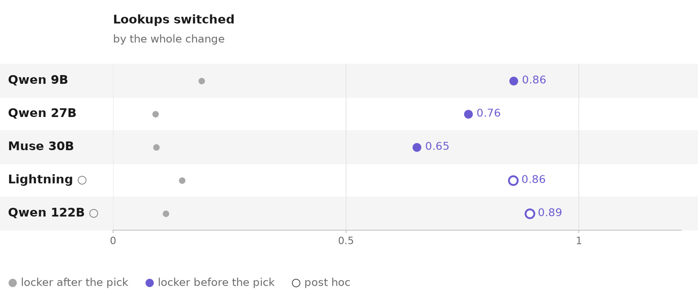
*Lookups switched by the whole change with the locker sentence before the pick, against after (grey). whiskers: 95% intervals over bridge items; Lightning ○; –: not run, not tested or under 30 switches; the 122B ○.*

- **Rule, fixed in advance.** None: the split was read after the data (descriptive); Lightning's is a coverage run, no prediction.

- **Result.**

  | | 9B | 27B | Muse | Lightning | 122B |
  |---|---|---|---|---|---|
  | lookups switched by the whole change, locker first | 0.86<!-- src: results/x0_composition/split-by-order-20261026T173323Z/split.md \| 0.35 [0.26, 0.43] :: 0.86 --> | 0.76<!-- src: results/x0_composition/split-by-order-20261026T173323Z/split.md \| 0.67 [0.58, 0.76] :: 0.76 --> | 0.65<!-- src: results/x0_composition/split-by-order-20261026T173323Z/split.md \| 0.68 [0.46, 0.88] :: 0.65 --> | 0.86<!-- src: results/x0_composition/split-by-order-20261029T005451Z/split.md \| 0.12 [0.04, 0.20] :: 0.86 --> | 0.89<!-- src: results/x0_composition/split-by-order-20261026T173323Z/split.md \| qwen3.5-122b-a10b :: two people swap :: before :: 0.89 --> |
  | lookups switched by the whole change, locker after | 0.19<!-- src: results/x0_composition/split-by-order-20261026T173323Z/split.md \| 0.65 [0.57, 0.73] :: 0.19 --> | 0.09<!-- src: results/x0_composition/split-by-order-20261026T173323Z/split.md \| 0.81 [0.71, 0.91] :: 0.09 --> | 0.09<!-- src: results/x0_composition/split-by-order-20261026T173323Z/split.md \| 0.80 [0.65, 0.92] :: 0.09 --> | 0.15<!-- src: results/x0_composition/split-by-order-20261029T005451Z/split.md \| 0.53 [0.40, 0.65] :: 0.15 --> | 0.11<!-- src: results/x0_composition/split-by-order-20261026T173323Z/split.md \| qwen3.5-122b-a10b :: two people swap :: after :: 0.11 --> |
  | lookup: switches blocked beyond a random part, locker first | 0.01 [-0.04, 0.07]<!-- src: results/x0_composition/split-by-order-20261026T173323Z/split.md \| 0.35 [0.26, 0.43] :: 0.01 [-0.04, 0.07] --> | 0.14 [0.07, 0.22]<!-- src: results/x0_composition/split-by-order-20261026T173323Z/split.md \| 0.67 [0.58, 0.76] :: 0.14 [0.07, 0.22] --> | -0.07 [-0.12, -0.02]<!-- src: results/x0_composition/split-by-order-20261026T173323Z/split.md \| 0.68 [0.46, 0.88] :: -0.07 [-0.12, -0.02] --> | 0.01 [-0.03, 0.07]<!-- src: results/x0_composition/split-by-order-20261029T005451Z/split.md \| 0.12 [0.04, 0.20] :: 0.01 [-0.03, 0.07] --> | -0.01 [-0.08, 0.06]<!-- src: results/x0_composition/split-by-order-20261026T173323Z/split.md \| qwen3.5-122b-a10b :: two people swap :: before :: -0.01 [-0.08, 0.06] --> |
  | lookup: switches blocked beyond a random part, locker after (under 30 switches on every model: not usable) | -0.21 [-0.43, -0.05]<!-- src: results/x0_composition/split-by-order-20261026T173323Z/split.md \| 0.65 [0.57, 0.73] :: -0.21 [-0.43, -0.05] --> | 0.11 [0.00, 0.40]<!-- src: results/x0_composition/split-by-order-20261026T173323Z/split.md \| 0.81 [0.71, 0.91] :: 0.11 [0.00, 0.40] --> | -0.30 [-0.44, 0.00]<!-- src: results/x0_composition/split-by-order-20261026T173323Z/split.md \| 0.80 [0.65, 0.92] :: -0.30 [-0.44, 0.00] --> | 0.12 [0.00, 0.29]<!-- src: results/x0_composition/split-by-order-20261029T005451Z/split.md \| 0.53 [0.40, 0.65] :: 0.12 [0.00, 0.29] --> | 0.08 [0.00, 0.23]<!-- src: results/x0_composition/split-by-order-20261026T173323Z/split.md \| qwen3.5-122b-a10b :: two people swap :: after :: 0.08 [0.00, 0.23] --> |
  | recall: switches blocked beyond a random part, locker first | 0.35 [0.26, 0.43]<!-- src: results/x0_composition/split-by-order-20261026T173323Z/split.md \| 0.01 [-0.04, 0.07] :: 0.35 [0.26, 0.43] --> | 0.67 [0.58, 0.76]<!-- src: results/x0_composition/split-by-order-20261026T173323Z/split.md \| 0.14 [0.07, 0.22] :: 0.67 [0.58, 0.76] --> | 0.68 [0.46, 0.88]<!-- src: results/x0_composition/split-by-order-20261026T173323Z/split.md \| -0.07 [-0.12, -0.02] :: 0.68 [0.46, 0.88] --> | 0.12 [0.04, 0.20]<!-- src: results/x0_composition/split-by-order-20261029T005451Z/split.md \| 0.01 [-0.03, 0.07] :: 0.12 [0.04, 0.20] --> | 0.20 [0.10, 0.30]<!-- src: results/x0_composition/split-by-order-20261026T173323Z/split.md \| qwen3.5-122b-a10b :: two people swap :: before :: 0.20 [0.10, 0.30] --> |
  | recall: switches blocked beyond a random part, locker after | 0.65 [0.57, 0.73]<!-- src: results/x0_composition/split-by-order-20261026T173323Z/split.md \| -0.21 [-0.43, -0.05] :: 0.65 [0.57, 0.73] --> | 0.81 [0.71, 0.91]<!-- src: results/x0_composition/split-by-order-20261026T173323Z/split.md \| 0.11 [0.00, 0.40] :: 0.81 [0.71, 0.91] --> | 0.80 [0.65, 0.92]<!-- src: results/x0_composition/split-by-order-20261026T173323Z/split.md \| -0.30 [-0.44, 0.00] :: 0.80 [0.65, 0.92] --> | 0.53 [0.40, 0.65]<!-- src: results/x0_composition/split-by-order-20261029T005451Z/split.md \| 0.12 [0.00, 0.29] :: 0.53 [0.40, 0.65] --> | 0.41 [0.26, 0.54]<!-- src: results/x0_composition/split-by-order-20261026T173323Z/split.md \| qwen3.5-122b-a10b :: two people swap :: after :: 0.41 [0.26, 0.54] --> |

- **Read.**
  - On every model, Lightning included, the change at the bridge word switches most lookups when the locker sentence came first and few when it came after.
  - The recall has more blocked switches without the lens part when the locker came after, on every model.
- **Caveats.**
  - Locker after, the whole change switches 0.09 to 0.19 of 99 to 115 lookups, under the 30 switches a cell needs; the lookup's drop there is not usable (the split's own note: measurable only where switches are many).
  - Descriptive: the split was chosen after the data.

### When the locker comes after the pick, is the link made in the locker sentences? (the copy test, 45q, opened 27 Oct) 

`in README` `below gate: Lightning` *Used in: README Part IV card "Does the bridge word redirect the lookup only when its locker sentence came first?" (the copy).*

- **Question.** In clean scenes whose locker sentence comes after the asked pick, does copying the changed prompt's states into the locker sentences switch the lookup, while the change at the bridge word does not?
- **Why we asked.** With the locker after the pick the bridge word cannot point back; the link must be made where the locker sentence is read.
- **Data.** Clean one-pick scenes (only the bridge token differs), locker after the pick: 201<!-- src: results/x45b_binding/x45q-20261027T005345Z/x45q.md \| qwen35_9b_x45q :: 201 / 0 / 201 / 201 :: 201 --> / 288<!-- src: results/x45b_binding/x45q-20261027T005345Z/x45q.md \| x45q_27b :: 288 / 0 / 288 / 288 :: 288 --> / 205<!-- src: results/x45b_binding/x45q-20261027T005345Z/x45q.md \| muse30b_x45q :: 205 / 0 / 205 / 205 :: 205 --> (9B / 27B / Muse). Lightning not tested: the clean one-pick design's gate fails on it.
- **Method.** On the original prompt: (a) the change at the bridge word at L; (c) the changed prompt's states copied into every locker-sentence token at L; (d) the same at L/2; each read as a share of the lookups the changed prompt itself switches.

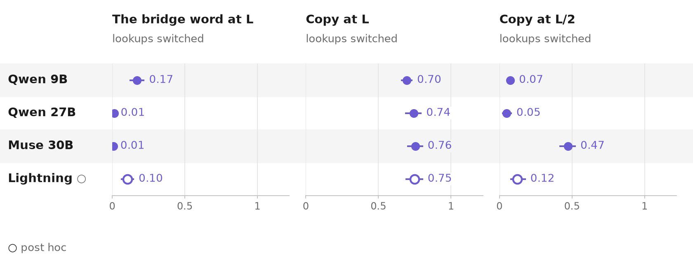
*The rule's three arms, locker after the pick: lookups switched by the bridge-word change at L, by the copy into every locker-sentence token at L, and at L/2. whiskers: 95% intervals over bridge items; Lightning ○; –: not run, not tested or under 30 switches. The layer curves: the verdict.*

- **Rule, fixed in advance.** ""the link is made in the locker sentences" if (c) or (d) switches at least half of the lookups S switches while (a) stays at or below 0.25, on at least 2 of 3 models."

- **Result.**

  | | 9B | 27B | Muse | Lightning | 122B |
  |---|---|---|---|---|---|
  | (a) lookups switched by the change at the bridge word at L (bar <= 0.25) | 0.17 [0.12, 0.22]<!-- src: results/x45b_binding/x45q-20261027T005345Z/x45q.md \| qwen35_9b_x45q :: 0.17 [0.12, 0.22] --> | 0.01 [0.00, 0.03]<!-- src: results/x45b_binding/x45q-20261027T005345Z/x45q.md \| x45q_27b :: 0.01 [0.00, 0.03] --> | 0.01 [0.00, 0.03]<!-- src: results/x45b_binding/x45q-20261027T005345Z/x45q.md \| muse30b_x45q :: 0.01 [0.00, 0.03] --> | ○ 0.10 [0.06, 0.15]<!-- src: results/x45b_binding/x52_45q_below-20261029T085135Z/x45q.md \| nem35l_x52_45q_below :: 0.10 [0.06, 0.15] --> | not run |
  | (c) the changed states copied into the locker sentences at L, share of S's switches (bar >= 0.5) | 0.70 [0.65, 0.74]<!-- src: results/x45b_binding/x45q-20261027T005345Z/x45q.md \| qwen35_9b_x45q :: 0.70 [0.65, 0.74] --> | 0.74 [0.68, 0.80]<!-- src: results/x45b_binding/x45q-20261027T005345Z/x45q.md \| x45q_27b :: 0.74 [0.68, 0.80] --> | 0.76 [0.70, 0.81]<!-- src: results/x45b_binding/x45q-20261027T005345Z/x45q.md \| muse30b_x45q :: 0.76 [0.70, 0.81] --> | ○ 0.75 [0.69, 0.81]<!-- src: results/x45b_binding/x52_45q_below-20261029T085135Z/x45q.md \| nem35l_x52_45q_below :: 0.75 [0.69, 0.81] --> | |
  | (d) the same at L/2 | 0.07 [0.05, 0.10]<!-- src: results/x45b_binding/x45q-20261027T005345Z/x45q.md \| qwen35_9b_x45q :: 0.07 [0.05, 0.10] --> | 0.05 [0.02, 0.09]<!-- src: results/x45b_binding/x45q-20261027T005345Z/x45q.md \| x45q_27b :: 0.05 [0.02, 0.09] --> | 0.47 [0.41, 0.53]<!-- src: results/x45b_binding/x45q-20261027T005345Z/x45q.md \| muse30b_x45q :: 0.47 [0.41, 0.53] --> | ○ 0.12 [0.07, 0.18]<!-- src: results/x45b_binding/x52_45q_below-20261029T085135Z/x45q.md \| nem35l_x52_45q_below :: 0.12 [0.07, 0.18] --> | |
  | holds | **yes<!-- src: results/x45b_binding/x45q-20261027T005345Z/x45q.md \| qwen35_9b_x45q :: tested (holds) :: yes -->** | **yes<!-- src: results/x45b_binding/x45q-20261027T005345Z/x45q.md \| x45q_27b :: tested (holds) :: yes -->** | **yes<!-- src: results/x45b_binding/x45q-20261027T005345Z/x45q.md \| muse30b_x45q :: tested (holds) :: yes -->** | not tested (gate 0.751<!-- src: results/x52_coverage/matrix-20261029T062909Z/matrix.json \| clean one-pick design's gate fails on Lightning (recall 0.751 :: 0.751 --> < 0.80); below gate, descriptive only: yes (163<!-- src: results/x45b_binding/x52_45q_below-20261029T085135Z/x45q.md \| nem35l_x52_45q_below :: 163 / 0 / 163 / 163 :: 163 --> locker-after items) | |

- **Read.**
  - With the locker after the pick, copying the changed states into the locker sentences at L carries about three quarters of the lookup's switches on all three models, while the change at the bridge word carries almost none: the link is made in the locker sentences.
- **Caveats.**
  - Lightning: below the clean one-pick gate, so not tested; the below-gate run (eligible items only) is exploratory, hollow ○, never in claims or grades.
  - At L/2 the copy carries little on the 9B and 27B and about half on Muse.
  - Clean scenes only; the main test's locker-after lookups are in the order-split card.

### Which token and layer carry each reader's switch, and when does the bridge word stop being read? (token-by-layer map and window patching, D1 / D2; the 27B's and Lightning's coverage runs 29 Oct) 

`in README` `below gate: Lightning` *Used in: README Part IV card "Which token and layer carry the lookup when the locker sentence comes after the pick?".*

- **Question.** With the changed prompt's state placed in one token group at one layer, which cell switches each reader, and after which layer does nothing downstream read the bridge word?
- **Why we asked.** With the locker sentence after the pick the bridge word cannot point back; the map says where the link sits instead.
- **Data.** Clean one-pick scenes (the main test beside them), split by sentence order: locker first 151 / 202 / 143, locker after 166 / 236 / 170 (9B / 27B / Muse). Lightning: the main test only, locker first 59<!-- src: results/x47_depthmap/x52_depthmap-20261029T011452Z/depth.md \| nemotron-3.5-lightning :: main :: locker-first :: 59 -->, locker after 79<!-- src: results/x47_depthmap/x52_depthmap-20261029T011452Z/depth.md \| nemotron-3.5-lightning :: main :: locker-after :: 79 -->; its clean design is not tested (the clean one-pick gate fails on it).
- **Method.** D1: the changed state placed at one token group (the bridge word, the rest of the pick sentence, the asked person, each locker sentence's item and number, the question, the last token) at one layer, every 2nd (9B) or 4th (27B, Muse). D2: the changed state at the bridge word at every layer from l on; the read-out layer l_R is the first where this switches 0.1 or fewer.

*No figure: the token-by-layer heat strips are supplementary ([figure](../../figures/depth/fig03d_depth_map.png)); the table has the rule's numbers.*

- **Rule, fixed in advance.** D1: "(a) In locker-after scenes the lookup's mass sits at the locker sentences, not at the bridge word, at every layer (bridge-word cells <= 0.25 everywhere; some locker-sentence cell >= 0.5). (b) In locker-first scenes the lookup's bridge-word mass ends before the recall's does (the last layer with bridge-word switch >= 0.3 is earlier for the lookup, by >= 2 layers on the 9B, >= 4 on Muse). (c) The recall's map has a second hot token, the item's earlier mention, in locker-first scenes (>= 0.3 at some layer), absent in locker-after." D2: ""The handover from the mention to the question" if l_R(recall) lies at or below the start of his late band on the 9B and 27B." The 27B and Lightning: coverage runs on these rules, no prediction.

- **Result.** (clean design; the main test gives the same D1 and D2 answers on the 9B, 27B and Muse; Lightning: the main test)

  | | 9B | 27B | Muse | Lightning (main; ○ clean, below gate) | 122B |
  |---|---|---|---|---|---|
  | D1 (a) locker after: a locker-sentence cell carries the lookup | no<!-- src: results/x47_depthmap/depth-20261028T120525Z/depth.md \| qwen3.5-9b :: clean :: glk_org_num@18 :: no --> | no<!-- src: results/x47_depthmap/x52_depthmap-20261029T010426Z/depth.md \| qwen3.6-27b :: clean :: glk_cf_item@28 :: no --> | no<!-- src: results/x47_depthmap/depth-20261028T120525Z/depth.md \| muse-glimmer-30b :: clean :: glk_cf_item@16 :: no --> | no<!-- src: results/x47_depthmap/x52_depthmap-20261029T011452Z/depth.md \| nemotron-3.5-lightning :: main :: glk_cf_item@12 :: no -->; ○ clean: no<!-- src: results/x47_depthmap/x52_depthmap_below-20261029T092524Z/depth.md \| nemotron-3.5-lightning :: clean :: no (bridge max :: no --> | not run |
  | D1 (b) locker first: the lookup leaves the bridge word first | no<!-- src: results/x47_depthmap/depth-20261028T120525Z/depth.md \| qwen3.5-9b :: clean :: lead -2 of 2 :: no --> | no<!-- src: results/x47_depthmap/x52_depthmap-20261029T010426Z/depth.md \| qwen3.6-27b :: clean :: lead -4 of 4 :: no --> | no<!-- src: results/x47_depthmap/depth-20261028T120525Z/depth.md \| muse-glimmer-30b :: clean :: lead 0 of 4 :: no --> | no<!-- src: results/x47_depthmap/x52_depthmap-20261029T011452Z/depth.md \| nemotron-3.5-lightning :: main :: lead 0 of 4 :: no -->; ○ clean: no<!-- src: results/x47_depthmap/x52_depthmap_below-20261029T092524Z/depth.md \| nemotron-3.5-lightning :: clean :: no (lookup last 24 :: no --> | |
  | D1 (c) the recall's second hot token, locker first only | no<!-- src: results/x47_depthmap/depth-20261028T120525Z/depth.md \| qwen3.5-9b :: clean :: peaks first :: no --> | no<!-- src: results/x47_depthmap/x52_depthmap-20261029T010426Z/depth.md \| qwen3.6-27b :: clean :: peaks first :: no --> | no<!-- src: results/x47_depthmap/depth-20261028T120525Z/depth.md \| muse-glimmer-30b :: clean :: peaks first :: no --> | no<!-- src: results/x47_depthmap/x52_depthmap-20261029T011452Z/depth.md \| nemotron-3.5-lightning :: main :: peaks first 0.0169 :: no -->; ○ clean: no<!-- src: results/x47_depthmap/x52_depthmap_below-20261029T092524Z/depth.md \| nemotron-3.5-lightning :: clean :: no (peaks first :: no --> | |
  | read-out layer l_R, lookup / recall, locker first | L18<!-- src: results/x47_depthmap/depth-20261028T120525Z/depth.md \| qwen3.5-9b :: clean :: locker-first :: 151 :: 18 --> / L20<!-- src: results/x47_depthmap/depth-20261028T120525Z/depth.md \| qwen3.5-9b :: clean :: locker-first :: 151 :: 20 --> | L44<!-- src: results/x47_depthmap/x52_depthmap-20261029T010426Z/depth.md \| qwen3.6-27b :: clean :: locker-first :: 202 :: 44 --> / L40<!-- src: results/x47_depthmap/x52_depthmap-20261029T010426Z/depth.md \| qwen3.6-27b :: clean :: locker-first :: 202 :: 40 --> | L32<!-- src: results/x47_depthmap/depth-20261028T120525Z/depth.md \| muse-glimmer-30b :: clean :: locker-first :: 143 :: 32 --> / L32<!-- src: results/x47_depthmap/depth-20261028T120525Z/depth.md \| muse-glimmer-30b :: clean :: locker-first :: 143 :: 32 --> | L28<!-- src: results/x47_depthmap/x52_depthmap-20261029T011452Z/depth.md \| nemotron-3.5-lightning :: main :: locker-first :: 59 :: 28 --> / L28<!-- src: results/x47_depthmap/x52_depthmap-20261029T011452Z/depth.md \| nemotron-3.5-lightning :: main :: locker-first :: 59 :: 28 -->; ○ clean: L28<!-- src: results/x47_depthmap/x52_depthmap_below-20261029T092524Z/depth.md \| clean :: locker-first :: 28 --> / L28<!-- src: results/x47_depthmap/x52_depthmap_below-20261029T092524Z/depth.md \| clean :: locker-first :: 28 --> | |
  | read-out layer l_R, lookup / recall, locker after | L12<!-- src: results/x47_depthmap/depth-20261028T120525Z/depth.md \| qwen3.5-9b :: clean :: locker-after :: 166 :: 12 --> / L24<!-- src: results/x47_depthmap/depth-20261028T120525Z/depth.md \| qwen3.5-9b :: clean :: locker-after :: 166 :: 24 --> | L28<!-- src: results/x47_depthmap/x52_depthmap-20261029T010426Z/depth.md \| qwen3.6-27b :: clean :: locker-after :: 236 :: 28 --> / L52<!-- src: results/x47_depthmap/x52_depthmap-20261029T010426Z/depth.md \| qwen3.6-27b :: clean :: locker-after :: 236 :: 52 --> | L16<!-- src: results/x47_depthmap/depth-20261028T120525Z/depth.md \| muse-glimmer-30b :: clean :: locker-after :: 170 :: 16 --> / L36<!-- src: results/x47_depthmap/depth-20261028T120525Z/depth.md \| muse-glimmer-30b :: clean :: locker-after :: 170 :: 36 --> | L12<!-- src: results/x47_depthmap/x52_depthmap-20261029T011452Z/depth.md \| nemotron-3.5-lightning :: main :: locker-after :: 79 :: 12 --> / L36<!-- src: results/x47_depthmap/x52_depthmap-20261029T011452Z/depth.md \| nemotron-3.5-lightning :: main :: locker-after :: 79 :: 36 -->; ○ clean: L12<!-- src: results/x47_depthmap/x52_depthmap_below-20261029T092524Z/depth.md \| clean :: locker-after :: 12 --> / L36<!-- src: results/x47_depthmap/x52_depthmap_below-20261029T092524Z/depth.md \| clean :: locker-after :: 36 --> | |
  | D2: the recall's read-out layer at or below the start of Zach's late band | yes<!-- src: results/x47_depthmap/depth-20261028T120525Z/depth.md \| qwen3.5-9b :: clean :: l_R recall 24, band 26 :: yes --> (band from L26) | yes<!-- src: results/x47_depthmap/x52_depthmap-20261029T010426Z/depth.md \| qwen3.6-27b :: clean :: l_R recall 52, band 52 :: yes --> (band from L52) | not designed: band None<!-- src: results/x47_depthmap/depth-20261028T120525Z/depth.md \| muse-glimmer-30b :: clean :: band None --> | not designed: band None<!-- src: results/x47_depthmap/x52_depthmap-20261029T011452Z/depth.md \| nemotron-3.5-lightning :: main :: l_R recall 36, band None :: band None -->; ○ clean: no band (l_R recall L36) | |

- **Read.**
  - On the 27B as on the 9B and Muse, all three D1 readings fail on both designs (Lightning: on the main test): no locker-sentence cell carries the locker-after lookup, the lookup does not leave the bridge word before the recall by the margin fixed in advance, and the recall has no second hot token.
  - With the locker after the pick, the lookup stops reading the bridge word far earlier than the recall on all four; the 27B's recall reads it up to the start of Zach's late band, as on the 9B.
- **Caveats.**
  - Lightning's clean design is below its gate (recall 0.751 < 0.80): its ○ entries are exploratory, never in claims or grades.
  - The 27B, Muse and Lightning were sampled every 4th layer, so their read-out layers are known to 4 layers; Lightning's in-job verdict crashed on a missing margin for rule (b), added after the run (Flagged 19).
  - Muse and Lightning have no late band of Zach's, so D2 is scored on the 9B and 27B only.

### When the change at L misses a lookup, where is the rest read? (cumulative patches, 47.4; the 27B's and Lightning's coverage runs 29 Oct) 

`in README` `below gate: Lightning` *Used in: README Part IV card "Which token and layer carry the lookup when the locker sentence comes after the pick?" (the cumulative patches).*

- **Question.** When the change at the bridge word at L leaves a lookup unswitched, is the rest read from the bridge word before L, from the pick sentence's other tokens, or from outside the pick sentence?
- **Why we asked.** The conflict test changes one layer; the lookups it misses may read the bridge word earlier.
- **Data.** The main test and clean one-pick scenes, by sentence order: locker first 75 / 69 / 68 (main) and 151 / 202 / 143 (clean), locker after 68 / 61 / 69 (main) (9B / 27B / Muse). Lightning, main design: locker first 59<!-- src: results/x47_cumulative/x52_cumulative-20261029T044453Z/x47_4.md \| nemotron-3.5-lightning :: main :: lookup :: locker-first :: 59 -->, locker after 79<!-- src: results/x47_cumulative/x52_cumulative-20261029T044453Z/x47_4.md \| nemotron-3.5-lightning :: main :: lookup :: locker-after :: 79 -->; its clean design not tested (gate).
- **Method.** Four arms on the original prompt: (a) the change at the bridge word at L; (b) the bridge word replaced at every layer up to L; (c) at every layer; (d) the whole asked pick sentence at every layer. The lookups (a) leaves unswitched split into before L (b minus a), the pick sentence's other tokens (d minus c) and outside the pick sentence (1 minus d).

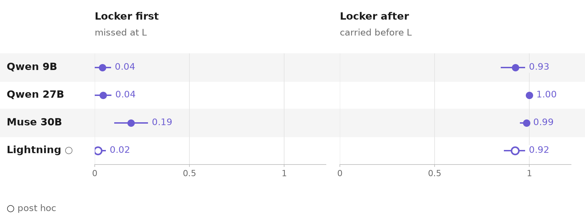
*Locker first: lookups the change at L misses; locker after: lookups carried by the bridge word before L. whiskers: 95% intervals over bridge items; Lightning ○; –: not run, not tested or under 30 switches.*

- **Rule, fixed in advance.** None: descriptive, no bar; the verdict reads which part is largest in locker-first scenes. The 27B and Lightning: coverage runs, no prediction.

- **Result.**

  | | 9B | 27B | Muse | Lightning | 122B |
  |---|---|---|---|---|---|
  | locker first: lookups the change at L leaves unswitched (main) | 0.04 [0.00, 0.09]<!-- src: results/x47_cumulative/x47_4-20261028T113105Z/x47_4.md \| qwen3.5-9b :: main :: 75 :: 0.04 [0.00, 0.09] --> | 0.04 [0.00, 0.09]<!-- src: results/x47_cumulative/x52_cumulative-20261029T023427Z/x47_4.md \| qwen3.6-27b :: main :: 69 :: 0.04 [0.00, 0.09] --> | 0.19 [0.10, 0.28]<!-- src: results/x47_cumulative/x47_4-20261028T113105Z/x47_4.md \| muse-glimmer-30b :: main :: 68 :: 0.19 [0.10, 0.28] --> | 0.02 [0.00, 0.06]<!-- src: results/x47_cumulative/x52_cumulative-20261029T044453Z/x47_4.md \| nemotron-3.5-lightning :: main :: 59 :: 0.02 [0.00, 0.06] --> | 0.04 [0.00, 0.10]<!-- src: results/x47_cumulative/x52_cumulative-20261030T010712Z/x47_4.md \| qwen3.5-122b-a10b :: main :: 53 :: 0.04 [0.00, 0.10] --> |
  | locker first: where most of that rest is read, main / clean | outside<!-- src: results/x47_cumulative/x47_4-20261028T113105Z/x47_4.md \| qwen3.5-9b :: main :: 75 :: outside --> / before_L<!-- src: results/x47_cumulative/x47_4-20261028T113105Z/x47_4.md \| qwen3.5-9b :: clean :: 151 :: before_L --> | outside<!-- src: results/x47_cumulative/x52_cumulative-20261029T023427Z/x47_4.md \| qwen3.6-27b :: main :: 69 :: outside --> / before_L<!-- src: results/x47_cumulative/x52_cumulative-20261029T023427Z/x47_4.md \| qwen3.6-27b :: clean :: 202 :: before_L --> | before_L<!-- src: results/x47_cumulative/x47_4-20261028T113105Z/x47_4.md \| muse-glimmer-30b :: main :: 68 :: before_L --> / before_L<!-- src: results/x47_cumulative/x47_4-20261028T113105Z/x47_4.md \| muse-glimmer-30b :: clean :: 143 :: before_L --> | outside<!-- src: results/x47_cumulative/x52_cumulative-20261029T044453Z/x47_4.md \| nemotron-3.5-lightning :: main :: 59 :: outside --> / ○ before_L<!-- src: results/x47_cumulative/x52_cumulative_below-20261029T085952Z/x47_4.md \| clean :: 89 :: before_L --> | outside<!-- src: results/x47_cumulative/x52_cumulative-20261030T010712Z/x47_4.md \| qwen3.5-122b-a10b :: main :: 53 :: outside --> / before_L<!-- src: results/x47_cumulative/x52_cumulative-20261030T010712Z/x47_4.md \| qwen3.5-122b-a10b :: clean :: 134 :: before_L --> |
  | locker after: lookups carried by the bridge word before L (main) | 0.93 [0.85, 0.98]<!-- src: results/x47_cumulative/x47_4-20261028T113105Z/x47_4.md \| qwen3.5-9b :: main :: lookup :: locker-after :: 68 :: 0.93 [0.85, 0.98] --> | 1.00 [1.00, 1.00]<!-- src: results/x47_cumulative/x52_cumulative-20261029T023427Z/x47_4.md \| qwen3.6-27b :: main :: lookup :: locker-after :: 61 :: 1.00 [1.00, 1.00] --> | 0.99 [0.95, 1.00]<!-- src: results/x47_cumulative/x47_4-20261028T113105Z/x47_4.md \| muse-glimmer-30b :: main :: lookup :: locker-after :: 69 :: 0.99 [0.95, 1.00] --> | 0.92 [0.86, 0.98]<!-- src: results/x47_cumulative/x52_cumulative-20261029T044453Z/x47_4.md \| nemotron-3.5-lightning :: main :: lookup :: locker-after :: 0.92 [0.86, 0.98] --> | 1.00 [1.00, 1.00]<!-- src: results/x47_cumulative/x52_cumulative-20261030T010712Z/x47_4.md \| qwen3.5-122b-a10b :: main :: lookup :: locker-after :: 82 :: 1.00 [1.00, 1.00] --> |

  Lightning's clean design is below its gate (recall 0.751 < 0.80), so it is not tested there; the below-gate run (exploratory, hollow ○) finds the rest read mostly at the bridge word before L in locker-first scenes, and, with the locker after the pick, the bridge word before L carries the lookup on ○ 0.94 [0.89, 0.98]<!-- src: results/x47_cumulative/x52_cumulative_below-20261029T085952Z/x47_4.md | lookup :: locker-after :: 0.94 [0.89, 0.98] --> of scenes.

- **Read.**
  - With the locker first the change at L misses few lookups on every model, the 27B included; with the locker after, almost all lookups are carried by the bridge word before L, on the 27B and Lightning too.
- **Caveats.**
  - Lightning's clean-design numbers are below gate, exploratory: never in claims or grades.
  - Descriptive: no rule fixed in advance.
  - In the main test the rest of a locker-first miss sits outside the pick sentence on the 9B, 27B and Lightning (the other person's pick also changes there); in clean scenes it is before L on all three.

### Does the lookup drop the lens part before it takes up the address? (anatomy by layer, 47.8; Lightning's coverage run and the 27B's full grid 29 Oct) 

`in README` *Used in: README Part IV card "Does the lookup drop the lens part before it takes up the address?".*

- **Question.** Layer by layer, when does the lookup stop needing the lens part, when does it start using the address, when is the address readable, and is the value ever used?
- **Why we asked.** At L the lookup takes an identity route and a position route; depth says which comes first and whether the address is written before it is read.
- **Data.** Routes scenes (another item moved), locker first, the test half: 200 per model (27B 150, on its full grid: every 4th layer); the fit half for the per-layer refits and probes.
- **Method.** At each sampled layer, the whole change and its parts (the lens part; the address part refit at that layer; the identity outside the lens), each added alone or taken out, against random parts of the same share; a slot probe at the bridge word. A layer counts only where the whole change switches 0.30 or more. D4: the angles between the address subspaces (and the identity subspaces) refit at every pair of layers in the probe's window.

*No figure: the layer-by-layer anatomy is supplementary ([figure](../../figures/depth/fig06b_anatomy.png)); the table has each model's layers and the rule's clauses.*

- **Rule, fixed in advance.** "Define l_J = the first layer from which the lookup's extra drop without J++ stays <= 0.10; l_P = the first layer where the position share under the whole change is >= 0.20; l_probe = the first layer where the slot probe is >= 0.80. (a) "Handoff": l_P >= l_J [...] (b) "The address forms before it is used": l_probe <= l_P on every model [...] (c) "Identity leaves the lens": identity share with only-J++ is >= 0.5 at the earliest interpretable layer and <= 0.1 by L, while identity with only-I_l rises to >= 0.3 by L, on >= 2 of 3 models [...] (d) "Never the value, at any depth": value <= 0.05 at every interpretable layer." D4: "persistent if the mean cos^2 of the principal angles >= 0.5 across the window where the slot probe is >= 0.8; re-encoded if it drops below 0.2 between adjacent sampled layers." The 27B's full grid and Lightning: coverage runs on this rule, no prediction.

- **Result.**

  | | 9B | 27B | Muse | Lightning | 122B |
  |---|---|---|---|---|---|
  | l_J: the lookup no longer needs the lens part | L12<!-- src: results/x47_anatomy/x47_8-20261028T154518Z/x47_8.md \| qwen3.5-9b :: 0 (<= 2) :: 12 --> | L40<!-- src: results/x47_anatomy/x52_anatomy-20261029T013405Z/x47_8.md \| qwen3.6-27b :: -12 (<= 2) :: 40 --> | L2<!-- src: results/x47_anatomy/x47_8-20261028T154518Z/x47_8.md \| muse-glimmer-30b :: 20 (> 6) :: 2 --> | L14<!-- src: results/x47_anatomy/x52_anatomy-20261029T010517Z/x47_8.md \| nemotron-3.5-lightning :: 0 (<= 2) :: 14 --> | L33<!-- src: results/x47_anatomy/x52_anatomy-20261030T032402Z/x47_8.md \| qwen3.5-122b-a10b :: yes (max 0.00) :: 33 --> ○ |
  | l_P: position answers begin | L12<!-- src: results/x47_anatomy/x47_8-20261028T154518Z/x47_8.md \| qwen3.5-9b :: 0 (<= 2) :: 12 --> | L28<!-- src: results/x47_anatomy/x52_anatomy-20261029T013405Z/x47_8.md \| qwen3.6-27b :: -12 (<= 2) :: 28 --> | L22<!-- src: results/x47_anatomy/x47_8-20261028T154518Z/x47_8.md \| muse-glimmer-30b :: 20 (> 6) :: 22 --> | L14<!-- src: results/x47_anatomy/x52_anatomy-20261029T010517Z/x47_8.md \| nemotron-3.5-lightning :: 0 (<= 2) :: 14 --> | L33 ○ |
  | l_probe: the address is readable | L4<!-- src: results/x47_anatomy/x47_8-20261028T154518Z/x47_8.md \| qwen3.5-9b :: 0 (<= 2) :: 4 --> | L8<!-- src: results/x47_anatomy/x52_anatomy-20261029T013405Z/x47_8.md \| qwen3.6-27b :: -12 (<= 2) :: 8 --> | L6<!-- src: results/x47_anatomy/x47_8-20261028T154518Z/x47_8.md \| muse-glimmer-30b :: 20 (> 6) :: 6 --> | L6<!-- src: results/x47_anatomy/x52_anatomy-20261029T010517Z/x47_8.md \| nemotron-3.5-lightning :: 0 (<= 2) :: 6 --> | L13<!-- src: results/x47_anatomy/x52_anatomy-20261030T032402Z/x47_8.md \| qwen3.5-122b-a10b :: 0 (<= 2) :: 13 --> ○ |
  | (a) handoff, l_P >= l_J (gap) | yes, gap 0 (<= 2)<!-- src: results/x47_anatomy/x47_8-20261028T154518Z/x47_8.md \| (a) qwen3.5-9b :: yes, gap 0 (<= 2) --> | no, gap -12 (<= 2)<!-- src: results/x47_anatomy/x52_anatomy-20261029T013405Z/x47_8.md \| Q47.8 :: no, gap -12 (<= 2) --> (full grid) | yes, gap 20 (> 6)<!-- src: results/x47_anatomy/x47_8-20261028T154518Z/x47_8.md \| Q47.8 :: yes, gap 20 (> 6) --> | yes, gap 0 (<= 2)<!-- src: results/x47_anatomy/x52_anatomy-20261029T010517Z/x47_8.md \| Q47.8 :: yes, gap 0 (<= 2) --> (no prediction) | yes, gap 0 (<= 2)<!-- src: results/x47_anatomy/x52_anatomy-20261030T032402Z/x47_8.md \| (a) qwen3.5-122b-a10b :: yes, gap 0 (<= 2) --> (no prediction; lookup-only gate) |
  | (b) the address readable before it is used | yes<!-- src: results/x47_anatomy/x47_8-20261028T154518Z/x47_8.md \| qwen3.5-9b :: (cross :: yes --> | yes<!-- src: results/x47_anatomy/x52_anatomy-20261029T013405Z/x47_8.md \| qwen3.6-27b :: (cross :: yes --> | yes<!-- src: results/x47_anatomy/x47_8-20261028T154518Z/x47_8.md \| muse-glimmer-30b :: (cross :: yes --> | yes<!-- src: results/x47_anatomy/x52_anatomy-20261029T010517Z/x47_8.md \| nemotron-3.5-lightning :: (cross :: yes --> | yes |
  | (c) identity leaves the lens (crossing layer) | no (cross 12)<!-- src: results/x47_anatomy/x47_8-20261028T154518Z/x47_8.md \| qwen3.5-9b :: no (cross 12) :: no (cross 12) --> | no (cross 4)<!-- src: results/x47_anatomy/x52_anatomy-20261029T013405Z/x47_8.md \| qwen3.6-27b :: no (cross 4) :: no (cross 4) --> | no (cross 2)<!-- src: results/x47_anatomy/x47_8-20261028T154518Z/x47_8.md \| muse-glimmer-30b :: no (cross 2) :: no (cross 2) --> | no (cross 2)<!-- src: results/x47_anatomy/x52_anatomy-20261029T010517Z/x47_8.md \| nemotron-3.5-lightning :: no (cross 2) :: no (cross 2) --> | no (cross 1)<!-- src: results/x47_anatomy/x52_anatomy-20261030T032402Z/x47_8.md \| qwen3.5-122b-a10b :: no (cross 1) --> |
  | (d) never the value | yes (max 0.00)<!-- src: results/x47_anatomy/x47_8-20261028T154518Z/x47_8.md \| qwen3.5-9b :: yes (max 0.00) :: yes (max 0.00) --> | yes (max 0.00)<!-- src: results/x47_anatomy/x52_anatomy-20261029T013405Z/x47_8.md \| qwen3.6-27b :: yes (max 0.00) :: yes (max 0.00) --> | yes (max 0.00)<!-- src: results/x47_anatomy/x47_8-20261028T154518Z/x47_8.md \| muse-glimmer-30b :: yes (max 0.00) :: yes (max 0.00) --> | yes (max 0.00)<!-- src: results/x47_anatomy/x52_anatomy-20261029T010517Z/x47_8.md \| nemotron-3.5-lightning :: yes (max 0.00) :: yes (max 0.00) --> | yes (max 0.00)<!-- src: results/x47_anatomy/x52_anatomy-20261030T032402Z/x47_8.md \| qwen3.5-122b-a10b :: yes (max 0.00) --> |
  | the recall switches 0.5 or more (window) | L2-L14<!-- src: results/x47_anatomy/x47_8-20261028T154518Z/x47_8.md \| qwen3.5-9b :: L2-L14 :: L2-L14 --> | L4-L32<!-- src: results/x47_anatomy/x52_anatomy-20261029T013405Z/x47_8.md \| qwen3.6-27b :: L4-L32 :: L4-L32 --> | L2-L22<!-- src: results/x47_anatomy/x47_8-20261028T154518Z/x47_8.md \| muse-glimmer-30b :: L2-L22 :: L2-L22 --> | L2-L22<!-- src: results/x47_anatomy/x52_anatomy-20261029T010517Z/x47_8.md \| nemotron-3.5-lightning :: L2-L22 :: L2-L22 --> | L1-L33<!-- src: results/x47_anatomy/x52_anatomy-20261030T032402Z/x47_8.md \| qwen3.5-122b-a10b :: L1-L33 --> |
  | D4: the address code across depth, mean cos^2 (label) | 0.279<!-- src: results/x47_depth_cpu/persistence-20261028T115530Z/persistence.md \| qwen3.5-9b :: U :: 0.279 -->, re-encoded<!-- src: results/x47_depth_cpu/persistence-20261028T115530Z/persistence.md \| qwen3.5-9b :: U :: 0.279 :: re-encoded --> | 0.256<!-- src: results/x47_depth_cpu/persistence-20261029T013614Z/persistence.md \| qwen3.6-27b :: U :: 0.256 -->, mixed<!-- src: results/x47_depth_cpu/persistence-20261029T013614Z/persistence.md \| qwen3.6-27b :: U :: 0.256 :: mixed --> | 0.213<!-- src: results/x47_depth_cpu/persistence-20261028T115530Z/persistence.md \| muse-glimmer-30b :: U :: 0.213 -->, re-encoded<!-- src: results/x47_depth_cpu/persistence-20261028T115530Z/persistence.md \| muse-glimmer-30b :: U :: 0.213 :: re-encoded --> | 0.341<!-- src: results/x47_depth_cpu/persistence-20261029T015607Z/persistence.md \| nemotron-3.5-lightning :: U :: 0.341 -->, mixed<!-- src: results/x47_depth_cpu/persistence-20261029T015607Z/persistence.md \| nemotron-3.5-lightning :: U :: 0.341 :: mixed --> | |
  | D4: the identity code across depth, mean cos^2 (label) | 0.432<!-- src: results/x47_depth_cpu/persistence-20261028T115530Z/persistence.md \| qwen3.5-9b :: Id :: 0.432 -->, mixed<!-- src: results/x47_depth_cpu/persistence-20261028T115530Z/persistence.md \| qwen3.5-9b :: Id :: 0.432 :: mixed --> | 0.386<!-- src: results/x47_depth_cpu/persistence-20261029T013614Z/persistence.md \| qwen3.6-27b :: Id :: 0.386 -->, mixed<!-- src: results/x47_depth_cpu/persistence-20261029T013614Z/persistence.md \| qwen3.6-27b :: Id :: 0.386 :: mixed --> | 0.365<!-- src: results/x47_depth_cpu/persistence-20261028T115530Z/persistence.md \| muse-glimmer-30b :: Id :: 0.365 -->, mixed<!-- src: results/x47_depth_cpu/persistence-20261028T115530Z/persistence.md \| muse-glimmer-30b :: Id :: 0.365 :: mixed --> | 0.419<!-- src: results/x47_depth_cpu/persistence-20261029T015607Z/persistence.md \| nemotron-3.5-lightning :: Id :: 0.419 -->, mixed<!-- src: results/x47_depth_cpu/persistence-20261029T015607Z/persistence.md \| nemotron-3.5-lightning :: Id :: 0.419 :: mixed --> | |

- **Read.**
  - On the 9B, Muse and Lightning the lookup stops needing the lens part no later than position answers begin; on the 27B's full grid it still needs it after they begin, so (a) fails there. On all four the address is readable before position answers begin and the value is never used; (c) fails on every model.
  - Lightning's handoff and first position answers fall at L14 (L), as on the 9B. The address code does not persist across depth on any of the four (re-encoded on the 9B and Muse, mixed on the 27B and Lightning).
- **Caveats.**
  - The 27B's column is its full grid. The reduced grid behind README E12 (9 layers) gave l_J L16, l_P L30, (a) yes; l_J needs the effect to stay under the bar at every later sampled layer, and the full grid samples L36, which the reduced grid skipped (Flagged, top).
  - Each layer's address part and probe are refit on the fit half; early-layer refits read less well (the verdicts give their held-out accuracy).

### Does the address travel to the last token? (51.4, opened 28 Oct 18:36; Lightning's coverage run 29 Oct) 

`in README` *Used in: README claims table, claim 12 (whether the address travels to the last token).*

- **Question.** Does the address swap work at the last token, with the bridge word's slot means or with means refit there?
- **Why we asked.** The answer is read at the last token; the address could be copied there or re-encoded.
- **Data.** Routes scenes without a move, 300 per model (read half 145 / 150 / 144 / 132<!-- src: results/x51_travel/x52_travel-20261029T012517Z/verdict.md \| nem35l_x52_travel :: 300 (132) :: 132 -->; Lightning at L14 and L18).
- **Method.** The address swap added at the last token at L and L+4, at doses 1 and 2, with the bridge word's means and with last-token means; each against a random vector of its norm; a slot probe at the last token beside.

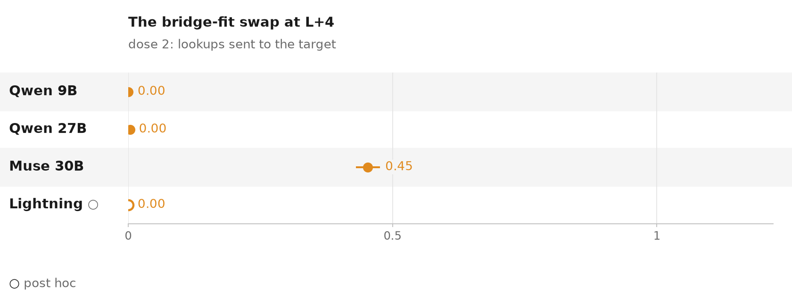
*The bridge-fit address swap at the last token at L+4, dose 2: lookups sent to the target. whiskers: 95% intervals over bridge items; Lightning ○; –: not run, not tested or under 30 switches. The probe by layer: the table.*

- **Rule, fixed in advance.** "The code travels: the bridge-fit swap sends >= 0.3 of lookups to slot k (random <= 0.05). Re-encoded on copy: bridge-fit <= 0.10 while last-token-fit >= 0.3. Not at the last token: both <= 0.10 while the probe reads the slot there >= 0.8. Otherwise in between." Lightning: a coverage run on this rule, no prediction.

- **Result.**

  | | 9B | 27B | Muse | Lightning | 122B |
  |---|---|---|---|---|---|
  | bridge-fit swap at L+4, dose 2: lookups sent to the target | 0.00 [0.00, 0.00]<!-- src: results/x51_travel/x51_4-20261028T173333Z/verdict.md \| bridge_swap :: 1.00 [1.00, 1.00] :: 0.00 [0.00, 0.00] --> | 0.00 [0.00, 0.01]<!-- src: results/x51_travel/x51_4-20261028T173333Z/verdict.md \| 0.99 [0.99, 1.00] :: 0.00 [0.00, 0.01] --> | 0.45 [0.43, 0.48]<!-- src: results/x51_travel/x51_4-20261028T173333Z/verdict.md \| bridge_swap :: 0.45 [0.43, 0.48] --> | 0.00 [0.00, 0.00]<!-- src: results/x51_travel/x52_travel-20261029T012517Z/verdict.md \| bridge_swap :: L+4 :: 600 :: 1.00 [1.00, 1.00] :: 0.00 [0.00, 0.00] --> | not run |
  | slot probe at the last token, L / L+4 | 0.55 [0.50, 0.61]<!-- src: results/x51_travel/x51_4-20261028T173333Z/verdict.md \| qwen35_9b_x51_4 :: 0.55 [0.50, 0.61] --> / 0.93 [0.89, 0.96]<!-- src: results/x51_travel/x51_4-20261028T173333Z/verdict.md \| qwen35_9b_x51_4 :: 0.93 [0.89, 0.96] --> | 0.85 [0.80, 0.89]<!-- src: results/x51_travel/x51_4-20261028T173333Z/verdict.md \| x51_4_27b :: 0.85 [0.80, 0.89] --> / 1.00 [1.00, 1.00]<!-- src: results/x51_travel/x51_4-20261028T173333Z/verdict.md \| x51_4_27b :: 1.00 [1.00, 1.00] --> | 0.99 [0.97, 1.00]<!-- src: results/x51_travel/x51_4-20261028T173333Z/verdict.md \| muse30_x51_4 :: 0.99 [0.97, 1.00] --> / 0.99 [0.98, 1.00]<!-- src: results/x51_travel/x51_4-20261028T173333Z/verdict.md \| muse30_x51_4 :: 0.99 [0.98, 1.00] --> | 0.28 [0.24, 0.33]<!-- src: results/x51_travel/x52_travel-20261029T012517Z/verdict.md \| nem35l_x52_travel :: 0.28 [0.24, 0.33] --> / 0.31 [0.27, 0.35]<!-- src: results/x51_travel/x52_travel-20261029T012517Z/verdict.md \| nem35l_x52_travel :: 0.31 [0.27, 0.35] --> | |
  | the rule | **not at the last token** | **not at the last token** | **the code travels** | **(d) in between<!-- src: results/x51_travel/x52_travel-20261029T012517Z/verdict.md \| nem35l_x52_travel :: (d) in between -->**, at L14 and L18 (no prediction) | |

- **Read.**
  - On the 9B and 27B the slot is readable at the last token but the bridge word's code does not work there; on Muse it does.
  - On Lightning the slot is not yet readable at the last token at L and L+4 (the probe sits near the majority slot) and the swap moves nothing there, so the rule says in between; the probe reads the slot only after L+4.
- **Caveats.**
  - "Not at the last token" means not usable there by this swap, not absent: the probe reads the slot there.
  - Doses 1 and 2 only.

### Is the recall's bridge entity read through the lens at the last token? (51.10, opened 28 Oct 20:06; Lightning's coverage run 29 Oct) 

`in README` *Used in: README Part IV card "At the last token, is the bridge entity in the lens part of the state, and does the model use it there?".*

- **Question.** At the last token and at the question's pick token, is the bridge entity readable through the lens, and does writing it through the lens move the answer?
- **Why we asked.** The bridge word's lens part is followed by the recall; the answer is computed later, at the last token.
- **Data.** Main test, the scenes whose locker sentences come first: 75 / 69 / 68 / 59<!-- src: results/x51_jread/x52_jread-20261029T005707Z/verdict.md \| n = 59 locker-first :: 59 --> (9B / 27B / Muse / Lightning; Lightning at L14, a coverage run on the same rule, no prediction).
- **Method.** Read: a probe on the lens part of the state, layer by layer, against the full state and chance. Write: at the read peak, Zach's swap or the lens part of the change (gain up to 2), against a random part and his rotated control; the whole-state patch as reference.

*The README's figure: at the last token, per model, at the layer where the read peaks (under the name): left, the probe's accuracy for the recall's entity on the lens part, against chance (dashed); right, recalls that switch when the lens part is written in, against the whole-state patch (grey). Lightning ○. The lookup's cells: the table.*

- **Rule, fixed in advance.** "read: through-the-lens probe >= 0.8 and lens top-5 >= 0.5 at some layer before the answer digit's layer, while the full-residual probe >= 0.9 there. write: at the layer of the read peak, his swap or the J++ part of the change (gain <= 2) switches >= 0.5 of what the whole-state patch switches at that layer, with the random part <= 0.10."

- **Result.** (recall, last token)

  | | 9B | 27B | Muse | Lightning | 122B |
  |---|---|---|---|---|---|
  | read peak layer (answer layer) | L24 (L29) | L56 (L61) | L40 (L46) | L36<!-- src: results/x51_jread/x52_jread-20261029T005707Z/verdict.md \| recall :: answer L49 :: 36 --> (L49<!-- src: results/x51_jread/x52_jread-20261029T005707Z/verdict.md \| recall :: answer L49 :: L36: 0.14 / 0.97 :: 49 -->) | 44<!-- src: results/x51_jread/x53_jread-20261029T140044Z/verdict.md \| recall :: answer L46 :: 44 --> (answer L46) |
  | through-the-lens probe at the peak | 0.97 [0.94, 0.99]<!-- src: results/x51_jread/x51_10-20261028T190608Z/verdict.md \| 0.87 :: 0.97 [0.94, 0.99] --> | 0.95 [0.89, 0.99]<!-- src: results/x51_jread/x51_10-20261028T190608Z/verdict.md \| 0.80 :: 0.95 [0.89, 0.99] --> | 0.95 [0.91, 0.98]<!-- src: results/x51_jread/x51_10-20261028T190608Z/verdict.md \| 0.73 :: 0.95 [0.91, 0.98] --> | 0.98 [0.96, 1.00]<!-- src: results/x51_jread/x52_jread-20261029T005707Z/verdict.md \| 0.82 :: 0.98 [0.96, 1.00] --> | 0.91 [0.81, 0.96]<!-- src: results/x51_jread/x53_jread-20261029T140044Z/verdict.md \| 0.32 :: 0.91 [0.81, 0.96] --> |
  | swap / whole-state patch, switches | 0.00 / 0.95<!-- src: results/x51_jread/x51_10-20261028T190608Z/verdict.md \| L24: 0.00 / 0.95 :: 0.00 / 0.95 --> | 0.01 / 0.97<!-- src: results/x51_jread/x51_10-20261028T190608Z/verdict.md \| L56: 0.01 / 0.97 :: 0.01 / 0.97 --> | 0.01 / 1.00<!-- src: results/x51_jread/x51_10-20261028T190608Z/verdict.md \| L40: 0.01 / 1.00 :: 0.01 / 1.00 --> | 0.14 / 0.97<!-- src: results/x51_jread/x52_jread-20261029T005707Z/verdict.md \| L36: 0.14 / 0.97 :: 0.14 / 0.97 --> | 0.00 / 0.79<!-- src: results/x51_jread/x53_jread-20261029T140044Z/verdict.md \| L44: 0.00 / 0.79 :: 0.00 / 0.79 --> |
  | the rule (recall, last token) | **readable, not used** | **readable, not used** | **readable, not used** | **readable, not used** (no prediction) | **(b) readable, not used<!-- src: results/x51_jread/x53_jread-20261029T140044Z/verdict.md \| qwen3.5-122b-a10b :: recall :: (b) readable, not used -->** (no prediction) |

  What the model outputs under the writes at the last token (a CPU check after the data, descriptive; results/x51_jread/x52_lenswrite-20261029T080535Z/lenswrite.md): the recall never outputs the bridge entity's name or a number word, on any of the four models. Under the lens swap its original answer stays unchanged on 0.95<!-- src: results/x51_jread/x52_lenswrite-20261029T080535Z/lenswrite.md | recall | swap | 75 |  :: 0.95 --> / 0.97<!-- src: results/x51_jread/x52_lenswrite-20261029T080535Z/lenswrite.md | recall | swap | 69 |  :: 0.97 --> / 0.94<!-- src: results/x51_jread/x52_lenswrite-20261029T080535Z/lenswrite.md | recall | swap | 68 |  :: 0.94 --> / 0.78<!-- src: results/x51_jread/x52_lenswrite-20261029T080535Z/lenswrite.md | recall | swap | 59 |  :: 0.78 --> of items (9B / 27B / Muse / Lightning); the lens part of the change at gain 2 gives the changed prompt's answer on 0.15<!-- src: results/x51_jread/x52_lenswrite-20261029T080535Z/lenswrite.md | recall | jpp2 | 75 | 0.65 :: 0.15 --> / 0.03<!-- src: results/x51_jread/x52_lenswrite-20261029T080535Z/lenswrite.md | recall | jpp2 | 69 | 0.91 :: 0.03 --> / 0.38<!-- src: results/x51_jread/x52_lenswrite-20261029T080535Z/lenswrite.md | recall | jpp2 | 68 | 0.38 :: 0.38 --> / 0.56<!-- src: results/x51_jread/x52_lenswrite-20261029T080535Z/lenswrite.md | recall | jpp2 | 59 | 0.15 :: 0.56 -->, a random part at the same gain on 0.04<!-- src: results/x51_jread/x52_lenswrite-20261029T080535Z/lenswrite.md | recall | rand2 | 75 | 0.84 :: 0.04 --> / 0.03<!-- src: results/x51_jread/x52_lenswrite-20261029T080535Z/lenswrite.md | recall | rand2 | 69 | 0.93 :: 0.03 --> / 0.04<!-- src: results/x51_jread/x52_lenswrite-20261029T080535Z/lenswrite.md | recall | rand2 | 68 | 0.90 :: 0.04 --> / 0.19<!-- src: results/x51_jread/x52_lenswrite-20261029T080535Z/lenswrite.md | recall | rand2 | 59 | 0.61 :: 0.19 -->.

- **Read.**
  - At the last token the recall's bridge entity is readable through the lens on all four models, Lightning included, but writing it through the lens does not move the answer.
- **Caveats.**
  - The lookup's cells: routes around J-space (9B) or none of the four (27B, Muse, Lightning); the question's pick token: not represented or none of the four on almost every cell.
  - Locker-first scenes only.

### At the last token, does each reader compute its answer through the lens part or outside it? (53.3, opened 29 Oct ~10:00-10:25, four models) 

`in README` *Used in: README "Tested and dropped" ("The copy bypasses the lens"), the reading dropped (its link goes to 53.3b).*

- **Question.** At the last token, does each reader compute its answer through the lens part of the last token's change, or outside it?
- **Why we asked.** At the last token the recall's bridge entity is readable through the lens, yet writing it there does not move the answer ([51.10](#t51-10)); the conflict test at that token asks which part of the change each reader follows there.
- **Data.** Main test, the locker-first scenes of 51.10: 75 / 69 / 68 / 59 (9B / 27B / Muse / Lightning; 32 / 34 / 29 / 30 bridge entities).
- **Method.** The change at the last token (the changed prompt's last-token state minus the original's) at 51.10's read-peak layer and two layers before the answer layer, per reader; the lens part = its 25 J++ directions; arms: the whole change, without the lens part, without a random part of the same share, the lens part alone, the rest alone.

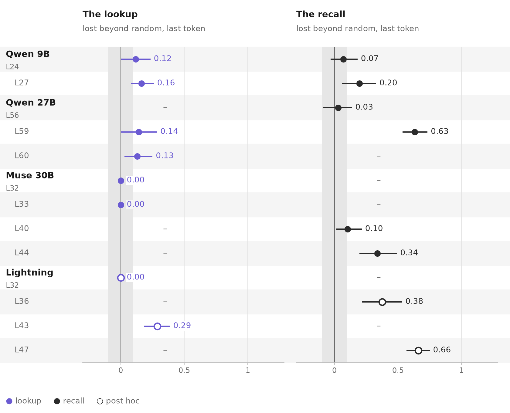
*Per model and layer (the read peak and the layer before the answer): lookup and recall switches blocked without the lens part beyond random at the last token. whiskers: 95% intervals over bridge items; Lightning ○; –: not run, not tested or under 30 switches; grey band: within 0.10 of random.*

- **Rule, fixed in advance.** "Rule per reader: "computes outside the lens at the last token" if the effect without the lens part is <= 0.10 beyond random and the rest alone switches >= 0.7 of the whole; "through the lens" if the effect is >= 0.30 beyond random; else in between." (jobs/c3/batch53.yaml, Dan 29 Oct 09:30; no prediction)

- **Result.**

  | | 9B | 27B | Muse | Lightning | 122B |
  |---|---|---|---|---|---|
  | lookup at the read peak (L24 / L60 / L32 / L32): blocked beyond a random part / the rest alone over the whole | 0.12 [0.00, 0.23]<!-- src: results/x53_lastconflict/x53_lastconflict-20261029T090326Z/verdict.md \| qwen3.5-9b :: lookup :: 24 (read peak) :: 0.12 [0.00, 0.23] --> / 0.35 [0.19, 0.52]<!-- src: results/x53_lastconflict/x53_lastconflict-20261029T090326Z/verdict.md \| qwen3.5-9b :: lookup :: 24 (read peak) :: 0.35 [0.19, 0.52] --> | 0.13 [0.03, 0.25]<!-- src: results/x53_lastconflict/x53_lastconflict-20261029T090326Z/verdict.md \| qwen3.6-27b :: lookup :: 60 (read peak) :: 0.13 [0.03, 0.25] --> / 0.19 [0.07, 0.33]<!-- src: results/x53_lastconflict/x53_lastconflict-20261029T090326Z/verdict.md \| qwen3.6-27b :: lookup :: 60 (read peak) :: 0.19 [0.07, 0.33] --> | 0.00 [0.00, 0.00]<!-- src: results/x53_lastconflict/x53_lastconflict-20261029T090326Z/verdict.md \| muse-glimmer-30b :: lookup :: 32 (read peak) :: 0.00 [0.00, 0.00] --> / 1.00 [1.00, 1.00]<!-- src: results/x53_lastconflict/x53_lastconflict-20261029T090326Z/verdict.md \| muse-glimmer-30b :: lookup :: 32 (read peak) :: 1.00 [1.00, 1.00] --> | 0.00 [0.00, 0.00]<!-- src: results/x53_lastconflict/x53_lastconflict-20261029T090326Z/verdict.md \| nemotron-3.5-lightning :: lookup :: 32 (read peak) :: 0.00 [0.00, 0.00] --> / 0.98 [0.95, 1.00]<!-- src: results/x53_lastconflict/x53_lastconflict-20261029T090326Z/verdict.md \| nemotron-3.5-lightning :: lookup :: 32 (read peak) :: 0.98 [0.95, 1.00] --> | not tested (L12: the whole change switches no item<!-- src: results/x53_lastconflict/x53_lastconflict-20261029T140437Z/verdict.md \| qwen3.5-122b-a10b :: lookup :: 12 (read peak) :: the whole change switches no item -->) |
  | lookup two layers before the answer (L27 / L59 / L33 / L43): the same (the 9B's and the 27B's descriptive, uninformative near the output (dictionary); Muse's and Lightning's keep their labels) | 0.16 [0.08, 0.26]<!-- src: results/x53_lastconflict/x53_lastconflict-20261029T090326Z/verdict.md \| qwen3.5-9b :: lookup :: 27 (answer L29 - 2) :: 0.16 [0.08, 0.26] --> / 0.16 [0.04, 0.29]<!-- src: results/x53_lastconflict/x53_lastconflict-20261029T090326Z/verdict.md \| qwen3.5-9b :: lookup :: 27 (answer L29 - 2) :: 0.16 [0.04, 0.29] --> | 0.14 [0.00, 0.29]<!-- src: results/x53_lastconflict/x53_lastconflict-20261029T090326Z/verdict.md \| qwen3.6-27b :: lookup :: 59 (answer L61 - 2) :: 0.14 [0.00, 0.29] --> / 0.10 [0.00, 0.25]<!-- src: results/x53_lastconflict/x53_lastconflict-20261029T090326Z/verdict.md \| qwen3.6-27b :: lookup :: 59 (answer L61 - 2) :: 0.10 [0.00, 0.25] --> (too few switches: not valid by X0's bar) | 0.00 [0.00, 0.00]<!-- src: results/x53_lastconflict/x53_lastconflict-20261029T090326Z/verdict.md \| muse-glimmer-30b :: lookup :: 33 (answer L35 - 2) :: 0.00 [0.00, 0.00] --> / 1.00 [1.00, 1.00]<!-- src: results/x53_lastconflict/x53_lastconflict-20261029T090326Z/verdict.md \| muse-glimmer-30b :: lookup :: 33 (answer L35 - 2) :: 1.00 [1.00, 1.00] --> | 0.29 [0.18, 0.39]<!-- src: results/x53_lastconflict/x53_lastconflict-20261029T090326Z/verdict.md \| nemotron-3.5-lightning :: lookup :: 43 (answer L45 - 2) :: 0.29 [0.18, 0.39] --> / 0.63 [0.50, 0.76]<!-- src: results/x53_lastconflict/x53_lastconflict-20261029T090326Z/verdict.md \| nemotron-3.5-lightning :: lookup :: 43 (answer L45 - 2) :: 0.63 [0.50, 0.76] --> | L44: 0.06 [0.00, 0.14]<!-- src: results/x53_lastconflict/x53_lastconflict-20261029T140437Z/verdict.md \| qwen3.5-122b-a10b :: lookup :: 44 (answer L46 - 2) :: 0.06 [0.00, 0.14] --> |
  | recall at the read peak (L24 / L56 / L40 / L36): the same | 0.07 [-0.03, 0.18]<!-- src: results/x53_lastconflict/x53_lastconflict-20261029T090326Z/verdict.md \| qwen3.5-9b :: recall :: 24 (read peak) :: 0.07 [-0.03, 0.18] --> / 0.79 [0.67, 0.90]<!-- src: results/x53_lastconflict/x53_lastconflict-20261029T090326Z/verdict.md \| qwen3.5-9b :: recall :: 24 (read peak) :: 0.79 [0.67, 0.90] --> | 0.03 [-0.09, 0.14]<!-- src: results/x53_lastconflict/x53_lastconflict-20261029T090326Z/verdict.md \| qwen3.6-27b :: recall :: 56 (read peak) :: 0.03 [-0.09, 0.14] --> / 0.79 [0.64, 0.93]<!-- src: results/x53_lastconflict/x53_lastconflict-20261029T090326Z/verdict.md \| qwen3.6-27b :: recall :: 56 (read peak) :: 0.79 [0.64, 0.93] --> | 0.10 [0.02, 0.22]<!-- src: results/x53_lastconflict/x53_lastconflict-20261029T090326Z/verdict.md \| muse-glimmer-30b :: recall :: 40 (read peak) :: 0.10 [0.02, 0.22] --> / 0.85 [0.72, 0.96]<!-- src: results/x53_lastconflict/x53_lastconflict-20261029T090326Z/verdict.md \| muse-glimmer-30b :: recall :: 40 (read peak) :: 0.85 [0.72, 0.96] --> | 0.38 [0.22, 0.53]<!-- src: results/x53_lastconflict/x53_lastconflict-20261029T090326Z/verdict.md \| nemotron-3.5-lightning :: recall :: 36 (read peak) :: 0.38 [0.22, 0.53] --> / 0.46 [0.29, 0.63]<!-- src: results/x53_lastconflict/x53_lastconflict-20261029T090326Z/verdict.md \| nemotron-3.5-lightning :: recall :: 36 (read peak) :: 0.46 [0.29, 0.63] --> | L44: 0.75 [0.66, 0.85]<!-- src: results/x53_lastconflict/x53_lastconflict-20261029T140437Z/verdict.md \| qwen3.5-122b-a10b :: recall :: 44 (read peak) :: 0.75 [0.66, 0.85] --> |
  | recall two layers before the answer (L27 / L59 / L44 / L47): the same, descriptive (uninformative near the output (dictionary)) | 0.20 [0.06, 0.33]<!-- src: results/x53_lastconflict/x53_lastconflict-20261029T090326Z/verdict.md \| qwen3.5-9b :: recall :: 27 (answer L29 - 2) :: 0.20 [0.06, 0.33] --> / 0.59 [0.45, 0.73]<!-- src: results/x53_lastconflict/x53_lastconflict-20261029T090326Z/verdict.md \| qwen3.5-9b :: recall :: 27 (answer L29 - 2) :: 0.59 [0.45, 0.73] --> | 0.63 [0.54, 0.73]<!-- src: results/x53_lastconflict/x53_lastconflict-20261029T090326Z/verdict.md \| qwen3.6-27b :: recall :: 59 (answer L61 - 2) :: 0.63 [0.54, 0.73] --> / 0.25 [0.15, 0.37]<!-- src: results/x53_lastconflict/x53_lastconflict-20261029T090326Z/verdict.md \| qwen3.6-27b :: recall :: 59 (answer L61 - 2) :: 0.25 [0.15, 0.37] --> | 0.34 [0.20, 0.49]<!-- src: results/x53_lastconflict/x53_lastconflict-20261029T090326Z/verdict.md \| muse-glimmer-30b :: recall :: 44 (answer L46 - 2) :: 0.34 [0.20, 0.49] --> / 0.62 [0.46, 0.76]<!-- src: results/x53_lastconflict/x53_lastconflict-20261029T090326Z/verdict.md \| muse-glimmer-30b :: recall :: 44 (answer L46 - 2) :: 0.62 [0.46, 0.76] --> | 0.66 [0.57, 0.75]<!-- src: results/x53_lastconflict/x53_lastconflict-20261029T090326Z/verdict.md \| nemotron-3.5-lightning :: recall :: 47 (answer L49 - 2) :: 0.66 [0.57, 0.75] --> / 0.22 [0.12, 0.31]<!-- src: results/x53_lastconflict/x53_lastconflict-20261029T090326Z/verdict.md \| nemotron-3.5-lightning :: recall :: 47 (answer L49 - 2) :: 0.22 [0.12, 0.31] --> | |
  | the labels: lookup at the read peak / two before the answer; recall at the read peak / two before the answer | **in between<!-- src: results/x53_lastconflict/x53_lastconflict-20261029T090326Z/verdict.md \| qwen3.5-9b :: lookup :: 24 (read peak) :: in between -->** / uninformative near the output (dictionary) (the verdict's: in between<!-- src: results/x53_lastconflict/x53_lastconflict-20261029T090326Z/verdict.md \| qwen3.5-9b :: lookup :: 27 (answer L29 - 2) :: in between -->); **computes outside the lens at the last token<!-- src: results/x53_lastconflict/x53_lastconflict-20261029T090326Z/verdict.md \| qwen3.5-9b :: recall :: 24 (read peak) :: computes outside the lens at the last token -->** / uninformative near the output (dictionary) (the verdict's: in between<!-- src: results/x53_lastconflict/x53_lastconflict-20261029T090326Z/verdict.md \| qwen3.5-9b :: recall :: 27 (answer L29 - 2) :: in between -->) | **in between<!-- src: results/x53_lastconflict/x53_lastconflict-20261029T090326Z/verdict.md \| qwen3.6-27b :: lookup :: 60 (read peak) :: in between -->** / uninformative near the output (dictionary) (the verdict's: in between<!-- src: results/x53_lastconflict/x53_lastconflict-20261029T090326Z/verdict.md \| qwen3.6-27b :: lookup :: 59 (answer L61 - 2) :: in between -->); **computes outside the lens at the last token<!-- src: results/x53_lastconflict/x53_lastconflict-20261029T090326Z/verdict.md \| qwen3.6-27b :: recall :: 56 (read peak) :: computes outside the lens at the last token -->** / uninformative near the output (dictionary) (the verdict's: through the lens<!-- src: results/x53_lastconflict/x53_lastconflict-20261029T090326Z/verdict.md \| qwen3.6-27b :: recall :: 59 (answer L61 - 2) :: through the lens -->) | **computes outside the lens at the last token<!-- src: results/x53_lastconflict/x53_lastconflict-20261029T090326Z/verdict.md \| muse-glimmer-30b :: lookup :: 32 (read peak) :: computes outside the lens at the last token -->** / **computes outside the lens at the last token<!-- src: results/x53_lastconflict/x53_lastconflict-20261029T090326Z/verdict.md \| muse-glimmer-30b :: lookup :: 33 (answer L35 - 2) :: computes outside the lens at the last token -->** (restored, Dan 11:55); **in between<!-- src: results/x53_lastconflict/x53_lastconflict-20261029T090326Z/verdict.md \| muse-glimmer-30b :: recall :: 40 (read peak) :: in between -->** / uninformative near the output (dictionary) (the verdict's: through the lens<!-- src: results/x53_lastconflict/x53_lastconflict-20261029T090326Z/verdict.md \| muse-glimmer-30b :: recall :: 44 (answer L46 - 2) :: through the lens -->) | **computes outside the lens at the last token<!-- src: results/x53_lastconflict/x53_lastconflict-20261029T090326Z/verdict.md \| nemotron-3.5-lightning :: lookup :: 32 (read peak) :: computes outside the lens at the last token -->** / **in between<!-- src: results/x53_lastconflict/x53_lastconflict-20261029T090326Z/verdict.md \| nemotron-3.5-lightning :: lookup :: 43 (answer L45 - 2) :: in between -->** (restored, Dan 11:55); **through the lens<!-- src: results/x53_lastconflict/x53_lastconflict-20261029T090326Z/verdict.md \| nemotron-3.5-lightning :: recall :: 36 (read peak) :: through the lens -->** / uninformative near the output (dictionary) (the verdict's: through the lens<!-- src: results/x53_lastconflict/x53_lastconflict-20261029T090326Z/verdict.md \| nemotron-3.5-lightning :: recall :: 47 (answer L49 - 2) :: through the lens -->) | not tested / in between<!-- src: results/x53_lastconflict/x53_lastconflict-20261029T140437Z/verdict.md \| qwen3.5-122b-a10b :: lookup :: 44 (answer L46 - 2) :: in between -->; in between<!-- src: results/x53_lastconflict/x53_lastconflict-20261029T140437Z/verdict.md \| qwen3.5-122b-a10b :: recall :: 44 (read peak) :: in between --> |

- **Read.**
  - At the read peak: the lookup is in between on the 9B and the 27B and computes outside the lens part on Muse and Lightning; the recall computes outside the lens part on the 9B and the 27B, is in between on Muse and goes through the lens on Lightning.
  - Two layers before the answer the cells are uninformative near the output (dictionary) (Dan, 11:25): close to the output the letter-token dictionary decides "through" vs "outside", and digits have no atoms. Their numbers stay in the table as descriptive, the verdict's labels beside. Muse's lookup at L33 and Lightning's at L43 keep their own labels (Dan, 11:55: "the last layers" does not hold there): Muse's computes outside the lens part, Lightning's is in between.
- **Caveats.**
  - 59 to 75 scenes per model over 29 to 34 bridge entities; the 27B's lookup two layers before the answer switches too rarely under the whole change for X0's validity bar.
  - Here the rest alone and the change without the lens part are the same arm (the verdict's table gives them the same shares).
  - The cells two layers before the answer sit at L27 of 32<!-- src: src/bridge_jspace/pins.py \| "n_layers" :: 32 --> (9B), L59 of 64<!-- src: configs/models/qwen3.6-27b.yaml \| Target model :: 64 --> (27B), L33 / L44 of 52<!-- src: configs/models/muse-glimmer-30b.yaml \| decoder layers :: 52 --> (Muse's lookup / recall) and L43 / L47 of 52<!-- src: src/bridge_jspace/pins.py \| hybrid :: 52 --> (Lightning's): on these digit answers the answer layer is earlier than on words ([53.3b](#b53-3b)). Muse's and Lightning's lookup cells keep their labels (Dan, 11:55): near the reader's answer layer; the lens dictionary has no digit atoms, but the recall's digits were captured under the same conditions, so this asymmetry is unresolved. The 27B's lookup read peak L60 is also its answer layer minus 1; it keeps its read-peak label.
  - Exploratory (batch 53): no prediction; UNVERIFIED.

### Does the last-token conflict test change when the answers are words? (53.3b, four models, joint verdict 29 Oct) 

`in README` `below gate: Muse, Lightning` *Used in: README "Tested and dropped" ("The copy bypasses the lens").*

- **Question.** At the last token, does the lookup compute its answer through the lens part when the answer is a word the passage states, as the recall does, or outside it as with digits?
- **Why we asked.** On our locker scenes (digit answers) the lookup computes outside the lens part at the last token on two models while the recall goes through it near the answer ([53.3](#b53-3)); the asymmetry could belong to digits or to copying. (53.3's near-answer recall cells are now labelled uninformative near the output, Dan 11:25; its Muse and Lightning digit lookups keep their labels, Dan 11:55.)
- **Data.** Zach's named-bridge passages with made-up facts (Z1-P's items): the lookup copies a made-up word the passage states; the recall answers from memory, the same answer vocabulary. The 9B: 112 passages (86 bridge entities) and the 27B: 200 passages (118 entities), at their gates; Muse: 120 passages (85 entities) and Lightning: 129 passages (100 entities), their eligible passages only, below their gates.
- **Method.** 53.3's conflict test at the last token, per reader at its own answer layer minus 1, 2 and 3 and at 51.10's read peak: the whole change, without the lens part, without a random part of the same share, the lens part alone; and 53.3's lookup again on our locker scenes at its answer layer minus 1 and 3. A cell under 53.3's validity bar (whole change >= 0.30, >= 30 switches) is invalid and counts for neither clause.

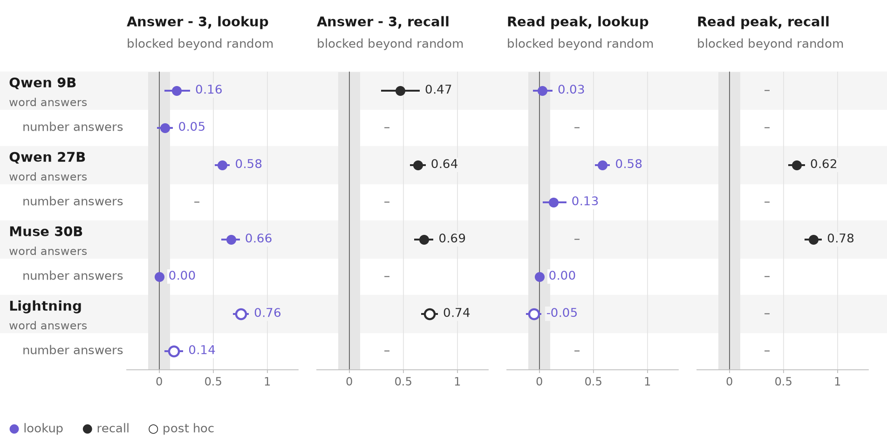
*Per model, word and number answers: switches blocked beyond random three layers before the answer and at the read peak, per reader; the cells one and two layers before the answer are uninformative (the table). whiskers: 95% intervals over bridge items; Lightning ○; –: not run, not tested or under 30 switches; grey band: within 0.10 of random.*

- **Rule, fixed in advance.** "Rule per reader and layer: 53.3's labels. Across readers: "copy bypasses the lens" if at answer - 1 and - 2 the recall is "through the lens" and the lookup "outside" on >= 3 of 4 models; "digits only" if on words the lookup goes through the lens like the recall; else in between." (jobs/c3/batch53.yaml, test_53_3b, Dan ~10:05; no prediction)

- **Result.**

  | | 9B | 27B | Muse | Lightning | 122B |
  |---|---|---|---|---|---|
  | words, lookup: blocked beyond random at answer - 1 / - 2 (descriptive: uninformative near the output) / - 3 | 0.55 [0.44, 0.64]<!-- src: results/x53_lastconflict/x53_lastconflict_words-20261029T100850Z/verdict.md \| qwen3.5-9b :: lookup :: 30 (answer L31 - 1) :: 0.55 [0.44, 0.64] --> / 0.37 [0.23, 0.53]<!-- src: results/x53_lastconflict/x53_lastconflict_words-20261029T100850Z/verdict.md \| qwen3.5-9b :: lookup :: 29 (answer L31 - 2) :: 0.37 [0.23, 0.53] --> / 0.16 [0.05, 0.29]<!-- src: results/x53_lastconflict/x53_lastconflict_words-20261029T100850Z/verdict.md \| qwen3.5-9b :: lookup :: 28 (answer L31 - 3) :: 0.16 [0.05, 0.29] --> (L30 / L29 / L28) | 0.88 [0.84, 0.92]<!-- src: results/x53_lastconflict/x53_lastconflict_words-20261029T100850Z/verdict.md \| qwen3.6-27b :: lookup :: 62 (answer L63 - 1) :: 0.88 [0.84, 0.92] --> / 0.74 [0.68, 0.80]<!-- src: results/x53_lastconflict/x53_lastconflict_words-20261029T100850Z/verdict.md \| qwen3.6-27b :: lookup :: 61 (answer L63 - 2) :: 0.74 [0.68, 0.80] --> / 0.58 [0.51, 0.65]<!-- src: results/x53_lastconflict/x53_lastconflict_words-20261029T100850Z/verdict.md \| qwen3.6-27b :: lookup :: 60 (read peak) :: 0.58 [0.51, 0.65] --> (L62 / L61 / L60) | ○ 0.79 [0.71, 0.87]<!-- src: results/x53_lastconflict/x53_lastconflict_words-20261029T100850Z/verdict.md \| muse-glimmer-30b :: lookup :: 48 (answer L49 - 1) :: 0.79 [0.71, 0.87] --> / 0.66 [0.56, 0.74]<!-- src: results/x53_lastconflict/x53_lastconflict_words-20261029T100850Z/verdict.md \| muse-glimmer-30b :: lookup :: 47 (answer L49 - 2) :: 0.66 [0.56, 0.74] --> / 0.66 [0.58, 0.75]<!-- src: results/x53_lastconflict/x53_lastconflict_words-20261029T100850Z/verdict.md \| muse-glimmer-30b :: lookup :: 46 (answer L49 - 3) :: 0.66 [0.58, 0.75] --> (L48 / L47 / L46) | ○ 0.82 [0.75, 0.89]<!-- src: results/x53_lastconflict/x53_lastconflict_words-20261029T100850Z/verdict.md \| nemotron-3.5-lightning :: lookup :: 49 (answer L50 - 1) :: 0.82 [0.75, 0.89] --> / 0.85 [0.79, 0.91]<!-- src: results/x53_lastconflict/x53_lastconflict_words-20261029T100850Z/verdict.md \| nemotron-3.5-lightning :: lookup :: 48 (answer L50 - 2) :: 0.85 [0.79, 0.91] --> / 0.76 [0.68, 0.83]<!-- src: results/x53_lastconflict/x53_lastconflict_words-20261029T100850Z/verdict.md \| nemotron-3.5-lightning :: lookup :: 47 (answer L50 - 3) :: 0.76 [0.68, 0.83] --> (L49 / L48 / L47) | not run |
  | words, lookup at its read peak: blocked beyond random / the rest alone over the whole | 0.03 [-0.06, 0.12]<!-- src: results/x53_lastconflict/x53_lastconflict_words-20261029T100850Z/verdict.md \| qwen3.5-9b :: lookup :: 24 (read peak) :: 0.03 [-0.06, 0.12] --> / 0.61 [0.44, 0.77]<!-- src: results/x53_lastconflict/x53_lastconflict_words-20261029T100850Z/verdict.md \| qwen3.5-9b :: lookup :: 24 (read peak) :: 0.61 [0.44, 0.77] --> (L24) | 0.58 [0.51, 0.65]<!-- src: results/x53_lastconflict/x53_lastconflict_words-20261029T100850Z/verdict.md \| qwen3.6-27b :: lookup :: 60 (read peak) :: 0.58 [0.51, 0.65] --> / 0.27 [0.21, 0.33]<!-- src: results/x53_lastconflict/x53_lastconflict_words-20261029T100850Z/verdict.md \| qwen3.6-27b :: lookup :: 60 (read peak) :: 0.27 [0.21, 0.33] --> (L60, its answer - 3) | ○ invalid at L32 (whole change 0.27<!-- src: results/x53_lastconflict/x53_lastconflict_words-20261029T100850Z/verdict.md \| muse-glimmer-30b :: lookup :: 32 (read peak) :: 0.27 --> < 0.30) | ○ -0.05 [-0.12, 0.02]<!-- src: results/x53_lastconflict/x53_lastconflict_words-20261029T100850Z/verdict.md \| nemotron-3.5-lightning :: lookup :: 32 (read peak) :: -0.05 [-0.12, 0.02] --> / 0.84 [0.73, 0.93]<!-- src: results/x53_lastconflict/x53_lastconflict_words-20261029T100850Z/verdict.md \| nemotron-3.5-lightning :: lookup :: 32 (read peak) :: 0.84 [0.73, 0.93] --> (L32) | |
  | words, recall: blocked beyond random at answer - 1 / - 2 (descriptive: uninformative near the output) / - 3 | 0.65 [0.55, 0.75]<!-- src: results/x53_lastconflict/x53_lastconflict_words-20261029T100850Z/verdict.md \| qwen3.5-9b :: recall :: 30 (answer L31 - 1) :: 0.65 [0.55, 0.75] --> / 0.49 [0.37, 0.62]<!-- src: results/x53_lastconflict/x53_lastconflict_words-20261029T100850Z/verdict.md \| qwen3.5-9b :: recall :: 29 (answer L31 - 2) :: 0.49 [0.37, 0.62] --> / 0.47 [0.29, 0.65]<!-- src: results/x53_lastconflict/x53_lastconflict_words-20261029T100850Z/verdict.md \| qwen3.5-9b :: recall :: 28 (answer L31 - 3) :: 0.47 [0.29, 0.65] --> | 0.96 [0.94, 0.99]<!-- src: results/x53_lastconflict/x53_lastconflict_words-20261029T100850Z/verdict.md \| qwen3.6-27b :: recall :: 62 (answer L63 - 1) :: 0.96 [0.94, 0.99] --> / 0.88 [0.84, 0.93]<!-- src: results/x53_lastconflict/x53_lastconflict_words-20261029T100850Z/verdict.md \| qwen3.6-27b :: recall :: 61 (answer L63 - 2) :: 0.88 [0.84, 0.93] --> / 0.64 [0.56, 0.71]<!-- src: results/x53_lastconflict/x53_lastconflict_words-20261029T100850Z/verdict.md \| qwen3.6-27b :: recall :: 60 (answer L63 - 3) :: 0.64 [0.56, 0.71] --> | ○ 0.75 [0.66, 0.83]<!-- src: results/x53_lastconflict/x53_lastconflict_words-20261029T100850Z/verdict.md \| muse-glimmer-30b :: recall :: 48 (answer L49 - 1) :: 0.75 [0.66, 0.83] --> / 0.67 [0.57, 0.76]<!-- src: results/x53_lastconflict/x53_lastconflict_words-20261029T100850Z/verdict.md \| muse-glimmer-30b :: recall :: 47 (answer L49 - 2) :: 0.67 [0.57, 0.76] --> / 0.69 [0.60, 0.78]<!-- src: results/x53_lastconflict/x53_lastconflict_words-20261029T100850Z/verdict.md \| muse-glimmer-30b :: recall :: 46 (answer L49 - 3) :: 0.69 [0.60, 0.78] --> | ○ 0.88 [0.81, 0.93]<!-- src: results/x53_lastconflict/x53_lastconflict_words-20261029T100850Z/verdict.md \| nemotron-3.5-lightning :: recall :: 49 (answer L50 - 1) :: 0.88 [0.81, 0.93] --> / 0.87 [0.80, 0.93]<!-- src: results/x53_lastconflict/x53_lastconflict_words-20261029T100850Z/verdict.md \| nemotron-3.5-lightning :: recall :: 48 (answer L50 - 2) :: 0.87 [0.80, 0.93] --> / 0.74 [0.66, 0.82]<!-- src: results/x53_lastconflict/x53_lastconflict_words-20261029T100850Z/verdict.md \| nemotron-3.5-lightning :: recall :: 47 (answer L50 - 3) :: 0.74 [0.66, 0.82] --> | |
  | words, recall at its read peak: blocked beyond random | invalid at L24 (whole change 0.18<!-- src: results/x53_lastconflict/x53_lastconflict_words-20261029T100850Z/verdict.md \| qwen3.5-9b :: recall :: 24 (read peak) :: 0.18 --> < 0.30) | 0.62 [0.54, 0.70]<!-- src: results/x53_lastconflict/x53_lastconflict_words-20261029T100850Z/verdict.md \| qwen3.6-27b :: recall :: 56 (read peak) :: 0.62 [0.54, 0.70] --> (L56) | ○ 0.78 [0.70, 0.86]<!-- src: results/x53_lastconflict/x53_lastconflict_words-20261029T100850Z/verdict.md \| muse-glimmer-30b :: recall :: 40 (read peak) :: 0.78 [0.70, 0.86] --> (L40) | ○ invalid at L36 (whole change 0.26<!-- src: results/x53_lastconflict/x53_lastconflict_words-20261029T100850Z/verdict.md \| nemotron-3.5-lightning :: recall :: 36 (read peak) :: 0.26 --> < 0.30) | |
  | words, the labels (uninformative = uninformative near the output (dictionary), Dan 11:25): lookup at answer - 1, - 2 / - 3 / read peak; recall at answer - 1, - 2 / - 3 / read peak | uninformative / in between / in between; uninformative / through the lens / invalid | uninformative / through the lens / through the lens (L60 is both); uninformative / through the lens / through the lens | ○ uninformative / through the lens / invalid; uninformative / through the lens / through the lens | ○ uninformative / through the lens / computes outside the lens; uninformative / through the lens / invalid | |
  | our locker scenes, lookup at answer - 1 / - 3 (a read-peak cell keeps its label) | 0.19 [0.11, 0.26]<!-- src: results/x53_lastconflict/x53_lastconflict_words-20261029T100850Z/verdict.md \| qwen3.5-9b :: lookup :: 28 (answer L29 - 1) :: 0.19 [0.11, 0.26] --> (L28): uninformative / 0.05 [-0.02, 0.13]<!-- src: results/x53_lastconflict/x53_lastconflict_words-20261029T100850Z/verdict.md \| qwen3.5-9b :: lookup :: 26 (answer L29 - 3) :: 0.05 [-0.02, 0.13] --> (L26): in between | 0.13 [0.03, 0.25]<!-- src: results/x53_lastconflict/x53_lastconflict_words-20261029T100850Z/verdict.md \| qwen3.6-27b :: lookup :: 60 (read peak) :: 0.13 [0.03, 0.25] --> (L60, its read peak and answer - 1): in between / invalid at L58 (whole change 0.29<!-- src: results/x53_lastconflict/x53_lastconflict_words-20261029T100850Z/verdict.md \| qwen3.6-27b :: lookup :: 58 (answer L61 - 3) :: 0.29 --> < 0.30) | -0.02 [-0.05, 0.00]<!-- src: results/x53_lastconflict/x53_lastconflict_words-20261029T100850Z/verdict.md \| muse-glimmer-30b :: lookup :: 34 (answer L35 - 1) :: -0.02 [-0.05, 0.00] --> (L34): uninformative / 0.00 [0.00, 0.00]<!-- src: results/x53_lastconflict/x53_lastconflict_words-20261029T100850Z/verdict.md \| muse-glimmer-30b :: lookup :: 32 (read peak) :: 0.00 [0.00, 0.00] --> (L32, its read peak and answer - 3): computes outside the lens | 0.19 [0.09, 0.29]<!-- src: results/x53_lastconflict/x53_lastconflict_words-20261029T100850Z/verdict.md \| nemotron-3.5-lightning :: lookup :: 44 (answer L45 - 1) :: 0.19 [0.09, 0.29] --> (L44): uninformative / 0.14 [0.05, 0.22]<!-- src: results/x53_lastconflict/x53_lastconflict_words-20261029T100850Z/verdict.md \| nemotron-3.5-lightning :: lookup :: 42 (answer L45 - 3) :: 0.14 [0.05, 0.22] --> (L42): in between | |
  | per model, from the answer - 1 / - 2 cells (uninformative): copy bypasses the lens / digits only | no / yes | no / yes | ○ no / yes (not counted) | ○ no / yes (not counted) | |
  | across readers | **in between (only 2 of 4 models above their gate: neither clause can reach 3 of 4)<!-- src: results/x53_lastconflict/x53_lastconflict_words-20261029T100850Z/verdict.md \| Across readers :: in between (only 2 of 4 models above their gate: neither clause can reach 3 of 4) -->** (copy bypasses on 0 and digits only on 2 of the 2 models counted<!-- src: results/x53_lastconflict/x53_lastconflict_words-20261029T100850Z/verdict.md \| Across readers :: copy bypasses on 0 and digits only on 2 of the 2 models counted -->: the 9B and the 27B); the "digits only" pattern sits in cells labelled uninformative near the output (dictionary) | | | | |

- **Read.**
  - By the rule, across readers: in between. Only the 9B and the 27B are at their gates, so neither clause can reach 3 of 4.
  - The "digits only" pattern under the label (the lookup through the lens part like the recall at answer - 1 and - 2 on all four models; copy bypasses on none) sits in cells labelled uninformative near the output (dictionary) (Dan, 11:25): at those layers the lens is close to the output and the letter-token dictionary decides "through" vs "outside", while digits have no atoms. Their numbers stay beside, descriptive.
  - Away from the output: three layers before the answer the lookup is in between on the 9B and goes through the lens on the 27B (and on Muse and Lightning, below gate); the recall goes through it on all four. At the read peak the lookup is weak (whole change 0.34<!-- src: results/x53_lastconflict/x53_lastconflict_words-20261029T100850Z/verdict.md \| qwen3.5-9b :: lookup :: 24 (read peak) :: 0.34 --> on the 9B, 0.27<!-- src: results/x53_lastconflict/x53_lastconflict_words-20261029T100850Z/verdict.md \| muse-glimmer-30b :: lookup :: 32 (read peak) :: 0.27 --> on Muse, 0.47<!-- src: results/x53_lastconflict/x53_lastconflict_words-20261029T100850Z/verdict.md \| nemotron-3.5-lightning :: lookup :: 32 (read peak) :: 0.47 --> on Lightning) and in between or outside the lens; on the 27B the read peak is its answer layer minus 3 and goes through. Three read-peak cells are under the validity bar: the 9B's recall, Muse's lookup, Lightning's recall.
  - On our locker scenes, away from the output: the 9B in between at L26, the 27B in between at its read peak L60 (L58 invalid), Muse outside at its read peak L32, Lightning in between at L42.
- **Caveats.**
  - Muse (Z1-P's lookup right on 0.781<!-- src: results/x50_zach/x52_z1p-20261029T094820Z/z1p.md | 'K': 0.78125 :: 0.781 --> < 0.80) and Lightning (0.794<!-- src: jobs/c3/batch52.yaml | Z1-P on Lightning :: 0.794 --> < 0.80) are below their gates on these passages: exploratory, hollow ○, never in claims or grades, and they do not count toward "3 of 4". With two models at gate, "in between" follows from the gates; the pattern under it is descriptive.
  - Gates just under 0.80 stay not tested (Dan, 11:25): on the harder variants the eligible items are the easier ones.
  - On word answers the answer layer sits at the end of the model: the last layer on the 9B (L31 of 32<!-- src: src/bridge_jspace/pins.py \| "n_layers" :: 32 -->) and the 27B (L63 of 64<!-- src: configs/models/qwen3.6-27b.yaml \| Target model :: 64 -->), the second-to-last on Lightning (L50 of 52<!-- src: src/bridge_jspace/pins.py \| hybrid :: 52 -->) and the third-to-last on Muse (L49 of 52<!-- src: configs/models/muse-glimmer-30b.yaml \| decoder layers :: 52 -->). Answer - 1 and - 2 are among the final layers.
  - The 27B's check at L58 is invalid (whole change 0.29<!-- src: results/x53_lastconflict/x53_lastconflict_words-20261029T100850Z/verdict.md \| qwen3.6-27b :: lookup :: 58 (answer L61 - 3) :: 0.29 --> < 0.30), so its locker label rests on L60 alone.
  - Exploratory (batch 53): no prediction; UNVERIFIED.

### On Lightning, does the lookup read the bridge word through attention blocks 19 and 26? (53.4, opened 29 Oct ~10:40; follow-up with Dan's 11:25 control 11:53) 

`in README` *Used in: README Part IV card "On Lightning, does the lookup read the bridge word through its attention blocks?".*

- **Question.** On Lightning, does the lookup read the bridge word through its attention blocks 19 and 26?
- **Why we asked.** Lightning's attention heads move with the address swap in blocks 19 and 26 ([attention under the swap](#t49-7)); its other blocks are Mamba-2 state, so the bridge word could reach the lookup through two attention blocks.
- **Data.** Main test at L14, 200 scenes (37 bridge entities); the whole change switches the lookup on 88 of them. The follow-up (Dan's 11:25 control): the same 200 scenes; its rule reads the 83 scenes (35 bridge entities) where the control fits; the 117 where none fits (median span 28 tokens) are dropped from the rule and read beside.
- **Method.** The whole change at the bridge word at L14, with attention from every later position to the bridge word's position blocked in (i) block 19, (ii) block 26, (iii) both, (iv) every attention block after L14 (19, 26, 33, 42), and (v) the control: both blocks, attention to a random other token of the same sentence; the share of the whole change's lookup switches cut; the recall beside. The follow-up: in blocks 19 and 26 every position after the scene's last token cannot attend to the span from the bridge word to the scene's end (median 9 tokens on the rule's scenes); the control: a span of the same length ending at the last token before the bridge's sentence, one placement: Dan's 11:25 control (approved 11:55).

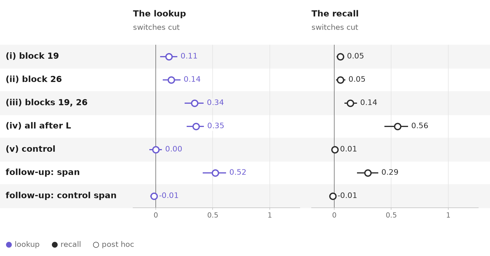
*Lightning (○): each reader's switches cut by blocking the bridge word in attention block 19, 26, both, every block after L, a control block, and the follow-up spans. Whiskers: 95% intervals.*

- **Rule, fixed in advance.** "Rule: "read through two blocks" if (iii) cuts the lookup's switches by >= 0.6 of the whole change's and (v) by <= 0.15; "one block" if (i) or (ii) alone cuts >= 0.6; "not through attention at the bridge" if (iv) cuts < 0.3 (the Mamba state carries it); else in between." (jobs/c3/batch52.yaml, lightning_attn_block, Dan ~10:05; no prediction) Follow-up (span): "the pointer is read by attention after the Mamba state spreads it" if the span cuts the lookup's switches by >= 0.6 and the control by <= 0.15; else as 53.4. (jobs/c3/batch53.yaml, next_1110, Dan 11:10; no prediction)

- **Result.**

  | | 9B | 27B | Muse | Lightning | 122B |
  |---|---|---|---|---|---|
  | lookup switches cut: (i) block 19 / (ii) block 26 | not applicable | not applicable | not applicable | 0.114 [0.039, 0.189]<!-- src: results/x53_attnblock/x53_attnblock-20261029T091303Z/verdict.md \| (i) block 19 only: S 0.390 :: 0.114 [0.039, 0.189] --> / 0.136 [0.060, 0.216]<!-- src: results/x53_attnblock/x53_attnblock-20261029T091303Z/verdict.md \| (ii) block 26 only: S 0.380 :: 0.136 [0.060, 0.216] --> | not applicable |
  | lookup: (iii) both blocks / (iv) every attention block after L / (v) control | | | | 0.341 [0.253, 0.420]<!-- src: results/x53_attnblock/x53_attnblock-20261029T091303Z/verdict.md \| (iii) blocks 19 and 26: S 0.290 :: 0.341 [0.253, 0.420] --> / 0.352 [0.272, 0.423]<!-- src: results/x53_attnblock/x53_attnblock-20261029T091303Z/verdict.md \| every attention block after L: S 0.285 :: 0.352 [0.272, 0.423] --> / 0.000 [-0.056, 0.054]<!-- src: results/x53_attnblock/x53_attnblock-20261029T091303Z/verdict.md \| random non-bridge token of the bridge :: 0.000 [-0.056, 0.054] --> | |
  | the clean answer unchanged, (iii) / (iv) | | | | 0.770<!-- src: results/x53_attnblock/x53_attnblock-20261029T091303Z/verdict.md \| (iii) blocks 19 and 26: S 0.290 :: 0.770 --> / 0.760<!-- src: results/x53_attnblock/x53_attnblock-20261029T091303Z/verdict.md \| every attention block after L: S 0.285 :: 0.760 --> | |
  | recall (beside): (iv) every attention block after L | | | | 0.555 [0.441, 0.647]<!-- src: results/x53_attnblock/x53_attnblock-20261029T091303Z/verdict.md \| every attention block after L: S 0.425 :: 0.555 [0.441, 0.647] --> | |
  | the rule (lookup) | | | | **in between<!-- src: results/x53_attnblock/x53_attnblock-20261029T091303Z/verdict.md \| Label (lookup) :: in between -->** | |
  | follow-up (Dan's 11:25 control, approved 11:55; one placement): lookup switches cut by the span / the control span, on the 83 scenes where the control fits (S_whole 0.831<!-- src: results/x53_attnblock/x53_attnspan_c-20261029T121412Z/verdict.md \| lookup (the rule's scenes) :: S_whole 0.831 :: 0.831 -->) | | | | 0.522 [0.411, 0.617]<!-- src: results/x53_attnblock/x53_attnspan_c-20261029T121412Z/verdict.md \| cannot attend to any position from the bridge word :: 0.522 [0.411, 0.617] --> / -0.015 [-0.050, 0.000]<!-- src: results/x53_attnblock/x53_attnspan_c-20261029T121412Z/verdict.md \| the control: blocks 19 and 26 :: -0.015 [-0.050, 0.000] --> | |
  | follow-up, beside (Dan 13:15, descriptive): the span / the control on the 37<!-- src: results/x53_attnblock/x53_attnspan_c-20261029T121412Z/verdict.md \| survives the span block :: 37 of 83 :: 37 --> rule scenes where the lookup's clean answer survives the span block | | | | 0.538 [0.333, 0.708]<!-- src: results/x53_attnblock/x53_attnspan_c-20261029T121412Z/verdict.md \| survives the span block :: the span's cut 0.538 [0.333, 0.708] :: 0.538 [0.333, 0.708] --> / 0.000 [0.000, 0.000]<!-- src: results/x53_attnblock/x53_attnspan_c-20261029T121412Z/verdict.md \| survives the span block :: the control's 0.000 [0.000, 0.000] :: 0.000 [0.000, 0.000] --> | |
  | follow-up: (iii) rerun on the same scenes, lookup cut | | | | 0.333 [0.243, 0.418]<!-- src: results/x53_attnblock/x53_attnspan_c-20261029T121412Z/verdict.md \| (iii) of 53.4, rerun here :: 0.333 [0.243, 0.418] --> | |
  | follow-up: the clean answer unchanged, span / control / (iii) rerun | | | | 0.446<!-- src: results/x53_attnblock/x53_attnspan_c-20261029T121412Z/verdict.md \| cannot attend to any position from the bridge word :: clean kept 0.446 :: 0.446 --> / 1.000<!-- src: results/x53_attnblock/x53_attnspan_c-20261029T121412Z/verdict.md \| the control: blocks 19 and 26 :: clean kept 1.000 :: 1.000 --> / 0.578<!-- src: results/x53_attnblock/x53_attnspan_c-20261029T121412Z/verdict.md \| (iii) of 53.4, rerun here :: clean kept 0.578 :: 0.578 --> | |
  | follow-up: lookup cut by the span on all 200 scenes / on the 117 without a control (S_whole 0.188<!-- src: results/x53_attnblock/x53_attnspan_c-20261029T121412Z/verdict.md \| no control fits, lookup :: S_whole 0.188 :: 0.188 -->: mostly not switching, uninformative) | | | | 0.407 [0.262, 0.538]<!-- src: results/x53_attnblock/x53_attnspan_c-20261029T121412Z/verdict.md \| all, lookup :: span cut 0.407 [0.262, 0.538] :: 0.407 [0.262, 0.538] --> / 0.045 [-0.571, 0.423]<!-- src: results/x53_attnblock/x53_attnspan_c-20261029T121412Z/verdict.md \| no control fits, lookup :: span cut 0.045 [-0.571, 0.423] :: 0.045 [-0.571, 0.423] --> | |
  | follow-up: recall (beside), span / control | | | | 0.293 [0.198, 0.385]<!-- src: results/x53_attnblock/x53_attnspan_c-20261029T121412Z/verdict.md \| cannot attend to any position from the bridge word :: 0.293 [0.198, 0.385] --> / -0.012 [-0.042, 0.000]<!-- src: results/x53_attnblock/x53_attnspan_c-20261029T121412Z/verdict.md \| the control: blocks 19 and 26 :: -0.012 [-0.042, 0.000] --> | |
  | follow-up: the rule (lookup) | | | | **in between<!-- src: results/x53_attnblock/x53_attnspan_c-20261029T121412Z/verdict.md \| Label (lookup) :: in between -->** (decided on the 83 scenes) | |
  | follow-up, first run, control placement superseded (results/x53_attnblock/x53_attnspan-20261029T102727Z): span / control, 95 scenes | | | | 0.527 [0.412, 0.627]<!-- src: results/x53_attnblock/x53_attnspan-20261029T102727Z/verdict.md \| cannot attend to any position from the bridge word :: 0.527 [0.412, 0.627] --> / 0.000 [-0.039, 0.041]<!-- src: results/x53_attnblock/x53_attnspan-20261029T102727Z/verdict.md \| the control: blocks 19 and 26 :: 0.000 [-0.039, 0.041] --> | |

- **Read.**
  - Blocking the bridge word in attention blocks 19 and 26 cuts about a third of Lightning's lookup switches, as much as blocking every attention block after L; either block alone cuts little, and the control cuts nothing. By the rule this is in between: the lookup is partly read through those two blocks.
  - Follow-up (Dan's 11:25 control): blocking the whole span from the bridge word to the scene's end in blocks 19 and 26 cuts about half of the lookup's switches on the 83 scenes where the control fits, the control span nothing; under 0.6, so in between by the rule. The span also costs the clean answer on more than half of those scenes. The first run, with the superseded control, gave the same picture.
  - On the scenes the span block leaves readable (the lookup's clean answer survives), the span still cuts about the same share: the cut is not just general damage (Dan 13:15; descriptive, the label stays as computed on all 83).
- **Caveats.**
  - The block also costs the clean answer on about a quarter of items (collateral), and blocking every attention block after L cuts more than half of the recall's switches.
  - The follow-up's control is one placement, ending at the last token before the bridge's sentence: Dan's 11:25 control (same length, same distance to the question, inside the scene, not touching the bridge's sentence; approved 11:55). It cannot match the span's distance to the question: the span reaches the scene's end, and the control ends further from the question (median 12.0<!-- src: results/x53_attnblock/x53_attnspan_c-20261029T121412Z/verdict.md \| Distance to the question's first token :: the control's end 12.0 :: 12.0 --> tokens against the span's 1.0<!-- src: results/x53_attnblock/x53_attnspan_c-20261029T121412Z/verdict.md \| Distance to the question's first token :: the span's end 1.0 :: 1.0 -->).
  - The span's collateral is large: the clean answer is unchanged on less than half of the rule's scenes under the span, on all of them under the control. On the 117 scenes without a control the lookup mostly does not switch, so the span's cut there is uninformative.
  - One model by design; exploratory (batch 53), no prediction; UNVERIFIED.

## Part V. Other datasets and operations

### Does the split hold on Zach's passages with a named bridge? (Z1, opened 28 Oct 17:17; Lightning's coverage run 29 Oct) 

`in README` *Used in: README Part V card "Does the split hold on Zach's passages, and do his operation and ours agree?" (his named passages and the recheck); README "Tested and dropped" ("The lookup follows the lens part on Zach's passages").*

- **Question.** On Zach's passages with a named bridge, does the lookup let go of the lens part while the recall follows it?
- **Why we asked.** Our scenes are short lists; his passages scatter the facts in prose.
- **Data.** His passages (named bridge; the lookup's passage states the true final fact, the recall's leaves it out): 200 per model (Lightning at L14, which decides, and L27 beside). Z1-P: his passages with made-up facts, 200 each on the 9B, 27B, Muse (L26) and Lightning.
- **Method.** The conflict test at the bridge name's last token at L: without the lens part, against without a random part; each reader gets its own change.

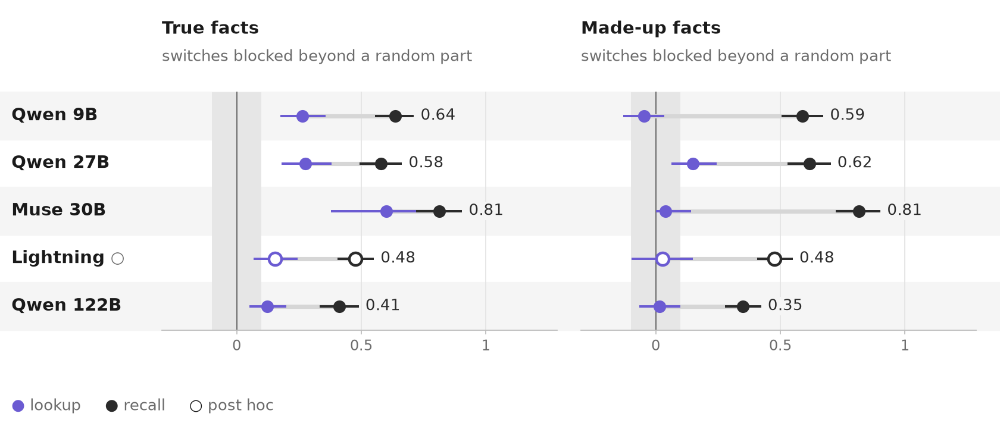
*Lookup and recall switches blocked beyond random on his named passages with true and with made-up facts, at each model's L. whiskers: 95% intervals over bridge items; Lightning ○; –: not run, not tested or under 30 switches; grey band: within 0.10 of random.*

- **Rule, fixed in advance.** "Per model: gap >= 0.3 and lookup extra drop <= 0.10 → the split holds on his passages; lookup >= 0.20 → the lookup follows the lens here; else in between. The order pattern replicates if the lookup's switch under the whole change is >= 2x higher fact-first than fact-after (both CIs)." Lightning: a coverage run on this rule, no prediction.

- **Result.**

  | | 9B | 27B | Muse (L26) | Lightning (L14) | 122B |
  |---|---|---|---|---|---|
  | lookup: switches blocked beyond a random part | 0.26 [0.18, 0.36]<!-- src: results/x50_zach/z1-20261028T161649Z/z1.md \| qwen35_9b_x50_z1 :: 0.26 [0.18, 0.36] --> | 0.28 [0.18, 0.38]<!-- src: results/x50_zach/z1-20261028T161649Z/z1.md \| x50_z1_27b :: 0.28 [0.18, 0.38] --> | 0.60 [0.38, 0.81]<!-- src: results/x50_zach/z1-20261028T161649Z/z1.md \| muse30_x50_z1 :: 0.60 [0.38, 0.81] --> | 0.15 [0.07, 0.25]<!-- src: results/x50_zach/x52_z1-20261029T013035Z/z1.md \| nem35l_x52_z1 :: 0.48 [0.40, 0.55] :: 0.15 [0.07, 0.25] --> | 0.12 [0.05, 0.20]<!-- src: results/x50_zach/x52_z1-20261029T215701Z/z1.md \| qwen35_122b_z1 :: 200 (115) :: 0.12 [0.05, 0.20] --> (L33) |
  | recall: switches blocked beyond a random part | 0.64 [0.56, 0.71]<!-- src: results/x50_zach/z1-20261028T161649Z/z1.md \| qwen35_9b_x50_z1 :: 0.64 [0.56, 0.71] --> | 0.58 [0.49, 0.66]<!-- src: results/x50_zach/z1-20261028T161649Z/z1.md \| x50_z1_27b :: 0.58 [0.49, 0.66] --> | 0.81 [0.72, 0.90]<!-- src: results/x50_zach/z1-20261028T161649Z/z1.md \| muse30_x50_z1 :: 0.81 [0.72, 0.90] --> | 0.48 [0.40, 0.55]<!-- src: results/x50_zach/x52_z1-20261029T013035Z/z1.md \| nem35l_x52_z1 :: 0.15 [0.07, 0.25] :: 0.48 [0.40, 0.55] --> | 0.41 [0.33, 0.49]<!-- src: results/x50_zach/x52_z1-20261029T215701Z/z1.md \| qwen35_122b_z1 :: 200 (115) :: 0.41 [0.33, 0.49] --> |
  | lookups switched, fact-first / fact-after | 0.78 [0.68, 0.86]<!-- src: results/x50_zach/z1-20261028T161649Z/z1.md \| L12 order :: 0.78 [0.68, 0.86] --> / 0.36 [0.27, 0.46]<!-- src: results/x50_zach/z1-20261028T161649Z/z1.md \| L12 order :: 0.36 [0.27, 0.46] --> | 0.67 [0.57, 0.76]<!-- src: results/x50_zach/z1-20261028T161649Z/z1.md \| L32 order :: 0.67 [0.57, 0.76] --> / 0.11 [0.05, 0.17]<!-- src: results/x50_zach/z1-20261028T161649Z/z1.md \| L32 order :: 0.11 [0.05, 0.17] --> | 0.20 [0.12, 0.29]<!-- src: results/x50_zach/z1-20261028T161649Z/z1.md \| L26 order :: 0.20 [0.12, 0.29] --> / 0.05 [0.01, 0.10]<!-- src: results/x50_zach/z1-20261028T161649Z/z1.md \| L26 order :: 0.05 [0.01, 0.10] --> | 0.71 [0.61, 0.80]<!-- src: results/x50_zach/x52_z1-20261029T013035Z/z1.md \| L14 order :: 0.71 [0.61, 0.80] --> / 0.38 [0.27, 0.49]<!-- src: results/x50_zach/x52_z1-20261029T013035Z/z1.md \| L14 order :: 0.38 [0.27, 0.49] --> | |
  | the rule | **the lookup follows the lens here** | **the lookup follows the lens here** | **the lookup follows the lens here** | **in between<!-- src: results/x50_zach/x52_z1-20261029T013035Z/z1.md \| nem35l_x52_z1 :: 0.32 [0.21, 0.44] :: in between -->** (gap 0.32 [0.21, 0.44]<!-- src: results/x50_zach/x52_z1-20261029T013035Z/z1.md \| nem35l_x52_z1 :: 0.32 [0.21, 0.44] -->; no prediction) | **in between<!-- src: results/x50_zach/x52_z1-20261029T215701Z/z1.md \| qwen35_122b_z1 :: 200 (115) :: in between -->** (no prediction; L39: can't tell) |
  | made-up facts (Z1-P): lookup, switches blocked beyond a random part | -0.05 [-0.13, 0.03]<!-- src: results/x50_zach/x52_z1p-20261029T081112Z/z1p.md \| qwen35_9b_x52_z1p :: -0.05 [-0.13, 0.03] --> | 0.15 [0.06, 0.25]<!-- src: results/x50_zach/x52_z1p-20261029T081323Z/z1p.md \| x52_z1p_27b :: 0.15 [0.06, 0.25] --> | ○ 0.04 [0.00, 0.14]<!-- src: results/x50_zach/x52_z1p-20261029T094820Z/z1p.md \| muse30_x53_z1p :: 0.04 [0.00, 0.14] --> | ○ 0.03 [-0.10, 0.15]<!-- src: results/x50_zach/x52_z1p-20261029T080731Z/z1p.md \| nem35l_x52_z1p :: 0.03 [-0.10, 0.15] --> | 0.02 [-0.07, 0.10]<!-- src: results/x50_zach/x52_z1p-20261029T223420Z/z1p.md \| qwen35_122b_z1p :: 0.02 [-0.07, 0.10] --> |
  | made-up facts: recall, the same | 0.59 [0.51, 0.67]<!-- src: results/x50_zach/x52_z1p-20261029T081112Z/z1p.md \| qwen35_9b_x52_z1p :: 0.59 [0.51, 0.67] --> | 0.62 [0.53, 0.70]<!-- src: results/x50_zach/x52_z1p-20261029T081323Z/z1p.md \| x52_z1p_27b :: 0.62 [0.53, 0.70] --> | ○ 0.81 [0.72, 0.90]<!-- src: results/x50_zach/x52_z1p-20261029T094820Z/z1p.md \| muse30_x53_z1p :: 0.81 [0.72, 0.90] --> | ○ 0.48 [0.41, 0.55]<!-- src: results/x50_zach/x52_z1p-20261029T080731Z/z1p.md \| nem35l_x52_z1p :: 0.48 [0.41, 0.55] --> | 0.35 [0.28, 0.42]<!-- src: results/x50_zach/x52_z1p-20261029T223420Z/z1p.md \| qwen35_122b_z1p :: 0.35 [0.28, 0.42] --> |
  | made-up facts: the gap | 0.64 [0.51, 0.76]<!-- src: results/x50_zach/x52_z1p-20261029T081112Z/z1p.md \| qwen35_9b_x52_z1p :: 0.64 [0.51, 0.76] --> | 0.47 [0.36, 0.58]<!-- src: results/x50_zach/x52_z1p-20261029T081323Z/z1p.md \| x52_z1p_27b :: 0.47 [0.36, 0.58] --> | ○ 0.77 [0.63, 0.89]<!-- src: results/x50_zach/x52_z1p-20261029T094820Z/z1p.md \| muse30_x53_z1p :: 0.77 [0.63, 0.89] --> | ○ 0.45 [0.30, 0.60]<!-- src: results/x50_zach/x52_z1p-20261029T080731Z/z1p.md \| nem35l_x52_z1p :: 0.45 [0.30, 0.60] --> | 0.33 [0.23, 0.44]<!-- src: results/x50_zach/x52_z1p-20261029T223420Z/z1p.md \| qwen35_122b_z1p :: 0.33 [0.23, 0.44] --> |
  | made-up facts: the rule | **the split holds on his passages<!-- src: results/x50_zach/x52_z1p-20261029T081112Z/z1p.md \| qwen35_9b_x52_z1p :: the split holds on his passages -->** | **in between<!-- src: results/x50_zach/x52_z1p-20261029T081323Z/z1p.md \| x52_z1p_27b :: in between -->** | not tested (gate 0.781<!-- src: results/x50_zach/x52_z1p-20261029T094820Z/z1p.md \| 'K': 0.78125 :: 0.781 --> < 0.80); numbers descriptive only | not tested (gate 0.794<!-- src: jobs/c3/batch52.yaml \| Z1-P on Lightning :: 0.794 --> < 0.80); numbers descriptive only | **the split holds on his passages<!-- src: results/x50_zach/x52_z1p-20261029T223420Z/z1p.md \| qwen35_122b_z1p :: the split holds on his passages -->** |
  | made-up facts, the 9B rechecked (Dan 12:50): the full set (200 passages, 129 entities) / without the 60 passages whose lookup passage holds the bridge's true value (140, 100): lookup / recall / gap | -0.05 [-0.13, 0.03]<!-- src: results/x50_zach/x53_z1p_clean-20261029T115708Z/verdict.md \| full :: 200 (129) :: -0.05 [-0.13, 0.03] --> / 0.59 [0.51, 0.67]<!-- src: results/x50_zach/x53_z1p_clean-20261029T115708Z/verdict.md \| full :: 200 (129) :: 0.59 [0.51, 0.67] --> / 0.64 [0.51, 0.76]<!-- src: results/x50_zach/x53_z1p_clean-20261029T115708Z/verdict.md \| full :: 200 (129) :: 0.64 [0.51, 0.76] -->; -0.07 [-0.17, 0.03]<!-- src: results/x50_zach/x53_z1p_clean-20261029T115708Z/verdict.md \| without the 60 :: 140 (100) :: -0.07 [-0.17, 0.03] --> / 0.56 [0.46, 0.67]<!-- src: results/x50_zach/x53_z1p_clean-20261029T115708Z/verdict.md \| without the 60 :: 140 (100) :: 0.56 [0.46, 0.67] --> / 0.63 [0.49, 0.78]<!-- src: results/x50_zach/x53_z1p_clean-20261029T115708Z/verdict.md \| without the 60 :: 140 (100) :: 0.63 [0.49, 0.78] --> | | | | |
  | the same: the rule, full set / without the 60 | **the split holds on his passages<!-- src: results/x50_zach/x53_z1p_clean-20261029T115708Z/verdict.md \| full :: 200 (129) :: the split holds on his passages -->** / **the split holds on his passages<!-- src: results/x50_zach/x53_z1p_clean-20261029T115708Z/verdict.md \| without the 60 :: 140 (100) :: the split holds on his passages -->** | | | | |

- **Read.**
  - Rechecked on the 9B (Dan 12:50) without the 60 passages where the bridge's true value stands in the lookup's passage as another entity's value: the split holds on the remaining 140 as on the full set, with the same gap.
  - On his named-bridge passages the lookup follows the lens part too on the 9B and 27B; Muse's lookup switches too rarely to tell (see Flagged for Dan). The order pattern replicates on all three.
  - On Lightning at L14 the split is in between: the lookup has more blocked than the 0.10 bar but far less than the recall; its order pattern does not replicate (fact-first under twice fact-after).
  - On his passages with made-up facts (Z1-P) the 9B's split holds and the 27B's is in between; Muse and Lightning missed the gate there, so their numbers are descriptive only.
- **Caveats.**
  - His true-fact lookup passages (the first four rows) state facts the model may know; the made-up-fact rerun (Z1-P, Dan's morning brief, 29 Oct) ran on the 9B, 27B (L32) and Lightning (L14): coverage runs on the same rule, no prediction, 200 passages each; Muse not run.
  - Hollow ○: below the gate, numbers descriptive only, never in claims or grades (Dan, 09:15).
  - Gates just under 0.80 stay not tested (Dan, 11:25): on the harder variants the eligible items are the easier ones (Muse's and Lightning's made-up-fact gates).
  - Muse's lookup switches under the whole change on 0.12 of passages; at L36 it cannot tell. Lightning's L27 (beside) likewise: its lookup switches on 1<!-- src: results/x50_zach/x52_z1-20261029T013035Z/z1.md \| L27: routes :: "original": 198, "switch": 1 :: 1 --> of 200 passages there, so the verdict's "follows the lens here" at L27 is not valid (Flagged 13).

### On Zach's made-up-fact passages, does the answer control read the same with the bridge named and described? (53.1b, the 9B and the 27B opened 29 Oct ~11:00-12:15) 

`ledger only` *Used in: not in the README (its 12:50 rebuild).*

- **Question.** On Zach's passages with made-up facts, what do 51.12's arms (is it the bridge item or its answer that moves through the lens?) say when the passage names the bridge (PP: the lookup reads the made-up value the passage states; PM: the recall answers from memory) and when it describes the bridge instead (MP: the lookup; MM: the recall)? In his codes the first letter is how the bridge enters, the second where the answer comes from; the made-up fact is stated in every cell, so PP against MP is a named against a described bridge, for the lookup.
- **Why we asked.** Dan's priority 1 of 29 Oct 09:50 ("jsuite PP vs MP, 51.12's arms + readout"): on his passages the cells exist already, no new scenes.
- **Data.** Zach's passages with made-up facts: the named bridge (Z1-P's items) and the described bridge (Z2's design, the change at the description's last token); 200 per cell where tested; the 9B at L12, the 27B at L32.
- **Method.** 51.12's arms per cell: the readout check first (is the answer word in the lens's top 50 at the bridge word?), then the change without the lens part, without the lens part but keeping the answer's directions, and without the answer directions only, each beyond a random part.

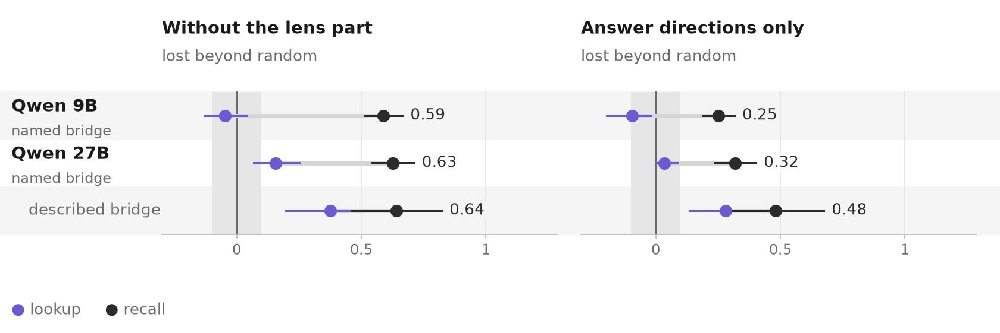
*Per model, named and described bridge: lookup and recall switches blocked beyond random without the lens part and with the answer directions only. whiskers: 95% intervals over bridge items; Lightning ○; –: not run, not tested or under 30 switches; grey band: within 0.10 of random.*

- **Rule, fixed in advance.** 51.12's rule per cell: "the lens effect is the entity": arm 2 keeps >= 0.7 of arm 1's extra drop and arm 3 costs <= 0.10 beyond random; "the lens effect is the answer": arm 2 falls to <= 0.3 of arm 1 and arm 3 alone costs >= 0.5 of arm 1; else mixed; the readout check first ("the answer word is not read at the bridge word" if its lens rank is above 50 on >= 90% of items). (results/x51_answer/x53_jsuite-20261029T095443Z/verdict.md; no prediction)

- **Result.**

  | | 9B | 27B | Muse | Lightning | 122B |
  |---|---|---|---|---|---|
  | PP (lookup, named bridge): blocked without the lens part, beyond random | -0.05 [-0.13, 0.05]<!-- src: results/x51_answer/x53_jsuite-20261029T095443Z/verdict.md \| z1p :: qwen3.5-9b :: lookup :: -0.05 [-0.13, 0.05] --> | 0.16 [0.06, 0.26]<!-- src: results/x51_answer/x53_jsuite-20261029T095443Z/verdict.md \| z1p :: qwen3.6-27b :: lookup :: 0.16 [0.06, 0.26] --> | not designed | not designed | not run |
  | PP: the label | **can't tell<!-- src: results/x51_answer/x53_jsuite-20261029T095443Z/verdict.md \| z1p :: qwen3.5-9b :: lookup :: can't tell -->** | **the answer word is not read at the bridge word<!-- src: results/x51_answer/x53_jsuite-20261029T095443Z/verdict.md \| z1p :: qwen3.6-27b :: lookup :: the answer word is not read at the bridge word -->** | | | |
  | PM (recall, named bridge): blocked without the lens part, beyond random | 0.59 [0.51, 0.67]<!-- src: results/x51_answer/x53_jsuite-20261029T095443Z/verdict.md \| z1p :: qwen3.5-9b :: recall :: 0.59 [0.51, 0.67] --> | 0.63 [0.54, 0.72]<!-- src: results/x51_answer/x53_jsuite-20261029T095443Z/verdict.md \| z1p :: qwen3.6-27b :: recall :: 0.63 [0.54, 0.72] --> | | | |
  | PM: the label | **mixed<!-- src: results/x51_answer/x53_jsuite-20261029T095443Z/verdict.md \| z1p :: qwen3.5-9b :: recall :: mixed -->** | **mixed<!-- src: results/x51_answer/x53_jsuite-20261029T095443Z/verdict.md \| z1p :: qwen3.6-27b :: recall :: mixed -->** | | | |
  | MP (lookup, described bridge): blocked without the lens part, beyond random | MP and MM (described bridge) | 0.38 [0.19, 0.56]<!-- src: results/x51_answer/x53_jsuite-20261029T095443Z/verdict.md \| z2p :: qwen3.6-27b :: lookup :: 0.38 [0.19, 0.56] --> | | | |
  | MP: the label | | **the answer word is not read at the bridge word<!-- src: results/x51_answer/x53_jsuite-20261029T095443Z/verdict.md \| z2p :: qwen3.6-27b :: lookup :: the answer word is not read at the bridge word -->** (95% of 140 items; the arms beside: mixed) | | | |
  | MM (recall, described bridge): blocked without the lens part, beyond random / share remaining with the answer directions retained / the answer directions alone over the effect | | 0.64 [0.46, 0.83]<!-- src: results/x51_answer/x53_jsuite-20261029T095443Z/verdict.md \| z2p :: qwen3.6-27b :: recall :: 0.64 [0.46, 0.83] --> / 0.06 [-0.18, 0.27]<!-- src: results/x51_answer/x53_jsuite-20261029T095443Z/verdict.md \| z2p :: qwen3.6-27b :: recall :: 0.06 [-0.18, 0.27] --> / 0.75 [0.42, 1.22]<!-- src: results/x51_answer/x53_jsuite-20261029T095443Z/verdict.md \| z2p :: qwen3.6-27b :: recall :: 0.75 [0.42, 1.22] --> | | | |
  | MM: the label | | **the lens effect is the answer<!-- src: results/x51_answer/x53_jsuite-20261029T095443Z/verdict.md \| z2p :: qwen3.6-27b :: recall :: the lens effect is the answer -->** | | | |

- **Read.**
  - On the named-bridge passages both recalls read as mixed: keeping the answer's directions keeps only part of the recall's drop, and the answer directions alone cost some of it; the 9B's lookup has nothing blocked beyond random (cannot tell), and the 27B's answer word is not read at the bridge word.
  - On the described bridge the 27B's recall reads as the answer: keeping the answer's directions keeps little of its drop, and the answer directions alone cost most of it; its lookup's answer word is not read at the bridge word.
- **Caveats.**
  - The 9B's described-bridge passages missed the gate (lookup right on 0.757 of 169 cases), so its MP and MM cells are not tested and have no numbers; the 27B's passed theirs (read right on 0.940, 140 chosen of 184).
  - Gates just under 0.80 stay not tested (Dan, 11:25): on the harder variants the eligible items are the easier ones (the 9B's described-bridge passages).
  - Exploratory (batch 53): no prediction; UNVERIFIED.

### Does the split survive when the bridge is changed at every layer up to L? (51.7, opened 28 Oct 18:21; Lightning's coverage run 29 Oct) 

`in README` *Used in: README Part V card "Does the split hold on Zach's passages, and do his operation and ours agree?" (the full carrier).*

- **Question.** On Zach's named-bridge passages, does changing the bridge token at every layer up to L (the full carrier) explain the one-layer result, and does the split hold there?
- **Why we asked.** At one layer his fact-after lookups barely switch; the link may be carried by the bridge token over several layers.
- **Data.** Z1's passages: 200 per model (9B: 100 fact-first, 100 fact-after; 27B: 97 / 103; Lightning, at L14: 103<!-- src: results/x51_carrier/x52_carrier-20261029T014338Z/verdict.md \| fact-first :: 103 (87) :: 103 --> / 97<!-- src: results/x51_carrier/x52_carrier-20261029T014338Z/verdict.md \| fact-after :: 97 (80) :: 97 -->); 9B, 27B and Lightning.
- **Method.** The change at the bridge name's last token at every block output up to L; the conflict test on it: without the lens part, against without a random part of the same share; the one-layer change beside.

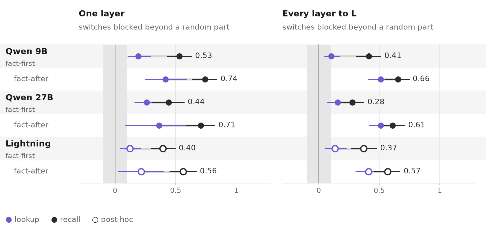
*Per model, fact first and fact after: lookup and recall switches blocked beyond random at one layer and over every layer up to L. whiskers: 95% intervals over bridge items; Lightning ○; –: not run, not tested or under 30 switches; grey band: within 0.10 of random.*

- **Rule, fixed in advance.** "(i) "The slice explanation": the whole before-L raises the lookup's switch on fact-after items by >= 0.3 over the one-layer whole, and on fact-first brings the lookup within 0.10 of the recall. (ii) On the full carrier, per model and reported per stratum with fact-first decisive: recall extra drop - lookup extra drop >= 0.3 and lookup <= 0.10 -> "the split holds on the full carrier"; lookup >= 0.20 -> "the lookup follows the lens on the full carrier"; else in between." (verdict.md) Lightning: a coverage run on this rule, no prediction.

- **Result.**

  | | 9B | 27B | Muse | Lightning | 122B |
  |---|---|---|---|---|---|
  | fact-after lookups switched: one layer → full carrier, rise | 0.54 [0.44, 0.64]<!-- src: results/x51_carrier/x51_7-20261028T171646Z/verdict.md \| qwen35_9b_x51_7 :: 0.54 [0.44, 0.64] --> | 0.73 [0.64, 0.81]<!-- src: results/x51_carrier/x51_7-20261028T171646Z/verdict.md \| x51_7_27b :: 0.73 [0.64, 0.81] --> | not run | 0.49 [0.39, 0.60]<!-- src: results/x51_carrier/x52_carrier-20261029T014338Z/verdict.md \| nem35l_x52_carrier :: 0.49 [0.39, 0.60] --> | not run |
  | fact-first: lookup switches blocked beyond a random part | 0.10 [0.05, 0.17]<!-- src: results/x51_carrier/x51_7-20261028T171646Z/verdict.md \| in between :: 0.10 [0.05, 0.17] --> | 0.16 [0.07, 0.25]<!-- src: results/x51_carrier/x51_7-20261028T171646Z/verdict.md \| in between :: 0.16 [0.07, 0.25] --> | | 0.14 [0.05, 0.23]<!-- src: results/x51_carrier/x52_carrier-20261029T014338Z/verdict.md \| in between :: 0.14 [0.05, 0.23] --> | |
  | fact-first: recall switches blocked beyond a random part | 0.41 [0.31, 0.52]<!-- src: results/x51_carrier/x51_7-20261028T171646Z/verdict.md \| in between :: 0.41 [0.31, 0.52] --> | 0.28 [0.18, 0.38]<!-- src: results/x51_carrier/x51_7-20261028T171646Z/verdict.md \| in between :: 0.28 [0.18, 0.38] --> | | 0.37 [0.27, 0.48]<!-- src: results/x51_carrier/x52_carrier-20261029T014338Z/verdict.md \| in between :: 0.37 [0.27, 0.48] --> | |
  | fact-after: lookup switches blocked beyond a random part | 0.51 [0.41, 0.61]<!-- src: results/x51_carrier/x51_7-20261028T171646Z/verdict.md \| the lookup follows the lens on the full carrier :: 0.51 [0.41, 0.61] --> | 0.51 [0.42, 0.61]<!-- src: results/x51_carrier/x51_7-20261028T171646Z/verdict.md \| the lookup follows the lens on the full carrier :: 0.51 [0.42, 0.61] --> | | 0.41 [0.31, 0.52]<!-- src: results/x51_carrier/x52_carrier-20261029T014338Z/verdict.md \| the lookup follows the lens on the full carrier :: 0.41 [0.31, 0.52] --> | |
  | rule (i) / (ii), fact-first | holds / in between | holds / in between | | holds / in between; (iii) no (no prediction) | |

- **Read.**
  - Carried over every layer up to L, the fact-after lookups switch as often as the fact-first ones, so the one-layer result was a slice; the same on Lightning.
  - On the full carrier the fact-first split is in between; fact-after lookups follow the lens part.
- **Caveats.**
  - Zach's lookup passages state true facts (see [Z1](#z1)).
  - Muse not run (designed for the 9B and 27B).

### Does the lookup take a position route on Zach's passages? (Z3, opened 28 Oct 17:31; the 27B's and Lightning's coverage runs 29 Oct) 

`in README` *Used in: README Part V card "Does the split hold on Zach's passages, and do his operation and ours agree?" (the routes test on his passages).*

- **Question.** On Zach's passages with scattered facts, does the lookup take a position route besides the identity route?
- **Why we asked.** The address codes where a locker sentence sits in a list; his passages have no list.
- **Data.** His level-0 passages with all three facts before the pointer: 60 (9B), 81<!-- src: results/x50_zach/x52_z3-20261029T024151Z/z3.md \| x50_z3_27b :: 81 (72) :: 81 --> (27B, at L32: X0's layer and the start of Zach's band), 48 (Muse), 52<!-- src: results/x50_zach/x52_z3-20261029T013329Z/z3.md \| nem35l_x52_z3 :: 52 (47) :: 52 --> (Lightning, at L14 and L27).
- **Method.** The routes test: the change comes from a passage where another item's fact sentence moved and took a new value; the lookup's answer is sorted into identity, position, value or original.

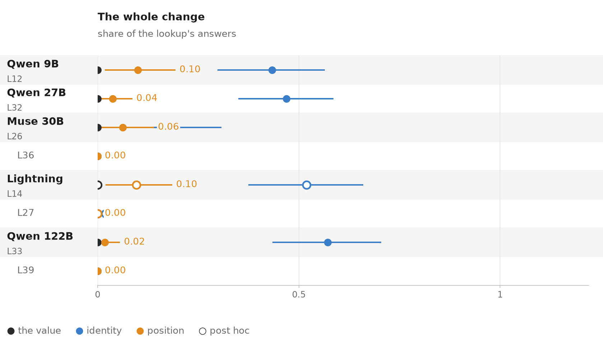
*Per model and layer: the lookup's shares by route under the whole change on his passages. whiskers: 95% intervals over bridge items; Lightning ○; –: not run, not tested or under 30 switches.*

- **Rule, fixed in advance.** "Value <= 0.05; if position >= 0.2: the address exists in scattered-fact passages; if position <= 0.05: no position route in his layout." The 27B and Lightning: coverage runs on this rule, no prediction.

- **Result.**

  | | 9B | 27B (L32) | Muse (L26) | Lightning (L14) | 122B |
  |---|---|---|---|---|---|
  | identity | 0.43 [0.30, 0.56]<!-- src: results/x50_zach/z3-20261028T163053Z/z3.md \| qwen35_9b_x50_z3 :: 0.43 [0.30, 0.56] --> | 0.47 [0.35, 0.59]<!-- src: results/x50_zach/x52_z3-20261029T024151Z/z3.md \| x50_z3_27b :: 0.47 [0.35, 0.59] --> | 0.19 [0.08, 0.31]<!-- src: results/x50_zach/z3-20261028T163053Z/z3.md \| muse30_x50_z3 :: 0.19 [0.08, 0.31] --> | 0.52 [0.37, 0.66]<!-- src: results/x50_zach/x52_z3-20261029T013329Z/z3.md \| nem35l_x52_z3 :: 52 (47) :: 0.52 [0.37, 0.66] --> | 0.57 [0.43, 0.70]<!-- src: results/x50_zach/x52_z3-20261030T035019Z/z3.md \| qwen35_122b_z3 :: 0.57 [0.43, 0.70] --> (L33) |
  | position | 0.10 [0.02, 0.19]<!-- src: results/x50_zach/z3-20261028T163053Z/z3.md \| qwen35_9b_x50_z3 :: 0.10 [0.02, 0.19] --> | 0.04 [0.00, 0.09]<!-- src: results/x50_zach/x52_z3-20261029T024151Z/z3.md \| x50_z3_27b :: 0.04 [0.00, 0.09] --> | 0.06 [0.00, 0.14]<!-- src: results/x50_zach/z3-20261028T163053Z/z3.md \| muse30_x50_z3 :: 0.06 [0.00, 0.14] --> | 0.10 [0.02, 0.19]<!-- src: results/x50_zach/x52_z3-20261029T013329Z/z3.md \| nem35l_x52_z3 :: 0.52 [0.37, 0.66] :: 0.10 [0.02, 0.19] --> | 0.02 [0.00, 0.06]<!-- src: results/x50_zach/x52_z3-20261030T035019Z/z3.md \| qwen35_122b_z3 :: 0.57 [0.43, 0.70] :: 0.02 [0.00, 0.06] --> |
  | value | 0.00 [0.00, 0.00]<!-- src: results/x50_zach/z3-20261028T163053Z/z3.md \| qwen35_9b_x50_z3 :: 0.00 [0.00, 0.00] --> | 0.00 [0.00, 0.00]<!-- src: results/x50_zach/x52_z3-20261029T024151Z/z3.md \| x50_z3_27b :: 0.04 [0.00, 0.09] :: 0.00 [0.00, 0.00] --> | 0.00 [0.00, 0.00]<!-- src: results/x50_zach/z3-20261028T163053Z/z3.md \| muse30_x50_z3 :: 0.00 [0.00, 0.00] --> | 0.00 [0.00, 0.00]<!-- src: results/x50_zach/x52_z3-20261029T013329Z/z3.md \| nem35l_x52_z3 :: 0.52 [0.37, 0.66] :: 0.00 [0.00, 0.00] --> | 0.00 [0.00, 0.00]<!-- src: results/x50_zach/x52_z3-20261030T035019Z/z3.md \| qwen35_122b_z3 :: 0.57 [0.43, 0.70] :: 0.00 [0.00, 0.00] --> |
  | the rule | **in between** | **no position route in his layout<!-- src: results/x50_zach/x52_z3-20261029T024151Z/z3.md \| x50_z3_27b :: no position route in his layout -->** (no prediction) | **in between** (L36: no position route) | **in between<!-- src: results/x50_zach/x52_z3-20261029T013329Z/z3.md \| nem35l_x52_z3 :: 0.10 [0.02, 0.19] :: in between -->** (L27: no position route; no prediction) | **no position route in his layout<!-- src: results/x50_zach/x52_z3-20261030T035019Z/z3.md \| qwen35_122b_z3 :: 0.57 [0.43, 0.70] :: no position route in his layout -->** (L39 too; no prediction) |

- **Read.**
  - On his passages the lookup rarely takes the position route: in between on the 9B, Muse and Lightning at L, and almost none on the 27B (no position route in his layout); it never takes the value.
- **Caveats.**
  - Small n (60 / 81 / 48 / 52); the lookup only.
  - The 27B is read at L32 only (X0's layer and the start of Zach's band).

### Does Zach's read window match ours? (51.5, opened 28 Oct 19:14) 

`ledger only` *Used in: not in the README (its 12:50 rebuild).*

- **Question.** On Zach's named-bridge passages, does each reader's read window end within 4 layers of ours?
- **Why we asked.** His swap works up to about L20; ours up to L16 on the 9B; the windows decide where the two operations can be compared.
- **Data.** Z1's passages, 200 per model (9B, 27B; Lightning: a coverage run with the design taken from the 9B / 27B spec, adapted to its layers, no prediction).
- **Method.** The whole change at the bridge name's last token, one layer at a time; the window's end is the last layer where a reader switches on at least 0.3.

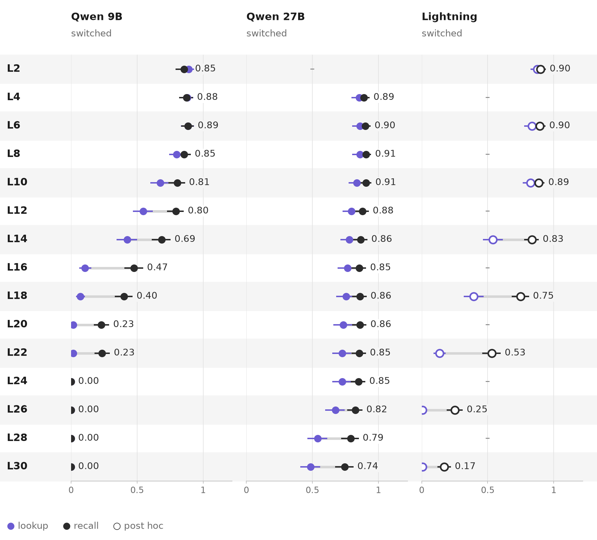
*Per model (columns) and layer (rows): lookups and recalls switched by the whole change on his named passages. Whiskers: 95% intervals; Lightning ○.*

- **Rule, fixed in advance.** "The same read window as ours if the last layer where each reader's switch >= 0.3 lies within 4 layers of ours."

- **Result.** (window ends, his / ours)

  | | 9B | 27B | Muse | Lightning | 122B |
  |---|---|---|---|---|---|
  | lookup | L14 / L16 (-2)<!-- src: results/x51_depth/x51_5-20261028T181100Z/verdict.md \| qwen35_9b_x51_5 :: L14 / L16 (-2) --> | L34 / L40 (-6)<!-- src: results/x51_depth/x51_5-20261028T181100Z/verdict.md \| x51_5_27b :: L34 / L40 (-6) --> | not designed | L18 / L22 (-4)<!-- src: results/x51_depth/x52_depth51-20261029T083500Z/verdict.md \| nem35l_x52_depth51 :: L18 / L22 (-4) --> | not run |
  | recall | L18 / L14 (4)<!-- src: results/x51_depth/x51_5-20261028T181100Z/verdict.md \| qwen35_9b_x51_5 :: L18 / L14 (4) --> | L34 / L32 (2)<!-- src: results/x51_depth/x51_5-20261028T181100Z/verdict.md \| x51_5_27b :: L34 / L32 (2) --> | | L22 / L22 (0)<!-- src: results/x51_depth/x52_depth51-20261029T083500Z/verdict.md \| nem35l_x52_depth51 :: L22 / L22 (0) --> | |
  | the rule | **the same window** | **not the same** | | **the same read window as ours<!-- src: results/x51_depth/x52_depth51-20261029T083500Z/verdict.md \| nem35l_x52_depth51 :: the same read window as ours -->** (no prediction) | |

- **Read.**
  - On the 9B his passages are read over the same layers as our scenes; on the 27B the lookup's window ends 6 layers earlier.
- **Caveats.**
  - Lightning's run uses the 9B / 27B design (adapted design, coverage run); its own window from its anatomy run (L22 for both readers).
  - Our 27B window comes from a coarser grid (every 8th layer with L30-34).
  - Layer ends carry no interval.

## Part VI. What did not hold

### Does the split hold for a described bridge? (described bridge, 47.3, opened 28 Oct; Lightning's gate 29 Oct) 

`in README` `below gate: Lightning` *Used in: README Part VI, one line with a link ("A described bridge in our scenes").*

- **Question.** When the asked pick describes the item instead of naming it ("picked the one known for honey"), does the lookup still let go of the lens part at the description's word while the recall follows it?
- **Why we asked.** A described bridge must be computed first; the computed item could travel through the lens.
- **Data.** Routes scenes with the asked pick described: 300 per model (15 / 15 / 9 bridge items). Lightning not tested: its gate failed. The answer control on these scenes (51.12's cue r2, 9B and 27B, 300 each) in the table; Lightning's was cancelled with 47.3.
- **Method.** The change at the description's word at L, another item moved (C2); without the lens part against a random part of its share; value answers; the refit address's cut beside.

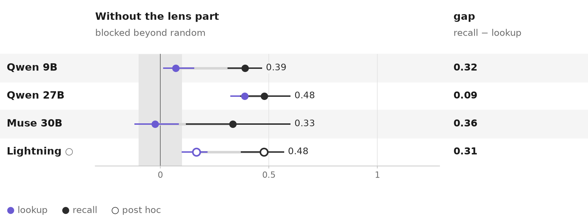
*Lookup and recall extra drop without the lens part on described bridges; right: the gap. whiskers: 95% intervals over bridge items; Lightning ○; –: not run, not tested or under 30 switches; grey band: within 0.10 of random.*

- **Rule, fixed in advance.** "(a) "the split holds for a recalled bridge": gap >= 0.3 and lookup extra drop <= 0.10; (a') "a recalled bridge is handed through the lens": lookup extra drop >= 0.20 [...]; (b) "never the value": value <= 0.05; (c) "a pointer at the cue token": U' removal cuts position answers >= 0.30 beyond random."

- **Result.**

  | | 9B | 27B | Muse | Lightning | 122B |
  |---|---|---|---|---|---|
  | lookup: switches blocked beyond a random part | 0.07 [0.01, 0.16]<!-- src: results/x47_cue/x47_3-20261028T113104Z/x47_3.md \| qwen35_9b_x47_cue :: 0.07 [0.01, 0.16] --> | 0.39 [0.32, 0.45]<!-- src: results/x47_cue/x47_3-20261028T113104Z/x47_3.md \| x47_cue_27b :: 0.39 [0.32, 0.45] --> | -0.02 [-0.12, 0.08]<!-- src: results/x47_cue/x47_3-20261028T113104Z/x47_3.md \| muse30_x47_cue :: -0.02 [-0.12, 0.08] --> | ○ 0.17 [0.10, 0.22]<!-- src: results/x47_cue/x52_cue_below-20261029T083221Z/x47_3.md \| nem35l_x52_cue_below :: 0.17 [0.10, 0.22] --> | not run |
  | recall: the same | 0.39 [0.31, 0.47]<!-- src: results/x47_cue/x47_3-20261028T113104Z/x47_3.md \| qwen35_9b_x47_cue :: 0.39 [0.31, 0.47] --> | 0.48 [0.37, 0.60]<!-- src: results/x47_cue/x47_3-20261028T113104Z/x47_3.md \| x47_cue_27b :: 0.48 [0.37, 0.60] --> | 0.33 [0.12, 0.60]<!-- src: results/x47_cue/x47_3-20261028T113104Z/x47_3.md \| muse30_x47_cue :: 0.33 [0.12, 0.60] --> | ○ 0.48 [0.37, 0.57]<!-- src: results/x47_cue/x52_cue_below-20261029T083221Z/x47_3.md \| nem35l_x52_cue_below :: 0.48 [0.37, 0.57] --> | |
  | the gap | 0.32 [0.20, 0.41]<!-- src: results/x47_cue/x47_3-20261028T113104Z/x47_3.md \| qwen35_9b_x47_cue :: 0.32 [0.20, 0.41] --> | 0.09 [-0.02, 0.20]<!-- src: results/x47_cue/x47_3-20261028T113104Z/x47_3.md \| x47_cue_27b :: 0.09 [-0.02, 0.20] --> | 0.36 [0.06, 0.66]<!-- src: results/x47_cue/x47_3-20261028T113104Z/x47_3.md \| muse30_x47_cue :: 0.36 [0.06, 0.66] --> | ○ 0.31 [0.21, 0.42]<!-- src: results/x47_cue/x52_cue_below-20261029T083221Z/x47_3.md \| nem35l_x52_cue_below :: 0.31 [0.21, 0.42] --> | |
  | the rule | **the split holds** | **handed through the lens** | **the split holds** | not tested (gate 0.72<!-- src: results/x47_cue/x52_cue-20261029T023827Z/x47_3.md \| nem35l_x52_cue :: 0.72 --> < 0.80); below gate, descriptive only: (a) no, (a') no | |
  | answer control (51.12 cue r2): the answer word not read at the cue word, lookup / recall | 1.00 [1.00, 1.00]<!-- src: results/x51_answer/x51_12-20261028T201842Z/verdict.md \| cue :: qwen3.5-9b :: lookup :: 1.00 [1.00, 1.00] --> / 1.00 [1.00, 1.00]<!-- src: results/x51_answer/x51_12-20261028T201842Z/verdict.md \| cue :: qwen3.5-9b :: recall :: 1.00 [1.00, 1.00] --> | 1.00 [1.00, 1.00]<!-- src: results/x51_answer/x51_12-20261028T201842Z/verdict.md \| cue :: qwen3.6-27b :: lookup :: 1.00 [1.00, 1.00] --> / 1.00 [1.00, 1.00]<!-- src: results/x51_answer/x51_12-20261028T201842Z/verdict.md \| cue :: qwen3.6-27b :: recall :: 1.00 [1.00, 1.00] --> | not run | cancelled with 47.3 | not run |
  | answer control: the recall's arms beside, remaining with the answer directions retained / the answer directions alone | 1.00 [0.95, 1.07]<!-- src: results/x51_answer/x51_12-20261028T201842Z/verdict.md \| cue :: qwen3.5-9b :: recall :: 1.00 [0.95, 1.07] --> / 0.01 [0.00, 0.03]<!-- src: results/x51_answer/x51_12-20261028T201842Z/verdict.md \| cue :: qwen3.5-9b :: recall :: 0.01 [0.00, 0.03] --> | 0.97 [0.92, 1.03]<!-- src: results/x51_answer/x51_12-20261028T201842Z/verdict.md \| cue :: qwen3.6-27b :: recall :: 0.97 [0.92, 1.03] --> / 0.05 [0.02, 0.09]<!-- src: results/x51_answer/x51_12-20261028T201842Z/verdict.md \| cue :: qwen3.6-27b :: recall :: 0.05 [0.02, 0.09] --> (the entity) | | | |

  Lightning, below its gate (exploratory, hollow ○): the answer control (51.12's arms on these scenes) finds the answer word not read at the bridge word for either reader, on 1.00 [1.00, 1.00]<!-- src: results/x51_answer/x52_answer_below-20261029T083454Z/verdict.md | cue :: nemotron-3.5-lightning :: recall :: 1.00 [1.00, 1.00] --> of items (the arms beside say the entity).

- **Read.**
  - The answer control: on the 9B and the 27B the answer word is not read at the cue word on every item, and the recall's arms beside say the item.
  - For a described bridge the split holds on the 9B and Muse; on the 27B the lookup follows the lens part too (the bridge is handed through the lens there). The lookup never takes the value, and no pointer sits at the description's word.
- **Caveats.**
  - Lightning's columns are below its gate (the lookup right on 0.72): exploratory, hollow ○, never in claims or grades.
  - Few bridge items (9 to 15).
  - Muse's recall effect is wide.

### Under one question with two instructions, does the lens part follow the source or the question? (one question, two sources, 47.15; the 27B) 

`in README` `below gate: 9B, Muse, Lightning` *Used in: README Part VI, one line with a link ("One question under two instructions").*

- **Question.** When one question asks for the answer "from the passage" or "from what you know", does each part of the change follow the source of the answer or the question?
- **Why we asked.** The lookup answers from the passage and the recall from memory: the split could follow the source, or the question the reader is asked.
- **Data.** Routes scenes (locker first) with a false-legs sentence per item, one question under two instructions (from the text / from memory) and none; 300 scenes per condition on the 27B at L32. Muse's gate failed with the fact after (memory 0.746<!-- src: results/x47_source/x47_15-20261028T142722Z/x47_15.md \| muse-glimmer-30b (muse30_x47_15_r2, L26) :: memory :: 0.746 -->); the 9B's rerun and Lightning's coverage run failed their gates too.
- **Method.** The change at the bridge word at L: without the lens part, and without the address and identity parts (U + I), each against a random part of its share; per condition (the text, memory), the fact placed after.

*No figure: one model tested (the 27B), three numbers per instruction: the Result's table.*

- **Rule, fixed in advance.** "a condition is like a lookup if without J++ <= 0.10 and without U + I >= 0.30, like a recall if without J++ >= 0.30 and without U + I <= 0.10, can't tell if its whole cell is invalid (S_whole < 0.30 or < 30 switches), else neither; the part follows the source if text is like a lookup and memory like a recall; follows the question if both give the same label (lookup or recall); each on the batch on >= 2 of 3 models; a model whose gate (0.80 per instruction) fails is not tested." (results/x47_source/x47_15-20261028T142722Z/x47_15.md; Dan's Q47.15 prediction)

- **Result.** (the fact placed after)

  | | 9B | 27B | Muse | Lightning | 122B |
  |---|---|---|---|---|---|
  | from the text: blocked without the lens part / without U + I, beyond random | not tested (gate) | 0.54 [0.43, 0.66]<!-- src: results/x47_source/x47_15-20261028T142722Z/x47_15.md \| x47_15_27b_r2 :: tested :: 0.54 [0.43, 0.66] --> / 0.39 [0.30, 0.49]<!-- src: results/x47_source/x47_15-20261028T142722Z/x47_15.md \| x47_15_27b_r2 :: tested :: 0.39 [0.30, 0.49] --> | not tested (gate) | not tested (gate) | not run |
  | from memory: the same | | 0.55 [0.40, 0.68]<!-- src: results/x47_source/x47_15-20261028T142722Z/x47_15.md \| x47_15_27b_r2 :: tested :: 0.55 [0.40, 0.68] --> / 0.31 [0.20, 0.44]<!-- src: results/x47_source/x47_15-20261028T142722Z/x47_15.md \| x47_15_27b_r2 :: tested :: 0.31 [0.20, 0.44] --> | | | |
  | the labels: text / memory | | **neither<!-- src: results/x47_source/x47_15-20261028T142722Z/x47_15.md \| x47_15_27b_r2 :: tested :: neither -->** / **can't tell** | | | |

- **Read.**
  - On the 27B both instructions have most of their switches blocked without the lens part and many without the address and identity parts: neither instruction reads like a lookup or a recall, so the part follows neither the source nor the question. With no instruction the 27B answers from the passage.
- **Caveats.**
  - One model; the 9B, Muse and Lightning missed the gate (Lightning's coverage rerun: results/x47_source/x52_source-20261029T062807Z).
  - The coverage matrix named this test "the second hop's key token" until its 12:20 build; that is another failure ([47.14](#t47-14)).

### Are the lookup's errors address errors? (the address probe on the lookup's errors, 47.13; Lightning's coverage run 29 Oct) 

`in README` *Used in: README Part VI, one line with a link ("The lookup's errors are not address errors").*

- **Question.** Where the lookup answers wrong on unedited varied scenes, does the address probe read the slot of the wrong answer, while the lens still names the right item?
- **Why we asked.** If the address carries the position route, some of the lookup's errors could come from a wrong address.
- **Data.** Unedited varied scenes where the lookup answers wrong (see the table).
- **Method.** A slot probe trained on the scenes the lookup gets right (per format and locker order, the wrong item's entity held out), read on the wrong ones against the wrong answer's slot; the lens's top item at the bridge word beside.

*No figure: one or two numbers per model against chance: the Result's table (the two-panel figure was mostly text).*

- **Rule, fixed in advance.** ""The address predicts the error" if the probe's slot matches the wrong answer's slot in >= 0.5 of wrong items (chance ~ 0.33 with three lockers; the layout baseline beside), and the lens's top item at the bridge word is still the right item in >= 0.8 of those." Lightning: a coverage run on this rule, no prediction.

- **Result.**

  | | 9B | 27B | Muse | Lightning | 122B |
  |---|---|---|---|---|---|
  | the lookup's wrong answers, with a probe | 100<!-- src: results/x47_errors/x47_13-20261028T113107Z/x47_errors.md \| qwen35_9b_x47_errors :: 100 (91 / 100; 40) :: 100 --> | 5<!-- src: results/x47_errors/x47_13-20261028T113107Z/x47_errors.md \| x47_errors_27b :: 5 (5 / 5; 5) :: 5 --> | 32<!-- src: results/x47_errors/x47_13-20261028T113107Z/x47_errors.md \| muse30_x47_errors :: 32 (32 / 32; 25) :: 32 --> | 105<!-- src: results/x47_errors/x47_13-20261029T035254Z/x47_errors.md \| nem35l_x52_errors :: 105 (100 / 105; 40) :: 105 --> | 7 (coverage, 30 Oct) |
  | the probe matches the wrong answer's slot (bar >= 0.5) | 0.07 [0.02, 0.12]<!-- src: results/x47_errors/x47_13-20261028T113107Z/x47_errors.md \| qwen35_9b_x47_errors :: 0.07 [0.02, 0.12] --> | 0.00 [0.00, 0.00]<!-- src: results/x47_errors/x47_13-20261028T113107Z/x47_errors.md \| x47_errors_27b :: 0.00 [0.00, 0.00] --> | 0.06 [0.00, 0.16]<!-- src: results/x47_errors/x47_13-20261028T113107Z/x47_errors.md \| muse30_x47_errors :: 0.06 [0.00, 0.16] --> | 0.05 [0.01, 0.09]<!-- src: results/x47_errors/x47_13-20261029T035254Z/x47_errors.md \| nem35l_x52_errors :: 0.05 [0.01, 0.09] --> | |
  | chance | 0.20<!-- src: results/x47_errors/x47_13-20261028T113107Z/x47_errors.md \| qwen35_9b_x47_errors :: 100 (91 / 100; 40) :: 0.20 --> | 0.14<!-- src: results/x47_errors/x47_13-20261028T113107Z/x47_errors.md \| x47_errors_27b :: 5 (5 / 5; 5) :: 0.14 --> | 0.20<!-- src: results/x47_errors/x47_13-20261028T113107Z/x47_errors.md \| muse30_x47_errors :: 32 (32 / 32; 25) :: 0.20 --> | 0.19<!-- src: results/x47_errors/x47_13-20261029T035254Z/x47_errors.md \| nem35l_x52_errors :: 105 (100 / 105; 40) :: 0.19 --> | |
  | the rule | **no** | not tested (5 errors, under 30) | pending (no lens read): no | **no** (no prediction) | not tested (7 errors, under 30) |

- **Read.**
  - On the 9B and Lightning the probe matches the wrong answer's slot in under a tenth of errors, below chance: the lookup's errors are not address errors. The 27B makes too few errors to test, and Muse's lens read never landed.
- **Caveats.**
  - Lightning's verdict header prints "Q47.13, Dan: 65%", but this is a coverage run with no prediction (Flagged 23).
  - Errors are few: about 100 per model over 40 bridge items.

### Does the lens part key the item's attribute, and do late MLPs at the bridge word carry the recall? (enrichment, 48.2; the 27B's and Lightning's coverage runs 29 Oct) 

`in README` *Used in: README "Tested and dropped" ("Four mechanisms for the split").*

- **Question.** (A) After L, does a probe for the item's attribute at the bridge word move with the lens part and not without it? (B) Does mean-ablating the bridge word's MLPs after L cost the recall its answer while the lookup's own is unchanged?
- **Why we asked.** The recall could fetch the item's attribute at the bridge word, keyed by the lens part, through late MLPs.
- **Data.** Main test, 200 per model for design B; the attribute probe on animal items, entities held out, for design A. Lightning: design A only (it has no per-block MLP to ablate for design B).
- **Method.** (A) At every probed layer from L+4 where the attribute probe reads above twice chance: its move under the whole change, without the lens part and without a random part. (B) The bridge word's MLP writes mean-ablated at layers after L; controls: the asked person's token after L, and the bridge word up to L/2.

*No figure: one deciding number per model against its bar: the Result's table (the five-panel mechanism figure is retired).*

- **Rule, fixed in advance.** A: "J++ keys the enrichment if, at every probed layer >= L + 4 where the legs probe (animals, entities held out) reads the attribute (held-out accuracy >= 2x chance), the probe moves >= 0.6 of the way under whole and under no_rand and <= 0.3 under no_jpp (the paired CI of no_rand - no_jpp excluding 0), on both models". B: "the recall's retrieval runs through the bridge token's late MLPs if recall accuracy falls >= 0.4 under bridge_late while lookup accuracy stays within 0.1, and both controls stay within 0.1 for both readers." The 27B and Lightning: coverage runs on these rules, no prediction.

- **Result.**

  | | 9B | 27B | Muse | Lightning | 122B |
  |---|---|---|---|---|---|
  | A: the lens part keys the attribute probe (layers after L+4) | does not hold at the bridge token<!-- src: results/x48_enrich/x48_2-20261028T113111Z/x48_2.md \| qwen35_9b_x48_2a :: does not hold at the bridge token --> | does not hold at the bridge token<!-- src: results/x48_enrich/x52_enrich-20261029T044139Z/x48_2.md \| x48_2a_27b :: does not hold at the bridge token --> | does not hold at the bridge token<!-- src: results/x48_enrich/x48_2-20261028T113111Z/x48_2.md \| muse30_x48_2a :: does not hold at the bridge token --> | does not hold at the bridge token<!-- src: results/x48_enrich/x52_enrich-20261029T044514Z/x48_2.md \| nem35l_x52_enrich_a :: does not hold at the bridge token --> | not run |
  | B: recall accuracy drop, the bridge word's MLPs after L mean-ablated (bar >= 0.4) | 0.13 [0.08, 0.19]<!-- src: results/x48_enrich/x48_2-20261028T113111Z/x48_2.md \| qwen35_9b_x48_2b :: 1.00 [1.00, 1.00] :: 0.13 [0.08, 0.19] --> | 0.03 [0.01, 0.06]<!-- src: results/x48_enrich/x52_enrich-20261029T044139Z/x48_2.md \| x48_2b_27b :: 1.00 [1.00, 1.00] :: 0.03 [0.01, 0.06] --> | 0.01 [0.00, 0.03]<!-- src: results/x48_enrich/x48_2-20261028T113111Z/x48_2.md \| muse30_x48_2b :: 1.00 [1.00, 1.00] :: 0.01 [0.00, 0.03] --> | not run (no per-block MLP) | |
  | B: lookup accuracy drop the same way (bar: within 0.1) | 0.02 [0.00, 0.04]<!-- src: results/x48_enrich/x48_2-20261028T113111Z/x48_2.md \| qwen35_9b_x48_2b :: 0.13 [0.08, 0.19] :: 0.02 [0.00, 0.04] --> | 0.00 [0.00, 0.00]<!-- src: results/x48_enrich/x52_enrich-20261029T044139Z/x48_2.md \| x48_2b_27b :: 0.03 [0.01, 0.06] :: 0.00 [0.00, 0.00] --> | 0.00 [0.00, 0.00]<!-- src: results/x48_enrich/x48_2-20261028T113111Z/x48_2.md \| muse30_x48_2b :: 0.01 [0.00, 0.03] :: 0.00 [0.00, 0.00] --> | | |
  | the verdicts A / B | does not hold<!-- src: results/x48_enrich/x48_2-20261028T113111Z/x48_2.md \| Verdict A :: does not hold --> / does not hold<!-- src: results/x48_enrich/x48_2-20261028T113111Z/x48_2.md \| Verdict B :: does not hold --> | does not hold<!-- src: results/x48_enrich/x52_enrich-20261029T044139Z/x48_2.md \| Verdict A :: does not hold --> / does not hold<!-- src: results/x48_enrich/x52_enrich-20261029T044139Z/x48_2.md \| Verdict B :: does not hold --> | does not hold<!-- src: results/x48_enrich/x48_2-20261028T113111Z/x48_2.md \| Verdict A :: does not hold --> / does not hold<!-- src: results/x48_enrich/x48_2-20261028T113111Z/x48_2.md \| Verdict B :: does not hold --> | does not hold<!-- src: results/x48_enrich/x52_enrich-20261029T044514Z/x48_2.md \| Verdict A :: does not hold --> / not run (no prediction) | |

- **Read.**
  - On the 9B, 27B and Muse neither holds, and design A fails on Lightning too: the lens part does not key the attribute probe at the bridge word, and the bridge word's late MLPs are not needed for the recall.
- **Caveats.**
  - Design B's early-MLP control moves answers on all three, so the controls do not stay within 0.1 either.
  - The verdicts read that the recall survives because the attribute is fetched at the last token; that reading is the verdict's, not tested here.

### Is the person who picked an item marked at its locker sentence? (person mark, 48.3; the 27B's coverage run 29 Oct) 

`in README` `below gate: Lightning` *Used in: README "Tested and dropped" ("Four mechanisms for the split").*

- **Question.** Is the person who picked an item written into the item's locker sentence, readable by a probe there, outside the lens, and able to move the lookup when written?
- **Why we asked.** A forward binding at the locker sentence would let the lookup find the pick's locker without reading the bridge word through the lens.
- **Data.** Main-test scenes split by sentence order; the probe's rule cell, locker after: 266<!-- src: results/x48_bind/x48_bind-20261028T113120Z/x48_bind.md \| qwen3.5-9b :: item :: 266 --> / 335<!-- src: results/x48_bind/x52_bind-20261029T023827Z/x48_bind.md \| qwen3.6-27b :: item :: 335 --> / 278<!-- src: results/x48_bind/x48_bind-20261028T113120Z/x48_bind.md \| muse-glimmer-30b :: item :: 278 --> sentences (9B / 27B / Muse).
- **Method.** A probe for which of the scene's three people picked the item, at the item and number tokens of the locker sentence; the person contrast's share in the lens part against random directions; the contrast written at both tokens at doses 1 and 2, against a random vector of its size.

*No figure: one deciding number per model against its bar: the Result's table (the five-panel mechanism figure is retired).*

- **Rule, fixed in advance.** "forward binding at the locker sentence, outside the lens: probe >= 0.85 in locker-after and <= 0.5 in locker-first; the person contrast's J++ share (k = 25) <= 2x a random direction's; the write sends >= 0.3 of lookups to the written item's locker (random <= 0.05); on both models." The 27B: a coverage run on this rule, no prediction.

- **Result.**

  | | 9B | 27B | Muse | Lightning | 122B |
  |---|---|---|---|---|---|
  | probe for who picked it, locker after, item token (bar >= 0.85) | 0.36 [0.30, 0.42]<!-- src: results/x48_bind/x48_bind-20261028T113120Z/x48_bind.md \| qwen3.5-9b :: item :: 0.36 [0.30, 0.42] --> | 0.50 [0.43, 0.56]<!-- src: results/x48_bind/x52_bind-20261029T023827Z/x48_bind.md \| qwen3.6-27b :: item :: 0.50 [0.43, 0.56] --> | 0.36 [0.31, 0.42]<!-- src: results/x48_bind/x48_bind-20261028T113120Z/x48_bind.md \| muse-glimmer-30b :: item :: 0.36 [0.31, 0.42] --> | not tested (gate 0.751<!-- src: results/x52_coverage/matrix-20261029T062909Z/matrix.json \| clean one-pick design's gate fails on Lightning (recall 0.751 :: 0.751 --> < 0.80) | not run |
  | the same, number token | 0.33 [0.27, 0.39]<!-- src: results/x48_bind/x48_bind-20261028T113120Z/x48_bind.md \| qwen3.5-9b :: number :: 0.33 [0.27, 0.39] --> | 0.31 [0.26, 0.35]<!-- src: results/x48_bind/x52_bind-20261029T023827Z/x48_bind.md \| qwen3.6-27b :: number :: 0.31 [0.26, 0.35] --> | 0.39 [0.34, 0.44]<!-- src: results/x48_bind/x48_bind-20261028T113120Z/x48_bind.md \| muse-glimmer-30b :: number :: 0.39 [0.34, 0.44] --> | | |
  | the write: lookups sent to the written item's locker, dose 2 (bar >= 0.3) | 0.000<!-- src: results/x48_bind/x48_bind-20261028T113120Z/x48_bind.md \| qwen35_9b_x48_bind :: s = 2: target 0.000 :: 0.000 --> | 0.010<!-- src: results/x48_bind/x52_bind-20261029T023827Z/x48_bind.md \| x48_bind_27b :: s = 2: target 0.010 :: 0.010 --> | 0.015<!-- src: results/x48_bind/x48_bind-20261028T113120Z/x48_bind.md \| muse30_x48_bind :: s = 2: target 0.015 :: 0.015 --> | | |
  | the rule | **does not hold<!-- src: results/x48_bind/x48_bind-20261028T113120Z/x48_bind.md \| Verdict :: does not hold -->** | **does not hold<!-- src: results/x48_bind/x52_bind-20261029T023827Z/x48_bind.md \| Verdict :: does not hold -->** (no prediction) | **does not hold<!-- src: results/x48_bind/x48_bind-20261028T113120Z/x48_bind.md \| Verdict :: does not hold -->** | | |

- **Read.**
  - On all three models the person who picked an item cannot be read at its locker sentence (near the 0.33 chance, far under 0.85), and writing a person contrast there moves almost no lookup.
- **Caveats.**
  - The 27B's item-token probe reads 0.50, above chance but far under the bar.
  - The lens-share clause holds on the 27B and Muse and fails on the 9B; it does not decide alone.

### Is the person mark spread over the locker sentence? (pooled person probe, 49.3; the 27B's coverage run 29 Oct) 

`ledger only` `below gate: Lightning` *Used in: not in the README (its 12:50 rebuild).*

- **Question.** In locker-after scenes, is who picked an item readable from the item's whole locker sentence pooled, though no single token holds it, or as a flag "picked by the asked person"?
- **Why we asked.** The single-token probe (48.3) reads chance; a mark spread over the sentence would escape it.
- **Data.** Clean one-pick scenes, the lookup's original prompt; the rule reads locker-after scenes, locker-first ones are the control.
- **Method.** Ridge probes (48.3's) on every token of each locker sentence and on the sentence mean, at L/2 and L: (i) which of the scene's three people picked the item; (ii) whether the asked person picked it.

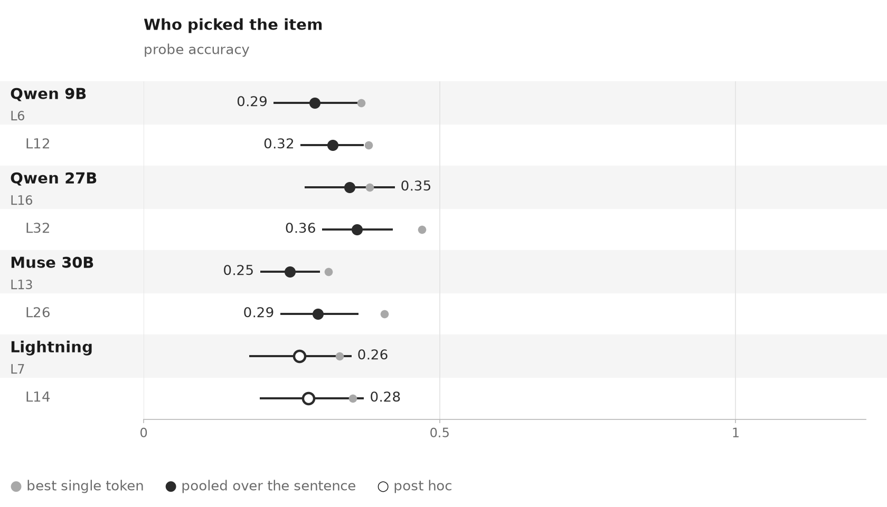
*Per model and layer: the probe for who picked the item, pooled over the locker sentence, against its best single token (grey); chance 0.33. whiskers: 95% intervals over bridge items; Lightning ○; –: not run, not tested or under 30 switches.*

- **Rule, fixed in advance.** ""Distributed person mark": pooled (i) >= 0.85 with every per-token (i) <= 0.6. "A picked-flag, not a person": (ii) >= 0.85 pooled or at some token while (i) <= 0.5. "Neither at the sentence": both at chance; the link is made elsewhere." The 27B: a coverage run on this rule, no prediction.

- **Result.**

  | | 9B | 27B | Muse | Lightning | 122B |
  |---|---|---|---|---|---|
  | (i) who picked it, pooled / best single token, at L/2 | L6: 0.29<!-- src: results/x49_probe/x49_3-20261028T154604Z/x49_3.md \| qwen35_9b_x49_3 :: L6 :: (i) pooled 0.29 :: 0.29 --> / 0.37<!-- src: results/x49_probe/x49_3-20261028T154604Z/x49_3.md \| qwen35_9b_x49_3 :: L6 :: per-token max 0.37 :: 0.37 --> | L16: 0.35<!-- src: results/x49_probe/x52_probe49-20261029T044135Z/x49_3.md \| x49_3_27b :: L16 :: (i) pooled 0.35 :: 0.35 --> / 0.38<!-- src: results/x49_probe/x52_probe49-20261029T044135Z/x49_3.md \| x49_3_27b :: L16 :: per-token max 0.38 :: 0.38 --> | L13: 0.25<!-- src: results/x49_probe/x49_3-20261028T154604Z/x49_3.md \| muse30_x49_3 :: L13 :: (i) pooled 0.25 :: 0.25 --> / 0.31<!-- src: results/x49_probe/x49_3-20261028T154604Z/x49_3.md \| muse30_x49_3 :: L13 :: per-token max 0.31 :: 0.31 --> | ○ L7: 0.26<!-- src: results/x49_probe/x52_probe49_below-20261029T085547Z/x49_3.md \| L7 :: (i) pooled 0.26 :: 0.26 --> / 0.33<!-- src: results/x49_probe/x52_probe49_below-20261029T085547Z/x49_3.md \| L7 :: per-token max 0.33 :: 0.33 --> | not run |
  | the same at L (rule's bar: pooled >= 0.85) | L12: 0.32<!-- src: results/x49_probe/x49_3-20261028T154604Z/x49_3.md \| qwen35_9b_x49_3 :: L12 :: (i) pooled 0.32 :: 0.32 --> / 0.38<!-- src: results/x49_probe/x49_3-20261028T154604Z/x49_3.md \| qwen35_9b_x49_3 :: L12 :: per-token max 0.38 :: 0.38 --> | L32: 0.36<!-- src: results/x49_probe/x52_probe49-20261029T044135Z/x49_3.md \| x49_3_27b :: L32 :: (i) pooled 0.36 :: 0.36 --> / 0.47<!-- src: results/x49_probe/x52_probe49-20261029T044135Z/x49_3.md \| x49_3_27b :: L32 :: per-token max 0.47 :: 0.47 --> | L26: 0.29<!-- src: results/x49_probe/x49_3-20261028T154604Z/x49_3.md \| muse30_x49_3 :: L26 :: (i) pooled 0.29 :: 0.29 --> / 0.41<!-- src: results/x49_probe/x49_3-20261028T154604Z/x49_3.md \| muse30_x49_3 :: L26 :: per-token max 0.41 :: 0.41 --> | ○ L14: 0.28<!-- src: results/x49_probe/x52_probe49_below-20261029T085547Z/x49_3.md \| L14 :: (i) pooled 0.28 :: 0.28 --> / 0.35<!-- src: results/x49_probe/x52_probe49_below-20261029T085547Z/x49_3.md \| L14 :: per-token max 0.35 :: 0.35 --> | |
  | (ii) picked by the asked person, pooled at L (chance 0.50) | 0.50<!-- src: results/x49_probe/x49_3-20261028T154604Z/x49_3.md \| qwen35_9b_x49_3 :: L12 :: (ii) pooled 0.50 :: 0.50 --> | 0.50<!-- src: results/x49_probe/x52_probe49-20261029T044135Z/x49_3.md \| x49_3_27b :: L32 :: (ii) pooled 0.50 :: 0.50 --> | 0.50<!-- src: results/x49_probe/x49_3-20261028T154604Z/x49_3.md \| muse30_x49_3 :: L26 :: (ii) pooled 0.50 :: 0.50 --> | ○ 0.50<!-- src: results/x49_probe/x52_probe49_below-20261029T085547Z/x49_3.md \| L14 :: (ii) pooled 0.50 :: 0.50 --> | |
  | the label at L/2; at L | neither<!-- src: results/x49_probe/x49_3-20261028T154604Z/x49_3.md \| qwen35_9b_x49_3 :: L6 :: neither at the sentence (neither) :: neither -->; neither<!-- src: results/x49_probe/x49_3-20261028T154604Z/x49_3.md \| qwen35_9b_x49_3 :: L12 :: neither at the sentence (neither) :: neither --> | neither<!-- src: results/x49_probe/x52_probe49-20261029T044135Z/x49_3.md \| x49_3_27b :: L16 :: neither at the sentence (neither) :: neither -->; in between<!-- src: results/x49_probe/x52_probe49-20261029T044135Z/x49_3.md \| x49_3_27b :: L32 :: in between (between) :: in between --> | neither<!-- src: results/x49_probe/x49_3-20261028T154604Z/x49_3.md \| muse30_x49_3 :: L13 :: neither at the sentence (neither) :: neither -->; neither<!-- src: results/x49_probe/x49_3-20261028T154604Z/x49_3.md \| muse30_x49_3 :: L26 :: neither at the sentence (neither) :: neither --> | not tested (gate 0.751<!-- src: results/x52_coverage/matrix-20261029T062909Z/matrix.json \| clean one-pick design's gate fails on Lightning (recall 0.751 :: 0.751 --> < 0.80); below gate, descriptive only: neither; neither | |

- **Read.**
  - No probe reads who picked an item from its locker sentence, pooled or at one token, on any of the three models: the 9B and Muse sit at chance at both layers ("neither at the sentence"); the 27B's best token at L comes out "in between", far under 0.85; the picked-flag probe is at chance everywhere.
- **Caveats.**
  - Lightning: below the clean one-pick gate, so not tested; its below-gate run (eligible items, L7 and L14) is exploratory, hollow ○, never in claims or grades.
  - "In between" at the 27B's L does not contradict "did not hold": neither reading fixed in advance holds there.
  - The locker-first control is at chance on all three, as the rule requires.

### Do the copying heads pass the rest of the change at twice the lens part? (copying heads, 48.4; the 27B's and Lightning's coverage runs 29 Oct) 

`in README` *Used in: README "Tested and dropped" ("Four mechanisms for the split").*

- **Question.** Do the five heads that copy most from the bridge word to the last token pass the rest of the change at least twice as strongly as the lens part?
- **Why we asked.** The lookup follows the rest of the change; heads that copy the rest would be its path.
- **Data.** Main-test items, locker first: 75<!-- src: results/x48_heads/x48_heads-20261028T113126Z/x48_heads.md \| qwen35_9b_x48_heads :: 75 --> / 69<!-- src: results/x48_heads/x52_heads48-20261029T044138Z/x48_heads.md \| x48_heads_27b :: 69 --> / 68<!-- src: results/x48_heads/x48_heads-20261028T113126Z/x48_heads.md \| muse30_x48_heads :: 68 --> / 59<!-- src: results/x48_heads/x52_heads48-20261029T044514Z/x48_heads.md \| nem35l_x52_heads48 :: 59 --> (9B / 27B / Muse / Lightning).
- **Method.** For the five heads with the most attention from the last token to the bridge word, each part of the change (the lens part, the rest, the address, a random part) read through the head's output-value map; medians over items.

*No figure: one deciding number per model against its bar: the Result's table (the five-panel mechanism figure is retired).*

- **Rule, fixed in advance.** "a head reads the rest if r(rest) >= 2 r(J++) with r(random) between them or below both (r(random) <= r(rest)), medians over items, W_OV = W_O W_V; a model holds on at least 3 of its 5 heads; the batch holds if both models hold." The 27B and Lightning: coverage runs on this rule, no prediction.

- **Result.**

  | | 9B | 27B | Muse | Lightning | 122B |
  |---|---|---|---|---|---|
  | heads that pass the rest at twice the lens part (of 5; bar: 3) | 0 of 5<!-- src: results/x48_heads/x48_heads-20261028T113126Z/x48_heads.md \| qwen35_9b_x48_heads :: 75 :: 0 of 5 --> | 0 of 5<!-- src: results/x48_heads/x52_heads48-20261029T044138Z/x48_heads.md \| x48_heads_27b :: 69 :: 0 of 5 --> | 1 of 5<!-- src: results/x48_heads/x48_heads-20261028T113126Z/x48_heads.md \| muse30_x48_heads :: 68 :: 1 of 5 --> | 0 of 5<!-- src: results/x48_heads/x52_heads48-20261029T044514Z/x48_heads.md \| nem35l_x52_heads48 :: 59 :: 0 of 5 --> | not run |
  | heads with r(address) >= r(rest) | 4 of 5<!-- src: results/x48_heads/x48_heads-20261028T113126Z/x48_heads.md \| qwen35_9b_x48_heads :: 75 :: 4 of 5 --> | 1 of 5<!-- src: results/x48_heads/x52_heads48-20261029T044138Z/x48_heads.md \| x48_heads_27b :: 69 :: 1 of 5 --> | 3 of 5<!-- src: results/x48_heads/x48_heads-20261028T113126Z/x48_heads.md \| muse30_x48_heads :: 68 :: 3 of 5 --> | 2 of 5<!-- src: results/x48_heads/x52_heads48-20261029T044514Z/x48_heads.md \| nem35l_x52_heads48 :: 59 :: 2 of 5 --> | |
  | the rule, per model | **no** | **no** (no prediction) | **no** | **no** (no prediction) | |

- **Read.**
  - On all four models at most one of the five heads that copy most passes the rest at twice the lens part; the rule fails.
- **Caveats.**
  - The coverage verdicts print "0 of 1" or "0 of 2 models hold (both needed)": the across-models clause read on the given runs; the per-model labels are the result. Lightning's heads are read on its attention layers (the attention port).
  - Five heads per model, chosen by attention from the last token to the bridge word.

### Is the address the recall's second route? (the address as the recall's second route, 48 route2, opened 28 Oct) 

`in README` `below gate: Lightning` *Used in: README "Tested and dropped" ("Four mechanisms for the split").*

- **Question.** Writing another slot's address at the bridge word, does the recall then name the item in that slot (slot k's item), as a second route besides the lens part?
- **Why we asked.** The recall has some blocked switches without the address; the address might be a route into the recall too.
- **Data.** Clean one-pick scenes with both items' lockers before the asked pick, informative writes: 224<!-- src: results/x48_route2/x48_route2-20261028T113127Z/x48_route2.md \| qwen35_9b_x48_route2 :: 224 (34) :: 224 --> / 316<!-- src: results/x48_route2/x48_route2-20261028T113127Z/x48_route2.md \| x48_route2_27b :: 316 (36) :: 316 --> / 208<!-- src: results/x48_route2/x48_route2-20261028T113127Z/x48_route2.md \| muse30_x48_route2 :: 208 (36) :: 208 --> (9B / 27B / Muse). Lightning not tested: the clean one-pick design's gate fails on it.
- **Method.** At the bridge word at L: (i) the change without its lens part alone; (ii) the address of slot k written; (iii) the write alone; (iv) a random vector of the write's size; the recall's answer sorted by the attribute it matches.

*No figure: one deciding number per model against its bar: the Result's table (the five-panel mechanism figure is retired).*

- **Rule, fixed in advance.** "the recall's second route is the address if under (ii) the recall names slot k's item in >= 0.3 of the informative writes with the random vector (iv) <= 0.05 (point estimates), on >= 2 of 3 models."

- **Result.**

  | | 9B | 27B | Muse | Lightning | 122B |
  |---|---|---|---|---|---|
  | (ii) the address written: recalls naming slot k's item (bar >= 0.3) | 0.10 [0.06, 0.15]<!-- src: results/x48_route2/x48_route2-20261028T113127Z/x48_route2.md \| qwen35_9b_x48_route2 :: 224 (34) :: 0.10 [0.06, 0.15] --> | 0.04 [0.02, 0.07]<!-- src: results/x48_route2/x48_route2-20261028T113127Z/x48_route2.md \| x48_route2_27b :: 316 (36) :: 0.04 [0.02, 0.07] --> | 0.07 [0.03, 0.12]<!-- src: results/x48_route2/x48_route2-20261028T113127Z/x48_route2.md \| muse30_x48_route2 :: 208 (36) :: 0.07 [0.03, 0.12] --> | ○ 0.11 [0.06, 0.17]<!-- src: results/x48_route2/x52_route2_below-20261029T084835Z/x48_route2.md \| nem35l_x52_route2_below :: 0.11 [0.06, 0.17] --> | not run |
  | (iv) a random vector of its size (bar <= 0.05) | 0.01 [0.00, 0.02]<!-- src: results/x48_route2/x48_route2-20261028T113127Z/x48_route2.md \| qwen35_9b_x48_route2 :: 224 (34) :: 0.01 [0.00, 0.02] --> | 0.02 [0.01, 0.04]<!-- src: results/x48_route2/x48_route2-20261028T113127Z/x48_route2.md \| x48_route2_27b :: 316 (36) :: 0.02 [0.01, 0.04] --> | 0.05 [0.02, 0.09]<!-- src: results/x48_route2/x48_route2-20261028T113127Z/x48_route2.md \| muse30_x48_route2 :: 208 (36) :: 0.05 [0.02, 0.09] --> | ○ 0.04 [0.01, 0.09]<!-- src: results/x48_route2/x52_route2_below-20261029T084835Z/x48_route2.md \| nem35l_x52_route2_below :: 0.04 [0.01, 0.09] --> | |
  | holds | **no<!-- src: results/x48_route2/x48_route2-20261028T113127Z/x48_route2.md \| qwen35_9b_x48_route2 :: 224 (34) :: no -->** | **no<!-- src: results/x48_route2/x48_route2-20261028T113127Z/x48_route2.md \| x48_route2_27b :: 316 (36) :: no -->** | **no<!-- src: results/x48_route2/x48_route2-20261028T113127Z/x48_route2.md \| muse30_x48_route2 :: 208 (36) :: no -->** | not tested (gate 0.751<!-- src: results/x52_coverage/matrix-20261029T062909Z/matrix.json \| clean one-pick design's gate fails on Lightning (recall 0.751 :: 0.751 --> < 0.80); below gate, descriptive only: no (122<!-- src: results/x48_route2/x52_route2_below-20261029T084835Z/x48_route2.md \| nem35l_x52_route2_below :: 122 --> informative writes) | |

- **Read.**
  - Writing another slot's address makes the recall name that slot's item in at most a tenth of writes on all three models: the address is not the recall's second route.
- **Caveats.**
  - Lightning: below the clean one-pick gate, so not tested; the below-gate run (eligible items only) is exploratory, hollow ○, never in claims or grades.
  - Muse's random vector reaches 0.05, at the rule's bar.
  - Clean scenes with both lockers first only.

### Is the address formed by the pick sentence reading the lockers? (blocking the pick sentence, 47.6; the 27B's coverage run 29 Oct) 

`in README` *Used in: README Part VI, one line with a link ("Blocking the pick sentence from the lockers").*

- **Question.** Blocking the pick sentence from reading the locker sentences at every layer up to L, are only the position answers blocked, with identity answers and the recall's switch still there?
- **Why we asked.** If the pick token forms the address by reading the lockers, blocking those reads should remove position answers alone.
- **Data.** Routes scenes (another item moved, a filler sentence first): 300 per model (9B / 27B / Muse).
- **Method.** Attention from the pick sentence to the locker sentences blocked at layers 0 to L, in both forward passes that make the change; control: the same number of edges to the filler sentence; the lookup's routes and the recall's switch.

*No figure: one deciding number per model against its bar: the Result's table (the five-panel mechanism figure is retired).*

- **Rule, fixed in advance.** ""the pointer is formed by the pick token reading the lockers" if position answers fall to <= 0.10 (from 0.51 / 0.54) while identity answers stay within 0.10 and the recall's switch within 0.10, on Muse and the 9B; the control within 0.10 of none." The 27B: a coverage run on this rule, no prediction.

- **Result.** (paired, the block minus no block)

  | | 9B | 27B | Muse | Lightning | 122B |
  |---|---|---|---|---|---|
  | position answers, block minus none | -0.43 [-0.48, -0.37]<!-- src: results/x47_edges/x47_6-20261028T113107Z/verdict.md \| block/sentence/all :: -0.43 [-0.48, -0.37] --> | -0.25 [-0.30, -0.21]<!-- src: results/x47_edges/x52_edges-20261029T023820Z/verdict.md \| block/sentence/all :: -0.25 [-0.30, -0.21] --> | -0.39 [-0.44, -0.33]<!-- src: results/x47_edges/x47_6-20261028T113107Z/verdict.md \| block/sentence/all :: -0.39 [-0.44, -0.33] --> | not run | not run |
  | identity answers, block minus none (bar: within 0.10) | -0.32 [-0.37, -0.27]<!-- src: results/x47_edges/x47_6-20261028T113107Z/verdict.md \| block/sentence/all :: -0.32 [-0.37, -0.27] --> | -0.30 [-0.34, -0.24]<!-- src: results/x47_edges/x52_edges-20261029T023820Z/verdict.md \| block/sentence/all :: -0.30 [-0.34, -0.24] --> | -0.25 [-0.31, -0.19]<!-- src: results/x47_edges/x47_6-20261028T113107Z/verdict.md \| block/sentence/all :: -0.25 [-0.31, -0.19] --> | | |
  | the recall's switch, block minus none (bar: within 0.10) | -0.23 [-0.29, -0.18]<!-- src: results/x47_edges/x47_6-20261028T113107Z/verdict.md \| block/sentence/all :: -0.23 [-0.29, -0.18] --> | -0.22 [-0.27, -0.17]<!-- src: results/x47_edges/x52_edges-20261029T023820Z/verdict.md \| block/sentence/all :: -0.22 [-0.27, -0.17] --> | -0.15 [-0.20, -0.09]<!-- src: results/x47_edges/x47_6-20261028T113107Z/verdict.md \| block/sentence/all :: -0.15 [-0.20, -0.09] --> | | |
  | the rule | **does not hold<!-- src: results/x47_edges/x47_6-20261028T113107Z/verdict.md \| Formation :: does not hold -->** | **does not hold<!-- src: results/x47_edges/x52_edges-20261029T023820Z/verdict.md \| Formation :: does not hold -->** (no prediction) | **does not hold<!-- src: results/x47_edges/x47_6-20261028T113107Z/verdict.md \| Formation :: does not hold -->** | | |

- **Read.**
  - On all three models the block removes position answers, but identity answers and the recall's switch fall too, by more than 0.10: blocking the pick sentence does not single out the address.
- **Caveats.**
  - Part (c), blocking the question's reads, was dropped before any run.
  - The control (edges to the filler sentence) stays within 0.10 of no block on all three.

### Is the address the same for any kind of item? (other kinds of item, 47.11; the 27B's and Lightning's coverage runs 29 Oct) 

`in README` *Used in: README Part VI, one line with a link ("the address for other kinds of item").*

- **Question.** With fruits or names as the items instead of animals, does the address fit on animal scenes still carry the lookup's position answers?
- **Why we asked.** An address, not an animal code, should work for any kind of item.
- **Data.** Routes scenes (another item moved) with animals, fruits and names as the items, matched digits, people and slots: 300 per kind per model (9B / 27B / Muse / Lightning).
- **Method.** At the bridge word at L: the address fit on animal scenes, not refit, taken out of the change against a random part of its share, and retained alone; where that fails, the address refit per kind on a fit half and read on the other half.

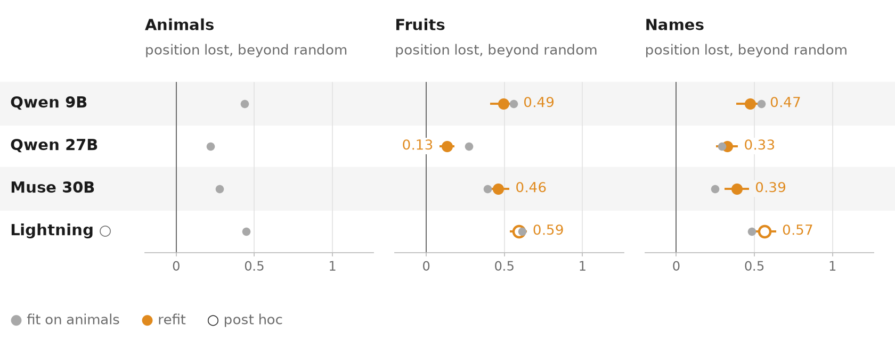
*Position answers blocked beyond random without the address fit on animals (grey) and without the address refit on each kind of item. whiskers: 95% intervals over bridge items; Lightning ○; –: not run, not tested or under 30 switches.*

- **Rule, fixed in advance.** ""An address, not an animal code" if without U cuts position answers >= 0.3 beyond random on both new item types (within 0.1 of the animal result), and only-U gives position >= 0.15. If it fails, refit U per item type and report both: the code is slot x type." The 27B and Lightning: coverage runs on this rule, no prediction.

- **Result.**

  | | 9B | 27B | Muse | Lightning | 122B |
  |---|---|---|---|---|---|
  | position blocked without the animal-fit address, beyond random: animals / fruits / names (bar >= 0.3) | 0.44 [0.39, 0.48]<!-- src: results/x47_agnostic/x47_11-20261028T143952Z/x47_11.md \| qwen3.5-9b :: animals :: 0.44 [0.39, 0.48] --> / 0.56 [0.51, 0.61]<!-- src: results/x47_agnostic/x47_11-20261028T143952Z/x47_11.md \| qwen3.5-9b :: fruits :: 0.56 [0.51, 0.61] --> / 0.54 [0.48, 0.60]<!-- src: results/x47_agnostic/x47_11-20261028T143952Z/x47_11.md \| qwen3.5-9b :: names :: 0.54 [0.48, 0.60] --> | 0.22 [0.18, 0.26]<!-- src: results/x47_agnostic/x52_agnostic-20261029T023820Z/x47_11.md \| qwen3.6-27b :: animals :: 0.22 [0.18, 0.26] --> / 0.27 [0.21, 0.34]<!-- src: results/x47_agnostic/x52_agnostic-20261029T023820Z/x47_11.md \| qwen3.6-27b :: fruits :: 0.27 [0.21, 0.34] --> / 0.29 [0.25, 0.34]<!-- src: results/x47_agnostic/x52_agnostic-20261029T023820Z/x47_11.md \| qwen3.6-27b :: names :: 0.29 [0.25, 0.34] --> | 0.28 [0.23, 0.32]<!-- src: results/x47_agnostic/x47_11-20261028T143952Z/x47_11.md \| muse-glimmer-30b :: animals :: 0.28 [0.23, 0.32] --> / 0.39 [0.33, 0.46]<!-- src: results/x47_agnostic/x47_11-20261028T143952Z/x47_11.md \| muse-glimmer-30b :: fruits :: 0.39 [0.33, 0.46] --> / 0.25 [0.20, 0.30]<!-- src: results/x47_agnostic/x47_11-20261028T143952Z/x47_11.md \| muse-glimmer-30b :: names :: 0.25 [0.20, 0.30] --> | 0.45 [0.38, 0.51]<!-- src: results/x47_agnostic/x52_agnostic-20261029T031638Z/x47_11.md \| nemotron-3.5-lightning :: animals :: 0.45 [0.38, 0.51] --> / 0.61 [0.52, 0.70]<!-- src: results/x47_agnostic/x52_agnostic-20261029T031638Z/x47_11.md \| nemotron-3.5-lightning :: fruits :: 0.61 [0.52, 0.70] --> / 0.48 [0.43, 0.54]<!-- src: results/x47_agnostic/x52_agnostic-20261029T031638Z/x47_11.md \| nemotron-3.5-lightning :: names :: 0.48 [0.43, 0.54] --> | not run |
  | only the address retained, position: fruits / names (bar >= 0.15) | 0.35 [0.30, 0.40]<!-- src: results/x47_agnostic/x47_11-20261028T143952Z/x47_11.md \| qwen3.5-9b :: fruits :: 0.35 [0.30, 0.40] --> / 0.35 [0.30, 0.41]<!-- src: results/x47_agnostic/x47_11-20261028T143952Z/x47_11.md \| qwen3.5-9b :: names :: 0.35 [0.30, 0.41] --> | 0.08 [0.04, 0.11]<!-- src: results/x47_agnostic/x52_agnostic-20261029T023820Z/x47_11.md \| qwen3.6-27b :: fruits :: 0.08 [0.04, 0.11] --> / 0.14 [0.10, 0.18]<!-- src: results/x47_agnostic/x52_agnostic-20261029T023820Z/x47_11.md \| qwen3.6-27b :: names :: 0.14 [0.10, 0.18] --> | 0.29 [0.24, 0.35]<!-- src: results/x47_agnostic/x47_11-20261028T143952Z/x47_11.md \| muse-glimmer-30b :: fruits :: 0.29 [0.24, 0.35] --> / 0.27 [0.21, 0.32]<!-- src: results/x47_agnostic/x47_11-20261028T143952Z/x47_11.md \| muse-glimmer-30b :: names :: 0.27 [0.21, 0.32] --> | 0.54 [0.48, 0.59]<!-- src: results/x47_agnostic/x52_agnostic-20261029T031638Z/x47_11.md \| nemotron-3.5-lightning :: fruits :: 0.54 [0.48, 0.59] --> / 0.41 [0.35, 0.47]<!-- src: results/x47_agnostic/x52_agnostic-20261029T031638Z/x47_11.md \| nemotron-3.5-lightning :: names :: 0.41 [0.35, 0.47] --> | |
  | label: fruits / names | slot x type<!-- src: results/x47_agnostic/x47_11-20261028T143952Z/x47_11.md \| qwen3.5-9b :: fruits :: slot x type --> / slot x type<!-- src: results/x47_agnostic/x47_11-20261028T143952Z/x47_11.md \| qwen3.5-9b :: names :: slot x type --> | neither U nor the refit<!-- src: results/x47_agnostic/x52_agnostic-20261029T023820Z/x47_11.md \| qwen3.6-27b :: fruits :: neither U nor the refit --> / slot x type<!-- src: results/x47_agnostic/x52_agnostic-20261029T023820Z/x47_11.md \| qwen3.6-27b :: names :: slot x type --> | slot x type<!-- src: results/x47_agnostic/x47_11-20261028T143952Z/x47_11.md \| muse-glimmer-30b :: fruits :: slot x type --> / slot x type<!-- src: results/x47_agnostic/x47_11-20261028T143952Z/x47_11.md \| muse-glimmer-30b :: names :: slot x type --> | slot x type<!-- src: results/x47_agnostic/x52_agnostic-20261029T031638Z/x47_11.md \| nemotron-3.5-lightning :: fruits :: slot x type --> / an address (U transfers)<!-- src: results/x47_agnostic/x52_agnostic-20261029T031638Z/x47_11.md \| nemotron-3.5-lightning :: names :: an address (U transfers) --> | |
  | the rule | **no<!-- src: results/x47_agnostic/x47_11-20261028T143952Z/x47_11.md \| Q47.11 per model :: no -->** | **no<!-- src: results/x47_agnostic/x52_agnostic-20261029T023820Z/x47_11.md \| Q47.11 per model :: no -->** (no prediction) | **no<!-- src: results/x47_agnostic/x47_11-20261028T143952Z/x47_11.md \| Q47.11 per model :: no -->** | **no<!-- src: results/x47_agnostic/x52_agnostic-20261029T031638Z/x47_11.md \| Q47.11 per model :: no -->** (no prediction) | |

- **Read.**
  - On all three models the animal-fit address does not carry over as the rule asks: on the 9B it cuts fruits and names more than animals, on Muse names fall short, and on the 27B it cuts no kind by 0.3 and retained alone gives few position answers. Refit per kind, it passes for names on all three and for fruits on the 9B and Muse. On Lightning the rule also says no, though its names take the animal-fit address as it is (an address); its fruits need the refit.
- **Caveats.**
  - Lightning's column comes from a later verdict folder that re-reads the 27B with the same rows.
  - The refit is read on half the scenes (150 per kind).

## Also failed (one line each) 

The README's Part VI "Also failed" line (Dan 12:50: its cards move here); each with its verdict, no card.

- **The positive control (the 27B, chemical symbols).** The alias test's difference for the elements is 0.15 [0.10, 0.19]<!-- src: results/x4_alias/x4_patch_27b/verdict-20261024T215021Z/verdict.md \| elements :: excess (syn) - excess (same) :: 0.15 [0.10, 0.19] -->, under its bar of 0.20: it "fails: the method may not see a lookup that needs J++" (the interval rests on 6 entities).
- **A second-versus-third address.** Only the pointer part moves lookups between slots 1 and 2 on no model to speak of: 1 → 2 / 2 → 1, the 9B 0.00<!-- src: results/x8_write/pairs-20261026T151225Z/pairs.md \| qwen3.5-9b :: 1 → 2 :: 47 :: 0.00 --> / 0.00<!-- src: results/x8_write/pairs-20261026T151225Z/pairs.md \| qwen3.5-9b :: 2 → 1 :: 49 :: 0.00 -->, the 27B 0.00<!-- src: results/x8_write/pairs-20261026T151225Z/pairs.md \| qwen3.6-27b :: 1 → 2 :: 54 :: 0.00 --> / 0.00<!-- src: results/x8_write/pairs-20261026T151225Z/pairs.md \| qwen3.6-27b :: 2 → 1 :: 50 :: 0.00 -->, Muse 0.04<!-- src: results/x8_write/pairs-20261026T151225Z/pairs.md \| muse-glimmer-30b :: 1 → 2 :: 45 :: 0.04 --> / 0.16<!-- src: results/x8_write/pairs-20261026T151225Z/pairs.md \| muse-glimmer-30b :: 2 → 1 :: 51 :: 0.16 -->; the mean-difference write at twice a real change reaches 0.78<!-- src: results/x8_write/score45c-20261026T211201Z/score.md \| qwen35_9b_x8_write12 :: 2 → 1 :: 0.78 --> on the 9B (2 → 1) and 0.39<!-- src: results/x8_write/score45c-20261026T211201Z/score.md \| muse30b_x8_write12 :: 1 → 2 :: 0.39 --> on Muse (1 → 2).
- **The 9B in the clean design.** Locker first, the gap is 0.23 [0.14, 0.31]<!-- src: results/x0_necessity/x45m-20261026T230628Z/x45m.md \| qwen3.5-9b :: locker-before :: 0.23 [0.14, 0.31] -->, under the rule's 0.3.
- **The 9B's replication.** The recall is blocked at 0.12 [0.06, 0.19]<!-- src: results/x0_replicate/qwen35_9b_x0_replicate/verdict-20261024T223149Z/verdict.md \| J++ (k = 25) :: recall :: 0.12 [0.06, 0.19] --> beyond a random part: mixed.
- **The 27B's strict bar.** Its lookup is blocked at 0.14 [0.08, 0.20]<!-- src: docs/depth/x0_details.md \| 32 :: lookup :: 200 :: 0.14 [0.08, 0.20] --> beyond a random part at L32, over the rule's 0.10: not confirmed (the rule in docs/depth/x0_details.md).

## How we checked

### Do the 9B's headline runs reproduce from a clean checkout? (49.5, landed 28 Oct 17:11) 

`in README` *Used in: README "How we checked" ("Clean-checkout reruns").*

- **Question.** Run again from one committed, clean tree, do the 9B's headline runs give the same stored answers?
- **Why we asked.** Every run of record ran from a dirty tree.
- **Data.** The 9B's main test (200), routes (300), only-U (300), zeroing (200) and the depth anatomy at L10 and L12 (200).
- **Method.** The same five commands in a fresh checkout; the stored per-item answers compared row by row.

*No figure: the record and the clean rerun side by side are the table's columns.*

- **Rule, fixed in advance.** None: descriptive, no prediction.

- **Result.** (9B; record / clean rerun)

  | | 9B | 27B | Muse | Lightning | 122B |
  |---|---|---|---|---|---|
  | main-test gap | 0.53<!-- src: docs/depth/notes/handcheck_clean49.md \| Main test gap :: 0.53 --> / 0.53<!-- src: docs/depth/notes/handcheck_clean49.md \| Main test gap :: 0.53 --> | not run | not run | not run | not run |
  | depth anatomy: position share at L12 | 0.51<!-- src: docs/depth/notes/handcheck_clean49.md \| position share under the whole change at L12 :: 0.51 --> / 0.52<!-- src: docs/depth/notes/handcheck_clean49.md \| position share under the whole change at L12 :: 0.52 --> | | | | |
  | rows compared, record / clean | main test 37600<!-- src: docs/depth/notes/handcheck_clean49.md \| qwen35_9b_clean49_x0_necessity :: 37600 -->, routes 10800<!-- src: docs/depth/notes/handcheck_clean49.md \| qwen35_9b_clean49_x6_routes` :: 10800 -->, only-U 12000<!-- src: docs/depth/notes/handcheck_clean49.md \| qwen35_9b_clean49_x6_routes_keeponly :: 12000 -->, zeroing 2000<!-- src: docs/depth/notes/handcheck_clean49.md \| qwen35_9b_clean49_x47_5 :: 2000 -->: all identical; anatomy: 38<!-- src: docs/depth/notes/handcheck_clean49.md \| route 36, switched 18, top 38 :: 38 --> of 11988<!-- src: docs/depth/notes/handcheck_clean49.md \| qwen35_9b_clean49_x47_anatomy :: 11988 --> differ | | | | |

- **Read.**
  - Four of the five runs reproduce row for row; the anatomy differs on a few rows.
- **Caveats.**
  - The clean runs' own commit is marked dirty in the pack (90210687).
  - Source: docs/depth/notes/handcheck_clean49.md and results/checks/clean49_9b.json (point values, no intervals).

## Run on one model only (one line each)

Rows of the coverage matrix whose result exists on one model only, by design or because the other models failed the gate; no card.

- **DAS for the address (49.8, DAS by position), the 9B only by design.** A learned 4-direction position subspace carries 0.94<!-- src: results/x49_das_pos/verdict-20261028T154510Z/verdict.md \| k = 4: own-IIA 0.94 :: 0.94 --> of the position switches on held-out pairs, but holds only 0.247<!-- src: results/x49_das_pos/verdict-20261028T154510Z/verdict.md \| U's energy in R_pos 0.247 :: 0.247 --> of our address's energy and moves the recall too (cross-IIA 0.44<!-- src: results/x49_das_pos/verdict-20261028T154510Z/verdict.md \| the recall's cross-IIA 0.44 :: 0.44 -->): "(d) in between". Its figure: [the verdict folder](../../results/x49_das_pos/verdict-20261028T154510Z/qwen35_9b_x49_das_pos.png).

## Withdrawn

### Does the split hold when Zach's bridge is described? (Z2, opened 28 Oct 17:27; withdrawn 21:18; Lightning's coverage run 29 Oct) 

`in README` *Used in: README "Tested and dropped" ("The described bridge on Zach's passages").*

- **Question.** On Zach's passages with a described (never named) bridge, does the lookup let go of the lens part?
- **Why we asked.** A described bridge must be computed before it can be used; the computed item could travel through the lens.
- **Data.** His described-bridge passages: 158 / 166 / 157 (below the 200 aimed for) / 200<!-- src: results/x50_zach/x52_z2-20261029T025625Z/z2.md \| nem35l_x52_z2 :: 200 (124) :: 200 --> (Lightning, at L14; L27 beside).
- **Method.** The conflict test at the description's last token at L, each reader its own change, against a random part.

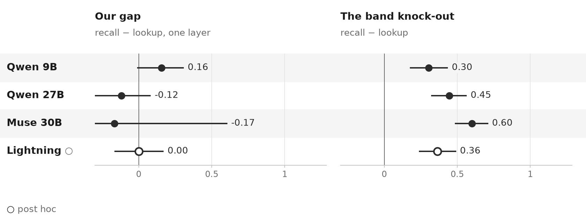
*Recall minus lookup: our one-layer gap and the band knock-out on his described bridges. whiskers: 95% intervals over bridge items; Lightning ○; –: not run, not tested or under 30 switches.*

- **Rule, fixed in advance.** "Per model, the 47.3 rule: (a) the split holds: gap >= 0.3, lookup <= 0.10; (a') the computed bridge is handed through the lens: lookup >= 0.20; (d) in between." Withdrawn by the answer control's rule ([51.12](#t51-12)): the lens effect there is the answer or mixed in all four cells.

- **Result.**

  | | 9B | 27B | Muse (L26) | Lightning (L14) | 122B |
  |---|---|---|---|---|---|
  | lookup: switches blocked beyond a random part | 0.54 [0.43, 0.66]<!-- src: results/x50_zach/z2-20261028T162710Z/z2.md \| qwen35_9b_x50_z2 :: 0.54 [0.43, 0.66] --> | 0.69 [0.52, 0.87]<!-- src: results/x50_zach/z2-20261028T162710Z/z2.md \| x50_z2_27b :: 0.69 [0.52, 0.87] --> | 0.67 [0.00, 1.00]<!-- src: results/x50_zach/z2-20261028T162710Z/z2.md \| muse30_x50_z2 :: 0.67 [0.00, 1.00] --> | 0.51 [0.38, 0.63]<!-- src: results/x50_zach/x52_z2-20261029T025625Z/z2.md \| nem35l_x52_z2 :: 0.51 [0.40, 0.62] :: 0.51 [0.38, 0.63] --> | 0.48 [0.36, 0.60]<!-- src: results/x50_zach/x52_z2-20261030T045145Z/z2.md \| qwen35_122b_z2 :: 192 (121) :: 0.48 [0.36, 0.60] --> (L33) |
  | the rule (before withdrawal) | (a') through the lens | (a') through the lens | (a') through the lens | (a') through the lens (no prediction) | (a') through the lens (no prediction; L39: can't tell) |

- **Read.**
  - Withdrawn: at the description's last token the lens part moves the answer, so removing it is not a test of the bridge.
- **Caveats.**
  - Muse's lookup switches under the whole change on 0.02 of passages; Lightning's L27 cell rests on 15<!-- src: results/x50_zach/x52_z2-20261029T025625Z/z2.md \| L27: routes :: "original": 184, "switch": 15 :: 15 --> lookup switches (under 30) and is not valid.
  - n below the 200 aimed for on the first three models. Lightning's run reads the design the README withdrew (Part VI) and stands under the same withdrawal; its own answer control (coverage run, no prediction) says mixed for both readers: without the answer directions only, the lookup is blocked at 0.29 [0.16, 0.44]<!-- src: results/x51_answer/x52_answer-20261029T080050Z/verdict.md | z2 :: nemotron-3.5-lightning :: lookup :: 0.29 [0.16, 0.44] --> and the recall 0.38 [0.26, 0.52]<!-- src: results/x51_answer/x52_answer-20261029T080050Z/verdict.md | z2 :: nemotron-3.5-lightning :: recall :: 0.38 [0.26, 0.52] --> beyond a random part.

## The 122B coverage, night 29-30 Oct (coverage, not hand-checked) 

Dan 18:20 (jobs/c3/batch53.yaml coverage_122b_1820, decision_470_1845): Qwen3.5-122B-A10B (FP8, MoE ~10B active, J++ fit on bf16), L33, 2x H100; every rule verbatim from its spec, no prediction, gates never lowered; UNVERIFIED. In the depth README since 30 Oct ~11:00 (Dan: "all runs in"), its cells pending hand-check; the lookup-only-gate runs hollow ○ (post hoc, Dan 30 Oct). One line per run; the verdict files hold the full tables. Log: NIGHT.md.

- **Conflict test, every 4th layer L1-L45** (`jobs/c3/x53c_conflict_sweep_122b.yaml`; [verdict](../../results/x0_necessity/qwen35_122b_x53c_conflict/verdict-20261029T175547Z/verdict.md)). At L33 (the decided layer): confirmed, lookup around, recall through (lookup -0.02 [-0.11, 0.06]<!-- src: results/x0_necessity/qwen35_122b_x53c_conflict/verdict-20261029T175547Z/verdict.md | 33 :: PP :: -0.02 [-0.11, 0.06] -->, recall 0.28 [0.17, 0.39]<!-- src: results/x0_necessity/qwen35_122b_x53c_conflict/verdict-20261029T175547Z/verdict.md | 33 :: PM :: 0.28 [0.17, 0.39] --> beyond random). Descriptive sweep, Dan's question "does the split hold at relative depth 0.25-0.50 too": no. At L13 / L17 / L21 the lookup has more blocked than the recall (lookup 0.47<!-- src: results/x0_necessity/qwen35_122b_x53c_conflict/verdict-20261029T175547Z/verdict.md | 13 :: PP :: 0.47 --> / 0.37<!-- src: results/x0_necessity/qwen35_122b_x53c_conflict/verdict-20261029T175547Z/verdict.md | 17 :: PP :: 0.37 --> / 0.37<!-- src: results/x0_necessity/qwen35_122b_x53c_conflict/verdict-20261029T175547Z/verdict.md | 21 :: PP :: 0.37 -->, label "through"; recall 0.26<!-- src: results/x0_necessity/qwen35_122b_x53c_conflict/verdict-20261029T175547Z/verdict.md | 13 :: PM :: 0.26 --> / 0.12<!-- src: results/x0_necessity/qwen35_122b_x53c_conflict/verdict-20261029T175547Z/verdict.md | 17 :: PM :: 0.12 --> / 0.31<!-- src: results/x0_necessity/qwen35_122b_x53c_conflict/verdict-20261029T175547Z/verdict.md | 21 :: PM :: 0.31 -->); the split appears only at L33; past L37 the lookup's whole change switches too few to read (can't tell).
- **47.0, the lens readout of an address swap** (adapted design: lookup-only gate; the recall (0.797) is not part of this test; `jobs/c3/x47_0_122b.yaml`; [summary](../../results/x47_verbal/summary-20261029T180530Z/verbal.md)): "not verbalizable" (ordinal median rank 993, null 5th percentile 523; rebuilt at k = 25 1.14x the null).
- **52 A, atoms of the lens part** (E1 only; `jobs/c3/x52_atoms_122b.yaml`; run `results/x52_atoms/qwen35_122b_x52_atoms_fwd/`): forwards done; the CPU classification ran 30 Oct ([report](../../results/x52_atoms/report-20261030T094628Z/), descriptive; `x52_atoms.FWD_RUNS` gained the 122B); Z2 not run (no Z2 run on the 122B).
- **51.1, dose curves** (`jobs/c3/x51_1_122b.yaml`; [verdict](../../results/x51_dose/x52_dose-20261029T181109Z/verdict.md), 53 items): (i) lookup blind to the lens part: yes; (ii) the recall reads it above its share: yes (first dose switching 0.3: 1.5).
- **47.5, zeroing at one layer** (`jobs/c3/x47_5_122b.yaml`; [verdict](../../results/x47_zero/x52_zero-20261029T183120Z/x47_5.md), 200 scenes): "followed, not needed at one layer" (0.95 [0.91, 0.99] of the recall's answers stay unchanged, 0.04 [0.00, 0.09] blocked beyond random).
- **45m, the clean one-pick design** (input of 49.2 and 45p; `jobs/c3/x45m_122b.yaml`; [verdict](../../results/x0_necessity/qwen35_122b_x45m_fresh/verdict-20261029T185411Z/verdict.md)): its gate passed; X0's rule at L33 on its scenes: confirmed (lookup around, recall through); 45m's locker-before rule not re-scored (cross-model).
- **49.2, the removal ladder, rung 6 in Zach's band L39-45** (`jobs/c3/x49_2_122b.yaml`; [verdict](../../results/x49_ladder/x52_ladder-20261029T192919Z/x49_2.md), 435 scenes): the second copy is the earlier mention: no; needed only when everything goes: no; the lookup never needs it: yes.
- **53.2, the monitor** (CPU, from the pulled states): the 53.2 card's 122B addendum.
- **47.1, identity outside the lens** (`jobs/c3/x47_1_122b.yaml`): the routes part **not tested** (its gate: recall read 0.797 < 0.80 on routes C2, results/x6_routes/qwen35_122b_routes_x47_1/gate.json; not lowered, no verdict for it). The main-test slices, descriptive ([verdict](../../results/x0_necessity/qwen35_122b_x47_1_main/verdict-20261029T212308Z/verdict.md)): without lens directions 26-100 the recall is blocked at 0.00 [-0.03, 0.03]<!-- src: results/x0_necessity/qwen35_122b_x47_1_main/verdict-20261029T212308Z/verdict.md | jpp26_100 :: PM :: 0.00 [-0.03, 0.03] --> and the lookup -0.02 [-0.09, 0.04]<!-- src: results/x0_necessity/qwen35_122b_x47_1_main/verdict-20261029T212308Z/verdict.md | jpp26_100 :: PP :: -0.02 [-0.09, 0.04] --> beyond random (both 'around').
- **Z1, Zach's named passages, true facts** (`jobs/c3/x50_z1_122b.yaml`; [verdict](../../results/x50_zach/x52_z1-20261029T215701Z/z1.md)): at L33 in between (lookup 0.12 [0.05, 0.20]<!-- src: results/x50_zach/x52_z1-20261029T215701Z/z1.md | qwen35_122b_z1 :: 33 :: 0.12 [0.05, 0.20] -->, recall 0.41 [0.33, 0.49]<!-- src: results/x50_zach/x52_z1-20261029T215701Z/z1.md | qwen35_122b_z1 :: 33 :: 0.41 [0.33, 0.49] --> beyond random); at L39 (his band's start) can't tell (no lookup switch under the whole change).
- **Z1-P, made-up facts** ([verdict](../../results/x50_zach/x52_z1p-20261029T223420Z/z1p.md)): at L33 "the split holds on his passages" (lookup 0.02 [-0.07, 0.10]<!-- src: results/x50_zach/x52_z1p-20261029T223420Z/z1p.md | qwen35_122b_z1p :: 33 :: 0.02 [-0.07, 0.10] -->, recall 0.35 [0.28, 0.42]<!-- src: results/x50_zach/x52_z1p-20261029T223420Z/z1p.md | qwen35_122b_z1p :: 33 :: 0.35 [0.28, 0.42] -->).
- **47.2, six lockers** (`jobs/c3/x47_2_122b.yaml`; [verdict](../../results/x47_six/x52_six-20261029T231821Z/x47_2.md), 300 test scenes, six slots; its gate passed): **slot-specific**.
- **45p, the earlier mention** (`jobs/c3/x45p_122b_r2.yaml`, r2 after a script bug in r1; [verdict](../../results/x45p/x53_45p_coverage-20261030T002915Z/x45p.md), 166 locker-first clean scenes): does not hold (the recall's drop with the new item's token also stripped exceeds random by 0.15 and another item's token by 0.20, against the bars 0.20 / 0.15).
- **53.7, the address probe in code and tool output** (adapted design: lookup-only gate; the recall is not part of this test; `jobs/c3/x53_7_probe_122b.yaml`; [verdict](../../results/x0_probe/x53_7_probe-20261030T002257Z/)): both formats tested (gate 0.867 code, 0.991 tool); locker before the pick, which locker sentence: code 0.92 [0.88, 0.95] (layout baseline 0.44), tool output 0.93 [0.91, 0.95] (0.40); descriptive.
- **Every item of Dan's 18:20 list has run** (the routes part of 47.1 not tested at its gate).
- **Second night batch (Dan 30 Oct 02:00-02:10, order of decisions_0205).**
  - **47.4, cumulative patches** (`x47_4_122b`; [verdict](../../results/x47_cumulative/x52_cumulative-20261030T010712Z/x47_4.md)): main design (53 items) "outside", clean design (134) "before L" (descriptive).
  - **47.16, the swap after neutral sentences** (`x47_16_122b`; adapted design: lookup-only gate; the recall (0.797) is not part of this test): ran, its gate passed (lookup 1.00, the recall 0.78 descriptive); verdict (CPU, 30 Oct; [x47_16](../../results/x47_distance/x52_distance-20261030T094552Z/x47_16.md)): "none of the three".
  - **47.8, anatomy by layer** (`x47_8_122b_lk`; same adapted design; [verdict](../../results/x47_anatomy/x52_anatomy-20261030T032402Z/x47_8.md)): (a) yes, gap 0; (b) yes; (c) no; (d) yes.
  - **47.13, the lookup's errors** (`x47_13_122b`): the GPU stage ran; 7 wrong of 1,500 lookups, under the rule's 30: can't tell. The job's exit 1 is its coverage note's path, not the run; no rerun.
  - **Z3, routes on Zach's passages** (`x50_z3_122b`; [verdict](../../results/x50_zach/x52_z3-20261030T035019Z/z3.md)): "no position route in his layout" at L33 and L39.
  - **47.14, chained addresses** (`x47_14_122b`): ran, its own gate passed (both lookups: 1.00 / 0.84); verdict (CPU, 30 Oct; [x47_14](../../results/x47_chain/x52_chain-20261030T094553Z/x47_14.md)): addresses do not chain (no).
  - **49.1, the gain grid** (`x49_1_122b`): ran on the main test's 410 eligible scenes; verdict (CPU, 30 Oct; [x49_1](../../results/x49_gain/x52_gain-20261030T094553Z/x49_1.md)): "(c) neither".
  - **Z2, the described bridge** (`x50_z2_122b`; [verdict](../../results/x50_zach/x52_z2-20261030T045145Z/z2.md)): at L33 "(a') the computed bridge is handed through the lens"; at L39 can't tell (no lookup switch under the whole change).
  - **52 B, the answer map** (`x52_answermap_122b`; [verdict](../../results/x52_answer_map/x52cov-20261030T045919Z/verdict.md)): the lookup's answer readable at the last token (best L44) and writing it there does not move it; the recall's answer not readable there, and writing it moves it.
  - **Not run** (decisions_0205 item 2): 47.7 (c) and 45d (need the 122B's 45d / P_cf refit on varied scenes); 51.3 DAS (needs a clean-design source decision, as Lightning's); 53.8 (its script has no coverage path); 47.11 (no single script).

## Running or sealed

Box times UTC, from `make queue-stats QUEUE=all` at 00:06 UTC on 29 Oct (low-high ends of the queue's estimate); the Lightning lanes follow batch 52 amendment 3.

### Batch 52 C: the rest of the coverage grid (running) 

- **Question.** Fill the coverage table's missing cells on the 27B, Lightning, 9B and Muse.
- **Status.** Running: the 27B anatomy full grid (`jobs/c3/x47_8_27b.yaml`), the 27B token map (`jobs/c3/x47_d1_27b.yaml`), the 27B ladder steps 3-6 (`jobs/c3/x52_ladder_27b_a.yaml`), the 27B six lockers (`jobs/c3/x47_2_27b_r3.yaml`), the Muse ladder with step 6 inside Zach's band (`jobs/c3/x52_ladder_muse_r2.yaml`); Lightning's lanes per amendment 3 (the probe, routes, swap and lens readout now on speedup). Bolt: out of scope, only a J-lens exists, no J++ lens.
- **Where used.** The coverage table above.

## Appendix A. Flagged for Dan 

**Contradicts a main-page card: README E12 (the anatomy by depth), the 27B.** On the 27B's full grid (every 4th layer), rule (a), "the lookup drops J++ by the time it takes up the address", says no: l_J L40<!-- src: results/x47_anatomy/x52_anatomy-20261029T013405Z/x47_8.md \| qwen3.6-27b :: -12 (<= 2) :: 40 --> comes after l_P L28<!-- src: results/x47_anatomy/x52_anatomy-20261029T013405Z/x47_8.md \| qwen3.6-27b :: -12 (<= 2) :: 28 --> (gap -12). The reduced grid behind E12 said yes (l_J L16<!-- src: results/x47_anatomy/x47_8-20261028T154518Z/x47_8.md \| qwen3.6-27b :: 14 (> 6) :: 16 -->, l_P L30<!-- src: results/x47_anatomy/x47_8-20261028T154518Z/x47_8.md \| qwen3.6-27b :: 14 (> 6) :: 30 -->). l_J is the first layer from which the lookup's drop without the lens part stays under 0.10 at every later sampled layer; the full grid samples L36, which the reduced grid skipped, and there that effect is 0.12 [0.05, 0.24]<!-- src: results/x47_anatomy/x52_anatomy-20261029T013405Z/x47_8.md \| qwen3.6-27b :: 0.61 [0.48, 0.74] :: 0.12 [0.05, 0.24] -->. (b) yes (l_probe L8), (c) no and (d) yes are unchanged; the recall window is L4-L32. E12's 27B reading must change ([47.8](#t47-8)).

1. Lightning's gate (○ gate chosen after the 60-scene pre-check was seen): the main test's gate on all 516 scenes decides; the 60-scene pre-check had failed (lookup 0.883, recall 0.783) before the choice. Accepted by Dan 01:10; layer L14 stands. See [Lightning's layer](#lightning-layer).
2. Lightning's `layer.json` "rule" field (and prereq.md's "Pick rule" line) holds the prerequisite rule text, not the amendment-1 pick rule; the pick itself follows amendment 1 (earliest passing layer at relative depth >= 0.25): prereq.md lists the candidates at depth >= 0.25 and marks L14 as the pick.
3. 51.11's wording: no row of Dan's wording table matches the labels (9B: in between / in between / none of the three; Muse: one per slot / in between / none of the three; 27B: part 2 in between only). The README claim waits for Dan. See [51.11](#t51-11). Decided (Dan, 09:05): the wording is claim 8 as in his 08:55 brief.
4. Z1 is not the made-up-fact rerun: Z1 ran Zach's K passages, which state true facts; the P-item reruns were never specced or run. See [Z1](#z1). Update (29 Oct morning): the made-up-fact rerun (Z1-P) has run on the 9B, 27B and Lightning (the Z1 card).
5. Bolt is out of scope: only a J-lens exists, no J++ lens (batch 52 amendment 2); the Bolt row in docs/depth/digest.md is a J-lens result and is not cited on the depth side.
6. The varied-scene count for Muse: Fig. 9a's per-format n sum to 1389, docs/depth/x0_numbers.json's `x0b_n_muse` says 1,388 (not traced).
7. The ladder on Lightning: not tested. It runs on the clean one-pick design, whose gate fails on Lightning (recall 0.751), the same reason as the copy test; no spec.
8. The routes test's sanity swap on Lightning uses Muse's C0 rule (switch rate >= 0.50): Lightning has no one-pick reference.
9. Attention under the swap on Lightning needs a NemotronH port (in progress); if it does not land: "not tested: port missing".
10. Lightning's GPU0 lane (probe, routes, swap, lens readout) now runs on speedup, not mats, so it starts sooner.
11. The previous ledger said Z1's order pattern replicates on the 9B and 27B; its verdict says it replicates on all three (Muse L26 too). Corrected in the Z1 card.
12. Test suite (coordinator, 01:30): six figure-test failures are left for the README pass (they need figure rebuilds or a root-README decision; nothing changed overnight): test_story_b47a's routes-lens (on planted data Fig. 5d's "random" label overlaps the panel titles; the real figure has a ~5 px gap; fix: more headroom above the top row); test_readme_phase2_figures' Fig. 3c x2 (the test expects a 122B "not run" panel, which Fig. 3c dropped in b4211951, the README restructure); test_joint_figures' quoting (the root README's joint figures still quote the frog scene, which left readme_story_figures.py with the carbon Fig. 0, 884b0576; the root README is Zach and Dan's); test_figs_lens x2 (failing before tonight). Fixed: the x49 prediction-block tests follow Dan's rewording of Q49.3 and Q49.6 (970b39a1).
13. Z1, Muse L26: the verdict labels the lookup "the lookup follows the lens here" (0.60 [0.38, 0.81]), but its lookup switches on 25 passages under the whole change, under the 30 that every other cell needs (z1.json: valid false). The ledger's figure leaves the cell out; the card shows the verdict's number and label. Lightning's L27, beside its L14, is the same case: its lookup switches on 1 of 200 passages (S_whole 0.01) and the verdict labels it "the lookup follows the lens here"; the card shows only L14's numbers.
14. Batch 52 B on our scenes: the write cells of the 27B's lookup (the last token, L0) and Muse's lookup (the question, L14) were picked because nothing else was readable, and the whole change switches 0.00 there; their "not usable" is uninformative (cannot tell), not a negative. The card reports the verdict's labels with that caveat. B's proposal, writing at the most readable non-last-token cell, waits for Dan.
15. Fixed in the 06:29 matrix: its row 4 (address swap by dose) now gives the 9B 0.02 / 0.46 / 0.73 and Muse 0.05 / 0.52 / 0.52, as the verdicts; the 00:08 matrix had the two swapped.
16. README E6 says the swap hypothesis was fixed in advance; the rule fixed in advance (Q44.1-3, s = 1) says no on the 9B, 27B and Muse, and E6's 0.46 / 0.25 / 0.52 are at s = 2 (mean over slot pairs). The s = 1 failure is known (joint_story_draft: a design error), but E6 does not say it ([address swap](#swap)).
17. Fixed (0866f22b, on danorel): scripts/x0_details.py (tier0_numbers) read the newest split-by-order folder; Lightning's one-model split is now the newest, so a rerun of it would break the same way the figure reader did (fixed in readme_story_figures by order_split_path(); x0_details not touched).
18. Reminder, no tension: the recall at the last token is "readable" in 51.10 and "not readable" in 52 B because they read different words: 51.10 ranks the bridge entity among the letter tokens, 52 B the answer word (the number word's one-letter-token variants). Wherever the README says "readable", it should name which word is read ([51.10](#t51-10), [52 B](#b52-b)).
19. Token map on Lightning: the run's in-job verdict crashed (KeyError) because x47_depthmap.LEAD, the margin of D1 rule (b), had no Lightning entry. The coordinator added LEAD = 4 (as Muse, one sampling step) after the run and ran the verdict on CPU (092f5579). The margin was set after the data, but (b)'s answer does not depend on it: Lightning's lead is 0 ([token map](#d1)).
20. Ladder reruns: the 27B's full ladder (x52_ladder_27b_a) and Muse's rerun (muse30_x52_ladder) redo every step on the same scene counts, and the steps shared with the first runs move by up to 0.02 (the 27B's locker-after step 2: 0.24 [0.17, 0.32] against 0.26 [0.19, 0.34]; Muse's step 5, all scenes: 0.19 against 0.21). No label changes. The README's 27B and Muse ladder numbers come from the first runs; the ledger's 27B column now comes from the full ladder ([ladder](#t49-2)). Decided (Dan, 09:05): the README cites the full reruns for every step (the 27B's full ladder, Muse's r3), Fig. 1d included, so no column mixes runs; "How we checked": the reruns agree within 0.02 on shared steps.
21. Fixed here: the README figure build (scripts/readme_story_figures.py) read the newest D4 folder for Fig. 6c; the 27B's one-model run (persistence-20261029T013614Z, 709b3de6) became the newest and the build stopped at the scorecard check (no 9B / Muse D4 rows). Fig. 6c's folder is now pinned to persistence-20261028T115530Z; the README figures are unchanged. Any other build on danorel since 709b3de6 hits the same stop.
22. Muse's 47.16 (the swap after neutral sentences): the coverage matrix and scripts/x52_coverage.py mark it done from x47_16-20261028T131501Z, but that verdict lists Muse as "pending (no run given)", and muse30_x47_16 holds no outcomes (cases, gate and manifest only; its gate passed). Muse has no 47.16 result ([47.16](#t47-16)). The coverage matrix's builder now checks a done cell against what it cites (e7474964). The 06:29 matrix marks Muse's cell missing (x47_16_muse_r2 written, not enqueued).
23. 47.13 on Lightning: the verdict header prints "Q47.13, Dan: 65%", but this is a coverage run with no prediction; x47_errors has no --coverage flag ([47.13](#t47-13)).
24. Muse's 47.16 r2 is written but not queued: Dan cancelled x47_16_muse on 28 Oct (batch 49 amendment 1), so it waits for Dan ([47.16](#t47-16)). Decided (Dan, 09:05): run Muse's 47.16 r2 now; enqueued on mats.
25. 47.6 / 48.2 / 48.4: the original designs were run on the 27B and Lightning as coverage. The coordinator reads them as not the "variants" Dan cancelled; Dan to confirm ([47.6](#t47-6)). Decided (Dan, 09:05): yes, the original designs as coverage, not the cancelled variants.
26. 47.7 (a) on the 9B and Muse is missing: exit 1 on 28 Oct, never rerun; Dan decides. Decided (Dan, 09:05): rerun only after items 0-2 of the 08:55 queue. Muse's rerun (r2): not tested (gate 0.23<!-- src: results/x47_value/muse30_x47_7a_r2/gate.json | "PM": 0.23 :: 0.23 --> < 0.80): the question-first recall reads 0.23 and no group passed; the original run's exit 1 on 28 Oct was the same gate stop. The 9B's rerun (r2): not tested (gate 0.7957<!-- src: results/x47_value/qwen35_9b_x47_7a_r2/gate.json | "PM": 0.7957142857142857 :: 0.7957 --> < 0.80): its question-first recall missed the gate and no group passed. So 47.7 (a) is not tested on the 9B and Muse, by gate.
27. Coverage matrix: cells the old builder marked "done" without outcomes are corrected (e7474964); the ledger's coverage table now mirrors the 11:01 matrix (b8a24aab), where 47.15 on the 9B and 47.7 (a) on the 9B and Muse read "not tested" from their r2 gates.
28. The coverage matrix's row "One question, two instructions (49.6)" is 49.6, "the report of slot 1, reworded" (results/x49_report/x49_6-20261028T154511Z): the matrix marks the 9B "ran; the gate failed", but the verdict scores the 9B (slot 1 recovers under the sentence wording; it decides: drop), and Lightning has a coverage run (not "not designed"). The README's Part VI "One question under two instructions" is another test. The ledger's card follows the verdict ([49.6](#t49-6)); the matrix row needs a rename and fresh cells. Fixed (fb9667eb, scripts/x52_coverage.py): the matrix row is now "Report of slot 1, reworded (49.6)" with the 9B, 27B and Lightning done and Muse not designed (results/x52_coverage/matrix-20261029T094549Z); Appendix C follows it.
29. Resolved (Dan, 11:25), a record line: 53.1's evaluation logic was clarified after the data (3dae749f): the cross-check reads "does not hold" once a tested cell exceeds 0.10, and a "can't tell" across cells lists the patterns still open. Dan confirmed it as the correct reading of "in all four cells"; on the 27B it changes nothing, since the Q-after cell is the main test (0.14<!-- src: results/x53_2x2/x53_2x2-20261029T100414Z/verdict.md \| Cross-check :: (Q-after, number) (0.14) :: 0.14 -->) ([53.1](#b53-1)).
30. The 53.6 labels ignore magnitude (a rule design issue, Dan's; Dan 12:10): every model reads "both", though the recall moves a quarter or more under each lever on the 9B and Lightning and at most about a tenth on the 27B and Muse ([53.6](#b53-6)).
31. Resolved (README agent, 29 Oct afternoon): "One question under two instructions" is 47.15, one question, two sources ([47.15](#t47-15)), misnamed "the second hop's key token" in the coverage matrix until its 12:20 build; the "Also failed" items are one line each under [Also failed](#also-failed), sourced to their verdicts.
32. The 122B's routes and swap runs (g75) lowered the gate to 0.75 after its 0.80 run missed it (recall 0.797): shown below gate here (○, never in claims), where the README marks them ° ([routes](#routes), [swap](#swap)).

## Appendix B. README changes waiting for Dan 

Dan lifted the overnight no-README rule at 08:55; the README's 12:50 rebuild (556d667b) applied all but two of these; 47.16 followed in d5f208a3 (the 27B and Lightning) and 8cc913df (Muse); 47.7 (c) is not on the page as such. None is open. One line each, its status first:

- **Applied** (claim 8 reworded and graded B; the six-locker card and "Tested and dropped"). "In one minute" and claim 8: "one code per locker" is not what 51.11 supports on the 9B (d* 2/2/>7/2, in between; the methods agree only in part; midpoint swaps fail); reword and regrade claim 8 ([51.11](#t51-11)).
- **Applied** (Lightning's layer and its rule in "How to read this page"; 51.11 under the six-locker card). Status line: 51.11 is opened, not sealed; add Lightning's layer L14 and its rule (amendment 1, Dan ~00:50: earliest passing layer at relative depth >= 0.25; tie-break the bridge word's lens readability) ([Lightning's layer](#lightning-layer)).
- **Applied** (Part V card, made-up facts and the recheck). Part V: replace "reruns with made-up-fact passages are queued" by the truth: Z1 ran the true-fact K passages; the made-up-fact rerun (Z1-P) has since run: the 9B's split holds, the 27B's is in between, Lightning not tested (gate) ([Z1](#z1)).
- **Applied** (Part IV card "At the last token, is the bridge entity in the lens part of the state, and does the model use it there?"). New card, Part IV next to the address at the last token: the recall's entity at the last token is readable but not used, all three models; figure figures/depth/fig17_jspace_last_token.png ([51.10](#t51-10)).
- **Applied** (claim 1's limits). Claim 1: add the full-carrier limit (fact-after lookups follow the lens, 0.51 on the 9B and 27B) ([51.7](#t51-7)).
- **Applied** (claim 12). Claim 12: add the last-token result (the address is not at the last token on the 9B and 27B; it travels on Muse) ([51.4](#t51-4)).
- **Applied** (claim 1 and the Part I conflict card). Claim 1, models: the conflict test is confirmed on Lightning at L14 (coverage run, no prediction; gate chosen after the 60-scene pre-check was seen) ([Lightning's conflict test](#lightning-conflict)).
- **Applied** (Part III card "Can the address be read, removed, added and swapped?" (the rule at s = 1 said no; the swap read at s = 2)). E6: say the rule fixed in advance was at s = 1 and said no (below a real change's size); the swap numbers are at s = 2; Lightning moves 0.50 at s = 2 (coverage run, no prediction) ([address swap](#swap)).
- **Applied** (claim 10 and the Part IV order card). E10 and claim 10, models: Lightning splits the same way (locker first 0.86 of lookups switch, after 0.15; descriptive, coverage run) ([order split](#order)).
- **Applied** (Part IV card "Which token and layer carry the lookup when the locker sentence comes after the pick?" (the 27B's column)). E11: "Not shown: the 27B" is out of date: the 27B's map fails D1 (a), (b), (c) on both designs and passes D2 (the recall's read-out layer L52 at the start of Zach's late band), as the 9B; Lightning's main-design map fails D1 too ([token map](#d1)).
- **Applied** (claim 8 (Lightning ○)). E7 and claim 8, models: Lightning is slot-specific at dose 2, as the 9B and Muse (coverage run, no prediction) ([six lockers](#six)).
- **Applied** (claim 5 and the Part II identity card; the dose card is ledger only now (a one-line link)). E3 and the dose card, models: Lightning's identity route runs outside the lens ((c)); its lookup is blind to the lens part, its recall misses rule (ii) at 0.19 against 0.2 (coverage runs, no prediction) ([47.1](#t47-1), [51.1](#t51-1)).
- **Applied** (the Part I ladder card (the 27B's full ladder)). Ladder card (Part I, "Does the recall need the lens part, or only follow it?"): the 27B column "not run (bridge-word steps only)" can now be filled from the full ladder (x52_ladder_27b_a, n 574): (a) no, (b) no, (c) yes; note that Muse's step 6 ran inside Zach's band (L36-42) with the same labels; Fig. 1d's grey 27B columns too ([ladder](#t49-2)).
- **Applied** (claim 12 (Lightning in between ○)). Claim 12 and the 51.4 card, models: Lightning is in between at L14 and L18 (the slot not yet readable at the last token; coverage run, no prediction) ([51.4](#t51-4)).
- **Applied** (claim 12 ("the handoff from the lens part depends on the layer grid") and the Part IV card "Does the lookup drop the lens part before it takes up the address?"). E12: the 27B's rule (a) is no on its full grid (l_J L40 after l_P L28); E12's reading and Fig. 6b's 27B panel come from the reduced grid. Restate (a) as holding on the 9B and Muse (and Lightning), not on the 27B; add the 27B's D4 overlap (0.256, mixed) beside 0.28 / 0.21 ([47.8](#t47-8)).
- **Applied** (Part V card (Lightning's column)). Part V, models: on Lightning Z1 is in between at L14 and Z3 in between at L14 (no position route at L27); coverage runs, no prediction ([Z1](#z1), [Z3](#z3)).
- **Applied** (Part I card "Does the split hold in other texts?"). Part I card "Does the split hold in other texts?" and claim 1, models: Lightning's varied scenes hold pooled (gap 0.24 [0.17, 0.32], lookup 0.03; 42 of 57 cells, 1,105 scenes); its natural passages are not tested (gate). Lightning's carrier before L (51.7) as on the 9B and 27B ([varied scenes](#x0b), [51.7](#t51-7)).
- **Applied** (claim 11). Claim 11, models: with the locker after, the 27B's lookups too are carried by the bridge word before L (1.00, main test) ([47.4](#t47-4)).
- **Applied** (after the rebuild, d5f208a3: Part III card "Can the address be read, removed, added and swapped?", the swap with no / 50 neutral sentences on the 9B, 27B and Lightning). E6: the swap after 50 neutral sentences is distance-robust on the 27B and Lightning as on the 9B; Muse has no run (Flagged 22) ([47.16](#t47-16)).
- **Applied** (8cc913df: Muse's column in the same row, 0.50 / 0.52, "distance-robust address"). Part III address card, the neutral-sentences row: Muse showed "not run", but its rerun r2 (Dan, 09:05; a coverage run on the same rule, no prediction) gives 0.50 [0.46, 0.54]<!-- src: results/x47_distance/x52_distance-20261029T090323Z/x47_16.md \| muse-glimmer-30b :: 0.44 [0.39, 0.50] :: 0.50 [0.46, 0.54] --> with no sentences and a distance-robust address, as in the 47.16 card; Flagged 22 covers only its first run ([47.16](#t47-16)).
- **Applied** ("Tested and dropped" and Part VI (one line each)). Part VI, models: the 27B also fails the person mark (48.3), the formation block (47.6) and the any-kind-of-item address (47.11: fruits neither U nor the refit, names slot x type) ([48.3](#t48-3), [47.6](#t47-6), [47.11](#t47-11)).
- **Applied** (Part V card, the routes test on his passages). Part V (Z3), models: the 27B takes no position route on Zach's passages at L32 (0.04), the 9B, Muse and Lightning in between ([Z3](#z3)).
- **Applied** (claim 2, the Part III refit card and Part VI's line on the lookup's errors). Part I (47.5) and Part VI (x45d, 47.13), models: on Lightning the recall follows the lens part and does not need it at one layer; refit per format the address is a pointer elsewhere; its errors are not address errors (coverage runs, no prediction) ([47.5](#t47-5), [x45d](#x45d), [47.13](#t47-13)).
- **Not on the page** (claim 4 reads "value none anywhere" (Lightning included); 47.7 (c) is ledger only). E5, models: "never the value" holds on Lightning's JSON (its prose and tables not tested, gate) ([47.7 (c)](#t47-7c)).
- **Applied** (the line is gone; the person mark is one of "Four mechanisms for the split" under "Tested and dropped"). Part VI, the person-mark line (README line 482): "(the pooled probe is running)" is stale. 49.3 landed on the 9B and Muse ("neither at the sentence") and on the 27B ("in between" at L32); "in between" does not contradict "did not hold", note it only ([49.3](#t49-3)). The copying heads (48.4) and the enrichment (48.2) fail on the 27B too ([48.4](#t48-4), [48.2](#t48-2)).
- **Applied** (claim 11 and "Tested and dropped"). Part VI and claim 11, Lightning: the copying heads (48.4) and the attribute probe (48.2 A) do not hold; with the locker after, its lookups are carried by the bridge word before L (0.92, main test) ([48.4](#t48-4), [48.2](#t48-2), [47.4](#t47-4)).
- **Applied** (claims 9 and 12 and the Part III and IV cards). E8, E12 and the 51.10 card, models: Lightning reads the same (lens readout not verbalizable; anatomy (a), (b), (d) yes, (c) no; recall at the last token readable, not used); coverage runs, no prediction ([47.0](#t47-0), [47.8](#t47-8), [51.10](#t51-10)).

## Appendix C. Coverage table 

Which test ran on which model, from the committed coverage matrix (results/x52_coverage/matrix-20261029T122040Z/matrix.json, built 12:20 UTC 29 Oct; each cell's source is in that file). Rows in the README's order, under their Part; a linked test has a card above. Each cell is a symbol (legend under the table) and, where the matrix has a note for it, a number pointing to that note. Lightning's gate (all its cells): the main test's gate on all 516 scenes, chosen after the 60-scene pre-check was seen (its cells are read as hollow); layer L14 (see [Lightning's layer](#lightning-layer)). Nemotron 3.5 Bolt: out of scope, only a J-lens exists, no J++ lens.

As of the matrix at 12:20 UTC (13:20 Paris; 8e2ef0cb: 47.15's row renamed "One question, two sources"; otherwise as b8a24aab: 161 done, 20 not tested, 9 not designed, 6 partial, none missing; 47.15 on the 9B and 47.7 (a) on the 9B and Muse now read "not tested" from their r2 reruns' failed gates, as flag 26). The 122B is not in the matrix; its cells are in the cards and the heatmap. Results opened since then are in their cards and the heatmap; the matrix has no rows for batch 53 or for Zach's made-up-fact passages.

<!-- coverage:start (scripts/ledger_coverage.py; do not edit by hand) -->
| test | 27B | Lightning | 9B | Muse |
|---|---|---|---|---|
| **Part I. The two readers** | | | | |
| [1. Conflict test (main test, at L)](#lightning-conflict) | ✓ 1 | ✓ 2 | ✓ 3 | ✓ 3 |
| [2. Answer control (51.12 E1)](#t51-12) | ✓ 4 | ✓ | ✓ 4 | ✓ 5 |
| [Split in other texts: varied scenes (x0b)](#x0b) | ✓ | ✓ | ✓ | ✓ |
| [Split in other texts: natural passages (x5)](#x5) | ✓ | ○ 6 | ✓ 7 | ✓ |
| [Dose curves, a part alone (51.1)](#t51-1) | ✓ | ✓ | ✓ | ✓ |
| [Zeroing at one layer (47.5)](#t47-5) | ✓ | ✓ 8 | ✓ | ✓ |
| [7. Ladder (49.2, rungs 1-6)](#t49-2) | ✓ 9 | ○ 10 | ✓ | ✓ 11 |
| [Earlier mention (45p)](#t45p) | ✓ | ○ 10 | ✓ | ✓ |
| [Gain map (49.1)](#t49-1) | ✓ | ✓ | ✓ | ✓ |
| **Part II. Identity** | | | | |
| [E3: identity route outside the lens (47.1 atom slices)](#t47-1) | ✓ | ✓ | ✓ | ✓ |
| [3. Routes test (identity / position / value; no address; address alone)](#routes) | ✓ 12 | ✓ | ✓ | ✓ |
| [What is left of the route; the value (47.7)](#t47-7c) | ✓ | ◐ 13 | ○ 14 | ○ 14 |
| [Learned subspaces (48 DAS; 51.3 DAS at scale)](#t51-3) | ✓ 15 | – 16 | ✓ | ✓ |
| **Part III. The address** | | | | |
| [E6: the address probe (x0_probe v4)](#probe) | ✓ | ✓ | ✓ | ✓ |
| [4. Address swap by dose (x8_write, s = 1 / 2 / 4)](#swap) | ✓ 17 | ✓ 18 | ✓ 19 | ✓ 20 |
| [E6: the swap after neutral sentences (47.16 distance)](#t47-16) | ✓ | ✓ | ✓ | ✓ 21 |
| [E7: six lockers, one code per slot (47.2)](#six) | ✓ | ✓ | ✓ | ✓ |
| [What is the address: dimension, methods, geometry (51.11)](#t51-11) | ◐ 22 | – 16 | ✓ | ✓ |
| [8. Lens readout with the item-change control (47.0)](#t47-0) | ✓ | ✓ | ✓ | ✓ |
| [E8: the report prompt (47.10)](#t47-10) | ✓ | ○ 23 | ○ 24 | ○ 25 |
| [Report of slot 1, reworded (49.6)](#t49-6) | ✓ | ✓ 26 | ✓ 27 | ✗ 28 |
| [Joint head ablation under the swap (51.2)](#t51-2) | ✓ | ✓ | ✓ | ✓ |
| [10. Attention under the swap (49.7)](#t49-7) | ✓ | ✓ 29 | ✓ | ✓ |
| [Chained addresses (47.14)](#t47-14) | ✓ | ○ 30 | ✓ | ✓ |
| [Address refit per text format (x45d)](#x45d) | ✓ | ✓ | ✓ | ✓ |
| **Part IV. Where and when** | | | | |
| [5a. Order split (descriptive)](#order) | ✓ | ✓ 31 | ✓ | ✓ |
| [5b. Copy test (45q)](#t45q) | ✓ 32 | ○ 10 | ✓ 32 | ✓ 32 |
| [E11: token by layer map (47.D1)](#d1) | ✓ | ◐ 33 | ✓ | ✓ |
| [E11: lookups carried before L (47.4 cumulative)](#t47-4) | ✓ | ◐ 34 | ✓ | ✓ |
| [6. Anatomy by layer (47.8)](#t47-8) | ✓ 35 | ✓ 36 | ✓ | ✓ |
| [E12: address persistence across depth (D4, CPU)](#t47-8) | ✓ 37 | ✓ 38 | ✓ | ✓ |
| [The address at the last token (51.4)](#t51-4) | ✓ | ✓ | ✓ | ✓ |
| [9. Last-token read / write (51.10)](#t51-10) | ✓ | ✓ | ✓ | ✓ |
| **Part V. Other datasets** | | | | |
| [Part V: Zach's passages Z1 / Z2 (x50)](#z1) | ✓ | ✓ 39 | ✓ | ✓ |
| [Z1 on the full carrier (51.7)](#t51-7) | ✓ | ✓ | ✓ | ✗ 28 |
| [Part V: Zach's passages Z3 (routes on his passages)](#z3) | ✓ 40 | ✓ 41 | ✓ | ✓ |
| [Anatomy on Zach's passages (51.5)](#t51-5) | ✓ | ✗ 42 | ✓ | ✗ 28 |
| **Part VI. What did not hold** | | | | |
| [Described bridge (47.3, and 51.12's cue r2)](#t47-3) | ✓ | ○ 43 | ✓ | ◐ 44 |
| [One question, two sources (47.15)](#t47-15) | ✓ | ○ 14 | ○ 14 | ○ 45 |
| [The lookup's errors are not address errors (47.13)](#t47-13) | ✓ | ✓ 46 | ✓ | ✓ |
| [Failed: the J++ part keys the attribute; late MLPs (48.2 enrichment)](#t48-2) | ✓ 47 | ◐ 48 | ✓ | ✓ |
| [Failed: a person mark at the locker sentence (48.3 bind)](#t48-3) | ✓ | ○ 49 | ✓ | ✓ |
| [Pooled person probe (49.3)](#t49-3) | ✓ | ○ 50 | ✓ | ✓ |
| [Failed: copying heads pass the rest (48 heads)](#t48-4) | ✓ | ✓ 51 | ✓ | ✓ |
| [Failed: the address as the recall's second route (48 route2)](#t48-5) | ✓ | ○ 52 | ✓ | ✓ |
| [Failed: blocking the pick sentence (47.6 edges)](#t47-6) | ✓ | – 53 | ✓ | ✓ |
| [Failed: the address is the same for any kind of item (47.11 agnostic)](#t47-11) | ✓ | ✓ | ✓ | ✓ |
| **Withdrawn, or run on one model only** | | | | |
| DAS by position (49.x das_pos) | ✗ 54 | ✗ 54 | ✓ | ✗ 54 |
| [Answer-direction control on Zach's Z2 (51.12 Z2)](#z2) | ✓ | ✗ 42 | ✓ | ✗ 28 |

✓ done, ◐ partial, ○ below the model's gate (not tested; a below-gate run is exploratory), – not tested (including missing, running or queued), ✗ not designed for that model; a number points to the matrix's note for that cell, listed under the table.

1. not confirmed (lookup 0.14 > 0.10; recall 0.74)
2. decided at L14; 3 arms at all 13 swept layers
3. confirmed
4. recall: the entity
5. answer word not read
6. its gate failed ({'PP': 0.7701149425287356, 'PM': 0.896551724137931}, eligible 36); no lowered rerun (the spec's rule)
7. gate lowered after the data
8. L14 and L14..17; the 60 dev scenes kept out
9. rungs 1-6, rung 6 at Zach's L32-40
10. the clean one-pick design's gate fails on Lightning (recall 0.751 < 0.80; amendment 1: no gate change)
11. rung 6 in Zach's L36-42 (49.2 ran it at L23-29)
12. 0.66 / 0.34 / 0.00; alone fails
13. (a) not tested (its gate failed (no placement / condition passed; see gate.json); no lowered rerun (the spec's rule)); (c) done
14. its gate failed (no placement / condition passed; see gate.json); no lowered rerun (the spec's rule)
15. 51.3 done; 48.1 done
16. DAS trains through the model's backward, unverified through NemotronH's Mamba-2 kernels; its recall half needs the clean design (gate fails)
17. target share at s = 1 / 2 / 4: 0.01 / 0.24 / 0.50
18. target share at s = 1 / 2 / 4: 0.03 / 0.50 / 0.69
19. target share at s = 1 / 2 / 4: 0.02 / 0.46 / 0.73
20. target share at s = 1 / 2 / 4: 0.05 / 0.52 / 0.52
21. x47_16_muse was cancelled by Dan mid-run (batch 49 amendment 1; no outcomes); r2 re-opens it under amendment 2 (flagged)
22. part 2 only by design (parts 1, 3 not designed for the 27B)
23. the cited verdict lists Lightning as not tested (results/x47_report/x52_report-20261029T023828Z)
24. the cited verdict lists 9B as not tested (results/x47_report/x47_10-20261028T113109Z)
25. the cited verdict lists Muse as not tested (results/x47_report/x47_10-20261028T113109Z)
26. the 9B / 27B design; read per model, the action is the 9B's
27. the deciding model
28. designed for the 9B and 27B (conservative, Dan 01:10)
29. attention blocks 19 / 26 / 33 / 42 after L14 (6 of 52 blocks)
30. the cited verdict lists Lightning as not tested (the gate missed (see gate.json); results/x47_chain/x52_chain-20261029T023424Z)
31. CPU from the conflict test's outcomes
32. holds
33. the main design only; the clean design (the decisive cell) not tested: gate fails
34. the main design only; the clean design not tested: gate fails
35. full grid
36. every 4th layer L2-L50
37. CPU from x47_anatomy_27b's cache
38. CPU from Lightning's anatomy cache (on its box)
39. Z1 done; Z2 done
40. at L32 (X0's layer = the start of his band L32-40)
41. at L14 and L27
42. the test was designed for the 9B and 27B; amendment 2's grid adds no new design
43. the cited verdict lists Lightning as not tested (gate: O's read accuracy {'PP': 0.7228571428571429, 'PM': 0.87} (bar 0.8), eligible 301; results/x47_cue/x52_cue-20261029T023827Z); was: 47.3 done; 51.12 cue r2 queued (x52_lightning_cue_answer (queued or running; no ledger entry here yet))
44. 47.3 done; 51.12's cue r2 not run on Muse (9B / 27B only by design)
45. the cited verdict lists Muse as not tested (the gate failed; results/x47_source/x47_15-20261028T142722Z)
46. count (CPU) then the verdict
47. A and B
48. A only; B not tested: it ablates each block's MLP and NemotronH has none (MoE blocks are separate)
49. the clean one-pick design's gate fails on Lightning (recall 0.751 < 0.80; amendment 1: no gate change) (48.3 reads the 45m scenes too)
50. the clean one-pick design's gate fails on Lightning (recall 0.751 < 0.80; amendment 1: no gate change) (49.3 reads the 45m scenes)
51. attention blocks after L14 (NemotronH port)
52. the clean one-pick design's gate fails on Lightning (recall 0.751 < 0.80; amendment 1: no gate change) (route2 reads the 45m scenes)
53. the edge knock-out (knockout.py) is not ported to NemotronH's Mamba-2 blocks
54. 9B only by design
<!-- coverage:end -->

## Appendix D. Figure checks 

Every PNG was opened after rendering (29 Oct ~02:00) and checked for: readable at the page width (880 px), no overlapping labels, axis names in words, the finding visible without the caption. New figures: `scripts/ledger_figures.py` into figures/depth/ledger/, every plotted number recorded in data/figures/depth/data.csv (figure ids `ledger_*`), not on the README's contact sheet. Every PNG linked from a caption or a one-line entry was opened too (29 Oct, morning) and has a row; none was changed.

| figure | page width | labels | axes in words | finding visible | note |
|---|---|---|---|---|---|
| figures/depth/ledger/ledger_coverage_map.png | yes (tall: 49 rows) | no overlap; the hatched cells' words sit on a white patch | yes | yes | the overview (29 Oct morning); no number drawn, each cell a verdict word from its card (scripts/ledger_coverage.py's HEATMAP); the 122B as a fifth column (Dan 11:30; HEATMAP_122B, not run where it has no verdict); re-opened |
| figures/depth/ledger/ledger_last_conflict.png | yes | no overlap (the grey label shortened to "uninformative" to stay inside the page) | yes | yes | batch 53 (53.3), four models from the combined verdict (x53_lastconflict-20261029T090326Z), Lightning hollow; the cells two layers before the answer grey and labelled uninformative (Dan 11:25) except Muse's L33 and Lightning's L43 lookups (Dan 11:55, own labels); the 27B's lookup L60 (read peak and answer - 1) keeps its label; new title; five slots (Dan 12:50), opened |
| figures/depth/ledger/ledger_address_probe.png | yes | no overlap (short row labels; the panel titles smaller with five panels) | yes | yes | five slots (the 122B, Dan 11:30), replaces Lightning's verdict-folder probe.png on the address-probe card; one layer per model (each model's L); five slots (Dan 12:50), opened |
| figures/depth/ledger/ledger_cumulative.png | yes | no overlap | yes | yes | four slots, replaces the README's s03e on the 47.4 card: 27B full, Lightning's main design, its clean design below gate (hollow); five slots (Dan 12:50), opened |
| figures/depth/ledger/ledger_das48.png | yes | no overlap | yes | yes | four slots, replaces the README's s12 (Muse only) on the 48.1 card; Lightning grey (dropped: DAS port); five slots (Dan 12:50), opened |
| figures/depth/ledger/ledger_report47.png | yes | no overlap (row labels on the grey 9B panel) | yes | yes | four slots, the 47.10 card's own figure (it no longer reuses fig07b); 9B, Muse, Lightning grey with their gate; five slots (Dan 12:50), opened |
| figures/depth/ledger/ledger_subset27b.png | yes | no overlap | yes | yes | four slots, replaces the verdict's figure on the 53.5 card; Muse and Lightning grey (not designed); five slots (Dan 12:50), opened |
| figures/depth/ledger/ledger_identity_address.png | yes | no overlap | yes | yes | batch 53 (53.6, joint verdict 105132Z), four slots: the 9B, the 27B and Muse solid, Lightning hollow; new title (all four both; the 27B and Muse mostly keep the original); five slots (Dan 12:50), opened |
| figures/depth/ledger/ledger_attnblock.png | yes | no overlap | yes | yes | batch 53 (53.4), four slots: Lightning (hollow), the other three grey (not applicable); the follow-up with Dan's 11:25 control (x53_attnspan_c-20261029T105304Z: span, control span) under each reader; five slots (Dan 12:50), opened |
| figures/depth/ledger/ledger_jsuite.png | yes | no overlap (the grey notes wrapped) | yes | yes | batch 53 (53.1b), four slots: 9B and 27B with their missing cells as grey notes; Muse and Lightning grey (not designed); five slots (Dan 12:50), opened |
| figures/depth/ledger/ledger_last_conflict_words.png | yes | no overlap (wider left margin for the ": uninformative" row labels) | yes | yes | batch 53 (53.3b, joint verdict 100850Z), four slots: the 9B and the 27B solid; Muse and Lightning below gate (hollow, ○ in the panel title); answer - 1 / - 2 rows grey and labelled uninformative (Dan 11:25); invalid cells as grey notes; the 27B's word lookup L60 in the answer - 3 and read-peak rows, its locker L60 in the read-peak row only; new title; five slots (Dan 12:50), opened |
| figures/depth/ledger/ledger_report_slot1.png | yes | no overlap | yes | yes | 49.6's card (was a one-line entry), four slots: 9B, 27B, Lightning (hollow); Muse grey (not designed); five slots (Dan 12:50), opened |
| figures/depth/ledger/ledger_twobytwo.png | yes | no overlap (short row labels; the grey notes touch the dashed 0.10 line, still legible; Lightning's gate note reaches the panel edge, inside the page; the panel titles smaller with five panels) | yes | yes | batch 53 (53.1, the five-model verdict 113335Z), five slots: the 9B, the 27B, Muse, Lightning (hollow) and the 122B, each untested cell a grey note with its own gate; the last row the lookup's paired difference (the 27B and the 122B); the cross-check's 0.10 dashed; five slots (Dan 12:50), opened |
| figures/depth/ledger/ledger_bindid.png | yes | no overlap | yes | yes | batch 53 (53.8, x53_bindid-20261029T115942Z), five slots: the 9B, the 27B and Muse (pre-specified and centered arms at 2x; x53_bindid-20261029T122650Z), Lightning grey (not designed), the 122B grey (not run); five slots (Dan 12:50), opened |
| figures/depth/ledger/ledger_code_tool.png | yes | no overlap | yes | yes | batch 53 (53.7, adapted design), five slots: the 9B and the 27B (routes in code and tool output, x53_7_routes-20261029T122509Z; the probes from x53_7_probe-20261029T130251Z with the layout alone beside: the 9B in tool output, the 27B in code and tool output; the 9B in code a hollow grey note, not tested), Muse and Lightning grey (not designed), the 122B grey (not run); opened |
| figures/depth/ledger/ledger_two_sources.png | yes | no overlap | yes | yes | 47.15 (one question, two sources), five slots: the 27B; the 9B, Muse and Lightning grey (not tested: gate); the 122B grey (not run); opened |
| figures/depth/ledger/ledger_monitor.png | yes | no overlap | yes | yes | batch 53 (53.2, x53_monitor-20261029T124428Z), five slots: the 9B, 27B, Muse and Lightning (hollow), the 122B grey (running); opened |
| results/x53_subset27b/x53_subset27b-20261029T085435Z/x53_subset27b.png | yes | no overlap | yes | yes | batch 53 (53.5); verdict folder, used as the card's figure; near the visual system; its title names the test |
| figures/depth/ledger/ledger_full_carrier.png | yes | no overlap | yes | yes | the 27B's one-layer fact-after lookup is left out (11 switches, under 30); Lightning added 29 Oct, re-opened; four slots (Muse grey: not designed); one x label for the row (Dan's figures brief, 10:00; re-opened); five slots (Dan 12:50), opened |
| figures/depth/ledger/ledger_address_shape.png | yes | no overlap | yes | yes | d* is read off the lines, not drawn; four slots (27B part 2 only, Lightning not tested: grey), tick labels shortened (Dan's figures brief, 10:00; re-opened); five slots (Dan 12:50), opened |
| figures/depth/ledger/ledger_last_token_address.png | yes | no overlap | yes | yes | L and L+4 are unlabelled dotted lines (the caption names them); Lightning added 29 Oct, re-opened; title now names Muse only; five slots (Dan 12:50), opened |
| figures/depth/fig17_jspace_last_token.png | yes | no overlap | yes | yes | reused; drawn by the README pass; Lightning drawn since the README rebuild (fea01179), hollow; re-opened 29 Oct ~10:50 |
| figures/depth/ledger/ledger_zach_named.png | yes | no overlap | yes | yes | Muse's lookup on his passages is left out (25 switches, under 30); Lightning (hollow) and the made-up-fact rows added 29 Oct morning, re-opened; the longest row label touches the left edge; five slots (Dan 12:50), opened |
| figures/depth/ledger/ledger_answer_control.png | yes | no overlap | yes | yes | Lightning and the 122B (its E1, x52_answer-20261029T112359Z, Dan 11:30) as blocks beside the three models; re-opened; five slots (Dan 12:50), opened |
| figures/depth/ledger/ledger_lightning_layers.png | yes | no overlap (after moving two labels; the 122B panel's name as its title) | yes | yes | top: 60 dev scenes; middle: 200 scenes; bottom: the 122B's conflict test at L24-L36 (Dan 11:30); the other three models' slots as one grey line under the figure (Dan's figures brief, 10:00; re-opened); five slots (Dan 12:50), opened |
| figures/depth/fig16_dose.png | yes | no overlap | yes | yes | reused; its labels say "J++ part"; Lightning drawn since the README rebuild (fea01179), hollow; re-opened 29 Oct ~10:50 |
| figures/depth/fig01d_ladder.png | yes | no overlap | yes | yes | reused; its labels say "J++ part"; Lightning below gate, hollow; each model's full run: rebuilt by the README pass with four model slots (22a5ebfc..a229cfc6); re-opened 29 Oct ~11:30 |
| figures/depth/ledger/ledger_learned.png | yes | no overlap (after a wider right margin) | yes | yes | four slots (Lightning grey: dropped) (Dan's figures brief, 10:00; re-opened); five slots (Dan 12:50), opened |
| figures/depth/ledger/ledger_atoms.png | yes | no overlap (a two-row key) | yes | yes | restyled from the report's figure (which kept the test ids); the key's two greys are close; Lightning's row added 29 Oct morning (our scenes only), re-opened; five slots (Dan 12:50), opened |
| figures/depth/ledger/ledger_heads.png | yes | no overlap | yes | yes | per-head effects are not stored, so the sets (top 1 to 10, best layer) stand in for "per head sorted"; Lightning added 29 Oct, re-opened; five slots (Dan 12:50), opened |
| figures/depth/ledger/ledger_read_window.png | yes | no overlap (window ends moved under the axes) | yes | yes | restyled from the verdict's figure (which kept the test ids); four slots: Lightning added (51.5's coverage run), Muse grey; new title (Dan's figures brief, 10:00; re-opened); five slots (Dan 12:50), opened |
| figures/depth/ledger/ledger_zach_routes.png | yes | no overlap | yes | yes | Muse's position share (0.06) is too narrow for its label; the 27B and Lightning added 29 Oct, re-opened; five slots (Dan 12:50), opened |
| figures/depth/ledger/ledger_clean_reruns.png | yes | no overlap | yes | yes | the other three models registered grey (9B only by design, the caption) (Dan's figures brief, 10:00; re-opened); five slots (Dan 12:50), opened |
| figures/depth/ledger/ledger_answer_map.png | yes | no overlap (after a wider left margin) | yes | yes | the per-layer maps stay in the verdict folder, linked from the caption; Lightning added (our scenes, hollow; Zach's passages grey: read pending); wider left margin (Dan's figures brief, 10:00; re-opened); five slots (Dan 12:50), opened |
| figures/depth/ledger/ledger_routes.png | yes | no overlap | yes | yes | five models, the 122B faded and ○ (its g75 runs, below gate); the value never appears, so its colour shows only in the key; five slots (Dan 12:50), opened |
| figures/depth/ledger/ledger_six_lockers.png | yes | no overlap (after moving two labels) | yes | yes | the one-shift bars are zero on every model; Lightning added 29 Oct, re-opened; five slots (Dan 12:50), opened |
| figures/depth/ledger/ledger_described.png | yes | no overlap | yes | yes | restyled from the verdict's figure (which kept the test id); our gap drawn only where the lookup switches enough; Lightning added 29 Oct morning (hollow), re-opened; five slots (Dan 12:50), opened |
| figures/depth/ledger/ledger_address_swap.png | yes | no overlap | yes | yes | five panels, the 122B hollow ○ (its g75 run, below gate); all 600 swaps pooled per dose; the random vector's dashed line sits at 0.00 to 0.01; five slots (Dan 12:50), opened |
| figures/depth/ledger/ledger_order_split.png | yes | no overlap | yes | yes | five models (the 122B from the same split); only the lookup's switch share is drawn; the extra losses stay in the card's table (locker after: under 30 switches); five slots (Dan 12:50), opened |
| figures/depth/ledger/ledger_attention.png | yes | no overlap | yes | yes | best head per model only; the random bars are near zero and thin; five slots (Dan 12:50), opened |
| figures/depth/fig09a_transfer.png | yes | no overlap | yes | yes | reused; drawn by the README pass; three models; Lightning drawn since the README rebuild (fea01179), hollow; re-opened 29 Oct ~10:50 |
| figures/depth/ledger/ledger_distance.png | yes | no overlap | yes | yes | Muse has no outcomes, so three panels; four slots: Muse's rerun r2 added; x label shortened (Dan's figures brief, 10:00; re-opened); five slots (Dan 12:50), opened |
| figures/depth/ledger/ledger_gain.png | yes | no overlap | yes | yes | the rule's bars as red ticks; Muse's lookup cell at zero shows no bar; five slots (Dan 12:50), opened |
| figures/depth/fig09d_chain.png | yes | no overlap | yes | yes | reused; drawn by the README pass; 9B and Muse; 27B added; Lightning grey (not tested: gate): rebuilt by the README pass with four model slots (22a5ebfc..a229cfc6); re-opened 29 Oct ~11:30 |
| figures/depth/supp/s03e_cumulative.png | yes | no overlap | yes | yes | reused; the README's supplementary figure; 9B and Muse; its 27B rows read "not run"; Lightning's main test (clean: not tested there); the 47.4 card now shows ledger_cumulative and links this: rebuilt by the README pass with four model slots (22a5ebfc..a229cfc6); re-opened 29 Oct ~11:30 |
| figures/depth/ledger/ledger_agnostic.png | yes | no overlap | yes | yes | the 27B's fruits refit falls below the animal fit; Lightning added, re-opened; five slots (Dan 12:50), opened |
| figures/depth/fig15_mechanisms.png | yes | no overlap | yes | yes | reused; drawn by the README pass; a stray grey dot sits at the top right (a README figure, left as is); 27B in every panel; Lightning drawn, below gate or grey per panel: rebuilt by the README pass with four model slots (22a5ebfc..a229cfc6); re-opened 29 Oct ~11:30 |
| figures/depth/fig01c_zeroing.png | yes | no overlap | yes | yes | reused; drawn by the README pass; three models; Lightning drawn, hollow: rebuilt by the README pass with four model slots (22a5ebfc..a229cfc6); re-opened 29 Oct ~11:30 |
| figures/depth/fig09b_refit.png | yes | no overlap | yes | yes | reused; drawn by the README pass; three models; Lightning drawn, hollow: rebuilt by the README pass with four model slots (22a5ebfc..a229cfc6); re-opened 29 Oct ~11:30 |
| figures/depth/fig07c_probe_errors.png | yes | no overlap | yes | yes | reused; drawn by the README pass; its build folder is now pinned (Lightning's one-model 47.13 folder is newer); Lightning drawn, hollow; the 27B: too few errors: rebuilt by the README pass with four model slots (22a5ebfc..a229cfc6); re-opened 29 Oct ~11:30 |
| figures/depth/ledger/ledger_value_formats.png | yes | no overlap (after fixing the x range) | yes | yes | untested formats marked in the panel; five slots (Dan 12:50), opened |
| figures/depth/supp/s12_das_muse.png | yes | no overlap | yes | yes | reused; the README's supplementary figure; its 27B panels say "not run" (the 27B is in the table) |
| figures/depth/ledger/ledger_pooled_probe.png | yes | no overlap (after a shorter subtitle) | yes | yes | the best token is the verdict's per-token maximum, no interval; Lightning added below gate (hollow, labelled); wider left margin (Dan's figures brief, 10:00; re-opened); five slots (Dan 12:50), opened |
| figures/depth/fig03_order.png | yes | no overlap | yes | yes | reused; the README's figure; three models |
| figures/depth/fig03c_earlier_mention.png | yes | no overlap | yes | yes | reused; the README's figure (restyled earlier tonight); three models; Lightning below gate, hollow: rebuilt by the README pass with four model slots (22a5ebfc..a229cfc6); re-opened 29 Oct ~11:30 |
| figures/depth/fig05c_described_bridge.png | yes | no overlap | yes | yes | reused; the README's figure; three models; Lightning below gate, hollow: rebuilt by the README pass with four model slots (22a5ebfc..a229cfc6); re-opened 29 Oct ~11:30 |
| results/x0_probe/nem35l_x52_probe/probe-20261029T002432Z/probe.png | yes | no overlap | yes | yes | verdict folder; plain style; the title holds the run name and "UNVERIFIED" |
| results/x0b_generalize/nem35l_x52_x0b/verdict-20261029T014520Z/x0b_strata.png | yes | no overlap | yes | yes | caption link; verdict folder; small text; the title holds the run name |
| results/x47_anatomy/x52_anatomy-20261029T010517Z/x47_anatomy.png | yes | the title runs off the right edge | yes | yes | caption link; verdict folder; Lightning; the subtitle names the test (47.8) |
| results/x47_anatomy/x52_anatomy-20261029T013405Z/x47_anatomy.png | yes | the title runs off the right edge | yes | yes | caption link; verdict folder; the 27B's full grid |
| results/x49_das_pos/verdict-20261028T154510Z/qwen35_9b_x49_das_pos.png | yes | the key's labels sit on the black bars | yes | yes | linked from the one-line entry; verdict folder; the title names the test (49.8) |
| results/x50_zach/z2-20261028T162710Z/z2_beside.png | yes | no overlap | yes | yes | caption link; verdict folder; plain style; the title names the batch |
| results/x51_depth/x51_5-20261028T181100Z/x51_5_depth.png | yes | the "n = 200" boxes cover a few hatched bars | yes | yes | caption link; verdict folder |
| results/x51_dose/x52_dose-20261029T011635Z/dose_curves.png | yes | the right panel's key sits over the curves | yes | yes | caption link; verdict folder; Lightning |
| results/x52_answer_map/x52-20261029T004559Z/map_9b.png | yes (wide) | the colour bar touches the last panel's title | yes | yes | caption link; verdict folder; dense heat maps |
| results/x52_answer_map/x52-20261029T004559Z/map_27b.png | yes (wide) | the colour bar touches the last panel's title | yes | yes | caption link; verdict folder |
| results/x52_answer_map/x52-20261029T004559Z/map_muse.png | yes (wide) | the colour bar touches the last panel's title | yes | yes | caption link; verdict folder |
| results/x52_atoms/report-20261029T000125Z/fig_atoms.png | yes (wide) | no overlap | yes | yes | caption link; the report's figure; its panels name the test sets (E1, Z2) |
| figures/depth/fig07b_verbal.png | yes | no overlap | yes | yes | reused; drawn by the README pass; three models; Lightning row, dashed (its address swap's share rebuilt just past the strip): rebuilt by the README pass with four model slots (22a5ebfc..a229cfc6); re-opened 29 Oct ~11:30 |
| figures/depth/fig03d_depth_map.png | yes | no overlap | yes | yes | reused; drawn by the README pass; the 9B only; redesigned: one block per model, locker sentences collapsed to their best cell; Lightning's main test: rebuilt by the README pass with four model slots (22a5ebfc..a229cfc6); re-opened 29 Oct ~11:30 |
| figures/depth/fig06b_anatomy.png | yes | the 27B panel's "identity route" label sits on thin bars and is hard to read | yes | yes | reused; drawn by the README pass; three models; Lightning drawn since the README rebuild (fea01179), hollow; re-opened 29 Oct ~10:50 |
| figures/depth/fig05d_routes_lens.png | yes | no overlap | yes | yes | reused; drawn by the README pass; three models; Lightning drawn, hollow: rebuilt by the README pass with four model slots (22a5ebfc..a229cfc6); re-opened 29 Oct ~11:30 |
