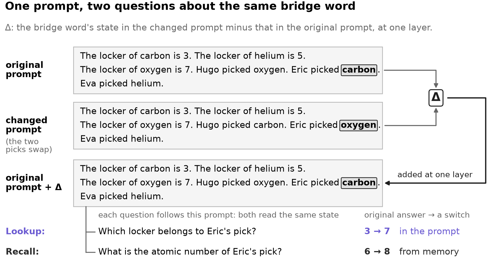
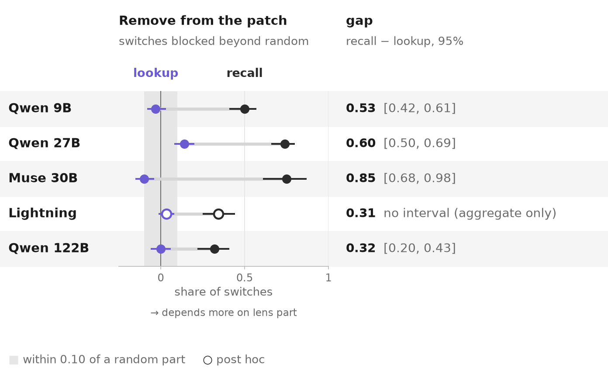
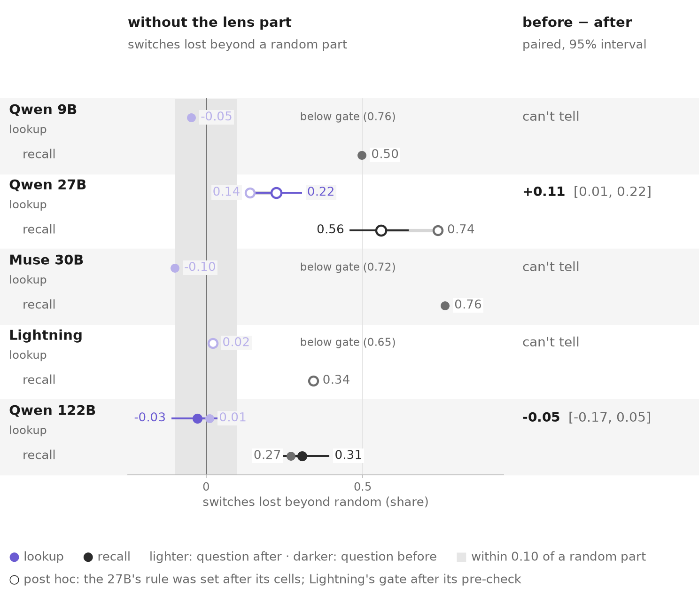
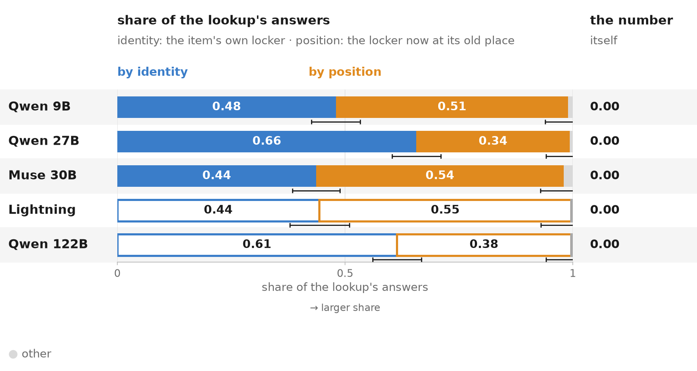
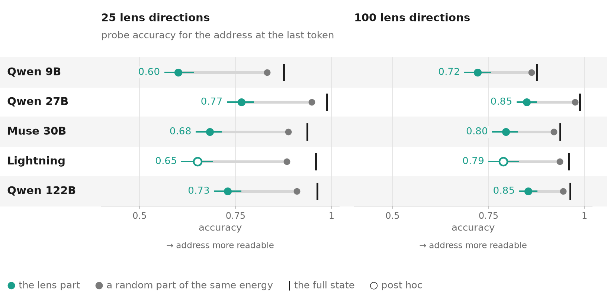
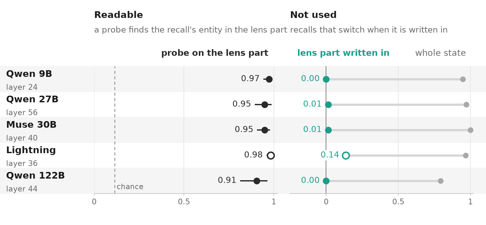
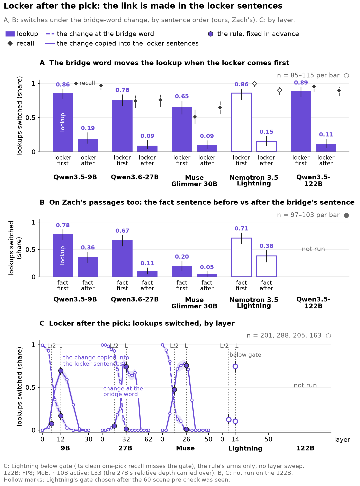
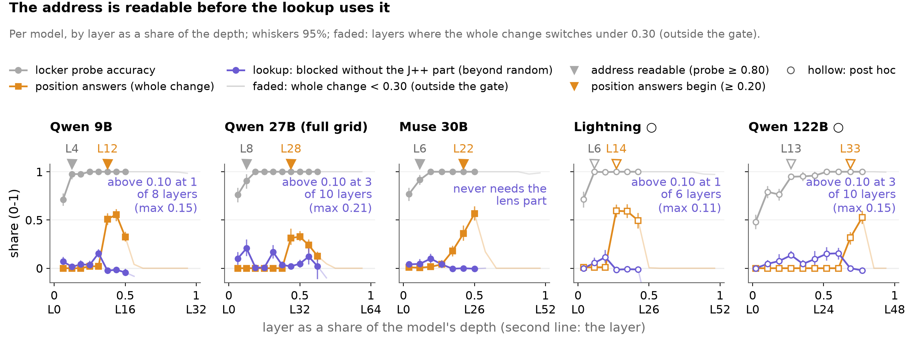
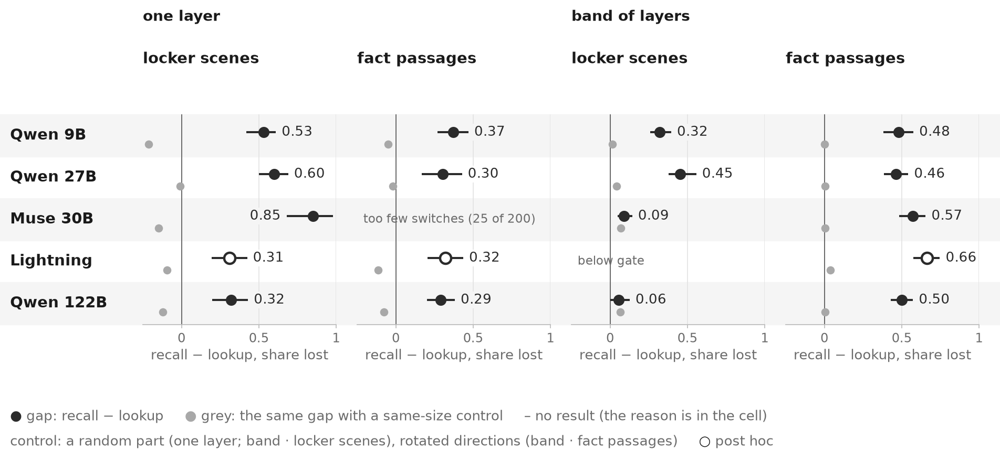
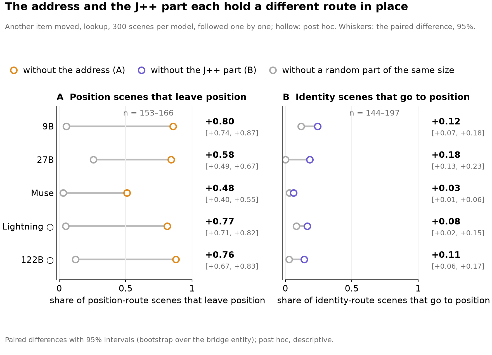

<!-- Generated by scripts/readme_build.py from docs/depth/README.template.md and grid.csv; edit the template. -->
# One word, two readers: what a model keeps at the bridge and what the lens sees

*A two-step question passes through one word, the bridge. The recall asks what the model knows about the item, the lookup where the prompt put it. What does each read from that word, and what can a lens see?*

## In one minute

- **The lookup reads the bridge word by a pointer (where the item's locker sits) plus an identity code, both outside the lens; never the value.** Removing, adding or swapping the pointer moves the lookup; the lens cannot read it. Five models, three families for the pointer; the identity code outside the lens on four (the 122B below its gate); prose, JSON, tables, Zach's made-up-fact passages, 50 neutral sentences; Python code and tool output too (pending hand-check).
- **The recall takes the item's name through the lens part;** on the 9B and Lightning partly the pointer too.
- **The lens part holds the item names** ("−carbon, +oxygen"), almost never the answer in our scenes; the answer when it is a word tied to the entity (Zach's passages). At the last token the item is readable but not used.
- **Scale and order:** the 122B's lookup ignores the lens part (0.00<!-- src: docs/depth/x0_numbers.json | lk_excess_k25_122b --> at 25 lens directions, −0.12<!-- src: docs/depth/x0_numbers.json | lk_excess_k100_122b --> at 100, where the 27B reaches 0.60<!-- src: docs/depth/x0_numbers.json | lk_excess_k100_27b -->); asking the question first matters on the 27B, not on the 122B (pending hand-check).
- **The 27B is weaker throughout:** its lookup partly follows the lens part; the address alone and swaps between given lockers mostly fail.
- **Tested and dropped:** six readings, one line each with the test that dropped it ([below](#tested-and-dropped)).

| # | Claim | 9B | 27B | Muse | Lightning ○ | 122B |
|---|---|---|---|---|---|---|
| 1 | The recall follows the lens part of the bridge word; the lookup follows the rest | holds | in part | holds | holds | holds |
| 2 | The recall does not need the lens part at one layer; it has other copies | holds | holds | holds | holds | holds |
| 3 | The recall also reads the item's earlier mention | holds | holds | holds | below gate | **fails** |
| 4 | The lookup goes by which item it is or where its locker sits, never by the number | holds | holds | holds | holds | holds ○ |
| 5 | The lookup's “which item” lives outside the lens | holds | holds | holds | holds | below gate |
| 6 | The address can be removed, and a swap redirects the lookup | holds | holds | holds | holds | holds ○ |
| 7 | Adding the address alone brings position answers back | holds | **fails** | holds | holds | holds ○ |
| 8 | With six lockers, swaps between given lockers work on most pairs; the code's size is not settled | holds | **fails** | holds | holds | holds |
| 9 | The lens cannot read the address | holds | holds | holds | holds | holds ○ |
| 10 | The bridge word redirects the lookup only when its locker sentence came first | holds | holds | holds | holds¹ | in part |
| 11 | Lookups the change at L misses were read from the bridge word before L | holds | holds | holds | holds | holds |
| 12 | The address is readable before the lookup uses it, and the lookup never reads the value | holds | holds | holds | holds | holds ○ |

¹ Lightning, claim 10: the order split is descriptive; the copy test only below gate (0.751).

*Each claim of the claims table, per model: the verdict of the test behind it. ○: post hoc (Lightning everywhere, the 122B where its gate was lowered); a cell with no result says why: not run, or below its gate.*

**Status.** Five models: Qwen3.5-9B, Qwen3.6-27B, Muse Glimmer 30B (another family), Nemotron 3.5 Lightning 30B-A3B (a third family, a Mamba-attention hybrid) and Qwen3.5-122B-A10B (FP8; MoE, ~10B active) where it ran; 29 Oct 2026. Hand-checked on a sample: 46 items across views a-g (5-10 per view, fixed in advance), all consistent; 6 issues and 6 observations logged in [docs/review/handcheck_findings.md](../review/handcheck_findings.md), none changes a headline claim.<!-- src: docs/review/handcheck_findings.md | 46 items across views a-g --> VERIFIED.md (human recomputation) not yet filled. Results whose views were not hand-checked (the last-token conflict test and the identity-and-address test, the 122B's coverage runs) are marked "pending hand-check". Built at d4862ee8 from the run files. Lightning ran on the rules already fixed for the other models, with no prediction of its own; its marks are hollow ○ everywhere: its gate was chosen after the 60-scene pre-check was seen. The 122B's caveats: FP8, its J++ lens fit on the bf16 weights; its layer, L33<!-- src: docs/depth/x0_numbers.json | layer_122b -->, set by another rule (the 27B's relative depth carried over: 0.69<!-- src: data/figures/depth/data.csv | L as a relative depth (L / the number of layers) -->); its gates lowered to 0.75 post hoc for the routes, address and swap tests (hollow ○); its numbers carry ~±0.04<!-- src: data/figures/depth/data.csv | 53.1: run-to-run noise beyond the bootstrap (Dan's estimate) --> run-to-run noise beyond the bootstrap. Its lookup having no switches blocked beyond random means the 27B's weakness is not a total-size trend; active parameters are not separated; its recall effect is the smallest of the five (0.32<!-- src: docs/depth/x0_numbers.json | rc_excess_122b -->) and mixed on varied scenes (0.15<!-- src: docs/depth/x0_numbers.json | x0b_c_122b -->), which we cannot separate from its later layer or FP8. Nemotron 3.5 Bolt is out of scope: no J++ lens exists for it.

## The question and the setup


*The running example: one prompt, its two questions and the changed prompt.*

- **The prompt** (a main-test scene): "The locker of carbon is 3. The locker of helium is 5. The locker of oxygen is 7. Hugo picked oxygen. Eric picked carbon. Eva picked helium."
- **The lookup** asks "Which locker belongs to Eric's pick?" (3, found in the prompt). **The recall** asks "What is the atomic number of Eric's pick?" (6, from memory).
- **The bridge** is the word both questions pass through: "carbon", Eric's pick.
- **The changed prompt** swaps the two picks, so Eric picks oxygen and the answers become 7 and 8.
- **The question:** what does each reader take from the bridge word, and how much of it can the J++ lens read?
- **Lightning's layer**, L14<!-- src: data/figures/depth/data.csv | L: the layer fixed in advance -->, was picked by a rule fixed before its layer sweep was read (Dan, 29 Oct ~00:50 Paris): the earliest layer passing the gate at relative depth ≥ 0.25, ties broken by the highest lens readability of the bridge word. [The conflict test at every swept layer](../../results/x0_necessity/nem35l_x52_conflict/verdict-20261029T001612Z/verdict.md).

## How to read this page

**Methods**, named the same way in every card:

- **The change**: at the bridge word and one layer, the changed prompt's state minus the original's, added to the original prompt's run (Eric's "carbon" moves towards "oxygen"). A reader **switches** if it then gives the changed prompt's answer.
- **The lens part** (on the figures, "the J++ part"): the 25 directions of the J++ lens that best rebuild the change. **A random part**: random directions with the same share of the change. **The rest**: the change without the lens part.
- **Conflict test**: the change with one part taken out; both readers read the same changed word, so each shows which part it follows.
- **Part alone**: one part added by itself, at a **dose** (a multiple of its size in the change).
- **Zeroing**: a part taken out of the changed prompt's own state, nothing added; a reader's answer stays unchanged or drops the changed prompt's answer.
- **Swap and state copy**: a swap replaces one code at the bridge word by another's; a state copy moves the changed prompt's states at chosen tokens and layers into the original.
- **Probe, lens readout, layer sweep**: a linear read-out trained on states; the lens's top words at a token; one test repeated over layers.

Every removal and every addition is matched by the same operation on a random part of the same size; only the difference between them is about the named part.

**Measures**, defined once:

- **Switches blocked beyond a random part**: switches blocked without a part minus those blocked without a same-size random part (control), as a share of the whole change's switches. **The gap**: the recall's minus the lookup's.
- **Accuracy drop beyond random** (zeroing): answers unchanged with the random part taken out minus those unchanged with the lens part taken out.
- **L**: the layer fixed in advance, 12<!-- src: docs/depth/x0_numbers.json | layer_9b --> / 32<!-- src: docs/depth/x0_numbers.json | layer_27b --> / 26<!-- src: docs/depth/x0_numbers.json | layer_muse --> / 14<!-- src: data/figures/depth/data.csv | L: the layer fixed in advance --> / 33<!-- src: docs/depth/x0_numbers.json | layer_122b --> on the 9B / 27B / Muse / Lightning / 122B; **L to L+3**: L and the three layers after it.
- **Identity route**: the lookup names the item's own locker; **position route**: the locker now at the item's old place; **value**: the new number.
- **The address**: four directions at the bridge word that code where the item's locker sentence sits (Part III).
- **Rules** are quoted as committed, internal metric names replaced by these terms; "post hoc" marks a rule or gate set after the results were seen.

**Reading the figures**:

- **Dots:** one row per model; whiskers: 95% intervals, cluster bootstrap over bridge items. A missing cell says why in the cell (no run, below gate).
- **Hollow (○):** post hoc, a gate or rule set after the results were seen: Lightning everywhere (its gate chosen after the 60-scene pre-check), the 122B where its gate was lowered (the routes, address and swap tests).
- **Grey:** the control (a random part of the same size, random vectors, the layout-only baseline) and the band within 0.10 of it ("not needed"); **z**: distance from 200 random vectors in units of half their 95% range.

## Data: the prompt sets

Every prompt is read in the model's chat template, thinking off, the reply begun with "Answer:"; in the digit sets each question ends "Answer with a single digit and nothing else."

| Set | What it is | The changed prompt differs in | n (9B / 27B / Muse / Lightning ○ / 122B) | Gate; one-token answers | Used by |
|---|---|---|---|---|---|
| Main test | six sentences: three lockers and three picks, in shuffled order | two people swap picks (two pick sentences) | 200<!-- src: docs/depth/x0_numbers.json \| n_9b --> / 200<!-- src: docs/depth/x0_numbers.json \| n_27b --> / 200<!-- src: docs/depth/x0_numbers.json \| n_muse --> / 200<!-- src: data/figures/depth/data.csv \| main test: scenes used --> / 200<!-- src: docs/depth/x0_numbers.json \| n_122b --> | both readers right on the original prompts at least 0.80 of the time; digits, one token | the conflict test, zeroing, the dose curves |
| Clean one-pick | the main test plus a locker for an item nobody picks | the asked pick becomes that item (one token) | 417<!-- src: data/figures/depth/data.csv \| clean one-pick scenes: scenes used --> / 574<!-- src: data/figures/depth/data.csv \| clean one-pick scenes: scenes used --> / 409<!-- src: data/figures/depth/data.csv \| clean one-pick scenes: scenes used --> / not tested (gate) / not run | as above; digits | the ladder, the earlier mention, the order tests, the token map |
| Routes scenes | three lockers, then three picks | another item's locker sentence trades places with a third and gets a new number; the asked pick becomes that item | 300<!-- src: data/figures/depth/data.csv \| routes scenes: scenes used --> / 300<!-- src: data/figures/depth/data.csv \| routes scenes: scenes used --> / 300<!-- src: data/figures/depth/data.csv \| routes scenes: scenes used --> / 300<!-- src: data/figures/depth/data.csv \| routes scenes: scenes used --> / 300<!-- src: data/figures/depth/data.csv \| routes scenes: scenes used --> ○ | as above; digits | the routes test; removing, adding and swapping the address |
| Six-locker scenes | six lockers, then three picks | the item's own locker sentence moves to another place and gets a new number; the pick stays | 300<!-- src: data/figures/depth/data.csv \| six-locker scenes: scenes used --> / not run / 300<!-- src: data/figures/depth/data.csv \| six-locker scenes: scenes used --> / 300<!-- src: data/figures/depth/data.csv \| six-locker scenes: scenes used --> / not run | as above; digits | swaps between given lockers |
| Varied scenes | prose, JSON or markdown tables; up to nine items, look-alike names, filler, paraphrased questions | the asked pick | 1010<!-- src: data/figures/depth/data.csv \| varied scenes: scenes used (prose, JSON and table) --> / 1635<!-- src: data/figures/depth/data.csv \| varied scenes: scenes used (prose, JSON and table) --> / 1389<!-- src: data/figures/depth/data.csv \| varied scenes: scenes used (prose, JSON and table) --> / 1105<!-- src: data/figures/depth/data.csv \| varied scenes: scenes used (prose, JSON and table) --> / 852<!-- src: docs/depth/x0_numbers.json \| x0b_n_122b --> | per format and level; failing cells left out; digits | the split in other texts, the refit address |
| Natural passages | notes, news, forum posts and emails with distractor sentences | the one sentence binding a person to the bridge | 83<!-- src: data/figures/depth/data.csv \| natural passages: scenes eligible --> / 137<!-- src: data/figures/depth/data.csv \| natural passages: scenes eligible --> / 60<!-- src: data/figures/depth/data.csv \| natural passages: scenes eligible --> / 36<!-- src: data/figures/depth/data.csv \| natural passages: scenes eligible (below gate) --> below gate / 114<!-- src: data/figures/depth/data.csv \| natural passages: scenes eligible --> | as above, the 9B's lowered post hoc; words, read by their first token | the split in natural text |
| Zach's passages | his passages: a named or a described bridge; the final fact stated in the lookup's passage, left out of the recall's | the sentence naming the bridge, or the description | named 200<!-- src: data/figures/depth/data.csv \| Zach's passages, named bridge: passages used --> / 200<!-- src: data/figures/depth/data.csv \| Zach's passages, named bridge: passages used --> / 200<!-- src: data/figures/depth/data.csv \| Zach's passages, named bridge: passages used --> / 200<!-- src: data/figures/depth/data.csv \| Zach's passages, named bridge: passages used --> / not run; described 158<!-- src: data/figures/depth/data.csv \| Zach's passages, described bridge: passages used --> / 166<!-- src: data/figures/depth/data.csv \| Zach's passages, described bridge: passages used --> / 157<!-- src: data/figures/depth/data.csv \| Zach's passages, described bridge: passages used --> / not run / not run | per reader; words, read by their first token; about a third of the bridge names are several tokens | Part V |

One item per set, copied from the run files (the original prompt; → the changed prompt's answer):

**Main test** (all five models; the page's running example):

```
The locker of carbon is 3. The locker of helium is 5. The locker of oxygen is 7. Hugo picked oxygen. Eric picked carbon. Eva picked helium.
Changed: Hugo picked carbon. Eric picked oxygen.
Lookup: Which locker belongs to Eric's pick?        3 → 7
Recall: What is the atomic number of Eric's pick?   6 → 8
```

**Clean one-pick** (9B, 27B, Muse):

```
The locker of the cow is 3. The locker of the eagle is 5. The locker of the owl is 4. The locker of the fox is 1. Jack picked the cow. Tara picked the fox. Diana picked the owl.
Changed: Jack picked the eagle.
Lookup: Which locker belongs to Jack's pick?   3 → 5
Recall: How many legs does Jack's pick have?   4 → 2
```

**Routes scenes** (9B and 27B):

```
The locker of the pig is 3. The locker of the butterfly is 4. The locker of the horse is 7. Finn picked the butterfly. Mia picked the horse. Luke picked the pig.
Changed: The locker of the horse is 1. The locker of the butterfly is 4. The locker of the pig is 3. Finn picked the horse.
Lookup: Which locker belongs to Finn's pick?   4 → 1; identity route 7, position route 3, value 1
Recall: How many legs does Finn's pick have?   6 → 4
```

**Six-locker scenes** (9B):

```
The locker of the camel is 7. The locker of the rabbit is 4. The locker of the dog is 6. The locker of the beetle is 3. The locker of the mouse is 2. The locker of the fox is 9. Vera picked the fox. Oscar picked the rabbit. Lily picked the camel.
Changed: The locker of the beetle is 3. ... The locker of the camel is 5. ...
Lookup: Which locker belongs to Lily's pick?   7 → 5; identity route 7, position route 3, value 5
```

**Varied scenes** (JSON, all five models):

```
Tool output from get_lockers:
[{"item": "fly", "locker": 2}, {"item": "elephant", "locker": 9}, {"item": "camel", "locker": 6}, {"item": "ant", "locker": 4}, {"item": "duck", "locker": 3}, {"item": "rabbit", "locker": 7}]
Tool output from get_picks:
[{"name": "Nina", "pick": "elephant"}, ..., {"name": "Eve", "pick": "duck"}, {"name": "Carl", "pick": "ant"}, {"name": "Paul", "pick": "fly"}]
Changed: {"name": "Eve", "pick": "ant"}
Lookup: Which locker belongs to Eve's pick?   3 → 4
Recall: How many legs does Eve's pick have?   2 → 6
```

**Natural passages** (all five models; Lightning below gate):

```
Meeting notes, 14 March.
- The delegation from Kenya announced that its next meeting will take place in Asia.
- Hannah Kerr was raised in Finland.
- The delegation from Bolivia announced that its next meeting will take place in North America.
- Tess Garland was raised in Bolivia.
- Paul Whitaker was raised in Kenya.
(and four distractor lines)
Changed: Tess Garland was raised in Kenya.
Lookup: Which continent will host the next meeting of the delegation from the country where Tess Garland was raised?   North America → Asia
Recall: Which continent is the country where Tess Garland was raised in?   South America → Africa
```

**Zach's passages** (named bridge, 9B; excerpt of the lookup's passage):

```
Posted by travel_notes_88: Uzbekistan is a country in Asia. ... Laura Bennett spent a whole childhood in Vietnam. ... Poland is a country in Europe. ... Eli Thornton spent a whole childhood in Poland. ... Vietnam is a country in Asia.
Changed: Eli Thornton spent a whole childhood in Vietnam.
Both readers: The country of Eli Thornton's childhood is on which continent?   Europe → Asia
(the recall's passage drops the "is a country in" sentences)
```

## Claims

| # | Claim | Models | Grade | Key numbers |
|---|---|---|---|---|
| 1 | The recall follows the lens part of the bridge word; the lookup follows the rest | 9B, 27B, Muse, Lightning, 122B (the 122B's varied scenes: mixed) | **A** (27B partial) | recall 0.50<!-- src: docs/depth/x0_numbers.json \| rc_excess_9b --> / 0.74<!-- src: docs/depth/x0_numbers.json \| rc_excess_27b --> / 0.75<!-- src: docs/depth/x0_numbers.json \| rc_excess_muse --> / 0.34<!-- src: data/figures/depth/data.csv \| conflict: recall, switches lost beyond a random part --> ○ / 0.32<!-- src: docs/depth/x0_numbers.json \| rc_excess_122b -->; lookup −0.03<!-- src: docs/depth/x0_numbers.json \| lk_excess_9b --> / 0.14<!-- src: docs/depth/x0_numbers.json \| lk_excess_27b --> / −0.10<!-- src: docs/depth/x0_numbers.json \| lk_excess_muse --> / 0.03<!-- src: data/figures/depth/data.csv \| conflict: lookup, switches lost beyond a random part --> ○ / 0.00<!-- src: docs/depth/x0_numbers.json \| lk_excess_122b -->. Limits: on the full carrier, fact-after lookups follow the lens (0.41<!-- src: data/figures/depth/data.csv \| 51.7: fact-after lookups, full carrier: switches lost beyond a random part -->-0.51<!-- src: data/figures/depth/data.csv \| 51.7: fact-after lookups, full carrier: switches lost beyond a random part -->); on Zach's true-fact passages the 9B's and 27B's lookups follow it (0.26<!-- src: data/figures/depth/data.csv \| Z1: lookup, switches lost beyond a random part --> / 0.28<!-- src: data/figures/depth/data.csv \| Z1: lookup, switches lost beyond a random part -->); on his made-up-fact passages the split holds on the 9B, the 27B is in between (Part V); with the question before the scene the 27B's lookup follows it a little more, the 122B's not (Part I, pending hand-check) |
| 2 | The recall does not need the lens part at one layer; it has other copies | 9B, 27B, Muse, Lightning, 122B | **B** | answers unchanged 0.97<!-- src: data/figures/depth/data.csv \| 47.5: recall's answers kept at L, the J++ part's 25 directions taken out --> / 0.97<!-- src: data/figures/depth/data.csv \| 47.5: recall's answers kept at L, the J++ part's 25 directions taken out --> / 0.94<!-- src: data/figures/depth/data.csv \| 47.5: recall's answers kept at L, the J++ part's 25 directions taken out --> / 0.97<!-- src: data/figures/depth/data.csv \| 47.5: recall's answers kept at L, the J++ part's 25 directions taken out --> ○ / 0.95<!-- src: data/figures/depth/data.csv \| 47.5: recall's answers kept at L, the J++ part's 25 directions taken out --> |
| 3 | The recall also reads the item's earlier mention | 9B, 27B, Muse (the 122B: does not hold) | **B** | 0.25<!-- src: docs/depth/x0_numbers.json \| x45p_d23_9b -->-0.42<!-- src: docs/depth/x0_numbers.json \| x45p_d23_muse -->; 122B 0.15<!-- src: data/figures/depth/data.csv \| 45p: recall, loss in (2) minus (3) --> |
| 4 | The lookup goes by which item it is or where its locker sits, never by the number | 9B, 27B, Muse, Lightning, 122B ○ | **A** | 9B identity / position 0.48<!-- src: docs/depth/x0_numbers.json \| rt_C2_whole_identity_9b --> / 0.51<!-- src: docs/depth/x0_numbers.json \| rt_C2_whole_position_9b -->; Lightning 0.44<!-- src: data/figures/depth/data.csv \| another item moved, whole: identity share --> / 0.55<!-- src: data/figures/depth/data.csv \| another item moved, whole: position share --> ○; 122B ○ 0.61<!-- src: docs/depth/x0_numbers.json \| rtg_C2_whole_identity_122b --> / 0.38<!-- src: docs/depth/x0_numbers.json \| rtg_C2_whole_position_122b -->; value none anywhere |
| 5 | The lookup's “which item” lives outside the lens | 9B, 27B, Muse, Lightning | **B** | identity route without 26–100: 0.05<!-- src: data/figures/depth/data.csv \| 47.1: identity route: answers lost beyond random without lens directions 26-100 --> / 0.05<!-- src: data/figures/depth/data.csv \| 47.1: identity route: answers lost beyond random without lens directions 26-100 --> / 0.02<!-- src: data/figures/depth/data.csv \| 47.1: identity route: answers lost beyond random without lens directions 26-100 --> / 0.05<!-- src: data/figures/depth/data.csv \| 47.1: identity answers lost beyond random without lens directions 26-100 --> ○; position route at most 0.01<!-- src: data/figures/depth/data.csv \| 47.1: position route: the most answers lost beyond random, over the models and slices --> |
| 6 | The address can be removed, and a swap redirects the lookup | 9B, 27B, Muse, Lightning, 122B ○ | **A** (code and tool output: pending hand-check) | position answers without it 0.08<!-- src: docs/depth/x0_numbers.json \| rt_C2_no_alf_position_9b --> / 0.06<!-- src: docs/depth/x0_numbers.json \| rt_C2_no_alf_position_27b --> / 0.27<!-- src: docs/depth/x0_numbers.json \| rt_C2_no_alf_position_muse --> / 0.10<!-- src: data/figures/depth/data.csv \| another item moved, no_alf: position share --> ○ / 0.05<!-- src: docs/depth/x0_numbers.json \| rtg_C2_no_alf_position_122b --> ○ vs random 0.54<!-- src: docs/depth/x0_numbers.json \| rt_C2_no_alf_rand_position_9b --> / 0.25<!-- src: docs/depth/x0_numbers.json \| rt_C2_no_alf_rand_position_27b --> / 0.55<!-- src: docs/depth/x0_numbers.json \| rt_C2_no_alf_rand_position_muse --> / 0.56<!-- src: data/figures/depth/data.csv \| another item moved, no_alf_rand: position share --> ○ / 0.36<!-- src: docs/depth/x0_numbers.json \| rtg_C2_no_alf_rand_position_122b --> ○; the swap at s = 2 moves 0.46<!-- src: data/figures/depth/data.csv \| lookup target share, mean over locker pairs, s = 2 --> / 0.25<!-- src: data/figures/depth/data.csv \| lookup target share, mean over locker pairs, s = 2 --> / 0.52<!-- src: data/figures/depth/data.csv \| lookup target share, mean over locker pairs, s = 2 --> / 0.50<!-- src: data/figures/depth/data.csv \| lookup target share, mean over locker pairs, s = 2 --> ○ / 0.50<!-- src: docs/depth/x0_numbers.json \| x8_t2_122b --> ○ (pooled over locker pairs) of lookups; in Python code and tool output too (9B, 27B; Part III, pending hand-check) |
| 7 | Adding the address alone brings position answers back | 9B, Muse, Lightning, 122B ○ (27B fails) | **B** | 0.26<!-- src: docs/depth/x0_numbers.json \| rtk_C2_keep_alf_position_9b --> / 0.09<!-- src: docs/depth/x0_numbers.json \| rtk_C2_keep_alf_position_27b --> / 0.29<!-- src: docs/depth/x0_numbers.json \| rtk_C2_keep_alf_position_muse --> / 0.40<!-- src: data/figures/depth/data.csv \| another item moved, keep_alf: position share --> ○ / 0.21<!-- src: docs/depth/x0_numbers.json \| rtk_C2_keep_alf_position_122b --> ○ |
| 8 | With six lockers, swaps between given lockers work on most pairs; the code's size is not settled | 9B, Muse, Lightning, 122B (not the 27B) | **B** | pairs reaching the bar 18<!-- src: data/figures/depth/data.csv \| 47.2: pairwise writes reaching 25% (dose 2) --> / 13<!-- src: data/figures/depth/data.csv \| 47.2: pairwise writes reaching 25% (dose 2) --> / 21<!-- src: data/figures/depth/data.csv \| 47.2: pairwise writes reaching 25% (dose 2) --> / 21<!-- src: data/figures/depth/data.csv \| 47.2: pairwise writes reaching 25% (dose 2) --> ○ / 21<!-- src: data/figures/depth/data.csv \| 47.2: pairwise writes reaching 25% (dose 2) --> of 30; the code's size on the 9B: in between<!-- src: data/figures/depth/data.csv \| 51.11 part 1: the code's size -->; midpoint swaps fail (0.06<!-- src: data/figures/depth/data.csv \| 51.11 part 3: midpoint swaps reaching the slot between, from the first slot (dose 2) -->), so not a metric order |
| 9 | The lens cannot read the address | 9B, 27B, Muse, Lightning, 122B ○ | **B** | share rebuilt 0.06<!-- src: data/figures/depth/data.csv \| 47.0 (b) share rebuilt by 25 lens directions: pointer --> / 0.04<!-- src: data/figures/depth/data.csv \| 47.0 (b) share rebuilt by 25 lens directions: pointer --> / 0.01<!-- src: data/figures/depth/data.csv \| 47.0 (b) share rebuilt by 25 lens directions: pointer --> / 0.04<!-- src: data/figures/depth/data.csv \| 47.0 (b) share rebuilt by 25 lens directions: pointer --> ○ / 0.03<!-- src: data/figures/depth/data.csv \| 47.0 (b) share rebuilt by 25 lens directions: pointer --> ○ |
| 10 | The bridge word redirects the lookup only when its locker sentence came first | 9B, 27B, Muse, Lightning | **A** | locker first 65%<!-- src: docs/depth/x0_numbers.json \| lk_order_before_muse -->-89%<!-- src: docs/depth/x0_numbers.json \| lk_order_before_122b -->, after 9%<!-- src: docs/depth/x0_numbers.json \| lk_order_after_27b -->-19%<!-- src: docs/depth/x0_numbers.json \| lk_order_after_9b -->; Lightning 0.86<!-- src: data/figures/depth/data.csv \| lookups switched by the whole change, locker sentence before the pick --> / 0.15<!-- src: data/figures/depth/data.csv \| lookups switched by the whole change, locker sentence after the pick --> ○; copy 0.70<!-- src: docs/depth/x0_numbers.json \| x45q_c_9b --> / 0.74<!-- src: docs/depth/x0_numbers.json \| x45q_c_27b --> / 0.76<!-- src: docs/depth/x0_numbers.json \| x45q_c_muse --> / 0.75<!-- src: data/figures/depth/data.csv \| 45q, the rule's arm c: copy at L, every locker-sentence token (lookups switched) --> ○ below gate |
| 11 | Lookups the change at L misses were read from the bridge word before L | 9B, 27B, Muse, Lightning, 122B | **B** | carried before L 0.93<!-- src: data/figures/depth/data.csv \| 47.4: main, locker after the pick: lookups carried by the bridge word before L --> / 1.00<!-- src: data/figures/depth/data.csv \| 47.4: main, locker after the pick: lookups carried by the bridge word before L --> / 0.99<!-- src: data/figures/depth/data.csv \| 47.4: main, locker after the pick: lookups carried by the bridge word before L --> / 0.92<!-- src: data/figures/depth/data.csv \| 47.4: main, locker after the pick: lookups carried by the bridge word before L --> ○ / 1.00<!-- src: data/figures/depth/data.csv \| 47.4: main, locker after the pick: lookups carried by the bridge word before L --> |
| 12 | The address is readable before the lookup uses it, and the lookup never reads the value | 9B, 27B, Muse, Lightning, 122B ○ | **B** | address readable from / used from layer 4<!-- src: data/figures/depth/data.csv \| 47.8: the address readable from --> / 12<!-- src: data/figures/depth/data.csv \| 47.8: the first layer of the position route --> (9B), 8<!-- src: data/figures/depth/data.csv \| 47.8 (full grid): the address readable from --> / 28<!-- src: data/figures/depth/data.csv \| 47.8 (full grid): the first layer of the position route --> (27B), 6<!-- src: data/figures/depth/data.csv \| 47.8: the address readable from --> / 22<!-- src: data/figures/depth/data.csv \| 47.8: the first layer of the position route --> (Muse), 6<!-- src: data/figures/depth/data.csv \| 47.8: the address readable from --> / 14<!-- src: data/figures/depth/data.csv \| 47.8: the first layer of the position route --> ○ (Lightning), 13<!-- src: data/figures/depth/data.csv \| 47.8: the address readable from --> / 33<!-- src: data/figures/depth/data.csv \| 47.8: the first layer of the position route --> ○ (122B); the handoff from the lens part is weak (the lookup's effect is small at every layer) and fails on the 27B's full grid (Part IV); whether the address travels to the last token: (c) not at the last token<!-- src: data/figures/depth/data.csv \| 51.4: the rule's reading --> (9B), (c) not at the last token<!-- src: data/figures/depth/data.csv \| 51.4: the rule's reading --> (27B), (a) the code travels<!-- src: data/figures/depth/data.csv \| 51.4: the rule's reading --> (Muse), (d) in between<!-- src: data/figures/depth/data.csv \| 51.4: the rule's reading --> ○ (Lightning) |

Hand-checked on a sample: 46 items across views a-g (5-10 per view, fixed in advance), all consistent; 6 issues and 6 observations logged in [docs/review/handcheck_findings.md](../review/handcheck_findings.md), none changes a headline claim.<!-- src: docs/review/handcheck_findings.md | 46 items across views a-g --> VERIFIED.md (human recomputation) not yet filled.

*Grades: **A**, a rule fixed in advance held on at least three models with a specificity control and a variant design; **B**, on two models, or three with one operation, or descriptive on three with a random null.* Weaker results are in Part VI, dropped readings under "Tested and dropped"; "pending hand-check" marks a result whose view was not hand-checked (the last-token conflict test, the identity-and-address test, the 122B's coverage runs). Lightning ran on the rules already fixed for the other models, with no prediction of its own; its key numbers carry ○. Claim 8 said "every locker has its own code" until a test on held-out items left the code's size open; claim 12 said "identity route early, position route late" until the 27B's full grid failed the handoff; both stay B (claim 12: five models, one operation). The 122B's coverage runs (no prediction; pending hand-check) add it to claims 2, 8, 9, 11 and 12 and fail claim 3; claim 5's routes part is below its gate (the recall reads 0.797, the gate needs 0.80); a hollow ○ marks its runs with the gate lowered post hoc (routes, address, swap) or with the lookup-only gate (claims 9 and 12: the recall is not part of those tests); its varied scenes are mixed.

## Part I. The two readers: lookup and recall

*The two readers weight different parts of one word, and the recall has copies elsewhere.*

*In the ledger, not on this page: [does each part, added by itself, move its reader?](EXPERIMENTS.md#t51-1) (the dose curves).*

### In a conflict, which part of the bridge word does each reader follow?

- **Question.** In a conflict, which part of the bridge word does each reader follow?
- **Why we asked.** Both readers pass through the same word; if they took the same thing from it, the lens part would matter to both alike.
- **Data.** Main test, 200<!-- src: docs/depth/x0_numbers.json | n_9b --> / 200<!-- src: docs/depth/x0_numbers.json | n_27b --> / 200<!-- src: docs/depth/x0_numbers.json | n_muse --> / 200<!-- src: data/figures/depth/data.csv | main test: scenes used --> / 200<!-- src: docs/depth/x0_numbers.json | n_122b --> scenes per model, the first in which both readers answer both prompts right; the gate passed on all five (Lightning's chosen after its pre-check, ○). The 122B (FP8; MoE, ~10B active) runs at L33<!-- src: docs/depth/x0_numbers.json | layer_122b -->: its L33 is the 27B's relative depth carried over (33/48), not the other models' rule; its J++ lens was fit on the bf16 weights.
- **Method.** The change at the bridge word at L, on the original prompt (Eric's "carbon" moves towards "oxygen"):
  - the whole change, which sets the switches each arm can block;
  - without the lens part; control: without a random part;
  - specificity: without the lens part but keeping its directions for both readers' answer words ("six", "eight"), and without those answer directions only, each against a random part of their share; and the lens's rank of the answer word at the bridge word.
- **Rule, fixed in advance.** "Confirmed if the lookup has at most 0.10 of its switches blocked beyond random and the recall at least 0.30 without the lens part; killed if the lookup has at least 0.20 blocked or the recall under 0.20." Specificity: "the lens effect is the item if the recall keeps at least 0.7 of its drop with the answer directions retained and has at most 0.10 blocked beyond random without them only". Before that result was opened, the answer directions became number words (digits are not in the lens) and a check of the answer word's rank was put first. Lightning: the same rules, copied, no prediction.


*Switches blocked without the lens part beyond a random part, lookup and recall per model, main test at L (the 122B's L33: the 27B's relative depth carried over); right: the gap, recall minus lookup, with its 95% interval; grey band: within 0.10 of random (the lookup's bar).*

- **Result.**

  | | 9B | 27B | Muse | Lightning ○ | 122B |
  |---|---|---|---|---|---|
  | recall: switches blocked beyond a random part | 0.50 [0.41, 0.57]<!-- src: docs/depth/x0_numbers.json \| rc_excess_9b --> | 0.74 [0.66, 0.80]<!-- src: docs/depth/x0_numbers.json \| rc_excess_27b --> | 0.75 [0.61, 0.87]<!-- src: docs/depth/x0_numbers.json \| rc_excess_muse --> | 0.34 [0.25, 0.44]<!-- src: data/figures/depth/data.csv \| conflict: recall, switches lost beyond a random part --> | 0.32 [0.22, 0.41]<!-- src: docs/depth/x0_numbers.json \| rc_excess_122b --> |
  | recall: switches blocked, not net of random | 0.53<!-- src: docs/depth/x0_numbers.json \| rc_jdep_9b --> | 0.77<!-- src: docs/depth/x0_numbers.json \| rc_jdep_27b --> | 0.72<!-- src: docs/depth/x0_numbers.json \| rc_jdep_muse --> | 0.41<!-- src: data/figures/depth/data.csv \| conflict: recall, switches lost, not net of random --> | 0.40<!-- src: docs/depth/x0_numbers.json \| rc_jdep_122b --> |
  | lookup: switches blocked beyond a random part | −0.03 [−0.08, 0.03]<!-- src: docs/depth/x0_numbers.json \| lk_excess_9b --> | 0.14 [0.08, 0.20]<!-- src: docs/depth/x0_numbers.json \| lk_excess_27b --> | −0.10 [−0.15, −0.04]<!-- src: docs/depth/x0_numbers.json \| lk_excess_muse --> | 0.03 [-0.01, 0.08]<!-- src: data/figures/depth/data.csv \| conflict: lookup, switches lost beyond a random part --> | 0.00 [−0.06, 0.06]<!-- src: docs/depth/x0_numbers.json \| lk_excess_122b --> |
  | the rule | confirmed<!-- src: docs/depth/x0_numbers.json \| verdict_9b --> | not confirmed<!-- src: docs/depth/x0_numbers.json \| verdict_27b --> | confirmed<!-- src: docs/depth/x0_numbers.json \| verdict_muse --> | confirmed<!-- src: data/figures/depth/data.csv \| conflict: the rule --> | confirmed<!-- src: docs/depth/x0_numbers.json \| verdict_122b --> |
  | recall: share of its drop remaining with the answer directions retained | 0.95 [0.90, 0.99]<!-- src: data/figures/depth/data.csv \| main test, recall: share of its loss kept when the lens part keeps the answer words' directions --> | 0.93 [0.85, 0.99]<!-- src: data/figures/depth/data.csv \| main test, recall: share of its loss kept when the lens part keeps the answer words' directions --> | 0.93 [0.85, 1.00]<!-- src: data/figures/depth/data.csv \| main test, recall: share of its loss kept when the lens part keeps the answer words' directions --> | 0.92 [0.83, 1.03]<!-- src: data/figures/depth/data.csv \| main test, recall: share of its loss kept when the lens part keeps the answer words' directions --> | 0.98 [0.86, 1.18]<!-- src: data/figures/depth/data.csv \| main test, recall: share of its loss kept when the lens part keeps the answer words' directions --> |
  | recall: switches blocked beyond random without the answer directions only | 0.00 [0.00, 0.00]<!-- src: data/figures/depth/data.csv \| main test, recall: switches lost beyond random without the answer words' directions only --> | 0.03 [0.01, 0.05]<!-- src: data/figures/depth/data.csv \| main test, recall: switches lost beyond random without the answer words' directions only --> | -0.01 [-0.05, 0.03]<!-- src: data/figures/depth/data.csv \| main test, recall: switches lost beyond random without the answer words' directions only --> | 0.00 [-0.02, 0.01]<!-- src: data/figures/depth/data.csv \| main test, recall: switches lost beyond random without the answer words' directions only --> | 0.01 [-0.01, 0.04]<!-- src: data/figures/depth/data.csv \| main test, recall: switches lost beyond random without the answer words' directions only --> |
  | recall: answer word outside the lens's top 50 at the bridge word | 0.56 [0.47, 0.66]<!-- src: data/figures/depth/data.csv \| main test, recall: items whose answer word ranks below the lens's top 50 at the bridge word --> | 0.79 [0.72, 0.86]<!-- src: data/figures/depth/data.csv \| main test, recall: items whose answer word ranks below the lens's top 50 at the bridge word --> | 0.99 [0.98, 1.00]<!-- src: data/figures/depth/data.csv \| main test, recall: items whose answer word ranks below the lens's top 50 at the bridge word --> | 0.95 [0.90, 0.99]<!-- src: data/figures/depth/data.csv \| main test, recall: items whose answer word ranks below the lens's top 50 at the bridge word --> | 1.00 [1.00, 1.00]<!-- src: data/figures/depth/data.csv \| main test, recall: items whose answer word ranks below the lens's top 50 at the bridge word --> |
  | the specificity rule | the item<!-- src: data/figures/depth/data.csv \| main test, recall: the rule's label (page words) --> | the item<!-- src: data/figures/depth/data.csv \| main test, recall: the rule's label (page words) --> (post hoc: mixed<!-- src: runs/answer_arms_translated/qwen3.6-27b/run_qwen3.6-27b/summary.json \| arm3_extra_all_languages -->) | the answer word is not read<!-- src: data/figures/depth/data.csv \| main test, recall: the rule's label (page words) --> (arms beside, post hoc: mixed<!-- src: runs/answer_arms_translated/muse-glimmer-30b/run2/summary.json \| claim_changes -->) | the answer word is not read<!-- src: data/figures/depth/data.csv \| main test, recall: the rule's label (page words) --> | the answer word is not read<!-- src: data/figures/depth/data.csv \| main test, recall: the rule's label (page words) --> |

  Rank check (automatic, every item of the conflict test and the routes test on all five models; flags: 0<!-- src: data/figures/depth/data.csv | checks: the rank check's flags -->), in Dan's words: what the lens can read about the item sits in the J++ part; the rest puts the new bridge word in the lens's top 50 on 0.00-0.14 of items (conflict test, 9B / 27B / Muse / Lightning / 122B: 0.00<!-- src: data/figures/depth/data.csv | rank check, conflict test: the new bridge word in the lens's top 50, the rest --> / 0.02<!-- src: data/figures/depth/data.csv | rank check, conflict test: the new bridge word in the lens's top 50, the rest --> / 0.01<!-- src: data/figures/depth/data.csv | rank check, conflict test: the new bridge word in the lens's top 50, the rest --> / 0.06<!-- src: data/figures/depth/data.csv | rank check, conflict test: the new bridge word in the lens's top 50, the rest --> / 0.05<!-- src: data/figures/depth/data.csv | rank check, conflict test: the new bridge word in the lens's top 50, the rest -->; the routes test's highest condition, Lightning: 0.14<!-- src: data/figures/depth/data.csv | rank check, routes test: the new bridge word in the lens's top 50, the rest, highest condition -->), against about 0.5 for a random part (0.52<!-- src: data/figures/depth/data.csv | rank check, conflict test: the new bridge word in the lens's top 50, a random part --> / 0.53<!-- src: data/figures/depth/data.csv | rank check, conflict test: the new bridge word in the lens's top 50, a random part --> / 0.66<!-- src: data/figures/depth/data.csv | rank check, conflict test: the new bridge word in the lens's top 50, a random part --> / 0.65<!-- src: data/figures/depth/data.csv | rank check, conflict test: the new bridge word in the lens's top 50, a random part --> / 0.83<!-- src: data/figures/depth/data.csv | rank check, conflict test: the new bridge word in the lens's top 50, a random part -->) and about 0.8 for the J++ part (0.81<!-- src: data/figures/depth/data.csv | rank check, conflict test: the new bridge word in the lens's top 50, the J++ part --> / 0.81<!-- src: data/figures/depth/data.csv | rank check, conflict test: the new bridge word in the lens's top 50, the J++ part --> / 0.89<!-- src: data/figures/depth/data.csv | rank check, conflict test: the new bridge word in the lens's top 50, the J++ part --> / 0.93<!-- src: data/figures/depth/data.csv | rank check, conflict test: the new bridge word in the lens's top 50, the J++ part --> / 0.93<!-- src: data/figures/depth/data.csv | rank check, conflict test: the new bridge word in the lens's top 50, the J++ part -->); the random part reads the bridge because it keeps part of Δ (the change) itself.
- **Read.**
  - The recall follows the part of the bridge word the lens reads; the lookup follows the rest, fully on the 9B, Muse, Lightning and the 122B, mostly on the 27B.
  - What the recall follows is the item, not its answer: keeping the answer's lens directions keeps almost all of the recall's drop.
- **Caveats.**
  - Following is not needing: a part is taken out of an added change at one layer (see "Does the recall need the lens part, or only follow it?").
  - The 27B's lookup misses its bar, and has 0.60<!-- src: docs/depth/x0_numbers.json | lk_excess_k100_27b --> of its switches blocked beyond random when 100 lens directions go (an open question).
  - On Muse, Lightning and the 122B the answer word is almost never near the top of the lens readout, so the rule's first case decides there.
  - Post hoc: answer in any language (single-token translations); 9B, 27B, Muse; Lightning and 122B not run. The answer control's answer directions were English number words. Taken in every language (about 100 directions per item, against 15), "answer directions only" blocks more of the recall's switches than its size-matched random part on the 27B (+0.040 [0.006, 0.082]) and Muse (+0.085 [0.018, 0.154]), not on the 9B (+0.005 [0.000, 0.018]); by the rule fixed for this check the arm label beside moves from the item to mixed on the 27B and Muse, and stays the item on the 9B<!-- src: runs/answer_arms_translated/muse-glimmer-30b/run2/summary.json | arm3_extra_all_languages -->. "Without the lens part, answer directions retained" blocks less with the larger set (9B 0.50 to 0.29, 27B 0.71 to 0.47, Muse 0.68 to 0.48), but random directions of the same count do the same (the shift beyond them: -0.02 [-0.06, 0.01], -0.01 [-0.06, 0.03], -0.01 [-0.07, 0.07]), so that shift is explained by the number of directions held and the labels rest on the first arm<!-- src: runs/answer_arms_krand/muse-glimmer-30b/krand/summary.json | b_beyond_K_random -->. The readout case does not change on Muse (0 of 200 labels flip). On Greek-letter scenes the answer is the letter's ordinal, so translated answer directions may overlap the bridge's content.
  - The answer control used English answer words only. A CPU re-check on the saved atoms (classes in any language) finds the answer carries ≤0.002 of the lens part's energy on average (f5 items; 8 of 250 have an answer atom, 5 of them in another language, e.g. “，三”, “ prima”). Re-ranking the state by the best rank over single-token translations (11 languages; some Japanese and Ukrainian numbers have no single token) changed 0 of 200 labels on Muse (95% Wilson [0, 0.019]); other models not re-run.<!-- src: runs/answer_translation_check/muse-glimmer-30b/full/summary.json | flip_rate_wilson95 --><!-- src: results/atoms_multilingual/20261030T204008Z/tables.json | sets; muse_case -->
  - Issues found in the hand-check, with the check that followed each, are logged in [docs/review/handcheck_findings.md](../review/handcheck_findings.md).
  - Two limits, on Zach's passages (Part V): on the full carrier (every token before L), fact-after lookups follow the lens part (0.41<!-- src: data/figures/depth/data.csv | 51.7: fact-after lookups, full carrier: switches lost beyond a random part --> ○ to 0.51<!-- src: data/figures/depth/data.csv | 51.7: fact-after lookups, full carrier: switches lost beyond a random part --> blocked beyond random); on his true-fact passages the 9B's and 27B's lookups follow it at L (0.26<!-- src: data/figures/depth/data.csv | Z1: lookup, switches lost beyond a random part --> / 0.28<!-- src: data/figures/depth/data.csv | Z1: lookup, switches lost beyond a random part -->). On his made-up-fact passages the split holds on the 9B and is in between on the 27B; Lightning is not tested there (gate).

### What do the lens part's 25 directions stand for?

- **Question.** What do the lens part's 25 directions stand for?
- **Why we asked.** The conflict test treats the lens part as one block; if its directions were mostly the answer words, "the recall follows the item" would be a reading of the answer.
- **Data.** Main test, 50<!-- src: data/figures/depth/data.csv | 52 A: main-test scenes --> scenes per model (the same change for both readers).
- **Method.** Each of the 25 directions is a word of the lens's vocabulary; each is classed automatically as the original bridge word (or its spelling: first token, initial, prefix), the new bridge word, another scene item, a person, either reader's answer word, a word of the same class, a function word, or none of these. Its share is the energy it adds when it enters the rebuild. The classifier was hand-checked on 5<!-- src: data/figures/depth/data.csv | 52 A: hand-checked items (the lookup's view) --> items per model on the 9B, 27B and Muse (agreement 0.94<!-- src: data/figures/depth/data.csv | 52 A: hand labels agreeing with the classifier -->-0.97<!-- src: data/figures/depth/data.csv | 52 A: hand labels agreeing with the classifier -->; only Muse's labels are blind: on the 9B and 27B the labeller had seen some of the classifier's labels while writing its spelling rules); Lightning's labels are not hand-checked.
- **Rule, fixed in advance.** None: descriptive.


*The lens part's rebuilt energy at the bridge word, split by the word each of its 25 directions decodes to: the old bridge word, the new one, or no word of the scene; right: the reader's answer word's share. Main test at L; Lightning tinted (○); the 122B at L33 (coverage, pending hand-check).*

- **Result.**

  | share of the rebuilt energy | 9B | 27B | Muse | Lightning ○ | 122B |
  |---|---|---|---|---|---|
  | the old bridge word | 0.11 [0.09, 0.13]<!-- src: data/figures/depth/data.csv \| 52 A: share of the rebuilt energy in the original bridge word --> | 0.10 [0.08, 0.13]<!-- src: data/figures/depth/data.csv \| 52 A: share of the rebuilt energy in the original bridge word --> | 0.18 [0.17, 0.20]<!-- src: data/figures/depth/data.csv \| 52 A: share of the rebuilt energy in the original bridge word --> | 0.09 [0.07, 0.10]<!-- src: data/figures/depth/data.csv \| 52 A: share of the rebuilt energy in the original bridge word --> | 0.15 [0.13, 0.18]<!-- src: data/figures/depth/data.csv \| 52 A: share of the rebuilt energy in the original bridge word --> |
  | the new bridge word | 0.11 [0.09, 0.12]<!-- src: data/figures/depth/data.csv \| 52 A: share of the rebuilt energy in the new bridge word --> | 0.11 [0.10, 0.13]<!-- src: data/figures/depth/data.csv \| 52 A: share of the rebuilt energy in the new bridge word --> | 0.19 [0.17, 0.21]<!-- src: data/figures/depth/data.csv \| 52 A: share of the rebuilt energy in the new bridge word --> | 0.11 [0.09, 0.13]<!-- src: data/figures/depth/data.csv \| 52 A: share of the rebuilt energy in the new bridge word --> | 0.15 [0.13, 0.18]<!-- src: data/figures/depth/data.csv \| 52 A: share of the rebuilt energy in the new bridge word --> |
  | the recall's answer word | 0.00<!-- src: data/figures/depth/data.csv \| 52 A: share of the rebuilt energy in the reader's answer word --> | 0.00<!-- src: data/figures/depth/data.csv \| 52 A: share of the rebuilt energy in the reader's answer word --> | 0.00<!-- src: data/figures/depth/data.csv \| 52 A: share of the rebuilt energy in the reader's answer word --> | 0.00<!-- src: data/figures/depth/data.csv \| 52 A: share of the rebuilt energy in the reader's answer word --> | 0.00<!-- src: data/figures/depth/data.csv \| 52 A: share of the rebuilt energy in the reader's answer word --> |
  | no scene word | 0.77 [0.74, 0.80]<!-- src: data/figures/depth/data.csv \| 52 A: share of the rebuilt energy in no scene word --> | 0.77 [0.74, 0.81]<!-- src: data/figures/depth/data.csv \| 52 A: share of the rebuilt energy in no scene word --> | 0.61 [0.58, 0.64]<!-- src: data/figures/depth/data.csv \| 52 A: share of the rebuilt energy in no scene word --> | 0.79 [0.76, 0.82]<!-- src: data/figures/depth/data.csv \| 52 A: share of the rebuilt energy in no scene word --> | 0.69 [0.65, 0.72]<!-- src: data/figures/depth/data.csv \| 52 A: share of the rebuilt energy in no scene word --> |
  | bridge-word directions with the expected sign (old −, new +) | 0.99<!-- src: data/figures/depth/data.csv \| 52 A: the bridge words' directions whose sign points the expected way (old -, new +) --> | 1.00<!-- src: data/figures/depth/data.csv \| 52 A: the bridge words' directions whose sign points the expected way (old -, new +) --> | 1.00<!-- src: data/figures/depth/data.csv \| 52 A: the bridge words' directions whose sign points the expected way (old -, new +) --> | 1.00<!-- src: data/figures/depth/data.csv \| 52 A: the bridge words' directions whose sign points the expected way (old -, new +) --> | 0.98<!-- src: data/figures/depth/data.csv \| 52 A: the bridge words' directions whose sign points the expected way (old -, new +) --> |

- **Read.**
  - The two bridge words carry about a tenth to a fifth of the rebuilt energy each, with the expected signs: the old word taken away, the new one added.
  - The answer words carry almost nothing.
  - Most of the energy matches no word of the scene; some of it is the bridge's spellings the classifier missed.
- **Caveats.**
  - This is what is readable through the lens's vocabulary, not all that is there.
  - Descriptive: no rule was fixed in advance; one set (the main test) per model.

### Does asking the question before the scene change how the lookup uses the lens part?

- **Question.** Does asking the question before the scene change how the lookup uses the lens part?
- **Why we asked.** Our questions come after the scene; Zach's passages put the question first. If the lookup leaned on the lens part with the question first, its independence from the lens would belong to our layout.
- **Data.** Our locker scenes (the main test's set), with both questions after the scene as usual and with both placed before it ("Question: ... Scene: ..."): 600<!-- src: data/figures/depth/data.csv | question after the scene: scenes --> / 600<!-- src: data/figures/depth/data.csv | question after the scene: scenes --> / 530<!-- src: data/figures/depth/data.csv | question after the scene: scenes --> / 516<!-- src: data/figures/depth/data.csv | question after the scene: scenes --> / 600<!-- src: data/figures/depth/data.csv | question after the scene: scenes --> scenes per order (Lightning keeps the scenes whose bridge word is one token at one position), 200<!-- src: data/figures/depth/data.csv | question before the scene: items tested --> tested per cell. With the question after, the gate passed on all five; with the question first only on the 27B and the 122B (the recall read right on the original prompts: 9B 0.76<!-- src: data/figures/depth/data.csv | question before the scene: the recall's gate (read right on the original prompts) -->, Muse 0.72<!-- src: data/figures/depth/data.csv | question before the scene: the recall's gate (read right on the original prompts) -->, Lightning 0.65<!-- src: data/figures/depth/data.csv | question before the scene: the recall's gate (read right on the original prompts) -->). The 122B (FP8; MoE, ~10B active) at L33, the 27B's relative depth carried over.
- **Method.** In each order, the conflict test unchanged at L:
  - without the lens part; control: without a random part; switches blocked beyond random, for the lookup and the recall;
  - per model with both cells, the lookup's drop with the question first minus after, paired on the scenes both cells read, with a cluster-bootstrap interval over the bridge item.
- **Rule, fixed in advance.** "The conflict test's lookup has <= 0.10 of its switches blocked beyond random in all four cells ("the pointer does not depend on the question")" (the two cells with a word answer were not tested: Caveats). After the data (set once the 27B's two cells had been seen, before the 122B ran): "the pointer does not depend on the question's position" if the lookup has <= 0.10 blocked in both cells on a model; and "order dependence" only if the paired difference's interval excludes 0.


*Lookup (purple) and recall (black), switches blocked without the lens part beyond a random part, with the question after the scene (lighter, the main test) and before it (darker); right: the lookup's difference, before minus after, paired, with its 95% interval. The question-first cell passed its gate on the 27B and the 122B only; the other models say so in the cell. The rule was set after the 27B's cells. The breadth track's band measure on its twin set moves the 27B the other way (less reliance with the question first). Grey band: within 0.10 of a random part.*

- **Result.**

  |  | 9B | 27B | Muse | Lightning ○ | 122B |
  |---|---|---|---|---|---|
  | question after: lookup, switches blocked beyond a random part | -0.05 [-0.09, 0.00]<!-- src: data/figures/depth/data.csv \| question after the scene: lookup, switches lost beyond a random part --> | 0.14 [0.08, 0.20]<!-- src: data/figures/depth/data.csv \| question after the scene: lookup, switches lost beyond a random part --> | -0.10 [-0.15, -0.04]<!-- src: data/figures/depth/data.csv \| question after the scene: lookup, switches lost beyond a random part --> | 0.02 [-0.03, 0.07]<!-- src: data/figures/depth/data.csv \| question after the scene: lookup, switches lost beyond a random part --> | 0.01 [-0.06, 0.08]<!-- src: data/figures/depth/data.csv \| question after the scene: lookup, switches lost beyond a random part --> |
  | question after: recall, the same | 0.50 [0.41, 0.57]<!-- src: data/figures/depth/data.csv \| question after the scene: recall, switches lost beyond a random part --> | 0.74 [0.66, 0.80]<!-- src: data/figures/depth/data.csv \| question after the scene: recall, switches lost beyond a random part --> | 0.76 [0.62, 0.88]<!-- src: data/figures/depth/data.csv \| question after the scene: recall, switches lost beyond a random part --> | 0.34 [0.25, 0.44]<!-- src: data/figures/depth/data.csv \| question after the scene: recall, switches lost beyond a random part --> | 0.27 [0.17, 0.38]<!-- src: data/figures/depth/data.csv \| question after the scene: recall, switches lost beyond a random part --> |

  |  | 27B | 122B |
  |---|---|---|
  | question before: lookup, switches blocked beyond a random part | 0.22 [0.15, 0.31]<!-- src: data/figures/depth/data.csv \| question before the scene: lookup, switches lost beyond a random part --> | -0.03 [-0.11, 0.05]<!-- src: data/figures/depth/data.csv \| question before the scene: lookup, switches lost beyond a random part --> |
  | question before: recall, the same | 0.56 [0.46, 0.65]<!-- src: data/figures/depth/data.csv \| question before the scene: recall, switches lost beyond a random part --> | 0.31 [0.22, 0.39]<!-- src: data/figures/depth/data.csv \| question before the scene: recall, switches lost beyond a random part --> |
  | the lookup at most 0.10 beyond random in both cells | **does not hold<!-- src: data/figures/depth/data.csv \| 53.1: the lookup at most 0.10 beyond random in both number cells -->** (post hoc) | **the pointer does not depend on the question's position<!-- src: data/figures/depth/data.csv \| 53.1: the lookup at most 0.10 beyond random in both number cells -->** |
  | the lookup, before minus after (paired) | 0.11 [0.01, 0.22]<!-- src: data/figures/depth/data.csv \| the lookup, question before minus after (paired) --> on 162<!-- src: data/figures/depth/data.csv \| the lookup, question before minus after: scenes both cells read --> scenes | -0.05 [-0.17, 0.05]<!-- src: data/figures/depth/data.csv \| the lookup, question before minus after (paired) --> on 148<!-- src: data/figures/depth/data.csv \| the lookup, question before minus after: scenes both cells read --> scenes |
  | the rule | **order dependence<!-- src: data/figures/depth/data.csv \| the lookup, question before minus after: the rule's label -->** (post hoc), pending hand-check | **the CI includes 0<!-- src: data/figures/depth/data.csv \| the lookup, question before minus after: the rule's label -->**: no order dependence, pending hand-check |

  Question before ran on the 27B and the 122B only. On the 9B, Muse and Lightning its gate failed (the recall read the original prompts right on 0.76<!-- src: data/figures/depth/data.csv | question before the scene: the recall's gate (read right on the original prompts) -->, 0.72<!-- src: data/figures/depth/data.csv | question before the scene: the recall's gate (read right on the original prompts) --> and 0.65<!-- src: data/figures/depth/data.csv | question before the scene: the recall's gate (read right on the original prompts) --> of the cases, gate 0.80), so they have no question-before cell, no paired difference and no rule.

  Across models: order dependence on 1<!-- src: data/figures/depth/data.csv | 53.1: of those, models with order dependence --> of the 2<!-- src: data/figures/depth/data.csv | 53.1: models where both number cells passed their gates --> models where both number cells passed their gates: 27B yes, 122B no; 9B / Muse / Lightning: Q-before gate failed. In Dan's words: a small order effect on the 27B (lower bound 0.01<!-- src: data/figures/depth/data.csv | 53.1: the lookup, question before minus after (paired): the interval's lower bound -->, of the order of the 122B's rerun noise), none on the 122B.
- **Read.**
  - With the question first, the 27B's lookup has a little more of its switches blocked without the lens part: a small order effect, its interval's lower end close to zero.
  - The 122B's lookup has nothing blocked beyond random in either order, and its paired difference includes zero.
  - The recall follows the lens part in every tested cell.
  - On the 9B, Muse and Lightning the question-first cell missed its gate, so the order is untested there.
- **Caveats.**
  - The 27B's two rules came after its cells had been seen, and its interval's lower end lies just above zero; one model each way.
  - The 122B: the rerun of its main cells matches the stored run on 193<!-- src: data/figures/depth/data.csv | 53.1: the rerun's question-after cell, recall: items whose whole change agrees with the stored run -->-194<!-- src: data/figures/depth/data.csv | 53.1: the rerun's question-after cell, lookup: items whose whole change agrees with the stored run --> of 200<!-- src: data/figures/depth/data.csv | 53.1: the rerun's question-after cell: items compared --> items, and its recall's drop beyond random without the lens part moves 0.315 → 0.270<!-- src: data/figures/depth/data.csv | 53.1: the recall's loss beyond random without the lens part, stored run → rerun --> (likely FP8 / MoE numerics, unchecked); its numbers carry ~±0.04<!-- src: data/figures/depth/data.csv | 53.1: run-to-run noise beyond the bootstrap (Dan's estimate) --> run-to-run noise beyond the bootstrap.
  - Gates just under the bar stay not tested: on the harder variants the eligible items are the easier ones.
  - The cells with a word answer were not tested (the only word relation that passed the one-token rule missed the 9B's accuracy bar), so the rule across all four cells gives no label; its cross-check was read as "does not hold" once a tested cell exceeds the bar, a reading clarified post hoc that changes nothing on the 27B. Unverified until hand-checked.

**More in the ledger** (each card with its figure, numbers and caveats):

- [When the lens part points the recall to one item and the address to another, which does it follow?](EXPERIMENTS.md#b53-6) With both levers, the 9B's and Lightning's recall gives B's and C's answers in about equal shares: it follows the address as well as the lens part.
- [Does the split hold in other texts?](EXPERIMENTS.md#x0b) In prose, JSON and tables the recall follows the lens part and the lookup does not, on the 9B, 27B, Muse and Lightning; on the 122B the lookup does not either, but the recall's lead is below the rule's bar, so the split is mixed there.
- [Does the recall need the lens part, or only follow it?](EXPERIMENTS.md#t47-5) At one layer the recall's answers stay nearly all unchanged: it follows the lens part without needing it there.
- [Does the recall also read the item's earlier mention?](EXPERIMENTS.md#t45p) The recall reads the item's lens part at its earlier mention as well as at the bridge word, on all three models; Lightning's numbers, below gate, point the same way; the 122B fails (claim 3).

## Part II. Identity: which item the lookup reads

*"Which item" is lens-readable for the recall, and the lookup's copy of it sits outside the lens.*

### Which route does the lookup take: the item's identity, its locker's position, or the number?

- **Question.** Which route does the lookup take: the item's identity, its locker's position, or the number?
- **Why we asked.** The conflict test says the lookup follows the rest of the bridge word; the routes test says what in it the lookup reads: when another item's locker sentence moves and takes a new number, each route predicts a different locker.
- **Data.** Routes scenes, 300 per model; Lightning's gate was chosen after its pre-check was seen (○); the 122B is below its gate and was run with the gate lowered after the data (○).
- **Method.** The change from a prompt where another item's locker sentence moved and took a new number; each route predicts a different locker. Arms: the whole change; without the address, against without a random part of its share; the address added by itself, against a random part.
- **Rule, fixed in advance.** "A route counts as used if its share is >= 0.20 with lower CI >= 0.10."


*Shares of the lookup's answers by route when another item moves, per model: identity, position, other; 95% intervals over bridge entities, n = 300 scenes per model; Lightning and the 122B hollow ○ (post hoc gates). The routes scenes are not among the hand-checked views.*

- **Result.**
  - Identity share under the whole change: 9B 0.48<!-- src: data/figures/depth/data.csv | another item moved, whole: identity share -->, 27B 0.66<!-- src: data/figures/depth/data.csv | another item moved, whole: identity share -->, Muse 0.44<!-- src: data/figures/depth/data.csv | another item moved, whole: identity share -->, Lightning ○ 0.44<!-- src: data/figures/depth/data.csv | another item moved, whole: identity share -->, 122B ○ 0.61<!-- src: data/figures/depth/data.csv | another item moved, whole: identity share -->.
  - Position share: 9B 0.51<!-- src: data/figures/depth/data.csv | another item moved, whole: position share -->, 27B 0.34<!-- src: data/figures/depth/data.csv | another item moved, whole: position share -->, Muse 0.54<!-- src: data/figures/depth/data.csv | another item moved, whole: position share -->, Lightning ○ 0.55<!-- src: data/figures/depth/data.csv | another item moved, whole: position share -->, 122B ○ 0.38<!-- src: data/figures/depth/data.csv | another item moved, whole: position share -->.
  - Value share: 9B 0.00<!-- src: data/figures/depth/data.csv | another item moved, whole: value share -->, 27B 0.00<!-- src: data/figures/depth/data.csv | another item moved, whole: value share -->, Muse 0.00<!-- src: data/figures/depth/data.csv | another item moved, whole: value share -->, Lightning ○ 0.00<!-- src: data/figures/depth/data.csv | another item moved, whole: value share -->, 122B ○ 0.00<!-- src: data/figures/depth/data.csv | another item moved, whole: value share -->.
- **Read.**
  - On every model the lookup answers by the item's identity or by its locker's position, never by the new number.
  - The 27B leans on identity, the others split between the two routes.
  - Removing the address takes the position route away beyond a random part of its share (Part III).
- **Caveats.**
  - The 122B was not tested at its gate on these scenes; its numbers are descriptive and never in a claim or a grade.
  - Lightning's gate was chosen after its pre-check; the value is read only as the answer digit's share.

**More in the ledger** (each card with its figure, numbers and caveats):

- [Does the lookup's identity route run outside the lens?](EXPERIMENTS.md#t47-1) On the four models that passed the routes gate (9B, 27B, Muse, Lightning) the identity route survives taking out the lens's next directions: it runs outside the lens, not in lens directions beyond the recall's; the 122B's routes part is below its gate.
- [Which route does the lookup take: the item's identity, its locker's position, or the number?](EXPERIMENTS.md#routes) On all five models the lookup answers by the item's identity or by its locker's position, never by the new number.

## Part III. The address: where the item's locker sits

*The lookup's second input is a code for where the locker sentence sits.*

### Can the address be read, removed, added and swapped?

- **Question.** Can the address be read, removed, added and swapped?
- **Why we asked.** If the bridge word stores where the item's locker sits, a probe should read it, removing it should cost position answers, adding it by itself should bring them back, and swapping it should send the lookup elsewhere.
- **Data.** The probe: every topic scene, split by whether the item's locker sentence comes before or after the pick. Removing and adding: the routes scenes (300<!-- src: data/figures/depth/data.csv | routes scenes: scenes used --> per model). The swap: routes scenes without a move, each swapped to both other lockers. The distance test: the routes scenes with no, 5, 20 or 50 neutral sentences between the lockers and the picks (218<!-- src: data/figures/depth/data.csv | 47.16: routes scenes --> / 300<!-- src: data/figures/depth/data.csv | 47.16: routes scenes --> / 279<!-- src: data/figures/depth/data.csv | 47.16: routes scenes --> / 199<!-- src: data/figures/depth/data.csv | 47.16: routes scenes --> on the 9B / 27B / Muse / Lightning; the 122B not run).
- **Method.** At the bridge word at L:
  - the probe, held out by bridge entity: which locker sentence holds the item's locker, against the layout baseline; scenes with the locker after the pick are the control; the answer digit beside;
  - removing: the routes test without the address, against without a random part of its share; adding: only the address, against only a random part;
  - the swap: the difference between two lockers' mean address codes, at one, two and four times its size (s = 1, 2, 4), against a random vector of the same size; read: lookups sent to the swapped-in locker, and recalls that change.
- **Rule, fixed in advance.** Removing and adding: the routes test's, "a route counts as used if its share is ≥ 0.20 with lower bound ≥ 0.10". The swap: "at s = 1 the target share minus the random direction's ≥ 0.15 with lower bound > 0" (read at s = 1; see the caveats). The distance test: "distance-robust: position share and probe within 0.1 of no neutral sentences at every distance, swap success within 0.15". The probe: none, descriptive, post hoc. Lightning and the 122B (and the 27B's, Muse's and Lightning's distance runs): the same rules, copied, no prediction.


*Column 1: the probe at the bridge word reads which locker sentence holds the item's locker (locker before the pick), against the layout-only baseline (grey tick). Column 2: lookups answering by position with the address removed, against a random part removed (grey). Column 3: lookups sent to the swapped-in locker at about a real change's size, against a random vector (grey). Column 4: how far above 200 random vectors the lens's 25 directions rebuild the address swap and, as the positive control, an item change of the same size (z; grey band: the random vectors' range). Post hoc ○: Lightning, and the 122B where its gate was lowered (FP8). Adding the address alone: the Result.*

- **Result.**

  | | 9B | 27B | Muse | Lightning ○ | 122B |
  |---|---|---|---|---|---|
  | probe, locker before the pick: which locker sentence | 0.97 [0.96, 0.98]<!-- src: data/figures/depth/data.csv \| the locker probe at the bridge word, locker-first scenes --> | 0.99 [0.98, 1.00]<!-- src: data/figures/depth/data.csv \| the locker probe at the bridge word, locker-first scenes --> | 0.97 [0.95, 0.98]<!-- src: data/figures/depth/data.csv \| the locker probe at the bridge word, locker-first scenes --> | 0.85 [0.81, 0.88]<!-- src: data/figures/depth/data.csv \| the locker probe at the bridge word, locker-first scenes --> | 0.92 [0.90, 0.94]<!-- src: data/figures/depth/data.csv \| the locker probe at the bridge word, locker-first scenes --> |
  | the layout baseline | 0.53<!-- src: data/figures/depth/data.csv \| the locker probe's layout baseline, locker-first scenes --> | 0.53<!-- src: data/figures/depth/data.csv \| the locker probe's layout baseline, locker-first scenes --> | 0.53<!-- src: data/figures/depth/data.csv \| the locker probe's layout baseline, locker-first scenes --> | 0.52<!-- src: data/figures/depth/data.csv \| the locker probe's layout baseline, locker-first scenes --> | 0.53<!-- src: data/figures/depth/data.csv \| the locker probe's layout baseline, locker-first scenes --> |
  | probe, locker after the pick (the control) | 0.34<!-- src: docs/depth/x0_numbers.json \| v4_b_after_9b --> | 0.34<!-- src: docs/depth/x0_numbers.json \| v4_b_after_27b --> | 0.34<!-- src: docs/depth/x0_numbers.json \| v4_b_after_muse --> | 0.36<!-- src: data/figures/depth/data.csv \| address probe: the locker probe at the bridge word, locker-after scenes (the control) --> | 0.33<!-- src: docs/depth/x0_numbers.json \| v4_b_after_122b --> |
  | probe, locker before the pick: the answer digit | 0.27<!-- src: docs/depth/x0_numbers.json \| v4_a_before_9b --> | 0.40<!-- src: docs/depth/x0_numbers.json \| v4_a_before_27b --> | 0.33<!-- src: docs/depth/x0_numbers.json \| v4_a_before_muse --> | 0.25<!-- src: data/figures/depth/data.csv \| address probe: the answer digit probe at the bridge word, locker-first scenes --> | 0.25<!-- src: docs/depth/x0_numbers.json \| v4_a_before_122b --> |
  | position answers without the address / without a random part | 0.08<!-- src: data/figures/depth/data.csv \| another item moved, no_alf: position share --> / 0.54<!-- src: data/figures/depth/data.csv \| another item moved, no_alf_rand: position share --> | 0.06<!-- src: data/figures/depth/data.csv \| another item moved, no_alf: position share --> / 0.25<!-- src: data/figures/depth/data.csv \| another item moved, no_alf_rand: position share --> | 0.27<!-- src: data/figures/depth/data.csv \| another item moved, no_alf: position share --> / 0.55<!-- src: data/figures/depth/data.csv \| another item moved, no_alf_rand: position share --> | 0.10<!-- src: data/figures/depth/data.csv \| another item moved, no_alf: position share --> / 0.56<!-- src: data/figures/depth/data.csv \| another item moved, no_alf_rand: position share --> | 0.05<!-- src: data/figures/depth/data.csv \| another item moved, no_alf: position share --> / 0.36<!-- src: data/figures/depth/data.csv \| another item moved, no_alf_rand: position share --> ○ |
  | position answers with only the address / with only a random part | 0.26<!-- src: data/figures/depth/data.csv \| another item moved, keep_alf: position share --> / 0.00<!-- src: data/figures/depth/data.csv \| another item moved, keep_alf_rand: position share --> | 0.09<!-- src: data/figures/depth/data.csv \| another item moved, keep_alf: position share --> / 0.00<!-- src: data/figures/depth/data.csv \| another item moved, keep_alf_rand: position share --> | 0.29<!-- src: data/figures/depth/data.csv \| another item moved, keep_alf: position share --> / 0.01<!-- src: data/figures/depth/data.csv \| another item moved, keep_alf_rand: position share --> | 0.40<!-- src: data/figures/depth/data.csv \| another item moved, keep_alf: position share --> / 0.00<!-- src: data/figures/depth/data.csv \| another item moved, keep_alf_rand: position share --> | 0.21<!-- src: data/figures/depth/data.csv \| another item moved, keep_alf: position share --> / 0.00<!-- src: data/figures/depth/data.csv \| another item moved, keep_alf_rand: position share --> ○ |
  | the swap at s = 1: lookups sent to the swapped-in locker (mean over locker pairs) | 0.02<!-- src: data/figures/depth/data.csv \| lookup target share, mean over locker pairs, s = 1 --> | 0.01<!-- src: data/figures/depth/data.csv \| lookup target share, mean over locker pairs, s = 1 --> | 0.05<!-- src: data/figures/depth/data.csv \| lookup target share, mean over locker pairs, s = 1 --> | 0.02<!-- src: data/figures/depth/data.csv \| lookup target share, mean over locker pairs, s = 1 --> | 0.00<!-- src: data/figures/depth/data.csv \| lookup target share, mean over locker pairs, s = 1 --> ○ |
  | the swap at s = 2, about a real change's size (the same) | 0.46<!-- src: data/figures/depth/data.csv \| lookup target share, mean over locker pairs, s = 2 --> | 0.25<!-- src: data/figures/depth/data.csv \| lookup target share, mean over locker pairs, s = 2 --> | 0.52<!-- src: data/figures/depth/data.csv \| lookup target share, mean over locker pairs, s = 2 --> | 0.50<!-- src: data/figures/depth/data.csv \| lookup target share, mean over locker pairs, s = 2 --> | 0.50<!-- src: data/figures/depth/data.csv \| lookup target share, mean over locker pairs, s = 2 --> ○ |
  | a random vector at s = 4 | 0.00<!-- src: data/figures/depth/data.csv \| lookup target share, random direction, s = 4 --> | 0.01<!-- src: data/figures/depth/data.csv \| lookup target share, random direction, s = 4 --> | 0.01<!-- src: data/figures/depth/data.csv \| lookup target share, random direction, s = 4 --> | 0.00<!-- src: data/figures/depth/data.csv \| lookup target share, random direction, s = 4 --> | 0.00<!-- src: data/figures/depth/data.csv \| lookup target share, random direction, s = 4 --> ○ |
  | the swap at s = 2: recalls that change | 0.21<!-- src: data/figures/depth/data.csv \| the address swap at s = 2: recalls that change --> | 0.04<!-- src: data/figures/depth/data.csv \| the address swap at s = 2: recalls that change --> | 0.06<!-- src: data/figures/depth/data.csv \| the address swap at s = 2: recalls that change --> | 0.27<!-- src: data/figures/depth/data.csv \| the address swap at s = 2: recalls that change --> | 0.23<!-- src: data/figures/depth/data.csv \| the address swap at s = 2: recalls that change --> ○ |
  | of those, naming the swapped-in item's answer | 0.84<!-- src: data/figures/depth/data.csv \| the address swap at s = 2: changed recalls naming the swapped-in item's answer --> | not checked | not checked | 0.85<!-- src: data/figures/depth/data.csv \| the address swap at s = 2: changed recalls naming the swapped-in item's answer --> | not checked |
  | the swap with no / 50 neutral sentences between the lockers and the picks: lookups sent to the target | 0.42<!-- src: data/figures/depth/data.csv \| 47.16: the swap (fit with none) sends lookups to the target, 0 sentences --> / 0.35<!-- src: data/figures/depth/data.csv \| 47.16: the swap (fit with none) sends lookups to the target, 50 sentences --> | 0.24<!-- src: data/figures/depth/data.csv \| 47.16: the swap (fit with none) sends lookups to the target, 0 sentences --> / 0.20<!-- src: data/figures/depth/data.csv \| 47.16: the swap (fit with none) sends lookups to the target, 50 sentences --> | 0.50<!-- src: data/figures/depth/data.csv \| 47.16: the swap (fit with none) sends lookups to the target, 0 sentences --> / 0.52<!-- src: data/figures/depth/data.csv \| 47.16: the swap (fit with none) sends lookups to the target, 50 sentences --> | 0.53<!-- src: data/figures/depth/data.csv \| 47.16: the swap (fit with none) sends lookups to the target, 0 sentences --> / 0.48<!-- src: data/figures/depth/data.csv \| 47.16: the swap (fit with none) sends lookups to the target, 50 sentences --> | 0.48<!-- src: data/figures/depth/data.csv \| 47.16: the swap (fit with none) sends lookups to the target, 0 sentences --> / 0.27<!-- src: data/figures/depth/data.csv \| 47.16: the swap (fit with none) sends lookups to the target, 50 sentences --> ○ |
  | the distance rule | distance-robust address<!-- src: data/figures/depth/data.csv \| 47.16: the rule's reading --> | distance-robust address<!-- src: data/figures/depth/data.csv \| 47.16: the rule's reading --> | distance-robust address<!-- src: data/figures/depth/data.csv \| 47.16: the rule's reading --> | distance-robust address<!-- src: data/figures/depth/data.csv \| 47.16: the rule's reading --> | none of the three<!-- src: data/figures/depth/data.csv \| 47.16: the rule's reading --> ○ |

  Of those changed recalls, on scenes where the swapped-in item's answer differs from both the third and the original item's (no collision): 0.82 (9B, n = 73) and 0.81 (Lightning, n = 91), with 95% intervals [0.74, 0.90] and [0.75, 0.89]; vs 0.85 / 0.85 on all<!-- src: results/c2_route_collision/20261030T210732Z/tables.json | swap_claim -->.

  Post hoc, following the same scenes one by one (another item moved, lookup): of the lookups on the position route under the whole change, 131 of 153 (9B), 85 of 101 (27B), 83 of 163 (Muse), 135 of 166 (Lightning) and 101 of 115 (122B) leave it when the address is removed, against 8, 26, 5, 8 and 14 when a random part of the same size is removed. The other way, lookups on the identity route that go to the position route are rare without the address (3, 2, 2, 0 and 0) and more common without J++ (35, 36, 8, 22 and 26), each beside its random part. Counts, not a test: the paired differences, with 95% intervals (bootstrap over the bridge entity), are in [Appendix B](#appendix-b-following-the-same-scenes-the-position-route-post-hoc), with a figure<!-- src: results/c2_route_crosstab/20261030T212820Z/tables.json | contrasts -->.

- **Read.**
  - With its locker sentence before the pick, the bridge word holds which locker sentence the item's locker sits in, on all five models, far above the layout baseline; with the locker after the pick it does not.
  - Removing the address takes the position route away beyond a random part on every model; added by itself it brings position answers back on the 9B, Muse, Lightning and the 122B, not on the 27B.
  - At about a real change's size a swap sends a quarter to a half of lookups to the swapped-in locker on every model, and after fifty neutral sentences about as many on the 9B, 27B, Muse and Lightning; a random vector sends none.
  - The address points to the item: the lookup always follows the swap, the recall sometimes, most on the 9B and Lightning.
- **Caveats.**
  - The swap's rule fixed in advance was read at s = 1 and said no on every model. That was a design error: s = 1 is below a real change's size; the swap numbers above are read at s = 2, post hoc.
  - The probe is descriptive, chosen post hoc; the answer digit is read only weakly.
  - The 122B (FP8; MoE, ~10B active): its routes and swap runs had their gate lowered to 0.75 post hoc (hollow ○, descriptive); its probe ran at its gate.
  - Lightning's gate was chosen after its pre-check (○); its probe reads the locker sentence less well than the others'.
  - The distance test ran on the 9B, and on the 27B, Muse (a rerun), Lightning and the 122B as coverage runs (Lightning ○; the 122B with the lookup-only gate, ○, "none of the three" by its [verdict](../../results/x47_distance/x52_distance-20261030T094552Z/x47_16.md)).
  - The swap's changed-recall share counts every (scene, target) pair, and in 16–20% of them (9B 0.16, 27B 0.16, Muse 0.20, Lightning 0.17, 122B 0.16) the target item has as many legs as the original item, so a followed pointer cannot show as a changed recall. On the other pairs the share of recalls that change at s = 2 is 0.24 / 0.05 / 0.06 / 0.32 / 0.25 (9B / 27B / Muse / Lightning / 122B), against 0.21 / 0.04 / 0.06 / 0.27 / 0.23 on all pairs: at most 0.04 more, so the table's numbers stand (post hoc)<!-- src: results/x8_target_legs_check/20261030T214423Z/tables.json | collision_rate -->.
  - Recall cannot identify a route when another item moves (the routes test): on 31–43% of scenes the position-route item has the same answer as the changed item (legs). We make no recall route claim there; any future one must exclude these scenes (scripts/c2_route_collision.py)<!-- src: results/c2_route_collision/20261030T210732Z/tables.json | routes_c2 -->.
  - Not shown: what reads the address.

### Can the lens read the address?

- **Question.** Can the lens read the address?
- **Why we asked.** A lens monitor would have to see the address to see where the model will look.
- **Data.** Routes scenes, each swapped at the bridge word to both other lockers at about a real change's size; for each case 200 random vectors of the same size. The report prompt: the 27B's routes scenes, question last. The 122B (FP8, L33): an adapted design with the lookup-only gate (its recall reads 0.797 on routes scenes and is not part of this test), so ○; coverage, pending hand-check.
- **Method.**
  - Through the lens after the swap: (a) the best rank of a position word (first, second, third, 1, 2, 3, ...) in the lens readout; (b) the share the lens's 25 best directions rebuild; (c) how far the readout moves; each against the random vectors; positive control: an item change of the same size.
  - The report prompt (27B): asked which locker sentence holds the item, the lens's top five at the bridge word, and the report's switches blocked without the lens part and without the address, beyond random.
- **Rule, fixed in advance.** Descriptive, with the reading fixed in advance: "'not verbalizable': the share rebuilt with 25 lens directions within 2x the random vectors' share, no position word in the top 20 beyond the random vectors' 5th-percentile rank, and the readout's change under the swap within the random vectors' 95th percentile, on all three models." The report prompt: "'surfaced on demand': under the report prompt the lens ranks the right position word in its top five in ≥ 0.4 of items (under the lookup prompt ≤ 0.1), and the report has ≥ 0.3 of its switches blocked without the lens part beyond random"; else "reported late, not surfaced" or neither. Lightning: the reading copied, no prediction.

*Shown in the right column of the address figure above ("The lens cannot see it"); the position word's rank: the Result.*

- **Result.**

  |  | 9B | 27B | Muse | Lightning ○ | 122B |
  |---|---|---|---|---|---|
  | share rebuilt by 25 lens directions: the address swap | 0.06<!-- src: data/figures/depth/data.csv \| 47.0 (b) share rebuilt by 25 lens directions: pointer --> | 0.04<!-- src: data/figures/depth/data.csv \| 47.0 (b) share rebuilt by 25 lens directions: pointer --> | 0.01<!-- src: data/figures/depth/data.csv \| 47.0 (b) share rebuilt by 25 lens directions: pointer --> | 0.04<!-- src: data/figures/depth/data.csv \| 47.0 (b) share rebuilt by 25 lens directions: pointer --> | 0.03<!-- src: data/figures/depth/data.csv \| 47.0 (b) share rebuilt by 25 lens directions: pointer --> ○ |
  | the same for random vectors (mean) | 0.05<!-- src: data/figures/depth/data.csv \| 47.0 (b) share rebuilt by 25 lens directions: random draws (mean; mean, 95th pct) --> | 0.04<!-- src: data/figures/depth/data.csv \| 47.0 (b) share rebuilt by 25 lens directions: random draws (mean; mean, 95th pct) --> | 0.01<!-- src: data/figures/depth/data.csv \| 47.0 (b) share rebuilt by 25 lens directions: random draws (mean; mean, 95th pct) --> | 0.03<!-- src: data/figures/depth/data.csv \| 47.0 (b) share rebuilt by 25 lens directions: random draws (mean; mean, 95th pct) --> | 0.03<!-- src: data/figures/depth/data.csv \| 47.0 (b) share rebuilt by 25 lens directions: random draws (mean; mean, 95th pct) --> ○ |
  | the same for an item change of the same size | 0.23<!-- src: data/figures/depth/data.csv \| 47.0 (b) share rebuilt by 25 lens directions: identity_mean --> | 0.21<!-- src: data/figures/depth/data.csv \| 47.0 (b) share rebuilt by 25 lens directions: identity_mean --> | 0.06<!-- src: data/figures/depth/data.csv \| 47.0 (b) share rebuilt by 25 lens directions: identity_mean --> | 0.13<!-- src: data/figures/depth/data.csv \| 47.0 (b) share rebuilt by 25 lens directions: identity_mean --> | 0.15<!-- src: data/figures/depth/data.csv \| 47.0 (b) share rebuilt by 25 lens directions: identity_mean --> ○ |
  | a position word's rank after the swap, z (the random vectors: −1 to 1) | -0.12<!-- src: data/figures/depth/data.csv \| 47.0 (a) best ordinal word's rank, h + pointer write: z = (ln random median - ln median) / w (lo, hi: the random draws' 95% range in z) --> | 0.00<!-- src: data/figures/depth/data.csv \| 47.0 (a) best ordinal word's rank, h + pointer write: z = (ln random median - ln median) / w (lo, hi: the random draws' 95% range in z) --> | -0.11<!-- src: data/figures/depth/data.csv \| 47.0 (a) best ordinal word's rank, h + pointer write: z = (ln random median - ln median) / w (lo, hi: the random draws' 95% range in z) --> | -0.07<!-- src: data/figures/depth/data.csv \| 47.0 (a) best ordinal word's rank, h + pointer write: z = (ln random median - ln median) / w (lo, hi: the random draws' 95% range in z) --> | -0.06<!-- src: data/figures/depth/data.csv \| 47.0 (a) best ordinal word's rank, h + pointer write: z = (ln random median - ln median) / w (lo, hi: the random draws' 95% range in z) --> ○ |
  | the new item's name rank after an item change, z | 14.58<!-- src: data/figures/depth/data.csv \| 47.0 (a) new item's name rank, h + identity change: z = (ln random median - ln median) / w (lo, hi: the random draws' 95% range in z) --> | 17.93<!-- src: data/figures/depth/data.csv \| 47.0 (a) new item's name rank, h + identity change: z = (ln random median - ln median) / w (lo, hi: the random draws' 95% range in z) --> | 15.92<!-- src: data/figures/depth/data.csv \| 47.0 (a) new item's name rank, h + identity change: z = (ln random median - ln median) / w (lo, hi: the random draws' 95% range in z) --> | 11.74<!-- src: data/figures/depth/data.csv \| 47.0 (a) new item's name rank, h + identity change: z = (ln random median - ln median) / w (lo, hi: the random draws' 95% range in z) --> | 14.29<!-- src: data/figures/depth/data.csv \| 47.0 (a) new item's name rank, h + identity change: z = (ln random median - ln median) / w (lo, hi: the random draws' 95% range in z) --> ○ |

  Report prompt (question last), 27B only: the lens's top five hold the right position word 0.00<!-- src: data/figures/depth/data.csv | 47.10: lens top-5 holds the right ordinal (report prompt) -->; the report's switches blocked beyond random without the lens part / without the address 0.06<!-- src: data/figures/depth/data.csv | 47.10: the report's extra loss without the J++ part --> / 0.28<!-- src: data/figures/depth/data.csv | 47.10: the report's extra loss without the address -->. The other models did not pass the gate for it, and the 122B was not run.

  Post hoc, decomposed over each model's lens dictionary at its layer (the six address swaps and the pointer basis): the 25 lens directions capture 6–13% of the address directions' energy, against 5–10% for random vectors of the same size<!-- src: results/address_verbalizable/20261030T214526Z/tables.json | overlap -->.

- **Read.**
  - On all five models the address swap reads through the lens like a random vector of its size: no position word, no more rebuilt, little change in the readout.
  - An item change of the same size stands far outside the random range: the lens reads which item is at the bridge, not where its locker sits.
  - Asked for the position, the 27B's lens still does not show it, and its report needs the address more than the lens part.
  - Post hoc, the main result: the address lies almost entirely outside what the lens dictionary spans (the overlap is in the Result).
- **Caveats.**
  - Descriptive: the reading is the plan's, not a claim fixed in advance; it uses medians, and per case some readouts move beyond their own random range on the 9B and Muse.
  - Lightning rebuilds a little more of the swap than its random vectors (0.04<!-- src: data/figures/depth/data.csv | 47.0 (b) share rebuilt by 25 lens directions: pointer --> against 0.03<!-- src: data/figures/depth/data.csv | 47.0 (b) share rebuilt by 25 lens directions: random draws (mean) -->), still a small share; its gate was chosen after its pre-check (○).
  - Post hoc, low-power support: among those 25 directions no ordinal of the slots (eleven languages) has the right sign on any of the six swaps, on any model, and the share of the energy in position words (ordinals, cardinals of the slot index, first / last / next and the like) is at or under the random vectors' 95th percentile (0 on four models, 0.0006 on Lightning). With so little captured the test could not see a weak component; on Muse's real changes (30 scenes) a sign-correct ordinal (German "erstes", first) is among the 25 in 5 scenes, at about 0.003 of the energy each<!-- src: results/address_verbalizable/20261030T214526Z/tables.json | rule -->.
  - The report prompt: one cell tested (the 27B, question last); every other cell missed its gate. Its effect without the address is just under the rule's bar, so neither reading holds.

### Can a monitor on the lens part read the address where the lookup uses it?

- **Question.** Can a monitor on the lens part read the address where the lookup uses it?
- **Why we asked.** The lens readout does not show the address (previous card), but a monitor need not read top words: a probe trained on the lens part of the state might still decode it, at the bridge word or at the last token, where the answer is written.
- **Data.** The main test, 400 rows, 43 bridge items<!-- src: data/figures/depth/data.csv | monitor, main test: rows, bridge items --> / 400 rows, 45 bridge items<!-- src: data/figures/depth/data.csv | monitor, main test: rows, bridge items --> / 400 rows, 44 bridge items<!-- src: data/figures/depth/data.csv | monitor, main test: rows, bridge items --> / 400 rows, 43 bridge items<!-- src: data/figures/depth/data.csv | monitor, main test: rows, bridge items --> ○; the JSON varied scenes, 620 rows, 32 bridge items<!-- src: data/figures/depth/data.csv | monitor, JSON scenes: rows, bridge items --> / 620 rows, 32 bridge items<!-- src: data/figures/depth/data.csv | monitor, JSON scenes: rows, bridge items --> / 776 rows, 35 bridge items<!-- src: data/figures/depth/data.csv | monitor, JSON scenes: rows, bridge items --> / 830 rows, 30 bridge items<!-- src: data/figures/depth/data.csv | monitor, JSON scenes: rows, bridge items --> ○ (9B / 27B / Muse / Lightning). The 122B: a coverage run (pending hand-check), its cells in the table below.
- **Method.** Two monitors, reported apart:
  - (a) the lens readout (its top words): the previous card's test, cited unchanged;
  - (b) trained probes: logistic probes on held-out bridge items, 5 x 5<!-- src: data/figures/depth/data.csv | monitor: probes (seeds x folds) --> (seeds x folds), at the bridge word and the last token, every second layer, on the full state, the lens part of each state (its 25 or 100 lens directions), a random part of the same size and a random part of the same energy (as many random directions as the lens part's share of the state's energy);
  - the headline targets: which locker sentence holds the bridge's locker (the address) and the lookup's answer digit; positive controls: which item is the bridge and the recall's answer.
- **Rule, fixed in advance.** Pending hand-check. The rule, verbatim: ""J-space blind to X" if the J++ probe is within 0.10 of the random subspace at every layer while the full residual reaches >= 0.8 at some layer; "J-space carries X" if J++ >= 0.8 and >= 0.3 above random; else in between." Dan's wording, fixed before the verdict: "If the random subspace also decodes the slot ("random reads it too"), the wording is: "the address is linearly decodable from many subspaces, J++ included; the lens readout does not show it" — not "J-space is blind". Only "J-space blind" if J++ is within 0.10 of random AND random is under 0.8 while the full state is >= 0.8." Dan's energy rule, post hoc (set after the first labels had been written, before this verdict): "if J++ is >= 0.10 below the energy-matched random while the full state is >= 0.8, the label is "the address is under-represented in the lens directions" (stronger than blind), not an energy artefact. If J++ is within 0.10 of the energy-matched random, "no different from random directions of the same energy"." No prediction.


*Trained probes for which locker sentence holds the bridge's locker, at the last token of the main test, at the layer where the full state peaks: the lens part (teal) and a random part of the same energy (grey), with 25 (left) and 100 (right) lens directions; tick: the full state; whiskers: 95% intervals; Lightning hollow; the 122B at L33 (coverage, pending hand-check). The same-size random part and the rule's labels: the Result.*

- **Result.**

  |  | 9B | 27B | Muse | Lightning ○ | 122B |
  |---|---|---|---|---|---|
  | the rule, 25 lens directions | **J-space blind to the address<!-- src: data/figures/depth/data.csv \| the address at the last token, main test, 25 lens directions: the rule's label -->** | in between<!-- src: data/figures/depth/data.csv \| the address at the last token, main test, 25 lens directions: the rule's label --> | **J-space blind to the address<!-- src: data/figures/depth/data.csv \| the address at the last token, main test, 25 lens directions: the rule's label -->** | in between<!-- src: data/figures/depth/data.csv \| the address at the last token, main test, 25 lens directions: the rule's label --> | **J-space blind to the address<!-- src: data/figures/depth/data.csv \| the address at the last token, main test, 25 lens directions: the rule's label -->** |
  | the layer read (where the full state peaks) | L20<!-- src: data/figures/depth/data.csv \| the address at the last token, main test, 25 lens directions: the layer read (where the full state peaks) --> | L48<!-- src: data/figures/depth/data.csv \| the address at the last token, main test, 25 lens directions: the layer read (where the full state peaks) --> | L34<!-- src: data/figures/depth/data.csv \| the address at the last token, main test, 25 lens directions: the layer read (where the full state peaks) --> | L34<!-- src: data/figures/depth/data.csv \| the address at the last token, main test, 25 lens directions: the layer read (where the full state peaks) --> | L40<!-- src: data/figures/depth/data.csv \| the address at the last token, main test, 25 lens directions: the layer read (where the full state peaks) --> |
  | the address at the bridge word: the full state at its best layer, main test | 0.71<!-- src: data/figures/depth/data.csv \| monitor, main test: the address at the bridge word, the full state at its best layer --> | 0.73<!-- src: data/figures/depth/data.csv \| monitor, main test: the address at the bridge word, the full state at its best layer --> | 0.71<!-- src: data/figures/depth/data.csv \| monitor, main test: the address at the bridge word, the full state at its best layer --> | 0.65<!-- src: data/figures/depth/data.csv \| monitor, main test: the address at the bridge word, the full state at its best layer --> | not run |
  | the address at the bridge word: the same, JSON scenes | 0.57<!-- src: data/figures/depth/data.csv \| monitor, JSON scenes: the address at the bridge word, the full state at its best layer --> | 0.60<!-- src: data/figures/depth/data.csv \| monitor, JSON scenes: the address at the bridge word, the full state at its best layer --> | 0.58<!-- src: data/figures/depth/data.csv \| monitor, JSON scenes: the address at the bridge word, the full state at its best layer --> | 0.57<!-- src: data/figures/depth/data.csv \| monitor, JSON scenes: the address at the bridge word, the full state at its best layer --> | not run |
  | the address at the bridge word: the rule (25 / 100 lens directions) | in between / in between<!-- src: data/figures/depth/data.csv \| monitor, main test: the address at the bridge word, the rule's label (25 / 100 lens directions) --> | in between / in between<!-- src: data/figures/depth/data.csv \| monitor, main test: the address at the bridge word, the rule's label (25 / 100 lens directions) --> | in between / in between<!-- src: data/figures/depth/data.csv \| monitor, main test: the address at the bridge word, the rule's label (25 / 100 lens directions) --> | in between / in between<!-- src: data/figures/depth/data.csv \| monitor, main test: the address at the bridge word, the rule's label (25 / 100 lens directions) --> | not run |
  | the address at the last token, JSON scenes: the full state at its best layer | 0.56<!-- src: data/figures/depth/data.csv \| monitor, JSON scenes: the address at the last token, the full state at its best layer --> | 0.74<!-- src: data/figures/depth/data.csv \| monitor, JSON scenes: the address at the last token, the full state at its best layer --> | 0.64<!-- src: data/figures/depth/data.csv \| monitor, JSON scenes: the address at the last token, the full state at its best layer --> | 0.58<!-- src: data/figures/depth/data.csv \| monitor, JSON scenes: the address at the last token, the full state at its best layer --> |
  | the address at the last token, JSON scenes: the rule (25 / 100 lens directions) | in between / in between<!-- src: data/figures/depth/data.csv \| monitor, JSON scenes: the address at the last token, the rule's label (25 / 100 lens directions) --> | in between / in between<!-- src: data/figures/depth/data.csv \| monitor, JSON scenes: the address at the last token, the rule's label (25 / 100 lens directions) --> | in between / in between<!-- src: data/figures/depth/data.csv \| monitor, JSON scenes: the address at the last token, the rule's label (25 / 100 lens directions) --> | in between / in between<!-- src: data/figures/depth/data.csv \| monitor, JSON scenes: the address at the last token, the rule's label (25 / 100 lens directions) --> | not run |
  | the lookup's answer digit at the last token, 100 lens directions: the rule, main test | the lookup's answer digit is linearly decodable from many subspaces, J++ included<!-- src: data/figures/depth/data.csv \| monitor, main test: the lookup's answer digit at the last token, 100 lens directions, the rule's label --> | in between<!-- src: data/figures/depth/data.csv \| monitor, main test: the lookup's answer digit at the last token, 100 lens directions, the rule's label --> | the lookup's answer digit is linearly decodable from many subspaces, J++ included<!-- src: data/figures/depth/data.csv \| monitor, main test: the lookup's answer digit at the last token, 100 lens directions, the rule's label --> | the lookup's answer digit is linearly decodable from many subspaces, J++ included<!-- src: data/figures/depth/data.csv \| monitor, main test: the lookup's answer digit at the last token, 100 lens directions, the rule's label --> | not run |
  | the lookup's answer digit at the bridge word: the full state at its best layer, main test (chance) | 0.13<!-- src: data/figures/depth/data.csv \| monitor, main test: the lookup's answer digit at the bridge word, the full state at its best layer --> (0.12<!-- src: data/figures/depth/data.csv \| monitor, main test: the lookup's answer digit at the bridge word, chance -->) | 0.26<!-- src: data/figures/depth/data.csv \| monitor, main test: the lookup's answer digit at the bridge word, the full state at its best layer --> (0.10<!-- src: data/figures/depth/data.csv \| monitor, main test: the lookup's answer digit at the bridge word, chance -->) | 0.14<!-- src: data/figures/depth/data.csv \| monitor, main test: the lookup's answer digit at the bridge word, the full state at its best layer --> (0.13<!-- src: data/figures/depth/data.csv \| monitor, main test: the lookup's answer digit at the bridge word, chance -->) | 0.12<!-- src: data/figures/depth/data.csv \| monitor, main test: the lookup's answer digit at the bridge word, the full state at its best layer --> (0.10<!-- src: data/figures/depth/data.csv \| monitor, main test: the lookup's answer digit at the bridge word, chance -->) | not run |
  | the lookup's answer digit at the bridge word: the same, JSON scenes | 0.17<!-- src: data/figures/depth/data.csv \| monitor, JSON scenes: the lookup's answer digit at the bridge word, the full state at its best layer --> | 0.23<!-- src: data/figures/depth/data.csv \| monitor, JSON scenes: the lookup's answer digit at the bridge word, the full state at its best layer --> | 0.28<!-- src: data/figures/depth/data.csv \| monitor, JSON scenes: the lookup's answer digit at the bridge word, the full state at its best layer --> | 0.20<!-- src: data/figures/depth/data.csv \| monitor, JSON scenes: the lookup's answer digit at the bridge word, the full state at its best layer --> | not run |
  | positive controls at the bridge word, main test, 25 lens directions: the lens part at its best layer, which item / the recall's answer | 0.99<!-- src: data/figures/depth/data.csv \| monitor, main test, positive control (which item is the bridge) at the bridge word, 25 lens directions: the J++ part at its best layer --> / 1.00<!-- src: data/figures/depth/data.csv \| monitor, main test, positive control (the recall's answer) at the bridge word, 25 lens directions: the J++ part at its best layer --> | 0.99<!-- src: data/figures/depth/data.csv \| monitor, main test, positive control (which item is the bridge) at the bridge word, 25 lens directions: the J++ part at its best layer --> / 1.00<!-- src: data/figures/depth/data.csv \| monitor, main test, positive control (the recall's answer) at the bridge word, 25 lens directions: the J++ part at its best layer --> | 0.99<!-- src: data/figures/depth/data.csv \| monitor, main test, positive control (which item is the bridge) at the bridge word, 25 lens directions: the J++ part at its best layer --> / 1.00<!-- src: data/figures/depth/data.csv \| monitor, main test, positive control (the recall's answer) at the bridge word, 25 lens directions: the J++ part at its best layer --> | 0.98<!-- src: data/figures/depth/data.csv \| monitor, main test, positive control (which item is the bridge) at the bridge word, 25 lens directions: the J++ part at its best layer --> / 1.00<!-- src: data/figures/depth/data.csv \| monitor, main test, positive control (the recall's answer) at the bridge word, 25 lens directions: the J++ part at its best layer --> | not run |

  The probe accuracies for the address at the last token (the full state, the lens part, a random part of the same size and of the same energy, at 25 and at 100 lens directions) are drawn per model in the figure above. On all five models the lens readout of an address swap is not verbalizable (the shares rebuilt are in the table above)<!-- src: results/x47_verbal/summary-20261028T033646Z/verbal.md \| reading :: not verbalizable -->; the rule at 100 lens directions reads “in between” on every model; the energy rule (post hoc), at 25 and 100 lens directions, reads “the address is under-represented in the lens directions” on every model; the positive control, the recall's answer, reads “J-space carries the recall's answer” on the four models it ran on (not the 122B).

  Across models: the address at the bridge word, the full state reaches only 0.57<!-- src: data/figures/depth/data.csv | monitor: the address at the bridge word, the full state at its best layer, lowest over models and scene sets -->-0.73<!-- src: data/figures/depth/data.csv | monitor: the address at the bridge word, the full state at its best layer, highest over models and scene sets -->, so neither "blind" nor "carries" can open there; the lookup's answer digit at the last token with 100 lens directions is "linearly decodable from many subspaces, J++ included" in 7 of 8<!-- src: data/figures/depth/data.csv | monitor: the lookup's answer digit at the last token, 100 lens directions: cells whose label is 'decodable from many subspaces' --> cells (four models, main test and JSON scenes); at the bridge word it stays near chance (at most 0.28<!-- src: data/figures/depth/data.csv | monitor: the lookup's answer digit at the bridge word, the full state at its best layer, highest over models and scene sets -->), and the energy rule there reads "no different from random directions of the same energy" with the full state under 0.8.
- **Read.**
  - Neither monitor finds the address in the lens part: the lens readout does not show it, and a probe on the lens part reads it less well than a probe on random parts of the same energy, on all five models (the 122B: coverage, pending hand-check); by the energy rule the address is under-represented in the lens directions.
  - Against random parts of the same size the lens part reads the address about as well or a little worse ("J-space blind" on the 9B and Muse with twenty-five directions).
  - The lookup's answer digit at the last token is read from almost any part of the state, the lens part included; at the bridge word the digit is not there.
  - The positive controls work: at the bridge word the lens part carries the recall's answer on the four models with both cells.
- **Caveats.**
  - Pending hand-check: today's run, unverified until hand-checked; no prediction.
  - The energy rule was set after the first labels had been written, so it reads "post hoc"; the brief's rule and Dan's wording for "random reads it too" were fixed before.
  - Three readings the verdict flags: "random is under 0.8" taken at every layer; the energy rule's "while" (at some layer where the full state reaches 0.8) and "within" (at every layer); and how the energy-matched size is chosen (the lens part's median share of the state's energy, times the state's width, as the first columns of the same random frame).
  - The labels are read over every sampled layer; the figure and the table show one layer, where the full state peaks.
  - At the bridge word and on the JSON scenes the full state itself stays under 0.8, so those cells cannot open "blind" or "carries".
  - The 122B (coverage, pending hand-check), at the last token: the rule reads J-space blind to the address<!-- src: data/figures/depth/data.csv | the address at the last token, main test, 25 lens directions: the rule's label --> with 25 lens directions and in between<!-- src: data/figures/depth/data.csv | the address at the last token, main test, 100 lens directions: the rule's label --> with 100; the energy rule the address is under-represented in the lens directions<!-- src: data/figures/depth/data.csv | the address at the last token, main test, 25 lens directions: the energy rule's label -->.

**More in the ledger** (each card with its figure, numbers and caveats):

- [With six lockers, does each locker have its own code?](EXPERIMENTS.md#six) No single shift moves the lookup one locker on, on any model: the address is not a line over the lockers. ([the six-lockers figure](../../figures/depth/fig09b_six_lockers.png))
- [Must the address be refit for each text format?](EXPERIMENTS.md#x45d) Refit on each format, the address carries the lookup again on the 9B, Muse and Lightning; on the 27B it stays weak in every format.
- [Is the address readable, and used, in Python code and tool output?](EXPERIMENTS.md#b53-7) In tool output on the 9B and in both formats on the 27B, the probe at the bridge word reads which locker sentence holds the bridge's locker about as well as in prose, far above the layout baseline; with the locker after the pick it reads nothing beyond its baselines. ([the code and tool figure](../../figures/depth/fig21_code_tool.png))

## Part IV. Where and when the link is made

*The bridge word can only point back, so the order decides where the link is made, and the address is written early and used late.*

### At the last token, is the bridge entity in the lens part of the state, and does the model use it there?

- **Question.** At the last token, is the bridge entity in the lens part of the state, and does the model use it there?
- **Why we asked.** The cards above work at the bridge word; a lens monitor reads the last token, where the answer is written.
- **Data.** Main test, scenes with the locker sentence first: 75<!-- src: data/figures/depth/data.csv | 51.10: main-test scenes, locker first --> / 69<!-- src: data/figures/depth/data.csv | 51.10: main-test scenes, locker first --> / 68<!-- src: data/figures/depth/data.csv | 51.10: main-test scenes, locker first --> / 59<!-- src: data/figures/depth/data.csv | 51.10: main-test scenes, locker first --> ○.
- **Method.** At the last token, every fourth layer before the answer appears:
  - read: a probe for the bridge entity on the lens part of the state (and the lens's top five), against the probe on the whole state;
  - write, at the layer the read peaks: the lens part of the changed prompt's state swapped in, against the whole state patched in; control: a random part of the same size;
  - what the model then outputs (descriptive): its clean answer, the changed prompt's answer, another digit, the entity's name or a number word.
- **Rule, fixed in advance.** "Read: through-the-lens probe ≥ 0.8 and lens top-5 ≥ 0.5 at some layer before the answer digit's layer, while the full-residual probe ≥ 0.9 there. Write: at the layer of the read peak, his swap or the J++ part of the change (gain ≤ 2) switches ≥ 0.5 of what the whole-state patch switches at that layer, with the random part ≤ 0.10. (b) readable, not used: read holds, write fails." Lightning: the same rule, copied.


*At the last token, per model, at the layer where the read peaks (under the name): left, the probe's accuracy for the recall's entity on the lens part of the state, against chance (dashed); right, recalls that switch when the lens part is swapped in, against the whole-state patch at that layer (grey). Lightning hollow; the 122B at L33 (coverage, pending hand-check): its whole-state patch switches fewer recalls (0.79<!-- src: data/figures/depth/data.csv | 51.10: recall, last token, read peak: the whole-state patch's switches -->).*

- **Result.**

  | the recall, last token | 9B | 27B | Muse | Lightning ○ | 122B |
  |---|---|---|---|---|---|
  | read: the probe on the lens part | 0.97 [0.94, 0.99]<!-- src: data/figures/depth/data.csv \| 51.10: recall, last token, read peak: the probe's accuracy on the lens part --> | 0.95 [0.89, 0.99]<!-- src: data/figures/depth/data.csv \| 51.10: recall, last token, read peak: the probe's accuracy on the lens part --> | 0.95 [0.91, 0.98]<!-- src: data/figures/depth/data.csv \| 51.10: recall, last token, read peak: the probe's accuracy on the lens part --> | 0.98 [0.96, 1.00]<!-- src: data/figures/depth/data.csv \| 51.10: recall, last token, read peak: the probe's accuracy on the lens part --> | 0.91 [0.81, 0.96]<!-- src: data/figures/depth/data.csv \| 51.10: recall, last token, read peak: the probe's accuracy on the lens part --> |
  | write: the lens swap's switches | 0.00<!-- src: data/figures/depth/data.csv \| 51.10: recall, last token, read peak: the lens swap's switches --> | 0.01<!-- src: data/figures/depth/data.csv \| 51.10: recall, last token, read peak: the lens swap's switches --> | 0.01<!-- src: data/figures/depth/data.csv \| 51.10: recall, last token, read peak: the lens swap's switches --> | 0.14<!-- src: data/figures/depth/data.csv \| 51.10: recall, last token, read peak: the lens swap's switches --> | 0.00<!-- src: data/figures/depth/data.csv \| 51.10: recall, last token, read peak: the lens swap's switches --> |
  | the whole-state patch's switches | 0.95<!-- src: data/figures/depth/data.csv \| 51.10: recall, last token, read peak: the whole-state patch's switches --> | 0.97<!-- src: data/figures/depth/data.csv \| 51.10: recall, last token, read peak: the whole-state patch's switches --> | 1.00<!-- src: data/figures/depth/data.csv \| 51.10: recall, last token, read peak: the whole-state patch's switches --> | 0.97<!-- src: data/figures/depth/data.csv \| 51.10: recall, last token, read peak: the whole-state patch's switches --> | 0.79<!-- src: data/figures/depth/data.csv \| 51.10: recall, last token, read peak: the whole-state patch's switches --> |
  | the lookup at the last token: the rule | (c) routes around J-space<!-- src: data/figures/depth/data.csv \| 51.10: lookup at the last token: the rule's reading --> | none of the four<!-- src: data/figures/depth/data.csv \| 51.10: lookup at the last token: the rule's reading --> | none of the four<!-- src: data/figures/depth/data.csv \| 51.10: lookup at the last token: the rule's reading --> | none of the four<!-- src: data/figures/depth/data.csv \| 51.10: lookup at the last token: the rule's reading --> | none of the four<!-- src: data/figures/depth/data.csv \| 51.10: lookup at the last token: the rule's reading --> |
  | under the lens swap, the clean answer stays | 0.95<!-- src: data/figures/depth/data.csv \| lenswrite: the recall keeps its clean answer under the lens swap --> | 0.97<!-- src: data/figures/depth/data.csv \| lenswrite: the recall keeps its clean answer under the lens swap --> | 0.94<!-- src: data/figures/depth/data.csv \| lenswrite: the recall keeps its clean answer under the lens swap --> | 0.78<!-- src: data/figures/depth/data.csv \| lenswrite: the recall keeps its clean answer under the lens swap --> | not run |
  | outputs naming the entity or a number word, any arm | 0.00<!-- src: data/figures/depth/data.csv \| lenswrite: the most outputs naming the entity or a number word, over every arm --> | 0.00<!-- src: data/figures/depth/data.csv \| lenswrite: the most outputs naming the entity or a number word, over every arm --> | 0.00<!-- src: data/figures/depth/data.csv \| lenswrite: the most outputs naming the entity or a number word, over every arm --> | 0.00<!-- src: data/figures/depth/data.csv \| lenswrite: the most outputs naming the entity or a number word, over every arm --> | not run |
  | the J++ part at gain 2: the changed prompt's answer | 0.15<!-- src: data/figures/depth/data.csv \| lenswrite: the J++ part at gain 2 gives the changed prompt's recall answer --> | 0.03<!-- src: data/figures/depth/data.csv \| lenswrite: the J++ part at gain 2 gives the changed prompt's recall answer --> | 0.38<!-- src: data/figures/depth/data.csv \| lenswrite: the J++ part at gain 2 gives the changed prompt's recall answer --> | 0.56<!-- src: data/figures/depth/data.csv \| lenswrite: the J++ part at gain 2 gives the changed prompt's recall answer --> | not run |
  | a random part at gain 2: the same | 0.04<!-- src: data/figures/depth/data.csv \| lenswrite: a random part at gain 2 gives the changed prompt's recall answer --> | 0.03<!-- src: data/figures/depth/data.csv \| lenswrite: a random part at gain 2 gives the changed prompt's recall answer --> | 0.04<!-- src: data/figures/depth/data.csv \| lenswrite: a random part at gain 2 gives the changed prompt's recall answer --> | 0.19<!-- src: data/figures/depth/data.csv \| lenswrite: a random part at gain 2 gives the changed prompt's recall answer --> | not run |

  The recall's rule reads “(b) readable, not used” on every model (the 122B: coverage, pending hand-check).

- **Read.**
  - At the last token the recall's bridge entity is readable through the lens on all five models (the 122B reads "(b) readable, not used" too: coverage, pending hand-check), but writing it through the lens does not switch it to the swapped-in entity's answer at a real change's size: the whole-state patch switches nearly every recall, the lens swap almost none; the 122B's whole-state patch switches less (the Result's table).
  - The lens swap never makes the model say the entity's name or a number word; the recall's clean answer stays unchanged.
  - At twice the size, the J++ part moves part of Muse's and Lightning's recalls, beyond a random part of that size.
  - The lookup's entity is not readable there by the rule on any model.
- **Caveats.**
  - The 122B's whole-state patch switches 0.79<!-- src: data/figures/depth/data.csv | 51.10: recall, last token, read peak: the whole-state patch's switches --> of its recalls at the read peak, fewer than the other models' (coverage run, pending hand-check).
  - "Not used" means not at a real change's size: at gain 2 the J++ part has an effect on Muse and Lightning.
  - Lightning's swap moves more than the others' (0.14<!-- src: data/figures/depth/data.csv | 51.10: recall, last token, read peak: the lens swap's switches -->), and its random part at gain 2 moves 0.19<!-- src: data/figures/depth/data.csv | lenswrite: a random part at gain 2 gives the changed prompt's recall answer -->.
  - The output classes are descriptive (CPU check of the stored runs).

### Does the bridge word redirect the lookup only when its locker sentence came first?

- **Question.** Does the bridge word redirect the lookup only when its locker sentence came first?
- **Why we asked.** The bridge word can only point back: if the locker sentence comes after it, the link must be made elsewhere.
- **Data.** Main test, 200 scenes per model, split by where the item's locker sentence sits: before the pick 100<!-- src: docs/depth/x0_numbers.json | lk_order_before_9b_n --> / 101<!-- src: docs/depth/x0_numbers.json | lk_order_before_27b_n --> / 92<!-- src: docs/depth/x0_numbers.json | lk_order_before_muse_n --> / 85<!-- src: docs/depth/x0_numbers.json | lk_order_before_lightning_n --> / 85<!-- src: docs/depth/x0_numbers.json | lk_order_before_122b_n -->, after it 100<!-- src: docs/depth/x0_numbers.json | lk_order_after_9b_n --> / 99<!-- src: docs/depth/x0_numbers.json | lk_order_after_27b_n --> / 108<!-- src: docs/depth/x0_numbers.json | lk_order_after_muse_n --> / 115<!-- src: docs/depth/x0_numbers.json | lk_order_after_lightning_n --> / 115<!-- src: docs/depth/x0_numbers.json | lk_order_after_122b_n --> (9B / 27B / Muse / Lightning ○ / 122B); Zach's passages by whether the fact sentence comes before the sentence naming the bridge; clean one-pick scenes with the locker after the pick.
- **Method.** The lookup's switch under the change at the bridge word, by sentence order; on Zach's passages, the fact sentence before vs after; with the locker after the pick, the change at the bridge word against the same change copied into the locker sentences, by layer. Post hoc, a 2 × 2: the original prompt's locker sentence before or after the pick, and the changed prompt's.
- **Rule, fixed in advance.** None for the split (read after the data, descriptive); Zach's split and the copy test's arms were fixed in advance.


*Lookups switched by the change at the bridge word, by sentence order (A: ours; B: Zach's passages); by layer, the change at the bridge word against the change copied into the locker sentences (C); the original prompt's and the changed prompt's locker sentence, before or after the pick (D, post hoc). 95% intervals (cluster bootstrap over bridge entities), n per panel; Lightning hollow ○ (gate chosen after its pre-check); the 122B not run in B and (C). Panel A was hand-checked on a sample (view g); B, (C) and D were not.*

- **Result.**
  - Locker first / after, lookups switched by the whole change: 9B 86%<!-- src: docs/depth/x0_numbers.json | lk_order_before_9b --> / 19%<!-- src: docs/depth/x0_numbers.json | lk_order_after_9b -->, 27B 76%<!-- src: docs/depth/x0_numbers.json | lk_order_before_27b --> / 9%<!-- src: docs/depth/x0_numbers.json | lk_order_after_27b -->, Muse 65%<!-- src: docs/depth/x0_numbers.json | lk_order_before_muse --> / 9%<!-- src: docs/depth/x0_numbers.json | lk_order_after_muse -->, Lightning ○ 86%<!-- src: docs/depth/x0_numbers.json | lk_order_before_lightning --> / 15%<!-- src: docs/depth/x0_numbers.json | lk_order_after_lightning -->, 122B 89%<!-- src: docs/depth/x0_numbers.json | lk_order_before_122b --> / 11%<!-- src: docs/depth/x0_numbers.json | lk_order_after_122b -->.
  - Zach's passages, fact first / after: 9B 0.78<!-- src: data/figures/depth/data.csv | Zach's passages, L12: lookups switched by the whole change, fact-first --> / 0.36<!-- src: data/figures/depth/data.csv | Zach's passages, L12: lookups switched by the whole change, fact-after -->, 27B 0.67<!-- src: data/figures/depth/data.csv | Zach's passages, L32: lookups switched by the whole change, fact-first --> / 0.11<!-- src: data/figures/depth/data.csv | Zach's passages, L32: lookups switched by the whole change, fact-after -->.
  - Post hoc, both orders: the original prompt's and the changed prompt's locker sentence both before / both after the pick, lookups switched: 9B 0.96<!-- src: data/figures/depth/data.csv | post hoc, original locker sentence before the pick, changed before: lookups switched by the whole change --> / 0.06<!-- src: data/figures/depth/data.csv | post hoc, original locker sentence after the pick, changed after: lookups switched by the whole change -->, 27B 0.96<!-- src: data/figures/depth/data.csv | post hoc, original locker sentence before the pick, changed before: lookups switched by the whole change --> / 0.02<!-- src: data/figures/depth/data.csv | post hoc, original locker sentence after the pick, changed after: lookups switched by the whole change -->, Muse 0.81<!-- src: data/figures/depth/data.csv | post hoc, original locker sentence before the pick, changed before: lookups switched by the whole change --> / 0.00<!-- src: data/figures/depth/data.csv | post hoc, original locker sentence after the pick, changed after: lookups switched by the whole change -->, Lightning ○ 0.98<!-- src: data/figures/depth/data.csv | post hoc, original locker sentence before the pick, changed before: lookups switched by the whole change --> / 0.05<!-- src: data/figures/depth/data.csv | post hoc, original locker sentence after the pick, changed after: lookups switched by the whole change -->, 122B 0.96<!-- src: data/figures/depth/data.csv | post hoc, original locker sentence before the pick, changed before: lookups switched by the whole change --> / 0.01<!-- src: data/figures/depth/data.csv | post hoc, original locker sentence after the pick, changed after: lookups switched by the whole change -->.
- **Read.**
  - On every model the change at the bridge word switches most lookups when the locker sentence comes first and few when it comes after.
  - On Zach's passages the same holds for the fact sentence; with the locker after the pick, the link is made in the locker sentences, in a band of layers.
  - Both orders matter: the changed prompt's locker sentence moves the lookup too, but the original prompt's order has the larger effect on four models, Muse about equal (post hoc).
- **Caveats.**
  - With the locker after the pick the whole change switches few lookups, under the 30 switches a cell needs: the lookup's drop there is not usable.
  - The split was chosen after the data; D is post hoc; some cells of the 2 × 2 hold few lookups.
  - Lightning's copy test is below its gate, so the layer panel shows the rule's arms only.

### Is the address readable before the lookup uses it, on every model?

- **Question.** Is the address readable before the lookup uses it, on every model?
- **Why we asked.** The address is formed early and used late; that it is readable before the lookup uses it is claim 12. Whether the lookup hands over from the lens part to the address is the weaker part.
- **Data.** Each model's sampled layers (the 27B's full grid, every fourth layer to 60), the lookup and recall main-test scenes, and the routes scenes where another item moves; Lightning and the 122B are coverage runs.
- **Method.** At each layer: the lookup's and the recall's switches blocked without the J++ part beyond a random part; the position answers under the whole change when another item moves; the accuracy of a locker probe. Three marks per model: the layer where the probe reads the address, where position answers start, and the last layer the lookup needs the J++ part.
- **Rule, fixed in advance.** "(a) the handoff: the lookup's last layer needing the J++ part is no later than its first layer of position answers; (b) the address is readable before it is used; (d) the lookup never answers with the value."


*Per model, one panel, x = the layer as a share of the model's depth (the layer under each tick): the locker probe's accuracy (grey), the position answers under the whole change (orange), the lookup's switches blocked without the J++ part beyond a random part (purple); whiskers 95% intervals; faded: layers where the whole change switches under 0.30 (outside the gate); triangles on the top edge: the address readable (probe at least 0.80) and the position answers begin (at least 0.20). The lookup barely needs the lens part at any layer (largest effect at most 0.2 except the 27B). The 27B is its full grid, where the lookup's rule-(a) layer falls after the position answers begin; Lightning and the 122B hollow ○. The anatomy is not among the hand-checked views.*

- **Result.**

  | | 9B | 27B (full grid) | Muse | Lightning ○ | 122B ○ |
  |---|---|---|---|---|---|
  | the address readable from layer | 4<!-- src: data/figures/depth/data.csv \| 47.8: the address readable from --> | 8<!-- src: data/figures/depth/data.csv \| 47.8 (full grid): the address readable from --> | 6<!-- src: data/figures/depth/data.csv \| 47.8: the address readable from --> | 6<!-- src: data/figures/depth/data.csv \| 47.8: the address readable from --> | 13<!-- src: data/figures/depth/data.csv \| 47.8: the address readable from --> |
  | position answers from layer | 12<!-- src: data/figures/depth/data.csv \| 47.8: the first layer of the position route --> | 28<!-- src: data/figures/depth/data.csv \| 47.8 (full grid): the first layer of the position route --> | 22<!-- src: data/figures/depth/data.csv \| 47.8: the first layer of the position route --> | 14<!-- src: data/figures/depth/data.csv \| 47.8: the first layer of the position route --> | 33<!-- src: data/figures/depth/data.csv \| 47.8: the first layer of the position route --> |
  | the lookup's last layer needing the J++ part | 12<!-- src: data/figures/depth/data.csv \| 47.8: the last layer the lookup needs the J++ part --> | 40<!-- src: data/figures/depth/data.csv \| 47.8 (full grid): the last layer the lookup needs the J++ part --> | 2<!-- src: data/figures/depth/data.csv \| 47.8: the last layer the lookup needs the J++ part --> | 14<!-- src: data/figures/depth/data.csv \| 47.8: the last layer the lookup needs the J++ part --> | 33<!-- src: data/figures/depth/data.csv \| 47.8: the last layer the lookup needs the J++ part --> |
  | gated layers where the lookup's effect is above 0.10 | 1<!-- src: data/figures/depth/data.csv \| 47.8: gated layers where the lookup's switches blocked without the J++ part exceed 0.10 --> of 8<!-- src: data/figures/depth/data.csv \| 47.8: gated layers --> | 3<!-- src: data/figures/depth/data.csv \| 47.8: gated layers where the lookup's switches blocked without the J++ part exceed 0.10 --> of 10<!-- src: data/figures/depth/data.csv \| 47.8: gated layers --> | 0<!-- src: data/figures/depth/data.csv \| 47.8: gated layers where the lookup's switches blocked without the J++ part exceed 0.10 --> of 7<!-- src: data/figures/depth/data.csv \| 47.8: gated layers --> | 1<!-- src: data/figures/depth/data.csv \| 47.8: gated layers where the lookup's switches blocked without the J++ part exceed 0.10 --> of 6<!-- src: data/figures/depth/data.csv \| 47.8: gated layers --> | 3<!-- src: data/figures/depth/data.csv \| 47.8: gated layers where the lookup's switches blocked without the J++ part exceed 0.10 --> of 10<!-- src: data/figures/depth/data.csv \| 47.8: gated layers --> |
  | the lookup's largest effect at a gated layer | 0.15<!-- src: data/figures/depth/data.csv \| 47.8: the largest lookup switches blocked without the J++ part at a gated layer --> | 0.21<!-- src: data/figures/depth/data.csv \| 47.8: the largest lookup switches blocked without the J++ part at a gated layer --> | 0.10<!-- src: data/figures/depth/data.csv \| 47.8: the largest lookup switches blocked without the J++ part at a gated layer --> | 0.11<!-- src: data/figures/depth/data.csv \| 47.8: the largest lookup switches blocked without the J++ part at a gated layer --> | 0.15<!-- src: data/figures/depth/data.csv \| 47.8: the largest lookup switches blocked without the J++ part at a gated layer --> |
  | (a) the handoff | yes<!-- src: data/figures/depth/data.csv \| 47.8: (a) the handoff --> | no<!-- src: data/figures/depth/data.csv \| 47.8 (full grid): (a) the handoff --> | yes<!-- src: data/figures/depth/data.csv \| 47.8: (a) the handoff --> | yes<!-- src: data/figures/depth/data.csv \| 47.8: (a) the handoff --> | yes<!-- src: data/figures/depth/data.csv \| 47.8: (a) the handoff --> |
  | (b) readable before it is used | yes<!-- src: data/figures/depth/data.csv \| 47.8: (b) readable before it is used --> | yes<!-- src: data/figures/depth/data.csv \| 47.8 (full grid): (b) readable before it is used --> | yes<!-- src: data/figures/depth/data.csv \| 47.8: (b) readable before it is used --> | yes<!-- src: data/figures/depth/data.csv \| 47.8: (b) readable before it is used --> | yes<!-- src: data/figures/depth/data.csv \| 47.8: (b) readable before it is used --> |
  | (d) never the value | yes<!-- src: data/figures/depth/data.csv \| 47.8: (d) never the value --> | yes<!-- src: data/figures/depth/data.csv \| 47.8 (full grid): (d) never the value --> | yes<!-- src: data/figures/depth/data.csv \| 47.8: (d) never the value --> | yes<!-- src: data/figures/depth/data.csv \| 47.8: (d) never the value --> | yes<!-- src: data/figures/depth/data.csv \| 47.8: (d) never the value --> |

- **Read.**
  - On every model the address is readable before the lookup uses it (b), and the lookup never answers with the value (d).
  - The handoff from the lens part is weak: the lookup barely needs the lens part at any layer, so rule (a) holds on the 9B, Muse, Lightning and the 122B because the lookup's effect is small at every layer, not because a clean handover shows.
  - On the 27B's full grid the rule fails: the lookup still needs the lens part until a layer after its position answers begin; the reduced grid had read it the other way.
- **Caveats.**
  - The 27B's reduced grid (every fourth layer to 32) read the handoff as holding; the full grid is the one the claims table uses.
  - Lightning is a coverage run (gate chosen after its pre-check); the 122B is a coverage run with its gate lowered; neither was hand-checked.
  - The anatomy is not among the views hand-checked on a sample.

**More in the ledger** (each card with its figure, numbers and caveats):

- [Does the bridge word redirect the lookup only when its locker sentence came first?](EXPERIMENTS.md#order) With the locker sentence first, the change at the bridge word switches most lookups on all five models; with it after, few. Both orders matter; the original order's effect is larger on 4 of 5 models (Muse: about equal; post hoc, [the 2x2](EXPERIMENTS.md#order))<!-- src: results/x0_order_2x2/20261030T224216Z/tables.json | original_order_effect -->.
- [Which token and layer carry the lookup when the locker sentence comes after the pick?](EXPERIMENTS.md#d1) No single cell carries the locker-after lookup on any model: the link is spread over tokens and layers.
- [On Lightning, does the lookup read the bridge word through its attention blocks?](EXPERIMENTS.md#b53-4) Blocking the bridge word in both attention blocks cuts about a third of Lightning's lookup switches, as much as blocking every attention block after L; either block on its own cuts little, the control nothing. By the rule: in between.
- [Does the lookup drop the lens part before it takes up the address?](EXPERIMENTS.md#t47-8) On all five models the address is readable before the lookup starts using it, and the lookup never takes the value (the 122B: coverage, lookup-only gate, pending hand-check).

## Part V. Other datasets and operations

*Our removal on Zach's passages and his operation on our scenes. The 122B: coverage runs, pending hand-check.*

### Does the split hold on Zach's passages, and do his operation and ours agree?

- **Question.** Does the split hold on Zach's passages, and do his operation and ours agree?
- **Why we asked.** Our scenes are short lists; his passages scatter the facts in prose, and his operation (a change in his own lens directions) is not our removal.
- **Data.** His passages with a named bridge, 200<!-- src: data/figures/depth/data.csv | Zach's passages, named bridge: passages used --> per model, at each model's L:
  - true facts (the lookup's passage states the bridge's final fact): the 9B, 27B, Muse and Lightning;
  - made-up facts: the same four models; Muse's and Lightning's miss the gate;
  - the recheck on the 9B: the made-up-fact passages without the 60<!-- src: data/figures/depth/data.csv | Z1-P recheck: passages left out (the bridge's true value in the lookup's passage) --> whose bridge's true value stands in the lookup's passage as another entity's value, 140<!-- src: data/figures/depth/data.csv | Z1-P recheck, without the passages holding the true value: passages --> passages (100<!-- src: data/figures/depth/data.csv | Z1-P recheck, without the passages holding the true value: bridge entities --> bridge entities) against all 200<!-- src: data/figures/depth/data.csv | Z1-P recheck, all passages: passages --> (129<!-- src: data/figures/depth/data.csv | Z1-P recheck, all passages: bridge entities -->);
  - the 122B at L33 (coverage, pending hand-check): true facts, and made-up facts.
- **Method.**
  - our removal: the conflict test at the bridge name's last token at L, without the lens part against without a random part, each reader with its own change;
  - the full carrier: the change at every layer up to L, the same removal;
  - the routes test on his passages: another item's fact sentence moved and took a new value;
  - his operation: his stored rows on his passages against his rotated directions, and on our clean scenes the ladder's last step (Part I).
- **Rule, fixed in advance.** "Per model: gap ≥ 0.3 and lookup extra drop ≤ 0.10 → the split holds on his passages; lookup ≥ 0.20 → the lookup follows the lens here; else in between. The order pattern replicates if the lookup's switch under the whole change is ≥ 2x higher fact-first than fact-after (both CIs)." The full carrier: "recall extra drop − lookup extra drop ≥ 0.3 and lookup ≤ 0.10 → the split holds on the full carrier; lookup ≥ 0.20 → the lookup follows the lens on the full carrier; else in between." The routes test: "Value ≤ 0.05; if position ≥ 0.2: the address exists in scattered-fact passages; if position ≤ 0.05: no position route in his layout." The recheck: the same rule, verbatim, on the remaining passages (set post hoc). The two operations side by side: descriptive. Lightning: the same rules, copied, no prediction.


*Same unit in every column. One layer asks whether the recall follows the lens part, a band whether it needs it, so compare the sign and the order across columns, not the size. Recall minus lookup, the effect as a share of each reader's answers; grey: the same gap with a same-size control. Muse's band cell on our scenes ran at L23-29, outside his band; the reason for a missing cell is written in it. Band · locker scenes: on Muse and the 122B the gap is within its control (0.09<!-- src: data/figures/depth/data.csv | Zach's operation, our scenes (rung 6): recall's cost minus the lookup's, every scene --> vs 0.07<!-- src: data/figures/depth/data.csv | Zach's operation, our scenes (rung 6): the control (a random part of the same size instead), recall minus lookup, every scene (kept with none minus kept with the random part) -->; 0.06<!-- src: data/figures/depth/data.csv | Zach's operation, our scenes (rung 6): recall's cost minus the lookup's, every scene --> vs 0.07<!-- src: data/figures/depth/data.csv | Zach's operation, our scenes (rung 6): the control (a random part of the same size instead), recall minus lookup, every scene (kept with none minus kept with the random part) -->).*

- **Result.**

  |  | 9B | 27B | Muse | Lightning ○ | 122B |
  |---|---|---|---|---|---|
  | true facts: lookup, switches blocked beyond a random part | 0.26 [0.18, 0.36]<!-- src: data/figures/depth/data.csv \| Z1: lookup, switches lost beyond a random part --> | 0.28 [0.18, 0.38]<!-- src: data/figures/depth/data.csv \| Z1: lookup, switches lost beyond a random part --> | 0.60 [0.38, 0.81]<!-- src: data/figures/depth/data.csv \| Z1: lookup, switches lost beyond a random part --> (too few switches: 25<!-- src: data/figures/depth/data.csv \| our removal, his passages: lookup switches under the whole change --> of 200<!-- src: data/figures/depth/data.csv \| Zach's passages, named bridge: passages used -->) | 0.15 [0.07, 0.25]<!-- src: data/figures/depth/data.csv \| Z1: lookup, switches lost beyond a random part --> | 0.12 [0.05, 0.20]<!-- src: data/figures/depth/data.csv \| Z1: lookup, switches lost beyond a random part --> |
  | true facts: recall, the same | 0.64 [0.56, 0.71]<!-- src: data/figures/depth/data.csv \| Z1: recall, switches lost beyond a random part --> | 0.58 [0.49, 0.66]<!-- src: data/figures/depth/data.csv \| Z1: recall, switches lost beyond a random part --> | 0.81 [0.72, 0.90]<!-- src: data/figures/depth/data.csv \| Z1: recall, switches lost beyond a random part --> | 0.48 [0.40, 0.55]<!-- src: data/figures/depth/data.csv \| Z1: recall, switches lost beyond a random part --> | 0.41 [0.33, 0.49]<!-- src: data/figures/depth/data.csv \| Z1: recall, switches lost beyond a random part --> |
  | true facts: the rule | **the lookup follows the lens here<!-- src: data/figures/depth/data.csv \| Z1: the rule's reading -->** | **the lookup follows the lens here<!-- src: data/figures/depth/data.csv \| Z1: the rule's reading -->** | **the lookup follows the lens here<!-- src: data/figures/depth/data.csv \| Z1: the rule's reading -->** (too few switches to read) | **in between<!-- src: data/figures/depth/data.csv \| Z1: the rule's reading -->** | **in between<!-- src: data/figures/depth/data.csv \| Z1: the rule's reading -->** |
  | true facts: lookups switched, fact first / fact after | 0.78<!-- src: data/figures/depth/data.csv \| Zach's passages, L12: lookups switched by the whole change, fact-first --> / 0.36<!-- src: data/figures/depth/data.csv \| Zach's passages, L12: lookups switched by the whole change, fact-after --> | 0.67<!-- src: data/figures/depth/data.csv \| Zach's passages, L32: lookups switched by the whole change, fact-first --> / 0.11<!-- src: data/figures/depth/data.csv \| Zach's passages, L32: lookups switched by the whole change, fact-after --> | 0.20<!-- src: data/figures/depth/data.csv \| Zach's passages, L26: lookups switched by the whole change, fact-first --> / 0.05<!-- src: data/figures/depth/data.csv \| Zach's passages, L26: lookups switched by the whole change, fact-after --> | 0.71<!-- src: data/figures/depth/data.csv \| Zach's passages, L14: lookups switched by the whole change, fact-first --> / 0.38<!-- src: data/figures/depth/data.csv \| Zach's passages, L14: lookups switched by the whole change, fact-after --> | not run |
  | made-up facts: lookup, switches blocked beyond a random part | -0.05 [-0.13, 0.03]<!-- src: data/figures/depth/data.csv \| Z1-P: lookup, switches lost beyond a random part --> | 0.15 [0.06, 0.25]<!-- src: data/figures/depth/data.csv \| Z1-P: lookup, switches lost beyond a random part --> | ○ 0.04 [0.00, 0.14]<!-- src: data/figures/depth/data.csv \| Z1-P: lookup, switches lost beyond a random part --> | 0.03 [-0.10, 0.15]<!-- src: data/figures/depth/data.csv \| Z1-P: lookup, switches lost beyond a random part --> | 0.02 [-0.07, 0.10]<!-- src: data/figures/depth/data.csv \| Z1-P: lookup, switches lost beyond a random part --> |
  | made-up facts: recall, the same | 0.59 [0.51, 0.67]<!-- src: data/figures/depth/data.csv \| Z1-P: recall, switches lost beyond a random part --> | 0.62 [0.53, 0.70]<!-- src: data/figures/depth/data.csv \| Z1-P: recall, switches lost beyond a random part --> | ○ 0.81 [0.72, 0.90]<!-- src: data/figures/depth/data.csv \| Z1-P: recall, switches lost beyond a random part --> | 0.48 [0.41, 0.55]<!-- src: data/figures/depth/data.csv \| Z1-P: recall, switches lost beyond a random part --> | 0.35 [0.28, 0.42]<!-- src: data/figures/depth/data.csv \| Z1-P: recall, switches lost beyond a random part --> |
  | made-up facts: the gap | 0.64 [0.51, 0.76]<!-- src: data/figures/depth/data.csv \| Z1-P: the gap --> | 0.47 [0.36, 0.58]<!-- src: data/figures/depth/data.csv \| Z1-P: the gap --> | ○ 0.77 [0.63, 0.89]<!-- src: data/figures/depth/data.csv \| Z1-P: the gap --> | 0.45 [0.30, 0.60]<!-- src: data/figures/depth/data.csv \| Z1-P: the gap --> | 0.33 [0.23, 0.44]<!-- src: data/figures/depth/data.csv \| Z1-P: the gap --> |
  | made-up facts: the rule | **the split holds on his passages<!-- src: data/figures/depth/data.csv \| Z1-P: the rule's reading -->** | **in between<!-- src: data/figures/depth/data.csv \| Z1-P: the rule's reading -->** | not tested (gate 0.78<!-- src: data/figures/depth/data.csv \| Z1-P: the gate (the lookup's read accuracy on the original passages) --> < 0.80); descriptive only | not tested (gate 0.79<!-- src: data/figures/depth/data.csv \| Z1-P: the gate (the lookup's read accuracy on the original passages) --> < 0.80); descriptive only | **the split holds on his passages<!-- src: data/figures/depth/data.csv \| Z1-P: the rule's reading -->** |
  | routes test on his passages: position share under the whole change | 0.10 [0.02, 0.19]<!-- src: data/figures/depth/data.csv \| Z3: position share under the whole change --> | 0.04 [0.00, 0.09]<!-- src: data/figures/depth/data.csv \| Z3: position share under the whole change --> | 0.06 [0.00, 0.14]<!-- src: data/figures/depth/data.csv \| Z3: position share under the whole change --> | 0.10 [0.02, 0.19]<!-- src: data/figures/depth/data.csv \| Z3: position share under the whole change --> | 0.02 [0.00, 0.06]<!-- src: data/figures/depth/data.csv \| Z3: position share under the whole change --> |
  | routes test: the rule | **in between<!-- src: data/figures/depth/data.csv \| Z3: the rule's reading -->** | **no position route in his layout<!-- src: data/figures/depth/data.csv \| Z3: the rule's reading -->** | **in between<!-- src: data/figures/depth/data.csv \| Z3: the rule's reading -->** | **in between<!-- src: data/figures/depth/data.csv \| Z3: the rule's reading -->** | **no position route in his layout<!-- src: data/figures/depth/data.csv \| Z3: the rule's reading -->** |
  | his operation, his passages: his stored recall minus lookup (rotated) | 0.48 [0.38, 0.58]<!-- src: data/figures/depth/data.csv \| Zach's operation, his passages: his stored recall minus lookup --> (0.00<!-- src: data/figures/depth/data.csv \| Zach's operation, his passages: his rotated-direction control, recall minus lookup -->) | 0.46 [0.38, 0.54]<!-- src: data/figures/depth/data.csv \| Zach's operation, his passages: his stored recall minus lookup --> (0.01<!-- src: data/figures/depth/data.csv \| Zach's operation, his passages: his rotated-direction control, recall minus lookup -->) | 0.57 [0.49, 0.65]<!-- src: data/figures/depth/data.csv \| Zach's operation, his passages: his stored recall minus lookup --> (0.01<!-- src: data/figures/depth/data.csv \| Zach's operation, his passages: his rotated-direction control, recall minus lookup -->) | 0.66 [0.58, 0.75]<!-- src: data/figures/depth/data.csv \| Zach's operation, his passages: his stored recall minus lookup --> (0.04<!-- src: data/figures/depth/data.csv \| Zach's operation, his passages: his rotated-direction control, recall minus lookup -->) | 0.50 [0.43, 0.57]<!-- src: data/figures/depth/data.csv \| Zach's operation, his passages: his stored recall minus lookup --> (0.01<!-- src: data/figures/depth/data.csv \| Zach's operation, his passages: his rotated-direction control, recall minus lookup -->) |
  | his operation, our clean scenes: the recall's cost minus the lookup's (random) | 0.32<!-- src: data/figures/depth/data.csv \| Zach's operation, our scenes (rung 6): recall's cost minus the lookup's, every scene --> (0.01<!-- src: data/figures/depth/data.csv \| Zach's operation, our scenes (rung 6): the control (a random part of the same size instead), recall minus lookup, every scene (kept with none minus kept with the random part) -->) | 0.45<!-- src: data/figures/depth/data.csv \| Zach's operation, our scenes (rung 6): recall's cost minus the lookup's, every scene --> (0.04<!-- src: data/figures/depth/data.csv \| Zach's operation, our scenes (rung 6): the control (a random part of the same size instead), recall minus lookup, every scene (kept with none minus kept with the random part) -->) | 0.09<!-- src: data/figures/depth/data.csv \| Zach's operation, our scenes (rung 6): recall's cost minus the lookup's, every scene --> (0.07<!-- src: data/figures/depth/data.csv \| Zach's operation, our scenes (rung 6): the control (a random part of the same size instead), recall minus lookup, every scene (kept with none minus kept with the random part) -->) | not tested (gate) | 0.06<!-- src: data/figures/depth/data.csv \| Zach's operation, our scenes (rung 6): recall's cost minus the lookup's, every scene --> (0.07<!-- src: data/figures/depth/data.csv \| Zach's operation, our scenes (rung 6): the control (a random part of the same size instead), recall minus lookup, every scene (kept with none minus kept with the random part) -->) |

  9B, made-up facts (post hoc): the whole change switches 63 of 200 lookups and 163 of 200 recalls; the blocked-beyond-random numbers are shares of those switches (lookup: 56 still switch without the lens part, 53 without a same-size random part; recall: 52 and 148)<!-- src: results/z1p_checks/20261030T222158Z/tables.json | denominators -->.

  9B only (made-up facts, recheck on the remaining passages): lookup / recall / gap on all passages -0.05 [-0.13, 0.03]<!-- src: data/figures/depth/data.csv | Z1-P recheck, all passages: lookup, switches lost beyond a random part --> / 0.59 [0.51, 0.67]<!-- src: data/figures/depth/data.csv | Z1-P recheck, all passages: recall, switches lost beyond a random part --> / 0.64 [0.51, 0.76]<!-- src: data/figures/depth/data.csv | Z1-P recheck, all passages: the gap -->; without the passages holding the true value -0.07 [-0.17, 0.03]<!-- src: data/figures/depth/data.csv | Z1-P recheck, without the passages holding the true value: lookup, switches lost beyond a random part --> / 0.56 [0.46, 0.67]<!-- src: data/figures/depth/data.csv | Z1-P recheck, without the passages holding the true value: recall, switches lost beyond a random part --> / 0.63 [0.49, 0.78]<!-- src: data/figures/depth/data.csv | Z1-P recheck, without the passages holding the true value: the gap -->; the rule, all passages / without **the split holds on his passages<!-- src: data/figures/depth/data.csv | Z1-P recheck, all passages: the rule's reading -->** / **the split holds on his passages<!-- src: data/figures/depth/data.csv | Z1-P recheck, without the passages holding the true value: the rule's reading -->**; lookups switched, fact first / fact after, all passages; without 0.60<!-- src: data/figures/depth/data.csv | Z1-P recheck, all passages: lookups switched by the whole change, fact-first --> / 0.05<!-- src: data/figures/depth/data.csv | Z1-P recheck, all passages: lookups switched by the whole change, fact-after -->; 0.58<!-- src: data/figures/depth/data.csv | Z1-P recheck, without the passages holding the true value: lookups switched by the whole change, fact-first --> / 0.05<!-- src: data/figures/depth/data.csv | Z1-P recheck, without the passages holding the true value: lookups switched by the whole change, fact-after -->. Not run on the other models.

  Full carrier (fact-after lookups, switches blocked beyond a random part): 9B 0.51 [0.41, 0.61]<!-- src: data/figures/depth/data.csv | 51.7: fact-after lookups, full carrier: switches lost beyond a random part --> / 27B 0.51 [0.42, 0.61]<!-- src: data/figures/depth/data.csv | 51.7: fact-after lookups, full carrier: switches lost beyond a random part --> / Lightning 0.41 [0.31, 0.52]<!-- src: data/figures/depth/data.csv | 51.7: fact-after lookups, full carrier: switches lost beyond a random part -->. Not run on Muse and the 122B.

- **Read.**
  - On his true-fact passages the lookup follows the lens part too on the 9B and 27B: there the lookup can answer from memory, as the recall does.
  - With made-up facts the split returns on the 9B, and it stays when the passages that hold the bridge's true value are left out; the 27B is in between.
  - Carried over every layer up to L, the fact-after lookups follow the lens part on his passages; his layout gives the lookup little or no position route.
  - Both operations point the same way on both datasets: the recall depends on the lens directions more than the lookup does.
- **Caveats.**
  - The recheck is today's, run on CPU on the stored run, the rule unchanged.
  - Made-up facts, 9B (post hoc): in 23 of 200 passages the lookup's changed answer is the true value of the original bridge (sukiyaki: Japan; France: Europe). Without them the lookup is -0.04 [-0.12, 0.05] (all passages -0.05 [-0.13, 0.03]), the recall 0.55 [0.46, 0.64] (0.59 [0.51, 0.67]) and the gap 0.59 [0.46, 0.72] (0.64 [0.51, 0.76]); the split still holds<!-- src: results/z1p_checks/20261030T222158Z/tables.json | F4 -->.
  - Made-up facts, 9B (post hoc): in 54 of 200 passages the recall's changed answer stands in its own passage, as another entity's value; its original answer never does. Without those 54 the recall is 0.60 [0.50, 0.70], the lookup -0.02 [-0.13, 0.09] and the gap 0.62 [0.47, 0.78]<!-- src: results/z1p_checks/20261030T222158Z/tables.json | F4b -->.
  - Muse's lookup switches under the whole change on too few of his passages to read its effect, with true facts and with made-up facts (25<!-- src: data/figures/depth/data.csv | our removal, his passages: lookup switches under the whole change --> and 25<!-- src: data/figures/depth/data.csv | Z1-P: lookups switched by the whole change --> of 200<!-- src: data/figures/depth/data.csv | Zach's passages, named bridge: passages used -->); Muse's and Lightning's made-up-fact gates are just under 0.80, so their numbers there are descriptive only (hollow).
  - The two operations differ in scope and units: only their sign and their order compare.
  - The routes test on his passages has few passages; the 27B is read at its L only.

## Part VI. Weaker results and other failed tests

*Each in full in [the ledger](EXPERIMENTS.md); one line here.*

- **A described bridge in our scenes** ("the one known for honey"): the split holds on the 9B and Muse, not on the 27B; Lightning not tested (gate). [Ledger card](EXPERIMENTS.md#t47-3).
- **One question under two instructions** ("from the passage" / "from what you know"): "neither" on the 27B; the other models miss the gate. [Ledger card](EXPERIMENTS.md#t47-15).
- **The lookup's errors are not address errors** (9B, Lightning ○): the address probe rarely predicts the wrong answer's locker. [Ledger card](EXPERIMENTS.md#t47-13).
- **Blocking the pick sentence from the lockers** removes identity answers and recall switches too, not only position answers ([ledger card](EXPERIMENTS.md#t47-6)); **the second hop's key token** carries no more of the hall question's address than a random part ([ledger card](EXPERIMENTS.md#t47-14)); **the address for other kinds of item** differs from the animals' ([ledger card](EXPERIMENTS.md#t47-11)).
- **Also failed:** the positive control, a second-vs-third address, the 9B in the clean design and its replication, the 27B's strict bar. [Ledger](EXPERIMENTS.md#also-failed).

## Tested and dropped

*Readings this page once made, each with the test that dropped it.*

- **The copy bypasses the lens** (near the answer the lookup's digit outside the lens part, the recall's through it): with word answers the lookup goes through the lens part like the recall; the digits were missing from the lens's directions. Dropped by the last-token conflict test with word answers ([ledger card](EXPERIMENTS.md#b53-3b); pending hand-check).
- **The question's position decides item or answer** (our recall follows the item because our question comes last): with the question first the 27B's recall still follows the item. Dropped by the question-position cells of the two-by-two ([ledger card](EXPERIMENTS.md#b53-1); pending hand-check).
- **The lookup follows the lens part on Zach's passages:** on his true-fact passages the lookup answers from memory; with made-up facts the split returns on the 9B. Dropped by his made-up-fact passages (Part V; [ledger card](EXPERIMENTS.md#z1)).
- **One code per locker:** swaps between given lockers work, but the code's size on held-out items is open and swaps to a midpoint slot fail. Dropped by the held-out code test ([ledger card](EXPERIMENTS.md#t51-11)).
- **The described bridge on Zach's passages** (withdrawn): at the changed token the lens ranks the answer word above or level with the bridge entity, so the recall's lens effect there cannot be read as the item. Dropped by the answer control on his described passages ([ledger card](EXPERIMENTS.md#z2)).
- **Four mechanisms for the split:** the lens part keys the item's attribute and late MLPs carry the recall; a person mark at the locker sentence; copying heads pass the rest at twice the lens part; the address is the recall's second route. None held on any model that ran it ([attribute and MLPs](EXPERIMENTS.md#t48-2), [person mark](EXPERIMENTS.md#t48-3), [copying heads](EXPERIMENTS.md#t48-4), [second route](EXPERIMENTS.md#t48-5); [the tests on one page](../../figures/depth/fig15_mechanisms.png)).

## How we checked

- **Independent recount:** code written from scratch recounts the page's conflict-test and routes numbers from the per-item files and matches 63 of 63<!-- src: data/figures/depth/data.csv | checks: the independent recount, rows matching --> against their sources (32 of 63<!-- src: data/figures/depth/data.csv | checks: the independent recount, rows quoted on the page --> are quoted on the page and agree with it; the rest are not quoted there), its item sets the runs' own on all five models.
- **Automatic checks:** 45,942<!-- src: data/figures/depth/data.csv | checks: items the automatic checks read --> items read; 4<!-- src: data/figures/depth/data.csv | checks: per-item check failures --> per-item failures, all from one check's limit on hyphenated names; no failure in any other per-item check; their recount matches 245 of 245<!-- src: data/figures/depth/data.csv | checks: the automatic recount, numbers matching --> numbers.
- **Rerun label agreement:** 382<!-- src: data/figures/depth/data.csv | checks: rerun label agreement, the lowest over models and arms -->-400<!-- src: data/figures/depth/data.csv | checks: rerun label agreement, the highest over models and arms --> of 400<!-- src: data/figures/depth/data.csv | checks: rerun label agreement, items per arm --> items per arm on the 9B, 27B, Muse and Lightning (the disagreements are near ties); the 122B has no rerun pair.
- **Ladder reruns:** every ladder step on this page comes from the full reruns (the 27B's full ladder; Muse's third run); shared steps move by at most 0.02<!-- src: data/figures/depth/data.csv | the ladder: largest difference between the first runs and the full reruns, every scene, on the steps both ran at the same layers --> against the first runs ([flagged](EXPERIMENTS.md#flagged)).
- **Clean-checkout reruns:** the 9B's headline runs reproduce 4 of 5<!-- src: data/figures/depth/data.csv | checks: clean-checkout reruns reproducing row for row --> row for row from a clean checkout; the depth anatomy differs on a few rows, and the clean runs' own commit is marked dirty in the pack ([ledger card](EXPERIMENTS.md#t49-5)).
- **Hand-check:** pending (30 Oct); claims enter [VERIFIED.md](../../VERIFIED.md) only once checked. [The verify pack](../review/verify_pack.md) recounts each claim from the per-item files.
- **Predictions:** committed before results are opened, then scored ([predictions](../../predictions/README.md)): mean Brier 0.32<!-- src: docs/depth/x0_numbers.json | pred_brier --> over 121<!-- src: docs/depth/x0_numbers.json | pred_n --> answers, worse than always answering 50%.
- **Limits:** one-token answers and bridges; reader and answer source confounded; the 122B in FP8 (MoE, ~10B active), with a J++ lens fit on its bf16 weights and its L carried over from the 27B's relative depth.

## Related work and what is new

Models bind entities to attributes in context (Feng & Steinhardt 2023) and track them through lookback pointers (Prakash et al. 2025) in a low-dimensional order subspace (Dai et al. 2024). The routes test follows Gur-Arieh et al. (2025); the address uses mass-mean directions (Marks & Tegmark 2023); random parts answer Makelov et al. (2023). The lens is the workspace paper's J++ (Gurnee et al. 2026<!-- src: docs/shared/references.md | Gurnee et al. 2026 -->). The paper already shows that removing the lens's top directions hurts free-form recall. Subject enrichment (Geva et al. 2023<!-- src: docs/shared/references.md | Geva, Bastings, Filippova and Globerson 2023 -->) predicts that an entity's attributes sit at its token before they are needed. Kawada & Kellis (2026<!-- src: docs/shared/references.md | Kawada and Kellis 2026 -->) find the state that arbitrates between context and memory outside the verbalizable workspace. New here: two readers of one word follow different parts of it; the address is the part the lens misses, and swapping it redirects the lookup.

## Open questions

- **Why does the 27B's lookup lean on J++ more as more directions are removed, when the other models' does not?** It has 0.14<!-- src: docs/depth/x0_numbers.json | lk_excess_27b --> of its switches blocked beyond random at 25 directions and 0.60<!-- src: docs/depth/x0_numbers.json | lk_excess_k100_27b --> at 100.
- **Why does the recall follow J++ without needing it at one layer?** Removing it over four layers costs the 9B's recall about a quarter.
- **Does the address exist in natural text?** Refit per format, it is found on the 9B, Muse and Lightning, not the 27B.
- **Does a write at the last token steer the output?** Not on this page: the write at the last token is close to steering the output, and its 1x and 2x doses disagree.

## Appendix A. Links

Every number on this page carries a source comment into data/figures/depth/data.csv or docs/depth/x0_numbers.json; where things live: run files under results/, job specs under jobs/c3/, scripts under scripts/. All figures on one page: [the contact sheet](../../figures/depth/contact_sheet.png). Supplementary figures: [every scene set](../../figures/depth/supp/s01_split_all_scene_sets.png), [the settings](../../figures/depth/fig01b_settings.png), [every part](../../figures/depth/supp/s02_parts_all.png), [parts of the same size](../../figures/depth/fig02_specificity.png), [the 27B with more directions](../../figures/depth/fig02b_k_curve.png), [the J++ part taken out at one layer](../../figures/depth/fig01c_zeroing.png), [the dose curves](../../figures/depth/fig16_dose.png), [the main test's parts](../../figures/depth/fig05b_identity_outside.png), [a described bridge](../../figures/depth/fig05c_described_bridge.png), [the order split with every model](../../figures/depth/supp/s03_order_split.png), [the layer sweep](../../figures/depth/fig03b_layers.png), [the link copy variants](../../figures/depth/supp/s03d_link_copy_variants.png), [the lookups the change misses](../../figures/depth/supp/s03e_cumulative.png), [the address across depth](../../figures/depth/fig06c_address_depth.png), [the recall follows the swap](../../figures/depth/supp/s07_recall_follows_swap.png), [the lens readout of the swap](../../figures/depth/supp/s07b_lens_readout.png), [the lookup's errors](../../figures/depth/fig07c_probe_errors.png), [the first locker](../../figures/depth/fig08_first_locker.png), [the first sentence and the moves](../../figures/depth/supp/s08b_pointer_moves_and_neutral_sentence.png), [the routes test drawn large](../../figures/depth/supp/s04_routes_design.png), [every routes arm](../../figures/depth/supp/s05_routes_all_arms.png), [the blocked pick sentence](../../figures/depth/fig09c_formation.png), [chained addresses](../../figures/depth/fig09d_chain.png), [what is left of the route](../../figures/depth/fig10_what_is_left.png), [attribute probe and MLPs](../../figures/depth/fig10b_enrichment.png), [binding](../../figures/depth/fig10c_binding.png), [heads](../../figures/depth/fig10d_heads.png), [second route](../../figures/depth/fig10e_second_route.png), [the mechanism tests](../../figures/depth/fig15_mechanisms.png), [attention follows the swapped address](../../figures/depth/fig13_attention.png), [learned subspaces](../../figures/depth/fig14_learned.png), [Muse's learned subspaces](../../figures/depth/supp/s12_das_muse.png), [the transfer on every model](../../figures/depth/fig09_transfer.png). Earlier figures: [figures/archive/status_2026-10-25/](../../figures/archive/status_2026-10-25/).

## Appendix B. Following the same scenes: the position route (post hoc)

*Another item moved, lookup, 300 scenes per model; the route of each scene under the whole change against under the arm. Left: of the scenes on the position route under the whole change, those that leave it without the address, against without a random part of the same size. Right: of the scenes on the identity route, those that go to the position route without J++, against without a random part. Differences with 95% intervals (bootstrap over the bridge entity, paired).*


*Post hoc, another item moved, lookup, 300 scenes per model: the scenes that leave the position route without the address, and the scenes that go from identity to position without the J++ part, each against a random part of the same size, with the paired differences and 95% intervals (bootstrap over the bridge entity); Lightning and the 122B hollow ○. Not among the hand-checked views. The table below has the counts.*

| | whole = position: n | leave position, without the address | leave position, random part | difference | whole = identity: n | go to position, without the lens part | go to position, random part | difference |
|---|---|---|---|---|---|---|---|---|
| 9B | 153 | 131 | 8 | +0.80 [+0.74, +0.87] | 144 | 35 | 17 | +0.12 [+0.07, +0.18] |
| 27B | 101 | 85 | 26 | +0.58 [+0.49, +0.67] | 197 | 36 | 0 | +0.18 [+0.13, +0.23] |
| Muse | 163 | 83 | 5 | +0.48 [+0.40, +0.55] | 131 | 8 | 4 | +0.03 [+0.01, +0.06] |
| Lightning ○ | 166 | 135 | 8 | +0.77 [+0.71, +0.82] | 133 | 22 | 11 | +0.08 [+0.02, +0.15] |
| 122B ○ | 115 | 101 | 14 | +0.76 [+0.67, +0.83] | 184 | 26 | 5 | +0.11 [+0.06, +0.17] |
<!-- src: results/c2_route_crosstab/20261030T212820Z/tables.json | contrasts -->
