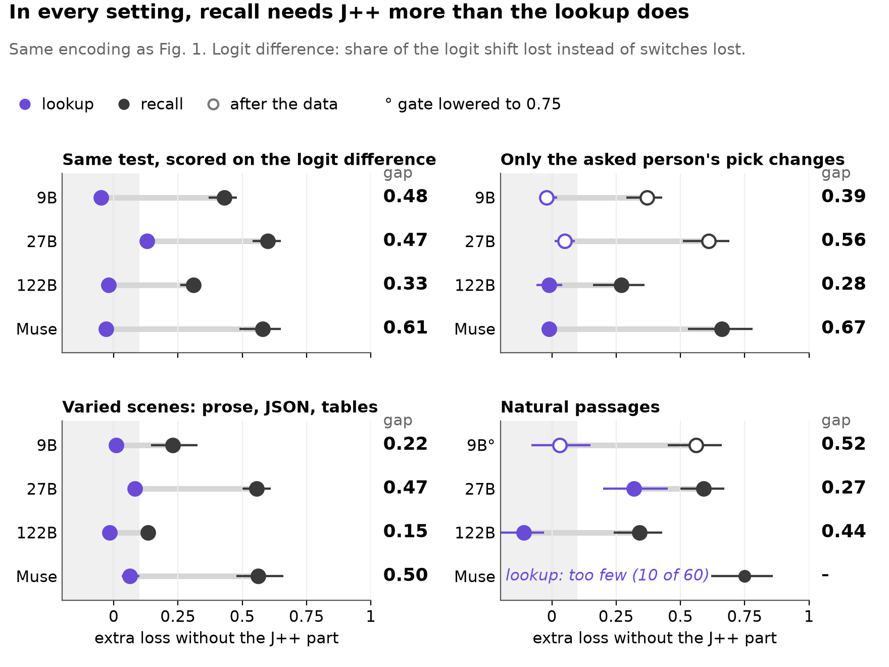
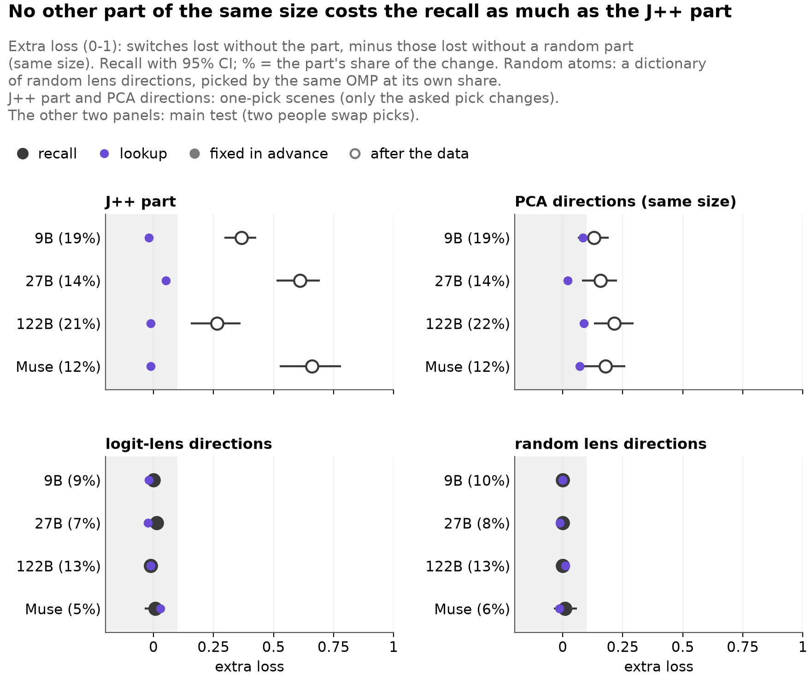
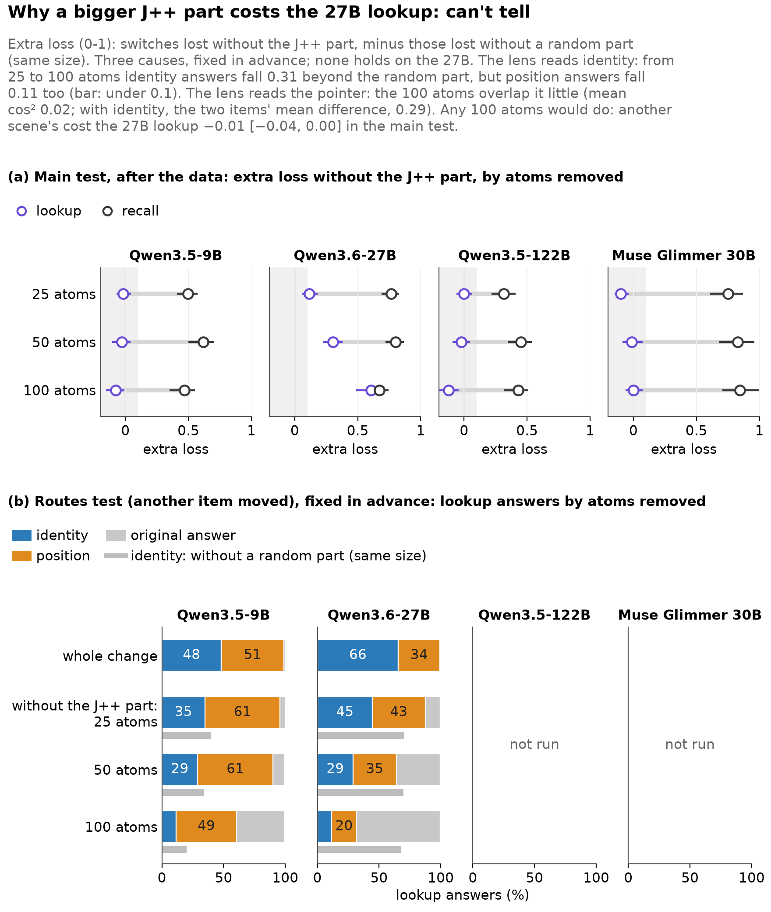
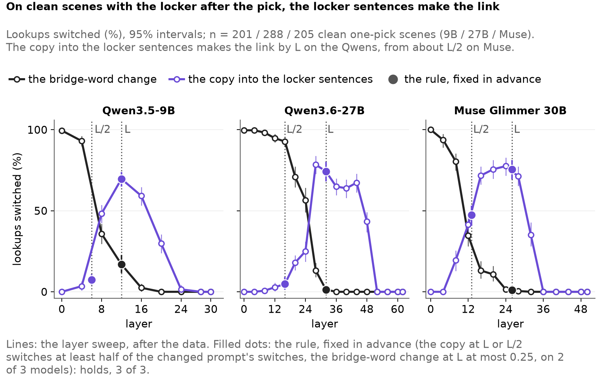
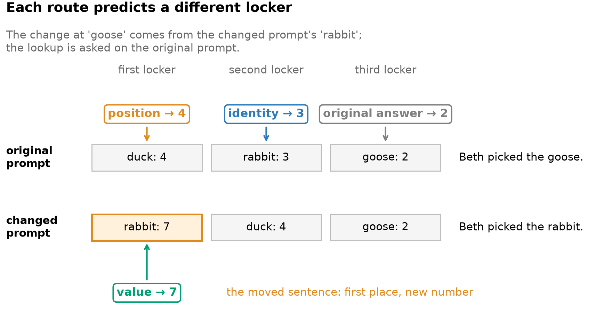
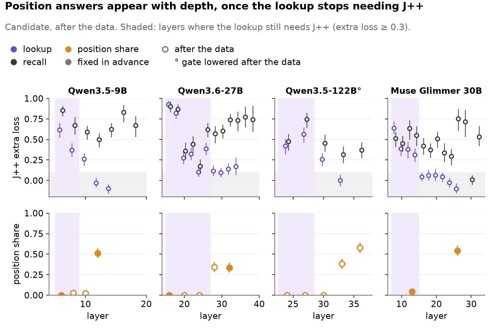
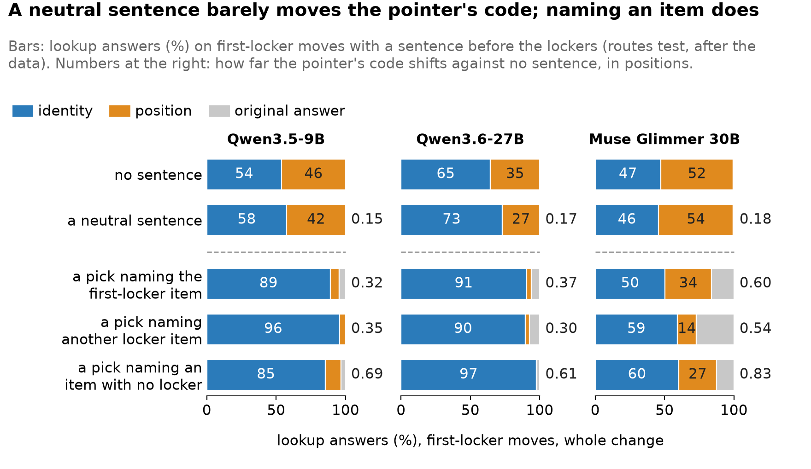
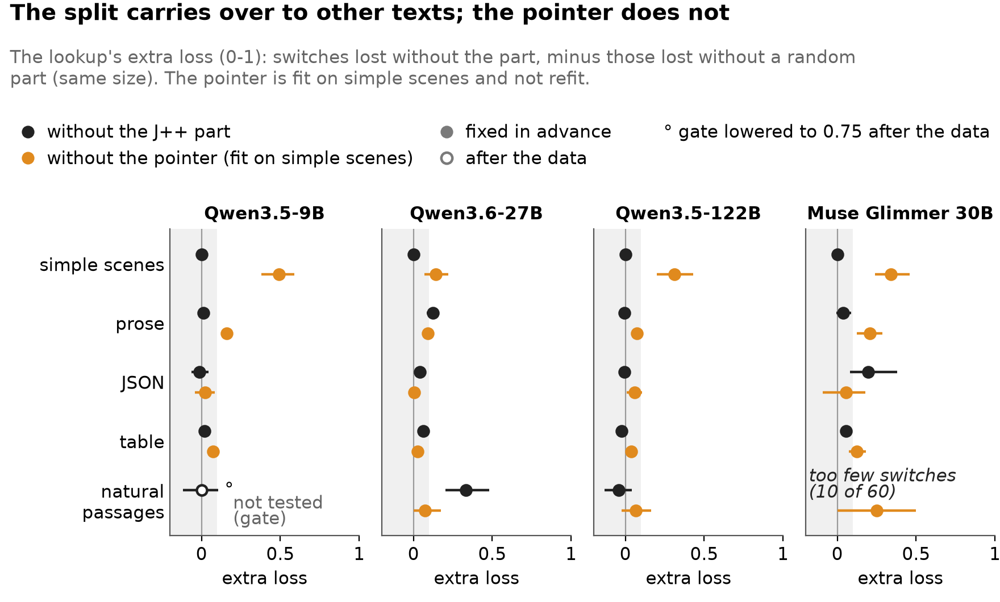
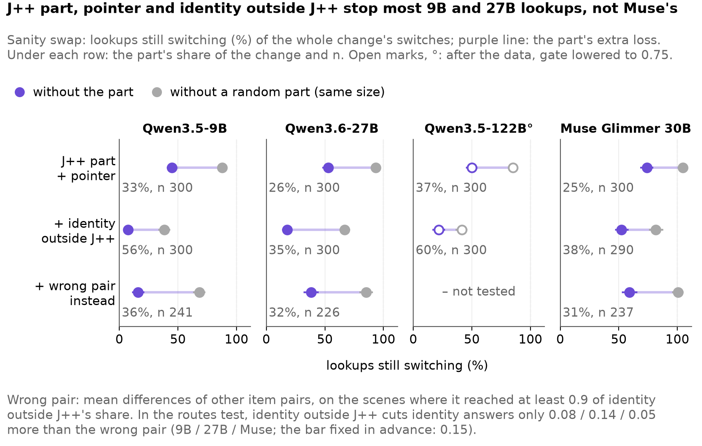
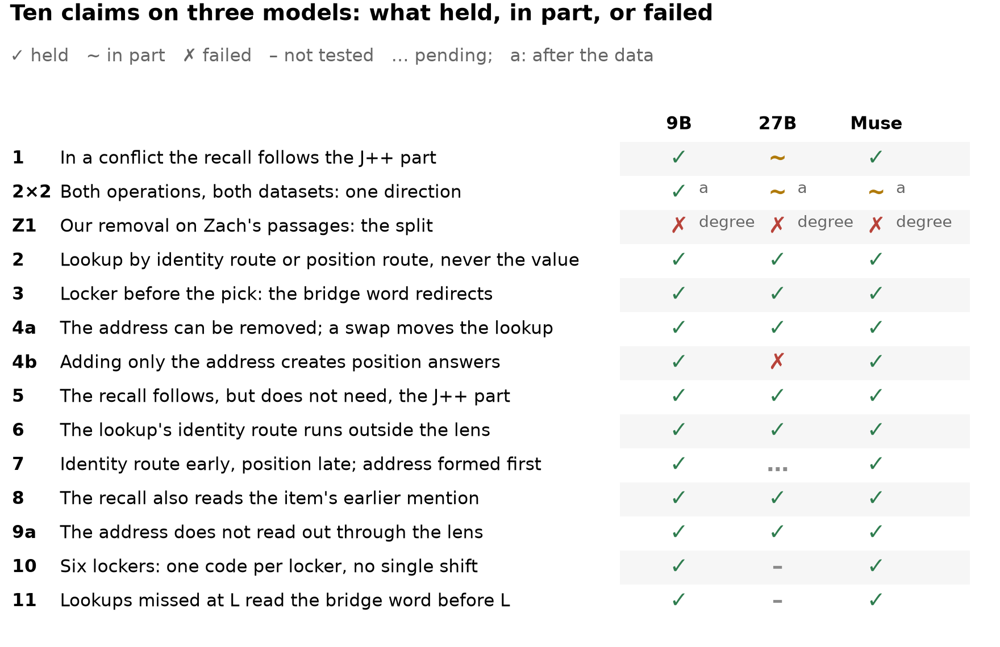

<!-- Generated by scripts/readme_build.py from docs/README.template.md and grid.csv; edit the template. -->
# The lookup goes around the lens: what a model reads from the bridge word

*When a model answers a two-step question, does it use the part of the in-between entity that a lens can read, and does that depend on what it does with that entity next?*

## In one minute

- **Recall uses the part the lens can read** on all four models by rules fixed in advance (clean design: two of three); **the lookup does not.** The recall reads that part at the bridge, or at the item's earlier mention when there is one (fixed in advance, 3 of 3).
- **The lookup uses which item it is and where its locker sits in the order of mentions:** the "where" is a pointer the lens cannot see; we can remove and write it.
- **The pointer is narrow:** it marks the first locker in a clean layout; naming an item first moves the lookup to identity. About half of the route around the lens is unexplained.
- **For monitoring:** a lens on the bridge word shows which item is there, not where the model will read its answer.

**Status.** Qwen3.5-9B, Qwen3.6-27B, Qwen3.5-122B-A10B (FP8) and Muse Glimmer 30B (another family); 27 Oct 2026. Unverified until hand-checked (Section 7). Built at b7201149 from the run files.

## Setup

*Fig. 0.*

- **Lookup**: "Which locker belongs to Iris's pick?" (answer in the prompt). **Recall**: "How many legs does Iris's pick have?" (answer from memory).
- **The change**: swap the bridge (frog → tick; the **main test** swaps two people's picks) and add the bridge word's hidden-state difference, at one layer, into the original prompt: whole, without a part, or without a **random part** of the same size. A reader **switches** to the changed prompt's answer.
- **Clean design**: an added locker item nobody picks becomes the asked person's pick; only the bridge token differs.
- **J++ part**: the 25 lens directions that best rebuild the change.
- **Extra loss**: the share of switches lost without a part minus that without its random part. **Gap**: the recall's extra loss minus the lookup's.
- **Fixed in advance**: committed before any result; otherwise **after the data**. Brackets: 95% bootstrap intervals.

## 1. Recall needs the J++ part; the lookup does not

*Fixed in advance, except the split by sentence order and the two other scores.*

- **The split holds on all four models:** without the J++ part the recall loses a large share of its switches and the lookup almost none; the gap is 0.32 to 0.85 over all scenes and 0.21 to 0.75 where the locker sentence comes before the pick (Section 2).

*Fig. 1.*

- **It holds in the clean design on two of three models** (bar: gap at least 0.3, lookup at most 0.10, locker before the pick): 27B 0.53 [0.42, 0.62], Muse 0.38 [0.23, 0.54]. The 9B misses (0.23 [0.14, 0.31]).
- **It is not a margin effect:** scored on the logit difference or the answer's probability, the gap is 0.33 to 0.61 and 0.34 to 0.73.
- **It holds in every setting, weaker outside simple scenes**; in natural passages Muse's lookup switches too rarely to measure.
- **It is still there without the chat template** (the 27B's lookup above the 0.10 bar, as with it; gate lowered to 0.75, after the data): gap 0.52 / 0.62 (9B / 27B), 0.40 / 0.54 with the locker before the pick, and the lookup never answers the value (0 of 300, 0 of 300; [supplement](../../figures/supp/s01c_no_chat_template.png)).

*Fig. 1b.*

- **It is specific to the J++ part:** other parts of the same size cost the recall much less, except on the 122B, where PCA directions of the same size come close (0.21 [0.13, 0.30] vs 0.26 [0.16, 0.36]).

*Fig. 2.*

- **The 27B misses the strict rule:** its lookup loses 0.14 [0.08, 0.20] (bar 0.10), 0.60 at 100 directions (Fig. 2b).

*Fig. 2b.*

## 2. At the layer we fixed, the bridge word redirects only locker-first lookups

*After the data unless marked; the main test unless named.*

- **Lookups switch when the locker sentence comes before the pick** (locker-first scenes): 65%-89% of them, against 9%-19% after it, on all four models; in the clean design 87%-99% against 0%-5%.
- **The recall needs the J++ part less when its locker came first, on every model** (Fig. 3, b).

*Fig. 3.*

- **With the locker after the pick, the locker sentences make the link, by the layer we fixed (L) on the Qwens and from about L/2 on Muse** (clean design, fixed in advance, 3 of 3): copying the changed prompt's states into them at L carries 0.70 / 0.74 / 0.76 of its lookup switches, the bridge-word change 0.17 / 0.01 / 0.01.

*Fig. 3b.*

- **With its locker first, the recall reads the new item's earlier mention** (clean design, fixed in advance, 3 of 3): removing the J++ part there too costs it 0.25-0.42 more switches than a random part, 0.26-0.49 more than at another item; the lookup does not move.

*Fig. 3c.*

## 3. The lookup uses which item it is and where its locker sits

*The routes test fixed in advance; the rest after the data.*

- **We set three routes against each other:** the change comes from a prompt where another item's locker sentence moved and took a new number.

*Fig. 4.*

- **The lookup never takes the number itself, and splits between identity and position:** the 27B leans on identity, the 9B and Muse on position. **Adding only the J++ part gives no identity answers**, so even the identity route runs mostly outside J++.

*Fig. 5.*

| Another item moved, whole change | Qwen3.5-9B | Qwen3.6-27B | Qwen3.5-122B° | Muse Glimmer 30B |
|---|---|---|---|---|
| Identity / position | 0.48 [0.43, 0.53] / 0.51 [0.46, 0.56] | 0.66 [0.60, 0.71] / 0.34 [0.28, 0.39] | 0.61 [0.56, 0.67] / 0.38 [0.33, 0.44] | 0.44 [0.38, 0.49] / 0.54 [0.49, 0.60] |

*° gate lowered to 0.75 after the data.*

- **A probe reads the value at the bridge word weakly, the slot almost perfectly** (after the data): value 0.27 / 0.40 / 0.25 (chance 0.11), slot 0.97 / 0.99 / 0.92 ([table](../x0_details.md)); the routes test never takes it.
- **Position appears with depth (candidate):** at an early layer the change moves the lookup by identity only, inside J++ on the Qwens; position answers appear a few layers later.

*Fig. 6.*

## 4. The pointer can be removed and written

*Removal after the data, replicated in advance on the 9B and Muse; routes arms and writes fixed in advance, their recall split after the data.*

- **A probe reads the pointer, the lens does not:** a linear probe on the bridge word tells which sentence holds the item's locker in 0.92-0.99 of scenes (layout alone: 0.53), almost none of it in J++. We then tested the **pointer**, four directions separating the positions, causally.
- **Removing the pointer stops position answers:** to near zero on the Qwens, by half on Muse; a random part of the same size barely changes them, and the recall loses much less (Fig. 5).
- **Adding only the pointer creates position answers** on three of four models (not the 27B); a random part of the same size creates none.
- **One fixed vector written into the bridge moves the lookup:** the mean difference between two positions sends it to the target locker in a quarter to a half of the writes at a real change's size; a random vector moves nothing.
- **The recall follows a strong write to the item:** on the Qwens about four in five recalls a strong write changes name the item at the target position (Muse: 28 of 64).

*Fig. 7.*

## 5. Where the pointer stops working

*After the data unless marked fixed in advance.*

- **It marks the first locker in a clean layout.** A neutral first sentence barely moves its code (code shift β 0.15-0.18 positions); one naming an item shifts it 0.30-0.83, and the Qwens' lookup then follows identity (0.85-0.97 of answers, against 0.54 / 0.65). The rule fixed in advance scores it mixed.

*Fig. 8.*

- **It must be refit for each format:** fit on simple scenes, it costs the lookup 0.05 to 0.15 in varied scenes and 0.07 to 0.25 in natural passages; refit (fixed in advance), 0.18-0.24 on the 9B, 0.23-0.47 on Muse, at most 0.13 on the 27B.

*Fig. 9.*

- **Later positions are coded elsewhere:** between the second and third locker the pointer barely moves the Qwens' lookup (Muse: 0.10); writing their mean difference moves it only at twice a real change (0.39-0.78 of writes on the 9B and Muse).
- **About half of the route is unexplained:** removing identity outside J++ with the J++ part and the pointer leaves few lookups on the 9B and 27B, fewer than a wrong-pair direction of the same size (table), but it cuts identity answers only 0.08 / 0.14 more (bar 0.15, fixed in advance): partly specific on the Qwens, not on Muse.

*Fig. 10.*

| Sanity swap, without the J++ part + pointer + identity outside J++ | Qwen3.5-9B | Qwen3.6-27B | Qwen3.5-122B° | Muse Glimmer 30B |
|---|---|---|---|---|
| Lookups still switching: without the part / without a random part (same size) | 0.07 / 0.38 | 0.18 / 0.67 | 0.22 / 0.41 | 0.52 / 0.82 |
| Lookups still switching: a wrong-pair direction (same size) in place of identity, where it reached 0.9 of identity's share (scenes) | 0.16 (241) | 0.38 (226) | – (not tested) | 0.59 (237) |
| The part's share of the change | 56% | 35% | 60% | 38% |
| Recall's extra loss without identity (nothing else removed) | 0.09 [0.04, 0.15] | 0.44 [0.34, 0.55] | 0.12 [0.07, 0.17] | 0.39 [0.28, 0.49] |

*° gate lowered to 0.75 after the data.*

## 6. What did not hold

*Fig. 11.*

- **Failed when fixed in advance:** the 27B's strict rule and the 9B in the clean design; the 9B's replication (recall 0.12); the positive control (chemical symbols, 27B 0.15, bar 0.20); a second route for the recall through the pointer; identity outside J++ by itself (27B only) and against a wrong pair; a second-versus-third pointer; the copied link outside the lens (27B, by one item); a cause for the 27B's loss with more directions ((d) can't tell).
- **Gates missed (bar 0.80), not tested:** the 9B's natural passages, the 122B's routes and replication, the Qwens' main test without the chat template; reruns at 0.75 are descriptive.
- **Design errors:** the write's dose fixed in advance, below a real change's size; the bar for the J++ part, pointer and identity removed together, out of reach at their share; the first scenes where only the asked pick changed reused another person's pick as the bridge (replaced by the clean design).
- **The first test of where the link is made was a design error:** the main test's changed prompt also differs after the bridge word; where it does not (36 of 100 / 34 of 99 items), its rule failed ([supplement](../../figures/supp/s03b_layers_45b.png)).
- **Limits:** one-token answers and bridges; reader and answer source (prompt vs memory) confounded; the 122B in FP8; Zach's knock-out finds the split weak outside Qwen, our change-removal finds it on Muse.

## 7. How we checked

- **Hand-checked numbers:** none yet; one item read, consistent ([docs/review_summary.md](../review_summary.md)); [docs/verify_pack.md](../verify_pack.md) recounts each claim from the per-item files.
- **Independent reimplementation:** code written from scratch reproduces the 9B's main test on 20 of 20 random items, every arm.
- **Raw examples:** `make review-serve`, random items per claim (fixed seed).
- **Predictions:** committed before results are opened, then scored ([predictions/](../../predictions/README.md)): mean Brier 0.32 over 122 answers, worse than always answering 50%.

## 8. Related work and what is new

Language models bind entities to attributes in context (Feng & Steinhardt 2023) and track them through lookback pointers (Prakash et al. 2025) in a low-dimensional order subspace (Dai et al. 2024). Our routes test follows Gur-Arieh et al. (2025), the pointer uses mass-mean directions (Marks & Tegmark 2023), and the random parts answer Makelov et al. (2023). The lens is the workspace paper's J++ (Gurnee et al. 2026). New here: two readers of the same word need different parts of it, only the recall the J++ part; the pointer is the part the lens misses, and writing it redirects the lookup.

## 9. Open questions

- **What is the rest of the lookup's route around the lens?** Removing J++, the order pointer and identity outside J++ stops most lookups, but identity outside J++ is only partly specific to the swapped pair.
- **What codes the later lockers?** Removal finds no separate 2nd-vs-3rd direction, yet writing their mean difference moves the lookup at twice a real change: a route the model may not use at its natural size.
- **Why does the 27B's lookup need J++ once 100 directions are removed?** Our test of identity, pointer and generic fitting could not tell (27B and Muse).
- **Is the 122B a different case?** Its split holds but is not specific against PCA directions.
- **Does the order pointer exist in natural text?** A pointer refit per format is found on the 9B and Muse, not the 27B; the simple-scene pointer barely transfers.

## Appendix A. Links

Every number on this page comes from [figures/story/data.csv](../../figures/story/data.csv) (also every plotted number) and [docs/x0_numbers.json](../x0_numbers.json), each with its source file; [docs/x0_details.md](../x0_details.md) has the full tables; [docs/verify_pack.md](../verify_pack.md) recounts them. All figures on one page: [docs/figures_contact_sheet.png](../figures_contact_sheet.png); the figure plan: [docs/figure_plan.md](../figure_plan.md). Supplementary figures: [every scene set](../../figures/supp/s01_split_all_scene_sets.png), [our first scenes where only the asked pick changed, with the reused pick](../../figures/supp/s01b_one_pick_duplicate.png), [the main test without the chat template](../../figures/supp/s01c_no_chat_template.png), [every part](../../figures/supp/s02_parts_all.png), [the layer sweep on the main test's items](../../figures/supp/s03b_layers_45b.png), [every routes arm](../../figures/supp/s05_routes_all_arms.png), [what the prompt names first, and the label-free pointer](../../figures/supp/s08_first_sentence_and_label_free.png), [the parts removed together, with the bars fixed in advance](../../figures/supp/s10_removed_together_bars.png), [Fig. 10 with the wrong pair on every scene](../../figures/supp/s10b_what_is_left_all_scenes.png). Earlier figures: [figures/status_2026-10-25/](../../figures/status_2026-10-25/).
