<!-- Generated by scripts/readme_build.py from docs/README.template.md and grid.csv; edit the template. -->
# One word, two readers: what a model keeps at the bridge and what the lens sees

*A two-step question passes through one word, the bridge. The recall asks what the model knows about the item, the lookup where the prompt put it. What does each read from that word, and what can a lens see?*

## In one minute

- **Four models, two families and a hybrid architecture:** Qwen3.5-9B and Qwen3.6-27B, Muse Glimmer 30B, and Nemotron 3.5 Lightning, a Mamba-attention hybrid (its marks hollow ○: its gate was chosen after a pre-check was seen).
- **On all four, the two readers split the bridge word:** the recall follows the part the lens reads, the lookup the rest [A]; the recall does not need that part at one layer, it has other copies [B]. Of that part's directions the readable ones are the two bridge words, almost never the answer; most of its energy matches no word of the scene.
- **On all four, the lookup goes by which item it is or where its locker sits, never by the number** [A]; its "which item" runs outside the lens [B]. Where the locker sits is an address: readable before it is used, removable, swappable, invisible to the lens [A/B]. A swap sends the lookup to the swapped-in locker, and some recalls to the swapped-in item.
- **At the last token** the recall's item is readable through the lens on all four models, but not used there at a real change's size.
- **Weaker on the 27B:** its lookup follows the lens part in part; adding the address alone brings no position answers back; swaps between given lockers miss on most pairs; on its full layer grid the lookup still needs the lens part after it takes up the address.
- **Limits, withdrawn, failed:** on Zach's true-fact passages, and when every token before L changes, the lookup follows the lens part too; with made-up facts the split returns on the 9B. Withdrawn: the described bridge on Zach's passages; "one code per locker" is now "swaps between given lockers work; the code's size is open". Did not hold: four mechanism tests, a person mark at the locker sentence, blocking the pick sentence, on every model that ran them [✗].

**Status.** Four models: Qwen3.5-9B, Qwen3.6-27B, Muse Glimmer 30B (another family) and Nemotron 3.5 Lightning 30B-A3B (a third family, a Mamba-attention hybrid); Qwen3.5-122B-A10B (FP8) on the first tests; 29 Oct 2026. Unverified until hand-checked. Built at 5070f93b from the run files. Lightning ran on the rules already fixed for the other models, with no prediction of its own; its numbers are marked ○ (hollow) everywhere: its gate was chosen after the 60-scene pre-check was seen. Nemotron 3.5 Bolt is out of scope: no J++ lens exists for it. Restructure in progress (Dan, 28 Oct 22:20): Parts II-VI keep their previous format until they move to the card template.

## The question and the setup

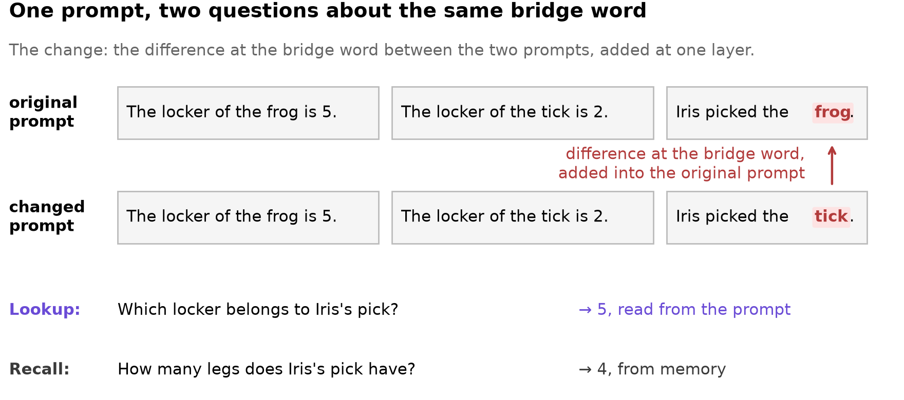
*The running example: one prompt, its two questions and the changed prompt.*

- **The prompt** (a main-test scene): "The locker of carbon is 3. The locker of helium is 5. The locker of oxygen is 7. Hugo picked oxygen. Eric picked carbon. Eva picked helium."
- **The lookup** asks "Which locker belongs to Eric's pick?" (3, found in the prompt). **The recall** asks "What is the atomic number of Eric's pick?" (6, from memory).
- **The bridge** is the word both questions pass through: "carbon", Eric's pick.
- **The changed prompt** swaps the two picks, so Eric picks oxygen and the answers become 7 and 8.
- **The question:** what does each reader take from the bridge word, and how much of it can the J++ lens read?
- **Lightning's layer**, L14<!-- src: figures/story/data.csv | L: the layer fixed in advance -->, was picked by a rule fixed before its layer sweep was read (Dan, 29 Oct ~00:50 Paris): the earliest layer passing the gate at relative depth ≥ 0.25, ties broken by the highest lens readability of the bridge word. [The conflict test at every swept layer](../../results/x0_necessity/nem35l_x52_conflict/verdict-20261029T001612Z/verdict.md).

## How to read this page

**Methods**, named the same way in every card:

- **The change**: at the bridge word and one layer, the changed prompt's state minus the original's, added to the original prompt's run (Eric's "carbon" moves towards "oxygen"). A reader **switches** if it then gives the changed prompt's answer.
- **The lens part** (on the figures, "the J++ part"): the 25 directions of the J++ lens that best rebuild the change. **A random part**: random directions with the same share of the change. **The rest**: the change without the lens part.
- **Conflict test**: the change with one part taken out; both readers read the same changed word, so each shows which part it follows.
- **Part alone**: one part added by itself, at a **dose** (a multiple of its size in the change).
- **Zeroing**: a part taken out of the changed prompt's own state, nothing added; a reader **keeps** or loses the changed prompt's answer.
- **Swap and state copy**: a swap replaces one code at the bridge word by another's; a state copy moves the changed prompt's states at chosen tokens and layers into the original.
- **Probe, lens readout, layer sweep**: a linear read-out trained on states; the lens's top words at a token; one test repeated over layers.

Every removal and every addition is matched by the same operation on a random part of the same size; only the difference between them is about the named part.

**Measures**, defined once:

- **Switches lost beyond a random part** (the figures' "extra loss"): switches lost without a part minus those lost without its random part, as a share of the whole change's switches. **The gap**: the recall's minus the lookup's.
- **Answers lost beyond random** (zeroing): answers kept with the random part taken out minus those kept with the lens part taken out.
- **L**: the layer fixed in advance, 12<!-- src: docs/x0_numbers.json | layer_9b --> / 32<!-- src: docs/x0_numbers.json | layer_27b --> / 26<!-- src: docs/x0_numbers.json | layer_muse --> / 14<!-- src: figures/story/data.csv | L: the layer fixed in advance --> on the 9B / 27B / Muse / Lightning; **L to L+3**: L and the three layers after it.
- **Identity route**: the lookup names the item's own locker; **position route**: the locker now at the item's old place; **value**: the new number.
- **The address**: four directions at the bridge word that code where the item's locker sentence sits (Part III).
- **Rules** are quoted as committed, internal metric names replaced by these terms; "after the data" marks a rule or gate set after results were seen.

**Reading the figures**:

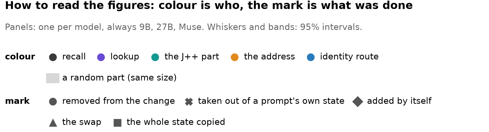
*Colour says which reader or part; the mark says what was done to it.*

- **Whiskers and bands**: 95% intervals, cluster bootstrap over bridge items. **● / ○** beside n: rule fixed in advance / read after the data; a hollow mark: a gate lowered after the data, or Lightning's gate (chosen after the 60-scene pre-check was seen). A model that misses a gate is "not tested (gate)"; where its numbers are shown they are descriptive only, hollow, and never relabelled.
- **Beyond random**: the grey band, strip or tick at zero (for Zach's stored rows, his rotated directions). **Dashed or dotted line**: a rule's bar. Cells not run, failing a gate or under 30 switches are left out.
- **Dose (×)**: a part's size relative to its size in the change; a **ring** marks the dose a rule reads. **z** (the lens-blindness figure): distance from 200 random vectors in units of half their 95% range; the grey strip spans −1 to 1.

## Data: the prompt sets

Every prompt is read in the model's chat template, thinking off, the reply begun with "Answer:"; in the digit sets each question ends "Answer with a single digit and nothing else."

| Set | What it is | The changed prompt differs in | n (9B / 27B / Muse / Lightning ○) | Gate; one-token answers | Used by |
|---|---|---|---|---|---|
| Main test | six sentences: three lockers and three picks, in shuffled order | two people swap picks (two pick sentences) | 200<!-- src: docs/x0_numbers.json \| n_9b --> / 200<!-- src: docs/x0_numbers.json \| n_27b --> / 200<!-- src: docs/x0_numbers.json \| n_muse --> / 200<!-- src: figures/story/data.csv \| main test: scenes used --> | both readers right on the original prompts at least 0.80 of the time; digits, one token | the conflict test, zeroing, the dose curves |
| Clean one-pick | the main test plus a locker for an item nobody picks | the asked pick becomes that item (one token) | 417<!-- src: figures/story/data.csv \| clean one-pick scenes: scenes used --> / 574<!-- src: figures/story/data.csv \| clean one-pick scenes: scenes used --> / 409<!-- src: figures/story/data.csv \| clean one-pick scenes: scenes used --> / not tested (gate) | as above; digits | the ladder, the earlier mention, the order tests, the token map |
| Routes scenes | three lockers, then three picks | another item's locker sentence trades places with a third and gets a new number; the asked pick becomes that item | 300<!-- src: figures/story/data.csv \| routes scenes: scenes used --> / 300<!-- src: figures/story/data.csv \| routes scenes: scenes used --> / 300<!-- src: figures/story/data.csv \| routes scenes: scenes used --> / 300<!-- src: figures/story/data.csv \| routes scenes: scenes used --> | as above; digits | the routes test; removing, adding and swapping the address |
| Six-locker scenes | six lockers, then three picks | the item's own locker sentence moves to another place and gets a new number; the pick stays | 300<!-- src: figures/story/data.csv \| six-locker scenes: scenes used --> / – / 300<!-- src: figures/story/data.csv \| six-locker scenes: scenes used --> / 300<!-- src: figures/story/data.csv \| six-locker scenes: scenes used --> | as above; digits | swaps between given lockers |
| Varied scenes | prose, JSON or markdown tables; up to nine items, look-alike names, filler, paraphrased questions | the asked pick | 1010<!-- src: figures/story/data.csv \| varied scenes: scenes used (prose, JSON and table) --> / 1635<!-- src: figures/story/data.csv \| varied scenes: scenes used (prose, JSON and table) --> / 1389<!-- src: figures/story/data.csv \| varied scenes: scenes used (prose, JSON and table) --> / 1105<!-- src: figures/story/data.csv \| varied scenes: scenes used (prose, JSON and table) --> | per format and level; failing cells left out; digits | the split in other texts, the refit address |
| Natural passages | notes, news, forum posts and emails with distractor sentences | the one sentence binding a person to the bridge | 83<!-- src: figures/story/data.csv \| natural passages: scenes eligible --> / 137<!-- src: figures/story/data.csv \| natural passages: scenes eligible --> / 60<!-- src: figures/story/data.csv \| natural passages: scenes eligible --> / 36<!-- src: figures/story/data.csv \| natural passages: scenes eligible (below gate) --> below gate | as above, the 9B's lowered after the data; words, read by their first token | the split in natural text |
| Zach's passages | his passages: a named or a described bridge; the final fact stated in the lookup's passage, left out of the recall's | the sentence naming the bridge, or the description | named 200<!-- src: figures/story/data.csv \| Zach's passages, named bridge: passages used --> / 200<!-- src: figures/story/data.csv \| Zach's passages, named bridge: passages used --> / 200<!-- src: figures/story/data.csv \| Zach's passages, named bridge: passages used --> / 200<!-- src: figures/story/data.csv \| Zach's passages, named bridge: passages used -->; described 158<!-- src: figures/story/data.csv \| Zach's passages, described bridge: passages used --> / 166<!-- src: figures/story/data.csv \| Zach's passages, described bridge: passages used --> / 157<!-- src: figures/story/data.csv \| Zach's passages, described bridge: passages used --> / – | per reader; words, read by their first token; about a third of the bridge names are several tokens | Part V |

One item per set, copied from the run files (the original prompt; → the changed prompt's answer):

**Main test** (all four models; the page's running example):

```
The locker of carbon is 3. The locker of helium is 5. The locker of oxygen is 7. Hugo picked oxygen. Eric picked carbon. Eva picked helium.
Changed: Hugo picked carbon. Eric picked oxygen.
Lookup: Which locker belongs to Eric's pick?        3 → 7
Recall: What is the atomic number of Eric's pick?   6 → 8
```

**Clean one-pick** (9B, 27B, Muse):

```
The locker of the cow is 3. The locker of the eagle is 5. The locker of the owl is 4. The locker of the fox is 1. Jack picked the cow. Tara picked the fox. Diana picked the owl.
Changed: Jack picked the eagle.
Lookup: Which locker belongs to Jack's pick?   3 → 5
Recall: How many legs does Jack's pick have?   4 → 2
```

**Routes scenes** (9B and 27B):

```
The locker of the pig is 3. The locker of the butterfly is 4. The locker of the horse is 7. Finn picked the butterfly. Mia picked the horse. Luke picked the pig.
Changed: The locker of the horse is 1. The locker of the butterfly is 4. The locker of the pig is 3. Finn picked the horse.
Lookup: Which locker belongs to Finn's pick?   4 → 1; identity route 7, position route 3, value 1
Recall: How many legs does Finn's pick have?   6 → 4
```

**Six-locker scenes** (9B):

```
The locker of the camel is 7. The locker of the rabbit is 4. The locker of the dog is 6. The locker of the beetle is 3. The locker of the mouse is 2. The locker of the fox is 9. Vera picked the fox. Oscar picked the rabbit. Lily picked the camel.
Changed: The locker of the beetle is 3. ... The locker of the camel is 5. ...
Lookup: Which locker belongs to Lily's pick?   7 → 5; identity route 7, position route 3, value 5
```

**Varied scenes** (JSON, all four models):

```
Tool output from get_lockers:
[{"item": "fly", "locker": 2}, {"item": "elephant", "locker": 9}, {"item": "camel", "locker": 6}, {"item": "ant", "locker": 4}, {"item": "duck", "locker": 3}, {"item": "rabbit", "locker": 7}]
Tool output from get_picks:
[{"name": "Nina", "pick": "elephant"}, ..., {"name": "Eve", "pick": "duck"}, {"name": "Carl", "pick": "ant"}, {"name": "Paul", "pick": "fly"}]
Changed: {"name": "Eve", "pick": "ant"}
Lookup: Which locker belongs to Eve's pick?   3 → 4
Recall: How many legs does Eve's pick have?   2 → 6
```

**Natural passages** (all four models; Lightning below gate):

```
Meeting notes, 14 March.
- The delegation from Kenya announced that its next meeting will take place in Asia.
- Hannah Kerr was raised in Finland.
- The delegation from Bolivia announced that its next meeting will take place in North America.
- Tess Garland was raised in Bolivia.
- Paul Whitaker was raised in Kenya.
(and four distractor lines)
Changed: Tess Garland was raised in Kenya.
Lookup: Which continent will host the next meeting of the delegation from the country where Tess Garland was raised?   North America → Asia
Recall: Which continent is the country where Tess Garland was raised in?   South America → Africa
```

**Zach's passages** (named bridge, 9B; excerpt of the lookup's passage):

```
Posted by travel_notes_88: Uzbekistan is a country in Asia. ... Laura Bennett spent a whole childhood in Vietnam. ... Poland is a country in Europe. ... Eli Thornton spent a whole childhood in Poland. ... Vietnam is a country in Asia.
Changed: Eli Thornton spent a whole childhood in Vietnam.
Both readers: The country of Eli Thornton's childhood is on which continent?   Europe → Asia
(the recall's passage drops the "is a country in" sentences)
```

## Claims

| # | Claim | Models | Grade | Key numbers | Hand-checked |
|---|---|---|---|---|---|
| 1 | The recall follows the lens part of the bridge word; the lookup follows the rest | 9B, 27B, Muse, Lightning (and the 122B) | **A** (27B partial) | recall 0.50<!-- src: docs/x0_numbers.json \| rc_excess_9b --> / 0.74<!-- src: docs/x0_numbers.json \| rc_excess_27b --> / 0.75<!-- src: docs/x0_numbers.json \| rc_excess_muse --> / 0.34<!-- src: figures/story/data.csv \| conflict: recall, switches lost beyond a random part --> ○; lookup −0.03<!-- src: docs/x0_numbers.json \| lk_excess_9b --> / 0.14<!-- src: docs/x0_numbers.json \| lk_excess_27b --> / −0.10<!-- src: docs/x0_numbers.json \| lk_excess_muse --> / 0.03<!-- src: figures/story/data.csv \| conflict: lookup, switches lost beyond a random part --> ○. Limits: on the full carrier, fact-after lookups follow the lens (0.41<!-- src: figures/story/data.csv \| 51.7: fact-after lookups, full carrier: switches lost beyond a random part -->-0.51<!-- src: figures/story/data.csv \| 51.7: fact-after lookups, full carrier: switches lost beyond a random part -->); on Zach's true-fact passages the 9B's and 27B's lookups follow it (0.26<!-- src: figures/story/data.csv \| Z1: lookup, switches lost beyond a random part --> / 0.28<!-- src: figures/story/data.csv \| Z1: lookup, switches lost beyond a random part -->); on his made-up-fact passages the split holds on the 9B, the 27B is in between (Part V) | no |
| 2 | The recall does not need the lens part at one layer; it has other copies | 9B, 27B, Muse, Lightning | **B** | kept 0.97<!-- src: figures/story/data.csv \| 47.5: recall's answers kept at L, the J++ part's 25 directions taken out --> / 0.97<!-- src: figures/story/data.csv \| 47.5: recall's answers kept at L, the J++ part's 25 directions taken out --> / 0.94<!-- src: figures/story/data.csv \| 47.5: recall's answers kept at L, the J++ part's 25 directions taken out --> / 0.97<!-- src: figures/story/data.csv \| 47.5: recall's answers kept at L, the J++ part's 25 directions taken out --> ○ | no |
| 3 | The recall also reads the item's earlier mention | 9B, 27B, Muse | **B** | 0.25<!-- src: docs/x0_numbers.json \| x45p_d23_9b -->-0.42<!-- src: docs/x0_numbers.json \| x45p_d23_muse --> | no |
| 4 | The lookup goes by which item it is or where its locker sits, never by the number | 9B, 27B, Muse, Lightning | **A** | 9B identity / position 0.48<!-- src: docs/x0_numbers.json \| rt_C2_whole_identity_9b --> / 0.51<!-- src: docs/x0_numbers.json \| rt_C2_whole_position_9b -->; Lightning 0.44<!-- src: figures/story/data.csv \| another item moved, whole: identity share --> / 0.55<!-- src: figures/story/data.csv \| another item moved, whole: position share --> ○; value none anywhere | no |
| 5 | The lookup's “which item” lives outside the lens | 9B, 27B, Muse, Lightning | **B** | identity route without 26–100: 0.05<!-- src: figures/story/data.csv \| 47.1: identity route: answers lost beyond random without lens directions 26-100 --> / 0.05<!-- src: figures/story/data.csv \| 47.1: identity route: answers lost beyond random without lens directions 26-100 --> / 0.02<!-- src: figures/story/data.csv \| 47.1: identity route: answers lost beyond random without lens directions 26-100 --> / 0.05<!-- src: figures/story/data.csv \| 47.1: identity answers lost beyond random without lens directions 26-100 --> ○; position route at most 0.01<!-- src: figures/story/data.csv \| 47.1: position route: the most answers lost beyond random, over the models and slices --> | no |
| 6 | The address can be removed, and a swap redirects the lookup | 9B, 27B, Muse, Lightning | **A** | position answers without it 0.08<!-- src: docs/x0_numbers.json \| rt_C2_no_alf_position_9b --> / 0.06<!-- src: docs/x0_numbers.json \| rt_C2_no_alf_position_27b --> / 0.27<!-- src: docs/x0_numbers.json \| rt_C2_no_alf_position_muse --> / 0.10<!-- src: figures/story/data.csv \| another item moved, no_alf: position share --> ○ vs random 0.54<!-- src: docs/x0_numbers.json \| rt_C2_no_alf_rand_position_9b --> / 0.25<!-- src: docs/x0_numbers.json \| rt_C2_no_alf_rand_position_27b --> / 0.55<!-- src: docs/x0_numbers.json \| rt_C2_no_alf_rand_position_muse --> / 0.56<!-- src: figures/story/data.csv \| another item moved, no_alf_rand: position share --> ○; the swap at s = 2 moves 0.46<!-- src: figures/story/data.csv \| lookup target share, mean over locker pairs, s = 2 --> / 0.25<!-- src: figures/story/data.csv \| lookup target share, mean over locker pairs, s = 2 --> / 0.52<!-- src: figures/story/data.csv \| lookup target share, mean over locker pairs, s = 2 --> / 0.50<!-- src: figures/story/data.csv \| lookup target share, mean over locker pairs, s = 2 --> ○ of lookups | no |
| 7 | Adding the address alone brings position answers back | 9B, Muse, Lightning (27B fails) | **B** | 0.26<!-- src: docs/x0_numbers.json \| rtk_C2_keep_alf_position_9b --> / 0.09<!-- src: docs/x0_numbers.json \| rtk_C2_keep_alf_position_27b --> / 0.29<!-- src: docs/x0_numbers.json \| rtk_C2_keep_alf_position_muse --> / 0.40<!-- src: figures/story/data.csv \| another item moved, keep_alf: position share --> ○ | no |
| 8 | With six lockers, swaps between given lockers work on most pairs; the code's size is not settled | 9B, Muse, Lightning (not the 27B) | **B** | pairs reaching the bar 18<!-- src: figures/story/data.csv \| 47.2: pairwise writes reaching 25% (dose 2) --> / 13<!-- src: figures/story/data.csv \| 47.2: pairwise writes reaching 25% (dose 2) --> / 21<!-- src: figures/story/data.csv \| 47.2: pairwise writes reaching 25% (dose 2) --> / 21<!-- src: figures/story/data.csv \| 47.2: pairwise writes reaching 25% (dose 2) --> ○ of 30; the code's size on the 9B: in between<!-- src: figures/story/data.csv \| 51.11 part 1: the code's size -->; midpoint swaps fail (0.06<!-- src: figures/story/data.csv \| 51.11 part 3: midpoint swaps reaching the slot between, from the first slot (dose 2) -->), so not a metric order | no |
| 9 | The lens cannot read the address | 9B, 27B, Muse, Lightning | **B** | share rebuilt 0.06<!-- src: figures/story/data.csv \| 47.0 (b) share rebuilt by 25 lens directions: pointer --> / 0.04<!-- src: figures/story/data.csv \| 47.0 (b) share rebuilt by 25 lens directions: pointer --> / 0.01<!-- src: figures/story/data.csv \| 47.0 (b) share rebuilt by 25 lens directions: pointer --> / 0.04<!-- src: figures/story/data.csv \| 47.0 (b) share rebuilt by 25 lens directions: pointer --> ○ | no |
| 10 | The bridge word redirects the lookup only when its locker sentence came first | 9B, 27B, Muse, Lightning | **A** | locker first 65%<!-- src: docs/x0_numbers.json \| lk_order_before_muse -->-89%<!-- src: docs/x0_numbers.json \| lk_order_before_122b -->, after 9%<!-- src: docs/x0_numbers.json \| lk_order_after_27b -->-19%<!-- src: docs/x0_numbers.json \| lk_order_after_9b -->; Lightning 0.86<!-- src: figures/story/data.csv \| lookups switched by the whole change, locker sentence before the pick --> / 0.15<!-- src: figures/story/data.csv \| lookups switched by the whole change, locker sentence after the pick --> ○; copy 0.70<!-- src: docs/x0_numbers.json \| x45q_c_9b --> / 0.74<!-- src: docs/x0_numbers.json \| x45q_c_27b --> / 0.76<!-- src: docs/x0_numbers.json \| x45q_c_muse --> | no |
| 11 | Lookups the change at L misses were read from the bridge word before L | 9B, 27B, Muse, Lightning | **B** | carried before L 0.93<!-- src: figures/story/data.csv \| 47.4: main, locker after the pick: lookups carried by the bridge word before L --> / 1.00<!-- src: figures/story/data.csv \| 47.4: main, locker after the pick: lookups carried by the bridge word before L --> / 0.99<!-- src: figures/story/data.csv \| 47.4: main, locker after the pick: lookups carried by the bridge word before L --> / 0.92<!-- src: figures/story/data.csv \| 47.4: main, locker after the pick: lookups carried by the bridge word before L --> ○ | no |
| 12 | The address is readable before the lookup uses it, and the lookup never reads the value | 9B, 27B, Muse, Lightning | **B** | address readable from / used from layer 4<!-- src: figures/story/data.csv \| 47.8: the address readable from --> / 12<!-- src: figures/story/data.csv \| 47.8: the first layer of the position route --> (9B), 8<!-- src: figures/story/data.csv \| 47.8 (full grid): the address readable from --> / 28<!-- src: figures/story/data.csv \| 47.8 (full grid): the first layer of the position route --> (27B), 6<!-- src: figures/story/data.csv \| 47.8: the address readable from --> / 22<!-- src: figures/story/data.csv \| 47.8: the first layer of the position route --> (Muse), 6<!-- src: figures/story/data.csv \| 47.8: the address readable from --> / 14<!-- src: figures/story/data.csv \| 47.8: the first layer of the position route --> ○ (Lightning); the handoff from the lens part depends on the layer grid ([E12](#e12-anatomy)); whether the address travels to the last token: (c) not at the last token<!-- src: figures/story/data.csv \| 51.4: the rule's reading --> (9B), (c) not at the last token<!-- src: figures/story/data.csv \| 51.4: the rule's reading --> (27B), (a) the code travels<!-- src: figures/story/data.csv \| 51.4: the rule's reading --> (Muse), (d) in between<!-- src: figures/story/data.csv \| 51.4: the rule's reading --> ○ (Lightning) | no |

*Grades: **A**, a rule fixed in advance held on at least three models with a specificity control and a variant design; **B**, on two models, or three with one operation, or descriptive on three with a random null.* Weaker and failed results are in Part VI; pending tests under Status. Lightning ran on the rules already fixed for the other models, with no prediction of its own; its key numbers carry ○. Claim 8 said "every locker has its own code" until a test on held-out items left the code's size open; claim 12 said "identity route early, position route late" until the 27B's full grid failed the handoff; both stay B (claim 12: four models, one operation).

## Part I. The two readers: lookup and recall

*The two readers weight different parts of one word, and the recall has copies elsewhere.*

### In a conflict, which part of the bridge word does each reader follow?

- **Question.** In a conflict, which part of the bridge word does each reader follow?
- **Why we asked.** Both readers pass through the same word; if they took the same thing from it, the lens part would matter to both alike.
- **Data.** Main test, 200<!-- src: docs/x0_numbers.json | n_9b --> / 200<!-- src: docs/x0_numbers.json | n_27b --> / 200<!-- src: docs/x0_numbers.json | n_muse --> / 200<!-- src: figures/story/data.csv | main test: scenes used --> scenes per model, the first in which both readers answer both prompts right; the gate passed on all four (Lightning's chosen after its pre-check, ○).
- **Method.** The change at the bridge word at L, on the original prompt (Eric's "carbon" moves towards "oxygen"):
  - the whole change, which sets the switches each arm can lose;
  - without the lens part; control: without a random part;
  - specificity: without the lens part but keeping its directions for both readers' answer words ("six", "eight"), and without those answer directions only, each against a random part of their share; and the lens's rank of the answer word at the bridge word.
- **Rule, fixed in advance.** "Confirmed if the lookup loses at most 0.10 beyond random and the recall loses at least 0.30 of its switches without the lens part; killed if the lookup loses at least 0.20 or the recall under 0.20." Specificity: "the lens effect is the item if the recall keeps at least 0.7 of its loss with the answer directions kept and loses at most 0.10 beyond random without them only". Before that result was opened, the answer directions became number words (digits are not in the lens) and a check of the answer word's rank was put first. Lightning: the same rules, copied, no prediction.
- **Result.**

  | | 9B | 27B | Muse | Lightning ○ |
  |---|---|---|---|---|
  | recall: switches lost beyond a random part | 0.50 [0.41, 0.57]<!-- src: docs/x0_numbers.json \| rc_excess_9b --> | 0.74 [0.66, 0.80]<!-- src: docs/x0_numbers.json \| rc_excess_27b --> | 0.75 [0.61, 0.87]<!-- src: docs/x0_numbers.json \| rc_excess_muse --> | 0.34 [0.25, 0.44]<!-- src: figures/story/data.csv \| conflict: recall, switches lost beyond a random part --> |
  | recall: switches lost, not net of random | 0.53<!-- src: docs/x0_numbers.json \| rc_jdep_9b --> | 0.77<!-- src: docs/x0_numbers.json \| rc_jdep_27b --> | 0.72<!-- src: docs/x0_numbers.json \| rc_jdep_muse --> | 0.41<!-- src: figures/story/data.csv \| conflict: recall, switches lost, not net of random --> |
  | lookup: switches lost beyond a random part | −0.03 [−0.08, 0.03]<!-- src: docs/x0_numbers.json \| lk_excess_9b --> | 0.14 [0.08, 0.20]<!-- src: docs/x0_numbers.json \| lk_excess_27b --> | −0.10 [−0.15, −0.04]<!-- src: docs/x0_numbers.json \| lk_excess_muse --> | 0.03 [-0.01, 0.08]<!-- src: figures/story/data.csv \| conflict: lookup, switches lost beyond a random part --> |
  | the rule | confirmed<!-- src: docs/x0_numbers.json \| verdict_9b --> | not confirmed<!-- src: docs/x0_numbers.json \| verdict_27b --> | confirmed<!-- src: docs/x0_numbers.json \| verdict_muse --> | confirmed<!-- src: figures/story/data.csv \| conflict: the rule --> |
  | recall: share of its loss kept with the answer directions kept | 0.95 [0.90, 0.99]<!-- src: figures/story/data.csv \| main test, recall: share of its loss kept when the lens part keeps the answer words' directions --> | 0.93 [0.85, 0.99]<!-- src: figures/story/data.csv \| main test, recall: share of its loss kept when the lens part keeps the answer words' directions --> | 0.93 [0.85, 1.00]<!-- src: figures/story/data.csv \| main test, recall: share of its loss kept when the lens part keeps the answer words' directions --> | 0.92 [0.83, 1.03]<!-- src: figures/story/data.csv \| main test, recall: share of its loss kept when the lens part keeps the answer words' directions --> |
  | recall: switches lost beyond random without the answer directions only | 0.00 [0.00, 0.00]<!-- src: figures/story/data.csv \| main test, recall: switches lost beyond random without the answer words' directions only --> | 0.03 [0.01, 0.05]<!-- src: figures/story/data.csv \| main test, recall: switches lost beyond random without the answer words' directions only --> | -0.01 [-0.05, 0.03]<!-- src: figures/story/data.csv \| main test, recall: switches lost beyond random without the answer words' directions only --> | 0.00 [-0.02, 0.01]<!-- src: figures/story/data.csv \| main test, recall: switches lost beyond random without the answer words' directions only --> |
  | recall: answer word outside the lens's top 50 at the bridge word | 0.56 [0.47, 0.66]<!-- src: figures/story/data.csv \| main test, recall: items whose answer word ranks below the lens's top 50 at the bridge word --> | 0.79 [0.72, 0.86]<!-- src: figures/story/data.csv \| main test, recall: items whose answer word ranks below the lens's top 50 at the bridge word --> | 0.99 [0.98, 1.00]<!-- src: figures/story/data.csv \| main test, recall: items whose answer word ranks below the lens's top 50 at the bridge word --> | 0.95 [0.90, 0.99]<!-- src: figures/story/data.csv \| main test, recall: items whose answer word ranks below the lens's top 50 at the bridge word --> |
  | the specificity rule | the item<!-- src: figures/story/data.csv \| main test, recall: the rule's label (page words) --> | the item<!-- src: figures/story/data.csv \| main test, recall: the rule's label (page words) --> | the answer word is not read<!-- src: figures/story/data.csv \| main test, recall: the rule's label (page words) --> | the answer word is not read<!-- src: figures/story/data.csv \| main test, recall: the rule's label (page words) --> |

- **Read.**
  - The recall follows the part of the bridge word the lens reads; the lookup follows the rest, fully on the 9B, Muse and Lightning, mostly on the 27B.
  - What the recall follows is the item, not its answer: keeping the answer's lens directions keeps almost all of the recall's loss.
- **Caveats.**
  - Following is not needing: a part is taken out of an added change at one layer (see "Does the recall need the lens part, or only follow it?").
  - The 27B's lookup misses its bar, and loses 0.60<!-- src: docs/x0_numbers.json | lk_excess_k100_27b --> beyond random when 100 lens directions go (an open question).
  - On Muse and Lightning the answer word is almost never near the top of the lens readout, so the rule's first case decides there.
  - Two limits, on Zach's passages (Part V): on the full carrier (every token before L), fact-after lookups follow the lens part (0.41<!-- src: figures/story/data.csv | 51.7: fact-after lookups, full carrier: switches lost beyond a random part --> ○ to 0.51<!-- src: figures/story/data.csv | 51.7: fact-after lookups, full carrier: switches lost beyond a random part --> lost beyond random); on his true-fact passages the 9B's and 27B's lookups follow it at L (0.26<!-- src: figures/story/data.csv | Z1: lookup, switches lost beyond a random part --> / 0.28<!-- src: figures/story/data.csv | Z1: lookup, switches lost beyond a random part -->). On his made-up-fact passages the split holds on the 9B and is in between on the 27B; Lightning is not tested there (gate).

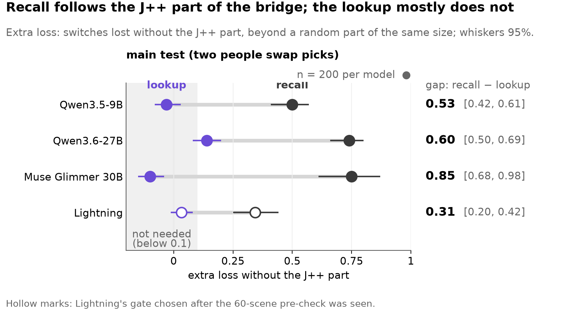
*Switches lost without the lens part beyond a random part, per reader and model, main test at L; whiskers: 95% intervals; grey band: the lookup's 0.10 bar.*

### What do the lens part's 25 directions stand for?

- **Question.** What do the lens part's 25 directions stand for?
- **Why we asked.** The conflict test treats the lens part as one block; if its directions were mostly the answer words, "the recall follows the item" would be a reading of the answer.
- **Data.** Main test, 50<!-- src: figures/story/data.csv | 52 A: main-test scenes --> scenes per model (the same change for both readers).
- **Method.** Each of the 25 directions is a word of the lens's vocabulary; each is classed automatically as the original bridge word (or its spelling: first token, initial, prefix), the new bridge word, another scene item, a person, either reader's answer word, a word of the same class, a function word, or none of these. Its share is the energy it adds when it enters the rebuild. The classifier was hand-checked on 5<!-- src: figures/story/data.csv | 52 A: hand-checked items (the lookup's view) --> items per model on the 9B, 27B and Muse (agreement 0.94<!-- src: figures/story/data.csv | 52 A: hand labels agreeing with the classifier -->-0.97<!-- src: figures/story/data.csv | 52 A: hand labels agreeing with the classifier -->; only Muse's labels are blind: on the 9B and 27B the labeller had seen some of the classifier's labels while writing its spelling rules); Lightning's labels are not hand-checked.
- **Rule, fixed in advance.** None: descriptive.
- **Result.**

  | share of the rebuilt energy | 9B | 27B | Muse | Lightning ○ |
  |---|---|---|---|---|
  | the old bridge word | 0.11 [0.09, 0.13]<!-- src: figures/story/data.csv \| 52 A: share of the rebuilt energy in the original bridge word --> | 0.10 [0.08, 0.13]<!-- src: figures/story/data.csv \| 52 A: share of the rebuilt energy in the original bridge word --> | 0.18 [0.17, 0.20]<!-- src: figures/story/data.csv \| 52 A: share of the rebuilt energy in the original bridge word --> | 0.09 [0.07, 0.10]<!-- src: figures/story/data.csv \| 52 A: share of the rebuilt energy in the original bridge word --> |
  | the new bridge word | 0.11 [0.09, 0.12]<!-- src: figures/story/data.csv \| 52 A: share of the rebuilt energy in the new bridge word --> | 0.11 [0.10, 0.13]<!-- src: figures/story/data.csv \| 52 A: share of the rebuilt energy in the new bridge word --> | 0.19 [0.17, 0.21]<!-- src: figures/story/data.csv \| 52 A: share of the rebuilt energy in the new bridge word --> | 0.11 [0.09, 0.13]<!-- src: figures/story/data.csv \| 52 A: share of the rebuilt energy in the new bridge word --> |
  | the recall's answer word | 0.00<!-- src: figures/story/data.csv \| 52 A: share of the rebuilt energy in the reader's answer word --> | 0.00<!-- src: figures/story/data.csv \| 52 A: share of the rebuilt energy in the reader's answer word --> | 0.00<!-- src: figures/story/data.csv \| 52 A: share of the rebuilt energy in the reader's answer word --> | 0.00<!-- src: figures/story/data.csv \| 52 A: share of the rebuilt energy in the reader's answer word --> |
  | no scene word | 0.77 [0.74, 0.80]<!-- src: figures/story/data.csv \| 52 A: share of the rebuilt energy in no scene word --> | 0.77 [0.74, 0.81]<!-- src: figures/story/data.csv \| 52 A: share of the rebuilt energy in no scene word --> | 0.61 [0.58, 0.64]<!-- src: figures/story/data.csv \| 52 A: share of the rebuilt energy in no scene word --> | 0.79 [0.76, 0.82]<!-- src: figures/story/data.csv \| 52 A: share of the rebuilt energy in no scene word --> |
  | bridge-word directions with the expected sign (old −, new +) | 0.99<!-- src: figures/story/data.csv \| 52 A: the bridge words' directions whose sign points the expected way (old -, new +) --> | 1.00<!-- src: figures/story/data.csv \| 52 A: the bridge words' directions whose sign points the expected way (old -, new +) --> | 1.00<!-- src: figures/story/data.csv \| 52 A: the bridge words' directions whose sign points the expected way (old -, new +) --> | 1.00<!-- src: figures/story/data.csv \| 52 A: the bridge words' directions whose sign points the expected way (old -, new +) --> |

- **Read.**
  - The two bridge words carry about a tenth to a fifth of the rebuilt energy each, with the expected signs: the old word taken away, the new one added.
  - The answer words carry almost nothing.
  - Most of the energy matches no word of the scene; some of it is the bridge's spellings the classifier missed.
- **Caveats.**
  - This is what is readable through the lens's vocabulary, not all that is there.
  - Descriptive: no rule was fixed in advance; one set (the main test) per model.

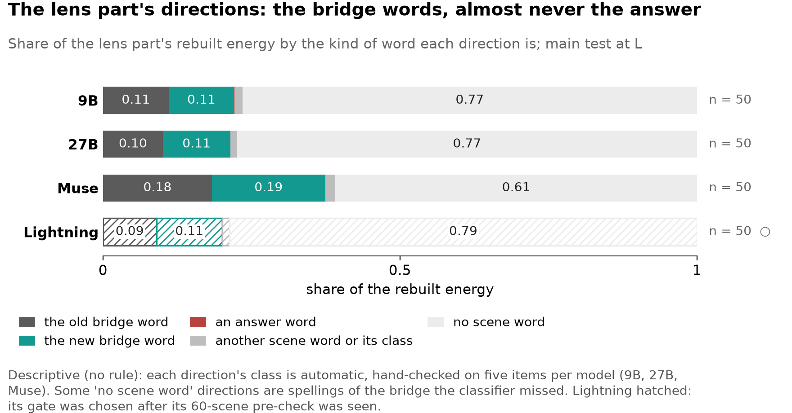
*The lens part's rebuilt energy at the bridge word, split by the kind of lens word each of its 25 directions is; main test at L; Lightning hatched (○).*

### Does the split hold in other texts?

- **Question.** Does the split hold in other texts?
- **Why we asked.** The main test is one template; the split could belong to that layout rather than to the two readers.
- **Data.** Varied scenes, 1010<!-- src: figures/story/data.csv | varied scenes: scenes used (prose, JSON and table) --> / 1635<!-- src: figures/story/data.csv | varied scenes: scenes used (prose, JSON and table) --> / 1389<!-- src: figures/story/data.csv | varied scenes: scenes used (prose, JSON and table) --> / 1105<!-- src: figures/story/data.csv | varied scenes: scenes used (prose, JSON and table) -->; natural passages, 83<!-- src: figures/story/data.csv | natural passages: scenes eligible --> / 137<!-- src: figures/story/data.csv | natural passages: scenes eligible --> / 60<!-- src: figures/story/data.csv | natural passages: scenes eligible --> / 36<!-- src: figures/story/data.csv | natural passages: scenes eligible (below gate) --> (the figure shows the 41<!-- src: figures/story/data.csv | natural passages: scenes used (fact first) --> / 75<!-- src: figures/story/data.csv | natural passages: scenes used (fact first) --> / 28<!-- src: figures/story/data.csv | natural passages: scenes used (fact first) --> whose fact comes first); the 9B's natural gate was lowered after the data; Lightning's natural passages miss the gate.
- **Method.** The conflict test unchanged, at L: without the lens part; control: without a random part.
- **Rule, fixed in advance.** Varied scenes, pooled: "holds if the lookup loses at most 0.10 beyond random (upper bound at most 0.20) and the gap is at least 0.20 (lower bound at least 0.10); fails if the lookup loses at least 0.20." Natural passages: "holds if the gap is at least 0.30 with its lower bound at least 0.15; fails at 0.10 or below; otherwise mixed."
- **Result.**

  | | 9B | 27B | Muse | Lightning ○ |
  |---|---|---|---|---|
  | varied: lookup, switches lost beyond a random part | 0.01 [−0.01, 0.03]<!-- src: docs/x0_numbers.json \| x0b_lk_excess_9b --> | 0.08 [0.06, 0.10]<!-- src: docs/x0_numbers.json \| x0b_lk_excess_27b --> | 0.06 [0.03, 0.10]<!-- src: docs/x0_numbers.json \| x0b_lk_excess_muse --> | 0.03 [0.00, 0.05]<!-- src: figures/story/data.csv \| varied: lookup, switches lost beyond a random part --> |
  | varied: the gap | 0.22 [0.14, 0.31]<!-- src: docs/x0_numbers.json \| x0b_c_9b --> | 0.47 [0.42, 0.53]<!-- src: docs/x0_numbers.json \| x0b_c_27b --> | 0.50 [0.40, 0.61]<!-- src: docs/x0_numbers.json \| x0b_c_muse --> | 0.24 [0.17, 0.32]<!-- src: figures/story/data.csv \| varied: the gap --> |
  | varied: the rule | holds<!-- src: docs/x0_numbers.json \| x0b_verdict_9b --> | holds<!-- src: docs/x0_numbers.json \| x0b_verdict_27b --> | holds<!-- src: docs/x0_numbers.json \| x0b_verdict_muse --> | holds<!-- src: figures/story/data.csv \| varied: the rule --> |
  | natural: recall, switches lost beyond a random part | 0.56 [0.45, 0.66]<!-- src: docs/x0_numbers.json \| natg75_rc_excess_9b --> | 0.59 [0.50, 0.67]<!-- src: docs/x0_numbers.json \| nat_rc_excess_27b --> | 0.75 [0.62, 0.86]<!-- src: docs/x0_numbers.json \| nat_rc_excess_muse --> | 0.49 [0.31, 0.67]<!-- src: figures/story/data.csv \| natural (below gate): recall, switches lost beyond a random part --> (below gate) |
  | natural: lookup, switches lost beyond a random part | 0.03 [−0.08, 0.15]<!-- src: docs/x0_numbers.json \| natg75_lk_excess_9b --> | 0.32 [0.20, 0.45]<!-- src: docs/x0_numbers.json \| nat_lk_excess_27b --> | −0.20 [−0.55, 0.00]<!-- src: docs/x0_numbers.json \| nat_lk_excess_muse --> | -0.08 [-0.27, 0.00]<!-- src: figures/story/data.csv \| natural (below gate): lookup, switches lost beyond a random part --> (below gate) |
  | natural: the rule | after the data | mixed<!-- src: docs/x0_numbers.json \| nat_label_27b --> | holds<!-- src: docs/x0_numbers.json \| nat_label_muse --> | not tested (gate); descriptive gap 0.56 [0.35, 0.82]<!-- src: figures/story/data.csv \| natural (below gate): the gap --> |

- **Read.**
  - In prose, JSON and tables the recall follows the lens part and the lookup does not, on all four models.
  - In natural passages the recall follows it on all four; the 27B's lookup follows it too, so there the split is mixed.
- **Caveats.**
  - In natural passages few lookups switch on Muse (10<!-- src: docs/x0_numbers.json | nat_lk_whole_sw_muse --> under the whole change), and the figure leaves the 9B's and Muse's lookup cells out.
  - The 9B's natural run had its gate lowered after the data; Lightning's misses its gate, so its natural numbers are descriptive only.

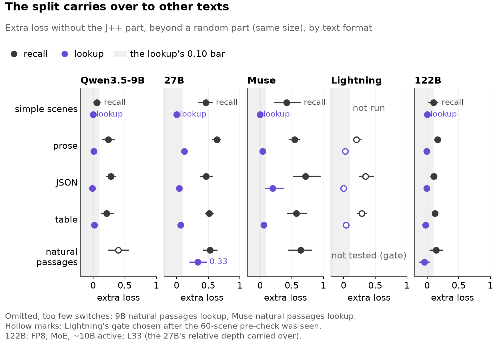
*Switches lost without the lens part beyond a random part, by text format, for the recall and the lookup; "simple scenes" are the scenes the address was fit on; natural passages with the fact first; hollow: the 9B's lowered gate; grey band: the lookup's 0.10 bar.*

### Does each part, added by itself, move its reader?

- **Question.** Does each part, added by itself, move its reader?
- **Why we asked.** The conflict test takes a part away; a reader that follows a part should also move when only that part is added.
- **Data.** Main test, the scenes whose locker sentences come before the picks: 75<!-- src: figures/story/data.csv | dose curves: main-test scenes, locker sentences first --> / 69<!-- src: figures/story/data.csv | dose curves: main-test scenes, locker sentences first --> / 68<!-- src: figures/story/data.csv | dose curves: main-test scenes, locker sentences first --> / 59<!-- src: figures/story/data.csv | dose curves: main-test scenes, locker sentences first --> ○.
- **Method.** At the bridge word at L, on the original prompt:
  - the lens part alone at doses from 0.5 to 3; control: a random part of the same share at the same dose;
  - the rest alone at doses from 0.25 to 1.5; control: the change without a random part of the lens part's share;
  - the rest without the address; control: the rest without a random part of the address's share;
  - each dose's plain-text loss at the bridge word is checked against twice the whole change's; no dose passed it.
- **Rule, fixed in advance.** "(i) The lookup is blind to the lens part: switches minus random at most 0.10 at every dose whose plain-text loss stays under twice the whole change's, on all three. (ii) The recall reads the lens part above its share: at the first dose where the lens part alone switches at least 0.3, minus random at least 0.2, per model. (iii) Together only (Muse): the whole change at least 0.8 while the best single part stays at most 0.3."
- **Result.**

  | | 9B | 27B | Muse | Lightning ○ |
  |---|---|---|---|---|
  | recall: lens part alone minus random, at dose 1.5 | 0.31 [0.20, 0.42]<!-- src: figures/story/data.csv \| 51.1 A: recall switches with the J++ part by itself at dose 1.5, minus a random part (same size) at the same dose --> | 0.12 [0.05, 0.19]<!-- src: figures/story/data.csv \| 51.1 A: recall switches with the J++ part by itself at dose 1.5, minus a random part (same size) at the same dose --> | 0.13 [0.04, 0.24]<!-- src: figures/story/data.csv \| 51.1 A: recall switches with the J++ part by itself at dose 1.5, minus a random part (same size) at the same dose --> | 0.19 [0.08, 0.31]<!-- src: figures/story/data.csv \| 51.1 A: recall switches with the J++ part by itself at dose 1.5, minus a random part (same size) at the same dose --> |
  | recall: the same at dose 3 | -0.05 [-0.16, 0.05]<!-- src: figures/story/data.csv \| 51.1 A: recall switches with the J++ part by itself at dose 3, minus a random part (same size) at the same dose --> | 0.42 [0.28, 0.54]<!-- src: figures/story/data.csv \| 51.1 A: recall switches with the J++ part by itself at dose 3, minus a random part (same size) at the same dose --> | 0.22 [0.07, 0.37]<!-- src: figures/story/data.csv \| 51.1 A: recall switches with the J++ part by itself at dose 3, minus a random part (same size) at the same dose --> | -0.10 [-0.21, 0.00]<!-- src: figures/story/data.csv \| 51.1 A: recall switches with the J++ part by itself at dose 3, minus a random part (same size) at the same dose --> |
  | lookup: lens part alone minus random, at dose 3 | -0.63 [-0.72, -0.52]<!-- src: figures/story/data.csv \| 51.1 A: lookup switches with the J++ part by itself at dose 3, minus a random part (same size) at the same dose --> | 0.13 [0.00, 0.26]<!-- src: figures/story/data.csv \| 51.1 A: lookup switches with the J++ part by itself at dose 3, minus a random part (same size) at the same dose --> | -0.22 [-0.32, -0.13]<!-- src: figures/story/data.csv \| 51.1 A: lookup switches with the J++ part by itself at dose 3, minus a random part (same size) at the same dose --> | -0.46 [-0.64, -0.28]<!-- src: figures/story/data.csv \| 51.1 A: lookup switches with the J++ part by itself at dose 3, minus a random part (same size) at the same dose --> |
  | (i) the lookup is blind to the lens part | yes<!-- src: figures/story/data.csv \| (i) the lookup is blind to the J++ part --> | no<!-- src: figures/story/data.csv \| (i) the lookup is blind to the J++ part --> | yes<!-- src: figures/story/data.csv \| (i) the lookup is blind to the J++ part --> | yes<!-- src: figures/story/data.csv \| (i) the lookup is blind to the J++ part --> |
  | (ii) the recall reads it above its share | yes<!-- src: figures/story/data.csv \| (ii) the recall reads the J++ part above its share --> | yes<!-- src: figures/story/data.csv \| (ii) the recall reads the J++ part above its share --> | yes<!-- src: figures/story/data.csv \| (ii) the recall reads the J++ part above its share --> | no<!-- src: figures/story/data.csv \| (ii) the recall reads the J++ part above its share --> |
  | lookups switched by the rest alone, dose 1 | 0.91 [0.82, 0.97]<!-- src: figures/story/data.csv \| 51.1 B: lookups switched, the rest by itself, dose 1 --> | 0.80 [0.70, 0.90]<!-- src: figures/story/data.csv \| 51.1 B: lookups switched, the rest by itself, dose 1 --> | 0.81 [0.71, 0.91]<!-- src: figures/story/data.csv \| 51.1 B: lookups switched, the rest by itself, dose 1 --> | 0.93 [0.86, 0.98]<!-- src: figures/story/data.csv \| 51.1 B: lookups switched, the rest by itself, dose 1 --> |
  | the same without the address | 0.12 [0.04, 0.20]<!-- src: figures/story/data.csv \| 51.1 B: lookups switched, the rest by itself without the address, dose 1 --> | 0.09 [0.02, 0.17]<!-- src: figures/story/data.csv \| 51.1 B: lookups switched, the rest by itself without the address, dose 1 --> | 0.21 [0.12, 0.31]<!-- src: figures/story/data.csv \| 51.1 B: lookups switched, the rest by itself without the address, dose 1 --> | 0.27 [0.11, 0.42]<!-- src: figures/story/data.csv \| 51.1 B: lookups switched, the rest by itself without the address, dose 1 --> |
  | the same without a random part of the address's share | 0.56 [0.46, 0.67]<!-- src: figures/story/data.csv \| 51.1 B: lookups switched, the rest by itself without a random part of the address's share, dose 1 --> | 0.12 [0.04, 0.20]<!-- src: figures/story/data.csv \| 51.1 B: lookups switched, the rest by itself without a random part of the address's share, dose 1 --> | 0.66 [0.54, 0.79]<!-- src: figures/story/data.csv \| 51.1 B: lookups switched, the rest by itself without a random part of the address's share, dose 1 --> | 0.69 [0.59, 0.79]<!-- src: figures/story/data.csv \| 51.1 B: lookups switched, the rest by itself without a random part of the address's share, dose 1 --> |

  Rule (iii) on Muse: no<!-- src: figures/story/data.csv | (iii) together only -->.
- **Read.**
  - Added by itself, the lens part moves the recall more than a random part of its size does, on the 9B, 27B and Muse; on Lightning only at middle doses, and its rule (ii) says no.
  - It moves the 9B's, Muse's and Lightning's lookups no more than random; the 27B's lookup moves a little at the highest dose.
  - The rest by itself moves the lookup; on the 9B, Muse and Lightning most of that goes when the address is removed from it, far more than with a random part.
- **Caveats.**
  - At high doses random parts switch readers too, so a negative lookup value means the random part moved it more, not that the lens part pushes back.
  - On the 27B, removing the address from the rest costs no more than removing a random part of its share.
  - One layer, and only scenes whose lockers come first.

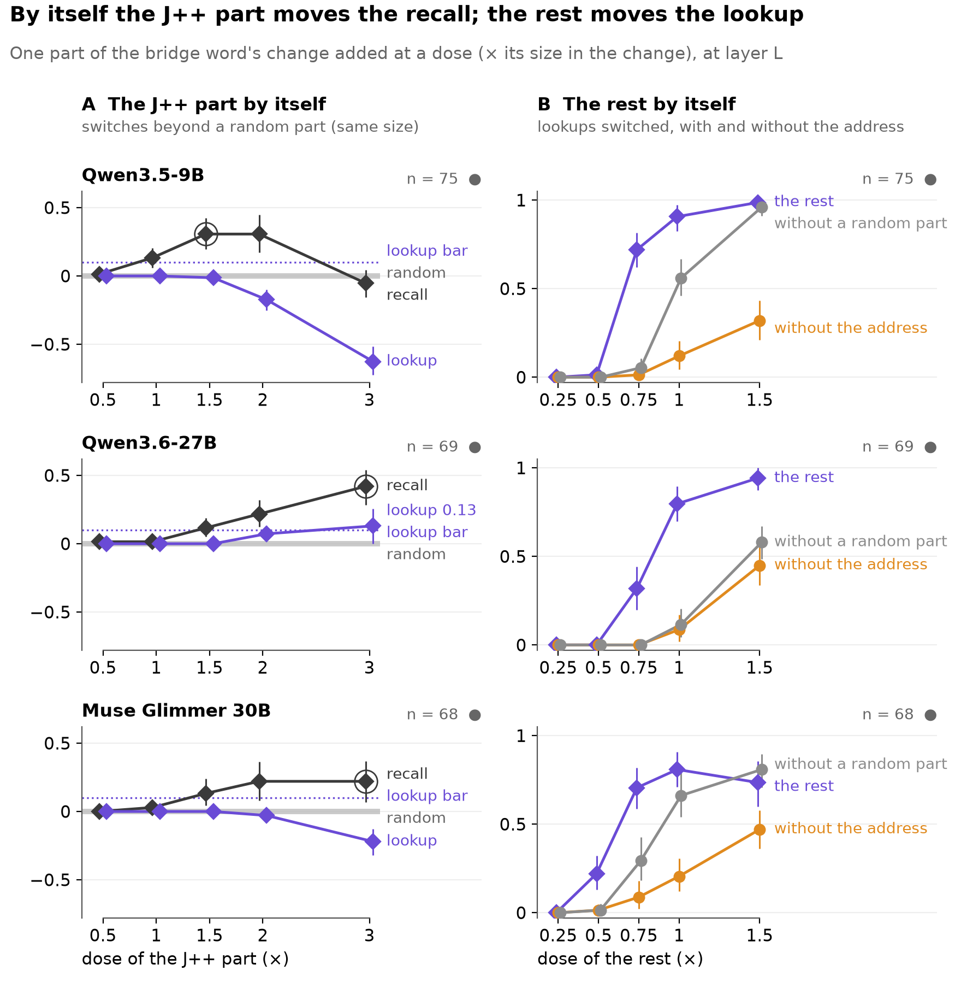
*Left: switches with the lens part alone minus a random part of the same size, by dose; rings mark the dose rule (ii) reads. Right: lookups switched by the rest alone, without the address, and without a random part. Rows: 9B, 27B, Muse, Lightning (hollow).*

### Does the recall need the lens part, or only follow it?

- **Question.** Does the recall need the lens part, or only follow it?
- **Why we asked.** The conflict test says the recall follows the lens part; following is not the same as needing it.
- **Data.** Zeroing: main test, 200<!-- src: docs/x0_numbers.json | n_9b --> / 200<!-- src: docs/x0_numbers.json | n_27b --> / 200<!-- src: docs/x0_numbers.json | n_muse --> / 200<!-- src: figures/story/data.csv | main test: scenes used --> scenes. The ladder: clean one-pick scenes, 417<!-- src: figures/story/data.csv | clean one-pick scenes: scenes used --> / 574<!-- src: figures/story/data.csv | clean one-pick scenes: scenes used --> / 409<!-- src: figures/story/data.csv | clean one-pick scenes: scenes used -->, every step from the full reruns (the 27B's first run had the first two steps; Muse's sixth step ran again inside Zach's layer band); Lightning's ladder ran below gate (its clean one-pick recall misses the gate): descriptive only, no rule label.
- **Method.** In the changed prompt's own run, nothing added, the lens part's directions are taken out, each step against a random part with the same share of the state:
  - zeroing, the ladder's first step: at the bridge word at L;
  - second step: at the bridge word over L to L+3;
  - third: also at the item's earlier mention, in its locker sentence;
  - fourth: also at the question's tokens;
  - fifth: at every token over L to L+3;
  - sixth, Zach's definition: at every token, each token's own top-10 lens directions over his layers.
- **Rule, fixed in advance.** Zeroing: "followed, not needed at one layer if the recall keeps at least 0.80 of its answers, within 0.10 of the random arm; needed if it loses at least 0.30 beyond random." The ladder: "(a) the second copy is the earlier mention: the third step costs the recall at least 0.3 more than the second where the locker comes first, and the second already costs at least 0.3 where it comes after; (b) needed only when everything goes: steps one to four each at most 0.2, and the fifth or sixth at least 0.5; (c) the lookup never needs it: at most 0.1 beyond random at every step."
- **Result.**

  | | 9B | 27B | Muse | Lightning ○ |
  |---|---|---|---|---|
  | zeroing: recall answers lost beyond random | 0.03 [0.01, 0.05]<!-- src: figures/story/data.csv \| 47.5: recall's answers kept, random part minus J++ part taken out (L) --> | 0.03 [0.01, 0.06]<!-- src: figures/story/data.csv \| 47.5: recall's answers kept, random part minus J++ part taken out (L) --> | 0.06 [0.02, 0.11]<!-- src: figures/story/data.csv \| 47.5: recall's answers kept, random part minus J++ part taken out (L) --> | 0.03 [0.01, 0.05]<!-- src: figures/story/data.csv \| 47.5: recall's answers lost beyond random (L) --> |
  | zeroing: the rule | followed, not needed at one layer<!-- src: figures/story/data.csv \| 47.5: the rule's reading (recall at L) --> | followed, not needed at one layer<!-- src: figures/story/data.csv \| 47.5: the rule's reading (recall at L) --> | followed, not needed at one layer<!-- src: figures/story/data.csv \| 47.5: the rule's reading (recall at L) --> | followed, not needed at one layer<!-- src: figures/story/data.csv \| 47.5: the rule's reading (recall at L) --> |
  | recall, locker first, second step | 0.07 [0.03, 0.11]<!-- src: figures/story/data.csv \| rung 2: recall, locker before the pick: answers lost beyond random --> | 0.02 [0.01, 0.04]<!-- src: figures/story/data.csv \| rung 2: recall, locker before the pick: answers lost beyond random --> | 0.04 [0.01, 0.09]<!-- src: figures/story/data.csv \| rung 2: recall, locker before the pick: answers lost beyond random --> | 0.09 [0.04, 0.15]<!-- src: figures/story/data.csv \| rung 2: recall, locker before the pick: answers lost beyond random --> below gate |
  | recall, locker first, third step | 0.39 [0.31, 0.47]<!-- src: figures/story/data.csv \| rung 3: recall, locker before the pick: answers lost beyond random --> | 0.15 [0.09, 0.22]<!-- src: figures/story/data.csv \| rung 3: recall, locker before the pick: answers lost beyond random --> | 0.15 [0.08, 0.24]<!-- src: figures/story/data.csv \| rung 3: recall, locker before the pick: answers lost beyond random --> | 0.30 [0.22, 0.39]<!-- src: figures/story/data.csv \| rung 3: recall, locker before the pick: answers lost beyond random --> below gate |
  | recall, locker after, second step | 0.40 [0.31, 0.51]<!-- src: figures/story/data.csv \| rung 2: recall, locker after the pick: answers lost beyond random --> | 0.24 [0.17, 0.32]<!-- src: figures/story/data.csv \| rung 2: recall, locker after the pick: answers lost beyond random --> | 0.13 [0.09, 0.19]<!-- src: figures/story/data.csv \| rung 2: recall, locker after the pick: answers lost beyond random --> | 0.32 [0.22, 0.40]<!-- src: figures/story/data.csv \| rung 2: recall, locker after the pick: answers lost beyond random --> below gate |
  | recall, locker first, fifth step | 0.42 [0.34, 0.50]<!-- src: figures/story/data.csv \| rung 5: recall, locker before the pick: answers lost beyond random --> | 0.15 [0.09, 0.23]<!-- src: figures/story/data.csv \| rung 5: recall, locker before the pick: answers lost beyond random --> | 0.17 [0.10, 0.24]<!-- src: figures/story/data.csv \| rung 5: recall, locker before the pick: answers lost beyond random --> | 0.40 [0.30, 0.49]<!-- src: figures/story/data.csv \| rung 5: recall, locker before the pick: answers lost beyond random --> below gate |
  | recall, locker first, sixth step (Zach's definition) | 0.42 [0.32, 0.52]<!-- src: figures/story/data.csv \| rung 6: recall, locker before the pick: answers lost beyond random --> | 0.50 [0.42, 0.61]<!-- src: figures/story/data.csv \| rung 6: recall, locker before the pick: answers lost beyond random --> | 0.07 [0.02, 0.12]<!-- src: figures/story/data.csv \| rung 6: recall, locker before the pick: answers lost beyond random --> | 0.32 [0.18, 0.48]<!-- src: figures/story/data.csv \| rung 6: recall, locker before the pick: answers lost beyond random --> below gate |
  | (a) the second copy is the earlier mention | yes<!-- src: figures/story/data.csv \| the second copy is the earlier mention --> | no<!-- src: figures/story/data.csv \| the second copy is the earlier mention --> | no<!-- src: figures/story/data.csv \| the second copy is the earlier mention --> | not tested (gate) |
  | (b) needed only when everything goes | no<!-- src: figures/story/data.csv \| needed only when everything goes --> | no<!-- src: figures/story/data.csv \| needed only when everything goes --> | no<!-- src: figures/story/data.csv \| needed only when everything goes --> | not tested (gate) |
  | (c) the lookup never needs it | yes<!-- src: figures/story/data.csv \| the lookup never needs it --> | yes<!-- src: figures/story/data.csv \| the lookup never needs it --> | yes<!-- src: figures/story/data.csv \| the lookup never needs it --> | not tested (gate) |

- **Read.**
  - At one layer the recall keeps nearly all its answers: it follows the lens part without needing it there.
  - Over four layers and at the earlier mention the 9B's recall loses many answers; where the locker comes first, the earlier mention holds the second copy. The 27B's recall loses answers step by step too, but its earlier mention stays below the rule's bar.
  - On Muse every step costs less, and Zach's definition, inside his band, costs little.
  - The lookup never needs the lens part.
- **Caveats.**
  - Rule (b) fails on every model: the recall's loss grows step by step rather than appearing only when everything goes.
  - Lightning's ladder is below gate: its steps are shown, its rules are not tested.

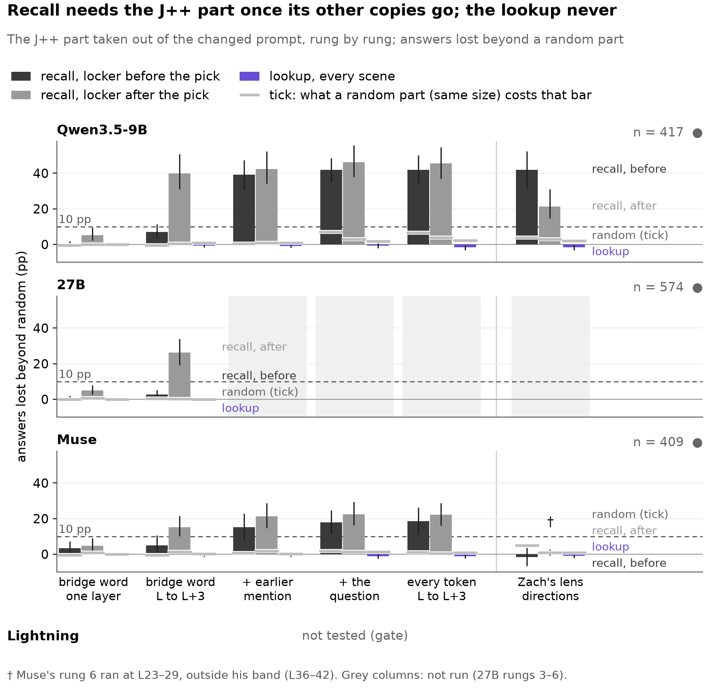
*Answers lost beyond a random part as the lens part's directions are taken out of the changed prompt, step by step; the recall split by sentence order, the lookup over every scene; ticks: what the random part itself costs; Lightning below gate, hollow.*

### Does the recall also read the item's earlier mention?

- **Question.** Does the recall also read the item's earlier mention?
- **Why we asked.** The ladder's third step points to a second copy where the locker sentence comes first; the earlier mention is the item's own word there.
- **Data.** Clean one-pick scenes whose new item's locker sentence comes before the asked pick: 186<!-- src: docs/x0_numbers.json | x45p_n_9b --> / 254<!-- src: docs/x0_numbers.json | x45p_n_27b --> / 178<!-- src: docs/x0_numbers.json | x45p_n_muse -->; Lightning below gate (its clean one-pick recall misses the gate), descriptive only.
- **Method.** At L, on the original prompt:
  - (1) the change without its lens part at the bridge word, as in the conflict test;
  - (2) (1), and the new item's tokens in its locker sentence without their own lens part;
  - (3) (1), and the same tokens without a random part of the same share: the control for (2);
  - (4) (1), and another item's tokens without their lens part: the control for the item.
- **Rule, fixed in advance.** "The recall reads the earlier mention if its switch loss in (2) exceeds (3) by at least 0.2 and (4) by at least 0.15, on at least two of three models; a model whose (1) switches fewer than 30 recalls is not tested." A loss is one minus the switches under the arm over those under (1).
- **Result.**

  | | 9B | 27B | Muse | Lightning ○ below gate |
  |---|---|---|---|---|
  | recalls switched under (1) | 137<!-- src: figures/story/data.csv \| 45p, (1): recalls switched --> | 75<!-- src: figures/story/data.csv \| 45p, (1): recalls switched --> | 55<!-- src: figures/story/data.csv \| 45p, (1): recalls switched --> | 89<!-- src: figures/story/data.csv \| 45p, (1): recalls switched --> |
  | recall: loss in (2) minus (3) | 0.25 [0.16, 0.34]<!-- src: docs/x0_numbers.json \| x45p_d23_9b --> | 0.41 [0.32, 0.53]<!-- src: docs/x0_numbers.json \| x45p_d23_27b --> | 0.42 [0.26, 0.63]<!-- src: docs/x0_numbers.json \| x45p_d23_muse --> | 0.22 [0.15, 0.30]<!-- src: figures/story/data.csv \| 45p (below gate): recall, loss in (2) minus (3) --> |
  | recall: loss in (2) minus (4) | 0.26 [0.18, 0.35]<!-- src: docs/x0_numbers.json \| x45p_d24_9b --> | 0.49 [0.38, 0.64]<!-- src: docs/x0_numbers.json \| x45p_d24_27b --> | 0.49 [0.31, 0.69]<!-- src: docs/x0_numbers.json \| x45p_d24_muse --> | 0.21 [0.14, 0.29]<!-- src: figures/story/data.csv \| 45p (below gate): recall, loss in (2) minus (4) --> |
  | lookup: loss in (2) | 0.01 [0.00, 0.02]<!-- src: figures/story/data.csv \| 45p, a2: lookup switches lost against (1) --> | 0.01 [0.00, 0.02]<!-- src: figures/story/data.csv \| 45p, a2: lookup switches lost against (1) --> | 0.00 [0.00, 0.00]<!-- src: figures/story/data.csv \| 45p, a2: lookup switches lost against (1) --> | -0.01 [-0.03, 0.00]<!-- src: figures/story/data.csv \| 45p, a2: lookup switches lost against (1) --> |

  The rule holds on 3 of 3<!-- src: docs/x0_numbers.json | x45p_held --> models; Lightning is not tested (gate), its numbers descriptive only.
- **Read.**
  - The recall reads the item's lens part at its earlier mention as well as at the bridge word, on all three models; Lightning's numbers, below gate, point the same way.
  - The same removal at another item's mention costs nothing, so the effect belongs to the item.
  - The lookup does not read the earlier mention this way.
- **Caveats.**
  - Only scenes with the locker first; after the pick there is no earlier mention.
  - Few recalls switch under (1) on the 27B and Muse, so their intervals are wide.
  - Zeroing finds a weaker second copy on Muse (previous card): the two operations disagree in size there.

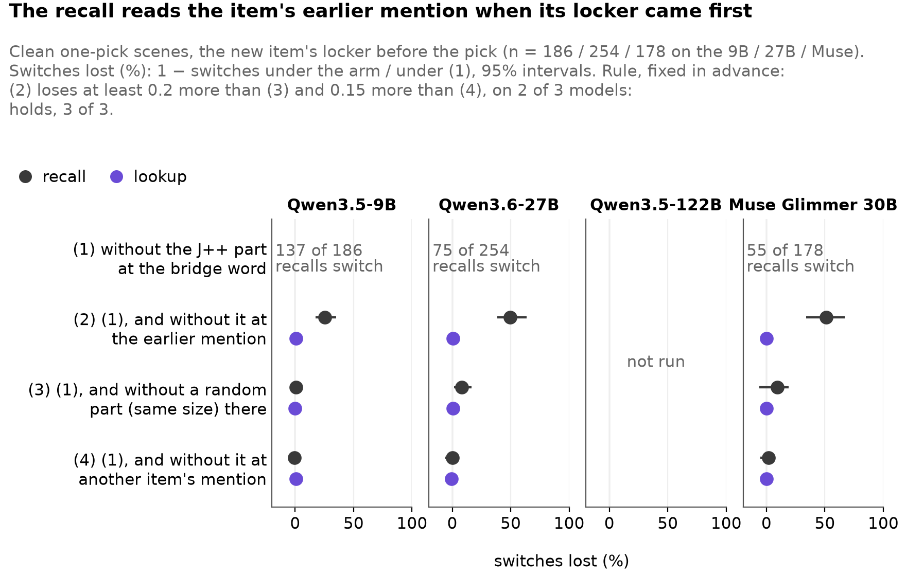
*Recall and lookup switches lost against arm (1), per arm; clean one-pick scenes with the locker first; whiskers: 95% intervals; 9B, 27B, Muse; Lightning below gate, hollow.*

## Part II. Identity: which item the lookup reads

*"Which item" is lens-readable for the recall, and the lookup's copy of it sits outside the lens.*

### E3. The lookup's identity route runs outside the lens <a id="e3-identity"></a>

- **Hypothesis.** The lookup's answers by the identity route fall at least 0.30 beyond random without lens directions 26-100, or under 0.10 (outside the lens). Fixed in advance.
- **Mechanics.** Lens directions 1-25, 26-100 or both taken out of the change, against a random part.
- **Data.** Routes scenes, 300 items per model.
- **Result.** Identity route without 1-25 / 26-100 / both: 0.06<!-- src: figures/story/data.csv | 47.1: identity route: answers lost beyond random without lens directions 1-25 --> / 0.05<!-- src: figures/story/data.csv | 47.1: identity route: answers lost beyond random without lens directions 26-100 --> / 0.09<!-- src: figures/story/data.csv | 47.1: identity route: answers lost beyond random without lens directions 1-100 --> (9B), 0.25<!-- src: figures/story/data.csv | 47.1: identity route: answers lost beyond random without lens directions 1-25 --> / 0.05<!-- src: figures/story/data.csv | 47.1: identity route: answers lost beyond random without lens directions 26-100 --> / 0.55<!-- src: figures/story/data.csv | 47.1: identity route: answers lost beyond random without lens directions 1-100 --> (27B), 0.00<!-- src: figures/story/data.csv | 47.1: identity route: answers lost beyond random without lens directions 1-25 --> / 0.02<!-- src: figures/story/data.csv | 47.1: identity route: answers lost beyond random without lens directions 26-100 --> / 0.02<!-- src: figures/story/data.csv | 47.1: identity route: answers lost beyond random without lens directions 1-100 --> (Muse), 0.04<!-- src: figures/story/data.csv | 47.1: identity answers lost beyond random without lens directions 1-25 --> / 0.05<!-- src: figures/story/data.csv | 47.1: identity answers lost beyond random without lens directions 26-100 --> / -0.08<!-- src: figures/story/data.csv | 47.1: identity answers lost beyond random without lens directions 1-100 --> (Lightning ○); position route at most 0.01<!-- src: figures/story/data.csv | 47.1: position route: the most answers lost beyond random, over the models and slices -->.
- **Figure.**

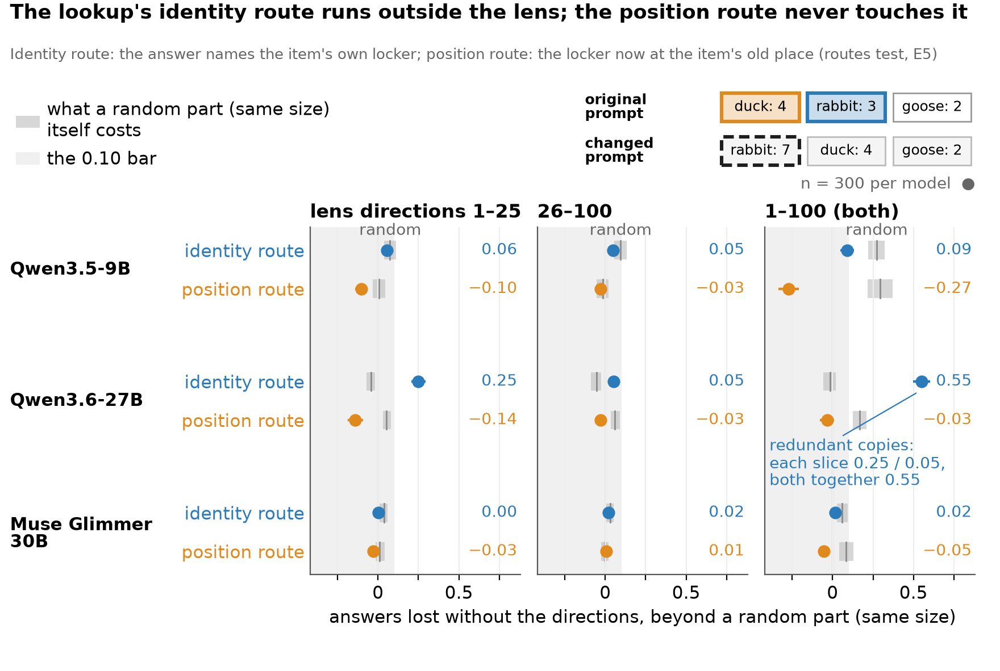

- **Conclusion.** The identity route survives the loss of lens directions 26-100 on all four models and of 1-25 on the 9B, Muse and Lightning; on the 27B the two slices are redundant copies. Not shown: the identity code itself.

### E5. Identity, position, never the value <a id="e5-routes"></a>

- **Hypothesis.** The lookup follows the item's identity, its locker's position, or the number. Fixed in advance.
- **Mechanics.** The change comes from a prompt where another item's locker sentence moved and took a new number; each route predicts a different locker. Whole change; without the address, against a random part.
- **Data.** Routes scenes, 300 items per model.
- **Result.** Identity / position 0.48<!-- src: docs/x0_numbers.json | rt_C2_whole_identity_9b --> / 0.51<!-- src: docs/x0_numbers.json | rt_C2_whole_position_9b --> (9B), 0.66<!-- src: docs/x0_numbers.json | rt_C2_whole_identity_27b --> / 0.34<!-- src: docs/x0_numbers.json | rt_C2_whole_position_27b --> (27B), 0.44<!-- src: docs/x0_numbers.json | rt_C2_whole_identity_muse --> / 0.54<!-- src: docs/x0_numbers.json | rt_C2_whole_position_muse --> (Muse), 0.44<!-- src: figures/story/data.csv | another item moved, whole: identity share --> / 0.55<!-- src: figures/story/data.csv | another item moved, whole: position share --> (Lightning ○); the value never, in any format.
- **Figure.**

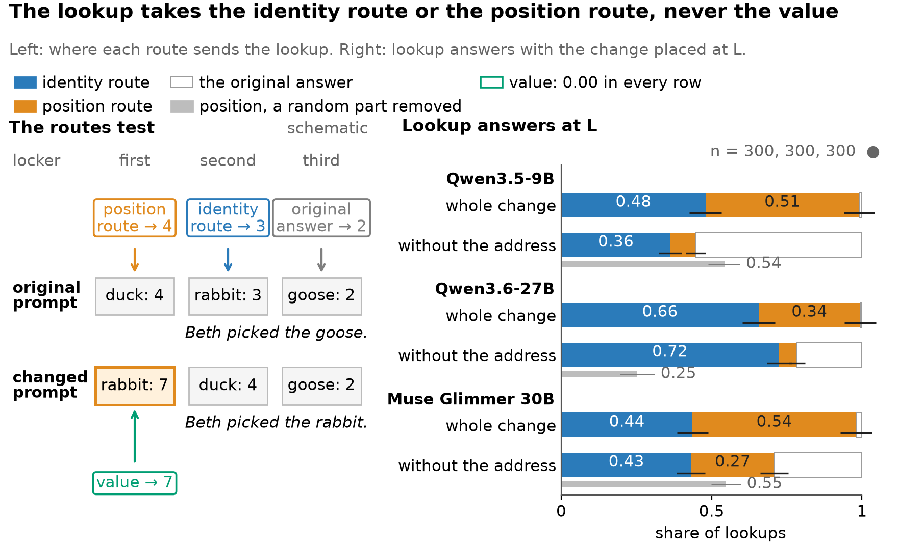
*The design is drawn on the setup figure's items; the routes test's own scenes are animals.*

The same routes by depth:

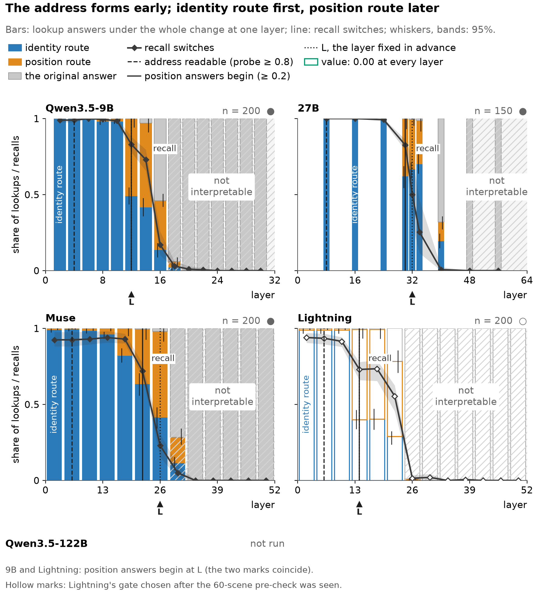

- **Conclusion.** The lookup reads what the item is and where it sits. Not shown: who reads the position (the dereference test is running).

## Part III. The address: where the item's locker sits

*The lookup's second input is a code for where the locker sentence sits.*

### E6. The address: probe, remove, add, swap <a id="e6-address"></a>

- **Hypothesis.** Removing the address stops position answers; adding it alone creates them; swapping it moves the lookup. Fixed in advance; probe post hoc.
- **Mechanics.** Removed or kept alone, against a random part; swapped (two slot means' difference) against a random vector of its size.
- **Data.** Routes scenes, 300 items per model.
- **Result.** A probe reads it in 0.92<!-- src: docs/x0_numbers.json | v4_b_before_122b -->-0.99<!-- src: docs/x0_numbers.json | v4_b_before_27b --> of scenes (0.85<!-- src: figures/story/data.csv | the locker probe at the bridge word, locker-first scenes --> on Lightning ○). Without it position answers drop to 0.08<!-- src: docs/x0_numbers.json | rt_C2_no_alf_position_9b --> / 0.06<!-- src: docs/x0_numbers.json | rt_C2_no_alf_position_27b --> / 0.27<!-- src: docs/x0_numbers.json | rt_C2_no_alf_position_muse --> / 0.10<!-- src: figures/story/data.csv | another item moved, no_alf: position share --> ○ (random 0.54<!-- src: docs/x0_numbers.json | rt_C2_no_alf_rand_position_9b --> / 0.25<!-- src: docs/x0_numbers.json | rt_C2_no_alf_rand_position_27b --> / 0.55<!-- src: docs/x0_numbers.json | rt_C2_no_alf_rand_position_muse --> / 0.56<!-- src: figures/story/data.csv | another item moved, no_alf_rand: position share --> ○); alone it gives 0.26<!-- src: docs/x0_numbers.json | rtk_C2_keep_alf_position_9b --> / 0.09<!-- src: docs/x0_numbers.json | rtk_C2_keep_alf_position_27b --> / 0.29<!-- src: docs/x0_numbers.json | rtk_C2_keep_alf_position_muse --> / 0.40<!-- src: figures/story/data.csv | another item moved, keep_alf: position share --> ○; a swap at a real change's size (s = 2) moves 0.46<!-- src: figures/story/data.csv | lookup target share, mean over locker pairs, s = 2 --> / 0.25<!-- src: figures/story/data.csv | lookup target share, mean over locker pairs, s = 2 --> / 0.52<!-- src: figures/story/data.csv | lookup target share, mean over locker pairs, s = 2 --> / 0.50<!-- src: figures/story/data.csv | lookup target share, mean over locker pairs, s = 2 --> ○ of lookups, 0.35<!-- src: figures/story/data.csv | 47.16: the swap (fit with none) sends lookups to the target, 50 sentences --> after 50 neutral sentences (9B).
- **The recall under the swap** (descriptive). At s = 2 the swap changes 0.21<!-- src: figures/story/data.csv | the address swap at s = 2: recalls that change --> / 0.04<!-- src: figures/story/data.csv | the address swap at s = 2: recalls that change --> / 0.06<!-- src: figures/story/data.csv | the address swap at s = 2: recalls that change --> / 0.27<!-- src: figures/story/data.csv | the address swap at s = 2: recalls that change --> ○ of recalls; of those, 0.84<!-- src: figures/story/data.csv | the address swap at s = 2: changed recalls naming the swapped-in item's answer --> (9B) and 0.85<!-- src: figures/story/data.csv | the address swap at s = 2: changed recalls naming the swapped-in item's answer --> ○ (Lightning) name the swapped-in item's answer. The address points to the item; the lookup always follows it, the recall sometimes.
- **Note.** The swap's rule fixed in advance was read at s = 1 (one times the slot difference) and said no on every model. That was a design error: s = 1 is below a real change's size. The swap numbers above are at s = 2.
- **Figure.**

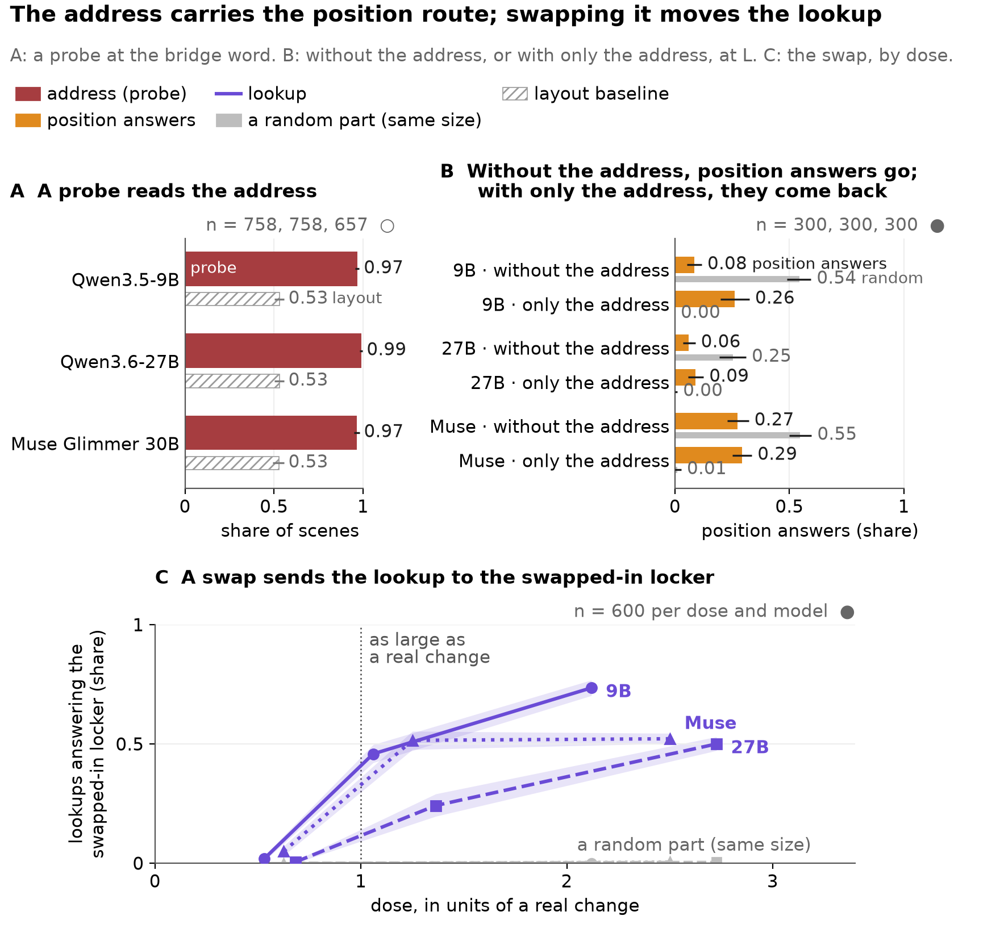

- **Conclusion.** The address is causal and survives distance. Not shown: who reads it.

### E7. Six lockers: swaps between given lockers <a id="e7-code"></a>

- **Hypothesis.** The address is a line over slots (one shift steps the lookup one slot), first-vs-rest, or one code per slot. Fixed in advance.
- **Mechanics.** Six-locker scenes: one shift per start slot and swaps between given slots, against a random direction.
- **Data.** 300 items each, 9B and Muse; the 27B and Lightning since. On the 9B the code was then fit three ways on held-out items.
- **Result.** No single shift reaches the bar on any model; swaps between given lockers reach it on 18<!-- src: figures/story/data.csv | 47.2: pairwise writes reaching 25% (dose 2) --> / 13<!-- src: figures/story/data.csv | 47.2: pairwise writes reaching 25% (dose 2) --> / 21<!-- src: figures/story/data.csv | 47.2: pairwise writes reaching 25% (dose 2) --> / 21<!-- src: figures/story/data.csv | 47.2: pairwise writes reaching 25% (dose 2) --> ○ of 30 pairs (9B / 27B / Muse / Lightning). The code's size on the 9B: in between<!-- src: figures/story/data.csv | 51.11 part 1: the code's size -->; swaps to a midpoint slot reach it in 0.06<!-- src: figures/story/data.csv | 51.11 part 3: midpoint swaps reaching the slot between, from the first slot (dose 2) --> of cases against 0.40<!-- src: figures/story/data.csv | 51.11 part 3: full swaps reaching their target (dose 2) --> for full swaps, so the slots are not a metric order.
- **Figure.**

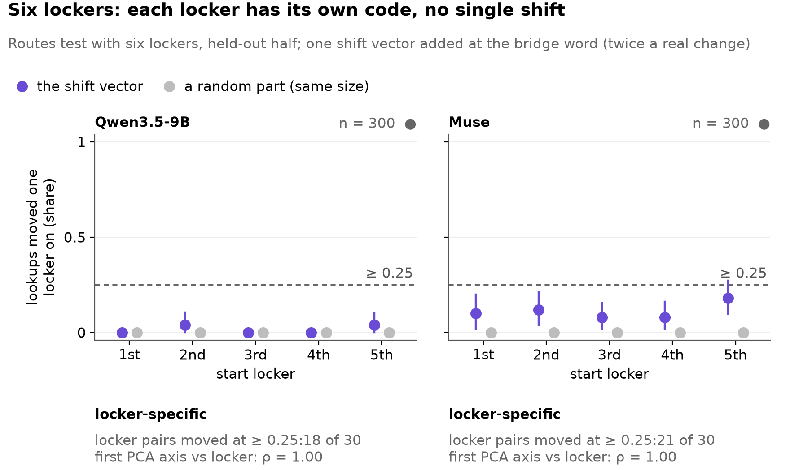

- **Conclusion.** A given locker can be targeted on most pairs on the 9B, Muse and Lightning, not on the 27B; the code's size is not settled. Not shown: whether the code is shared across item kinds (Part VI).

### E8. The lens is blind to the address <a id="e8-blind"></a>

- **Hypothesis.** Through the J++ lens an address swap looks like a random draw. Descriptive.
- **Mechanics.** The swap against 200 random draws: any position word's best rank and the share rebuilt; an identity change as control.
- **Data.** 200 cases per model.
- **Result.** The lens rebuilds 0.06<!-- src: figures/story/data.csv | 47.0 (b) share rebuilt by 25 lens directions: pointer --> / 0.04<!-- src: figures/story/data.csv | 47.0 (b) share rebuilt by 25 lens directions: pointer --> / 0.01<!-- src: figures/story/data.csv | 47.0 (b) share rebuilt by 25 lens directions: pointer --> / 0.04<!-- src: figures/story/data.csv | 47.0 (b) share rebuilt by 25 lens directions: pointer --> ○ of the swap: as for random draws on the 9B, 27B and Muse; on Lightning a little more than its random draws (0.03<!-- src: figures/story/data.csv | 47.0 (b) share rebuilt by 25 lens directions: random draws (mean) -->), still a small share. Asked for the position, the 27B's lens top five hold the right ordinal in 0.00<!-- src: figures/story/data.csv | 47.10: lens top-5 holds the right ordinal (report prompt) --> of reports, yet it loses 0.28<!-- src: figures/story/data.csv | 47.10: the report's extra loss without the address --> without the address.
- **Figure.**

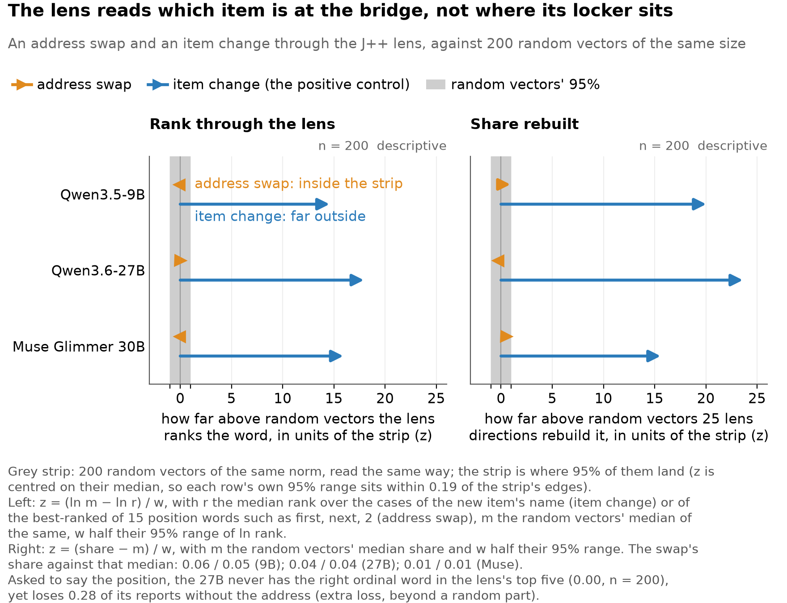

- **Conclusion.** A lens monitor sees which item is at the bridge, not where the model will look. Not shown: a probe-based monitor.

## Part IV. Where and when the link is made

*The bridge word can only point back, so the order decides where the link is made, and the address is written early and used late.*

### E10. Sentence order: where the link is made <a id="e10-order"></a>

- **Hypothesis.** Locker after the pick: copying the changed prompt's locker-sentence states at L carries at least half the switches. Link rule fixed in advance, order split post hoc.
- **Mechanics.** Main test split by order; clean scenes; copies into the locker sentences per layer.
- **Data.** 200 items per model.
- **Result.** Lookups switch in 65%<!-- src: docs/x0_numbers.json | lk_order_before_muse -->-89%<!-- src: docs/x0_numbers.json | lk_order_before_122b --> of locker-first scenes, 9%<!-- src: docs/x0_numbers.json | lk_order_after_27b -->-19%<!-- src: docs/x0_numbers.json | lk_order_after_9b --> otherwise; Lightning 0.86<!-- src: figures/story/data.csv | lookups switched by the whole change, locker sentence before the pick --> / 0.15<!-- src: figures/story/data.csv | lookups switched by the whole change, locker sentence after the pick --> ○. The copy carries 0.70<!-- src: docs/x0_numbers.json | x45q_c_9b --> / 0.74<!-- src: docs/x0_numbers.json | x45q_c_27b --> / 0.76<!-- src: docs/x0_numbers.json | x45q_c_muse -->; on Lightning the copy test is not tested (gate: its clean one-pick recall is below 0.80).
- **Figure.**


- **Conclusion.** The bridge word links only when the locker came first. Not shown: what the locker sentence holds.

### E11. Token by token, layer by layer <a id="e11-map"></a>

- **Hypothesis.** Locker after the pick: one locker-sentence cell carries the lookup, which stops reading the bridge word before the recall. Fixed in advance.
- **Mechanics.** The changed prompt's state placed into one token group at one layer, every other layer.
- **Data.** Clean scenes, 9B and Muse; since then the 27B (clean scenes and the main test) and Lightning (the main test only).
- **Result.** Both fail: no single cell carries the locker-after lookup, which reads the bridge word early; both readers read it to about the same depth, then the question and last token carry the answer. Of the locker-after lookups the change at L misses, the bridge word before L carries 0.93<!-- src: figures/story/data.csv | 47.4: main, locker after the pick: lookups carried by the bridge word before L --> / 1.00<!-- src: figures/story/data.csv | 47.4: main, locker after the pick: lookups carried by the bridge word before L --> / 0.99<!-- src: figures/story/data.csv | 47.4: main, locker after the pick: lookups carried by the bridge word before L --> / 0.92<!-- src: figures/story/data.csv | 47.4: main, locker after the pick: lookups carried by the bridge word before L --> ○ (main test).
- **Figure.**

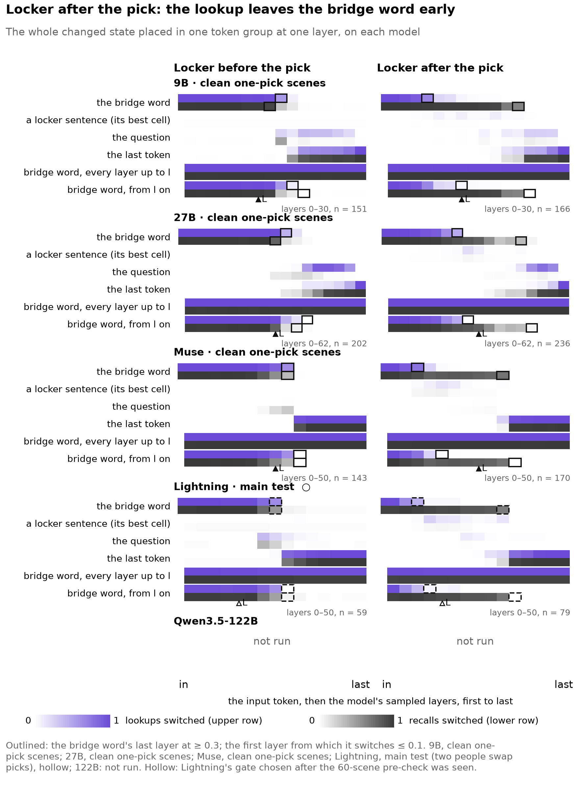

- **Conclusion.** The link is spread over tokens and layers. The 27B and Lightning, run since, fail the same readings; the 27B's recall reads the bridge word up to the start of Zach's late band, as the 9B's.

### E12. The anatomy by depth <a id="e12-anatomy"></a>

- **Hypothesis.** The lookup drops the J++ part by the time it takes up the address, which is readable earlier; never the value. Fixed in advance.
- **Mechanics.** The change's parts per sampled layer against random parts, and a slot probe.
- **Data.** Routes scenes split in halves; 9B and Muse; the 27B on two grids (first a reduced one, then every fourth layer); Lightning.
- **Result.**
  - (b) The address is readable before the lookup uses it, on all four: readable from / position route from layer 4<!-- src: figures/story/data.csv | 47.8: the address readable from --> / 12<!-- src: figures/story/data.csv | 47.8: the first layer of the position route --> (9B), 8<!-- src: figures/story/data.csv | 47.8 (full grid): the address readable from --> / 28<!-- src: figures/story/data.csv | 47.8 (full grid): the first layer of the position route --> (27B, full grid), 6<!-- src: figures/story/data.csv | 47.8: the address readable from --> / 22<!-- src: figures/story/data.csv | 47.8: the first layer of the position route --> (Muse), 6<!-- src: figures/story/data.csv | 47.8: the address readable from --> / 14<!-- src: figures/story/data.csv | 47.8: the first layer of the position route --> ○ (Lightning).
  - (d) Never the value, on all four.
  - (a) The handoff (the lookup stops needing the J++ part by the layer its position route starts) holds on the 9B, Muse and Lightning, and on the 27B's reduced grid (16<!-- src: figures/story/data.csv | 47.8 (reduced grid): the last layer the lookup needs the J++ part --> / 30<!-- src: figures/story/data.csv | 47.8 (reduced grid): the first layer of the position route -->). On the 27B's full grid it fails: the lookup still needs the J++ part at layer 40<!-- src: figures/story/data.csv | 47.8 (full grid): the last layer the lookup needs the J++ part -->, after its position route starts at layer 28<!-- src: figures/story/data.csv | 47.8 (full grid): the first layer of the position route -->. The handoff depends on the layer grid.
  - The address settles late: mean overlap across depth 0.28<!-- src: figures/story/data.csv | D4: the address's mean overlap over every pair of window layers --> / 0.26<!-- src: figures/story/data.csv | D4: the address's mean overlap over every pair of window layers --> / 0.21<!-- src: figures/story/data.csv | D4: the address's mean overlap over every pair of window layers --> / 0.34<!-- src: figures/story/data.csv | D4: the address's mean overlap over every pair of window layers --> ○.
- **Figure.**


- **Conclusion.** The address is written before it is read, and the lookup never reads the value, on all four models; whether the lookup lets go of the J++ part before it takes up the address depends on which layers are sampled. Position grows with depth on the main test too (candidate).

### The recall's bridge entity at the last token: readable through the lens, not used

- **Question.** At the last token, is the bridge entity in the lens part of the state, and does the model use it there?
- **Why we asked.** The cards above work at the bridge word; a lens monitor reads the last token, where the answer is written.
- **Data.** Main test, scenes with the locker sentence first: 75<!-- src: figures/story/data.csv | 51.10: main-test scenes, locker first --> / 69<!-- src: figures/story/data.csv | 51.10: main-test scenes, locker first --> / 68<!-- src: figures/story/data.csv | 51.10: main-test scenes, locker first --> / 59<!-- src: figures/story/data.csv | 51.10: main-test scenes, locker first --> ○.
- **Method.** At the last token, every fourth layer before the answer appears:
  - read: a probe for the bridge entity on the lens part of the state (and the lens's top five), against the probe on the whole state;
  - write, at the layer the read peaks: the lens part of the changed prompt's state swapped in, against the whole state patched in; control: a random part of the same size;
  - what the model then outputs (descriptive): its clean answer, the changed prompt's answer, another digit, the entity's name or a number word.
- **Rule, fixed in advance.** "Read: through-the-lens probe ≥ 0.8 and lens top-5 ≥ 0.5 at some layer before the answer digit's layer, while the full-residual probe ≥ 0.9 there. Write: at the layer of the read peak, his swap or the J++ part of the change (gain ≤ 2) switches ≥ 0.5 of what the whole-state patch switches at that layer, with the random part ≤ 0.10. (b) readable, not used: read holds, write fails." Lightning: the same rule, copied.
- **Result.**

  | the recall, last token | 9B | 27B | Muse | Lightning ○ |
  |---|---|---|---|---|
  | read: the probe on the lens part | 0.97 [0.94, 0.99]<!-- src: figures/story/data.csv \| 51.10: recall, last token, read peak: the probe's accuracy on the lens part --> | 0.95 [0.89, 0.99]<!-- src: figures/story/data.csv \| 51.10: recall, last token, read peak: the probe's accuracy on the lens part --> | 0.95 [0.91, 0.98]<!-- src: figures/story/data.csv \| 51.10: recall, last token, read peak: the probe's accuracy on the lens part --> | 0.98 [0.96, 1.00]<!-- src: figures/story/data.csv \| 51.10: recall, last token, read peak: the probe's accuracy on the lens part --> |
  | write: the lens swap's switches | 0.00<!-- src: figures/story/data.csv \| 51.10: recall, last token, read peak: the lens swap's switches --> | 0.01<!-- src: figures/story/data.csv \| 51.10: recall, last token, read peak: the lens swap's switches --> | 0.01<!-- src: figures/story/data.csv \| 51.10: recall, last token, read peak: the lens swap's switches --> | 0.14<!-- src: figures/story/data.csv \| 51.10: recall, last token, read peak: the lens swap's switches --> |
  | the whole-state patch's switches | 0.95<!-- src: figures/story/data.csv \| 51.10: recall, last token, read peak: the whole-state patch's switches --> | 0.97<!-- src: figures/story/data.csv \| 51.10: recall, last token, read peak: the whole-state patch's switches --> | 1.00<!-- src: figures/story/data.csv \| 51.10: recall, last token, read peak: the whole-state patch's switches --> | 0.97<!-- src: figures/story/data.csv \| 51.10: recall, last token, read peak: the whole-state patch's switches --> |
  | the rule | (b) readable, not used<!-- src: figures/story/data.csv \| 51.10: recall at the last token: the rule's reading --> | (b) readable, not used<!-- src: figures/story/data.csv \| 51.10: recall at the last token: the rule's reading --> | (b) readable, not used<!-- src: figures/story/data.csv \| 51.10: recall at the last token: the rule's reading --> | (b) readable, not used<!-- src: figures/story/data.csv \| 51.10: recall at the last token: the rule's reading --> |
  | the lookup at the last token: the rule | (c) routes around J-space<!-- src: figures/story/data.csv \| 51.10: lookup at the last token: the rule's reading --> | none of the four<!-- src: figures/story/data.csv \| 51.10: lookup at the last token: the rule's reading --> | none of the four<!-- src: figures/story/data.csv \| 51.10: lookup at the last token: the rule's reading --> | none of the four<!-- src: figures/story/data.csv \| 51.10: lookup at the last token: the rule's reading --> |
  | under the lens swap, the clean answer stays | 0.95<!-- src: figures/story/data.csv \| lenswrite: the recall keeps its clean answer under the lens swap --> | 0.97<!-- src: figures/story/data.csv \| lenswrite: the recall keeps its clean answer under the lens swap --> | 0.94<!-- src: figures/story/data.csv \| lenswrite: the recall keeps its clean answer under the lens swap --> | 0.78<!-- src: figures/story/data.csv \| lenswrite: the recall keeps its clean answer under the lens swap --> |
  | outputs naming the entity or a number word, any arm | 0.00<!-- src: figures/story/data.csv \| lenswrite: the most outputs naming the entity or a number word, over every arm --> | 0.00<!-- src: figures/story/data.csv \| lenswrite: the most outputs naming the entity or a number word, over every arm --> | 0.00<!-- src: figures/story/data.csv \| lenswrite: the most outputs naming the entity or a number word, over every arm --> | 0.00<!-- src: figures/story/data.csv \| lenswrite: the most outputs naming the entity or a number word, over every arm --> |
  | the J++ part at gain 2: the changed prompt's answer | 0.15<!-- src: figures/story/data.csv \| lenswrite: the J++ part at gain 2 gives the changed prompt's recall answer --> | 0.03<!-- src: figures/story/data.csv \| lenswrite: the J++ part at gain 2 gives the changed prompt's recall answer --> | 0.38<!-- src: figures/story/data.csv \| lenswrite: the J++ part at gain 2 gives the changed prompt's recall answer --> | 0.56<!-- src: figures/story/data.csv \| lenswrite: the J++ part at gain 2 gives the changed prompt's recall answer --> |
  | a random part at gain 2: the same | 0.04<!-- src: figures/story/data.csv \| lenswrite: a random part at gain 2 gives the changed prompt's recall answer --> | 0.03<!-- src: figures/story/data.csv \| lenswrite: a random part at gain 2 gives the changed prompt's recall answer --> | 0.04<!-- src: figures/story/data.csv \| lenswrite: a random part at gain 2 gives the changed prompt's recall answer --> | 0.19<!-- src: figures/story/data.csv \| lenswrite: a random part at gain 2 gives the changed prompt's recall answer --> |

- **Read.**
  - At the last token the recall's bridge entity is readable through the lens on all four models, but writing it through the lens does not move the answer at a real change's size: the whole-state patch switches nearly every recall, the lens swap almost none.
  - The lens swap never makes the model say the entity's name or a number word; the recall keeps its clean answer.
  - At twice the size, the J++ part moves part of Muse's and Lightning's recalls, beyond a random part of that size.
  - The lookup's entity is not readable there by the rule on any model.
- **Caveats.**
  - "Not used" means not at a real change's size: at gain 2 the J++ part has an effect on Muse and Lightning.
  - Lightning's swap moves more than the others' (0.14<!-- src: figures/story/data.csv | 51.10: recall, last token, read peak: the lens swap's switches -->), and its random part at gain 2 moves 0.19<!-- src: figures/story/data.csv | lenswrite: a random part at gain 2 gives the changed prompt's recall answer -->.
  - The output classes are descriptive (CPU check of the stored runs).

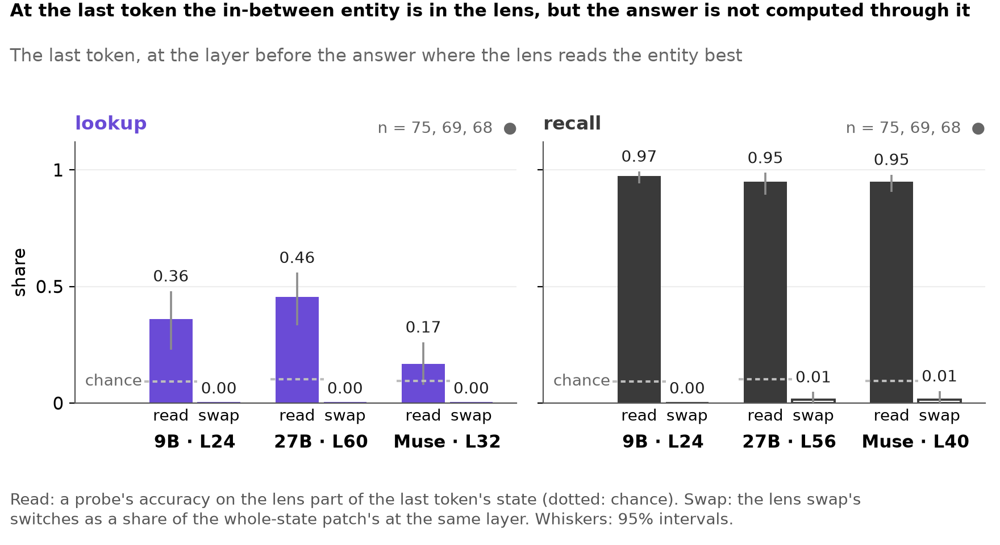
*At the last token, per reader and model: the probe's accuracy on the lens part of the state (read) and the lens swap's switches as a share of the whole-state patch's (swap), both at the layer where the read peaks; Lightning hollow.*

## Part V. Other datasets and operations

*Our removal on Zach's passages and his operation on our scenes.*

- **His true-fact passages** (the final fact stated in the lookup's passage): the lookup follows the lens part too on the 9B and 27B (0.26 [0.18, 0.36]<!-- src: figures/story/data.csv | Z1: lookup, switches lost beyond a random part --> / 0.28 [0.18, 0.38]<!-- src: figures/story/data.csv | Z1: lookup, switches lost beyond a random part --> lost beyond random); Muse's lookup switches rarely there; Lightning is in between<!-- src: figures/story/data.csv | Z1: the rule's reading --> ○ (0.15<!-- src: figures/story/data.csv | Z1: lookup, switches lost beyond a random part -->).
- **His made-up-fact passages** (same rule): on the 9B the split holds on his passages<!-- src: figures/story/data.csv | Z1-P: the rule's reading --> (lookup -0.05 [-0.13, 0.03]<!-- src: figures/story/data.csv | Z1-P: lookup, switches lost beyond a random part -->, recall 0.59<!-- src: figures/story/data.csv | Z1-P: recall, switches lost beyond a random part -->, gap 0.64<!-- src: figures/story/data.csv | Z1-P: the gap -->); on the 27B in between<!-- src: figures/story/data.csv | Z1-P: the rule's reading --> (lookup 0.15 [0.06, 0.25]<!-- src: figures/story/data.csv | Z1-P: lookup, switches lost beyond a random part -->, recall 0.62<!-- src: figures/story/data.csv | Z1-P: recall, switches lost beyond a random part -->, gap 0.47<!-- src: figures/story/data.csv | Z1-P: the gap -->); Lightning not tested (gate 0.79<!-- src: figures/story/data.csv | Z1-P: the gate (the lookup's read accuracy on the original passages) --> < 0.80), descriptive only ○: lookup 0.03 [-0.10, 0.15]<!-- src: figures/story/data.csv | Z1-P: lookup, switches lost beyond a random part -->, recall 0.48<!-- src: figures/story/data.csv | Z1-P: recall, switches lost beyond a random part -->, gap 0.45<!-- src: figures/story/data.csv | Z1-P: the gap -->.
- **The full carrier** (every token before L changed): fact-after lookups follow the lens part (0.51<!-- src: figures/story/data.csv | 51.7: fact-after lookups, full carrier: switches lost beyond a random part --> / 0.51<!-- src: figures/story/data.csv | 51.7: fact-after lookups, full carrier: switches lost beyond a random part --> / 0.41<!-- src: figures/story/data.csv | 51.7: fact-after lookups, full carrier: switches lost beyond a random part --> ○ lost beyond random; 9B / 27B / Lightning).
- **The routes test on his passages:** position answers under the whole change 0.10<!-- src: figures/story/data.csv | Z3: position share under the whole change --> / 0.04<!-- src: figures/story/data.csv | Z3: position share under the whole change --> / 0.06<!-- src: figures/story/data.csv | Z3: position share under the whole change --> / 0.10<!-- src: figures/story/data.csv | Z3: position share under the whole change --> ○: no position route on the 27B; the others in between.
- The two operations differ in scope, so only their sign and their order are comparable.

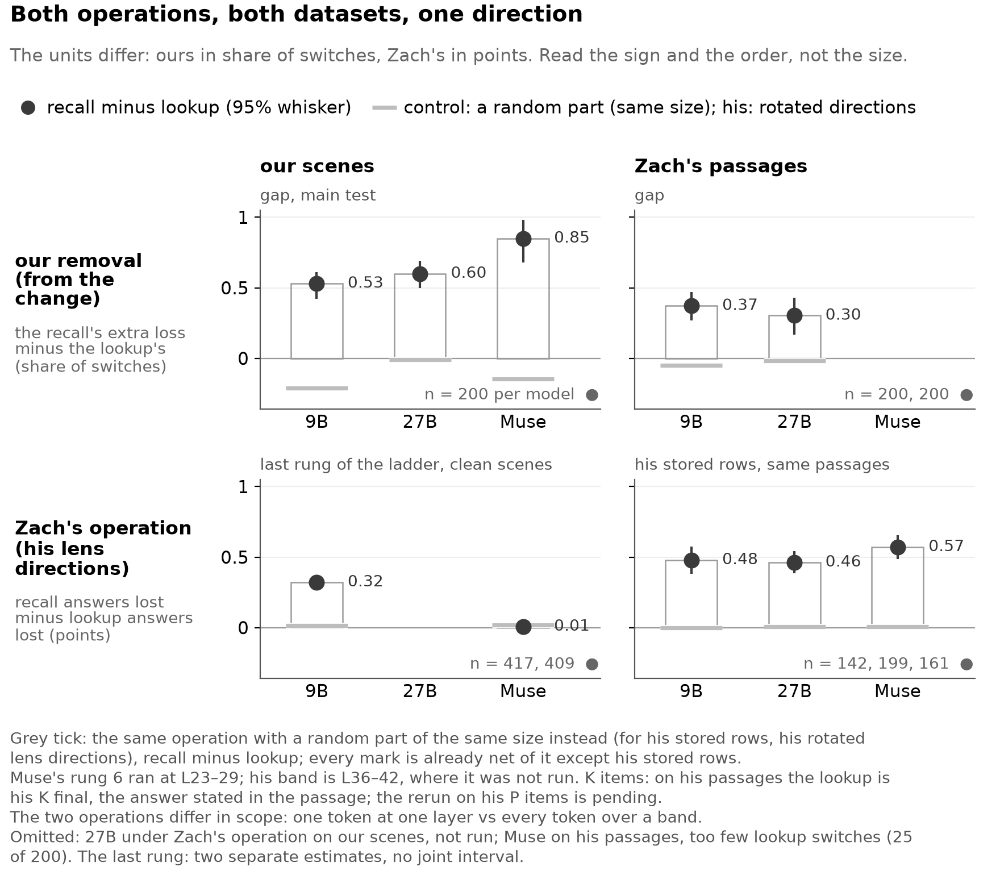

## Part VI. What did not hold

*Harder prompts keep the split in part, and every mechanism we proposed for why failed.*

**Weaker results.**

- **A described bridge** ("the one known for honey"; rule fixed in advance): the split holds on the 9B and Muse (gap 0.32<!-- src: figures/story/data.csv | 47.3: gap (recall's extra loss minus the lookup's) --> / 0.36<!-- src: figures/story/data.csv | 47.3: gap (recall's extra loss minus the lookup's) -->); on the 27B the lookup follows the lens too (0.39<!-- src: figures/story/data.csv | 47.3: lookup's extra loss without the J++ part -->). Lightning is not tested (gate 0.72<!-- src: figures/story/data.csv | 47.3: the gate (the lookup's read accuracy on the original prompts) --> < 0.80); descriptive only ○: gap 0.31 [0.21, 0.42]<!-- src: figures/story/data.csv | 47.3: gap (recall's extra loss minus the lookup's) -->, lookup 0.17<!-- src: figures/story/data.csv | 47.3: lookup's extra loss without the J++ part -->, and the answer word is not read at the changed token on 1.00<!-- src: figures/story/data.csv | 47.3 below gate, recall: items whose answer word ranks below the lens's top 50 at the changed token --> of items. Few bridge items ([figure](../../figures/story/fig05c_described_bridge.png); its example is another scene from the same set). Answer control: the answer word is not read at the bridge word on 1.00<!-- src: figures/story/data.csv | the described bridge in locker scenes, recall: items whose answer word ranks below the lens's top 50 at the changed token --> / 1.00<!-- src: figures/story/data.csv | the described bridge in locker scenes, recall: items whose answer word ranks below the lens's top 50 at the changed token --> of items (9B / 27B, 300 each); the arms beside say the item.

- **One question under two instructions** ("from the passage" / "from what you know"; 27B only, the others miss the gate): both instructions lose most switches without the J++ part and many without the address and the outside identity. With no instruction the 27B answers from the passage.
- **The address must be refit per text format:** fit on simple scenes it costs the lookup 0.05 to 0.15<!-- src: docs/x0_numbers.json | tptr_varied_range --> in varied scenes; refit it reaches 0.18<!-- src: docs/x0_numbers.json | x45d_table_9b -->-0.24<!-- src: docs/x0_numbers.json | x45d_prose_9b --> (9B) and 0.23<!-- src: docs/x0_numbers.json | x45d_prose_muse -->-0.47<!-- src: docs/x0_numbers.json | x45d_table_muse --> (Muse), 0.16<!-- src: figures/story/data.csv | 45d: the refit address, lookup switches lost beyond random: prose -->-0.26<!-- src: figures/story/data.csv | 45d: the refit address, lookup switches lost beyond random: json --> on Lightning ○, at most 0.13<!-- src: docs/x0_numbers.json | x45d_table_27b --> on the 27B ([figure](../../figures/story/fig09b_refit.png)).

- **The lookup's errors are not address errors** (9B, Lightning ○): the probe matches the wrong answer's slot in 0.07<!-- src: figures/story/data.csv | 47.13: wrong answers whose locker the address probe predicts --> / 0.05<!-- src: figures/story/data.csv | 47.13: wrong answers whose locker the address probe predicts --> of them.

**Withdrawn.**

- **The described bridge on Zach's passages.** At the token the change is made at, the lens ranks the answer word above the bridge entity on the 9B (median 47<!-- src: figures/story/data.csv | Zach's described passages, lookup: the answer word's median lens rank at the changed token (original prompt), rounded --> against 177<!-- src: figures/story/data.csv | Zach's described passages, lookup: the bridge entity's median lens rank at the changed token (original prompt), rounded -->) and level with it on the 27B (32<!-- src: figures/story/data.csv | Zach's described passages, lookup: the answer word's median lens rank at the changed token (original prompt), rounded --> against 25<!-- src: figures/story/data.csv | Zach's described passages, lookup: the bridge entity's median lens rank at the changed token (original prompt), rounded -->). Taking out the answer directions alone costs 0.34<!-- src: figures/story/data.csv | Zach's described passages, lookup: switches lost beyond a random part without the answer directions only --> / 0.55<!-- src: figures/story/data.csv | Zach's described passages, recall: switches lost beyond a random part without the answer directions only --> (9B, lookup / recall) and 0.50<!-- src: figures/story/data.csv | Zach's described passages, lookup: switches lost beyond a random part without the answer directions only --> / 0.42<!-- src: figures/story/data.csv | Zach's described passages, recall: switches lost beyond a random part without the answer directions only --> (27B) of the switches beyond a random part, and about as much beyond a frequency-matched part; the verdict is "answer" or "mixed" in all four cells. Any reading of these passages as "the recall follows the item" is withdrawn.

**What did not hold** (each rule fixed in advance; [the five mechanism tests on one page](../../figures/story/fig15_mechanisms.png), now with the 27B and Lightning wherever they ran; none holds on any model):

- The J++ part keys the item's attribute at the bridge word; late MLPs there carry the recall → without the J++ part the attribute still moves part way; the MLPs are not needed.
- A person mark at the locker sentence → a probe reads chance there; a person direction moves nothing; pooled over the whole locker sentence, the probe stays at chance on the 9B and Muse and in between on the 27B, neither reading holding.
- The copying heads pass the rest at twice the J++ part → about equal.
- The address is the recall's second route → few recalls name the swapped slot's item. Removing the address does not hurt the recall, but swapping it at s = 2 redirects part of it (Part III, E6).
- Blocking the pick sentence from the lockers removes position answers only → identity answers and recall switches fall too.
- The second hop's key token (the locker number) carries the hall question's address → removing it costs no more than a random part of its large share.
- The address is the same for any kind of item (within 0.10 of the animal result) → on the 9B it moves fruits and names more than animals; on Muse names fall short.
- Token by layer: one locker-sentence cell carries the locker-after lookup; the lookup leaves the bridge word before the recall → neither.
- Also failed: the positive control, a second-vs-third address, the 9B in the clean design and its replication, the 27B's strict bar.

## How we checked

- **Hand-checked numbers:** none yet; [the verify pack](../verify_pack.md) recounts each claim from the per-item files.
- **The ladder's reruns:** every step on this page comes from the full reruns (the 27B's full ladder; Muse's third run). Over every scene they agree with the first runs within 0.02<!-- src: figures/story/data.csv | the ladder: largest difference between the first runs and the full reruns, every scene, on the steps both ran at the same layers --> on each step both ran at the same layers (0.03<!-- src: figures/story/data.csv | the ladder: the same within one sentence order --> at most within one sentence order); Muse's sixth step moved into Zach's layer band and differs by 0.09<!-- src: figures/story/data.csv | the ladder: step 6's difference, every scene (moved into Zach's band) -->.
- **Independent reimplementation:** code written from scratch reproduces the 9B's main test on 20 of 20<!-- src: docs/x0_numbers.json | indep_agree_9b --> random items, every arm.
- **Predictions:** committed before results are opened, then scored ([predictions](../../predictions/README.md)): mean Brier 0.32<!-- src: docs/x0_numbers.json | pred_brier --> over 121<!-- src: docs/x0_numbers.json | pred_n --> answers, worse than always answering 50%.
- **Limits:** one-token answers and bridges; reader and answer source confounded; the 122B in FP8.

## Related work and what is new

Models bind entities to attributes in context (Feng & Steinhardt 2023) and track them through lookback pointers (Prakash et al. 2025) in a low-dimensional order subspace (Dai et al. 2024). The routes test follows Gur-Arieh et al. (2025); the address uses mass-mean directions (Marks & Tegmark 2023); random parts answer Makelov et al. (2023). The lens is the workspace paper's J++ (Gurnee et al. 2026). New here: two readers of one word follow different parts of it; the address is the part the lens misses, and swapping it redirects the lookup.

## Open questions

- **Why does the 27B's lookup need J++ only when all 100 directions go together?**
- **Why does the recall follow J++ without needing it at one layer?** Removing it over four layers costs the 9B's recall about a quarter.
- **Does the address exist in natural text?** Refit per format, it is found on the 9B, Muse and Lightning, not the 27B.
- **Does a write at the last token steer the output?** Not on this page: the write at the last token is close to steering the output, and its 1x and 2x doses disagree.

## Appendix A. Links

Every number on this page carries a source comment into figures/story/data.csv or docs/x0_numbers.json; where things live: run files under results/, job specs under jobs/c3/, scripts under scripts/. All figures on one page: [the contact sheet](../figures_contact_sheet.png). Supplementary figures: [every scene set](../../figures/supp/s01_split_all_scene_sets.png), [the settings](../../figures/story/fig01b_settings.png), [every part](../../figures/supp/s02_parts_all.png), [parts of the same size](../../figures/story/fig02_specificity.png), [the 27B with more directions](../../figures/story/fig02b_k_curve.png), [the J++ part taken out at one layer](../../figures/story/fig01c_zeroing.png), [the main test's parts](../../figures/story/fig05b_identity_outside.png), [a described bridge](../../figures/story/fig05c_described_bridge.png), [the order split with every model](../../figures/supp/s03_order_split.png), [the layer sweep](../../figures/story/fig03b_layers.png), [the link copy variants](../../figures/supp/s03d_link_copy_variants.png), [the lookups the change misses](../../figures/supp/s03e_cumulative.png), [the depth candidate on the main test](../../figures/story/fig06_depth.png), [the address across depth](../../figures/story/fig06c_address_depth.png), [the recall follows the swap](../../figures/supp/s07_recall_follows_swap.png), [the lens readout of the swap](../../figures/supp/s07b_lens_readout.png), [the lookup's errors](../../figures/story/fig07c_probe_errors.png), [the first locker](../../figures/story/fig08_first_locker.png), [the first sentence and the moves](../../figures/supp/s08b_pointer_moves_and_neutral_sentence.png), [the routes test drawn large](../../figures/supp/s04_routes_design.png), [every routes arm](../../figures/supp/s05_routes_all_arms.png), [the blocked pick sentence](../../figures/story/fig09c_formation.png), [chained addresses](../../figures/story/fig09d_chain.png), [what is left of the route](../../figures/story/fig10_what_is_left.png), [attribute probe and MLPs](../../figures/story/fig10b_enrichment.png), [binding](../../figures/story/fig10c_binding.png), [heads](../../figures/story/fig10d_heads.png), [second route](../../figures/story/fig10e_second_route.png), [the mechanism tests](../../figures/story/fig15_mechanisms.png), [attention follows the swapped address](../../figures/story/fig13_attention.png), [learned subspaces](../../figures/story/fig14_learned.png), [Muse's learned subspaces](../../figures/supp/s12_das_muse.png), [the transfer on every model](../../figures/story/fig09_transfer.png). Earlier figures: [figures/status_2026-10-25/](../../figures/status_2026-10-25/).
