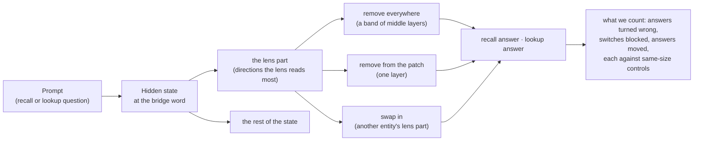

# Recall goes through the workspace, lookup goes around it

*A controlled test of the J++ lens on two-step questions in open language models: what the lens reads at the middle entity of a question, and whether the model uses it.*

**Danyil Orel and Zach Perlman** · MATS 12.0 sprint, Neel Nanda's stream · 19–30 Oct 2026<!-- src: docs/plans/hypotheses.md | The proposal (19 Oct) --><!-- src: docs/depth/README.md | 29 Oct 2026 -->
**Status:** every number is sourced from the run files (checked by tests); a 46-item hand-check changed no headline claim ([findings](docs/review/handcheck_findings.md))<!-- src: docs/review/handcheck_findings.md | 46 items across views a-g -->; human recomputation (VERIFIED.md) not yet done.

**TL;DR.** Gurnee et al. (2026) argue that a model holds the middle step of multi-step reasoning in a small "workspace" that the J++ lens can read, which would make the lens a monitor of what a model is thinking about. We tested this on two-step questions whose middle entity (the bridge) is used either to recall a fact from memory or to look one up in the prompt. Removing the lens's few directions at the bridge breaks recalled answers and leaves looked-up ones nearly intact: on the three clearest of nine models, recall drops {{b|ko.q9.mk}} to {{b|ko.nl.mk}} points more than lookup, and on the rest the effect is weaker, not specific to the lens, or gone when scored by probability; at a single layer, recall follows those directions and lookup does not. The lookup instead reads an identity code and an address (where the item's sentence sits) that the lens does not show. A lens monitor shows what a model recalls, not where in its context it reads an answer.

{{fig|r1_c1_split}}

{{caption|readme/02_main_split}}

## Summary

The J++ lens reads a language model's hidden state as a short list of word-like directions, which its authors argue form a *global workspace* for multi-step thinking. We tested what it shows, and whether the model depends on it, on questions that need two steps: first find an entity (*the composer who wrote The Magic Flute* → Mozart), then a fact about it (Mozart's nationality). The fact either comes from the model's memory (**recall**) or is written in the text in front of it (**lookup**).

- **Recall goes through the lens's directions; lookup does not.** Removing a handful of them costs recalled answers 43 to 53 points more than looked-up ones on the three clearest models<!-- src: docs/breadth/data.csv | ko.q9.mk; ko.nl.mk -->; at one layer the recall follows them and the lookup does not. → [Finding 1](#finding-1-recall-goes-through-the-lens-part-lookup-does-not)
- **Lookup runs on two codes outside the lens**: which item it is, and an address for where the item sits in the prompt. A linear probe reads the address at 0.85 to 0.99<!-- src: data/figures/depth/data.csv | the locker probe at the bridge word, locker-first scenes -->, swapping it redirects the lookup, and the lens cannot see it. → [Finding 2](#finding-2-lookup-runs-on-codes-outside-the-lens-identity-and-address)
- **What recall needs is its answer's own directions.** Removing only the answer span's directions does all of the recall's damage (fixed in advance, three models), and keeping only them undoes {{w|fig10.keep_span.nl}} to {{w|fig10.keep_span.q27}} of it; that removals orthogonal to the answer cost nothing rests on a post hoc arm. So this removal cannot show that the bridge itself is used. → [Finding 3](#finding-3-what-recall-needs-is-its-answers-own-directions)
- **A lens reading at an entity reports associations, not use.** At the bridge it shows what the entity's words evoke, which works as a reference to the entity; at the answer position it reads the entity at 0.91 to 0.98, yet swapping it changes at most 0.14 of answers<!-- src: data/figures/depth/data.csv | 51.10: recall, last token, read peak: the probe's accuracy on the lens part; 51.10: recall, last token, read peak: the lens swap's switches -->. → [Finding 4](#finding-4-a-lens-reading-at-an-entity-reports-associations-not-use)

**For anyone using lens readouts as a monitor:** at the entity, the lens tells you what the model associates with it. It does not tell you whether the model is answering from memory or from the text, which source wins when they conflict, or whether what it shows is in use.

## Background

- **Two-step questions** pass through a middle entity, the **bridge** (Mozart, for the composer of The Magic Flute).
- **Recall and lookup.** The second step comes from memory ("Mozart was Austrian") or from the prompt ("...Mozart was Austrian by birth..."); our datasets pair the two on the same question.
- **The J++ lens and the workspace claim.** The J-lens and its improved version J++ (Gurnee et al. 2026<!-- src: docs/depth/README.md | (Gurnee et al. 2026) -->; [paper](https://transformer-circuits.pub/2026/workspace/index.html), [code](https://github.com/anthropics/jacobian-lens)) map a hidden state to vocabulary words through the model's own Jacobian; removing its top directions across middle layers breaks multi-step reasoning and free-form recall.
- **Why a bridge.** One place to look, two answers that differ only in where the fact comes from, exact scoring.

### How the tests work

### What the model sees

Real items, picked by the rule printed on each card, never by outcome.

Notice: without the lens part only the recall stops switching.

{{caption|examples/01_locker_scene}}

Notice: the two passages differ only in whether the fact is stated, and removing the lens part turns the recalled answer wrong while the looked-up one holds; a rotated part of the same size turns neither.

{{caption|examples/02_fact_passage}}

The two kinds of prompt, side by side

| dataset | reader | prompt (the bridge in bold) | answer | source |
|---|---|---|---|---|
| Fact passages | lookup | Question: **The composer who wrote The Magic Flute** was of which nationality? Passage: "… **Mozart** was Austrian by birth. …" | Austrian | in the passage |
| Fact passages | recall | Question: **The composer who wrote The Magic Flute** was of which nationality? Passage: "… A reader asked a question about **Mozart** in the letters page. …" | Austrian | from memory |
| Locker scenes | lookup | The locker of carbon is 3. The locker of helium is 5. Eric picked **carbon**. <!-- src: docs/depth/README.md \| The locker of carbon is 3. The locker of helium is 5. --> Which locker belongs to Eric's pick? | 3<!-- src: docs/depth/README.md \| Which locker belongs to Eric's pick?" (3, found in the prompt) --> | in the scene |
| Locker scenes | recall | The locker of carbon is 3. The locker of helium is 5. Eric picked **carbon**. <!-- src: docs/depth/README.md \| The locker of carbon is 3. The locker of helium is 5. --> What is the atomic number of Eric's pick? | 6<!-- src: docs/depth/README.md \| What is the atomic number of Eric's pick?" (6, from memory) --> | from memory |

### Key terms

- **Bridge**: the entity a two-step question passes through (Mozart; "carbon").
- **Recall / lookup**: the second step answered from memory / from the prompt.
- **The lens part**: the few directions the J++ lens reads most strongly at the bridge.
- **Logit lens**: a simpler lens that reads the state through the model's output layer; used as a control.
- **Switch**: an answer that changes to the changed prompt's answer when the patch is added.
- **Address**: the code at the bridge for where the item's sentence sits in the prompt.
- **Identity code**: what the lookup uses to know which item the bridge is; outside the lens.
- **Readable / carried / needed / used**: a probe decodes it / swapping it moves the answer / removing it costs answers / the answer's path runs through it.
- **Post hoc (○)**: a gate or rule set after the data were seen. More: [glossary](docs/shared/glossary_joint.md).

### Reading the figures

Colour is a role: black recall, violet lookup, teal the lens part, amber the address, blue identity, slate a gap; grey is a control, named in the key. Hollow (○) is post hoc. Whiskers are 95% intervals<!-- src: docs/breadth/README.md | Brackets: 95% bootstrap over bridges -->. Fact passages are in *points* (out of 100), locker scenes in *shares* (0 to 1): compare patterns, not values. The key walks through one row:

## What we asked

Each hypothesis we committed to, with its verdict and source: [hypotheses ledger](docs/plans/hypotheses.md).

- **The proposal (19 Oct).**
  - H0, deflationary ("inside" means only the bridge's own word): **failed** for recalled entities, **held in part** for computed numbers.
  - H1, use: **not separable** from H2; where they come apart, the data follow H2.
  - H2, answer source: **favored, not proven**.
  - H3, any lookup in the chain puts the bridge outside: **failed**.
- **The sprint plan (20 Oct).**
  - C1, memory steps need the workspace, lookups do not: **held**, graded across models.
  - C2, the lens steers only recall-used bridges: **withdrawn** (24 Oct), replaced by the swap.
  - C2′, a bridge is written only when a recall uses it: **held in part**.
  - C3, computed bridges sit in the workspace: **not tested in the final design**.
- **Pre-registered checks.** The Olmo architecture prediction: **failed**. The Muse puzzle: **did not reproduce** on `jsuite_v2`. Gemma 4 31B: untestable.
- **Longshots.** A "pointer readout" [the address] that steers the lookup: **held in part**. The OLMo post-training ladder: **not tested in the final design**.

## What we did

- **Fact passages** (breadth track, nine models): the question needs a fact about the passage's entity, stated in the passage (lookup) or left to memory (recall). A ladder of sets: toy puzzles, `jsuite_v1` with natural fact chains, `jsuite_v2`, the main set (8 relations, 179 bridge facts and 5,370 test items<!-- src: docs/breadth/README.md | 8 relations; 179 bridge facts on test; 5,370 test items -->), and the twin set (`jsuite_v4`), which describes people instead of naming them.
- **Locker scenes** (depth track, five models): one scene, a lookup question (the pick's locker) and a recall question (its atomic number); then the conflict test, the routes and the address.
- **The lens part.** The directions the J++ lens reads at the bridge: the top 10 in the breadth track<!-- src: docs/breadth/README.md | project out the 10 directions the J++ lens reads most there -->; in the depth track, the 25 that best rebuild the change between two prompts<!-- src: docs/depth/README.md | the 25 directions of the J++ lens that best rebuild the change -->.
- **Three operations**, each against same-size removals (a rotated part, the logit lens's directions, the top principal directions): **remove everywhere** over a band of middle layers (answers turned wrong); **remove from the patch**, the change between two prompts at one layer (switches that no longer happen); **swap** in another entity's lens part (answers that move to its fact).
- **Models.** Qwen3.5-9B, Qwen3.6-27B, Muse Glimmer 30B, Nemotron 3.5 Lightning, Qwen3.5-122B-A10B; breadth adds DeepSeek-V4-Flash, Ministral-3-14B, Nemotron 3.5 Bolt, OLMo-3-32B base<!-- src: docs/breadth/README.md | Nemotron 3.5 Lightning (L27-33); DeepSeek-V4-Flash (L18-23); Ministral-3-14B (L32-37); Nemotron 3.5 Bolt (L42-53); OLMo-3-32B base (L12-20) -->.

{{fig|p0b_tools}}

{{caption|readme/01_tools}}

## Findings

Each finding: the claim in plain terms, one figure, the takeaway; method, controls and limits folded underneath.

### Finding 1. Recall goes through the lens part; lookup does not

In plain terms: the recall needs and follows the few directions the lens reads at the bridge; the lookup does not, and same-size removals cost far less.

{{fig|f2_controls}}

{{caption|readme/03_controls}}

**Takeaway.** The directions the lens reads are on the causal path for producing a remembered word (needed over a band, followed at one layer), not for reading the prompt.

Method, controls and limits

- **Claim.** At middle layers the recall goes through the directions the lens reads at the bridge: removed over a band of layers they break recalled answers, and at one layer the recall follows them when the patch's parts disagree. Lookup answers do neither.
- **Test.** Remove everywhere over a band of middle layers (fact passages), and remove from the patch at one layer (locker scenes).
- **Result.**
  - Remove everywhere: the accuracy of recalled answers drops 42.6 / 50.9 / 53.1 points more than that of looked-up ones (Qwen 9B / Qwen 27B / Lightning)<!-- src: docs/breadth/data.csv | ko.q9.mk; ko.q27.mk; ko.nl.mk -->; the stated facts themselves drop {{b|ko.q9.klost}}, {{b|ko.q27.klost}} and {{b|ko.nl.klost}} points.
  - Remove from the patch: removing the lens part blocks 0.50 / 0.74 / 0.75 / 0.34 ○ / 0.32 of the recall's switches beyond random (9B / 27B / Muse / Lightning / 122B)<!-- src: docs/depth/x0_numbers.json | rc_excess_9b; rc_excess_27b; rc_excess_muse; rc_excess_122b --><!-- src: data/figures/depth/data.csv | conflict: recall, switches lost beyond a random part -->; the lookup −0.03 / 0.14 / −0.10 / 0.03 ○ / 0.00<!-- src: docs/depth/x0_numbers.json | lk_excess_9b; lk_excess_27b; lk_excess_muse; lk_excess_122b --><!-- src: data/figures/depth/data.csv | conflict: lookup, switches lost beyond a random part -->.
  - Where in the prompt (twin set): the recall's need is spread over the bridge's words. Removing the lens part only at the final token costs it almost nothing; only at the description or only at the mention costs more; the full effect needs all positions. The damage is upstream, so this is not the output being suppressed.
  - Say versus use (twin set, named people): when a remembered word is only used as a key to pick a line of the passage, removing the lens part costs no more than a random part of the same size; saying the same word costs much more.
- **Controls.** Same-size removals cost far less. Remove everywhere: rotated 1.8 / 2.7 / 3.6 points, the logit lens's own directions 1.4 / 1.9 / 8.7, principal directions of the same norm 7.3 / 12.4 / 8.2 (9B / 27B / Lightning)<!-- src: docs/breadth/data.csv | ko.q9.rot; ko.q27.rot; ko.nl.rot; ko.q9.u; ko.q27.u; ko.nl.u; ko.q9.pc; ko.q27.pc; ko.nl.pc -->. Remove from the patch, in the earlier runs that carry the same-size control: the lens part costs the recall 0.37 / 0.61 / 0.66 / 0.26 beyond random, principal directions of the same size 0.13 / 0.16 / 0.18 / 0.21 (9B / 27B / Muse / 122B)<!-- src: data/figures/depth/data.csv | J++ part: recall extra loss; PCA directions (same size): recall extra loss -->; random lens directions and the logit lens's at most 0.01<!-- src: data/figures/depth/data.csv | random lens directions: recall extra loss; logit-lens directions: recall extra loss -->. Paired on the same items, the lens part beats its largest same-size control by 35.4 / 38.5 / 44.4 points in the band (9B / 27B / Lightning)<!-- src: docs/breadth/data.csv | f2.band.q9.pc; f2.band.q27.pc; f2.band.nl.u --> and by 0.24 / 0.45 / 0.48 / 0.05 of its switches at one layer (9B / 27B / Muse / 122B), the 122B's interval including zero<!-- src: docs/breadth/data.csv | f2.layer.q9.pca; f2.layer.q27.pca; f2.layer.mu.pca; f2.layer.q122.pca -->.
- **Scope.** Every passage set we built shows it on the two Qwens: 22.8 to 52.1 points on toy puzzles, natural fact chains and natural text<!-- src: docs/breadth/data.csv | toy.q27.s1; toy.q27.s2; toy.q27.s3; toy.q9.s1; toy.q9.s2; toy.q9.s3; nat.q27.s1; nat.q27.s2; nat.q27.s3; nat.q9.s1; nat.q9.s2; nat.q9.s3; natplus.q27; natplus.q9 -->; every relation, from 36.0 (languages) to 72.0 (dishes) on the 27B<!-- src: docs/breadth/data.csv | ko.q27.rel.languages; ko.q27.rel.dishes -->; rare and popular bridges alike<!-- src: docs/breadth/data.csv | natplus.q27.rare; natplus.q27.pop; natplus.nl.rare; natplus.nl.pop -->; scored by probability, not only by the top answer (35.3 / 50.3 / 44.1)<!-- src: docs/breadth/data.csv | ko.q9.soft; ko.q27.soft; ko.nl.soft -->. On the twin set it survives dropping every item a shortcut could answer (a check run after the data), and asking the question before the passage. With a codename, which the lens does not show, recall still needs the lens part far more than lookup does, though on the 27B a random part of the same size costs nearly as much.
- **Confidence.** Credence {{cred|main_split}} for the split as stated; {{cred|broadly}} that it holds broadly, beyond the models and settings tested. Grade A in the depth report (claim 1). High for the recall on every model tested, and for the lookup on the 9B, Muse, Lightning and 122B; partial on the 27B, whose lookup is also partly blocked (see [Where it does not hold](#where-it-does-not-hold)).
- **Limits.** "Lookup does not need it" holds at middle layers: in the deep layers, where the answer is about to be said, lookups on the 9B and Lightning need the lens part too (twin set). At one layer the recall does not *need* the lens part, because other layers carry copies: zeroing it leaves 0.94 to 0.97 of recalled answers unchanged<!-- src: data/figures/depth/data.csv | 47.5: recall's answers kept at L, the J++ part's 25 directions taken out -->; it *follows* the lens part when the two parts of the patch disagree. The removal also costs plain text +0.30 nats (27B) to +1.67 nats (Lightning)<!-- src: docs/breadth/README.md | +0.30 nats (27B) to +1.67 nats (Lightning) -->. English templated prompts, one-token answers, greedy answers with thinking off.

The gaps against their largest same-size control, model by model:

{{caption|readme/02b_main_split_gaps}}

The same at one layer, where each control is removed from the patch instead of the lens part:

{{caption|readme/03b_controls_layer}}

The band test's two models the post does not claim, Muse 30B and Qwen 122B (post hoc), each with the reason it is not claimed:

{{caption|readme/03c_controls_more}}

### Finding 2. Lookup runs on codes outside the lens: identity and address

In plain terms: when another item moves, the lookup follows either the item's own locker (identity) or the position its locker sat in (the address), never the number, and the lens shows neither code.

One real scene first:

{{caption|examples/03_routes}}

Over all scenes, per model:

{{fig|r5_routes}}

{{caption|readme/08_routes}}<!-- src: data/figures/depth/data.csv | another item moved, whole: identity share -->

**Takeaway.** What the lookup uses is linearly readable and causally effective, but invisible to the lens. A monitor that reads only the lens misses it.

Method, controls and limits

- **Claim.** The lookup answers either by which item it is (its own locker) or by where its locker sat (the address); never by the number. Its position answers read the bridge through an *address*, a code for where the item's sentence sits in the prompt (a "lookback pointer" [the address], in Prakash et al.'s term). A linear probe reads it, removing it stops lookups by position, swapping it redirects the lookup, and the lens cannot see it.
- **Test.** Train a probe at the bridge word to read which locker sentence holds the item's locker. Remove the probe's directions from the patch. Write another locker's address in. Measure how much of that write the lens directions rebuild.
- **Result.**
  - Routes: when another item moves, the lookup names the item's own locker in 0.48 / 0.66 / 0.44 / 0.44 ○ / 0.61 ○ of cases and follows the position in the rest; never the new number (9B / 27B / Muse / Lightning / 122B)<!-- src: data/figures/depth/data.csv | another item moved, whole: identity share; another item moved, whole: position share -->.
  - Read: the probe reads the address at 0.97 / 0.99 / 0.97 / 0.85 ○ / 0.92 (9B / 27B / Muse / Lightning / 122B)<!-- src: data/figures/depth/data.csv | the locker probe at the bridge word, locker-first scenes -->.
  - Remove: lookups that follow the item's position fall to 0.08 / 0.06 / 0.27 / 0.10 ○ / 0.05 ○, against 0.54 / 0.25 / 0.55 / 0.56 ○ / 0.36 ○ with a random part removed<!-- src: data/figures/depth/data.csv | another item moved, no_alf: position share; another item moved, no_alf_rand: position share -->.
  - Swap: writing another locker's address sends 0.46 / 0.25 / 0.52 / 0.50 ○ / 0.50 ○ of lookups to that locker<!-- src: data/figures/depth/data.csv | lookup target share, mean over locker pairs, s = 2 -->.
  - Lens: the 25 lens directions rebuild 0.01 to 0.06 of that write<!-- src: data/figures/depth/data.csv | 47.0 (b) share rebuilt by 25 lens directions: pointer -->, as little as for a random vector.
  - Two codes, two removals (post hoc): following the same scenes one by one, lookups on the position route leave it without the address 0.80 / 0.58 / 0.48 / 0.77 ○ / 0.76 ○ more often than without a random part of the same size, and lookups on the identity route turn to the position without the lens part 0.12 / 0.18 / 0.03 / 0.08 ○ / 0.11 ○ more often than without a random part (paired differences, 9B / 27B / Muse / Lightning / 122B; intervals in the figure)<!-- src: data/figures/depth/data.csv | post hoc, another item moved, lookup: Position scenes that leave position, paired difference; post hoc, another item moved, lookup: Identity scenes that go to position, paired difference -->.
- **Controls.** A layout-only baseline reads the address at 0.53<!-- src: data/figures/depth/data.csv | the locker probe's layout baseline, locker-first scenes -->; a random vector sends at most 0.01 of lookups anywhere<!-- src: data/figures/depth/data.csv | lookup target share, random direction, s = 4 -->. At the last token, a probe on the lens part reads the address worse than a random part of the same energy (0.60 / 0.77 / 0.68 / 0.65 ○ / 0.73 against 0.83 / 0.95 / 0.89 / 0.88 ○ / 0.91; this energy rule was set after the data)<!-- src: data/figures/depth/data.csv | the address at the last token, main test, 25 lens directions: the J++ part; the address at the last token, main test, 25 lens directions: a random part (same energy) -->, and about as well as a random part of the same size.
- **Scope.** The identity code survives removing the lens's next directions too: it lies outside the lens on the 9B, 27B, Muse and Lightning (not tested on the 122B: below its gate). The address was found in the locker scenes: removing it cuts position answers beyond a random part on five models, and a swap moves lookups to the swapped-in locker, also across neutral sentences; on the varied scenes (prose, JSON, tables) the address fit on simple scenes does little, but refit on each format it carries the lookup again on the 9B, Muse and Lightning, not the 27B; on the fact passages the lookup rarely takes the position route the address serves (almost never on the 27B), and the natural passages were not tested; in Python code and tool output (exploratory, the 9B and the 27B) it is readable and needed, added alone it brings few position answers back, and the swap was not run there. In tool output the probe reads 0.97 to 0.99 and in code 0.95 (27B)<!-- src: data/figures/depth/data.csv | code and tool output, tool: the locker probe at the bridge word, locker-first scenes; code and tool output, code: the locker probe at the bridge word, locker-first scenes -->; the 9B's code probe was not run (below its gate). Sources: [the address card](docs/depth/README.md#part-iii-the-address-where-the-items-locker-sits), [refit per format](docs/depth/EXPERIMENTS.md#x45d), [the fact passages' routes](docs/depth/EXPERIMENTS.md#z3), [code and tool output](docs/depth/EXPERIMENTS.md#b53-7).
- **Confidence.** Credence {{cred|address}}. Grade A in the depth report (claims 4, 6) for prose, JSON and tables. Medium for the swap: its rule fixed in advance was read at the wrong dose and said no on every model<!-- src: docs/depth/README.md | read at s = 1 and said no on every model -->; the numbers above use twice that dose, chosen afterwards. Lightning and the 122B's lowered gate are post hoc.
- **Limits.** The 27B's address is weak: its swap reaches only 0.25, and adding the address alone does not bring position answers back. The probe is refit for each format. The address points to the item's mention, not to a number: on the 9B and Lightning its swap also changes 0.21 / 0.27 ○ of recalls<!-- src: data/figures/depth/data.csv | the address swap at s = 2: recalls that change -->.

A probe reads the address, and removing it stops lookups by position:

{{fig|f6a_address_read_remove}}

{{caption|readme/06_address_read_remove}}

Swapping another locker's address in moves the lookup, and the lens's directions do not rebuild that swap:

{{fig|f6b_address_swap_lens}}

{{caption|readme/07_address_swap_lens}}

Which code each lookup gives up, scene by scene (post hoc):

{{fig|f14_two_codes}}

{{caption|readme/10_two_codes}}

At the last token the lens part reads the address worse than a random part of the same energy:

{{fig|f11_monitor}}

{{caption|readme/11_monitor}}

The order of the sentences decides where the link is made:

{{fig|f10_sentence_order}}

{{caption|readme/09_sentence_order}}

### Finding 3. What recall needs is its answer's own directions

In plain terms: removing only the directions of the answer does all of the removal's damage, a test fixed in advance on three models; so this kind of removal cannot show that an intermediate step is used. That removals orthogonal to the answer cannot see the subject rests on weaker evidence: the one-hop orthogonal arm is post hoc on all three models, with no stored interval, and the data-built subspace test fixed in advance is under 15 points beyond random at the point estimate on all three models<!-- src: data/figures/writeup/data.csv | fig11.clean_subspace.q27 -->, but its interval reaches above 15 on the 27B and Lightning.

{{caption|writeup/10_answer_span}}

**Takeaway.** The removal of Finding 1 shows that recall needs the directions that produce its remembered word, not that the bridge entity is used as a step. The claims about the bridge rest on the one-layer conflict test (Finding 1) and the swap (Finding 4).

Method, controls and limits

- **Claim.** On the twin set the recall's damage under the removal is the answer's own directions: keeping only the answer span's directions undoes nearly all of it, removing only them does all of it, and removing the subject's directions made orthogonal to the answers costs nothing.
- **Test.** Remove the lens part over the band as in Finding 1, but keep the answer span's directions (the keep); remove only the answer span's directions, net of a random part of the same energy; on a one-hop question about the subject (a city), remove its lens directions, the answers' own directions, or its directions made orthogonal to the answers; and a subspace built from the data, cleaned of the answers, against a random part of the same energy (rule fixed in advance, bar 15 points)<!-- src: data/figures/writeup/data.csv | fig11.clean_subspace.q27 -->.
- **Result.**
  - The keep undoes {{wci|fig10.keep_span.q9}} / {{wci|fig10.keep_span.q27}} / {{wci|fig10.keep_span.nl}} of the recall's damage (9B / 27B / Lightning).
  - Removing only the answer span does {{wci|fig10.span_only.v4.q9}} / {{wci|fig10.span_only.v4.q27}} / {{wci|fig10.span_only.v4.nl}} times the full damage; on the codename set {{wci|fig10.span_only.codename.q9}} / {{wci|fig10.span_only.codename.q27}} / {{wci|fig10.span_only.codename.nl}}.
  - One-hop question: the city's lens directions cost {{wci|fig11.onehop.city.q9}} / {{wci|fig11.onehop.city.q27}} / {{wci|fig11.onehop.city.nl}} points, the answers' own directions {{wci|fig11.onehop.answers.q9}} / {{wci|fig11.onehop.answers.q27}} / {{wci|fig11.onehop.answers.nl}}, the city's directions orthogonal to the answers {{w|fig11.onehop.city_perp.q9}} / {{w|fig11.onehop.city_perp.q27}} / {{w|fig11.onehop.city_perp.nl}} (no interval). The city and answer arms were fixed in advance; the orthogonal arm is post hoc on all three models.
  - The cleaned subspace minus random: {{wci|fig11.clean_subspace.q9}} / {{wci|fig11.clean_subspace.q27}} / {{wci|fig11.clean_subspace.nl}} points. The rule fixed in advance: under 15 points beyond random means the subject is not seen<!-- src: data/figures/writeup/data.csv | fig11.clean_subspace.q27 -->. All three point estimates are under it; the 27B's and Lightning's intervals reach above it, so the test is not decisive on those two.
- **Controls.** A random keep of the same energy, orthogonal to the answers, undoes {{wci|fig10.keep_ctrl.q9}} / {{wci|fig10.keep_ctrl.q27}} (9B / 27B; Lightning has no random part matched in energy). Every answer-only removal is net of a random part of the same energy.
- **Scope.** The twin set and the codename set, three models (9B, 27B, Lightning); the one-hop question on one relation. Items of these sets are not posted; the numbers are.
- **Confidence.** Credence {{cred|answer_directions}} for "the damage is the answer's directions", {{cred|beyond_countries}} that it holds beyond the countries relation, {{cred|orthogonal}} that answer-orthogonal removals cannot see the subject (lowered after Q2b). Medium-high for "the damage is the answer's directions": the answer-only removal was fixed in advance and agrees on three models, and the keep (descriptive: a number under a label fixed in advance) agrees with it. Medium for "orthogonal removals cost nothing": one relation; the city and answer arms were fixed in advance, the orthogonal arm is post hoc on all three models. The subspace test fixed in advance (under 15 points beyond random = the subject is not seen<!-- src: data/figures/writeup/data.csv | fig11.clean_subspace.q27 -->) gives point estimates under 15 on all three models; on the 27B and Lightning its intervals reach above 15, so it is not decisive there.
- **Limits.** On Lightning the random part reached its target energy on only {{w|fig10.span_only_matched.v4.nl}} of the twin items and {{w|fig10.span_only_matched.codename.nl}} of the codename items, so its answer-only numbers are weaker evidence. One-token answers; the removal of Finding 1 only.

Removals orthogonal to the answers, on a one-hop question about the subject:

{{caption|writeup/11_orthogonal}}

### Finding 4. A lens reading at an entity reports associations, not use

In plain terms: at the bridge the lens part works as a reference to the entity, what its words evoke: swapped into another prompt it redirects the recall, even when taken from one neutral sentence naming the entity; at the answer position the lens reads the entity almost perfectly, yet swapping it barely changes an answer.

{{fig|r4_pointer}}

{{caption|readme/04_pointer}}

**Takeaway.** A lens reading at an entity reports associations, primed by the words, before and regardless of the question; it does not tell a monitor whether the model uses what it shows, or which source the model will answer from. A misleading cue word in a description outranks the true attribute there, on all three models tested (twin set).

Method, controls and limits

**The reference at the bridge.**

- **Claim.** At the bridge the lens reads what the entity's words evoke: its name or its remembered attributes. Written into another prompt it redirects recall to that entity, and it does so just as well when taken from one neutral sentence naming the entity. It is not the address the lookup uses (Finding 2), and not a fact computed for the question.
- **Test.** Swap another entity's lens part into the bridge, taken from its own passage, from one neutral sentence naming it, or with its name's own directions removed. Decompose the lens part into the vocabulary words it stands for. Compare what the lens shows at the bridge before a recall, before a lookup, and with no question asked (twin set).
- **Result.**
  - Swap: 63.9 / 63.0 / 44.8 points of answers move to the other entity (9B / 27B / Lightning)<!-- src: docs/breadth/data.csv | swap.q9.swap; swap.q27.swap; swap.nl.swap -->.
  - From one neutral sentence: 1.10 / 1.09 / 1.01 times as much as from the entity's own passage (9B / 27B / Lightning)<!-- src: docs/breadth/data.csv | ptr.q9.neutral; ptr.q27.neutral; ptr.nl.neutral -->.
  - Decomposed in the locker scenes: the old and the new bridge words each carry 0.09 to 0.19 of the rebuilt energy, the answer word 0.00 (9B, 27B, Muse, Lightning ○, 122B)<!-- src: data/figures/depth/data.csv | 52 A: share of the rebuilt energy in the original bridge word; 52 A: share of the rebuilt energy in the new bridge word; 52 A: share of the rebuilt energy in the reader's answer word -->.
  - Before the question (twin set): the person's remembered attribute shows as strongly before a lookup of a made-up value as before a recall, and as strongly when no question is asked. The made-up value the model will say barely shows at the bridge and appears only at the final token.
  - At described bridges (the twin set and its predecessor), the swap's effect runs through the answer's directions: scrubbing the relation's answer directions removes almost all of it, while a random scrub of the same size keeps most of it.
- **Controls.** Swapping a supervised probe's subspace that reads the fact moves 5.5 / 8.3 / 2.2 points, against 79.5 / 74.8 / 62.4 for the lens part on the same relations (9B / 27B / Lightning)<!-- src: docs/breadth/data.csv | probe.q9.probe; probe.q27.probe; probe.nl.probe; probe.q9.swap; probe.q27.swap; probe.nl.swap -->. Rotated and logit-lens parts move nothing on the 27B ({{b|swap.q27.swap_rot}} and {{b|swap.q27.swap_u}}). In the locker scenes, sparing the answer words' directions keeps 0.92 to 0.98 of the recall's drop<!-- src: data/figures/depth/data.csv | main test, recall: share of its loss kept when the lens part keeps the answer words' directions -->: there, the effect is not the answer token's.
- **Scope.** The neutral-sentence reference holds on 8 of 8 relations on the 27B<!-- src: docs/breadth/README.md | It holds on 8 of 8 relations on the 27B --> and on Bolt with more directions (1.01)<!-- src: docs/breadth/data.csv | ptr.nb.neutral -->. It needs words that name the entity: a codename that the passage itself defines shows almost nothing of the person in the lens (twin set).
- **Confidence.** Credence {{cred|associations}}. High for the reference (fixed in advance; three models, two families; two methods agree). Medium for "what the words evoke" (twin set: three models, one seed each).
- **Limits.** Which of the two the lens part holds depends on the setting. With named items and numeric answers (locker scenes), the part readable as words is the item's name; most of its energy matches no word of the scene; at a description (fact passages) it is the remembered attributes, the answer among them<!-- src: docs/depth/README.md | the answer when it is a word tied to the entity (the fact passages) -->. Even at a named mention it is more than the name in the Qwens: without the name's own directions the swap keeps 0.83 / 0.84 / 0.62 (9B / 27B / Lightning)<!-- src: docs/breadth/README.md | swap keeps 0.84 / 0.83 / 0.62 -->, while Bolt's keeps 0.43<!-- src: docs/breadth/README.md | Bolt's keeps 0.43 -->; with the answer taken in any language, a small causal part on the 27B and Muse (post hoc)<!-- src: docs/depth/README.md | answer in any language (single-token translations) -->.

What the lens part is made of in the locker scenes, word by word:

{{fig|f5_atoms}}

{{caption|readme/05_atoms}}

**Readable, not used: the answer position and nine models.**

- **Claim.** What the lens can read is not necessarily what the model uses. At the last token the lens part reads the bridge entity almost perfectly while the answer does not go through it; across nine models the entity is readable everywhere and needed in only some; and in a real conflict between memory and the passage, the bridge shows memory whichever source wins.
- **Test.** At the last token, train a probe on the lens part to read the recall's entity, then swap only the lens part between prompts and compare with patching the whole state. Across nine models, compare whether the lens part is carried (the swap moves the answer) and needed (the removal costs it). In the twin set's conflict variant (the passage states a value that contradicts the model's memory), read the bridge when memory wins and when the passage wins.
- **Result.**
  - Last token: the probe reads the entity at 0.97 / 0.95 / 0.95 / 0.98 ○ / 0.91 (9B / 27B / Muse / Lightning / 122B)<!-- src: data/figures/depth/data.csv | 51.10: recall, last token, read peak: the probe's accuracy on the lens part -->; swapping that part changes 0.00 / 0.01 / 0.01 / 0.14 ○ / 0.00 of recalls<!-- src: data/figures/depth/data.csv | 51.10: recall, last token, read peak: the lens swap's switches -->, while patching the whole state changes 0.95 to 1.00 (the 122B 0.79)<!-- src: data/figures/depth/data.csv | 51.10: recall, last token, read peak: the whole-state patch's switches -->.
  - Nine models: OLMo 32B carries the entity (swap 41.4) without needing it (removal 5.4)<!-- src: docs/breadth/data.csv | swap.ol.swap; ko.ol.mk -->; Ministral's lens reads the fact at mid depth, but its lens part carries only {{b|swap.mi.mid.swap}}.
  - Conflict (twin set): removing the lens part pushes answers toward the passage, but the bridge shows the remembered attribute about as strongly whether memory or the passage wins, and barely shows the passage's false value. It predicts the winner poorly, and framing that makes the model follow the passage much more barely changes it.
- **Controls.** The whole-state patch shows that the answer-changing information is at the last token; only the lens part's share of it goes unused. In the nine-model comparison every removal is set against the rotated, logit-lens and same-size controls of Finding 1.
- **Scope.** The last-token test on five models, three families; the carried-or-needed comparison on nine models; the conflict on three (twin set).
- **Confidence.** Credence {{cred|readable_not_used}} that readable is not the same as used. Medium. The last-token test's rule was fixed in advance; Lightning is post hoc. The nine-model grading is descriptive: each model's band was fixed in advance, the grades after.
- **Limits.** "Not used" means not used at that token and layer, and at a real change's size: at twice that size the lens part moves part of Muse's and Lightning's recalls. The simplest explanation fits: the answer was computed earlier, at the bridge, and the last-token copy is a by-product.

At the answer position the lens part reads the entity, and the answer does not go through it:

{{fig|r3_last_token}}

{{caption|readme/12_last_token}}

Across nine models, whether the lens part is carried, needed, or both:

{{fig|f3_nine_models}}

{{caption|readme/13_nine_models}}

## Where it does not hold

- **Longer chains: the cost does not simply follow the recalled hop.** Three-hop chains label each hop P (read) or M (recalled); the prediction: a chain needs the lens part when its last hop is recalled. Lightning meets it on every set; the 27B breaks it twice: P → P → M costs only {{bci|mod.q27.threehop.paper10.PPM-PPP}} points beyond the all-passage chain, on the second seed too ({{bci|mod2.q27.threehop.paper10.PPM-PPP}}), and M → M → P costs {{bci|mod.q27.threehop.paper10.MMP-PPP}}, which was not predicted. The 9B's chains cannot be read: its all-passage chain alone drops {{b|mod.q9.threehop.paper10.loss.PPP}} points. One model meeting the rule is not enough for a finding ([the chain figures](figures/breadth/10a1_beyond.png)).
  

One real entity's three chains

  

  {{caption|examples/04_chains}}

  

- **The 27B's lookup.** It leans on the lens part partly: 0.14 beyond random at 25 directions, 0.60 at 100<!-- src: docs/depth/x0_numbers.json | lk_excess_27b; lk_excess_k100_27b -->, while the 122B's stays at −0.12<!-- src: docs/depth/x0_numbers.json | lk_excess_k100_122b -->.
- **Question order.** With the question before the scene, the 27B's lookup has {{s|qwen3.6-27b|the lookup, question before minus after (paired)}} more of its switches blocked without the lens part (95% interval from {{s|qwen3.6-27b|53.1: the lookup, question before minus after (paired): the interval's lower bound}}); the 122B's {{s|qwen3.5-122b-a10b|the lookup, question before minus after (paired)}}; on the twin set the 27B's lookup leans *less* on it, and the 9B's and Lightning's do not move. No general order effect.
- **Passages whose fact the model already knows.** On true-fact passages the 9B's and 27B's lookups follow the lens part (0.26 / 0.28 beyond random)<!-- src: data/figures/depth/data.csv | Z1: lookup, switches lost beyond a random part -->: the model answers from memory even when the passage states the fact. With made-up facts the split returns on the 9B and the 122B.
- **Across models it is graded.** Strong and lens-specific on three of nine (Qwen 9B, Qwen 27B, Lightning); weaker, not specific, shared with the logit lens or gone by probability on the rest.

Model by model

- Weak: Ministral 23.3 and DeepSeek 17.9 points<!-- src: docs/breadth/data.csv | ko.mi.mk; ko.ds.mk -->. Not specific on Bolt and DeepSeek, where a same-size principal-direction removal costs nearly as much (at 100 directions: 24.0 against 31.3, and 25.9 against 28.7)<!-- src: docs/breadth/data.csv | dose.nb.k100.pc; dose.nb.k100; dose.ds.k100.pc; dose.ds.k100 -->. Carried, not needed: OLMo 32B (swap 41.4, removal 5.4)<!-- src: docs/breadth/data.csv | swap.ol.swap; ko.ol.mk -->. Shared with the logit lens: Muse, 34.6 of its 59.9<!-- src: docs/breadth/data.csv | ko.mu.u; ko.mu.mk -->. Gone by probability: the 122B's 48.5 drops to 1.7 when scored by the answer's probability<!-- src: docs/breadth/data.csv | ko.q122.mk; ko.q122.soft -->. Untestable: removing the top lens directions breaks plain text on Gemma 4 31B-it, gpt-oss-20b and Kolibri-1 (9.3, 4.7 and 6.4 nats added)<!-- src: docs/breadth/data.csv | text.gemma; text.gptoss; text.kol -->.

- **Two tests disagree on two models.** The 122B fails the band test by probability but passes the one-layer conflict test (recall 0.32, lookup 0.00 beyond random)<!-- src: docs/depth/x0_numbers.json | rc_excess_122b; lk_excess_122b -->. Muse shares much of its band effect with the logit lens, yet at one layer the logit lens's directions cost its recall nothing<!-- src: data/figures/depth/data.csv | logit-lens directions: recall extra loss -->.

## More results

- **[Where the need sits, layer by layer](figures/readme/17_where.png).** At middle layers the bridge's mention carries most of the need on the Qwens (Qwen 27B: 29.7 of 50.9 points from the mention alone); deeper, the question carries nearly all of it (47.1 of 50.0)<!-- src: docs/breadth/data.csv | pos.q27.all.bridge; pos.q27.all.all; late.q27.question; late.q27.all -->.
- Figures for the cases above: [more lens directions, more of the 27B's lookup blocked](figures/readme/14_directions.png); [known facts against made-up ones](figures/readme/15_facts.png); [question before or after the scene](figures/readme/16_order.png).
- **Longer chains, per chain and seed:** [chains ending in a recall](figures/breadth/10a1_beyond.png), [chains ending in a read](figures/breadth/10a2_beyond.png), [numbers computed from the passage](figures/breadth/10b_beyond.png), [how replies change](figures/breadth/10c_beyond.png). Reporting a number computed by arithmetic costs nothing in all three models; a recalled number costs the Qwens {{b|mod.q9.numbers.paper10.MR-PR}} and {{b|mod.q27.numbers.paper10.MR-PR}} points (9B / 27B).
- **[Agents: picking and verifying cost far less than producing](figures/writeup/a01_agents.png).** On one relation, with the facts posed as agent tasks, removing the lens part costs producing the answer {{w|figA1.produce.q9}} / {{w|figA1.produce.q27}} / {{w|figA1.produce.nl}} points beyond a rotated part, picking the true one of two {{w|figA1.pick.q9}} / {{w|figA1.pick.q27}} / {{w|figA1.pick.nl}}, and verifying a claim {{w|figA1.verify.q9}} / {{w|figA1.verify.q27}} / {{w|figA1.verify.nl}} against the harshest control (9B / 27B / Lightning; several cells descriptive). Credence {{cred|agents}}.
- **Mostly from pretraining**: the 9B base model {{b|v1.q9base.qa}}, its instruct model {{b|v1.q9inst.qa}}.
- **The fact is fetched later**: at the answer position the lens reads it only after the band (layer 50 on the 27B, band ending at L40)<!-- src: docs/breadth/README.md | layer 50 on the 27B (band ends at L40) -->.

## Why this matters

- **For monitoring through lenses.** At an entity a lens monitor reports associations, not whether the model recalls or reads, which source wins a conflict, whether what it shows is in use, or anything defined only in the context (a codename, an address).
- **For the global-workspace view.** A narrower claim holds: the lens's directions are needed to produce a remembered word; in-context lookup runs on a non-verbal address outside the workspace.
- **For interpretability practice.** Readable, carried, needed and used come apart; compare every removal with a same-size one.

## Open questions and next steps

Five open questions, with what we would run next

- **Why does the 27B behave differently?** *Next:* the same twin items through both lookup measures.
- **Why does the recall follow the lens part without needing it at one layer?** Removing it over four layers costs the 9B's recall about a quarter<!-- src: docs/depth/README.md | Removing it over four layers costs the 9B's recall about a quarter. -->. *Next:* map where the other copies sit, layer by layer.
- **Does the address exist in natural text?** Not tested there; refit per format on the varied scenes (prose, JSON, tables), it carries the lookup on the 9B, Muse and Lightning, not the 27B ([card](docs/depth/EXPERIMENTS.md#x45d)). *Next:* a probe trained on one format and tested on another.
- **Can a monitor tell recall from lookup?** *Next:* a lens readout plus an address probe, scored on which source the model uses.
- **Beyond our setting** (one-token answers, English templates, greedy decoding). *Next:* multi-token answers, reasoning traces.

Two more

- **Does a bridge the model computes, rather than reads or recalls, go through the workspace?** Computed numbers do not; a computed entity is untested. *Next:* a bridge computed from the passage on the main passage set.
- **What makes models differ?** Bolt and DeepSeek are weak at every dose, OLMo carries without needing, Muse shares with the logit lens. *Next:* OLMo through the dose grid; base and instruct pairs of one family.

## How we checked

- **Rules fixed in advance.** Breadth: [a pre-registration](docs/breadth/prereg_replication_1022.md), with amendments committed before each run. Depth: [predictions](predictions/README.md) committed before results were opened, then scored: mean Brier 0.32 over 121 answers, worse than always answering 50%<!-- src: docs/depth/README.md | mean Brier 0.32 over 121 answers -->.
- **Reruns.** From a clean checkout the breadth headline runs match row for row: 0 of 22325 rows differ on the 27B<!-- src: docs/breadth/README.md | 0 of 22325 -->. Depth rerun labels agree on 382-400 of 400 items per arm<!-- src: docs/depth/README.md | 382-400 of 400 items per arm -->.
- **Independent recounts.** Code written from scratch recounts the depth headline numbers from the per-item files and matches 63 of 63 against their sources<!-- src: docs/depth/README.md | matches 63 of 63 -->; automatic checks read 45,942 items<!-- src: docs/depth/README.md | 45,942 items read --> and their recount matches 245 of 245 numbers<!-- src: docs/depth/README.md | their recount matches 245 of 245 -->.
- **What we dropped**, each with the test that dropped it: [depth](docs/depth/README.md#tested-and-dropped), [breadth](docs/breadth/README.md#8-what-did-not-hold). Every number here carries a source comment, checked by `tests/test_readme_sources.py`.

Run provenance

- **The runs behind this page.** Its numbers trace to {{p|prov.runs}} run folders: {{p|prov.no_commit}} of their manifests record no git commit, and {{p|prov.no_lens_sha}} no lens sha256 (where a commit is recorded, the lens follows from the model's pin at that commit, `configs/models/*.yaml`); {{p|prov.untraced}} cited files are CPU read-outs or verdicts with no manifest of their own. Counted by `scripts/provenance_counts.py`.
- **Environment switches.** The {{p|g1.writers_unrecorded}} late-sprint run scripts did not record their environment switches; {{p|g1.writers_switches}} of them now do, and the other {{p|g1.writers_left_out}} load no model. For the runs already on disk the `BJ_` variables (device map, batch size) were not recorded.

Red-teaming and reusable pieces

- **Red-teaming.** A shortcut found in one twin-set variant, and false values in the conflict variant that were too easy to reject, were fixed by rebuilding both sets, with the changes fixed in advance, before any result was read.
- **Reusable pieces.** Matched recall/lookup datasets, J++ lens fits for models without a published lens ([results/lens_fit](results/lens_fit)), the scripts, and the pre-registered rules with every run logged.

## Related work and what is new

- **What is not new.** The J-space paper already shows that removing the top lens directions hurts free-form recall and multi-step reasoning (Gurnee et al. 2026<!-- src: docs/shared/references.md | Gurnee et al. 2026 -->). Subject enrichment: Geva et al. 2023<!-- src: docs/shared/references.md | Geva, Bastings, Filippova and Globerson 2023 -->. Entities are bound in context (Feng & Steinhardt 2023) and found through "lookback pointers" [addresses] (Prakash et al. 2025)<!-- src: docs/depth/README.md | (Feng & Steinhardt 2023); "lookback pointers" [addresses] (Prakash et al. 2025) -->. Context-memory arbitration outside the verbalizable workspace (Kawada & Kellis 2026<!-- src: docs/shared/references.md | Kawada and Kellis 2026 -->).
- **What is new here.** Matched recall/lookup twins across nine models with three kinds of control, graded per model; where the recall's need sits; the address as the part the lens misses (where it holds: below); false positives and negatives of lens readings at entities. Methods we build on: the identity and position routes follow Gur-Arieh et al. (2025); the address uses mass-mean directions (Marks & Tegmark 2023); random parts answer Makelov et al. (2023)<!-- src: docs/depth/README.md | Gur-Arieh et al. (2025); (Marks & Tegmark 2023); Makelov et al. (2023) -->. Full list: [references](docs/shared/references.md).
- **Where the address holds.** The address was found in the locker scenes: removing it cuts position answers beyond a random part on five models, and a swap moves lookups to the swapped-in locker, also across neutral sentences; on the varied scenes (prose, JSON, tables) the address fit on simple scenes does little, but refit on each format it carries the lookup again on the 9B, Muse and Lightning, not the 27B; on the fact passages the lookup rarely takes the position route the address serves (almost never on the 27B), and the natural passages were not tested; in Python code and tool output (exploratory, the 9B and the 27B) it is readable and needed, added alone it brings few position answers back, and the swap was not run there.

## Repository guide

- **Reports.** [Depth report](docs/depth/README.md) (locker scenes, five models) with its [experiment ledger](docs/depth/EXPERIMENTS.md); [breadth report](docs/breadth/README.md) (fact passages, nine models; its every-model-every-test table); [hypotheses ledger](docs/plans/hypotheses.md).
- **Figures and code.** [figures/](figures/) by set, each with an index; numbers in `data/figures/` and `docs/breadth/data.csv`; code in `scripts/` and `src/`; run outputs in `results/`.
- **Rebuilding this page.** Edit `docs/readme/README.template.md`, then run `scripts/readme_root.py build`; see [DEVELOPER.md](DEVELOPER.md). Joint notes: [glossary](docs/shared/glossary_joint.md), [references](docs/shared/references.md).
