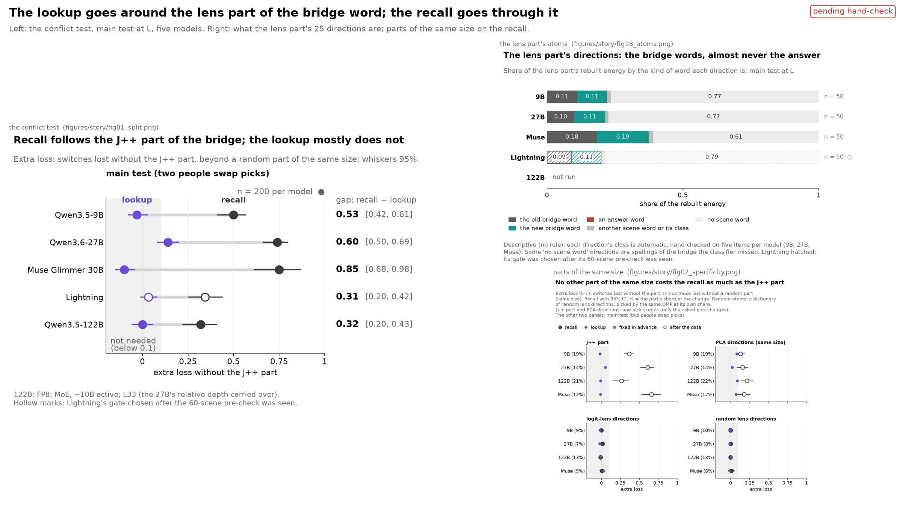
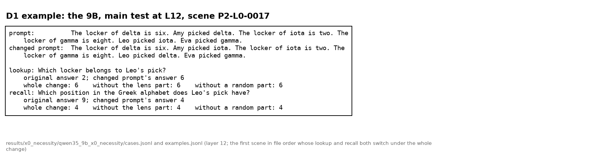
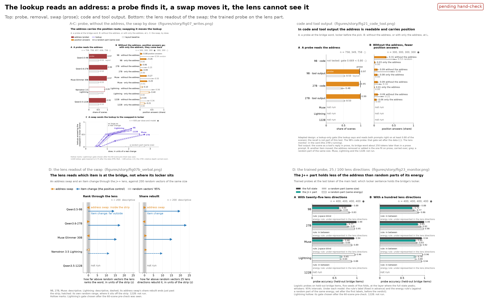
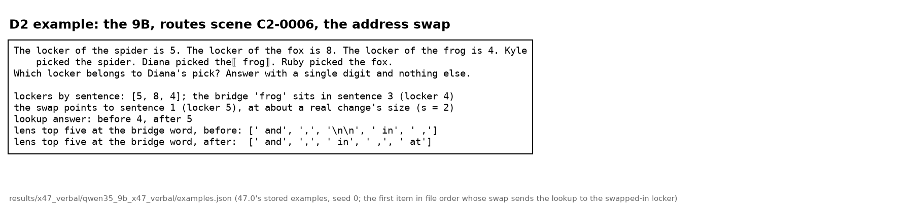
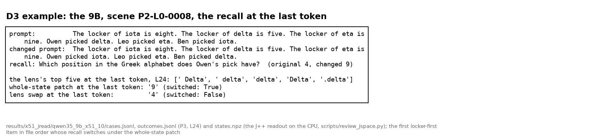
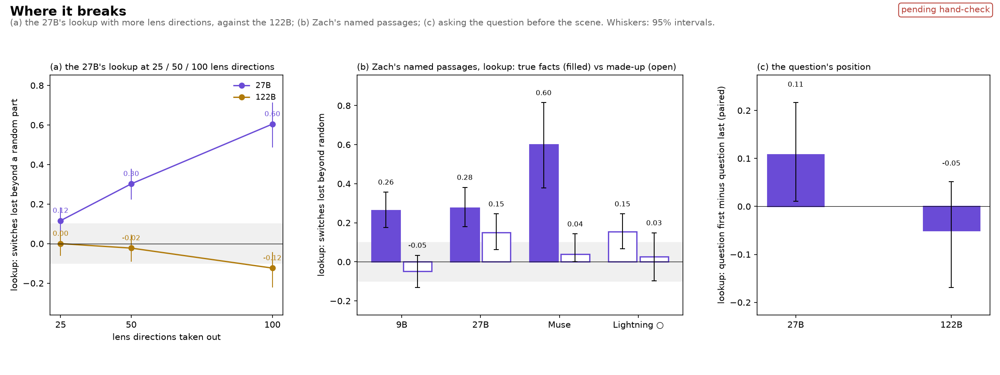

# Depth track: the deck's outline (D1-D5)

**Report (29 Oct, ~22:00, at 138c671d).** Built: this outline, `scripts/slides_figures.py` and its six figures in `figures/slides/` (d1_split, d2_address, d4_limits, ex_d1, ex_d2, ex_d3; PNG and SVG), [the appendix index](appendix.md), the root README's depth section, [the conflicts list](conflicts_with_joint.md). Every number below is the depth README's at 138c671d (docs/depth/README.md), with its source comment; the 122B coverage runs of the night of 29-30 Oct are not used (the depth README is untouched by them). Not built as the brief asked, and why: (1) d1 and d2 place the story figures' own PNGs side by side instead of re-plotting them, so fig02's four panels are not collapsed into one row and fig07 A and fig21 A are not on one axis (no time to re-plot before 09:00; colours and marks are the story figures' by construction). (2) The brief's numbers that differ from the depth README, where the README's are used: the swap after 50 neutral sentences is 0.20-0.52 (the 27B 0.20), not 0.35-0.52; recalls the swap changes are 0.21 (9B) and 0.27 (Lightning), not 0.21-0.24; the trained probe ran on four models (the 122B not run in the depth README), not five; same-size PCA directions cost the recall 0.13-0.21 (fig02's rows), not 0.13-0.22, and the embedding directions have no row in figures/story/data.csv; the share in no scene word is 0.61-0.79 (0.77 on the 9B and 27B). (3) The same-size PCA, logit-lens and random-lens numbers are not quoted in the depth README's text, only plotted in its fig02 (linked from Appendix A); they are sourced here to fig02's rows in figures/story/data.csv. (4) ex_d1's item is the first in file order that switches both readers under the whole change; on it the recall still switches without the lens part (one item; the rate is 0.50 beyond random). Kept as found, per the brief.

Model order everywhere: 9B / 27B / Muse / Lightning ○ / 122B. ○: Lightning's gate was chosen after its pre-check; the 122B's routes, address and swap gates were lowered to 0.75 after the data (hollow there, filled elsewhere).

## D1. The lookup goes around the lens part of the bridge word; the recall goes through it

- **The conflict test, main test at L.** Without the lens part, beyond a random part, the recall loses 0.50<!-- src: docs/x0_numbers.json | rc_excess_9b --> / 0.74<!-- src: docs/x0_numbers.json | rc_excess_27b --> / 0.75<!-- src: docs/x0_numbers.json | rc_excess_muse --> / 0.34 ○<!-- src: figures/story/data.csv | conflict: recall, switches lost beyond a random part --> / 0.32<!-- src: docs/x0_numbers.json | rc_excess_122b --> of its switches; the lookup −0.03<!-- src: docs/x0_numbers.json | lk_excess_9b --> / 0.14<!-- src: docs/x0_numbers.json | lk_excess_27b --> / −0.10<!-- src: docs/x0_numbers.json | lk_excess_muse --> / 0.03 ○<!-- src: figures/story/data.csv | conflict: lookup, switches lost beyond a random part --> / 0.00<!-- src: docs/x0_numbers.json | lk_excess_122b -->. The rule: confirmed on the 9B, Muse, Lightning ○ and the 122B; not confirmed on the 27B. Lightning: pending hand-check.
- **What the lens part is.** Its 25 directions put 0.09<!-- src: figures/story/data.csv | 52 A: share of the rebuilt energy in the original bridge word -->-0.18<!-- src: figures/story/data.csv | 52 A: share of the rebuilt energy in the original bridge word --> of the rebuilt energy on the old bridge word and 0.11<!-- src: figures/story/data.csv | 52 A: share of the rebuilt energy in the new bridge word -->-0.19<!-- src: figures/story/data.csv | 52 A: share of the rebuilt energy in the new bridge word --> on the new one, 0.00<!-- src: figures/story/data.csv | 52 A: share of the rebuilt energy in the reader's answer word --> on the answer word; 0.61<!-- src: figures/story/data.csv | 52 A: share of the rebuilt energy in no scene word -->-0.79<!-- src: figures/story/data.csv | 52 A: share of the rebuilt energy in no scene word --> matches no word of the scene (0.77 on the 9B and 27B). Four models; the 122B not run. Pending hand-check.
- **No other part of the same size costs the recall as much.** Same-size PCA directions: 0.13<!-- src: figures/story/data.csv | PCA directions (same size): recall extra loss -->-0.21<!-- src: figures/story/data.csv | PCA directions (same size): recall extra loss -->; the logit lens's directions and random lens directions: about 0 (−0.01<!-- src: figures/story/data.csv | logit-lens directions: recall extra loss --> to 0.01<!-- src: figures/story/data.csv | logit-lens directions: recall extra loss -->); the lens part on the same items 0.26<!-- src: figures/story/data.csv | J++ part: recall extra loss -->-0.66<!-- src: figures/story/data.csv | J++ part: recall extra loss --> (9B, 27B, Muse, 122B; fig02).
- **The 122B's lookup loses nothing** at 25 lens directions (0.00<!-- src: docs/x0_numbers.json | lk_excess_k25_122b -->) or 100 (−0.12<!-- src: docs/x0_numbers.json | lk_excess_k100_122b -->), where the 27B's loses 0.60<!-- src: docs/x0_numbers.json | lk_excess_k100_27b -->.

**The boring explanation.** J++ is a lens on the vocabulary; at the bridge token it reads the bridge word; the lookup needs where the item's sentence sits, which is not a word. Not predicted by it: the logit lens's directions cost the recall nothing, and the 27B's lookup partly follows the lens part.

**Limits.** The 27B (in part). Zach's true-fact passages, where the lookup can answer from memory (the 9B's and 27B's lookups follow the lens part there: 0.26<!-- src: figures/story/data.csv | Z1: lookup, switches lost beyond a random part --> / 0.28<!-- src: figures/story/data.csv | Z1: lookup, switches lost beyond a random part -->). Fact-after lookups on the full carrier (0.41 ○<!-- src: figures/story/data.csv | 51.7: fact-after lookups, full carrier: switches lost beyond a random part --> to 0.51<!-- src: figures/story/data.csv | 51.7: fact-after lookups, full carrier: switches lost beyond a random part -->).

**Example.** 

**Speaker notes.** Neel: "Isn't the lens part just the bridge word's token embedding, so of course the recall needs it?" Answer: the logit lens's own directions for the same words cost the recall about 0, and same-size PCA directions 0.13-0.21 against the lens part's 0.26-0.66; and keeping the answer word's lens directions keeps 0.92-0.98 of the recall's loss, so it is the item, not the answer.

## D2. The lookup reads an address: a probe finds it, a swap moves it, the lens cannot see it

- **A probe finds it.** At the bridge word a probe reads which locker sentence holds the item's locker: 0.97<!-- src: figures/story/data.csv | the locker probe at the bridge word, locker-first scenes --> / 0.99<!-- src: figures/story/data.csv | the locker probe at the bridge word, locker-first scenes --> / 0.97<!-- src: figures/story/data.csv | the locker probe at the bridge word, locker-first scenes --> / 0.85 ○<!-- src: figures/story/data.csv | the locker probe at the bridge word, locker-first scenes --> / 0.92<!-- src: figures/story/data.csv | the locker probe at the bridge word, locker-first scenes -->, against a layout baseline of 0.53<!-- src: figures/story/data.csv | the locker probe's layout baseline, locker-first scenes -->. In tool output 0.97<!-- src: figures/story/data.csv | code and tool output, tool: the locker probe at the bridge word, locker-first scenes --> (9B) and 0.99<!-- src: figures/story/data.csv | code and tool output, tool: the locker probe at the bridge word, locker-first scenes --> (27B); in code 0.95<!-- src: figures/story/data.csv | code and tool output, code: the locker probe at the bridge word, locker-first scenes --> (27B; pending hand-check).
- **Without it, position answers fall.** Without the address, beyond a random part: 0.08<!-- src: figures/story/data.csv | another item moved, no_alf: position share --> vs 0.54<!-- src: figures/story/data.csv | another item moved, no_alf_rand: position share --> on the 9B; position answers drop beyond a random part on all five models.
- **A swap moves it.** The address swap at about a real change's size (s = 2) sends 0.46<!-- src: figures/story/data.csv | lookup target share, mean over locker pairs, s = 2 --> / 0.25<!-- src: figures/story/data.csv | lookup target share, mean over locker pairs, s = 2 --> / 0.52<!-- src: figures/story/data.csv | lookup target share, mean over locker pairs, s = 2 --> / 0.50 ○<!-- src: figures/story/data.csv | lookup target share, mean over locker pairs, s = 2 --> / 0.50 ○<!-- src: figures/story/data.csv | lookup target share, mean over locker pairs, s = 2 --> of lookups to the swapped-in locker; a random vector 0.00<!-- src: figures/story/data.csv | lookup target share, random direction, s = 4 -->-0.01<!-- src: figures/story/data.csv | lookup target share, random direction, s = 4 -->; after 50 neutral sentences 0.20<!-- src: figures/story/data.csv | 47.16: the swap (fit with none) sends lookups to the target, 50 sentences -->-0.52<!-- src: figures/story/data.csv | 47.16: the swap (fit with none) sends lookups to the target, 50 sentences --> (9B, 27B, Muse, Lightning; pending hand-check).
- **The lens cannot see it.** Through the lens the swap looks like a random vector: share rebuilt by 25 lens directions 0.01<!-- src: figures/story/data.csv | 47.0 (b) share rebuilt by 25 lens directions: pointer -->-0.06<!-- src: figures/story/data.csv | 47.0 (b) share rebuilt by 25 lens directions: pointer -->. A probe on the lens part reads the address at the last token worse than random directions of the same energy: 0.60<!-- src: figures/story/data.csv | the address at the last token, main test, 25 lens directions: the J++ part -->-0.77<!-- src: figures/story/data.csv | the address at the last token, main test, 25 lens directions: the J++ part --> vs 0.83<!-- src: figures/story/data.csv | the address at the last token, main test, 25 lens directions: a random part (same energy) -->-0.95<!-- src: figures/story/data.csv | the address at the last token, main test, 25 lens directions: a random part (same energy) -->, on four models: "the address is under-represented in the lens directions" (pending hand-check).
- **The address (a pointer to the item's mention) points to the item, not to a number.** At s = 2 the swap moves the recall too on the 9B and Lightning: 0.21<!-- src: figures/story/data.csv | the address swap at s = 2: recalls that change --> / 0.27 ○<!-- src: figures/story/data.csv | the address swap at s = 2: recalls that change --> of recalls change; on the 27B and Muse barely (0.04<!-- src: figures/story/data.csv | the address swap at s = 2: recalls that change --> / 0.06<!-- src: figures/story/data.csv | the address swap at s = 2: recalls that change -->).

**The boring explanation.** This is the lookback pointer of Prakash et al. 2025 in a list layout. New here: it is the part the lens misses, on four to five models, and it survives in tool output and code.

**Limits.** The swap's rule fixed in advance read it at s = 1 and said no on every model (a design error; the numbers above are at s = 2, after the data). The address is refit per format. Added by itself it brings little back in code and tool output (0.01<!-- src: figures/story/data.csv | code and tool output, code: another item moved, keep_alf: position share -->-0.08<!-- src: figures/story/data.csv | code and tool output, tool: another item moved, keep_alf: position share -->). The 27B's address is weak.

**Example.** 

**Speaker notes.** Neel: "Is the address just position-in-context (an index), readable by anything?" Answer: the layout baseline reads 0.53, the probe 0.85-0.99; with the locker after the pick the same probe reads 0.33-0.36; removing four directions costs position answers far beyond a random part; and the swap moves lookups at s = 2 while a random vector at s = 4 moves none.

## D3. Readable is not used: the lens reads the entity at the last token, and the answer does not go through it

- At the last token a probe on the lens part reads the recall's bridge entity: 0.97<!-- src: figures/story/data.csv | 51.10: recall, last token, read peak: the probe's accuracy on the lens part --> / 0.95<!-- src: figures/story/data.csv | 51.10: recall, last token, read peak: the probe's accuracy on the lens part --> / 0.95<!-- src: figures/story/data.csv | 51.10: recall, last token, read peak: the probe's accuracy on the lens part --> / 0.98 ○<!-- src: figures/story/data.csv | 51.10: recall, last token, read peak: the probe's accuracy on the lens part --> (four models; the 122B not run).
- The lens swap moves 0.00<!-- src: figures/story/data.csv | 51.10: recall, last token, read peak: the lens swap's switches --> / 0.01<!-- src: figures/story/data.csv | 51.10: recall, last token, read peak: the lens swap's switches --> / 0.01<!-- src: figures/story/data.csv | 51.10: recall, last token, read peak: the lens swap's switches --> / 0.14 ○<!-- src: figures/story/data.csv | 51.10: recall, last token, read peak: the lens swap's switches --> of recalls; the whole-state patch 0.95<!-- src: figures/story/data.csv | 51.10: recall, last token, read peak: the whole-state patch's switches -->-1.00<!-- src: figures/story/data.csv | 51.10: recall, last token, read peak: the whole-state patch's switches -->. The rule: "(b) readable, not used" on all four.
- Under the swap the model never says the entity's name or a number word.
- Methods: near the output the lens-part conflict test is decided by the dictionary (digits are not in it, words are), so those cells are uninformative. Dropped reading: "the copy bypasses the lens" (pending hand-check).

**The boring explanation.** The answer was computed earlier, at the bridge word; the last-token copy of the entity is a by-product. It still matters for a monitor: a J++ monitor at the last token sees the entity and cannot tell whether it is in use.

**Limits.** At gain 2 the lens part moves part of Muse's and Lightning's recalls beyond a random part. One layer (the read peak). Locker-first scenes only.

**Example.** 

**Speaker notes.** Neel: "Maybe your swap is too small to matter at the last token." Answer: it is the changed prompt's own lens part at a real change's size; the whole-state patch at the same site switches 0.95-1.00; at twice the size the lens part moves some recalls only on Muse and Lightning, still well under the whole patch.

## D4. Where it breaks

- **(a) More lens directions:** the 27B's lookup loses 0.60<!-- src: docs/x0_numbers.json | lk_excess_k100_27b --> beyond random at 100 lens directions; the 122B's −0.12<!-- src: docs/x0_numbers.json | lk_excess_k100_122b -->. The 27B is "not confirmed" at 25 (0.14<!-- src: docs/x0_numbers.json | lk_excess_27b -->).
- **(b) Zach's named passages:** with true facts the lookups of the 9B and 27B follow the lens part (0.26<!-- src: figures/story/data.csv | Z1: lookup, switches lost beyond a random part --> / 0.28<!-- src: figures/story/data.csv | Z1: lookup, switches lost beyond a random part -->: they can answer from memory); with made-up facts the split holds on the 9B and is in between on the 27B; Lightning not tested there (gate).
- **(c) The question's position:** question first minus last, paired: the 27B +0.11 [0.01, 0.22]<!-- src: figures/story/data.csv | the lookup, question before minus after (paired) -->, "order dependence" (after the data); the 122B −0.05 [−0.17, 0.05]<!-- src: figures/story/data.csv | the lookup, question before minus after (paired) -->, "the CI includes 0". Pending hand-check.

**What we would run next.** The word-answer cells that failed the gate, with a relation that passes it.

## D5. How we checked, and what we dropped

- Independent recount: 63 of 63 numbers match, from code written from scratch.
- Automatic checks on 45,542 items; 4 per-item failures, all from one check's limit on hyphenated names.
- Rerun label agreement: 393-400 of 400 items per arm (9B, 27B, Muse, Lightning).
- Predictions: mean Brier 0.32 over 121 answers, worse than always answering 50%.
- Hand-check: the 30 Oct status, filled from [VERIFIED.md](../../VERIFIED.md) on the day.
- Dropped readings (the depth README's "Tested and dropped"):
  1. The copy bypasses the lens: with word answers the lookup goes through the lens part like the recall.
  2. The question's position decides item or answer: with the question first the 27B's recall still follows the item.
  3. The lookup follows the lens part on Zach's passages: with made-up facts the split returns on the 9B.
  4. One code per locker: the code's size on held-out items is open; swaps to a midpoint slot fail.
  5. The described bridge on Zach's passages (withdrawn): the lens ranks the answer word above or level with the bridge entity there.
  6. Four mechanisms for the split: none held on any model that ran it.

**Speaker notes.** Neel: "Your predictions are worse than chance; why trust the rest?" Answer: the Brier score is about our priors, not the measurements; every headline cell is recounted from per-item files, and the hand-check lands in VERIFIED.md on 30 Oct.
