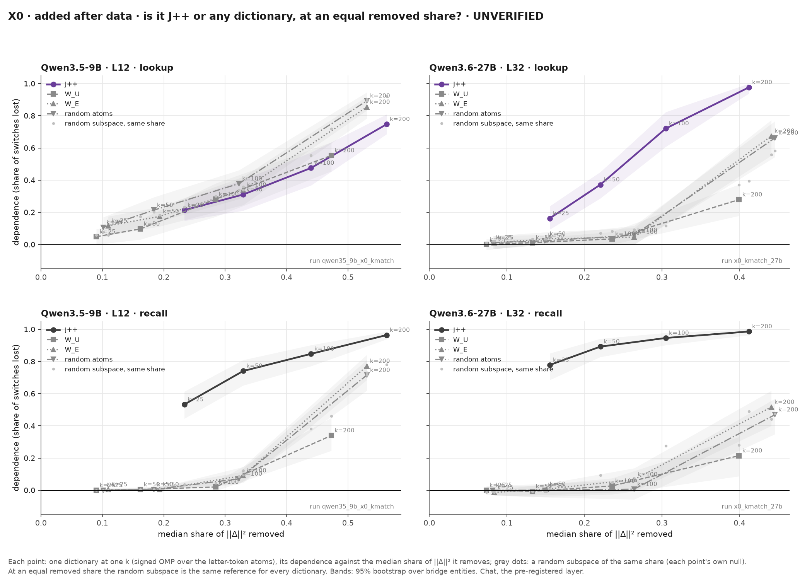
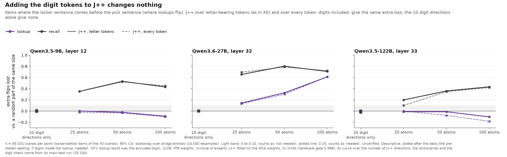

<!-- Generated by scripts/x0_details.py from docs/x0_details.template.md and the X0 runs; edit the template. -->
# X0 in detail

The README gives the summary; this page holds the tables behind it. Every number is recomputed from the run files by `scripts/x0_details.py`, and every number is unverified. Design and log: [jobs/c3/X0.md](../jobs/c3/X0.md). Run folders: [results/x0_necessity/](../results/x0_necessity/).

**Terms.** "Excess" here is the README's "extra loss": the J-dependence (the share of the whole edit's flips lost when a part is removed) minus that of a random subspace of the same share of ‖Δ‖².

**Labels**, per reader and layer:
- around: excess ≤ 0.10, upper CI ≤ 0.20;
- through: J-dependence ≥ 0.30 and excess ≥ 0.20, lower CI ≥ 0.10;
- mixed: the rest;
- can't tell: the whole edit flips < 30% or < 30 items.

CIs are 95%, from a cluster bootstrap over bridge entities (10,000 resamples).

## Every layer (chat, the bridge's word, J++ at 25 atoms)

Qwen3.5-9B (n = 200 scenes, 40 bridge entities; pre-registered layer 12):

| layer | reader | n | S whole | S without J++ | S without random | excess | J++ share | label |
|---|---|---|---|---|---|---|---|---|
| 6 | recall | 200 | 0.98 | 0.07 | 0.92 | 0.85 [0.79, 0.91] | 0.349 | through |
| 6 | lookup | 200 | 0.80 | 0.04 | 0.53 | 0.62 [0.53, 0.70] | 0.349 | through |
| 8 | recall | 200 | 0.99 | 0.30 | 0.97 | 0.67 [0.57, 0.77] | 0.291 | through |
| 8 | lookup | 200 | 0.64 | 0.27 | 0.50 | 0.37 [0.30, 0.45] | 0.291 | through |
| 10 | recall | 200 | 0.99 | 0.38 | 0.96 | 0.59 [0.51, 0.66] | 0.288 | through |
| 10 | lookup | 200 | 0.57 | 0.34 | 0.49 | 0.26 [0.19, 0.33] | 0.288 | through |
| 12 | recall | 200 | 0.98 | 0.46 | 0.95 | 0.50 [0.41, 0.57] | 0.233 | through |
| 12 | lookup | 200 | 0.53 | 0.41 | 0.40 | −0.03 [−0.08, 0.03] | 0.233 | around |
| 14 | recall | 200 | 0.96 | 0.30 | 0.91 | 0.63 [0.53, 0.69] | 0.216 | through |
| 14 | lookup | 200 | 0.46 | 0.41 | 0.37 | −0.10 [−0.15, −0.05] | 0.216 | around |
| 16 | recall | 200 | 0.62 | 0.08 | 0.59 | 0.83 [0.71, 0.91] | 0.223 | through |
| 16 | lookup | 200 | 0.23 | 0.21 | 0.18 | −0.16 [−0.28, −0.03] | 0.223 | can't tell |
| 18 | recall | 200 | 0.54 | 0.09 | 0.45 | 0.67 [0.54, 0.78] | 0.321 | through |
| 18 | lookup | 200 | 0.05 | 0.05 | 0.03 | −0.40 [−0.78, −0.09] | 0.321 | can't tell |
| 20 | recall | 200 | 0.28 | 0.04 | 0.20 | 0.58 [0.41, 0.75] | 0.289 | can't tell |
| 20 | lookup | 200 | 0.00 | 0.00 | 0.00 | nan [nan, nan] | 0.289 | can't tell |

Qwen3.6-27B (n = 200 scenes, 44 bridge entities; pre-registered layer 32):

| layer | reader | n | S whole | S without J++ | S without random | excess | J++ share | label |
|---|---|---|---|---|---|---|---|---|
| 16 | recall | 200 | 0.98 | 0.07 | 0.96 | 0.90 [0.84, 0.96] | 0.179 | through |
| 16 | lookup | 200 | 0.89 | 0.01 | 0.83 | 0.93 [0.89, 0.96] | 0.179 | through |
| 18 | recall | 200 | 0.97 | 0.09 | 0.93 | 0.87 [0.80, 0.92] | 0.245 | through |
| 18 | lookup | 200 | 0.89 | 0.02 | 0.75 | 0.82 [0.76, 0.88] | 0.245 | through |
| 20 | recall | 200 | 0.93 | 0.58 | 0.92 | 0.36 [0.27, 0.46] | 0.190 | through |
| 20 | lookup | 200 | 0.80 | 0.50 | 0.72 | 0.28 [0.21, 0.35] | 0.190 | through |
| 22 | recall | 200 | 0.92 | 0.52 | 0.92 | 0.44 [0.34, 0.53] | 0.214 | through |
| 22 | lookup | 200 | 0.78 | 0.43 | 0.69 | 0.32 [0.25, 0.40] | 0.214 | through |
| 24 | recall | 200 | 0.92 | 0.73 | 0.90 | 0.17 [0.10, 0.25] | 0.175 | mixed |
| 24 | lookup | 200 | 0.73 | 0.59 | 0.67 | 0.10 [0.05, 0.15] | 0.175 | mixed |
| 26 | recall | 200 | 0.90 | 0.36 | 0.92 | 0.62 [0.54, 0.69] | 0.235 | through |
| 26 | lookup | 200 | 0.70 | 0.35 | 0.62 | 0.39 [0.32, 0.45] | 0.235 | through |
| 28 | recall | 200 | 0.94 | 0.39 | 0.93 | 0.57 [0.46, 0.66] | 0.213 | through |
| 28 | lookup | 200 | 0.59 | 0.45 | 0.52 | 0.12 [0.06, 0.18] | 0.213 | mixed |
| 30 | recall | 200 | 0.93 | 0.35 | 0.92 | 0.61 [0.52, 0.68] | 0.172 | through |
| 30 | lookup | 200 | 0.56 | 0.46 | 0.51 | 0.10 [0.05, 0.15] | 0.172 | around |
| 32 | recall | 200 | 0.75 | 0.17 | 0.73 | 0.74 [0.66, 0.80] | 0.155 | through |
| 32 | lookup | 200 | 0.43 | 0.35 | 0.41 | 0.14 [0.08, 0.20] | 0.155 | mixed |
| 34 | recall | 200 | 0.60 | 0.17 | 0.61 | 0.73 [0.61, 0.83] | 0.159 | through |
| 34 | lookup | 200 | 0.38 | 0.31 | 0.38 | 0.17 [0.07, 0.27] | 0.159 | mixed |
| 36 | recall | 200 | 0.31 | 0.10 | 0.34 | 0.77 [0.65, 0.90] | 0.157 | through |
| 36 | lookup | 200 | 0.19 | 0.12 | 0.17 | 0.21 [0.10, 0.34] | 0.157 | can't tell |
| 38 | recall | 200 | 0.31 | 0.10 | 0.33 | 0.74 [0.60, 0.90] | 0.167 | through |
| 38 | lookup | 200 | 0.17 | 0.13 | 0.15 | 0.15 [0.04, 0.30] | 0.167 | can't tell |
| 40 | recall | 200 | 0.17 | 0.14 | 0.21 | 0.40 [0.24, 0.60] | 0.127 | can't tell |
| 40 | lookup | 200 | 0.08 | 0.07 | 0.07 | 0.06 [−0.14, 0.36] | 0.127 | can't tell |

Qwen3.5-122B-A10B (n = 200 scenes, 40 bridge entities; pre-registered layer 33; FP8 weights, mixture of experts, J++ fitted on the bf16 weights, 2x H100, hardware gate 0.998):

| layer | reader | n | S whole | S without J++ | S without random | excess | J++ share | label |
|---|---|---|---|---|---|---|---|---|
| 24 | recall | 200 | 0.96 | 0.47 | 0.93 | 0.47 [0.37, 0.56] | 0.275 | through |
| 24 | lookup | 200 | 0.83 | 0.32 | 0.67 | 0.42 [0.32, 0.50] | 0.275 | through |
| 27 | recall | 200 | 0.93 | 0.18 | 0.88 | 0.75 [0.65, 0.82] | 0.306 | through |
| 27 | lookup | 200 | 0.77 | 0.14 | 0.56 | 0.56 [0.47, 0.64] | 0.306 | through |
| 30 | recall | 200 | 0.93 | 0.48 | 0.91 | 0.45 [0.36, 0.55] | 0.308 | through |
| 30 | lookup | 200 | 0.64 | 0.35 | 0.52 | 0.26 [0.18, 0.33] | 0.308 | through |
| 33 | recall | 200 | 0.92 | 0.56 | 0.84 | 0.32 [0.22, 0.41] | 0.252 | through |
| 33 | lookup | 200 | 0.45 | 0.35 | 0.35 | 0.00 [−0.06, 0.06] | 0.252 | around |
| 36 | recall | 200 | 0.77 | 0.48 | 0.77 | 0.37 [0.28, 0.46] | 0.204 | through |
| 36 | lookup | 200 | 0.29 | 0.28 | 0.28 | −0.02 [−0.10, 0.06] | 0.204 | can't tell |

## Every dictionary and number of atoms (the pre-registered layer; added after the data)

Each dictionary's part is set against a random subspace of its own share. These come from the k-match runs, which recompute the X0 items.

Qwen3.5-9B, layer 12:

| dictionary | atoms | reader | share removed | dependence | random dependence | excess | label |
|---|---|---|---|---|---|---|---|
| J++ | 25 | lookup | 0.233 | 0.21 [0.15, 0.28] | 0.23 [0.15, 0.31] | −0.02 [−0.07, 0.04] | around |
| J++ | 25 | recall | 0.233 | 0.53 [0.45, 0.61] | 0.04 [0.01, 0.07] | 0.50 [0.41, 0.57] | through |
| J++ | 50 | lookup | 0.329 | 0.31 [0.21, 0.40] | 0.34 [0.25, 0.42] | −0.03 [−0.10, 0.04] | around |
| J++ | 50 | recall | 0.329 | 0.74 [0.65, 0.81] | 0.12 [0.07, 0.19] | 0.62 [0.50, 0.71] | through |
| J++ | 100 | lookup | 0.440 | 0.48 [0.37, 0.57] | 0.55 [0.47, 0.62] | −0.08 [−0.15, −0.01] | around |
| J++ | 100 | recall | 0.440 | 0.85 [0.77, 0.90] | 0.38 [0.31, 0.46] | 0.47 [0.35, 0.55] | through |
| J++ | 200 | lookup | 0.563 | 0.75 [0.69, 0.81] | 0.92 [0.87, 0.97] | −0.17 [−0.25, −0.11] | around |
| J++ | 200 | recall | 0.563 | 0.96 [0.94, 0.99] | 0.78 [0.70, 0.86] | 0.18 [0.11, 0.26] | mixed |
| random lens directions | 25 | lookup | 0.101 | 0.11 [0.05, 0.17] | 0.08 [0.02, 0.14] | 0.03 [−0.01, 0.08] | around |
| random lens directions | 25 | recall | 0.101 | 0.00 [0.00, 0.00] | 0.00 [0.00, 0.00] | 0.00 [0.00, 0.00] | around |
| random lens directions | 50 | lookup | 0.184 | 0.21 [0.13, 0.29] | 0.20 [0.11, 0.29] | 0.01 [−0.03, 0.05] | around |
| random lens directions | 50 | recall | 0.184 | 0.01 [0.00, 0.02] | 0.01 [0.00, 0.02] | 0.00 [0.00, 0.00] | around |
| random lens directions | 100 | lookup | 0.323 | 0.38 [0.28, 0.46] | 0.34 [0.25, 0.42] | 0.04 [0.01, 0.07] | around |
| random lens directions | 100 | recall | 0.323 | 0.07 [0.04, 0.11] | 0.09 [0.05, 0.13] | −0.02 [−0.04, 0.01] | around |
| random lens directions | 200 | lookup | 0.531 | 0.89 [0.83, 0.95] | 0.90 [0.83, 0.96] | −0.01 [−0.06, 0.04] | around |
| random lens directions | 200 | recall | 0.531 | 0.72 [0.62, 0.81] | 0.73 [0.65, 0.81] | −0.02 [−0.06, 0.03] | around |
| W_E | 25 | lookup | 0.109 | 0.12 [0.06, 0.17] | 0.06 [0.01, 0.12] | 0.06 [0.01, 0.11] | around |
| W_E | 25 | recall | 0.109 | 0.01 [0.00, 0.02] | 0.00 [0.00, 0.00] | 0.01 [0.00, 0.02] | around |
| W_E | 50 | lookup | 0.193 | 0.17 [0.11, 0.23] | 0.18 [0.10, 0.28] | −0.01 [−0.07, 0.05] | around |
| W_E | 50 | recall | 0.193 | 0.01 [0.00, 0.02] | 0.01 [0.00, 0.03] | −0.01 [−0.02, 0.00] | around |
| W_E | 100 | lookup | 0.329 | 0.34 [0.25, 0.42] | 0.36 [0.26, 0.44] | −0.02 [−0.06, 0.03] | around |
| W_E | 100 | recall | 0.329 | 0.09 [0.05, 0.15] | 0.10 [0.06, 0.15] | −0.01 [−0.04, 0.03] | around |
| W_E | 200 | lookup | 0.531 | 0.85 [0.78, 0.92] | 0.89 [0.82, 0.95] | −0.04 [−0.08, 0.00] | around |
| W_E | 200 | recall | 0.531 | 0.77 [0.69, 0.84] | 0.72 [0.63, 0.80] | 0.06 [0.01, 0.10] | around |
| W_U | 25 | lookup | 0.090 | 0.05 [0.00, 0.10] | 0.06 [0.00, 0.12] | −0.01 [−0.06, 0.04] | around |
| W_U | 25 | recall | 0.090 | 0.00 [0.00, 0.00] | 0.00 [0.00, 0.00] | 0.00 [0.00, 0.00] | around |
| W_U | 50 | lookup | 0.162 | 0.10 [0.03, 0.16] | 0.17 [0.09, 0.26] | −0.08 [−0.15, −0.01] | around |
| W_U | 50 | recall | 0.162 | 0.01 [0.00, 0.02] | 0.01 [0.00, 0.02] | 0.00 [0.00, 0.00] | around |
| W_U | 100 | lookup | 0.284 | 0.28 [0.17, 0.38] | 0.30 [0.21, 0.38] | −0.02 [−0.08, 0.04] | around |
| W_U | 100 | recall | 0.284 | 0.02 [−0.00, 0.05] | 0.05 [0.02, 0.08] | −0.03 [−0.05, 0.00] | around |
| W_U | 200 | lookup | 0.473 | 0.55 [0.46, 0.64] | 0.72 [0.65, 0.79] | −0.17 [−0.24, −0.10] | around |
| W_U | 200 | recall | 0.473 | 0.34 [0.25, 0.45] | 0.46 [0.35, 0.58] | −0.12 [−0.18, −0.05] | around |

Qwen3.6-27B, layer 32:

| dictionary | atoms | reader | share removed | dependence | random dependence | excess | label |
|---|---|---|---|---|---|---|---|
| J++ | 25 | lookup | 0.155 | 0.16 [0.09, 0.24] | 0.05 [0.01, 0.09] | 0.12 [0.06, 0.18] | mixed |
| J++ | 25 | recall | 0.155 | 0.78 [0.69, 0.85] | 0.01 [−0.02, 0.05] | 0.77 [0.69, 0.83] | through |
| J++ | 50 | lookup | 0.221 | 0.37 [0.29, 0.45] | 0.07 [0.03, 0.12] | 0.30 [0.22, 0.38] | through |
| J++ | 50 | recall | 0.221 | 0.89 [0.83, 0.94] | 0.09 [0.03, 0.16] | 0.80 [0.72, 0.87] | through |
| J++ | 100 | lookup | 0.305 | 0.72 [0.61, 0.82] | 0.12 [0.06, 0.18] | 0.60 [0.49, 0.71] | through |
| J++ | 100 | recall | 0.305 | 0.95 [0.90, 0.98] | 0.28 [0.19, 0.35] | 0.67 [0.60, 0.75] | through |
| J++ | 200 | lookup | 0.412 | 0.98 [0.94, 1.00] | 0.40 [0.29, 0.49] | 0.58 [0.48, 0.68] | through |
| J++ | 200 | recall | 0.412 | 0.99 [0.96, 1.00] | 0.49 [0.40, 0.57] | 0.50 [0.41, 0.59] | through |
| random lens directions | 25 | lookup | 0.082 | 0.01 [−0.03, 0.05] | 0.02 [0.00, 0.06] | −0.01 [−0.04, 0.00] | around |
| random lens directions | 25 | recall | 0.082 | 0.00 [−0.03, 0.03] | −0.01 [−0.03, 0.02] | 0.01 [−0.02, 0.03] | around |
| random lens directions | 50 | lookup | 0.149 | 0.02 [0.00, 0.06] | 0.03 [0.00, 0.08] | −0.01 [−0.04, 0.00] | around |
| random lens directions | 50 | recall | 0.149 | 0.00 [−0.04, 0.04] | −0.01 [−0.04, 0.03] | 0.01 [−0.02, 0.04] | around |
| random lens directions | 100 | lookup | 0.264 | 0.06 [0.00, 0.12] | 0.09 [0.04, 0.15] | −0.03 [−0.08, 0.00] | around |
| random lens directions | 100 | recall | 0.264 | 0.01 [−0.06, 0.07] | 0.07 [0.02, 0.13] | −0.07 [−0.12, −0.01] | around |
| random lens directions | 200 | lookup | 0.446 | 0.66 [0.54, 0.77] | 0.58 [0.44, 0.70] | 0.08 [0.01, 0.17] | around |
| random lens directions | 200 | recall | 0.446 | 0.47 [0.35, 0.57] | 0.48 [0.37, 0.57] | −0.01 [−0.07, 0.04] | around |
| W_E | 25 | lookup | 0.084 | 0.01 [−0.03, 0.05] | 0.02 [0.00, 0.06] | −0.01 [−0.04, 0.00] | around |
| W_E | 25 | recall | 0.084 | −0.01 [−0.04, 0.00] | −0.01 [−0.04, 0.01] | 0.00 [−0.03, 0.03] | around |
| W_E | 50 | lookup | 0.151 | 0.03 [0.00, 0.08] | 0.03 [0.00, 0.08] | 0.00 [−0.03, 0.03] | around |
| W_E | 50 | recall | 0.151 | 0.01 [−0.03, 0.04] | −0.01 [−0.04, 0.03] | 0.01 [−0.02, 0.05] | around |
| W_E | 100 | lookup | 0.264 | 0.05 [0.00, 0.10] | 0.08 [0.02, 0.15] | −0.03 [−0.07, 0.00] | around |
| W_E | 100 | recall | 0.264 | 0.07 [−0.01, 0.14] | 0.06 [0.01, 0.12] | 0.01 [−0.04, 0.05] | around |
| W_E | 200 | lookup | 0.441 | 0.67 [0.55, 0.77] | 0.56 [0.42, 0.68] | 0.12 [0.02, 0.22] | mixed |
| W_E | 200 | recall | 0.441 | 0.52 [0.40, 0.62] | 0.44 [0.33, 0.54] | 0.07 [0.01, 0.12] | around |
| W_U | 25 | lookup | 0.073 | 0.00 [−0.03, 0.03] | 0.01 [−0.03, 0.05] | −0.01 [−0.04, 0.00] | around |
| W_U | 25 | recall | 0.073 | 0.00 [−0.03, 0.03] | −0.01 [−0.04, 0.01] | 0.01 [−0.01, 0.04] | around |
| W_U | 50 | lookup | 0.133 | 0.01 [0.00, 0.04] | 0.03 [0.00, 0.08] | −0.02 [−0.06, 0.00] | around |
| W_U | 50 | recall | 0.133 | −0.01 [−0.04, 0.03] | −0.01 [−0.04, 0.02] | 0.00 [−0.03, 0.03] | around |
| W_U | 100 | lookup | 0.235 | 0.03 [0.00, 0.08] | 0.08 [0.03, 0.14] | −0.05 [−0.08, −0.01] | around |
| W_U | 100 | recall | 0.235 | 0.03 [−0.03, 0.08] | 0.05 [−0.01, 0.10] | −0.02 [−0.07, 0.02] | around |
| W_U | 200 | lookup | 0.399 | 0.28 [0.18, 0.37] | 0.37 [0.26, 0.47] | −0.09 [−0.18, 0.00] | around |
| W_U | 200 | recall | 0.399 | 0.21 [0.09, 0.33] | 0.28 [0.15, 0.39] | −0.07 [−0.13, −0.01] | around |

Qwen3.5-122B, layer 33 (from its X0 run: J++ at 25 / 50 / 100 directions; W_U, W_E and random lens directions at 25 only; J++ over every token and the digit directions):

| dictionary | atoms | reader | share removed | dependence | random dependence | excess | label |
|---|---|---|---|---|---|---|---|
| J++ | 25 | lookup | 0.252 | 0.20 [0.11, 0.30] | 0.20 [0.10, 0.31] | 0.00 [−0.06, 0.06] | around |
| J++ | 25 | recall | 0.252 | 0.40 [0.30, 0.49] | 0.08 [0.04, 0.13] | 0.32 [0.22, 0.41] | through |
| J++ | 50 | lookup | 0.334 | 0.26 [0.15, 0.37] | 0.28 [0.17, 0.39] | −0.02 [−0.09, 0.05] | around |
| J++ | 50 | recall | 0.334 | 0.64 [0.54, 0.71] | 0.18 [0.11, 0.26] | 0.45 [0.35, 0.54] | through |
| J++ | 100 | lookup | 0.436 | 0.36 [0.26, 0.45] | 0.48 [0.38, 0.59] | −0.12 [−0.22, −0.04] | around |
| J++ | 100 | recall | 0.436 | 0.83 [0.74, 0.89] | 0.40 [0.32, 0.48] | 0.43 [0.32, 0.51] | through |
| J++ (every token) | 25 | lookup | 0.253 | 0.18 [0.08, 0.28] | 0.18 [0.07, 0.30] | 0.00 [−0.08, 0.08] | around |
| J++ (every token) | 25 | recall | 0.253 | 0.37 [0.27, 0.47] | 0.10 [0.05, 0.15] | 0.27 [0.17, 0.38] | through |
| J++ (every token) | 50 | lookup | 0.334 | 0.21 [0.11, 0.33] | 0.31 [0.20, 0.42] | −0.10 [−0.19, −0.03] | around |
| J++ (every token) | 50 | recall | 0.334 | 0.61 [0.50, 0.71] | 0.18 [0.12, 0.25] | 0.43 [0.32, 0.52] | through |
| J++ (every token) | 100 | lookup | 0.434 | 0.33 [0.21, 0.44] | 0.51 [0.40, 0.62] | −0.18 [−0.30, −0.07] | around |
| J++ (every token) | 100 | recall | 0.434 | 0.83 [0.75, 0.89] | 0.42 [0.34, 0.51] | 0.41 [0.30, 0.49] | through |
| the 10 digit directions | 10 | lookup | 0.008 | 0.00 [−0.06, 0.05] | 0.01 [−0.04, 0.06] | −0.01 [−0.04, 0.00] | around |
| the 10 digit directions | 10 | recall | 0.008 | 0.01 [−0.02, 0.04] | −0.01 [−0.03, 0.02] | 0.01 [−0.01, 0.03] | around |
| random lens directions | 25 | lookup | 0.134 | 0.10 [0.04, 0.17] | 0.09 [0.03, 0.16] | 0.01 [−0.04, 0.06] | around |
| random lens directions | 25 | recall | 0.134 | 0.01 [−0.01, 0.03] | 0.01 [−0.01, 0.03] | 0.00 [−0.02, 0.02] | around |
| W_E | 25 | lookup | 0.178 | 0.11 [0.04, 0.19] | 0.11 [0.05, 0.19] | 0.00 [−0.06, 0.06] | around |
| W_E | 25 | recall | 0.178 | 0.03 [0.00, 0.06] | 0.03 [0.00, 0.06] | 0.01 [−0.02, 0.03] | around |
| W_U | 25 | lookup | 0.125 | 0.08 [0.02, 0.15] | 0.09 [0.03, 0.16] | −0.01 [−0.05, 0.03] | around |
| W_U | 25 | recall | 0.125 | 0.00 [−0.01, 0.02] | 0.01 [−0.01, 0.03] | −0.01 [−0.02, 0.00] | around |

On the 27B, the lookup's J-dependence tracks, across layers, the share of ‖Δ‖² that J++ takes (Spearman 0.79). The recall's does not.

## Subsets (the pre-registered layer; added after the data)

- **Upstream change.** The alt swaps two people's picks. Where the other changed pick comes first, Δ at the asked word also carries that change. On the 27B:
  - with the upstream change (n = 97), lookups flip 63%, excess 0.16;
  - asked first (n = 103), lookups flip 24%, excess 0.08, too few flips to measure.
- **Sentence order.** The whole edit flips lookups 86% vs 19% (9B) and 76% vs 9% (27B), with the locker sentence before vs after the pick sentence.

Qwen3.5-9B:

| split | value | reader | n | flipped by the whole edit | excess | label |
|---|---|---|---|---|---|---|
| upstream | no | lookup | 92 | 31 | −0.03 [−0.11, 0.00] | around |
| upstream | no | recall | 92 | 89 | 0.62 [0.49, 0.70] | through |
| upstream | yes | lookup | 108 | 74 | −0.03 [−0.09, 0.05] | around |
| upstream | yes | recall | 108 | 108 | 0.40 [0.30, 0.51] | through |
| domain | animals | lookup | 68 | 45 | 0.00 [−0.08, 0.10] | around |
| domain | animals | recall | 68 | 68 | 0.35 [0.21, 0.49] | through |
| domain | elements | lookup | 76 | 31 | −0.06 [−0.10, 0.00] | around |
| domain | elements | recall | 76 | 75 | 0.56 [0.48, 0.69] | through |
| domain | greek | lookup | 56 | 29 (too few) | −0.03 [−0.17, 0.08] | can't tell |
| domain | greek | recall | 56 | 54 | 0.59 [0.43, 0.69] | through |
| asked pick place | 1st | lookup | 58 | 13 (too few) | 0.00 [0.00, 0.00] | can't tell |
| asked pick place | 1st | recall | 58 | 55 | 0.67 [0.53, 0.79] | through |
| asked pick place | 2nd | lookup | 63 | 33 | −0.03 [−0.13, 0.07] | around |
| asked pick place | 2nd | recall | 63 | 63 | 0.59 [0.46, 0.70] | through |
| asked pick place | 3rd | lookup | 79 | 59 | −0.03 [−0.10, 0.05] | around |
| asked pick place | 3rd | recall | 79 | 79 | 0.30 [0.20, 0.41] | through |
| org locker vs asked pick | after | lookup | 100 | 19 (too few) | −0.21 [−0.43, −0.05] | can't tell |
| org locker vs asked pick | after | recall | 100 | 97 | 0.65 [0.57, 0.73] | through |
| org locker vs asked pick | before | lookup | 100 | 86 | 0.01 [−0.04, 0.07] | around |
| org locker vs asked pick | before | recall | 100 | 100 | 0.35 [0.26, 0.43] | through |
| alt locker vs asked pick | after | lookup | 93 | 18 (too few) | 0.22 [0.06, 0.42] | can't tell |
| alt locker vs asked pick | after | recall | 93 | 90 | 0.73 [0.63, 0.82] | through |
| alt locker vs asked pick | before | lookup | 107 | 87 | −0.08 [−0.14, −0.01] | around |
| alt locker vs asked pick | before | recall | 107 | 107 | 0.30 [0.20, 0.39] | through |

Qwen3.6-27B:

| split | value | reader | n | flipped by the whole edit | excess | label |
|---|---|---|---|---|---|---|
| upstream | no | lookup | 103 | 25 (too few) | 0.08 [0.00, 0.20] | can't tell |
| upstream | no | recall | 103 | 78 | 0.74 [0.61, 0.86] | through |
| upstream | yes | lookup | 97 | 61 | 0.16 [0.08, 0.27] | mixed |
| upstream | yes | recall | 97 | 72 | 0.74 [0.62, 0.83] | through |
| domain | animals | lookup | 70 | 35 | 0.09 [0.00, 0.17] | around |
| domain | animals | recall | 70 | 48 | 0.69 [0.56, 0.81] | through |
| domain | elements | lookup | 69 | 28 (too few) | 0.21 [0.08, 0.36] | can't tell |
| domain | elements | recall | 69 | 60 | 0.82 [0.71, 0.88] | through |
| domain | greek | lookup | 61 | 23 (too few) | 0.13 [0.04, 0.24] | can't tell |
| domain | greek | recall | 61 | 42 | 0.69 [0.58, 0.82] | through |
| asked pick place | 1st | lookup | 70 | 11 (too few) | 0.09 [0.00, 0.25] | can't tell |
| asked pick place | 1st | recall | 70 | 51 | 0.78 [0.69, 0.89] | through |
| asked pick place | 2nd | lookup | 57 | 28 (too few) | 0.14 [0.04, 0.26] | can't tell |
| asked pick place | 2nd | recall | 57 | 48 | 0.69 [0.49, 0.88] | through |
| asked pick place | 3rd | lookup | 73 | 47 | 0.15 [0.06, 0.25] | mixed |
| asked pick place | 3rd | recall | 73 | 51 | 0.75 [0.58, 0.87] | through |
| org locker vs asked pick | after | lookup | 99 | 9 (too few) | 0.11 [0.00, 0.40] | can't tell |
| org locker vs asked pick | after | recall | 99 | 75 | 0.81 [0.71, 0.91] | through |
| org locker vs asked pick | before | lookup | 101 | 77 | 0.14 [0.07, 0.22] | mixed |
| org locker vs asked pick | before | recall | 101 | 75 | 0.67 [0.58, 0.76] | through |
| alt locker vs asked pick | after | lookup | 93 | 12 (too few) | 0.17 [0.00, 0.43] | can't tell |
| alt locker vs asked pick | after | recall | 93 | 78 | 0.74 [0.65, 0.84] | through |
| alt locker vs asked pick | before | lookup | 107 | 74 | 0.14 [0.07, 0.21] | mixed |
| alt locker vs asked pick | before | recall | 107 | 72 | 0.74 [0.59, 0.86] | through |

Qwen3.5-122B:

| split | value | reader | n | flipped by the whole edit | excess | label |
|---|---|---|---|---|---|---|
| upstream | no | lookup | 117 | 38 | −0.05 [−0.15, 0.05] | around |
| upstream | no | recall | 117 | 105 | 0.37 [0.23, 0.50] | through |
| upstream | yes | lookup | 83 | 51 | 0.04 [−0.06, 0.13] | around |
| upstream | yes | recall | 83 | 79 | 0.24 [0.15, 0.34] | through |
| domain | animals | lookup | 48 | 29 (too few) | 0.00 [−0.13, 0.15] | can't tell |
| domain | animals | recall | 48 | 43 | 0.33 [0.21, 0.45] | through |
| domain | elements | lookup | 81 | 33 | 0.00 [−0.08, 0.08] | around |
| domain | elements | recall | 81 | 78 | 0.38 [0.20, 0.58] | through |
| domain | greek | lookup | 71 | 27 (too few) | 0.00 [−0.11, 0.10] | can't tell |
| domain | greek | recall | 71 | 63 | 0.22 [0.09, 0.33] | mixed |
| asked pick place | 1st | lookup | 81 | 19 (too few) | −0.11 [−0.28, 0.12] | can't tell |
| asked pick place | 1st | recall | 81 | 69 | 0.45 [0.29, 0.60] | through |
| asked pick place | 2nd | lookup | 64 | 34 | 0.00 [−0.07, 0.10] | around |
| asked pick place | 2nd | recall | 64 | 63 | 0.19 [0.08, 0.31] | mixed |
| asked pick place | 3rd | lookup | 55 | 36 | 0.06 [−0.06, 0.16] | around |
| asked pick place | 3rd | recall | 55 | 52 | 0.29 [0.16, 0.43] | through |
| org locker vs asked pick | after | lookup | 115 | 13 (too few) | 0.08 [0.00, 0.23] | can't tell |
| org locker vs asked pick | after | recall | 115 | 103 | 0.41 [0.26, 0.54] | through |
| org locker vs asked pick | before | lookup | 85 | 76 | −0.01 [−0.08, 0.06] | around |
| org locker vs asked pick | before | recall | 85 | 81 | 0.20 [0.10, 0.30] | mixed |
| alt locker vs asked pick | after | lookup | 114 | 26 (too few) | 0.00 [−0.18, 0.20] | can't tell |
| alt locker vs asked pick | after | recall | 114 | 102 | 0.42 [0.27, 0.57] | through |
| alt locker vs asked pick | before | lookup | 86 | 63 | 0.00 [−0.06, 0.06] | around |
| alt locker vs asked pick | before | recall | 86 | 82 | 0.18 [0.09, 0.29] | mixed |

## The digit check (the pre-registered layer; added after the data)

The question: the J++ dictionary has letter-bearing tokens only. Does the lookup read the answer digit at the bridge's word, which no letter-only dictionary can remove?
- The pre-stated reading (Dan, before the run): if J++ over every token, or the 10 digit directions alone, makes the lookup "through" in locker-before items, X0's "around" was the excluded digit.
- The reference: letter-only J++ at the same number of atoms.
- Result: the digits change nothing. The J++ readout at the bridge's word ranks the lookup's answer digit first in 8% (9B) and 13% (27B) of locker-before items, against a chance of 10%.

Qwen3.5-9B, layer 12:

| locker vs pick | reader | dictionary | atoms | n | flipped by the whole edit | excess | label |
|---|---|---|---|---|---|---|---|
| before | lookup | J++ (letters) | 25 | 100 | 86 | 0.00 [−0.04, 0.05] | around |
| before | lookup | J++ (letters) | 50 | 100 | 86 | −0.02 [−0.10, 0.06] | around |
| before | lookup | J++ (letters) | 100 | 100 | 86 | −0.09 [−0.18, −0.01] | around |
| before | lookup | J++ (every token) | 25 | 100 | 86 | −0.02 [−0.07, 0.04] | around |
| before | lookup | J++ (every token) | 50 | 100 | 86 | −0.03 [−0.11, 0.04] | around |
| before | lookup | J++ (every token) | 100 | 100 | 86 | −0.10 [−0.19, −0.02] | around |
| before | lookup | the 10 digit directions | 10 | 100 | 86 | 0.00 [−0.03, 0.03] | around |
| before | recall | J++ (letters) | 25 | 100 | 100 | 0.35 [0.26, 0.43] | through |
| before | recall | J++ (letters) | 50 | 100 | 100 | 0.53 [0.40, 0.64] | through |
| before | recall | J++ (letters) | 100 | 100 | 100 | 0.43 [0.26, 0.57] | through |
| before | recall | J++ (every token) | 25 | 100 | 100 | 0.35 [0.26, 0.43] | through |
| before | recall | J++ (every token) | 50 | 100 | 100 | 0.52 [0.40, 0.62] | through |
| before | recall | J++ (every token) | 100 | 100 | 100 | 0.45 [0.30, 0.58] | through |
| before | recall | the 10 digit directions | 10 | 100 | 100 | 0.00 [0.00, 0.00] | around |
| after | lookup | J++ (letters) | 25 | 100 | 20 | −0.20 [−0.40, −0.05] | can't tell |
| after | lookup | J++ (letters) | 50 | 100 | 20 | −0.05 [−0.23, 0.12] | can't tell |
| after | lookup | J++ (letters) | 100 | 100 | 20 | −0.05 [−0.18, 0.00] | can't tell |
| after | lookup | J++ (every token) | 25 | 100 | 20 | −0.25 [−0.45, −0.08] | can't tell |
| after | lookup | J++ (every token) | 50 | 100 | 20 | −0.05 [−0.23, 0.12] | can't tell |
| after | lookup | J++ (every token) | 100 | 100 | 20 | 0.00 [0.00, 0.00] | can't tell |
| after | lookup | the 10 digit directions | 10 | 100 | 20 | 0.05 [0.00, 0.20] | can't tell |
| after | recall | J++ (letters) | 25 | 100 | 97 | 0.65 [0.57, 0.73] | through |
| after | recall | J++ (letters) | 50 | 100 | 97 | 0.74 [0.62, 0.84] | through |
| after | recall | J++ (letters) | 100 | 100 | 97 | 0.52 [0.40, 0.62] | through |
| after | recall | J++ (every token) | 25 | 100 | 97 | 0.66 [0.58, 0.74] | through |
| after | recall | J++ (every token) | 50 | 100 | 97 | 0.72 [0.60, 0.82] | through |
| after | recall | J++ (every token) | 100 | 100 | 97 | 0.54 [0.42, 0.65] | through |
| after | recall | the 10 digit directions | 10 | 100 | 97 | 0.00 [0.00, 0.00] | around |

Qwen3.6-27B, layer 32:

| locker vs pick | reader | dictionary | atoms | n | flipped by the whole edit | excess | label |
|---|---|---|---|---|---|---|---|
| before | lookup | J++ (letters) | 25 | 101 | 77 | 0.14 [0.07, 0.22] | mixed |
| before | lookup | J++ (letters) | 50 | 101 | 77 | 0.32 [0.23, 0.41] | through |
| before | lookup | J++ (letters) | 100 | 101 | 77 | 0.61 [0.49, 0.73] | through |
| before | lookup | J++ (every token) | 25 | 101 | 77 | 0.13 [0.06, 0.21] | mixed |
| before | lookup | J++ (every token) | 50 | 101 | 77 | 0.30 [0.21, 0.39] | through |
| before | lookup | J++ (every token) | 100 | 101 | 77 | 0.61 [0.49, 0.73] | through |
| before | lookup | the 10 digit directions | 10 | 101 | 77 | 0.00 [0.00, 0.00] | around |
| before | recall | J++ (letters) | 25 | 101 | 75 | 0.65 [0.56, 0.74] | through |
| before | recall | J++ (letters) | 50 | 101 | 75 | 0.80 [0.70, 0.89] | through |
| before | recall | J++ (letters) | 100 | 101 | 75 | 0.71 [0.61, 0.79] | through |
| before | recall | J++ (every token) | 25 | 101 | 75 | 0.69 [0.61, 0.77] | through |
| before | recall | J++ (every token) | 50 | 101 | 75 | 0.79 [0.68, 0.88] | through |
| before | recall | J++ (every token) | 100 | 101 | 75 | 0.72 [0.62, 0.81] | through |
| before | recall | the 10 digit directions | 10 | 101 | 75 | 0.00 [0.00, 0.00] | around |
| after | lookup | J++ (letters) | 25 | 99 | 8 | 0.12 [0.00, 0.44] | can't tell |
| after | lookup | J++ (letters) | 50 | 99 | 8 | 0.25 [0.00, 0.67] | can't tell |
| after | lookup | J++ (letters) | 100 | 99 | 8 | 0.50 [0.17, 0.83] | can't tell |
| after | lookup | J++ (every token) | 25 | 99 | 8 | 0.12 [0.00, 0.44] | can't tell |
| after | lookup | J++ (every token) | 50 | 99 | 8 | 0.25 [0.00, 0.67] | can't tell |
| after | lookup | J++ (every token) | 100 | 99 | 8 | 0.37 [0.00, 0.69] | can't tell |
| after | lookup | the 10 digit directions | 10 | 99 | 8 | 0.00 [0.00, 0.00] | can't tell |
| after | recall | J++ (letters) | 25 | 99 | 75 | 0.80 [0.68, 0.91] | through |
| after | recall | J++ (letters) | 50 | 99 | 75 | 0.81 [0.70, 0.92] | through |
| after | recall | J++ (letters) | 100 | 99 | 75 | 0.63 [0.52, 0.75] | through |
| after | recall | J++ (every token) | 25 | 99 | 75 | 0.79 [0.66, 0.90] | through |
| after | recall | J++ (every token) | 50 | 99 | 75 | 0.81 [0.70, 0.92] | through |
| after | recall | J++ (every token) | 100 | 99 | 75 | 0.64 [0.53, 0.76] | through |
| after | recall | the 10 digit directions | 10 | 99 | 75 | 0.00 [0.00, 0.00] | around |

Qwen3.5-122B, layer 33 (its X0 run; the readout ranks the answer digit first in 8% of locker-before items):

| locker vs pick | reader | dictionary | atoms | n | flipped by the whole edit | excess | label |
|---|---|---|---|---|---|---|---|
| before | lookup | J++ (letters) | 25 | 85 | 76 | −0.01 [−0.08, 0.06] | around |
| before | lookup | J++ (letters) | 50 | 85 | 76 | −0.01 [−0.08, 0.06] | around |
| before | lookup | J++ (letters) | 100 | 85 | 76 | −0.11 [−0.22, −0.01] | around |
| before | lookup | J++ (every token) | 25 | 85 | 76 | 0.00 [−0.08, 0.09] | around |
| before | lookup | J++ (every token) | 50 | 85 | 76 | −0.08 [−0.16, 0.00] | around |
| before | lookup | J++ (every token) | 100 | 85 | 76 | −0.18 [−0.31, −0.06] | around |
| before | lookup | the 10 digit directions | 10 | 85 | 76 | 0.00 [0.00, 0.00] | around |
| before | recall | J++ (letters) | 25 | 85 | 81 | 0.20 [0.10, 0.30] | mixed |
| before | recall | J++ (letters) | 50 | 85 | 81 | 0.36 [0.24, 0.45] | through |
| before | recall | J++ (letters) | 100 | 85 | 81 | 0.43 [0.27, 0.57] | through |
| before | recall | J++ (every token) | 25 | 85 | 81 | 0.10 [0.01, 0.19] | around |
| before | recall | J++ (every token) | 50 | 85 | 81 | 0.35 [0.20, 0.46] | through |
| before | recall | J++ (every token) | 100 | 85 | 81 | 0.42 [0.25, 0.56] | through |
| before | recall | the 10 digit directions | 10 | 85 | 81 | −0.01 [−0.05, 0.00] | around |
| after | lookup | J++ (letters) | 25 | 115 | 13 | 0.08 [0.00, 0.23] | can't tell |
| after | lookup | J++ (letters) | 50 | 115 | 13 | −0.08 [−0.23, 0.00] | can't tell |
| after | lookup | J++ (letters) | 100 | 115 | 13 | −0.23 [−0.39, 0.00] | can't tell |
| after | lookup | J++ (every token) | 25 | 115 | 13 | 0.00 [−0.19, 0.33] | can't tell |
| after | lookup | J++ (every token) | 50 | 115 | 13 | −0.23 [−0.50, 0.00] | can't tell |
| after | lookup | J++ (every token) | 100 | 115 | 13 | −0.15 [−0.33, 0.00] | can't tell |
| after | lookup | the 10 digit directions | 10 | 115 | 13 | −0.08 [−0.23, 0.00] | can't tell |
| after | recall | J++ (letters) | 25 | 115 | 103 | 0.41 [0.26, 0.54] | through |
| after | recall | J++ (letters) | 50 | 115 | 103 | 0.52 [0.38, 0.66] | through |
| after | recall | J++ (letters) | 100 | 115 | 103 | 0.43 [0.32, 0.53] | through |
| after | recall | J++ (every token) | 25 | 115 | 103 | 0.41 [0.26, 0.55] | through |
| after | recall | J++ (every token) | 50 | 115 | 103 | 0.50 [0.36, 0.62] | through |
| after | recall | J++ (every token) | 100 | 115 | 103 | 0.41 [0.30, 0.50] | through |
| after | recall | the 10 digit directions | 10 | 115 | 103 | 0.03 [0.00, 0.07] | around |

## The value, the slot and the identity at the bridge word (x0_probe v4; four models; added after the data)

Linear probes on the bridge word's state at each model's pre-registered layer, on the 1,500 fresh scenes of d1_topics_v4 (batch 47 amendment 1, item 2; descriptive, UNVERIFIED). Targets: the answer digit (the value), the index of the asked item's locker sentence (the slot), the bridge entity (the identity). Locker-first: the asked person's locker sentence comes before the pick sentence; locker-after: it comes after, so the word has not seen it, a control by construction. Folds hold whole bridge entities out (the identity: items); intervals are the runs' stored 95% cluster bootstraps over entities (10,000 resamples, seed 0). Baselines, from the training folds: majority (the most frequent class), chance (1 / classes), structure (the most frequent locker index given the pick sentence's index) and layout (given which sentences before the pick are locker sentences); the last column is the probe minus the best of them.

| model (layer) | locker vs pick | target | n | classes | probe | majority | chance | structure | layout | probe − best baseline |
|---|---|---|---|---|---|---|---|---|---|---|
| Qwen3.5-9B (12) | locker-first | answer digit | 758 | 9 | 0.27 [0.24, 0.31] | 0.10 [0.07, 0.13] | 0.11 | - | - | 0.16 [0.13, 0.20] (chance) |
| Qwen3.5-9B (12) | locker-first | locker sentence | 758 | 5 | 0.97 [0.96, 0.98] | 0.33 [0.30, 0.36] | 0.20 | 0.35 [0.32, 0.39] | 0.53 [0.50, 0.56] | 0.44 [0.41, 0.47] (layout) |
| Qwen3.5-9B (12) | locker-first | bridge identity | 758 | 46 | 1.00 [1.00, 1.00] | 0.07 [0.00, 0.21] | 0.02 | - | - | 0.93 [0.79, 1.00] (majority) |
| Qwen3.5-9B (12) | locker-after | answer digit | 742 | 9 | 0.10 [0.08, 0.13] | 0.13 [0.11, 0.16] | 0.11 | - | - | −0.03 [−0.06, −0.01] (majority) |
| Qwen3.5-9B (12) | locker-after | locker sentence | 742 | 5 | 0.34 [0.30, 0.37] | 0.33 [0.30, 0.36] | 0.20 | 0.37 [0.34, 0.40] | 0.36 [0.33, 0.39] | −0.03 [−0.08, 0.01] (structure) |
| Qwen3.5-9B (12) | locker-after | bridge identity | 742 | 46 | 1.00 [1.00, 1.00] | 0.06 [0.00, 0.20] | 0.02 | - | - | 0.94 [0.80, 1.00] (majority) |
| Qwen3.6-27B (32) | locker-first | answer digit | 758 | 9 | 0.40 [0.36, 0.44] | 0.10 [0.07, 0.13] | 0.11 | - | - | 0.29 [0.25, 0.33] (chance) |
| Qwen3.6-27B (32) | locker-first | locker sentence | 758 | 5 | 0.99 [0.98, 1.00] | 0.33 [0.30, 0.36] | 0.20 | 0.35 [0.32, 0.39] | 0.53 [0.50, 0.56] | 0.46 [0.43, 0.49] (layout) |
| Qwen3.6-27B (32) | locker-first | bridge identity | 758 | 46 | 1.00 [1.00, 1.00] | 0.07 [0.00, 0.21] | 0.02 | - | - | 0.93 [0.79, 1.00] (majority) |
| Qwen3.6-27B (32) | locker-after | answer digit | 742 | 9 | 0.11 [0.08, 0.14] | 0.13 [0.11, 0.16] | 0.11 | - | - | −0.02 [−0.05, 0.01] (majority) |
| Qwen3.6-27B (32) | locker-after | locker sentence | 742 | 5 | 0.34 [0.31, 0.37] | 0.33 [0.30, 0.36] | 0.20 | 0.37 [0.34, 0.40] | 0.36 [0.33, 0.39] | −0.03 [−0.07, 0.01] (structure) |
| Qwen3.6-27B (32) | locker-after | bridge identity | 742 | 46 | 1.00 [1.00, 1.00] | 0.06 [0.00, 0.20] | 0.02 | - | - | 0.94 [0.80, 1.00] (majority) |
| Qwen3.5-122B (33) | locker-first | answer digit | 758 | 9 | 0.25 [0.21, 0.28] | 0.10 [0.07, 0.13] | 0.11 | - | - | 0.14 [0.10, 0.17] (chance) |
| Qwen3.5-122B (33) | locker-first | locker sentence | 758 | 5 | 0.92 [0.90, 0.94] | 0.33 [0.30, 0.36] | 0.20 | 0.35 [0.32, 0.39] | 0.53 [0.50, 0.56] | 0.39 [0.35, 0.42] (layout) |
| Qwen3.5-122B (33) | locker-first | bridge identity | 758 | 46 | 1.00 [1.00, 1.00] | 0.07 [0.00, 0.21] | 0.02 | - | - | 0.93 [0.79, 1.00] (majority) |
| Qwen3.5-122B (33) | locker-after | answer digit | 742 | 9 | 0.11 [0.09, 0.14] | 0.13 [0.11, 0.16] | 0.11 | - | - | −0.02 [−0.05, 0.00] (majority) |
| Qwen3.5-122B (33) | locker-after | locker sentence | 742 | 5 | 0.33 [0.31, 0.35] | 0.33 [0.30, 0.36] | 0.20 | 0.37 [0.34, 0.40] | 0.36 [0.33, 0.39] | −0.04 [−0.07, −0.00] (structure) |
| Qwen3.5-122B (33) | locker-after | bridge identity | 742 | 46 | 1.00 [1.00, 1.00] | 0.06 [0.00, 0.20] | 0.02 | - | - | 0.94 [0.80, 1.00] (majority) |
| Muse 30B (26) | locker-first | answer digit | 657 | 9 | 0.33 [0.28, 0.37] | 0.12 [0.09, 0.15] | 0.11 | - | - | 0.21 [0.16, 0.25] (majority) |
| Muse 30B (26) | locker-first | locker sentence | 657 | 5 | 0.97 [0.95, 0.98] | 0.34 [0.31, 0.37] | 0.20 | 0.35 [0.30, 0.38] | 0.53 [0.49, 0.56] | 0.44 [0.41, 0.47] (layout) |
| Muse 30B (26) | locker-first | bridge identity | 657 | 44 | 1.00 [0.99, 1.00] | 0.08 [0.00, 0.23] | 0.02 | - | - | 0.92 [0.76, 1.00] (majority) |
| Muse 30B (26) | locker-after | answer digit | 669 | 9 | 0.10 [0.08, 0.11] | 0.14 [0.11, 0.16] | 0.11 | - | - | −0.04 [−0.06, −0.01] (majority) |
| Muse 30B (26) | locker-after | locker sentence | 669 | 5 | 0.34 [0.31, 0.37] | 0.33 [0.30, 0.37] | 0.20 | 0.35 [0.31, 0.39] | 0.32 [0.28, 0.35] | −0.01 [−0.05, 0.04] (structure) |
| Muse 30B (26) | locker-after | bridge identity | 669 | 44 | 1.00 [0.99, 1.00] | 0.07 [0.00, 0.22] | 0.02 | - | - | 0.93 [0.78, 1.00] (majority) |

Beside it, the lens: the J++ readout at the bridge's word ranks the lookup's answer digit first in 8% (9B) / 13% (27B) of locker-first items, chance 10% (the digit check above). And the routes test (another item moved, whole change): the lookup answers the value in 0 of 300 items (9B), 0 of 300 (27B), 0 of 300 (122B, gate 0.75, after the data), 0 of 300 (Muse).

## The J++ atoms of the bridge edit (27B, layer 32, 20 random items; added after the data)

- The first atom is the bridge's own token (before or after the edit) in 13 of 20 items.
- Over all 40 items (random and asked-first), the bridge's own tokens are among the top 25 atoms in 28 of 40 and carry a median 12% of the part's Σcoef²: the J++ part is mostly not the bridge word (Dan's audit, 24 Oct ~19:30). Ranks 26-100 hold no bridge, name, digit or context token.
- The rest of the top 25 are mostly tokens that are neither context words nor names. Some of them are the bridge in other scripts (フライ for *fly*, 小熊 for *bear*).
- Digits never enter the top 25, even when every token is allowed (0 of 500). Number words enter 3 of 500.

Tables: [letter atoms](../results/x0_atoms/x0_atoms_27b_letters/tables.md), [every token](../results/x0_atoms/x0_atoms_27b_all/tables.md).

## The 23 Oct context cell on the fresh scenes (a replication; not part of X0's rule)

27B at layer 32, with the change at every context position, using the 23 Oct code, filter and read (n = 180 per reader):
- lookups flip 84% with the whole change and 87% without the J++ part;
- recalls flip 77% → 36%, a loss of 41 points, against −1 for a random part. The difference is 0.42 [0.34, 0.50] (shares).

[Verdict](../results/d1_verdict/x0_ctx_parts_27b_20261024-144050/verdict.md).

## The first-mention table (README Section 5 keeps four rows)

J++ extra loss by whether the asked pick is the bridge's first mention (no = matched), after the data; italics: under 30 lookup switches (count shown); n: items per row; the 122B's fresh scenes at gate 0.75.

| Swap | First mention? | 9b lookup | 9b recall | 9b n | 27b lookup | 27b recall | 27b n | 122b lookup | 122b recall | 122b n | muse lookup | muse recall | muse n |
|---|---|---|---|---|---|---|---|---|---|---|---|---|---|
| Two people swap picks | yes | *−0.21 [−0.43, −0.05]; 19 switches* | 0.65 [0.57, 0.73] | 100 | *0.11 [0.00, 0.40]; 9 switches* | 0.81 [0.71, 0.91] | 99 | *0.08 [0.00, 0.23]; 13 switches* | 0.41 [0.26, 0.54] | 115 | *−0.30 [−0.44, 0.00]; 10 switches* | 0.80 [0.65, 0.92] | 108 |
| Two people swap picks | no | 0.01 [−0.04, 0.07] | 0.35 [0.26, 0.43] | 100 | 0.14 [0.07, 0.22] | 0.67 [0.58, 0.76] | 101 | −0.01 [−0.08, 0.06] | 0.20 [0.10, 0.30] | 85 | −0.07 [−0.12, −0.02] | 0.68 [0.46, 0.88] | 92 |
| Only the asked person's pick changes | yes | *−0.11 [−0.29, 0.10]; 19 switches* | 0.57 [0.47, 0.67] | 100 | *0.33 [0.10, 0.60]; 12 switches* | 0.73 [0.58, 0.86] | 97 | *0.00 [0.00, 0.00]; 14 switches* | 0.40 [0.25, 0.54] | 115 | *−0.10 [−0.29, 0.00]; 10 switches* | 0.76 [0.64, 0.87] | 105 |
| Only the asked person's pick changes | no | 0.00 [0.00, 0.00] | 0.17 [0.11, 0.23] | 100 | 0.01 [0.00, 0.04] | 0.49 [0.39, 0.60] | 103 | −0.01 [−0.07, 0.04] | 0.10 [0.03, 0.17] | 85 | 0.00 [0.00, 0.00] | 0.54 [0.32, 0.75] | 95 |
| Same, fresh scenes | no | −0.01 [−0.02, 0.00] | 0.12 [0.06, 0.19] | 200 | 0.01 [0.00, 0.02] | 0.37 [0.28, 0.46] | 200 | 0.00 [0.00, 0.00] | 0.06 [0.03, 0.09] | 200 | −0.01 [−0.03, 0.02] | 0.31 [0.16, 0.45] | 200 |

## Tables moved from the README (README v4, Dan 26 Oct ~16:45)

°: after the data, the gate lowered to 0.75. ‡: the lookup switches in only 10 of 60 passages; recall 0.75 [0.62, 0.86], lookup −0.20 [−0.55, 0.00].

**The split in every setting.**

| Gap | Qwen3.5-9B | Qwen3.6-27B | Qwen3.5-122B | Muse Glimmer 30B |
|---|---|---|---|---|
| Two people swap picks (fixed in advance) | 0.53 [0.42, 0.61] | 0.60 [0.50, 0.69] | 0.32 [0.20, 0.43] | 0.85 [0.68, 0.98] |
| Only the asked person's pick changes | 0.39 [0.30, 0.46] | 0.56 [0.45, 0.65] | 0.28 [0.15, 0.39] | 0.67 [0.53, 0.80] |
| Matched: fresh scenes, both locker sentences first, only the asked pick changes | 0.13 | 0.37 | 0.06° | 0.32 |
| Varied scenes | 0.22 [0.14, 0.31] | 0.47 [0.42, 0.53] | 0.15 [0.12, 0.18] | 0.50 [0.40, 0.61] |
| Natural passages | 0.52 [0.36, 0.68]° | 0.27 [0.13, 0.41] | 0.44 [0.32, 0.58] | not measurable‡ |
| More J++ directions removed, 100: gap (27B: lookup's extra loss at 25 / 50 / 100) | 0.54 | 0.12 / 0.30 / 0.60 | 0.55 | 0.85 |
| Logit difference: gap | 0.48 [0.42, 0.53] | 0.47 [0.42, 0.51] | 0.33 [0.29, 0.38] | 0.61 [0.52, 0.68] |
| Logit difference (lookup / recall extra loss) | −0.05 [−0.07, −0.03] / 0.43 [0.37, 0.48] | 0.13 [0.11, 0.16] / 0.60 [0.54, 0.65] | −0.02 [−0.05, −0.00] / 0.31 [0.26, 0.34] | −0.03 [−0.05, −0.02] / 0.58 [0.49, 0.65] |

**The pointer: removed, added alone, written.**

| Pointer directions | Qwen3.5-9B | Qwen3.6-27B | Qwen3.5-122B° | Muse Glimmer 30B |
|---|---|---|---|---|
| Lookup's extra loss without them | 0.47 [0.41, 0.53] (replicated) | 0.14 [0.07, 0.22] | 0.31 [0.20, 0.43] | 0.41 [0.34, 0.49] (replicated) |
| Position without them / without a random part of their size | 0.08 [0.05, 0.12] / 0.54 [0.49, 0.59] | 0.06 [0.03, 0.09] / 0.25 [0.19, 0.31] | 0.05 [0.02, 0.07] / 0.36 [0.31, 0.41] | 0.27 [0.23, 0.32] / 0.55 [0.50, 0.60] |
| Position with only their part / only a random part of its size | 0.26 [0.20, 0.32] / 0.00 [0.00, 0.00] | 0.09 [0.06, 0.12] / 0.00 [0.00, 0.01] | 0.21 [0.16, 0.26] / 0.00 [0.00, 0.00] | 0.29 [0.25, 0.34] / 0.01 [0.00, 0.03] |
| Write, lookup's target share: s = 1 / 2 / 4; random direction, 4 | 0.02 [0.01, 0.03] / 0.46 [0.42, 0.50] / 0.73 [0.70, 0.77]; 0.00 [0.00, 0.00] | 0.01 [0.00, 0.01] / 0.24 [0.20, 0.29] / 0.50 [0.47, 0.53]; 0.01 [0.00, 0.01] | 0.01 [0.00, 0.01] / 0.50 [0.46, 0.54] / 0.66 [0.63, 0.69]; 0.00 [0.00, 0.01] | 0.05 [0.03, 0.07] / 0.52 [0.48, 0.55] / 0.52 [0.50, 0.54]; 0.01 [0.00, 0.02] |
| Write at s = 4: changed recalls giving the target slot's item | 205 of 256 | 55 of 68 | 211 of 268 | 28 of 64 |

**How far the pointer reaches.**

| Pointer directions | Qwen3.5-9B | Qwen3.6-27B | Qwen3.5-122B | Muse Glimmer 30B |
|---|---|---|---|---|
| Lookup's extra loss without them, by what the first sentence names: the bridge in its locker sentence / the bridge in a pick sentence / another item | 0.66 / 0.24 / 0.29 | 0.24 / 0.07 / 0.00 | 0.52 / 0.18 / 0.08 | 0.51 / 0.21 / 0.00 |
| Same, by locker sentence: first sentence / first locker, not first / neither | 0.66 (n 41) / 0.23 (n 22) / 0.33 (n 9) | 0.24 (n 37) / 0.05 (n 20) / 0.00 (n 13) | 0.52 (n 25) / 0.21 (n 19) / 0.00 (n 10) | 0.51 (n 39) / 0.14 (n 21) / 0.00 (n 7) |
| Same, first sentence minus the rest | 0.40 [0.18, 0.60] | 0.21 [0.05, 0.35] | 0.38 [0.21, 0.56] | 0.41 [0.25, 0.59] |
| Neutral sentence before the first locker / before the first pick: the code's shift (B1 / B2) | 0.15 [0.13, 0.16] / 0.15 [0.14, 0.17] | 0.17 [0.15, 0.19] / 0.17 [0.16, 0.18] | 0.11 [0.09, 0.13]° / 0.28 [0.26, 0.30]° | 0.18 [0.17, 0.20] / 0.17 [0.15, 0.18] |
| Routes, only their part: moves from or to slot 0 / 1 → 2 and 2 → 1 | 0.10 to 0.76 / 0.00 / 0.00 | 0.00 to 0.44 / 0.00 / 0.00 | 0.15 to 0.47 / 0.00 / 0.00 | 0.16 to 0.69 / 0.04 / 0.16 |
| Routes, the whole change: 1 → 2 / 2 → 1 | 0.53 / 0.78 | 0.24 / 0.38 | 0.40 / 0.35 | 0.49 / 0.71 |
| Varied scenes, lookup's extra loss without them | 0.11 [0.08, 0.13] | 0.05 [0.04, 0.06] | 0.06 [0.04, 0.07] | 0.15 [0.11, 0.19] |
| Same: prose / json / table | 0.16 / 0.02 / 0.07 | 0.09 / 0.01 / 0.03 | 0.07 / 0.06 / 0.04 | 0.21 / 0.05 / 0.12 |
| Natural passages (the fact before the bridge) | not tested (gate) | 0.07 [0.00, 0.18] | 0.07 [−0.02, 0.16] | 0.25 [0.00, 0.50] |
| Sanity swap, both removed minus the pointer alone | 0.12 [0.04, 0.19] | 0.26 [0.19, 0.32] | 0.09 [0.03, 0.16]° | 0.03 [−0.03, 0.08] |
| Lookups still switching: J++ and the pointer removed | 0.46 [0.41, 0.50] | 0.53 [0.48, 0.57] | 0.50 [0.45, 0.55]° | 0.74 [0.68, 0.79] |
| Same, with identity outside J++ / its random part | {{num|rtd_left_C0_jpp+alf+idout_lk_9b}} / {{num|rtd_randleft_C0_jpp+alf+idout_lk_9b}} | {{num|rtd_left_C0_jpp+alf+idout_lk_27b}} / {{num|rtd_randleft_C0_jpp+alf+idout_lk_27b}} | not in this test | {{num|rtd_left_C0_jpp+alf+idout_lk_muse}} / {{num|rtd_randleft_C0_jpp+alf+idout_lk_muse}} |
| Recall's extra loss without identity | 0.09 [0.04, 0.15] | 0.44 [0.34, 0.55] | not in this test | 0.39 [0.28, 0.49] |
| Switches lost: pointer + J++ minus pointer + random | −0.08 [−0.11, −0.04] | 0.23 [0.18, 0.27] | 0.00 [−0.02, 0.03]° | 0.01 [−0.02, 0.03] |

**Depth: the early layer.**

| Early layer, another item moved | Qwen3.5-9B (L6) | Qwen3.6-27B (L16) | Qwen3.5-122B (L27)° | Muse Glimmer 30B (L13) |
|---|---|---|---|---|
| Identity share | 1.00 [1.00, 1.00] | 1.00 [1.00, 1.00] | 1.00 [1.00, 1.00] | 0.96 [0.93, 0.98] |
| Without J++: the original answer | 0.99 [0.97, 1.00] | 0.99 [0.98, 1.00] | 0.84 [0.78, 0.89] | 0.26 [0.20, 0.31] |

## Tier 0 of the batch-45 brief (Dan, 26 Oct ~18:30; after the data, descriptive)

**Shares of the change.** Every "% of the change" in the README is the median over items of ‖PΔ‖² / ‖Δ‖². For the 9B's J++ + pointer + identity outside J++ (sanity swap) that is 56%; the mean of the per-item ratios is 50% and the pooled ratio (Σ‖PΔ‖² / Σ‖Δ‖²) 46% (27B 35% / 37% / 32%; Muse 38% / 35% / 29%).

**The split by sentence order** (main test; [split_by_order.md](split_by_order.md) has every design). The lookup's extra loss is a share of the lookups the whole change switches, so it is measurable only where the locker sentence comes before the pick.

| Main test | Qwen3.5-9B | Qwen3.6-27B | Qwen3.5-122B | Muse Glimmer 30B |
|---|---|---|---|---|
| Gap, all scenes (fixed in advance) | 0.53 [0.42, 0.61] | 0.60 [0.50, 0.69] | 0.32 [0.20, 0.43] | 0.85 [0.68, 0.98] |
| Gap, locker before the pick | 0.34 [0.23, 0.43] | 0.52 [0.40, 0.65] | 0.21 [0.10, 0.33] | 0.75 [0.51, 0.95] |
| Gap, locker after the pick | 0.86 [0.67, 1.10] | 0.70 [0.40, 0.88] | 0.33 [0.09, 0.53] | 1.10 [0.83, 1.30] |
| Lookups switched: before / after | 86% / 19% | 76% / 9% | 89% / 11% | 65% / 9% |

**The switch as a probability** (the TA's sampling question): with "switch" replaced by p_alt, the expected switch rate when sampling at T = 1, the main test's gap is 0.51 [0.44, 0.58] (9B), 0.53 [0.46, 0.59] (27B), 0.34 [0.27, 0.41] (122B), 0.73 [0.59, 0.82] (Muse); lookup −0.05 [−0.07, −0.03] / 0.17 [0.13, 0.22] / −0.01 [−0.05, 0.02] / −0.03 [−0.05, −0.01], recall 0.46 [0.39, 0.53] / 0.70 [0.63, 0.76] / 0.33 [0.26, 0.40] / 0.70 [0.57, 0.79].

## Writing between the second and third locker (batch 45c; after the data, descriptive)

A strong write can switch on a route the model does not use at its natural size; the removal and keep-only arms say the real change carries little of it (Q45.6: the pair of directions found from second-vs-third moves halves position on none of the three models, and only it gives position in under 0.15 of scenes). The write adds a fixed vector, μ of the target locker minus μ of the bridge's, at the bridge word; the dose is in units of a real pointer change. Share of writes whose lookup answers the written locker (n: writes per pair).

| Write, second ↔ third locker | Qwen3.5-9B: 1 → 2 / 2 → 1 | Qwen3.6-27B: 1 → 2 / 2 → 1 | Muse Glimmer 30B: 1 → 2 / 2 → 1 |
|---|---|---|---|
| dose 1 | 0.06 / 0.07 | 0.00 / 0.00 | 0.09 / 0.13 |
| dose 2 | 0.70 / 0.78 | 0.03 / 0.06 | 0.39 / 0.55 |
| dose 3 | 0.69 / 0.91 | 0.22 / 0.55 | 0.52 / 0.80 |
| dose 4 | 0.66 / 0.92 | 0.41 / 0.73 | 0.50 / 0.80 |
| random direction (same size), dose 1 | 0.00 / 0.00 | 0.00 / 0.00 | 0.00 / 0.01 |
| random direction (same size), dose 4 | 0.00 / 0.00 | 0.00 / 0.01 | 0.04 / 0.14 |
| n | 108 / 99 | 111 / 100 | 101 / 100 |

## Batch 45 behind README v5 (27 Oct; UNVERIFIED)

Rules and readings: [predictions/2026-10-26_dan.md](../predictions/2026-10-26_dan.md), batch 45; specs in [jobs/c3/batch45.yaml](../jobs/c3/batch45.yaml).

**The clean design (45m, fixed in advance).** An added locker item nobody picks becomes the asked person's pick, so only the bridge token differs. Extra loss without the J++ part (25 directions) against a random part of the same size, at the layer fixed in advance; the lookup's extra loss is not measurable where the locker comes after the pick (too few switches).

| Clean design | Qwen3.5-9B | Qwen3.6-27B | Muse Glimmer 30B |
|---|---|---|---|
| Gap, locker before the pick (the rule) | 0.23 [0.14, 0.31] | 0.53 [0.42, 0.62] | 0.38 [0.23, 0.54] |
| Lookup extra loss, locker before the pick | −0.01 [−0.03, 0.00] | 0.01 [0.00, 0.02] | 0.05 [0.01, 0.10] |
| Recall extra loss: locker before / after the pick | 0.21 [0.13, 0.29] / 0.79 [0.70, 0.88] | 0.54 [0.43, 0.63] / 0.87 [0.81, 0.93] | 0.43 [0.28, 0.60] / 0.85 [0.73, 0.93] |
| Gap, all scenes | 0.48 [0.40, 0.55] | 0.69 [0.63, 0.75] | 0.64 [0.52, 0.73] |
| Lookups switched by the whole change: before / after | 99% / 5% | 98% / 0% | 87% / 0% |
| n: before / after / all | 151 / 166 / 417 | 202 / 236 / 574 | 143 / 170 / 409 |

**Locker after the pick, by layer (45b's sweep; after the data).** Main-test items whose two prompts are identical after the bridge word (9B 36 of 100, 27B 34 of 99). Share of lookups switched by: the bridge-word change; the changed prompt's states copied into every locker-sentence token; only into the item names in those sentences; only into the numbers. 45b's rule on these items (copy at the layer fixed in advance, share of the lookups the changed prompt switches / the bridge-word change over all items): 9B 0.39 [0.26, 0.53] / 0.28 [0.16, 0.40], 27B 0.35 [0.21, 0.47] / 0.09 [0.00, 0.19], Muse (34 of 108) 0.41 [0.26, 0.58] / 0.18 [0.06, 0.31].

| Qwen3.5-9B, layer | bridge word | locker sentences | item names | numbers |
|---|---|---|---|---|
| 6 | 0.92 | 0.03 | 0.00 | 0.00 |
| 8 | 0.53 | 0.06 | 0.06 | 0.00 |
| 10 | 0.36 | 0.06 | 0.00 | 0.00 |
| 12 (fixed in advance) | 0.28 | 0.39 | 0.28 | 0.00 |

| Qwen3.6-27B, layer | bridge word | locker sentences | item names | numbers |
|---|---|---|---|---|
| 16 | 0.94 | 0.00 | 0.00 | 0.00 |
| 20 | 0.91 | 0.00 | 0.00 | 0.00 |
| 24 | 0.82 | 0.00 | 0.00 | 0.00 |
| 28 | 0.50 | 0.29 | 0.29 | 0.00 |
| 32 (fixed in advance) | 0.09 | 0.35 | 0.26 | 0.00 |

**A refit pointer per format (45d, fixed in advance).** Fit without labels on half of each format's varied scenes, removed from the change on the other half; the lookup's extra loss (a format with fewer than 30 lookup switches does not count).

| Refit pointer | Qwen3.5-9B | Qwen3.6-27B | Muse Glimmer 30B |
|---|---|---|---|
| Prose | 0.24 [0.16, 0.32] | 0.08 [0.04, 0.13] | 0.23 [0.16, 0.31] |
| JSON | 0.24 [0.16, 0.30] | 0.09 [0.05, 0.12] | not counted |
| Table | 0.18 [0.13, 0.24] | 0.13 [0.09, 0.17] | 0.47 [0.34, 0.60] |
| The rule's label | pointer elsewhere | neither | pointer elsewhere |

**What the prompt names first (45a; the rule fixed in advance, these numbers after the data).** One sentence put at the start of both prompts. Identity share of the lookup's answers under the whole change on moves to or from the first locker, and the code shift β (positions) at the bridge word against no sentence.

| First sentence | Qwen3.5-9B: identity / β | Qwen3.6-27B: identity / β | Muse Glimmer 30B: identity / β |
|---|---|---|---|
| none | 0.54 / – | 0.65 / – | 0.47 / – |
| a pick naming the first locker's item | 0.89 / 0.32 | 0.91 / 0.37 | 0.50 / 0.60 |
| a pick naming another item with a locker | 0.96 / 0.35 | 0.90 / 0.30 | 0.59 / 0.54 |
| a pick naming an item with no locker | 0.85 / 0.69 | 0.97 / 0.61 | 0.60 / 0.83 |
| a neutral sentence | 0.58 / 0.15 | 0.73 / 0.17 | 0.46 / 0.18 |

**Other batch-45 numbers the README quotes.** Identity outside J++ against a wrong-pair direction (45e): identity answers cut beyond it 0.06 [0.02, 0.10] (9B), 0.12 [0.08, 0.16] (27B), 0.04 [0.01, 0.07] (Muse; bar 0.15). Without the chat template, the routes test's value answers (another item moved, whole change): 0 of 300 (9B), 0 of 300 (27B). The independent re-implementation of the 9B's main test: 20 of 20 items agree on every arm.

## Margins of the non-switchers (batch 47, 47.0b; descriptive, UNVERIFIED)

Why does not every answer switch? The cheapest explanation: the answers the whole change leaves alone were held more firmly before the change. Per design (the main test; the clean design, 45m), model and reader: the unedited logit margin at the read step (the original answer's logit minus the changed answer's; chat, the layer fixed in advance) of the items the whole change switches against those it does not. Means with 95% cluster-bootstrap intervals over the bridge items (10,000 resamples, seed 0; the difference on the same draws); AUC is the chance that a stayer's margin is above a switcher's (0.5: the margin does not separate them). "Locker before the pick": the original bridge's locker sentence comes before the asked pick (as in the split by sentence order). The causal test is 47.4. Spec: [jobs/c3/batch47.yaml](../jobs/c3/batch47.yaml); code: scripts/x47_margins.py.

| design | model (layer) | reader | scenes | n switch / stay | margin, switchers | margin, stayers | stayers − switchers | median switch / stay | AUC |
|---|---|---|---|---|---|---|---|---|---|
| main test | Qwen3.5-9B (L12) | lookup | all | 105 / 95 | 3.70 [3.47, 3.96] | 3.71 [3.40, 3.97] | 0.01 [−0.39, 0.33] | 3.88 / 3.88 | 0.50 |
| main test | Qwen3.5-9B (L12) | lookup | locker before the pick | 86 / 14 | 4.03 [3.81, 4.26] | 4.10 [3.66, 4.61] | 0.07 [−0.43, 0.58] | 4.06 / 4.19 | 0.50 |
| main test | Qwen3.5-9B (L12) | recall | all | 197 / 3° | 3.80 [3.43, 4.10] | 2.85 [1.00, 5.44] | −0.94 [−2.82, 1.65] | 3.75 / 2.12 | 0.33 |
| main test | Qwen3.5-9B (L12) | recall | locker before the pick | 100 / 0° | 3.92 [3.57, 4.21] | – | – | 3.94 / – | – |
| main test | Qwen3.6-27B (L32) | lookup | all | 86 / 114 | 7.23 [6.94, 7.53] | 7.77 [7.55, 7.96] | 0.54 [0.24, 0.82] | 7.34 / 7.94 | 0.60 |
| main test | Qwen3.6-27B (L32) | lookup | locker before the pick | 77 / 24 | 7.49 [7.14, 7.82] | 7.93 [7.51, 8.40] | 0.45 [−0.08, 0.98] | 7.62 / 7.78 | 0.60 |
| main test | Qwen3.6-27B (L32) | recall | all | 150 / 50 | 6.13 [5.76, 6.42] | 6.68 [6.35, 7.00] | 0.55 [0.18, 0.95] | 6.25 / 6.75 | 0.59 |
| main test | Qwen3.6-27B (L32) | recall | locker before the pick | 75 / 26 | 6.29 [5.87, 6.64] | 6.40 [5.96, 6.83] | 0.11 [−0.40, 0.63] | 6.25 / 6.31 | 0.51 |
| main test | Muse Glimmer 30B (L26) | lookup | all | 70 / 130 | 3.45 [3.20, 3.75] | 3.74 [3.56, 3.91] | 0.29 [−0.08, 0.61] | 3.62 / 3.88 | 0.57 |
| main test | Muse Glimmer 30B (L26) | lookup | locker before the pick | 60 / 32 | 3.71 [3.51, 3.93] | 4.03 [3.61, 4.41] | 0.32 [−0.14, 0.75] | 3.88 / 4.12 | 0.61 |
| main test | Muse Glimmer 30B (L26) | recall | all | 117 / 83 | 5.27 [4.68, 5.72] | 5.26 [4.70, 5.75] | −0.01 [−0.53, 0.52] | 5.19 / 5.38 | 0.51 |
| main test | Muse Glimmer 30B (L26) | recall | locker before the pick | 47 / 45 | 5.50 [4.83, 5.92] | 5.49 [4.91, 6.04] | −0.01 [−0.53, 0.61] | 5.25 / 5.44 | 0.48 |
| clean design | Qwen3.5-9B (L12) | lookup | all | 216 / 201 | 4.03 [3.86, 4.21] | 3.51 [3.35, 3.68] | −0.52 [−0.72, −0.33] | 4.25 / 3.62 | 0.37 |
| clean design | Qwen3.5-9B (L12) | lookup | locker before the pick | 182 / 34 | 4.23 [4.07, 4.40] | 3.66 [3.35, 4.00] | −0.57 [−0.93, −0.20] | 4.38 / 3.75 | 0.34 |
| clean design | Qwen3.5-9B (L12) | recall | all | 411 / 6° | 3.61 [3.28, 3.90] | 4.46 [2.91, 6.02] | 0.85 [−0.52, 2.35] | 3.62 / 4.31 | 0.62 |
| clean design | Qwen3.5-9B (L12) | recall | locker before the pick | 214 / 2° | 3.59 [3.24, 3.88] | 3.19 [2.25, 4.12] | −0.40 [−1.53, 0.77] | 3.62 / 3.19 | 0.40 |
| clean design | Qwen3.6-27B (L32) | lookup | all | 222 / 352 | 7.78 [7.64, 7.92] | 7.91 [7.77, 8.03] | 0.13 [−0.05, 0.28] | 7.84 / 8.06 | 0.55 |
| clean design | Qwen3.6-27B (L32) | lookup | locker before the pick | 219 / 67 | 7.79 [7.66, 7.94] | 8.08 [7.81, 8.34] | 0.29 [0.00, 0.57] | 7.88 / 8.12 | 0.59 |
| clean design | Qwen3.6-27B (L32) | recall | all | 445 / 129 | 6.06 [5.79, 6.29] | 6.58 [6.24, 6.88] | 0.52 [0.15, 0.89] | 6.12 / 6.69 | 0.58 |
| clean design | Qwen3.6-27B (L32) | recall | locker before the pick | 236 / 50 | 5.85 [5.55, 6.13] | 6.20 [5.89, 6.56] | 0.35 [−0.03, 0.82] | 5.88 / 6.50 | 0.55 |
| clean design | Muse Glimmer 30B (L26) | lookup | all | 131 / 278 | 4.75 [4.61, 4.90] | 4.81 [4.69, 4.96] | 0.07 [−0.11, 0.25] | 4.75 / 4.81 | 0.53 |
| clean design | Muse Glimmer 30B (L26) | lookup | locker before the pick | 129 / 75 | 4.75 [4.61, 4.90] | 4.91 [4.65, 5.20] | 0.16 [−0.16, 0.48] | 4.75 / 4.75 | 0.55 |
| clean design | Muse Glimmer 30B (L26) | recall | all | 293 / 116 | 5.40 [4.78, 5.81] | 5.23 [4.75, 5.67] | −0.17 [−0.55, 0.25] | 5.38 / 5.19 | 0.47 |
| clean design | Muse Glimmer 30B (L26) | recall | locker before the pick | 133 / 71 | 5.37 [4.60, 5.89] | 5.30 [4.78, 5.81] | −0.07 [−0.62, 0.57] | 5.38 / 5.19 | 0.48 |

° fewer than 10 items in a group: its mean and interval are noise.

Source: results/x47_margins/20261028T010341Z/margins.json.

## Controls

- A random part at each dictionary's own share of ‖Δ‖², per item.
- The random dictionary's own 25-atom fit.
- Both readers on the identical patch.
- The valid-cell bar: the whole edit flips at least 30% and 30 items.
- The competence gate: at least 80% unedited accuracy for both readers.
- A hardware gate reran a 23 Oct cell on the new box (0.99 per-row agreement).

## Simple explanations we checked

| Explanation | Test | Result | Status |
|---|---|---|---|
| The J++ part is just small | A random part of the same share removed | Recalls lose 0.03 to it at the 27B's layer 32, and 0.77 to J++ | checked |
| The edit differs between lookups and recalls | The identical patch at the bridge's word | By design | checked |
| Any token-aligned part would do | W_U, W_E and random lens directions at 25-200 directions | Only J++ costs the recall more than a random subspace of the same share | checked (27B, 9B) |
| The chat template | No chat template, with thinking not disabled or off | Can't test: the models open a think block or answer in markdown (first-token read right on 0% / 0% of 9B lookups / recalls, 63% / 90.5% on the 27B) | not a test of the hypothesis |
| The alt's second changed pick | Asked-first vs upstream-change items | Recalls the same; 27B lookups flip less without the upstream change | partly; a single-change alt is next |
| The lookup's layer profile is the J++ share | J-dependence against share across layers | 27B lookups track it; recalls do not | open |

## Choices made after the data (24 Oct; log in [jobs/c3/X0.md](../jobs/c3/X0.md))

| Choice | Why | What we did |
|---|---|---|
| X1-X4 run on the 27B although X0 did not confirm it (D3 amendment) | The graded contrast is large and specific to J++ | Reader comparisons at layer 32 under graded rules; the X0 verdict stays "not confirmed" |
| X1-X4 confirmatory on the 9B, exploratory on the 27B | The 9B passed X0's gate | Committed to each spec before its run |
| "No chat template, thinking off" arm (amendment 2) | Raw prompts open a think block | Descriptive; it failed its gate too |
| A first-digit read without the gate (amendment 3) | Answers start with " **" or a word | Descriptive, labeled |
| Descriptive tables and figures (the critic's requests) | Share, absolute drops, upstream change, equal shares, strata | Labeled "added after data" |

## Pre-registered tests and Dan's predictions

| Test | Rule fixed before the run | Verdict | Dan's prediction |
|---|---|---|---|
| X0, 27B at layer 32 | lookup excess ≤ 0.10 and recall J-dependence ≥ 0.30; killed if excess ≥ 0.20 or recall < 0.20 | not confirmed | confirmed, 80%: wrong |
| X0, 9B at layer 12 | the same | confirmed | confirmed, 80%: right |
| X0, 122B at layer 33 | the same | confirmed | not confirmed, 70%: wrong |
| The 27B's layer-32 cell is valid for both readers | the whole edit flips ≥ 30% and ≥ 30 items | both valid | only recalls, 80%: wrong |
| W_E removal (H-token) | W_E lookup excess ≥ 0.20 with J++'s around | 9B: neither; 27B: not applicable | neither, 90%: right / wrong |
| W_U removal | both readers around | both models | inert, 90%: right |
| No chat template, thinking not disabled: gate | ≥ 80% for both readers | can't test | both pass, 80%: wrong |
| No chat template, thinking off: gate (amendment 2) | the same | can't test | both pass, 80%: wrong |

Scored question by question in [predictions/2026-10-24_dan.md](../predictions/2026-10-24_dan.md).

## Prompt formats and words

| Word | Meaning |
|---|---|
| chat | the chat template, thinking off (run key `chat`) |
| no chat template, thinking off | the template's empty think block added by hand; no roles, no instruction (run key `nochat`; two earlier runs say `nothink`) |
| no chat template, thinking not disabled | raw text (run key `raw`) |
| J++ | the refit J-lens, pinned per model (sha256 checked on load) |
| part | the 25-atom signed OMP fit of Δ over a dictionary's letter-token atoms |
| J-dependence | 1 − (flips without the part) / (flips with the whole edit) |
| excess | J-dependence minus that of a random subspace of the same share |
| graded contrast C | recall excess minus lookup excess on the same items (paired bootstrap over entities) |
| read | the top token after "Answer:" and a space is the alt answer's first token (chat) |
