# Figures for the breadth README

Built by `make readme` with [styles-plot](https://github.com/danorel/styles-plot) (vocabulary: [plotstyle.toml](../../plotstyle.toml); statuses: [data/figures/status.csv](../../data/figures/status.csv)). File names follow the document's order (figkit/layout.py); `_meta/` holds each figure's sidecar, `_sheets/` the contact sheets.

| № | figure | what it shows | status |
|---|---|---|---|
| 01 | <a href="01_needed.png">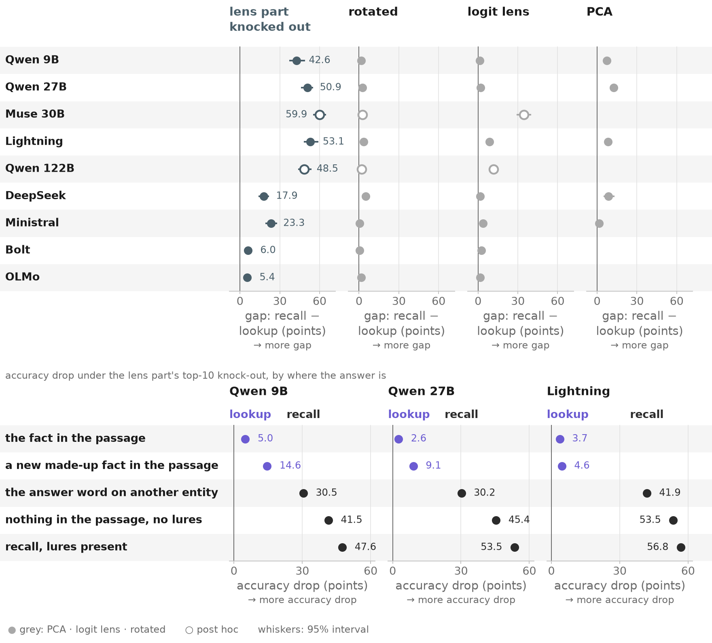</a> | Removing the lens part (its 10 directions) breaks recalled facts, not looked-up ones, in three models from two families, far beyond the largest same-size control | 2 of 12 cells post hoc · UNVERIFIED |
| 02 | <a href="02_datasets.png">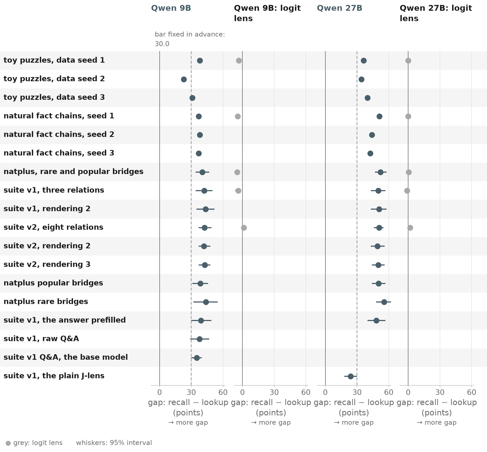</a> | The Qwens' split on every dataset we built, with the logit lens near zero | UNVERIFIED |
| 02b | <a href="02b_datasets.png">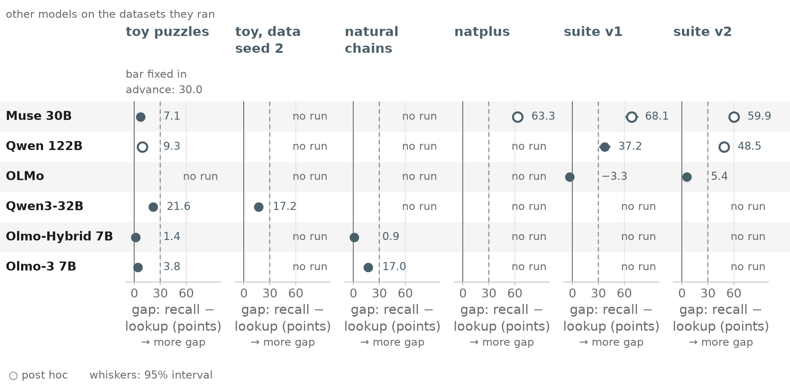</a> | The other models on the datasets they ran: Muse and the 122B above the bar on the later sets, the Olmos and Qwen3-32B below it | 5 of 15 cells post hoc · UNVERIFIED |
| 03a | <a href="03a_robust.png">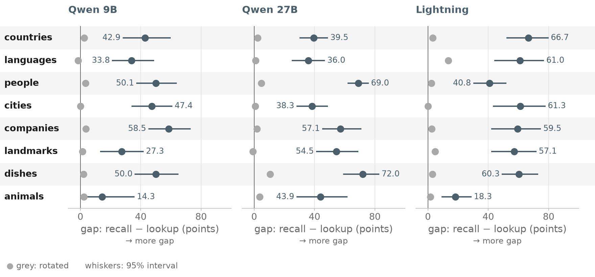</a> | The split holds on every relation, far above the rotated control | UNVERIFIED |
| 03b | <a href="03b_robust.png">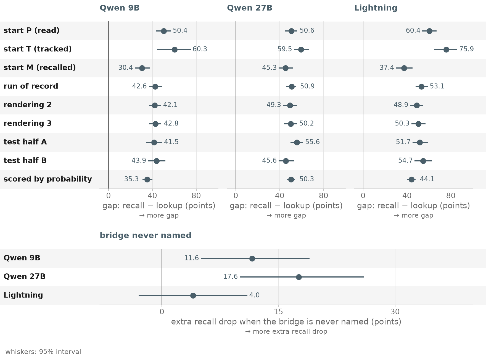</a> | The split holds on every start, both test halves, three renderings and by probability; a bridge never named adds to the recall's drop | UNVERIFIED |
| 04 | <a href="04_where.png">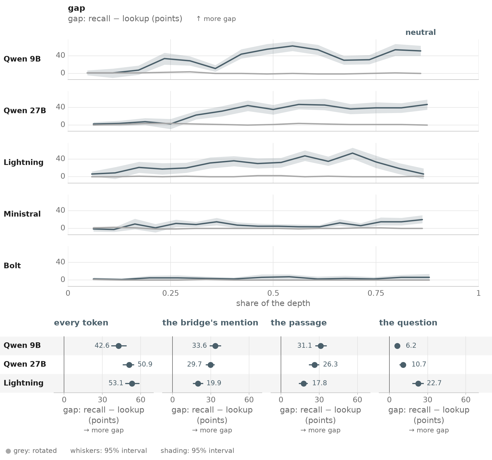</a> | Depth and position: the mention at mid depth in the Qwens, mention and question in Lightning, the question late | UNVERIFIED |
| 05 | <a href="05_carries.png">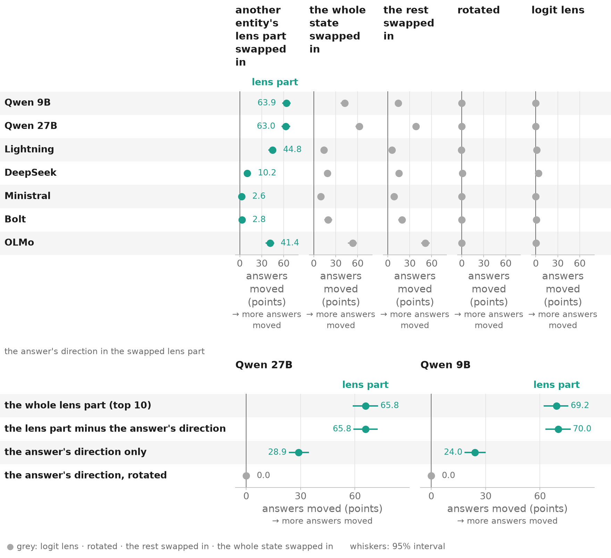</a> | A swapped lens part moves the answer to the other entity; it is not the answer token | UNVERIFIED |
| 07 | <a href="07_lookup.png">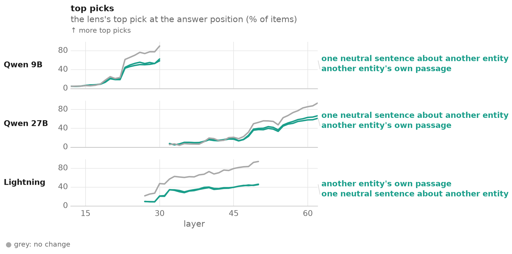</a> | The fact appears at the answer position only after the band, for a swapped entity as for the original | UNVERIFIED |
| 08 | <a href="08_readable.png">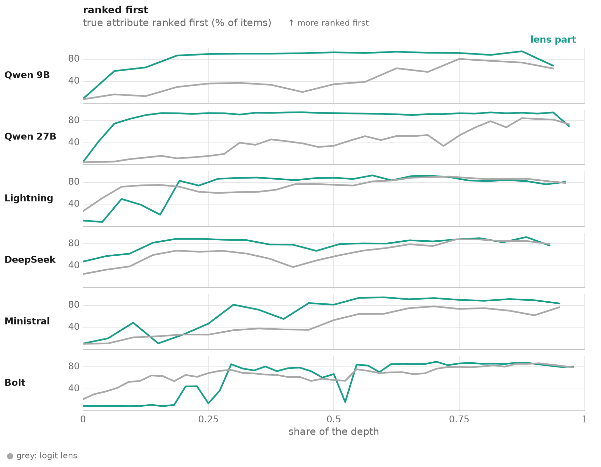</a> | The lens reads the fact at the mention in every model; readable is not the same as needed | UNVERIFIED |
| 09 | <a href="09_dose.png">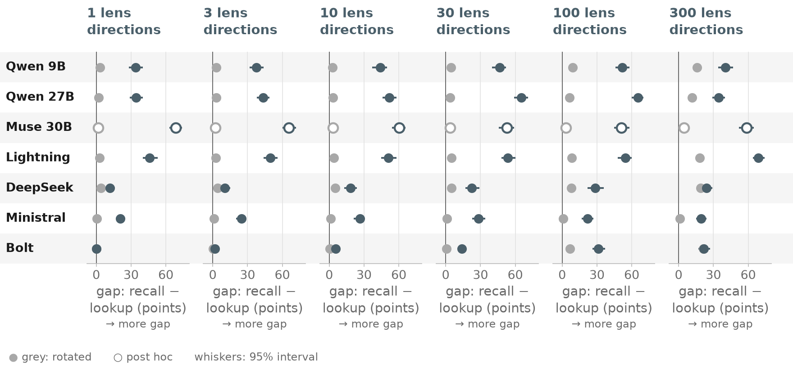</a> | The lens-specific part sits in the first 1-30 directions; in Bolt and DeepSeek a same-size removal costs about as much | 1 of 7 cells post hoc · UNVERIFIED |
| 10a1 | <a href="10a1_beyond.png">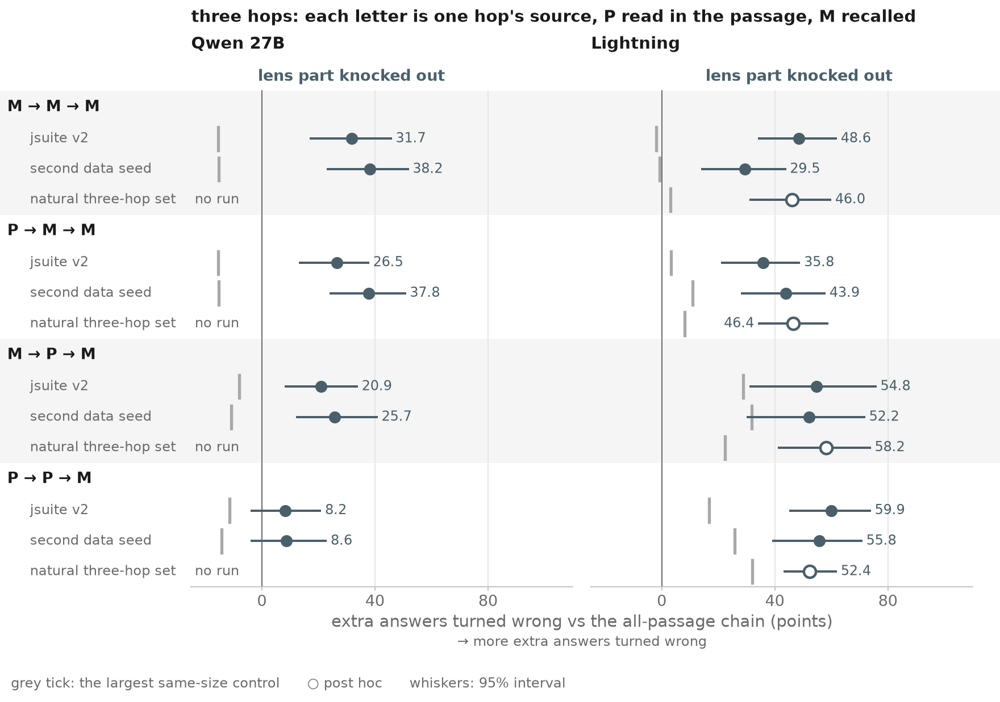</a> | Chains whose last hop recalls: the removal turns more answers wrong than in the all-passage chain, beyond its largest same-size control, on every chain but the 27B's P → P → M | 1 of 5 cells post hoc · UNVERIFIED |
| 10a2 | <a href="10a2_beyond.png">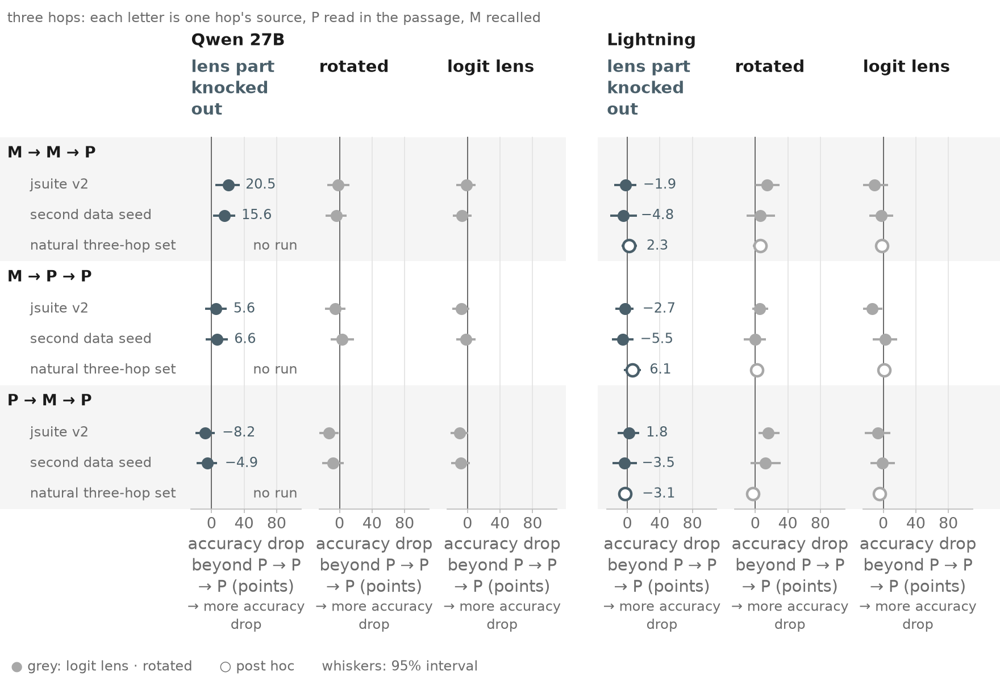</a> | Chains whose last hop reads the passage: no extra cost beyond the controls on Lightning; on the 27B only when the first two hops recall | 1 of 5 cells post hoc · UNVERIFIED |
| 10b | <a href="10b_beyond.png">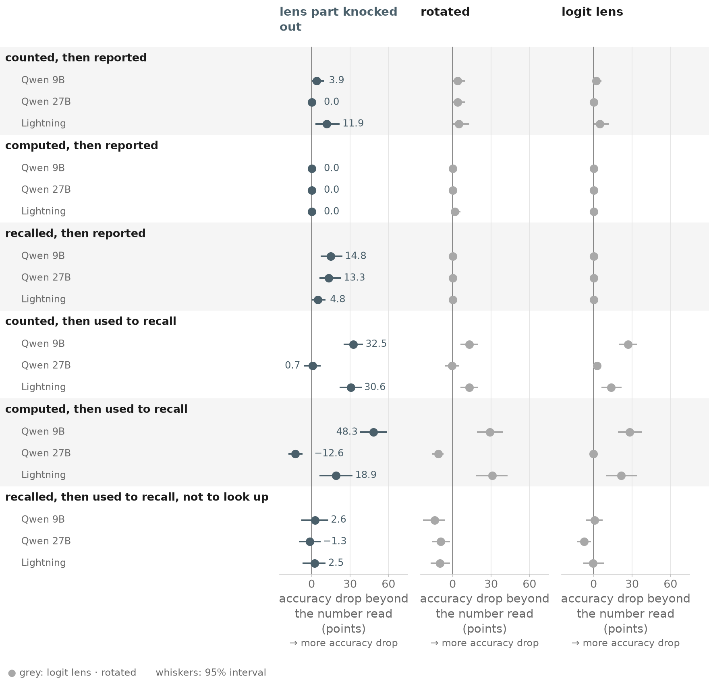</a> | A number made from the passage and then used: the extra cost under the removal, per model | UNVERIFIED |
| 10c | <a href="10c_beyond.png">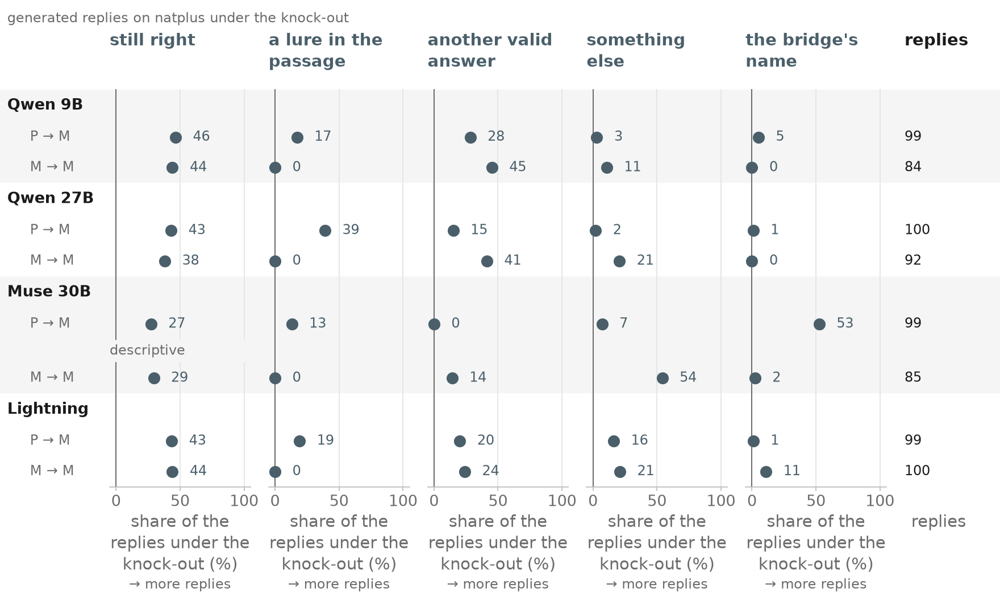</a> | Generated replies under the removal, sorted into five classes, per model | 1 descriptive · UNVERIFIED |
