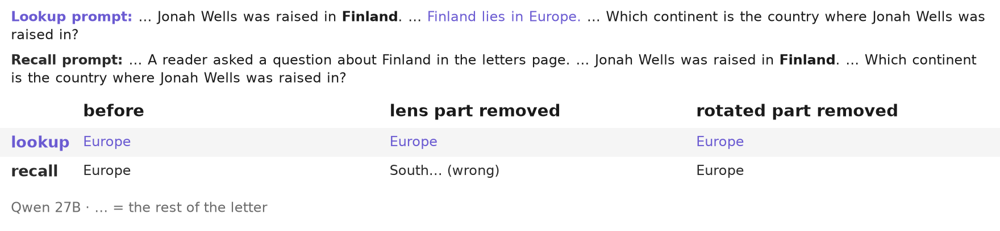
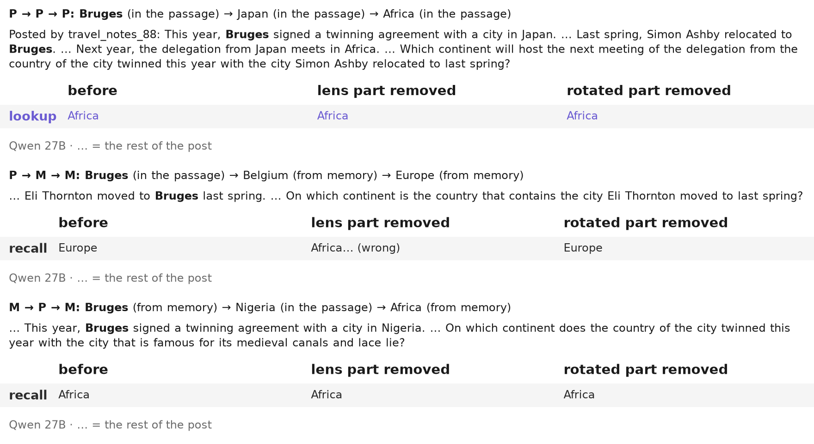

# Figures for the breadth track's real examples

Built by `make readme` with [styles-plot](https://github.com/danorel/styles-plot) (vocabulary: [plotstyle.toml](../../../plotstyle.toml); statuses: [data/figures/status.csv](../../../data/figures/status.csv)). File names follow the document's order (figkit/layout.py); `_meta/` holds each figure's sidecar, `_sheets/` the contact sheets.

| № | figure | what it shows | status |
|---|---|---|---|
| 01 |  | One real fact passage, Qwen 27B: without the lens part the recalled answer turns wrong and the looked-up one holds | UNVERIFIED |
| 02 |  | One real entity, Qwen 27B: only the chain that ends in two recalls turns wrong, and only without the lens part | UNVERIFIED |
