# Figures for the breadth README

Built by `make readme` with [styles-plot](https://github.com/danorel/styles-plot) (vocabulary: [plotstyle.toml](../../../plotstyle.toml); statuses: [data/figures/status.csv](../../../data/figures/status.csv)). File names follow the document's order (figkit/layout.py); `_meta/` holds each figure's sidecar, `_sheets/` the contact sheets.

| № | figure | what it shows | status |
|---|---|---|---|
| 01 | <a href="01_needed.png">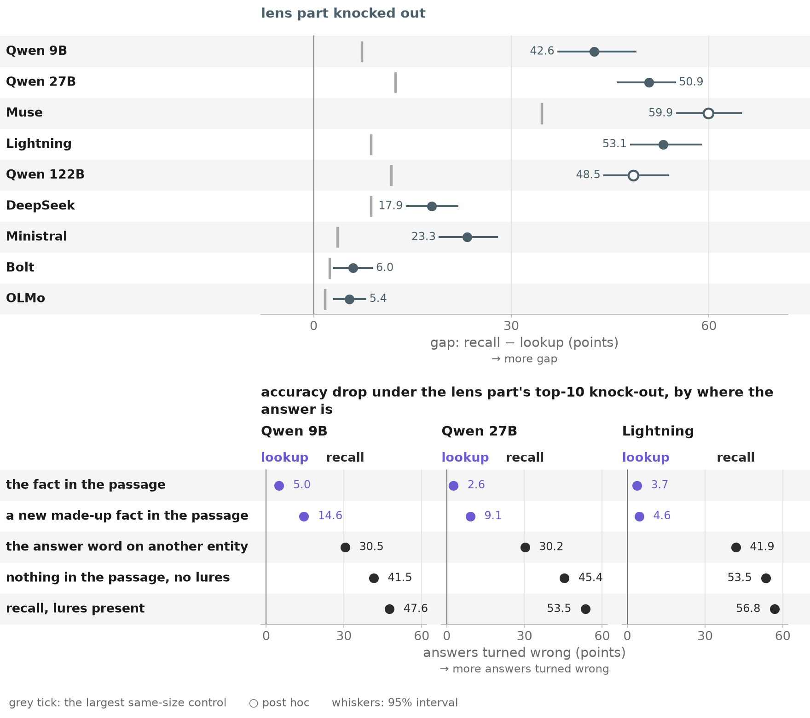</a> | Top: one row per model; each dot is the recall − lookup gap, in points, when the lens part's directions are removed at every token over the model's band (slate), with its 95% interval over bridges; grey tick: the gap of the largest same-size control (a rotated part, the logit lens's directions or the top principal directions). | 2 of 12 cells post hoc · UNVERIFIED |
| 02 | <a href="02_datasets.png">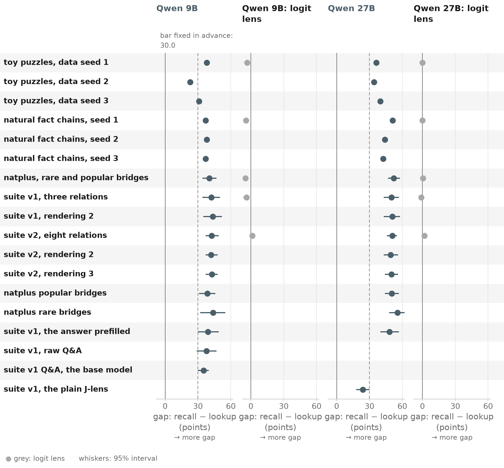</a> | The Qwens on every dataset built: one row per dataset or variant (toy puzzles and natural fact chains with three data seeds each, natplus, suite v1 and v2 with their renderings and variants); each dot is the recall − lookup gap, in points, under the lens part's removal (slate), with its 95% interval where the run saved one; grey: the logit lens's own directions, where it was run; dashed: the bar fixed in advance. | UNVERIFIED |
| 02b | <a href="02b_datasets.png">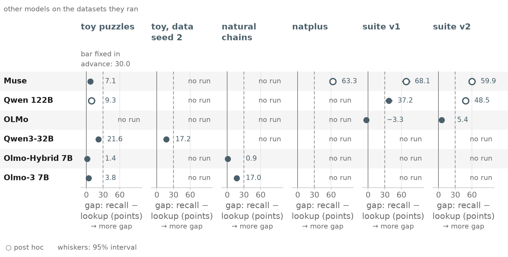</a> | The other models on the datasets they ran: one row per model, one column per dataset (toy puzzles, toy data seed 2, natural chains, natplus, suite v1, suite v2); each dot is the recall − lookup gap, in points, with its 95% interval; dashed: the bar fixed in advance; "no run" where a model did not run a set. | 5 of 15 cells post hoc · UNVERIFIED |
| 03a | <a href="03a_robust.png">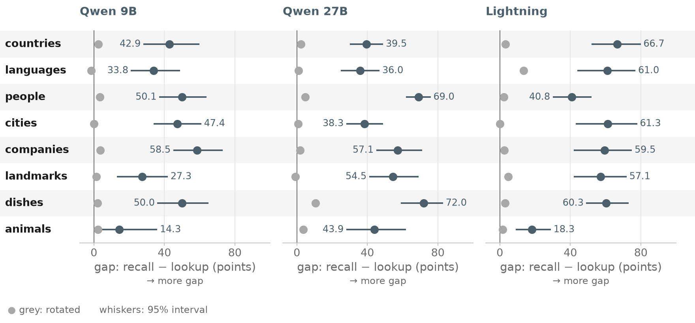</a> | Every relation of jsuite v2, one row each, one panel per model: the recall − lookup gap, in points, under the lens part's removal (slate), with its 95% interval over bridges; grey: the same removal rotated to random directions. | UNVERIFIED |
| 03b | <a href="03b_robust.png">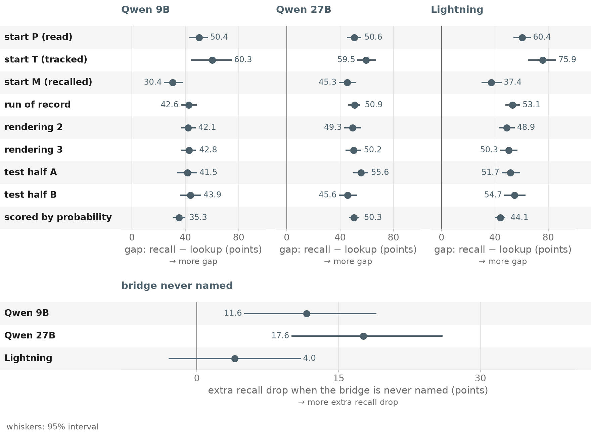</a> | Top, one panel per model: the recall − lookup gap, in points, by start of the chain (P read, T tracked, M recalled), for the run of record, two more renderings, the two halves of the test split, and scored by the answer's probability, with 95% intervals. | UNVERIFIED |
| 04 | <a href="04_where.png">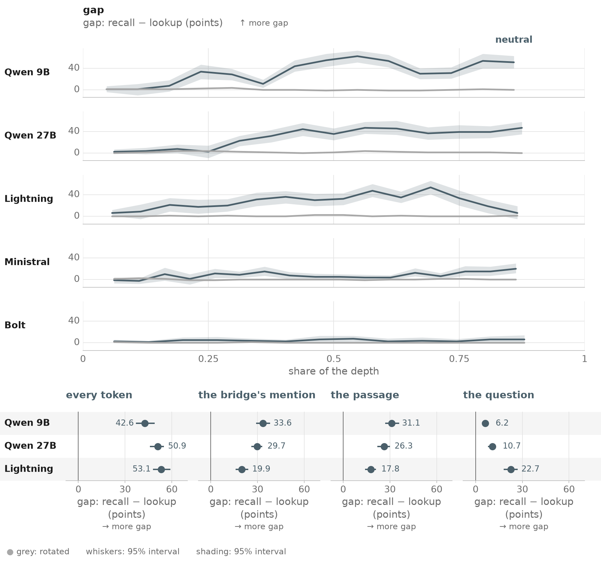</a> | Top, one panel per model: the recall − lookup gap, in points, when the lens part is removed over a sliding window of layers, against the share of the depth (slate; shading: 95% interval); grey: the same removal rotated. | UNVERIFIED |
| 05 | <a href="05_carries.png">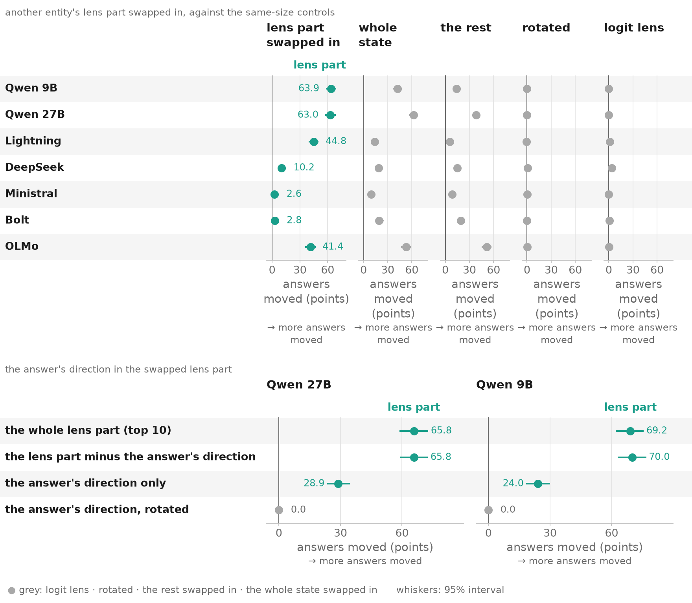</a> | Top, one row per model: answers moved to the other entity's fact, in points, when another entity's lens part is swapped in at the bridge (teal), against swaps of the same kind as controls (grey: the whole state, the rest of the state, a rotated part, the logit lens's directions), one column each, with 95% intervals. | UNVERIFIED |
| 07 | <a href="07_lookup.png">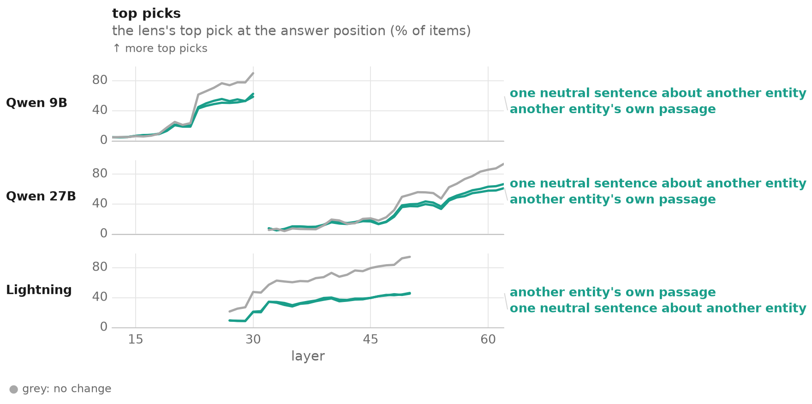</a> | One panel per model: the share of items, in %, on which the lens's top pick at the answer position is the fact of the entity in play, layer by layer, unedited (grey: no change) and with another entity's lens part swapped in, taken from that entity's own passage or from one neutral sentence about it (teal, each line named at its end). | UNVERIFIED |
| 08 | <a href="08_readable.png">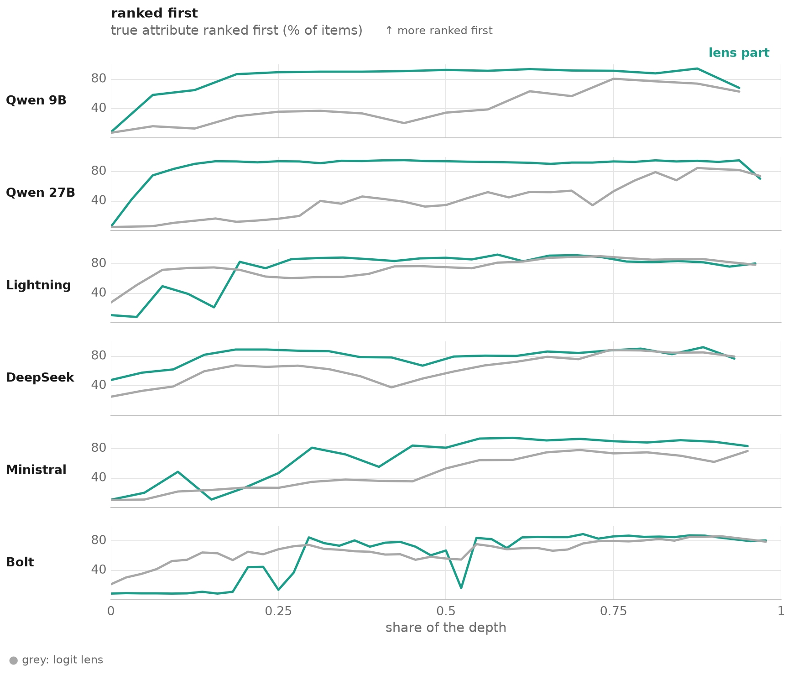</a> | One panel per model: the share of items, in %, on which the true attribute is ranked first when the lens part at the bridge's mention is read (teal) and when the logit lens is read (grey), against the share of the depth. | UNVERIFIED |
| 09 | <a href="09_dose.png">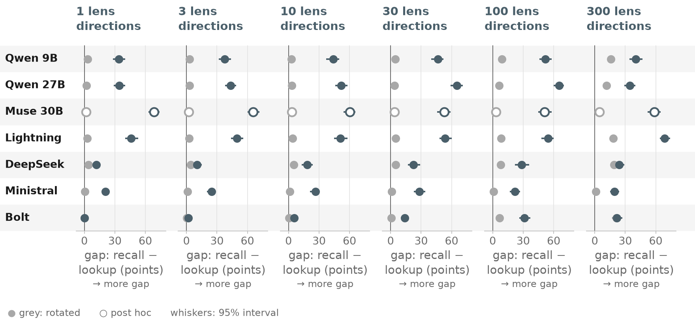</a> | One column per number of lens directions removed (as headed), one row per model: the recall − lookup gap, in points, with its 95% interval (slate); grey: the same number of directions rotated. | 1 of 7 cells post hoc · UNVERIFIED |
| 10a1 | <a href="10a1_beyond.png">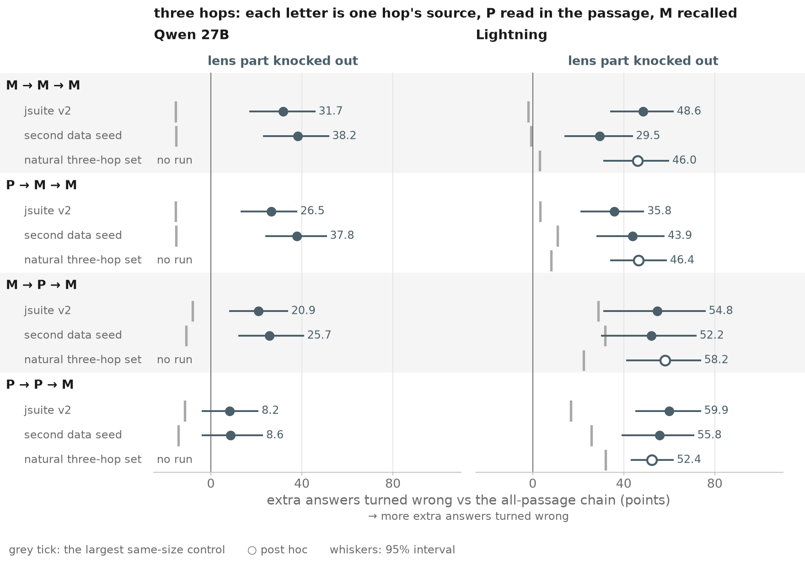</a> | Three-hop chains whose last hop recalls (each letter one hop's source: P read in the passage, M recalled), each on jsuite v2, a second data seed and the natural three-hop set: the extra answers turned wrong beyond the all-passage chain (P → P → P), in points, under the lens part's removal, with 95% intervals; grey tick: the largest same-size control; "no run" where the 27B did not run the natural set. | 1 of 5 cells post hoc · UNVERIFIED |
| 10a2 | <a href="10a2_beyond.png">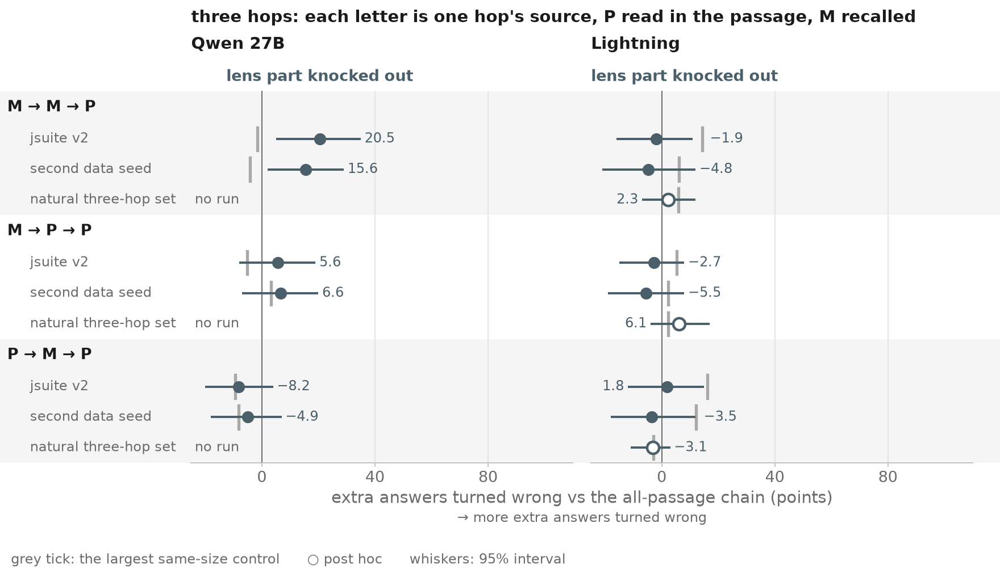</a> | Three-hop chains whose last hop reads the passage, drawn as in the chains whose last hop recalls: the extra answers turned wrong beyond P → P → P, in points, with 95% intervals; grey tick: the largest same-size control. | 1 of 5 cells post hoc · UNVERIFIED |
| 10b | <a href="10b_beyond.png">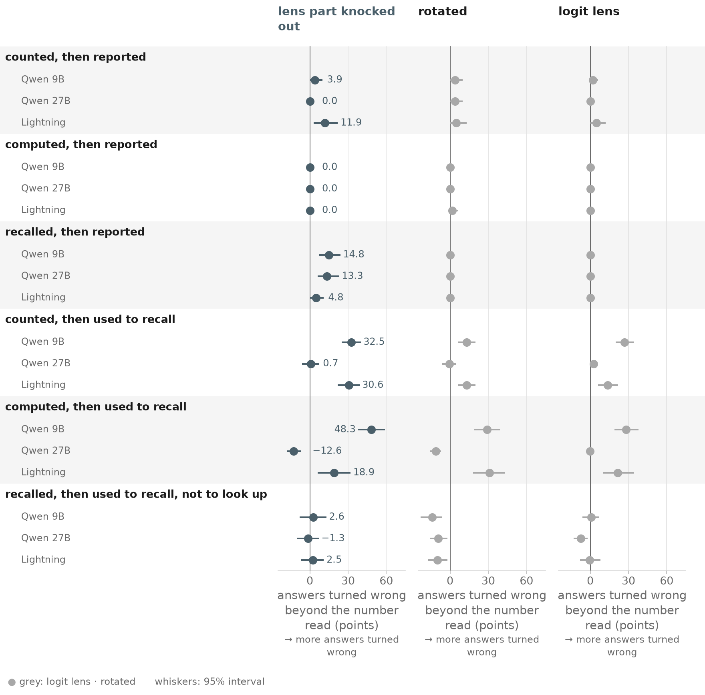</a> | Numbers made from the passage and then used: counted, computed or recalled, then reported, used to recall, or recalled and used to recall rather than to look up; one row per model in each group: answers turned wrong beyond a number read from the passage, in points, with 95% intervals, under the lens part's removal (slate) and under the rotated and logit-lens controls (grey), one column each. | UNVERIFIED |
| 10c | <a href="10c_beyond.png">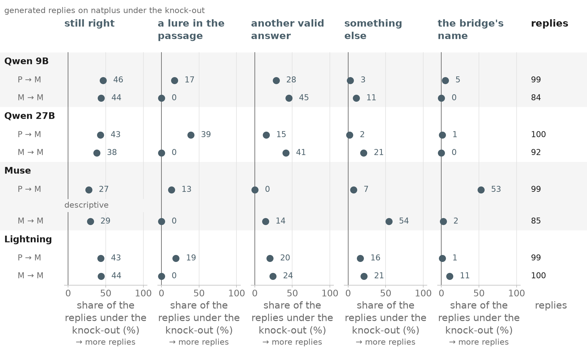</a> | Generated replies on natplus under the removal, per model and chain (P → M, M → M): the share, in %, that is still right, a lure in the passage, another valid answer, something else, or the bridge's name, one column each; right: the number of replies classified. | 1 descriptive · UNVERIFIED |
