# Figures for the root README

Built by `make readme` with [styles-plot](https://github.com/danorel/styles-plot) (vocabulary: [plotstyle.toml](../../../plotstyle.toml); statuses: [data/figures/status.csv](../../../data/figures/status.csv)). File names follow the document's order (figkit/layout.py); `_meta/` holds each figure's sidecar, `_sheets/` the contact sheets.

| № | figure | what it shows | status |
|---|---|---|---|
| 01 | <a href="01_tools.png">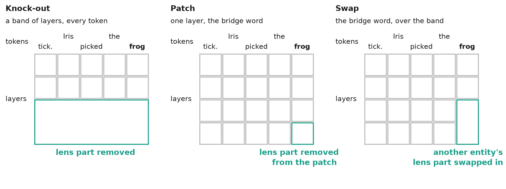</a> | Three ways to test the lens part, each at the bridge, drawn over the last words of the real locker scene in the first example card (its bridge word in bold); rows are layers, columns tokens, and the teal box marks the cells each test changes. | UNVERIFIED |
| 02 | <a href="02_main_split.png">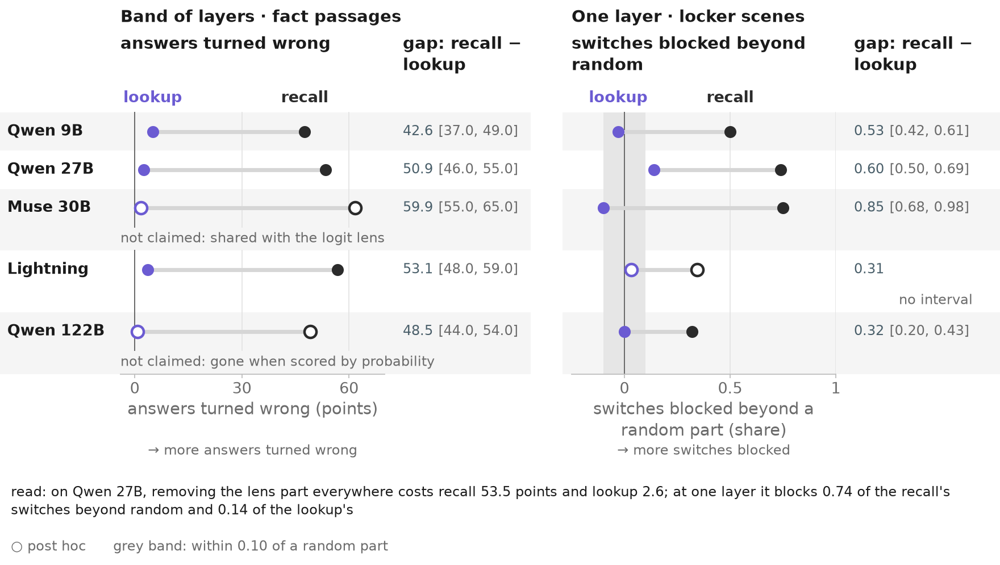</a> | Rows are models; each dumbbell joins one reader's score to the other's (lookup violet, recall black). | 3 of 10 cells post hoc · 2 not claimed · UNVERIFIED |
| 02b | <a href="02b_main_split_gaps.png">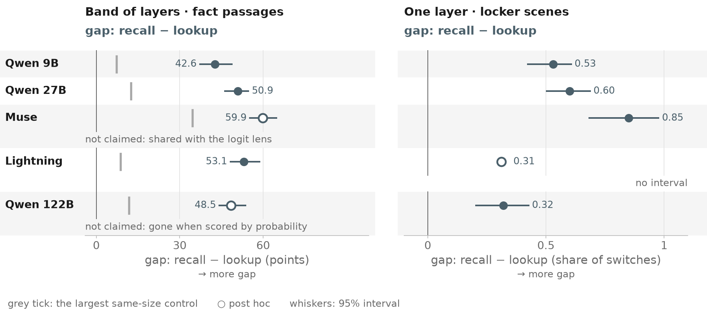</a> | The headline's gaps, recall minus lookup, with their 95% intervals over bridge items. | 3 of 10 cells post hoc · 2 not claimed · UNVERIFIED |
| 03 | <a href="03_controls.png">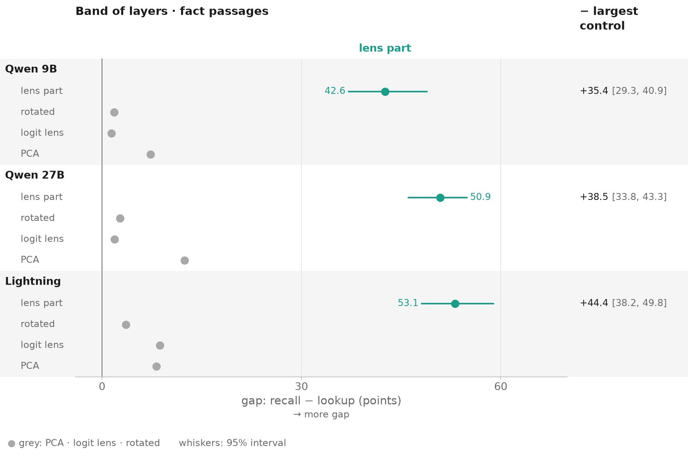</a> | Band of layers (fact passages): the recall − lookup gap, in points, when the lens part is removed everywhere (teal, with its 95% interval over bridge items) and when a same-size control is removed instead (grey: a rotated part, the logit lens's top directions, the residual stream's top principal directions at the same norm), one lane each, on one axis. | UNVERIFIED |
| 03b | <a href="03b_controls_layer.png">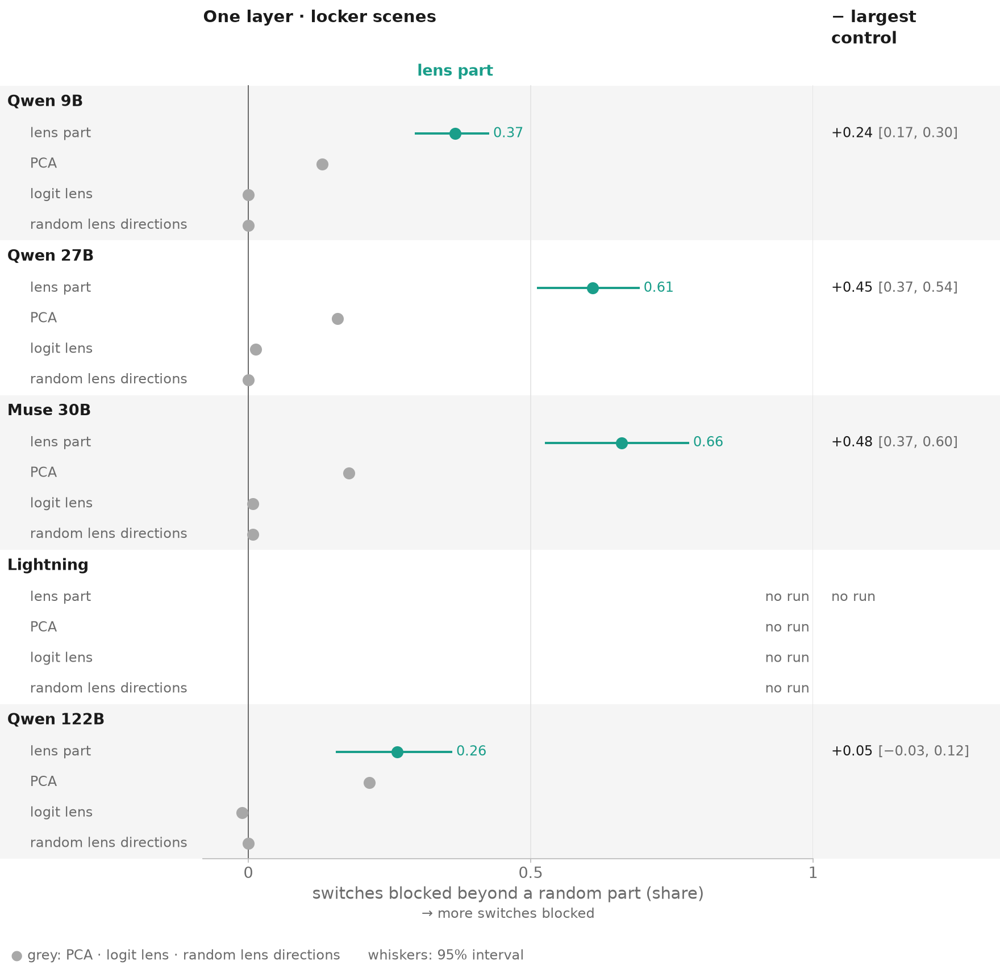</a> | One layer (locker scenes, the earlier runs with a same-size control): the recall's switches blocked beyond a random part when the lens part is removed from the patch (teal, with its 95% interval) and when a same-size control is removed instead (grey: PCA, the logit lens's directions, random lens directions), one lane each, on one axis. | UNVERIFIED |
| 03c | <a href="03c_controls_more.png">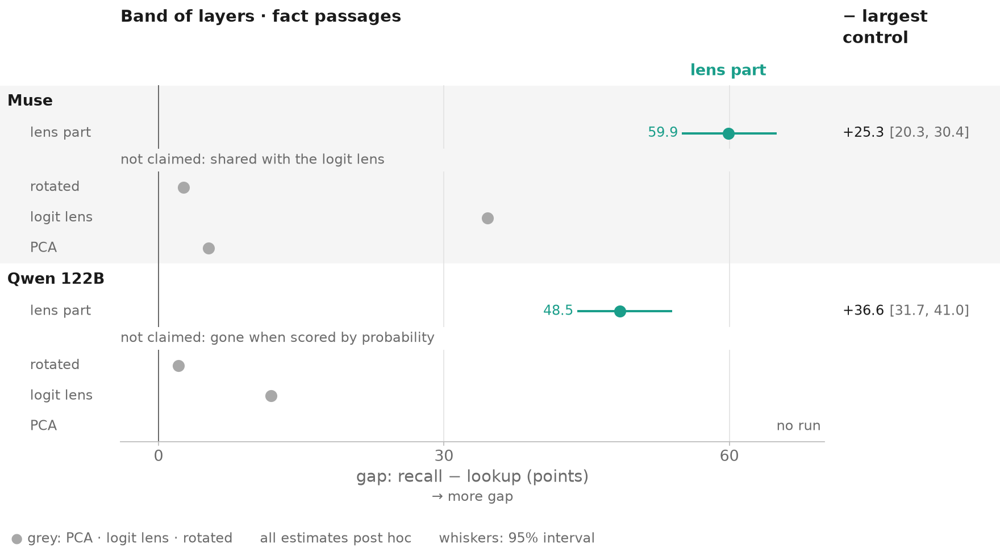</a> | The same band test for Muse 30B and Qwen 122B, the two models the post does not claim; the grey tag under each says why (shared with the logit lens; gone when scored by the answer's probability). | all post hoc · 2 not claimed · UNVERIFIED |
| 04 | <a href="04_pointer.png">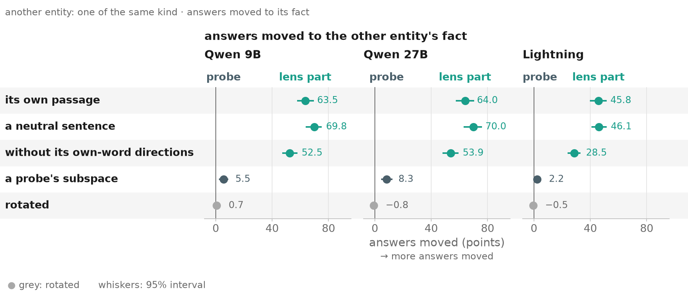</a> | Rows are the source of the part swapped in at the bridge: another entity's own passage, one neutral sentence about that entity, the same without its own-word directions (the lens part, teal), a probe's subspace that reads the fact (slate) and a rotated part (grey, a control). | UNVERIFIED |
| 05 | <a href="05_atoms.png">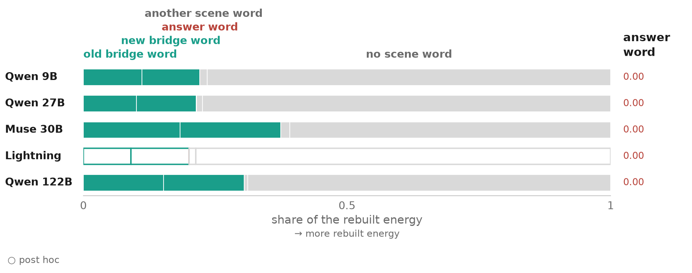</a> | One bar per model: the lens part's directions, each counted by the word it decodes to, as shares of the energy they rebuild. | 1 of 5 cells post hoc · UNVERIFIED |
| 06 | <a href="06_address_read_remove.png">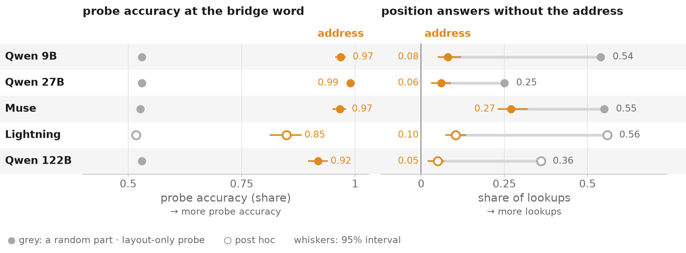</a> | Left: a probe at the bridge word reads which locker sentence holds the item's locker (the address, amber), against a probe trained on the layout only (grey). | 3 of 10 cells post hoc · UNVERIFIED |
| 07 | <a href="07_address_swap_lens.png">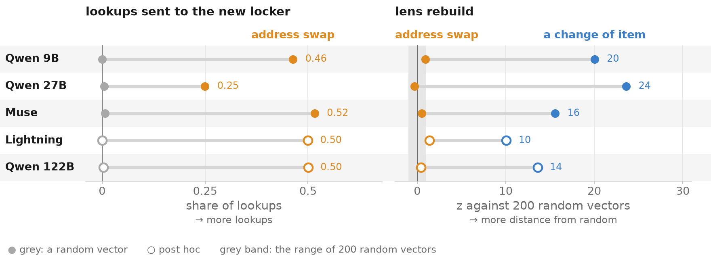</a> | Left: the lookups sent to the new locker when another locker's address is swapped in at about a real change's size (amber), against a random vector of the same size (grey). | 4 of 10 cells post hoc · UNVERIFIED |
| 08 | <a href="08_routes.png">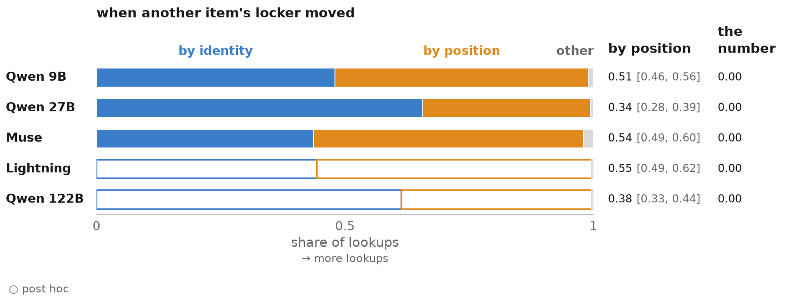</a> | Shares of the lookup's answers by route when another item moves, per model: identity, position, other; 95% intervals over bridge entities, n = 300 scenes per model; Lightning and the 122B hollow ○ (post hoc gates). | 2 of 5 cells post hoc · UNVERIFIED |
| 09 | <a href="09_sentence_order.png">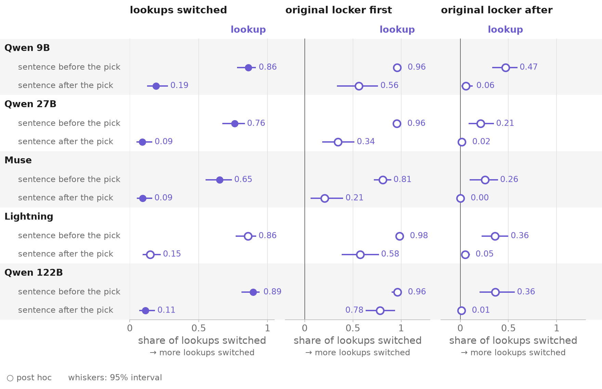</a> | Lookups switched by the whole change when the locker sentence comes first and when it comes after the pick, per model, and (post hoc, hollow ○) with the changed prompt's locker sentence before or after the pick, for each original order. | 11 of 15 cells post hoc · UNVERIFIED |
| 10 | <a href="10_two_codes.png">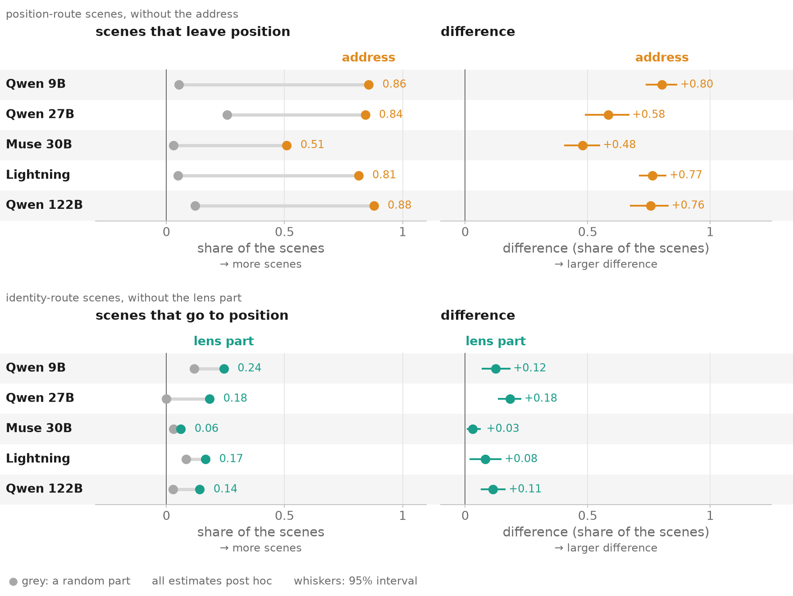</a> | Post hoc, another item moved, lookup. | all post hoc · UNVERIFIED |
| 11 | <a href="11_monitor.png">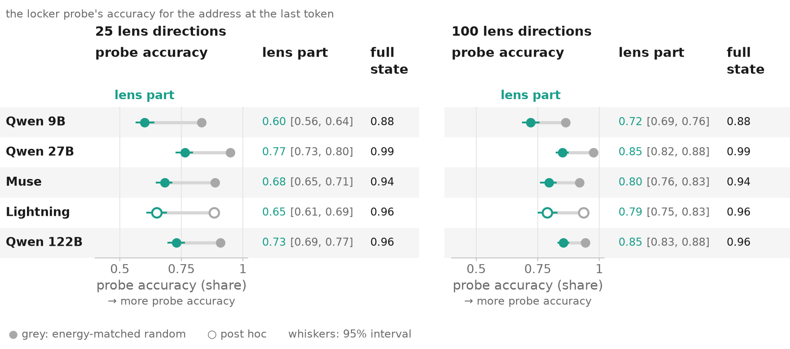</a> | The locker probe's accuracy for the address at the last token, per model, for the lens part as used throughout (left) and with four times as many directions (right): the lens part (teal) against a random part of the same energy (grey), with 95% intervals; the lens part's value and interval, and the full state's accuracy, in their own columns. | 1 of 5 cells post hoc · UNVERIFIED |
| 12 | <a href="12_last_token.png">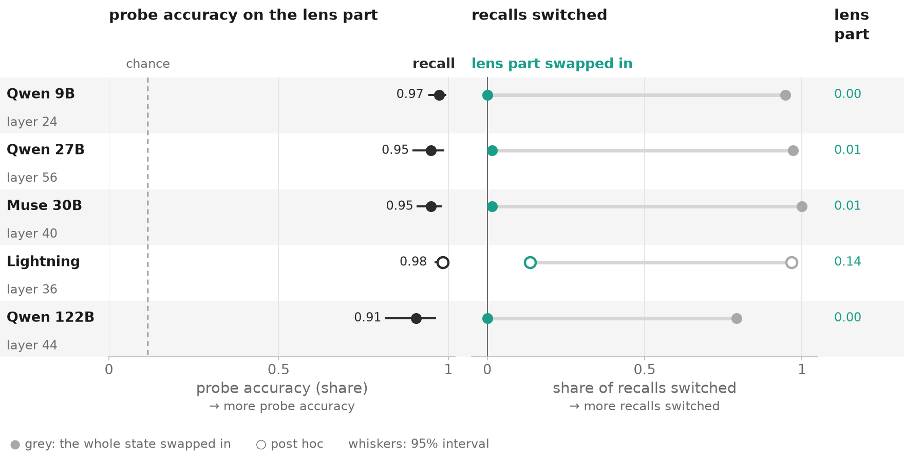</a> | Per model, at the layer where the read peaks (under the name). | 1 of 5 cells post hoc · UNVERIFIED |
| 13 | <a href="13_nine_models.png">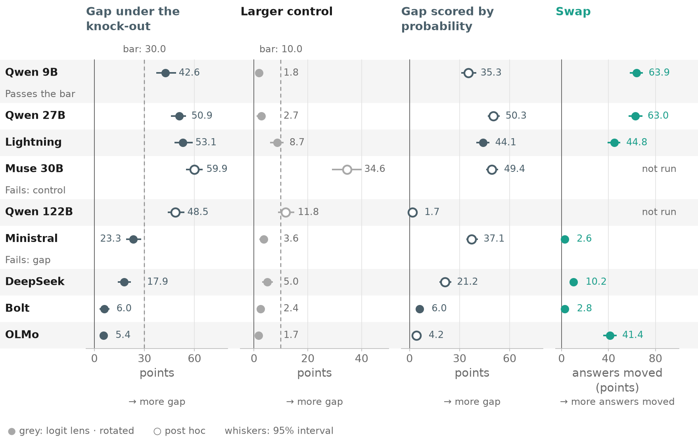</a> | Nine models, four tests, rows grouped by the bar fixed before the main runs. | 11 of 34 cells post hoc · UNVERIFIED |
| 14 | <a href="14_directions.png">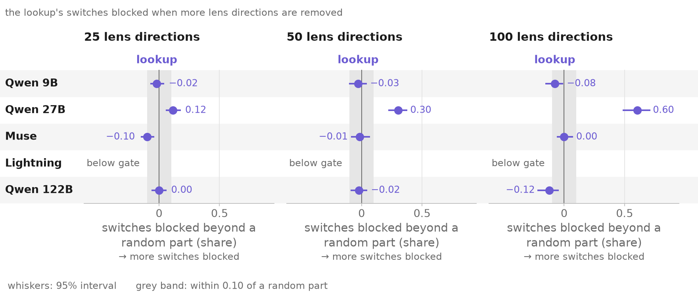</a> | The 27B's lookup has more switches blocked beyond random as more lens directions are removed; the other models' does not. | UNVERIFIED |
| 15 | <a href="15_facts.png">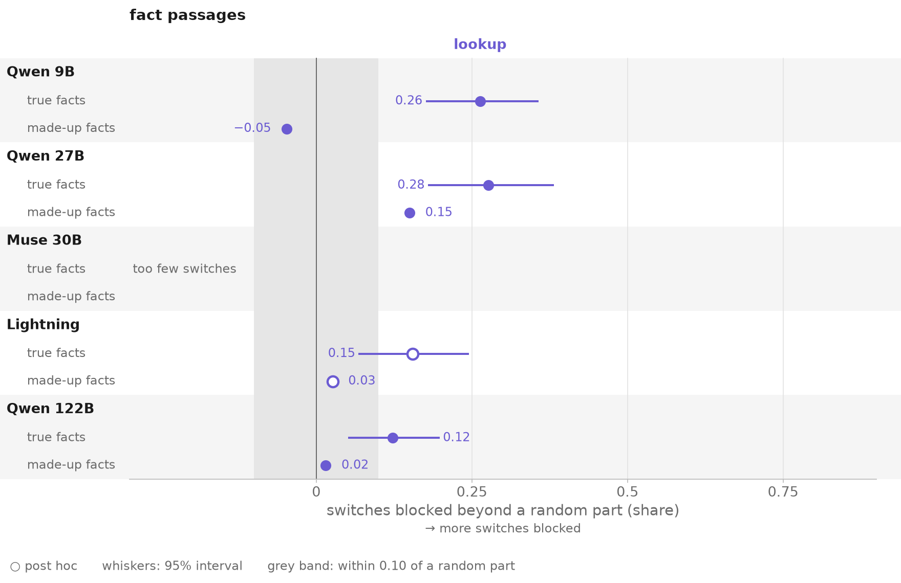</a> | The lookup on passages with true and with made-up facts, per model; whiskers: intervals on the true-fact values (Muse: too few lookup switches, not drawn). | 1 of 4 cells post hoc · UNVERIFIED |
| 16 | <a href="16_order.png">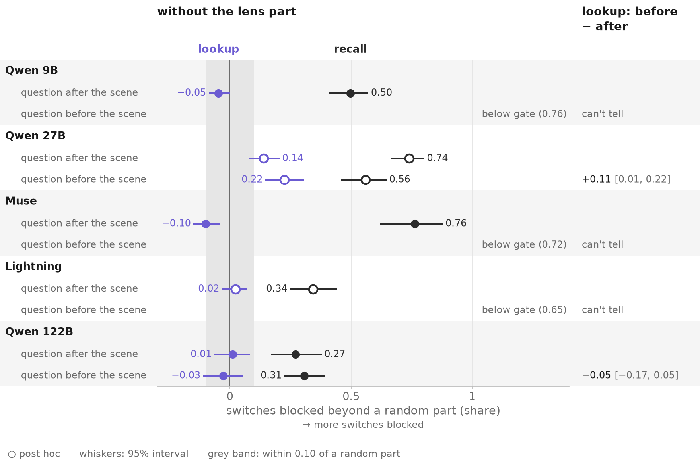</a> | Per model two rows, the question after the scene (the main test) and the question before it, in the same colours (lookup violet, recall black): switches blocked without the lens part beyond a random part, with 95% intervals; grey band: within 0.10 of a random part. | 3 of 7 cells post hoc · UNVERIFIED |
| 17 | <a href="17_where.png">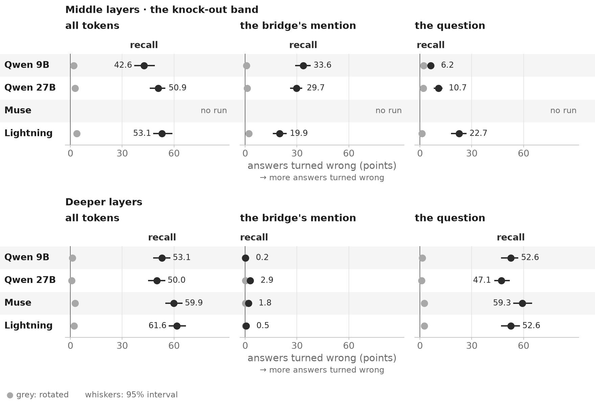</a> | Where in the prompt the recall needs the lens part, by layer band: the recall's answers turned wrong, in points, with the lens part removed at all tokens, only at the bridge's mention, or only at the question (black, with its 95% interval), against a rotated part of the same size (grey). | UNVERIFIED |
