# Figures for the LessWrong write-up

Built by `make figures-writeup` with [styles-plot](https://github.com/danorel/styles-plot) (vocabulary: [plotstyle.toml](../../../plotstyle.toml); statuses: [data/figures/status.csv](../../../data/figures/status.csv)). File names follow the document's order (figkit/layout.py); `_meta/` holds each figure's sidecar, `_sheets/` the contact sheets.

| № | figure | what it shows | status |
|---|---|---|---|
| 00 | <a href="00_key.png">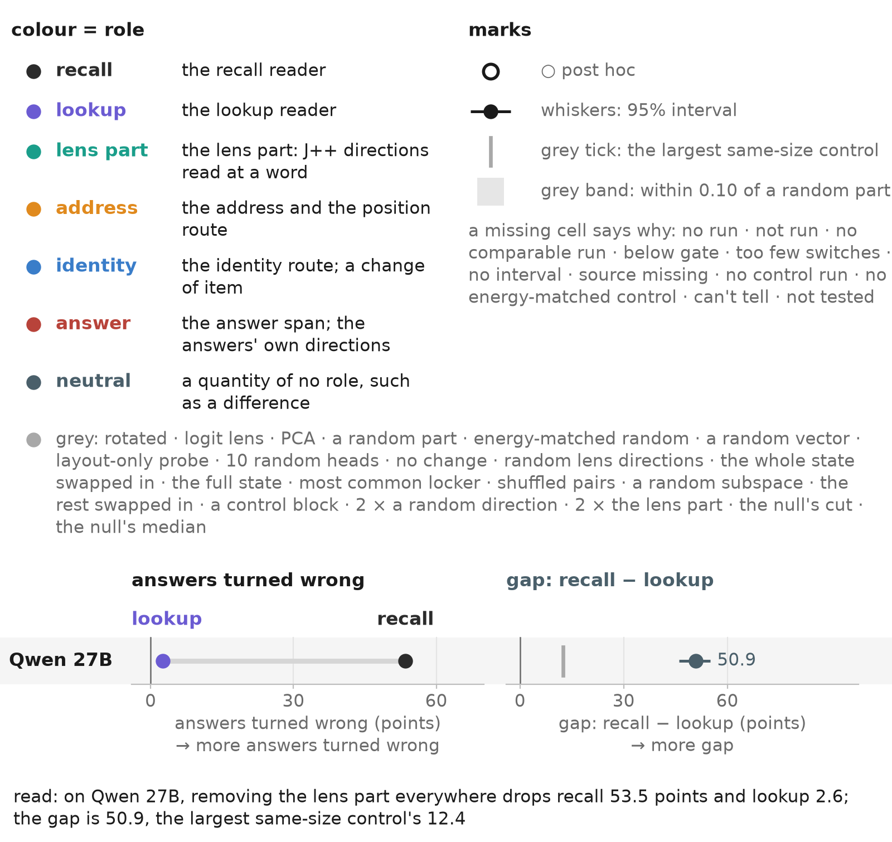</a> | **How to read the figures: each colour's role, the marks, one row read aloud.** How to read every figure: each colour is a role (recall black, lookup violet, the lens part teal, the address amber, identity blue, the answer brick, a quantity of no role such as a gap slate), grey is a control and nothing else, and the marks (a hollow dot is post hoc, a whisker is the 95% interval, the grey tick is the largest same-size control, the grey band is within 0.10 of a random part). A missing cell says why in grey words. Bottom: Qwen 27B's band-test row from Fig. 1, read aloud under it.<!-- src: plotstyle.toml \| 95% interval; within 0.10 of a random part --> | UNVERIFIED |
| e01 | <a href="e01_setup_twins.png">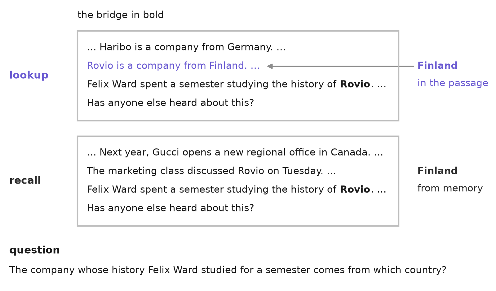</a> | A pair of twins from the known-fact set, every sentence verbatim (… marks the sentences not shown). Both passages name Rovio, the bridge, and ask the same question. The lookup twin gives Rovio's country in the passage; the recall twin leaves it out and adds lures, so Finland must come from memory. Rule: the pair the post quotes, the second item of its section (the first names Russian figures), not picked by outcome. | UNVERIFIED |
| e02 | <a href="e02_setup_locker.png">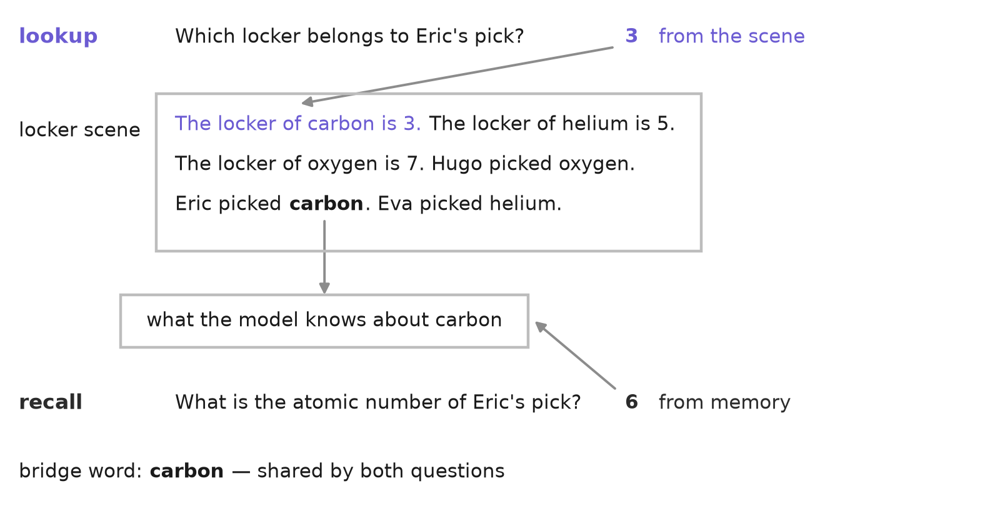</a> | Illustrative. Bridge word: carbon — shared by both questions. The lookup reads its answer in the scene (carbon's locker, 3); the recall brings it from what the model knows about carbon (its atomic number, 6). At the bridge word the model has not yet seen the question, so its state there is the same for both. | UNVERIFIED |
| e03 | <a href="e03_setup_patch.png">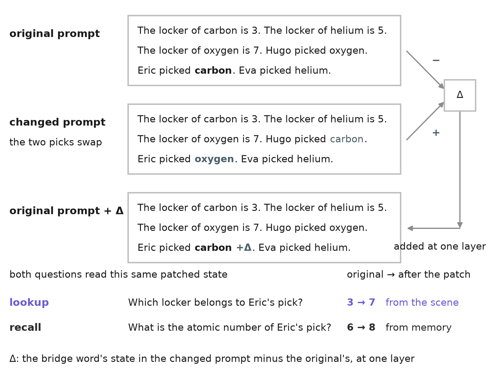</a> | Illustrative. The patch: Δ, the bridge word's state in a changed prompt (the two picks swap) minus the original's, is added to the original prompt at one layer. Both questions then read the same patched state, and both answers change: the lookup's to oxygen's locker from the scene, the recall's to oxygen's atomic number from memory. | UNVERIFIED |
| e04 | <a href="e04_setup_knockout.png">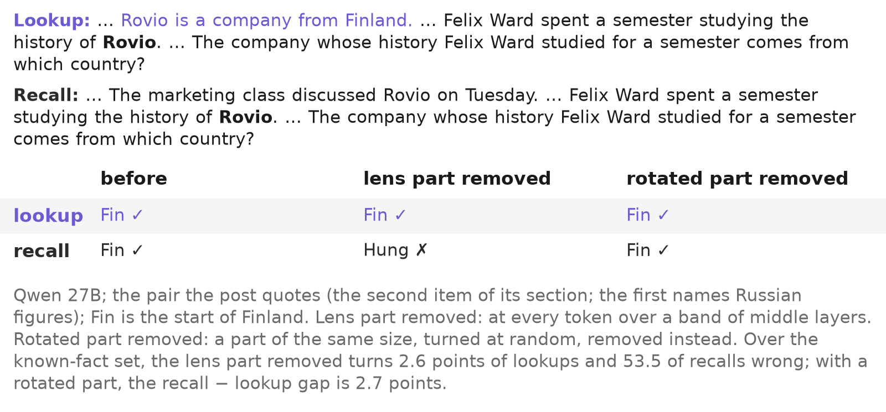</a> | The knock-out on the same pair (Qwen 27B): removing the lens part at every token over a band of middle layers turns the recall's answer wrong and leaves the lookup's right; removing a rotated part of the same size changes nothing. Cells show the model's first token (Fin is the start of Finland). The note under the card gives the rates over the known-fact set. Rule: the pair the post quotes, the second item of its section (the first names Russian figures), not picked by outcome. | UNVERIFIED |
| e05 | <a href="e05_setup_datasets.png">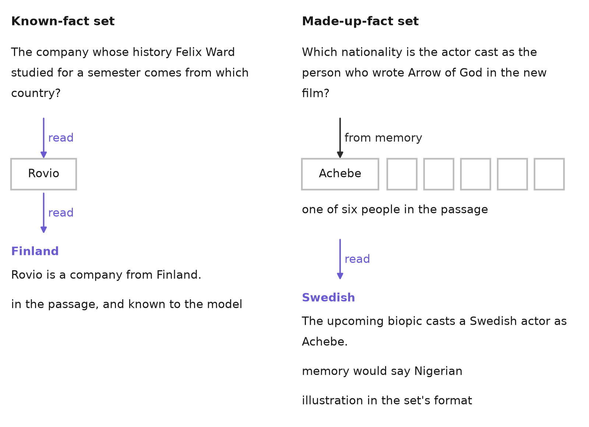</a> | Illustration in the set's format. Known-fact set: the passage names the bridge and gives a true fact, which the model may also know. Made-up-fact set: the question only describes the bridge, which the model must find from memory among six people; the passage gives each a made-up value, which only reading can give. | UNVERIFIED |
| 00 | <a href="00_schematic.png">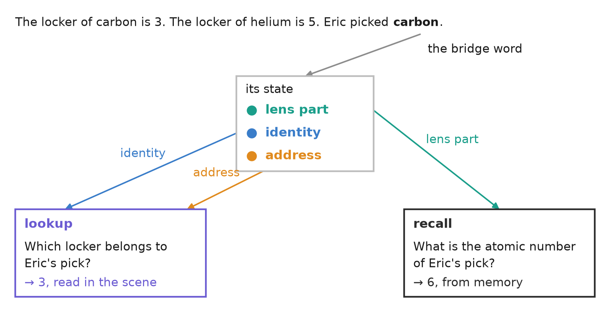</a> | **One bridge word, two readers.** One locker scene (the bridge word in bold). The bridge word's state holds three parts: the lens part (teal) feeds the recall, which answers from memory; identity (blue) and the address (amber) feed the lookup, which answers from the scene. A schematic of the claim, not a measurement. | UNVERIFIED |
| r01 | <a href="r01_patch_split.png">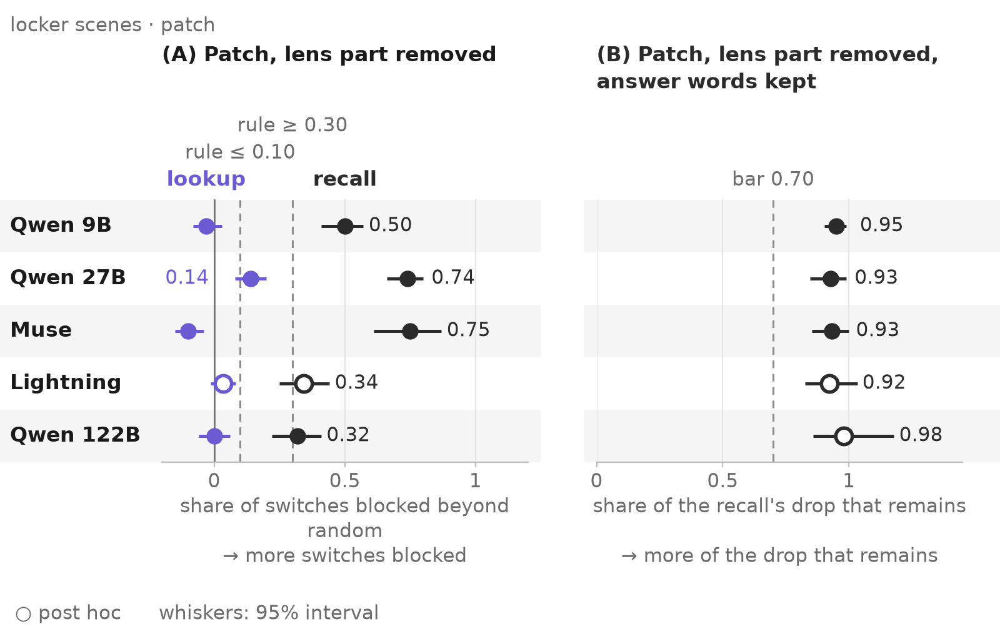</a> | Two checks on the patch (locker scenes). (A) The share of the patch's switches that removing the lens part blocks beyond a random part of the same size. Dashed lines are the pass rule fixed before the run: the lookup at most 0.10 on this measure, the recall at least 0.30 on the switches lost without the random part subtracted (it also clears 0.30 here); the 27B's lookup, at 0.14, is the only point on the wrong side. Below 0 means the random part blocked more switches than the lens part (Muse's lookup). (B) The share of the recall's drop that remains when the directions for the answer words are spared. ○ post hoc. Whiskers are 95% intervals; an interval can cross 1 when the sample is small. | 3 of 10 cells post hoc · UNVERIFIED |
| r02 | <a href="r02_patch_layers.png">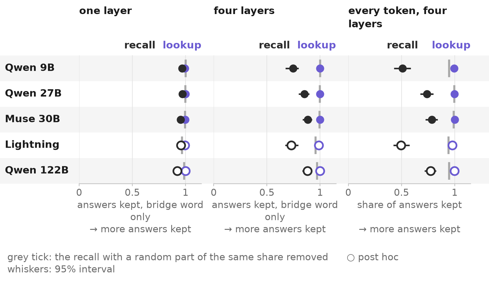</a> | (C) One layer is not essential. The share of answers kept when the lens part is removed from a prompt's own state, with no patch: at the bridge word at one layer, at the bridge word over four layers, and at every token over four layers. The recall loses answers only as the removal widens; the lookup keeps them throughout. The grey tick is the recall with a random part of the same size removed instead. All three columns use the same one-pick scenes, 295 to 574 per model. ○ post hoc. Whiskers are 95% intervals. | 6 of 15 cells post hoc · UNVERIFIED |
| 01 | <a href="01_main_split.png">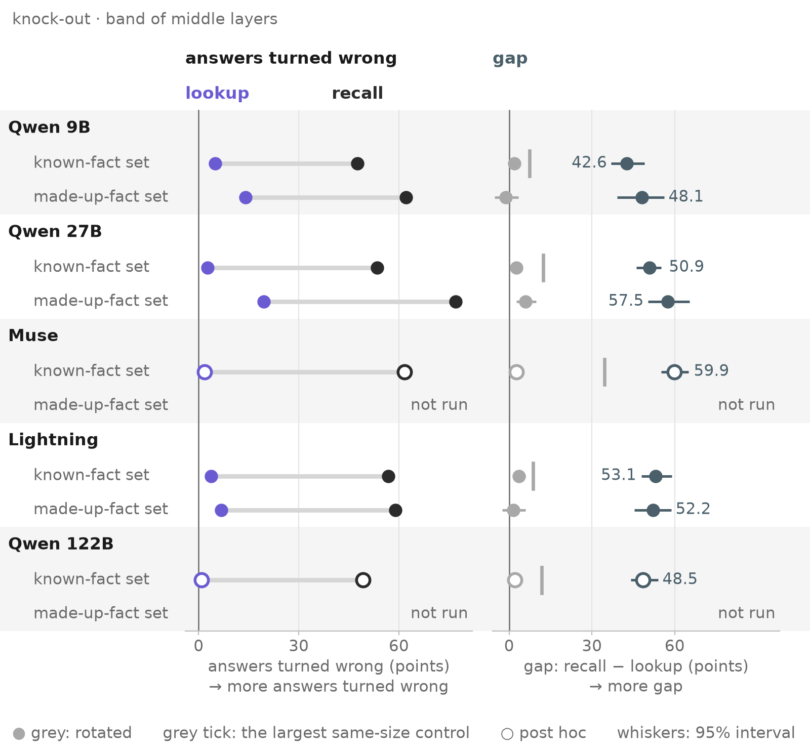</a> | **Taking the lens part out breaks recalled answers, not lookup ones.** Rows are models. Left, band of layers (fact passages): each reader's answers turned wrong, in points, when the lens part is removed at every token over a band of middle layers (lookup violet, recall black, joined by a grey bar), and the recall − lookup gap (slate) with its 95% interval over bridge items and a grey tick at the largest same-size control's gap. Right, one layer (locker scenes): each reader's switches blocked beyond a random part of the same size when the lens part is removed from the patch, on the grey band (within 0.10 of a random part), and the gap as a share of switches. Hollow (○, post hoc): Muse 30B and Qwen 122B in the band test, Lightning in the one-layer test; Lightning's one-layer gap has no interval (only the aggregate verdict was saved). Grey tags: the two band cells the text does not claim. Items per model: the n columns of docs/breadth/data.csv and data/figures/depth/data.csv.<!-- src: plotstyle.toml \| 95% interval; within 0.10 of a random part --> | 3 of 10 cells post hoc · 2 not claimed · UNVERIFIED |
| 02 | <a href="02_datasets.png">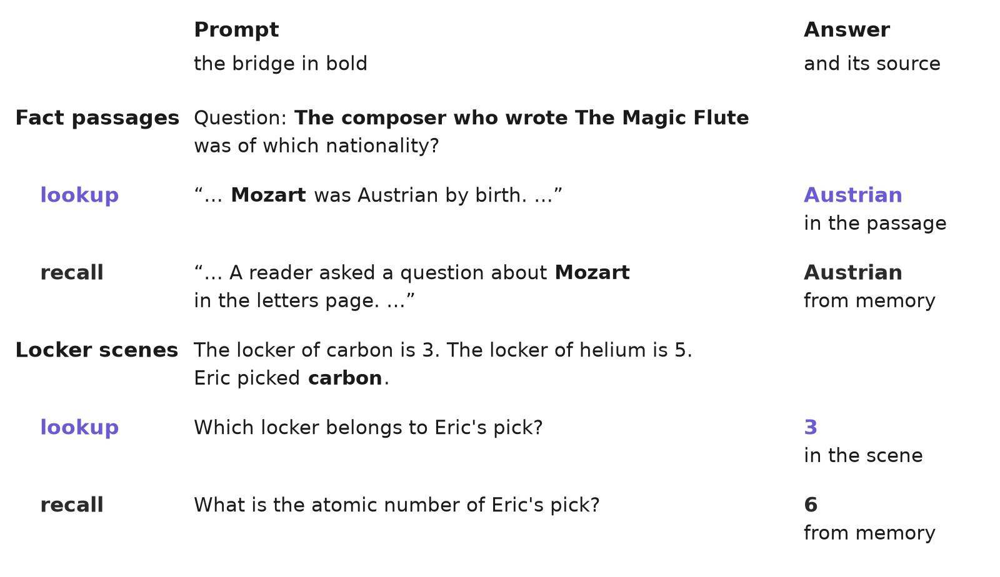</a> | **One question, two kinds of answer, two datasets.** The two kinds of prompt, as text: a fact passage, where the final fact is given in the passage (the lookup reads it) or left to memory (the recall); and a locker scene, where the same bridge word feeds a lookup question and a recall question. The bridge in bold; each answer in its reader's colour, with its source. Illustrative prompts written for the figure, not test items. | UNVERIFIED |
| 03 | <a href="03_tools.png">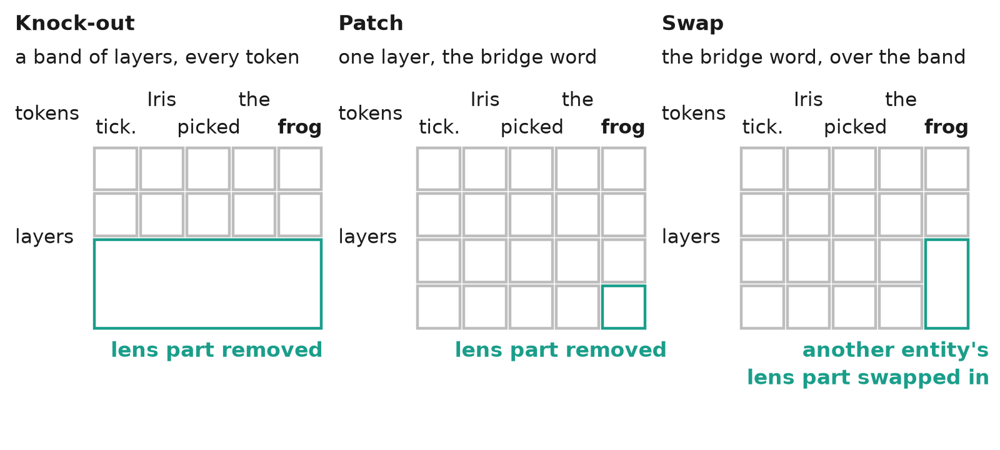</a> | **Three tools, one target: the lens part at the bridge.** The three ways the lens part is tested, drawn over the last words of a real locker scene (the bridge word in bold); rows are layers, columns tokens, and the teal box marks the cells each test changes. Knock-out: the lens part is projected out of every token over a band of middle layers. Patch: the patch is the change between two prompts at one layer at the bridge word, added without its lens part. Swap: another entity's lens part replaces the bridge word's over the band; it is teal because it is a lens part too. | UNVERIFIED |
| 04 | <a href="04_made_up_fact_set.png">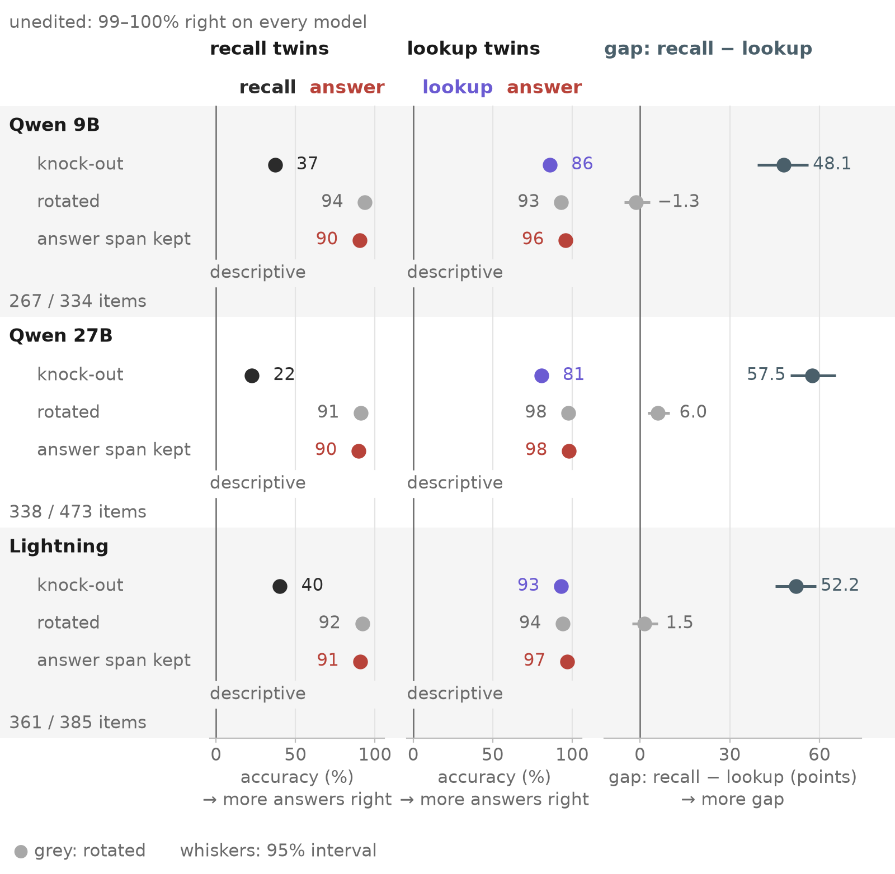</a> | **On matched twins the knock-out breaks the recall, the lookup much less.** The made-up-fact set (matched pairs whose question describes a person instead of naming them; the passage gives each person a made-up value). Rows are models, each with three lanes: the knock-out (the lens part removed everywhere, in the reader's colour), a rotated part of the same size (grey) and the answer span kept (brick). Left and middle: accuracy on the recall twins and on the lookup twins; right: the recall − lookup gap (slate) with its 95% interval. The answer-span lanes are descriptive (grey tag). Items per model (recall / lookup) under each name; unedited accuracy above the table.<!-- src: plotstyle.toml \| 95% interval --> | 6 descriptive · UNVERIFIED |
| 05a | <a href="05a_controls_band.png">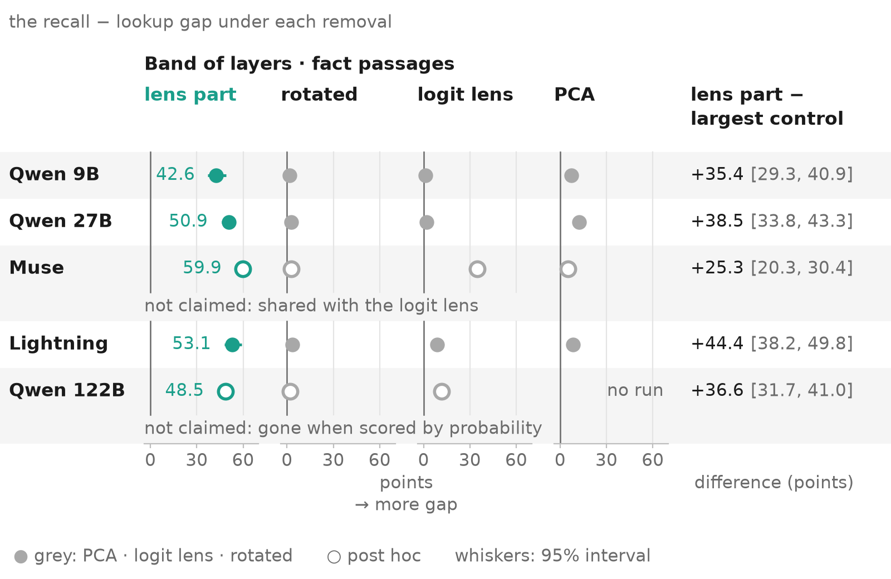</a> | **Same-size removals cost a fraction of what the lens part costs (band of layers).** Band of layers (fact passages): the recall − lookup gap, in points, when the lens part is removed everywhere (teal) and when a same-size control is removed instead (grey: a rotated part, the logit lens's top directions, the residual stream's top principal directions), one column each on the same scale. Right: the lens part minus its largest control, paired on the same items, with its 95% interval. Hollow (○, post hoc): Muse 30B and Qwen 122B; grey tags: the two cells the text does not claim; "no run": no PCA control on the 122B.<!-- src: plotstyle.toml \| 95% interval --> | 2 of 5 cells post hoc · 2 not claimed · UNVERIFIED |
| 05b | <a href="05b_controls_layer.png">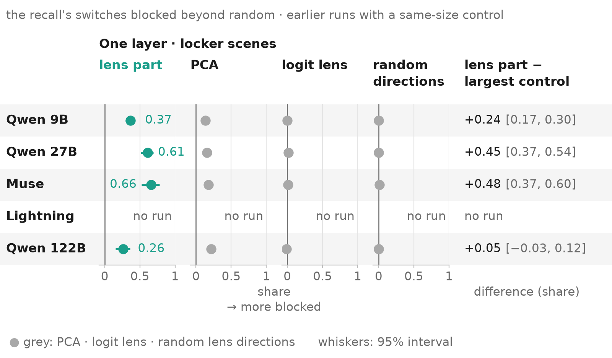</a> | **Same-size removals cost a fraction of what the lens part costs (one layer).** One layer (locker scenes, the earlier runs that had a same-size control): the recall's switches blocked beyond a random part when the lens part is removed from the patch (teal, with its 95% interval) and when a same-size control is removed instead (grey: PCA, the logit lens's directions, random lens directions). Right: the lens part minus its largest control, with its interval. Lightning: no run with a same-size control at one layer.<!-- src: plotstyle.toml \| 95% interval --> | UNVERIFIED |
| 06 | <a href="06_nine_models.png">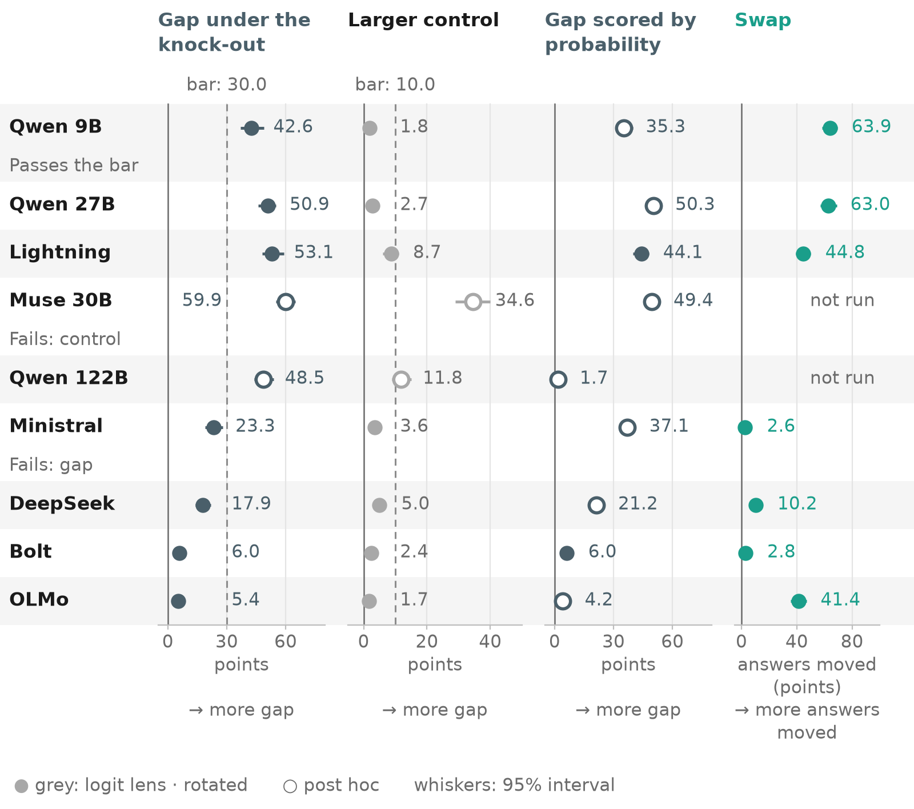</a> | **Carried and needed come apart across models.** Nine models, four tests. Rows are grouped by the bar fixed before the main runs: a recall − lookup gap of at least 30 points with the rotated and logit-lens controls under 10 (passes; fails because a control does as well; fails because the gap is too small). Dashed lines mark the bars. From left: the gap under the knock-out; the larger of the rotated and logit-lens controls (grey); the gap scored by the answer's probability; the answers moved to another entity's fact when its lens part is swapped in. All at 10 lens directions; the same tests at 100 directions are in the next figure. Hollow: post hoc. "Not run": no comparable run. Whiskers: 95% intervals. | 11 of 34 cells post hoc · UNVERIFIED |
| 06b | <a href="06b_nine_models_100.png">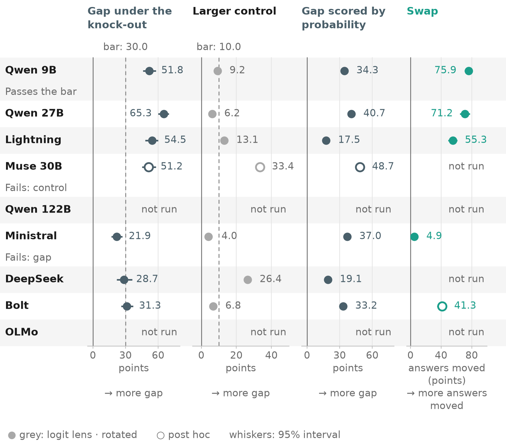</a> | The same nine models and tests at 100 lens directions: the dose runs for the knock-out, its controls and the probability gap (no intervals for the controls and the probability gap), and the swap at 100 directions. Rows and bands as in the previous figure; the dashed lines repeat its bars for reference. Hollow: post hoc. "Not run": no comparable run. Whiskers: 95% intervals. | 4 of 26 cells post hoc · UNVERIFIED |
| 07 | <a href="07_routes.png">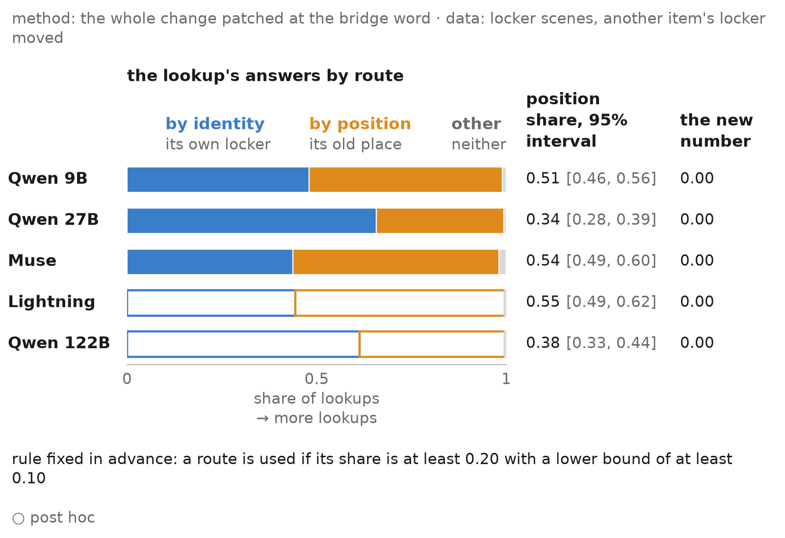</a> | **The lookup goes by identity or position, never by the number.** When another item's locker moves, where each model's lookup goes: one bar per model splitting its answers by identity (the item's own locker, blue), by position (the locker now at the old place, amber) and other (light grey). Right: the position share with its 95% interval over bridge entities, and the share answered by the number itself. Hollow outlines (○, post hoc): Lightning and the 122B.<!-- src: plotstyle.toml \| 95% interval --> | 2 of 5 cells post hoc · UNVERIFIED |
| 08a | <a href="08a_address_read_remove.png">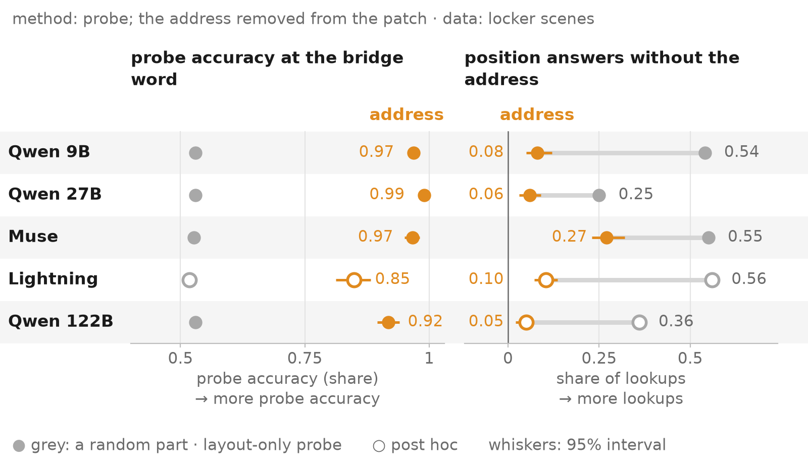</a> | **A probe reads the address; removing it stops position answers.** Left: a probe at the bridge word reads the address, which locker sentence holds the item's locker (amber), against a probe trained on the layout only (grey). Right: the lookups that still answer by position when the address is removed from the patch (amber), joined to a random part of the same size removed instead (grey); lower means more blocked. Whiskers: 95% intervals. Hollow (○, post hoc): Lightning, and the 122B where its gate was lowered.<!-- src: plotstyle.toml \| 95% interval --> | 3 of 10 cells post hoc · UNVERIFIED |
| 08b | <a href="08b_address_swap_lens.png">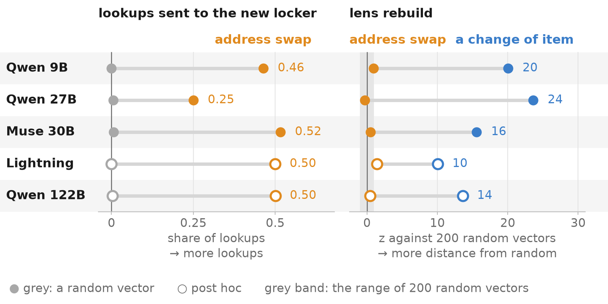</a> | **Swapping the address moves the lookup; the lens does not rebuild it.** Left: the lookups sent to the new locker when another locker's address is swapped in (amber), against a random vector of the same size (grey). Right: how far above random vectors the lens part rebuilds that swap (amber), against a change of item of the same size (blue, the positive control), in z; grey band: the range of the random vectors. Hollow (○, post hoc): Lightning and the 122B.<!-- src: plotstyle.toml \| z against 200 random vectors --> | 4 of 10 cells post hoc · UNVERIFIED |
| 09 | <a href="09_order.png">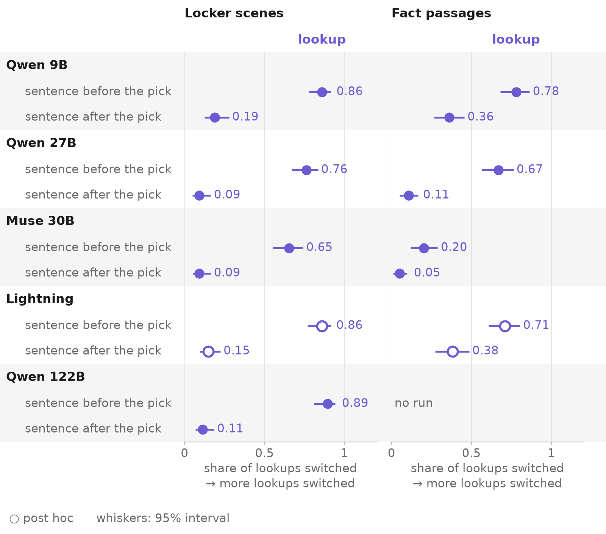</a> | **The bridge word moves the lookup only when the locker sentence came first.** Per model two lanes, the locker (or fact) sentence before the pick and after it: the share of lookups the whole change at the bridge word switches, with its 95% interval. Left, locker scenes; right, fact passages ("no run": none on the 122B). Hollow (○, post hoc): Lightning.<!-- src: plotstyle.toml \| 95% interval --> | 4 of 18 cells post hoc · UNVERIFIED |
| 10 | <a href="10_answer_span.png">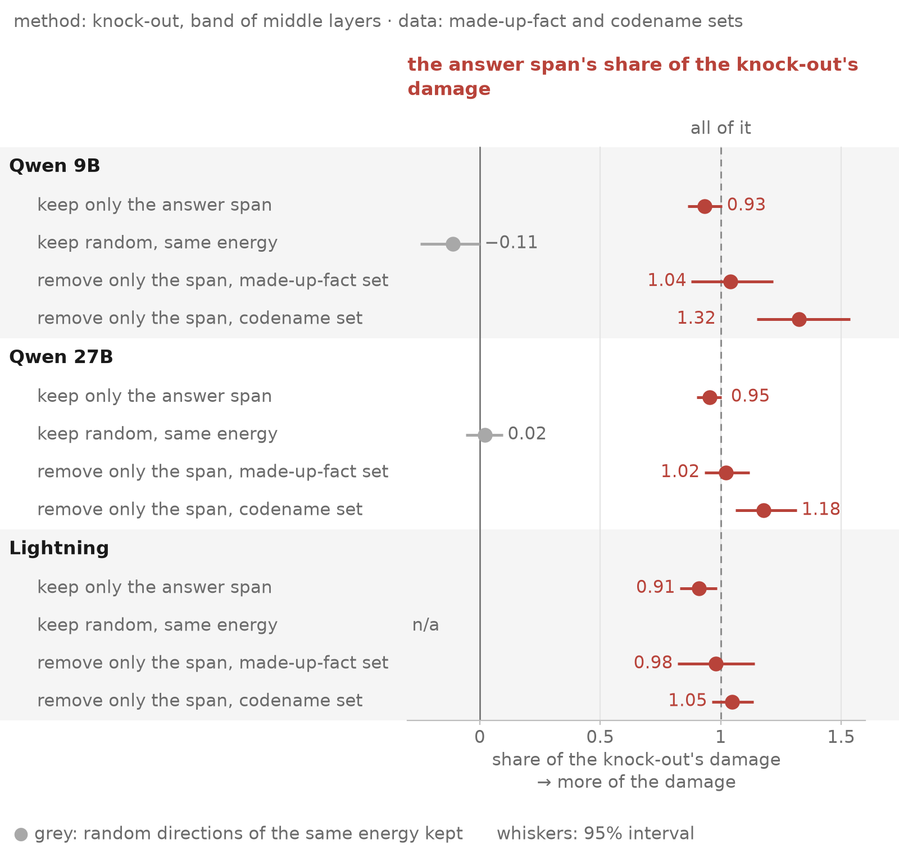</a> | **What recall loses is its answer's own directions.** What the knock-out removes from the recall. Left: the share of the knock-out's damage undone when the answer span (the answers' own lens directions, brick) is kept, against an energy-matched random keep (grey); descriptive. Middle: the damage when only the answer span is removed, as a multiple of the full knock-out's (dashed: all of it), beyond an energy-matched random removal. Right: the same on the codename set, an independent fact sample. Whiskers: 95% intervals; "matched on …": the share of items whose random part reached its target energy.<!-- src: plotstyle.toml \| 95% interval --> | 3 descriptive · UNVERIFIED |
| 11 | <a href="11_orthogonal.png">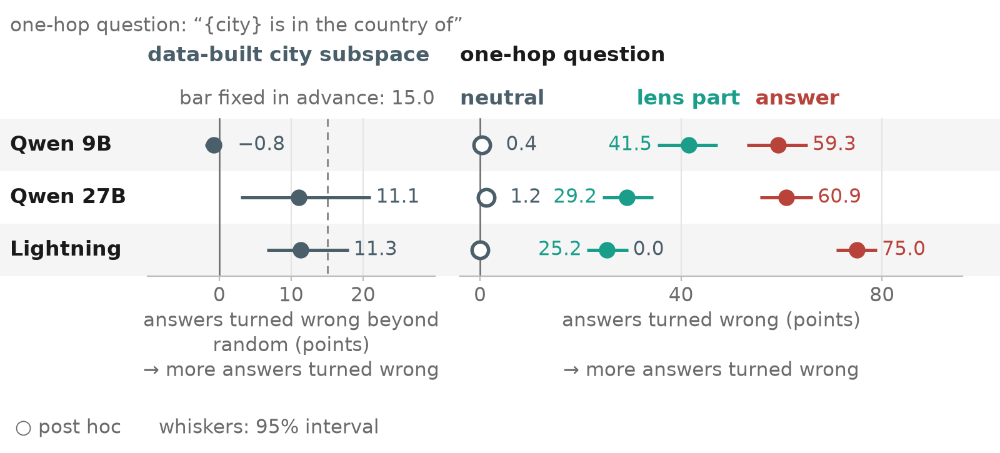</a> | **Removals made orthogonal to the answers cannot see even the subject.** Removals orthogonal to the answers. Left: a data-built subspace for the subject (slate), answers turned wrong beyond random, against the bar fixed in advance (dashed). Right, a one-hop question about the subject: answers turned wrong when the subject's lens directions are removed (teal), when only the answers' own directions are (brick), and when the subject's directions are made orthogonal to the answers (slate, hollow: post hoc, no interval stored). Whiskers: 95% intervals.<!-- src: plotstyle.toml \| 95% interval --> | 3 of 12 cells post hoc · UNVERIFIED |
| 12 | <a href="12_pointer.png">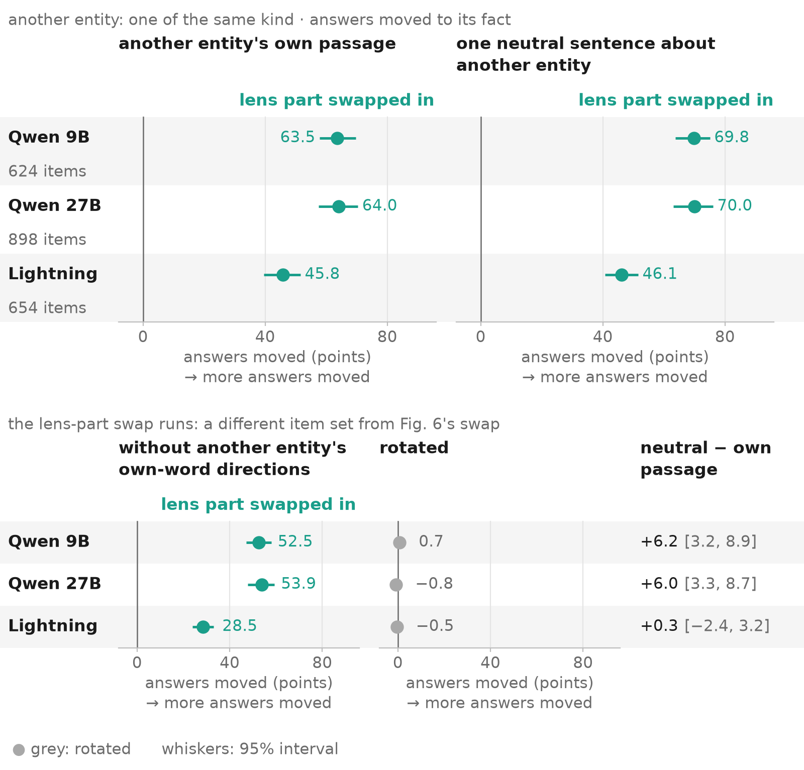</a> | **Another entity's lens part moves the recall, even from one neutral sentence.** Answers moved to another entity's fact (of the same kind) when its lens part is swapped in at the bridge, with 95% intervals; rows are models, items per model under the name. Top: the part taken from that entity's own passage and from one neutral sentence about it. Bottom: the same without the entity's own-word directions, a rotated part (grey), and the paired difference neutral sentence − own passage. These runs use a different item set from Fig. 6's swap.<!-- src: plotstyle.toml \| 95% interval --> | UNVERIFIED |
| 13 | <a href="13_last_token.png">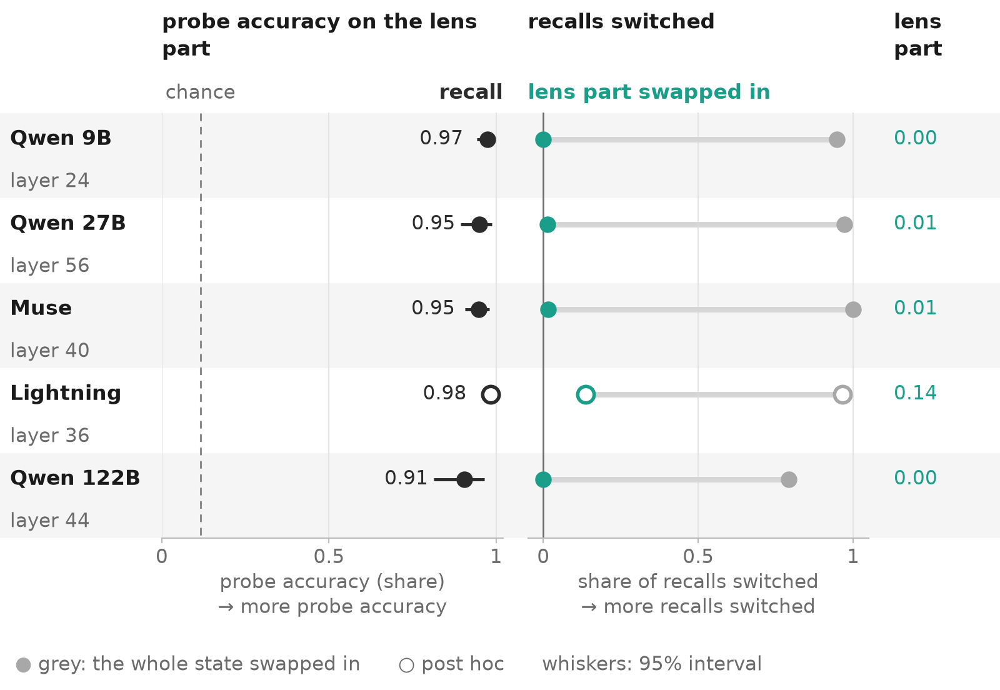</a> | **At the last token the lens part reads the entity, yet a 1× swap barely moves the answer.** Per model, at the layer where the read peaks (under the name). Left: a probe's accuracy for the recall's entity on the lens part of the last token's state, with its 95% interval; dashed: chance. Right: the recalls switched when only the lens part is swapped in (teal), joined to the whole state swapped in (grey); the lens part's value in the last column. Hollow (○, post hoc): Lightning.<!-- src: plotstyle.toml \| 95% interval --> | 1 of 5 cells post hoc · UNVERIFIED |
| a01 | <a href="a01_agents.png">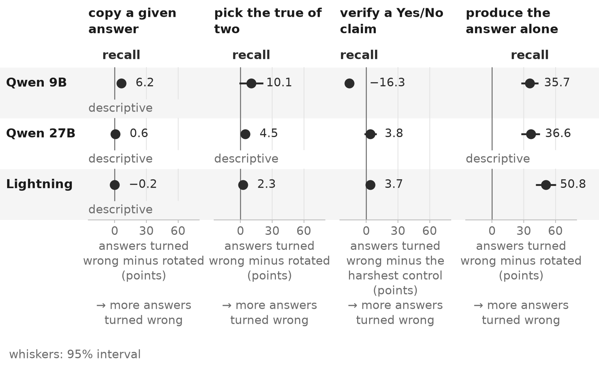</a> | **Inside agent transcripts, copying and picking survive the knock-out; producing does not.** Inside agent transcripts, one relation: the recall's answers turned wrong by the knock-out minus a control's, in points, when the step is to copy a given answer, pick the true one of two, verify a Yes/No claim, or produce the answer alone (minus the rotated control, or the harshest control for verify). Whiskers: 95% intervals; grey tags: cells read without a rule fixed in advance (descriptive). No transcript is quoted.<!-- src: plotstyle.toml \| 95% interval --> | 5 descriptive · UNVERIFIED |
| a02 | <a href="a02_atoms.png">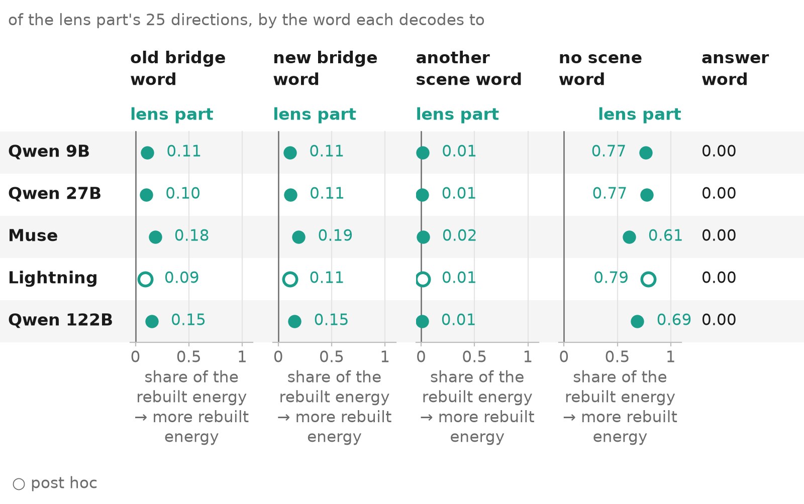</a> | Of the lens part's directions at the bridge, the share of the energy they rebuild by the word each decodes to: the old bridge word, the new bridge word, another scene word, no scene word (teal dots, one column each); the answer word's share at the right. Hollow (○, post hoc): Lightning. | 1 of 5 cells post hoc · UNVERIFIED |
| a03 | <a href="a03_position_route.png">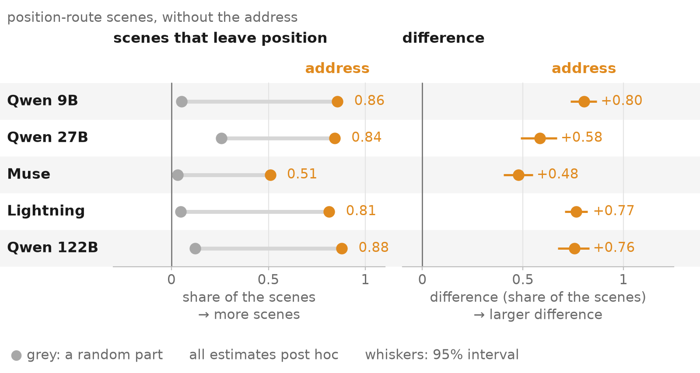</a> | Post hoc, another item moved, lookup. Of the scenes on the position route, the share that leaves it when the address is removed (amber), joined to a random part of the same size removed instead (grey); right: the paired difference with its 95% interval over bridge entities. All estimates post hoc.<!-- src: plotstyle.toml \| 95% interval --> | all post hoc · UNVERIFIED |
| a04 | <a href="a04_identity_route.png">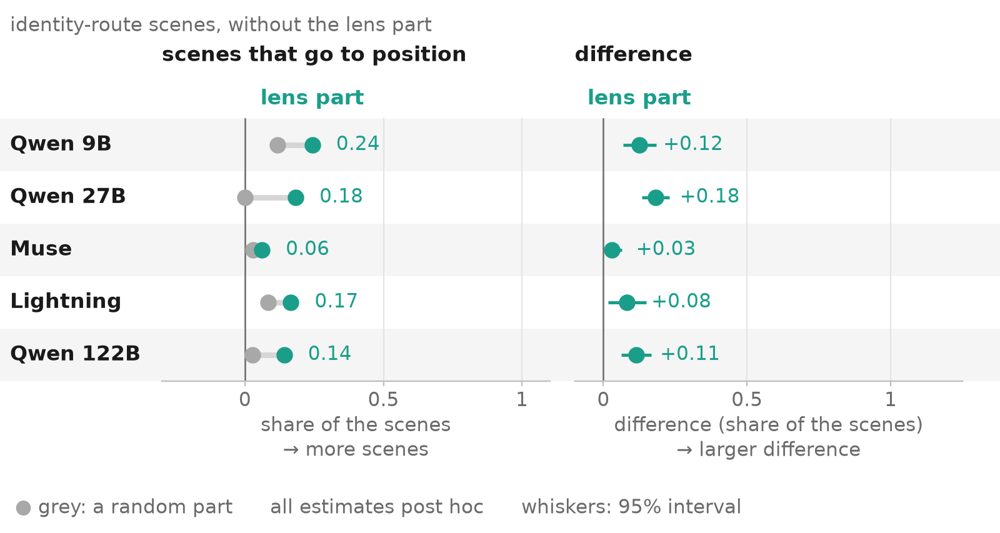</a> | Post hoc, another item moved, lookup. Of the scenes on the identity route, the share that turns to the position when the lens part is removed (teal), joined to a random part removed instead (grey); right: the paired difference with its 95% interval. All estimates post hoc.<!-- src: plotstyle.toml \| 95% interval --> | all post hoc · UNVERIFIED |
| a05 | <a href="a05_where.png">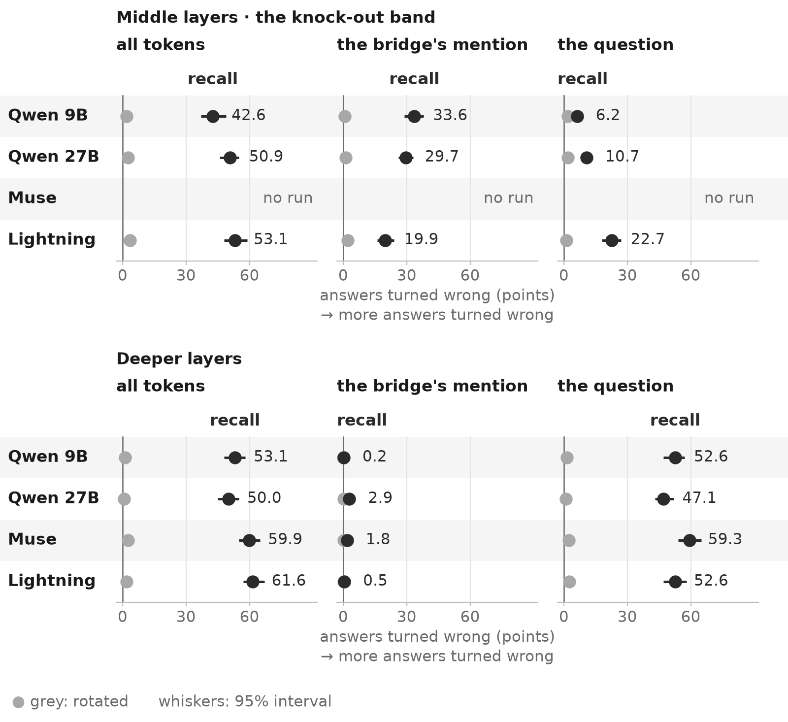</a> | Where the recall needs the lens part: answers turned wrong, in points, when it is removed at all tokens, at the bridge's mention only, or at the question only (black, 95% intervals), against a rotated part of the same size (grey). Top: the middle layers (the knock-out band); bottom: deeper layers. Muse 30B: no run in the middle band.<!-- src: plotstyle.toml \| 95% interval --> | UNVERIFIED |
| a06 | <a href="a06_order.png">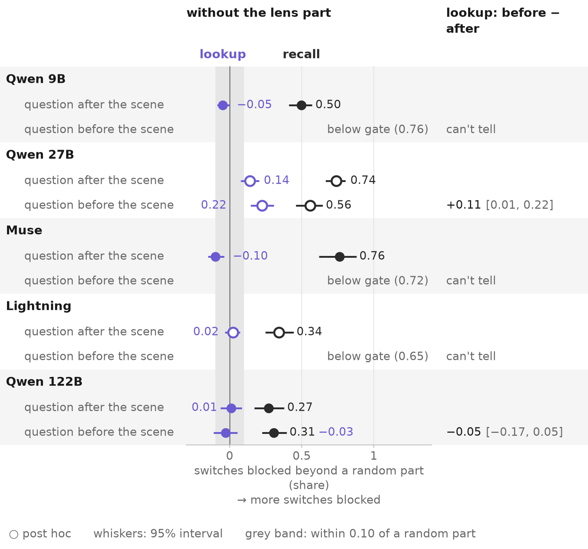</a> | Per model two lanes, the question after the scene (the main test) and before it: switches blocked without the lens part beyond a random part (lookup violet, recall black, 95% intervals), on the grey band. Right: the lookup's difference, before − after. "below gate (…)": the question-first scenes did not pass that model's gate; "can't tell": no difference without that cell. Hollow (○, post hoc): the 27B and Lightning.<!-- src: plotstyle.toml \| 95% interval; within 0.10 of a random part --> | 3 of 7 cells post hoc · UNVERIFIED |
| a07 | <a href="a07_facts.png">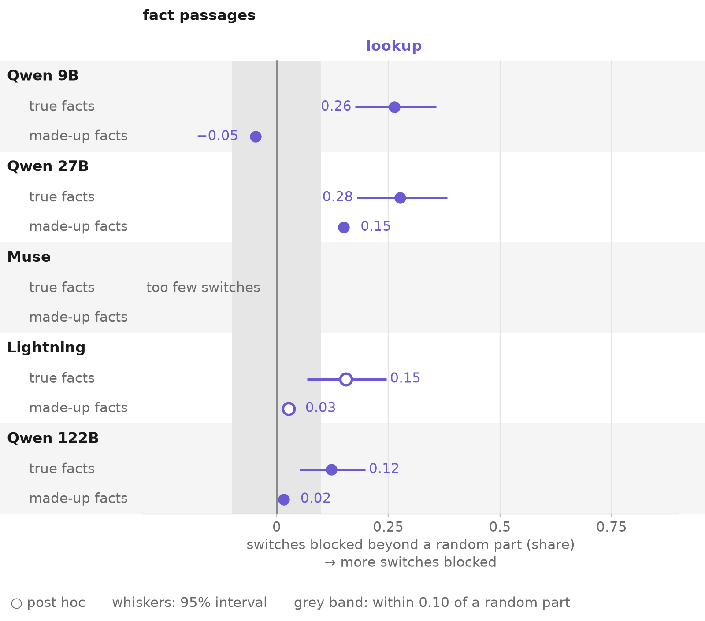</a> | Fact passages: the lookup's switches blocked beyond a random part when the lens part is removed, with true facts and with made-up ones (one lane each), on the grey band. Whiskers: 95% intervals on the true-fact cells. Muse 30B: too few lookup switches. Hollow (○, post hoc): Lightning.<!-- src: plotstyle.toml \| 95% interval; within 0.10 of a random part --> | 1 of 4 cells post hoc · UNVERIFIED |
| a08 | <a href="a08_directions.png">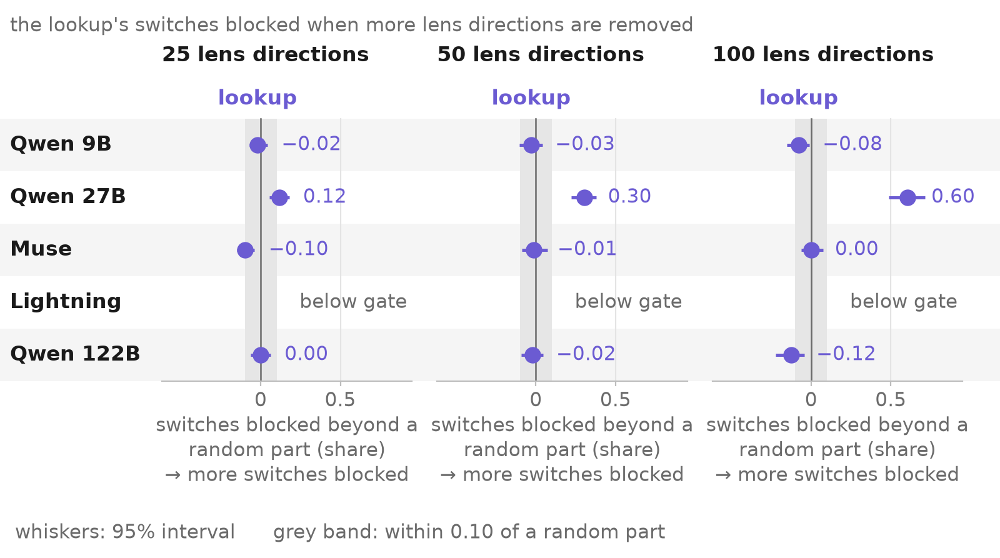</a> | The conflict test with more lens directions removed: the lookup's switches blocked beyond a random part, one column per number of directions, on the grey band; whiskers: 95% intervals. Lightning: below its gate.<!-- src: plotstyle.toml \| 95% interval; within 0.10 of a random part --> | UNVERIFIED |
| a09 | <a href="a09_link_crossover.png">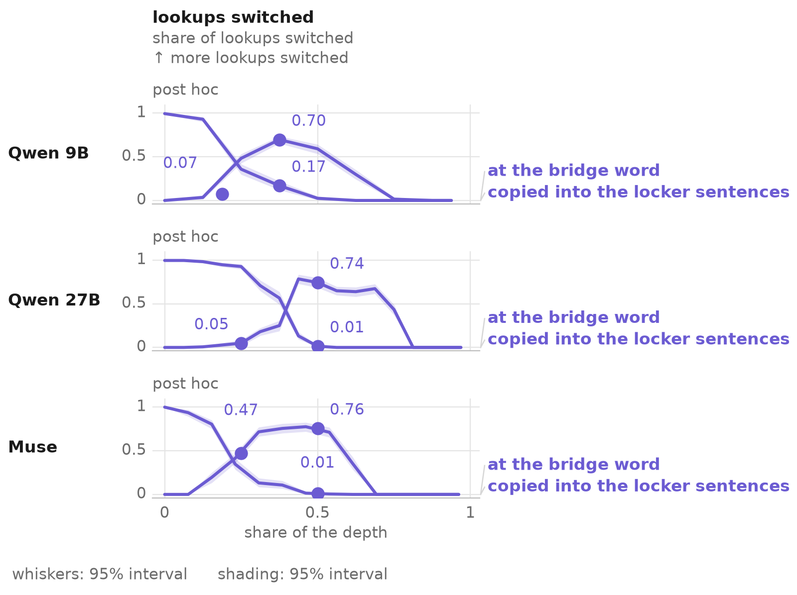</a> | Per model, over the depth (share of the layers): the lookups switched by the change at the bridge word and by the same change copied into the locker sentences (two violet lines, named at their ends; shading: 95% interval). Dots: the cells fixed in advance, with their own whiskers and values. Grey "post hoc" over each panel: the lines are post hoc.<!-- src: plotstyle.toml \| 95% interval --> | 6 of 15 cells post hoc · UNVERIFIED |
| a10 | <a href="a10_attention.png">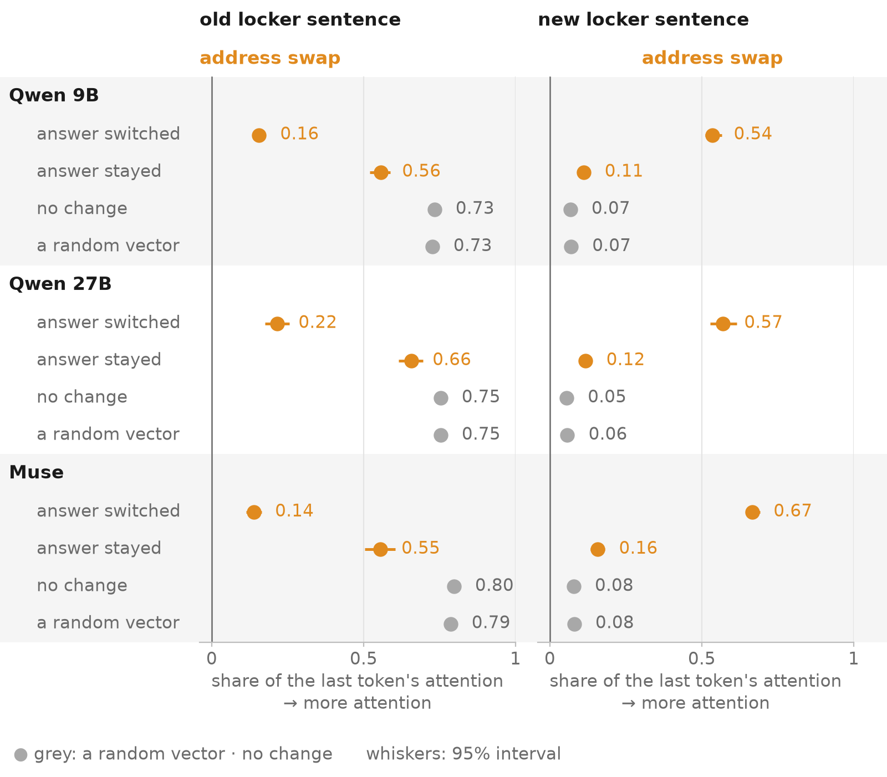</a> | Per model four lanes: the address swap with the answer switched, with it staying (amber, 95% intervals), no change and a random vector (grey controls). Each is the last token's attention on the old locker sentence (left) and on the new one (right).<!-- src: plotstyle.toml \| 95% interval --> | UNVERIFIED |
| a11 | <a href="a11_heads.png">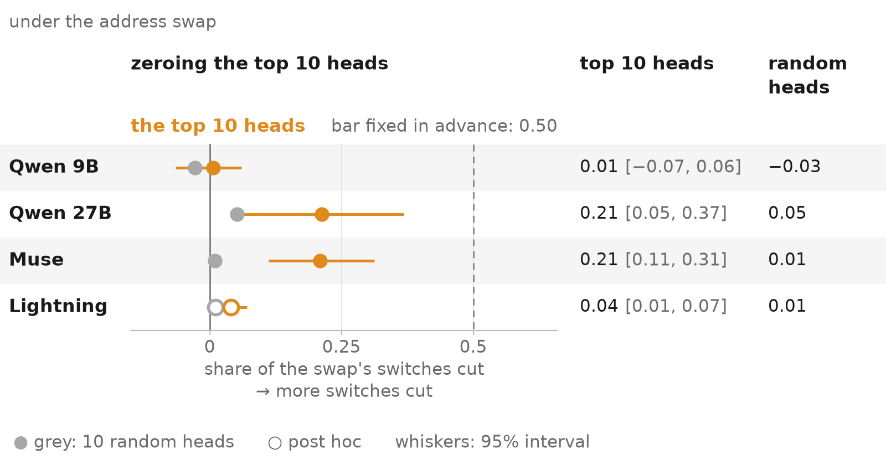</a> | Under the address swap: the share of its switches cut when the top heads are zeroed (amber, 95% interval), against as many random heads (grey), with the bar fixed in advance (dashed); the values in the two columns at the right. Hollow (○, post hoc): Lightning.<!-- src: plotstyle.toml \| 95% interval --> | 2 of 8 cells post hoc · UNVERIFIED |
| a12 | <a href="a12_code_tool.png">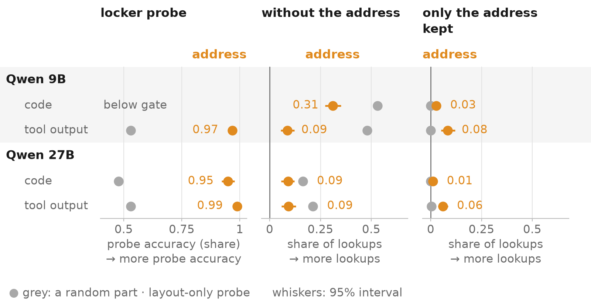</a> | Python code and tool output (exploratory, the 9B and the 27B). Left: the locker probe reads the address (amber) against a layout-only probe (grey); "below gate": the 9B's code probe was not run. Middle: the lookups that keep the position route without the address (amber) against a random part (grey). Right: with only the address kept. Whiskers: 95% intervals.<!-- src: plotstyle.toml \| 95% interval --> | UNVERIFIED |
| a13 | <a href="a13_six_lockers.png">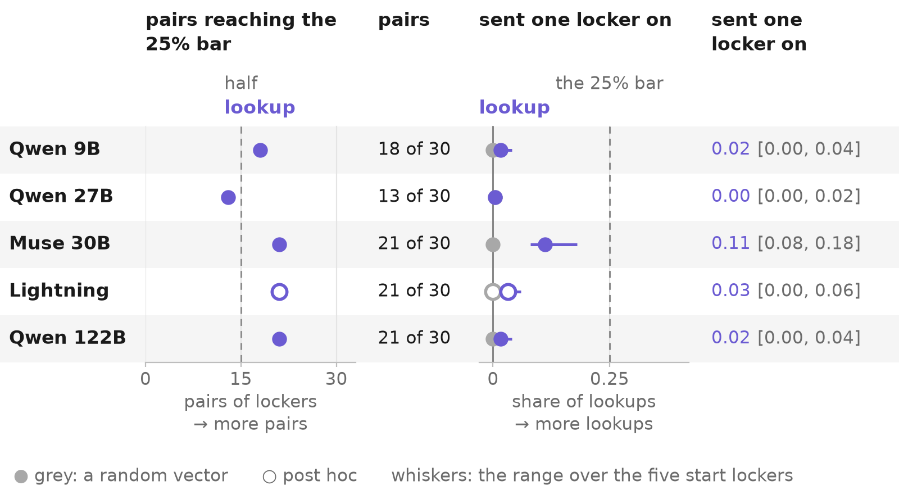</a> | With six lockers. Left: the pairs of lockers whose address swap reaches the bar (dashed: half of them); the count in the next column. Right: the lookups sent one locker on by the shift vector (violet; whisker: the range over the start lockers) against a random vector of the same size (grey), with the bar (dashed). Hollow (○, post hoc): Lightning. | 1 of 5 cells post hoc · UNVERIFIED |
