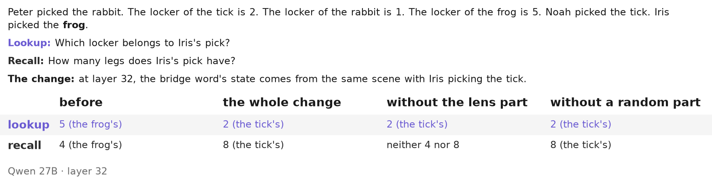
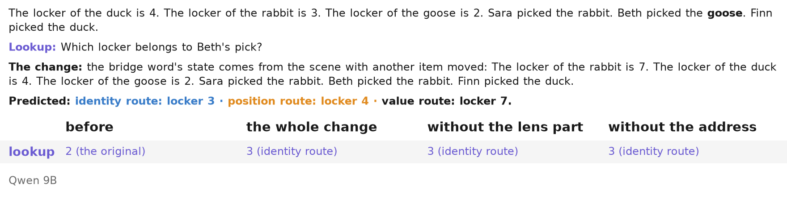

# Figures for the depth track's real examples

Built by `make readme` with [styles-plot](https://github.com/danorel/styles-plot) (vocabulary: [plotstyle.toml](../../../plotstyle.toml); statuses: [data/figures/status.csv](../../../data/figures/status.csv)). File names follow the document's order (figkit/layout.py); `_meta/` holds each figure's sidecar, `_sheets/` the contact sheets.

| № | figure | what it shows | status |
|---|---|---|---|
| 01 |  | One real locker scene, Qwen 27B: the whole change switches both readers; without the lens part the lookup still switches and the recall does not | UNVERIFIED |
| 02 |  | One real routes scene, Qwen 9B: the three routes predict three lockers; the lookup takes the identity route's | UNVERIFIED |
