# Figures for the depth ledger (docs/depth/EXPERIMENTS.md)

Built by `make readme` with [styles-plot](https://github.com/danorel/styles-plot) (vocabulary: [plotstyle.toml](../../../plotstyle.toml); statuses: [data/figures/status.csv](../../../data/figures/status.csv)). File names follow the document's order (figkit/layout.py); `_meta/` holds each figure's sidecar, `_sheets/` the contact sheets.

| № | figure | what it shows | status |
|---|---|---|---|
| 01 | <a href="01_item_not_answer.png">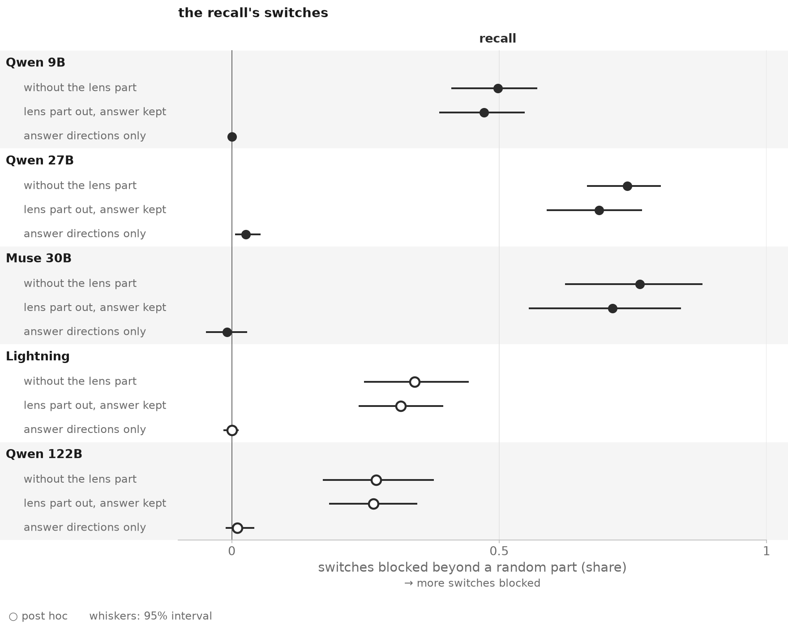</a> | The answer control, main test: the recall's switches blocked beyond a random part of the same size without the lens part, with the lens part removed but the answer word's directions kept, and with only the answer word's directions removed, one lane each per model. | 2 of 5 cells post hoc · UNVERIFIED |
| 02 | <a href="02_lightning_layers.png">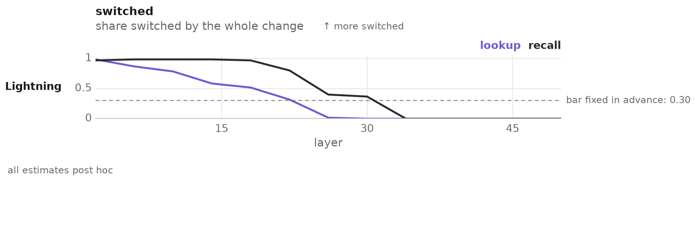</a> | Lightning's layer sweep on the pre-check scenes: the share of each reader's answers switched by the whole change at the bridge word, lookup (violet) and recall (black), at every swept layer; dashed: the bar both readers must reach. | all post hoc · UNVERIFIED |
| 03 | <a href="03_ladder.png">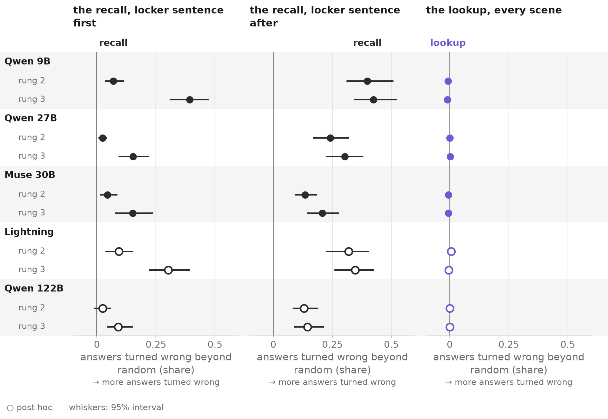</a> | The ladder at the two rungs its rule compares: the answers turned wrong beyond a random part of the same share when the lens part is removed step by step, the recall in locker-first and in locker-after scenes and the lookup over every scene. | 2 of 5 cells post hoc · UNVERIFIED |
| 04 | <a href="04_follows_both.png">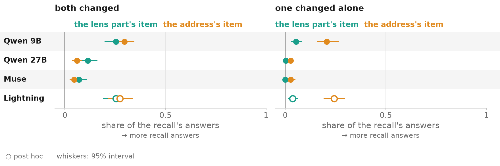</a> | The lens part from one scene (item B) and the address from another (item C) swapped in together (left) or alone (right): the share of the recall's answers that are B's (the lens part's item, teal) and C's (the address's item, orange), per model. | 1 of 4 cells post hoc · UNVERIFIED |
| 05 | <a href="05_number_answer.png">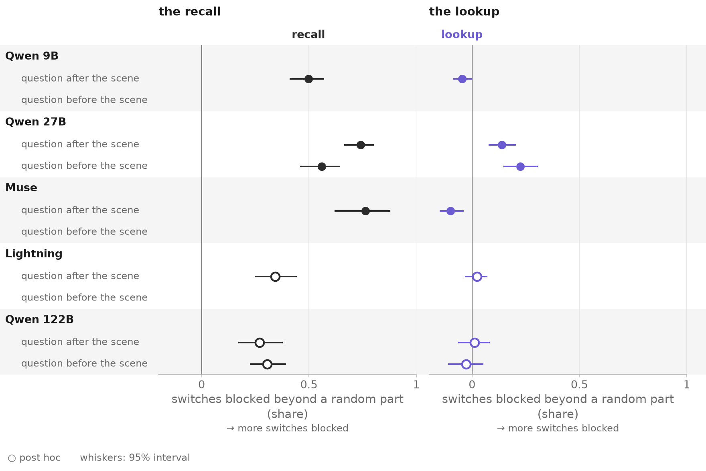</a> | A number as the answer: the switches blocked without the lens part beyond a random part, the recall (left) and the lookup (right), with the question after the scene and, on the 27B and the 122B, before it. | 2 of 5 cells post hoc · UNVERIFIED |
| 06 | <a href="06_answer_map.png">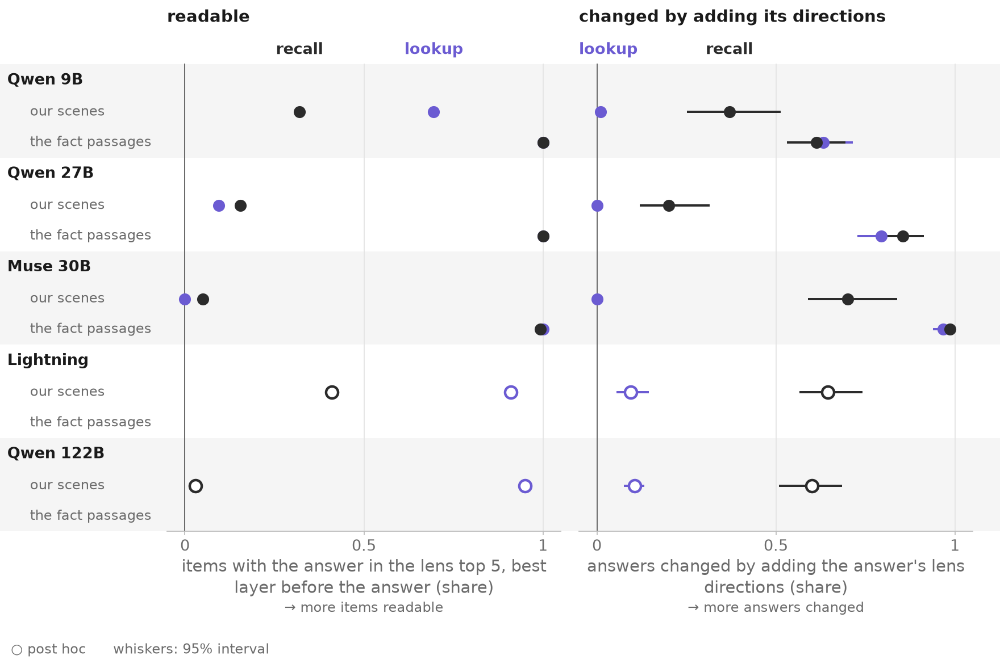</a> | Where the answer word is readable through the lens (left: the share of items with it in the lens top 5 at the best layer before the answer; one value, no interval) and whether adding its lens directions there changes the answer (right; at the size the run chose), lookup (violet) and recall (black), on our scenes and on the fact passages. | 2 of 5 cells post hoc · UNVERIFIED |
| 07 | <a href="07_value_formats.png">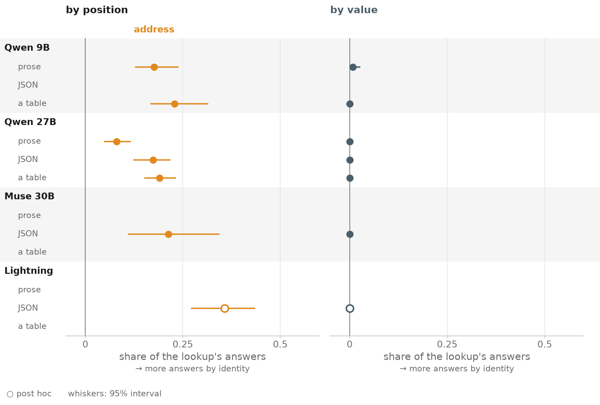</a> | The routes test in prose, JSON and a table: the share of the lookup's answers that follow the moved item's position (orange) and its new value (slate), per model and format run. | 1 of 4 cells post hoc · UNVERIFIED |
| 08 | <a href="08_identity_code.png">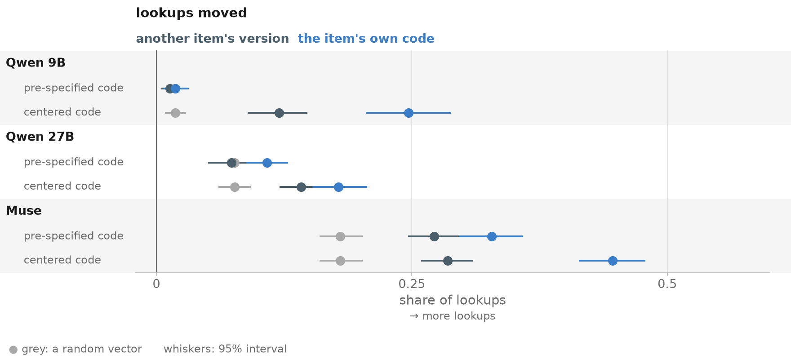</a> | The item's identity code from its locker sentence added at the bridge word: the share of lookups moved by the item's own code (blue), by another item's version of it (slate) and by a random vector (grey), with the code as fit in advance and centered. | UNVERIFIED |
| 09 | <a href="09_subset27b.png">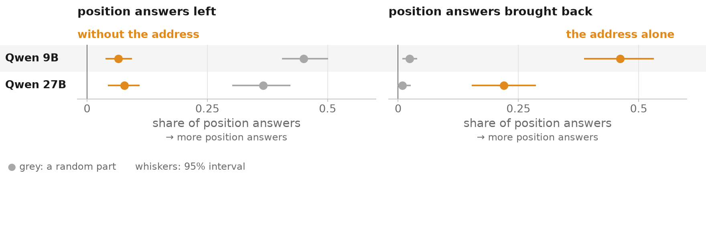</a> | The 27B's scenes where its lookup goes by position, beside the 9B: the position answers left without the address and without a random part (grey), and brought back by the address alone and by a random part alone (grey). | UNVERIFIED |
| 10 | <a href="10_report_first_position.png">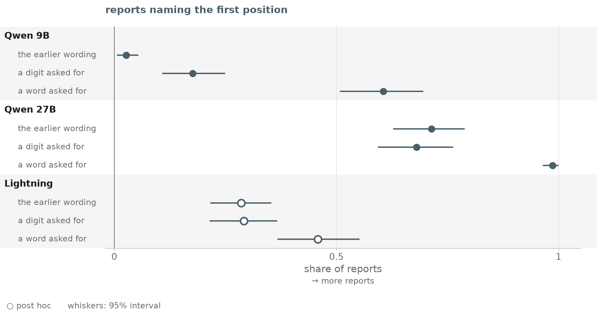</a> | The model's report of where the item sits, reworded: the share of reports naming the first position under the earlier wording, when a digit is asked for and when a word is asked for, per model. | 1 of 3 cells post hoc · UNVERIFIED |
| 11 | <a href="11_last_token_swap.png">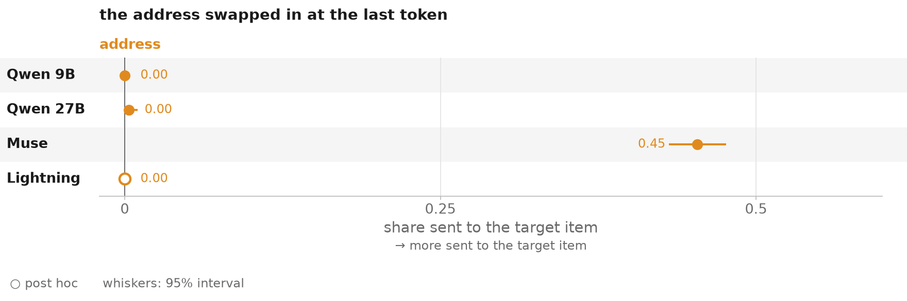</a> | The address fit at the bridge word swapped in at the last token, a few layers after L at twice a real change's size: the share of lookups sent to the target item, per model. | 1 of 4 cells post hoc · UNVERIFIED |
| 12 | <a href="12_last_conflict.png">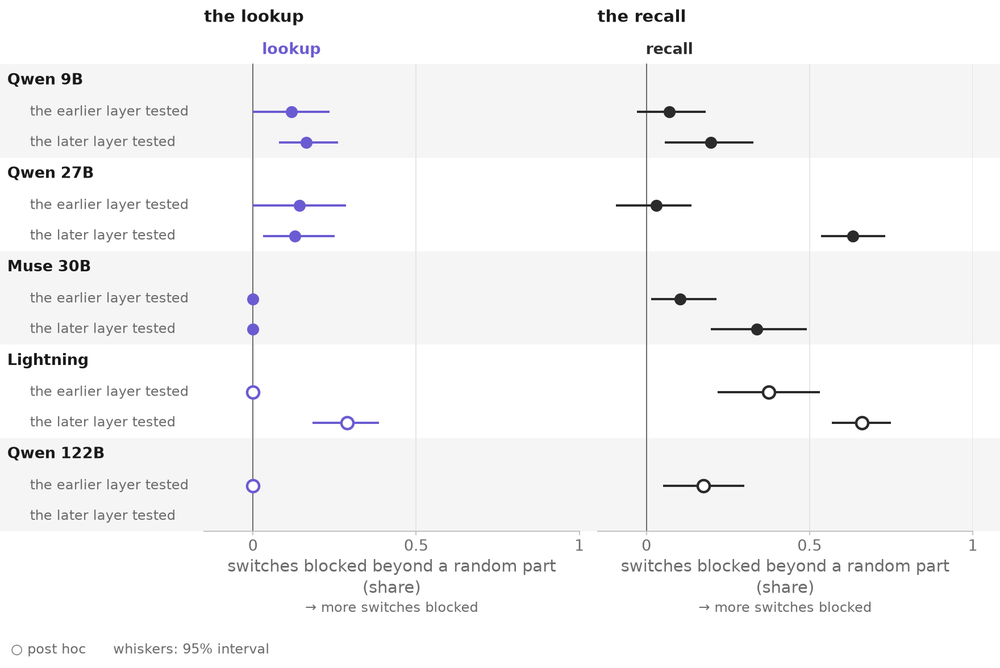</a> | The conflict test at the last token: the switches blocked without the lens part beyond a random part, lookup (left) and recall (right), at the two layers tested for each reader (its own layers, earlier first; the 122B at one). | 2 of 5 cells post hoc · UNVERIFIED |
| 13 | <a href="13_last_conflict_words.png">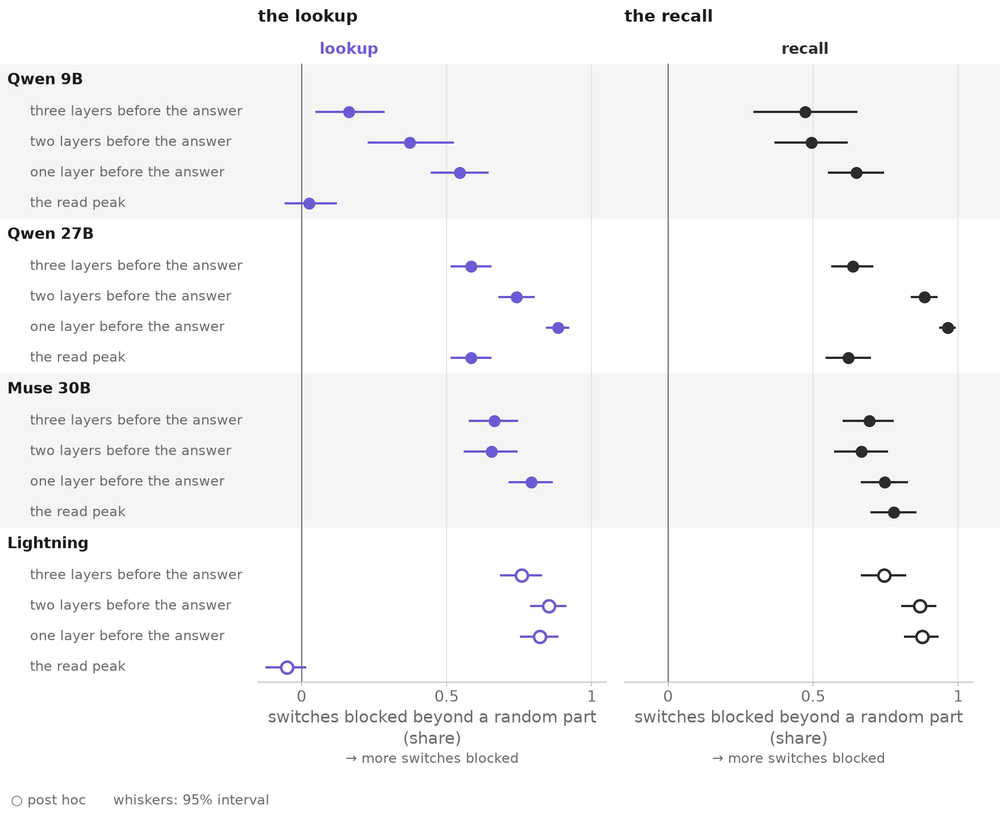</a> | As the figure above with words as the answers: per model, three, two and one layers before the answer and at the read peak (the rule counts the two layers nearest the answer as uninformative). | 1 of 4 cells post hoc · UNVERIFIED |
| 14 | <a href="14_attention_blocks.png">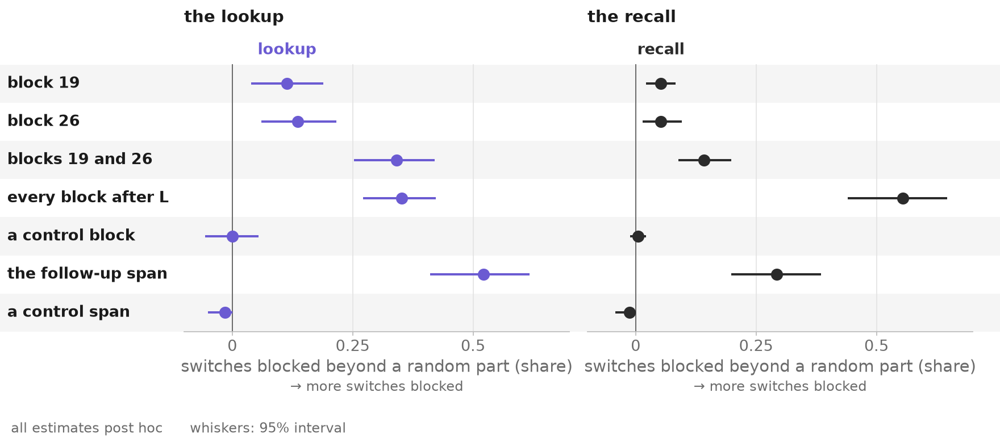</a> | Lightning: the switches blocked when attention blocks are cut, lookup (left) and recall (right), per block or span cut (rows), with a control block and a control span. | all post hoc · UNVERIFIED |
| 15 | <a href="15_fact_answer_control.png">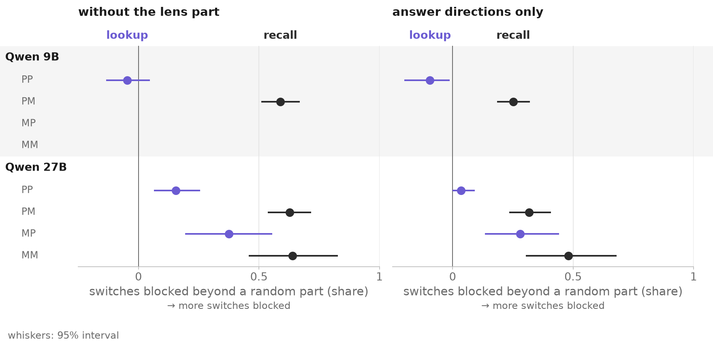</a> | The answer control on the fact passages with the bridge named, per chain (P: read in the passage, M: recalled; the last letter is the hop the reader answers): the switches blocked without the lens part and with only the answer word's directions removed, lookup (violet) and recall (black). | UNVERIFIED |
| 16 | <a href="16_every_layer.png">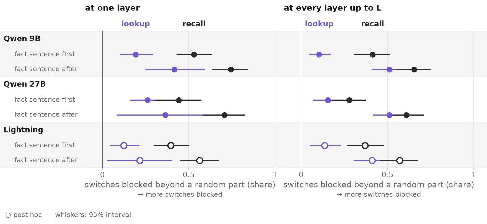</a> | The change at the bridge word at one layer (left) and at every layer up to L (right): the switches blocked without the lens part beyond a random part, lookup (violet) and recall (black), with the fact sentence before the pick and after it. | 1 of 3 cells post hoc · UNVERIFIED |
| 17 | <a href="17_fact_routes.png">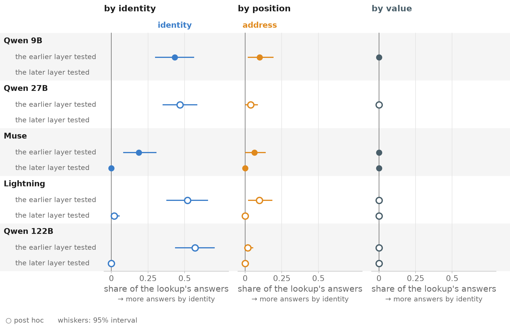</a> | The routes test on the fact passages: the share of the lookup's answers by identity (blue), by position (orange) and by value (slate), at each model's layer tested and, where run, a later one. | 3 of 5 cells post hoc · UNVERIFIED |
| 18 | <a href="18_read_window.png">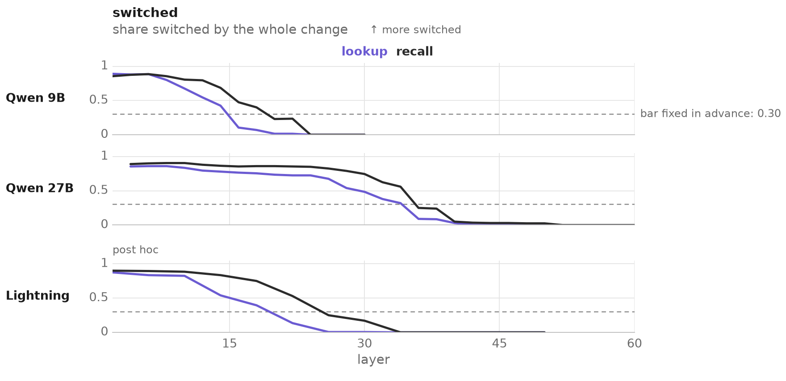</a> | The fact passages' read window: the share of each reader's answers switched by the whole change at the bridge name, one layer at a time, lookup (violet) and recall (black); dashed: the bar fixed in advance. | 1 of 3 cells post hoc · UNVERIFIED |
| 19 | <a href="19_person_probe.png">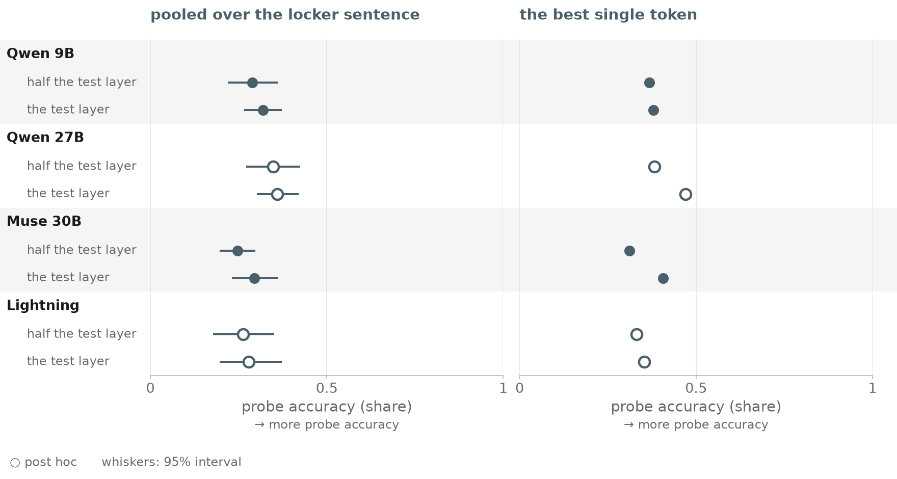</a> | Who picked the item, read by a probe at its locker sentence: the accuracy pooled over the sentence (with its 95% interval) and at the best single token, at half the test layer and at it. | 2 of 4 cells post hoc · UNVERIFIED |
| 20 | <a href="20_any_item.png">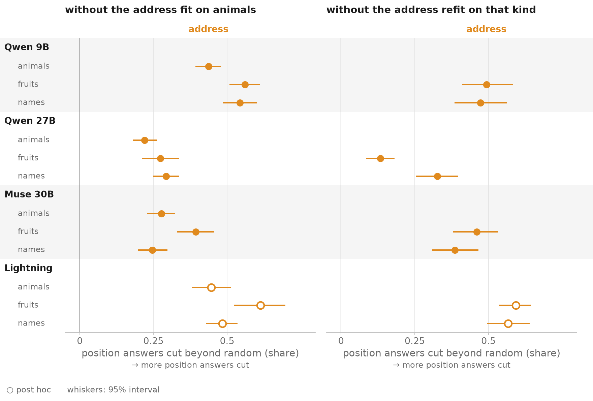</a> | The address on other kinds of item: the position answers cut beyond random without the address fit on animals (left) and refit on each kind (right), per model and kind. | 1 of 4 cells post hoc · UNVERIFIED |
| 21 | <a href="21_described_gap.png">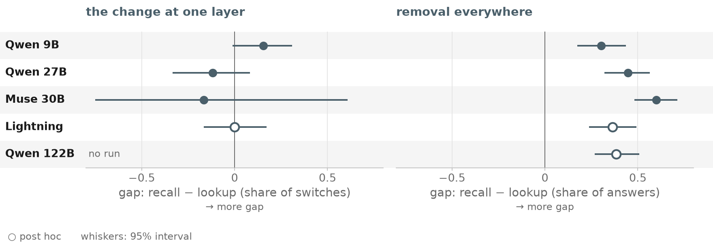</a> | The fact passages with the bridge described: the gap, recall minus lookup, under the change at one layer (left, a share of switches) and under removal everywhere (right, a share of answers); the 122B not run at one layer. | 2 of 5 cells post hoc · UNVERIFIED |
