# Figures for the depth README

Built by `make readme` with [styles-plot](https://github.com/danorel/styles-plot) (vocabulary: [plotstyle.toml](../../../plotstyle.toml); statuses: [data/figures/status.csv](../../../data/figures/status.csv)). File names follow the document's order (figkit/layout.py); `_meta/` holds each figure's sidecar, `_sheets/` the contact sheets.

| № | figure | what it shows | status |
|---|---|---|---|
| 01 | <a href="01_setup.png">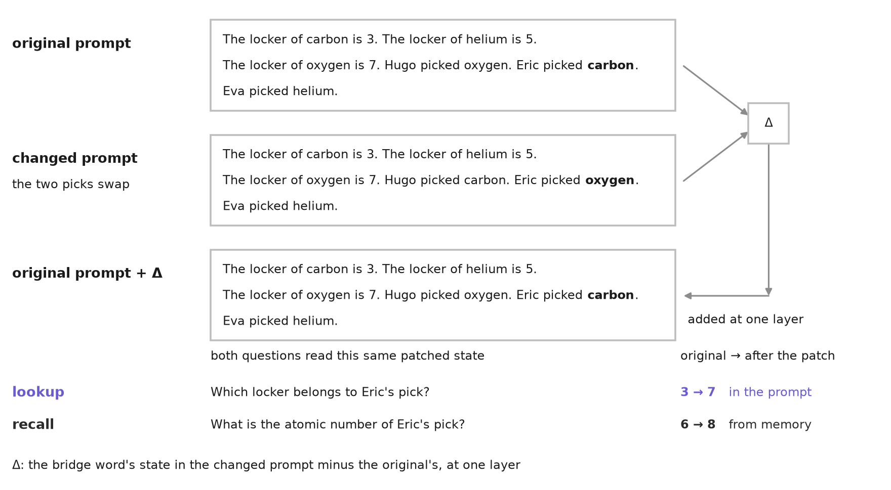</a> | The worked example: one prompt, its two questions and the changed prompt. | UNVERIFIED |
| 02 | <a href="02_one_layer_split.png">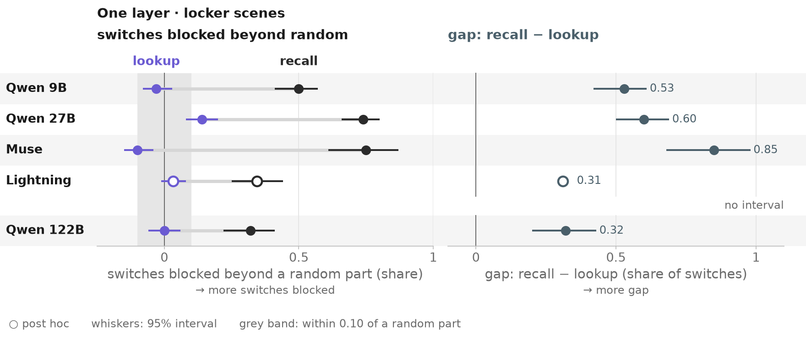</a> | Switches blocked without the lens part beyond a random part, lookup and recall per model, main test at L (the 122B's L33: the 27B's relative depth carried over); right: the gap, recall minus lookup, with its 95% interval; grey band: within 0.10 of random (the lookup's bar). | 1 of 5 cells post hoc · UNVERIFIED |
| 03 | <a href="03_six_lockers.png">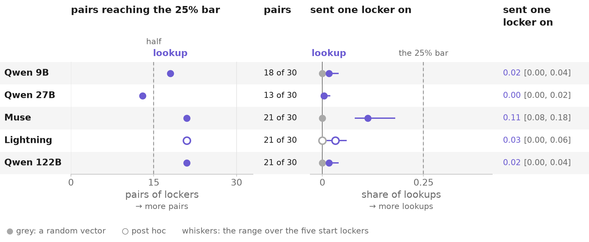</a> | Claim 8: six-locker scenes. | 1 of 5 cells post hoc · UNVERIFIED |
| 04 | <a href="04_code_tool.png">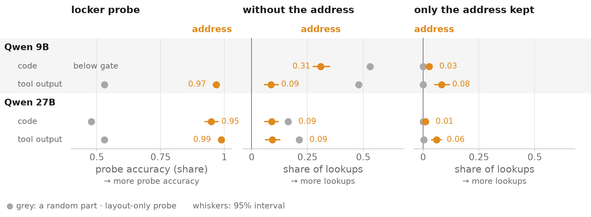</a> | Python code and tool output on the 9B and the 27B (rows): the locker probe's accuracy for the address (amber) against a random part and a layout-only probe (grey); the lookups left on position without the address, and brought back with only the address kept. | UNVERIFIED |
| 05 | <a href="05_order.png">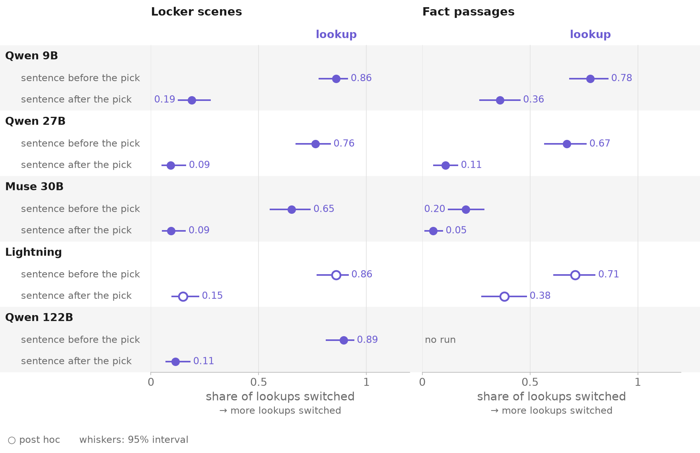</a> | Lookups switched by the change at the bridge word, with the item's locker (or fact) sentence before the pick and after it: the locker scenes (left) and the fact passages (right); whiskers 95% intervals; Lightning hollow ○ (its gate chosen after its pre-check); the 122B not run on the fact passages. | 4 of 18 cells post hoc · UNVERIFIED |
| 06 | <a href="06_link_layers.png">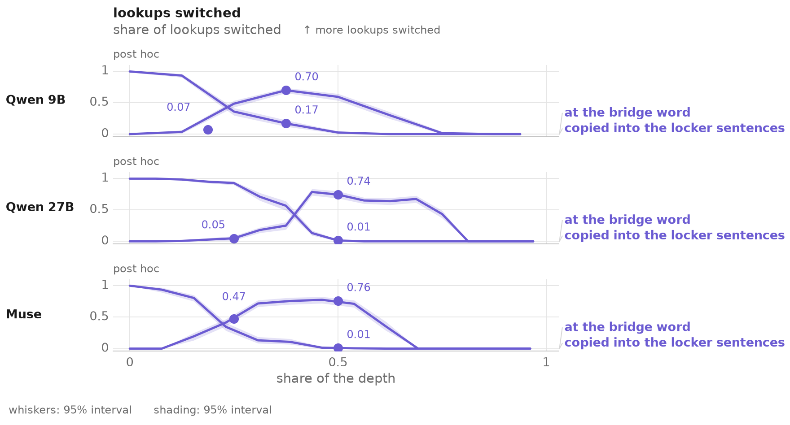</a> | With the locker sentence after the pick, by layer (x: the layer as a share of the model's depth): the lookups switched by the change at the bridge word and by the same change copied into the locker sentences, each line named at its end; dots: the cells fixed in advance, with their values; shading 95% intervals; the layer sweeps after the data (post hoc); the 9B, 27B and Muse. | 6 of 15 cells post hoc · UNVERIFIED |
| 07 | <a href="07_depth.png">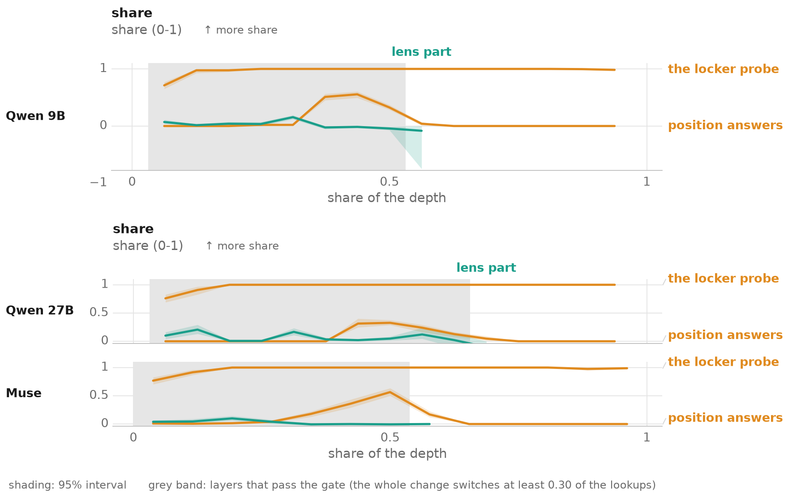</a> | By depth (x: the layer as a share of the model's depth), on the three models whose gates were fixed in advance: the locker probe's accuracy and the position answers under the whole change when another item moves (orange, named at their ends), and the lookup's switches blocked without the lens part beyond a random part of the same size (teal); shading 95% intervals; grey band: the layers that pass the gate. | UNVERIFIED |
| 08 | <a href="08_depth_more.png">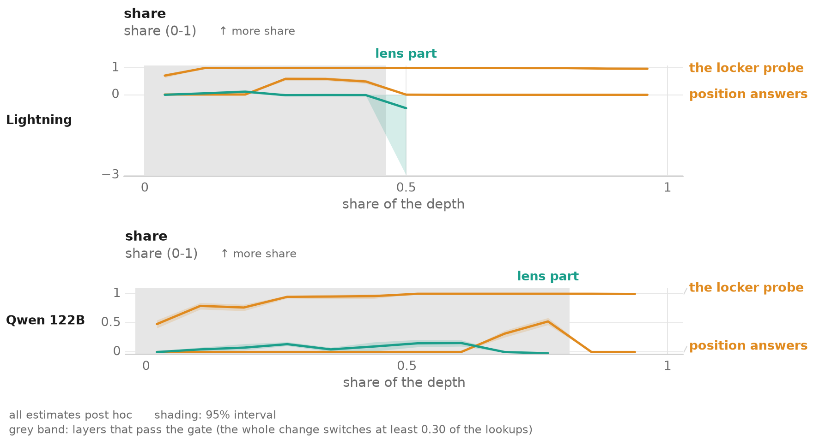</a> | As the figure above, on Lightning and the 122B, whose gates were chosen after the data (all estimates post hoc); Lightning in its own block: its interval runs far below zero outside its gate. | all post hoc · UNVERIFIED |
| 09 | <a href="09_two_by_two.png">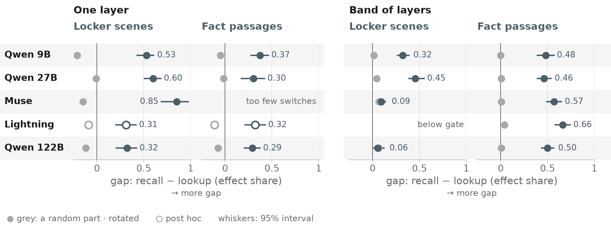</a> | Same unit in every column. | 2 of 18 cells post hoc · UNVERIFIED |
| 10 | <a href="10_mechanisms.png">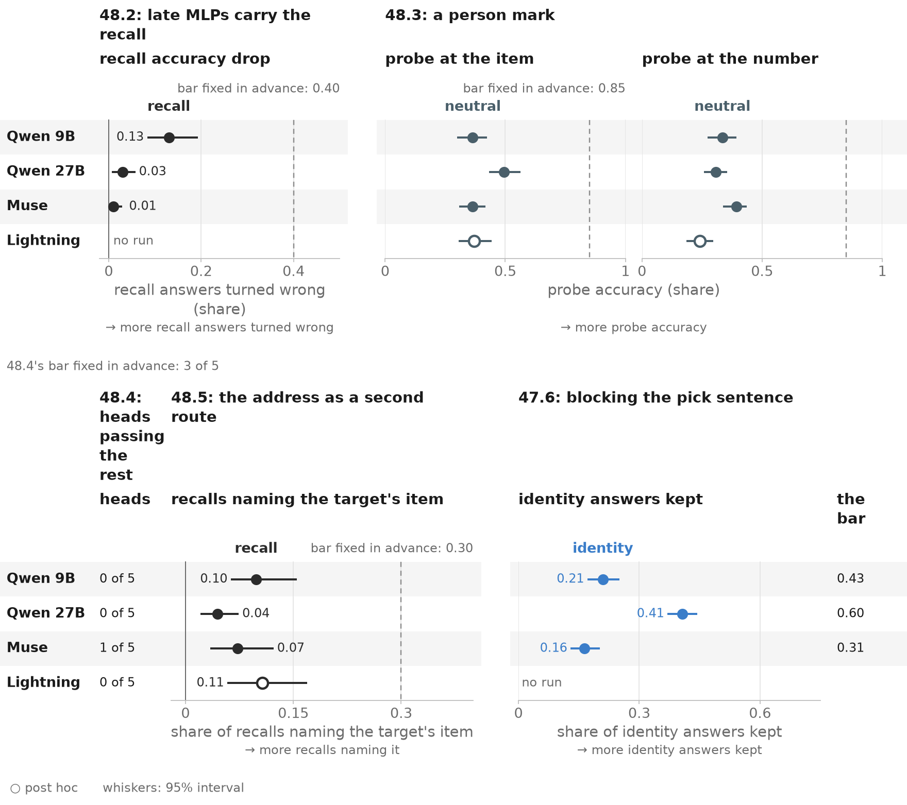</a> | Four mechanism tests, each against its bar fixed in advance (dashed): late MLPs and the recall (the recall's answers turned wrong, a share); a person mark read by a probe at the item and at the number (probe accuracy, slate); heads passing the rest (how many of five pass, as "k of 5"); the address as a second route (recalls naming the target's item); and blocking the pick sentence (identity answers kept, blue, beside the rule's bar per model). | 2 of 14 cells post hoc · UNVERIFIED |
| 11 | <a href="11_settings.png">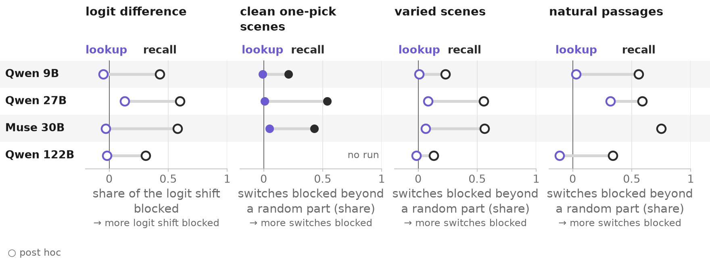</a> | The conflict test in four settings: logit difference, clean one-pick scenes, varied scenes and natural passages. | 12 of 15 cells post hoc · UNVERIFIED |
| 12 | <a href="12_specificity.png">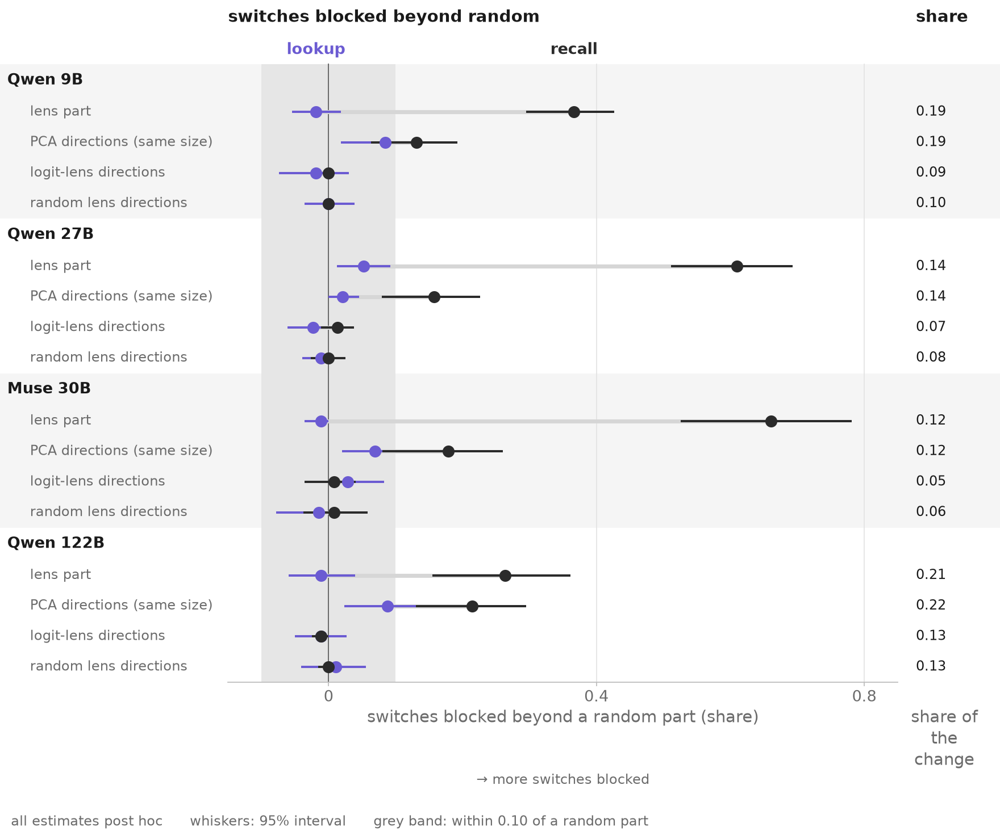</a> | Which part of the change the readers need: per model, lanes for the lens part and three same-size alternatives (PCA directions, logit-lens directions, random lens directions); the lookup (violet) and the recall (black) as switches blocked beyond a random part, with 95% intervals, joined by a grey connector; the grey band is within 0.10 of a random part. | all post hoc · UNVERIFIED |
| 13 | <a href="13_k_curve.png">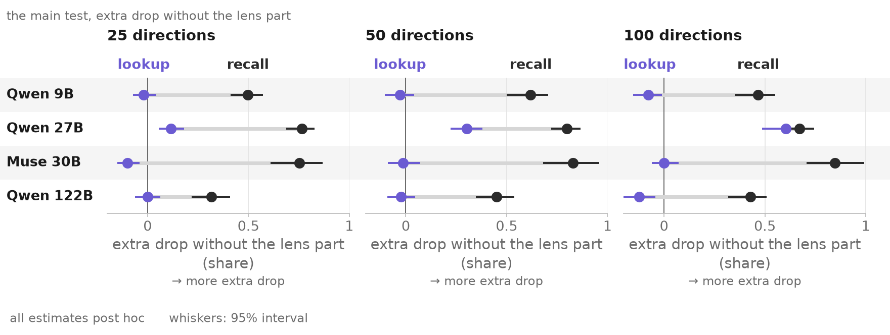</a> | The main test with more lens directions removed (25, 50, 100): the lookup's (violet) and the recall's (black) extra drop without the lens part, a share, with 95% intervals, joined per model. | all post hoc · UNVERIFIED |
| 14 | <a href="14_k_routes.png">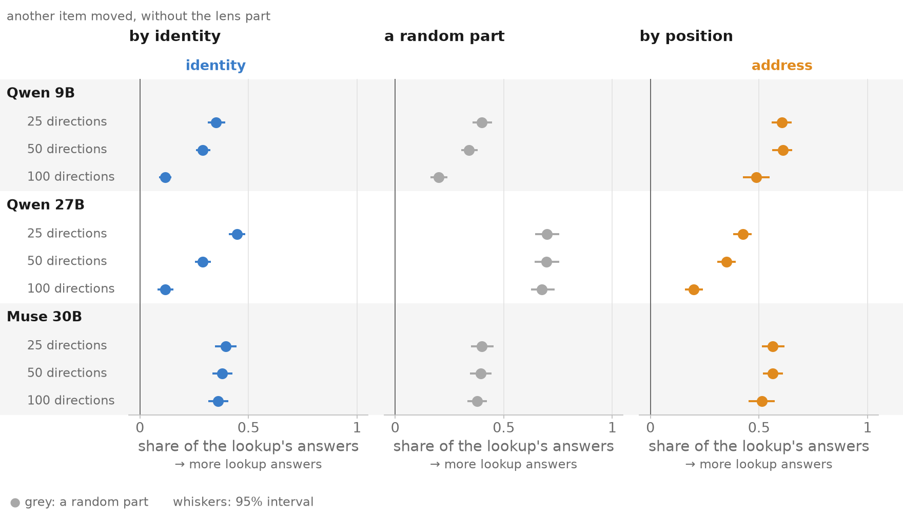</a> | Another item moved, without the lens part, at 25, 50 and 100 directions (lanes): the share of the lookup's answers given by identity (blue), by position (amber, the address) and with a random part removed instead (grey), with 95% intervals. | UNVERIFIED |
| 15 | <a href="15_zeroing.png">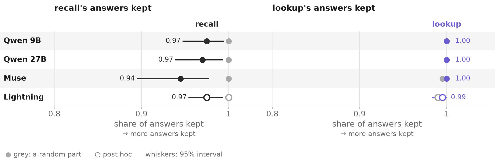</a> | Claim 2: the share of each reader's answers kept at L when the lens part's 25 directions are removed from the changed prompt's own state (recall black, lookup violet), against a random part of the same size removed (grey); main test; whiskers 95% intervals; Lightning hollow ○ (its gate chosen after its pre-check). | 1 of 4 cells post hoc · UNVERIFIED |
| 16 | <a href="16_dose_lens.png">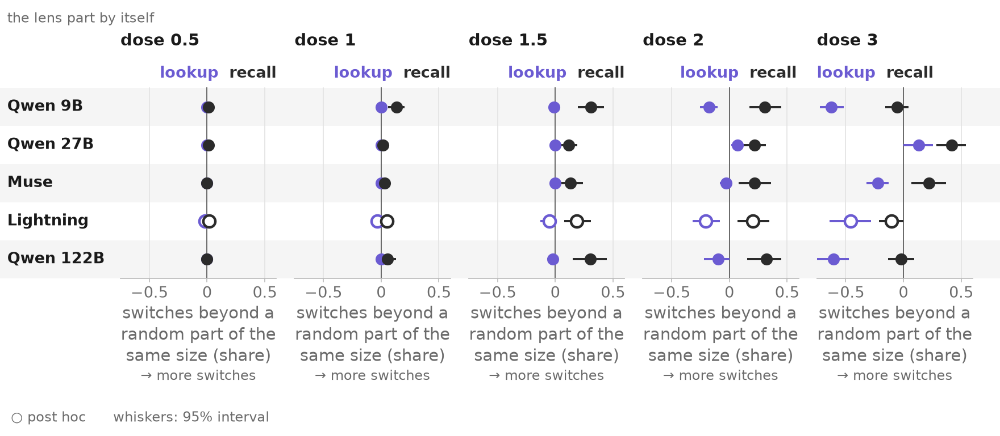</a> | The lens part added by itself at the bridge word, one column per dose: per model, the switches beyond a random part of the same size, lookup (violet) and recall (black). | 1 of 5 cells post hoc · UNVERIFIED |
| 17 | <a href="17_dose_rest.png">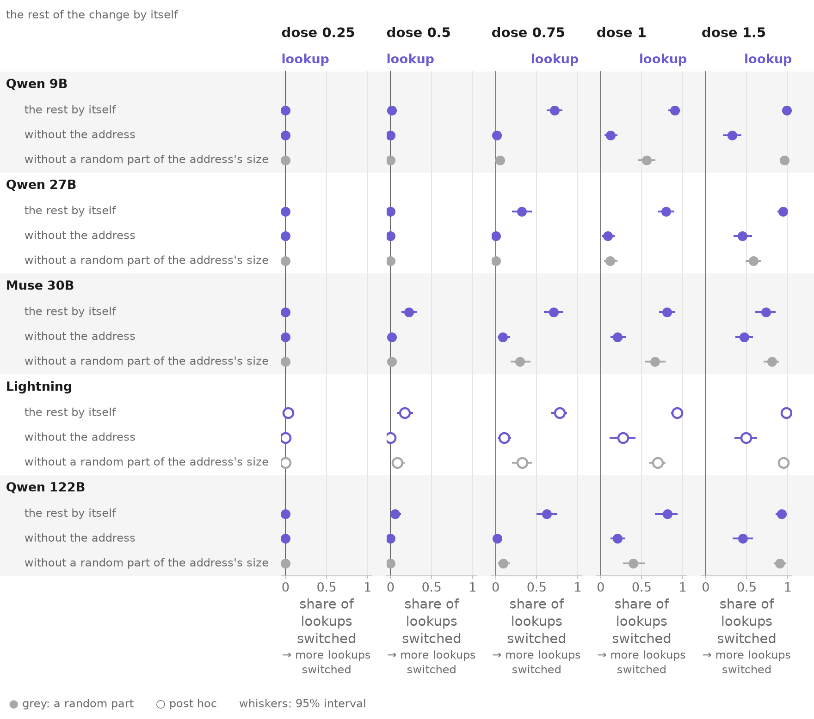</a> | The rest of the change by itself at five doses (columns): per model, lanes for the rest alone, the rest without the address, and the rest without a random part of the address's size (grey), each the share of lookups switched with its 95% interval. | 1 of 5 cells post hoc · UNVERIFIED |
| 18 | <a href="18_identity_outside.png">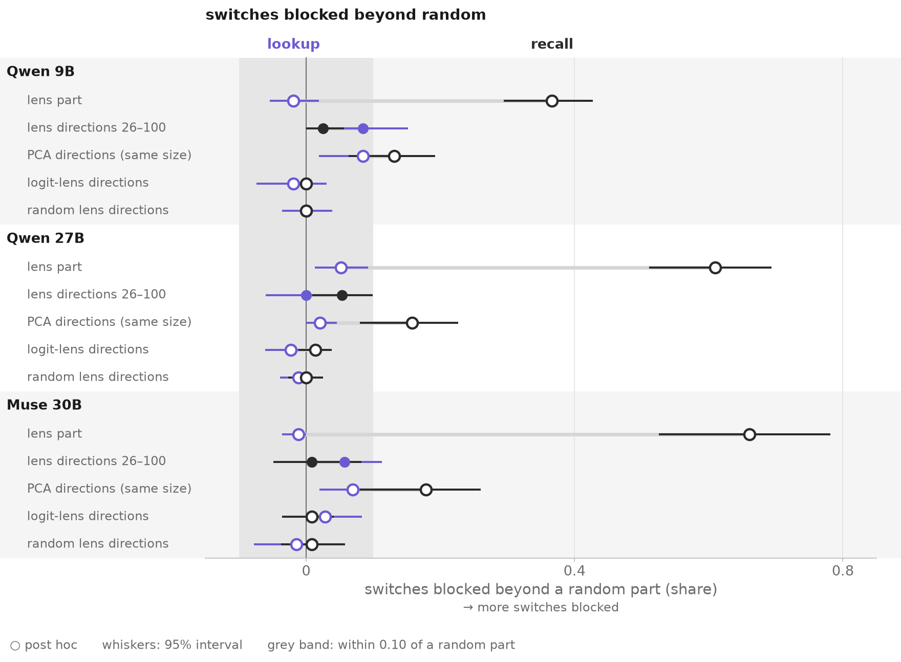</a> | Claim 5: switches blocked beyond a random part of the same size, lookup (violet) and recall (black), per model and per part removed at the bridge word: the lens part, lens directions 26–100 (fixed in advance, filled), PCA directions of the same size, logit-lens directions and random lens directions (run after the data, hollow ○); grey band: within 0.10 of random; whiskers 95% intervals. | 12 of 15 cells post hoc · UNVERIFIED |
| 19 | <a href="19_described_bridge.png">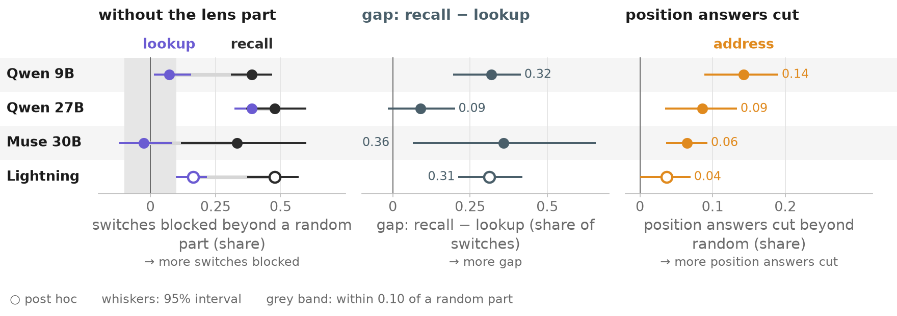</a> | A described bridge ("the one known for …") instead of a named one, per model: the switches blocked without the lens part beyond a random part, lookup (violet) and recall (black), over the grey band; the gap (slate) with its interval; the position answers cut beyond random without the address (amber). | 1 of 4 cells post hoc · UNVERIFIED |
| 20 | <a href="20_layers.png">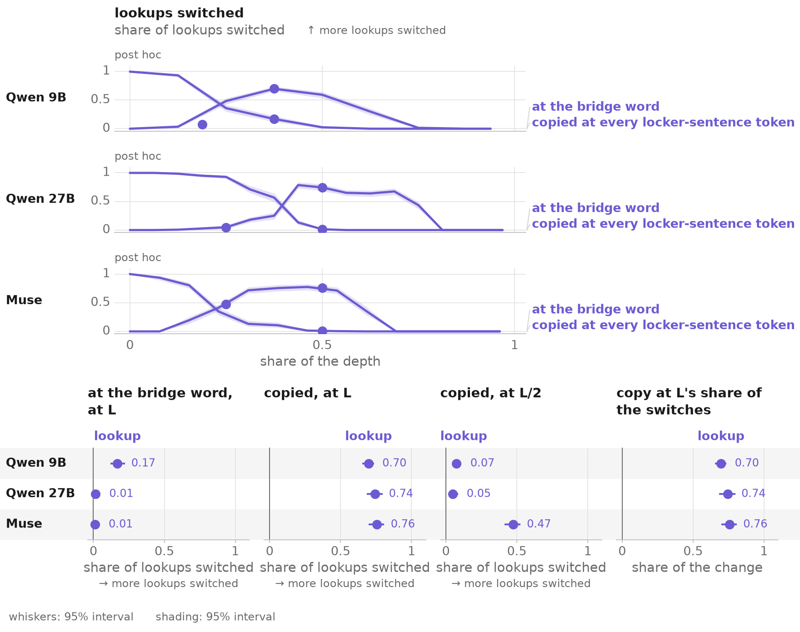</a> | Where the link is made, with the locker sentence after the pick. | 6 of 15 cells post hoc · UNVERIFIED |
| 21 | <a href="21_address_depth.png">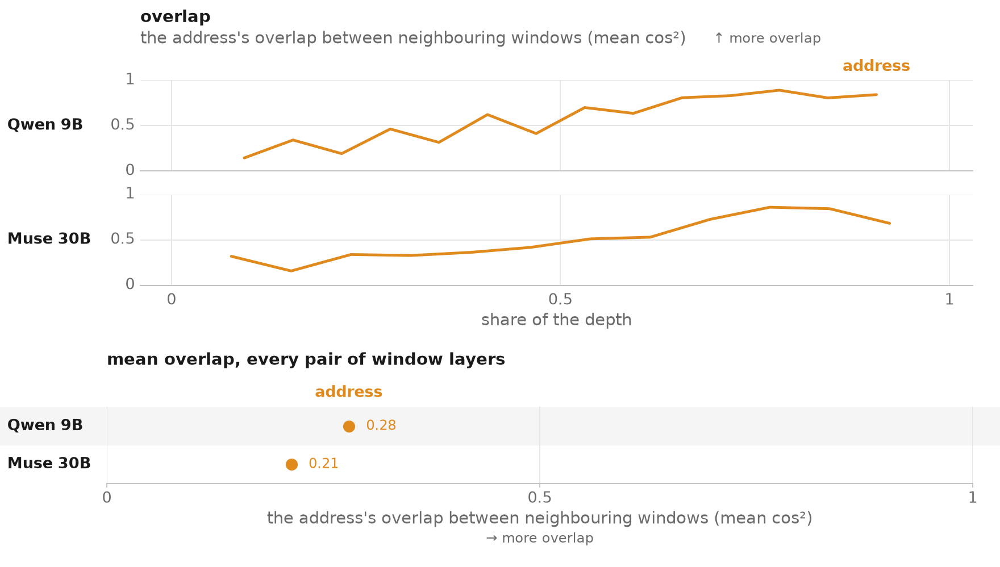</a> | How stable the address is across depth: its overlap between neighbouring layer windows (mean cos², amber) per model along the depth, and below the mean over every pair of window layers. | UNVERIFIED |
| 22 | <a href="22_probe_errors.png">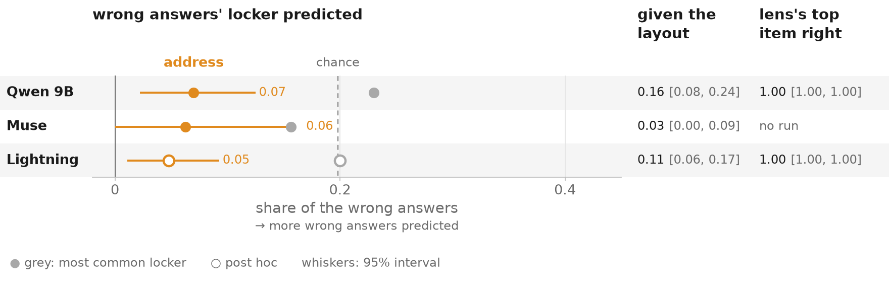</a> | On the lookup's wrong answers, the share whose locker a probe predicts from the address (amber, with its 95% interval) against the most common locker (grey) and chance (dashed). | 1 of 3 cells post hoc · UNVERIFIED |
| 23 | <a href="23_first_locker.png">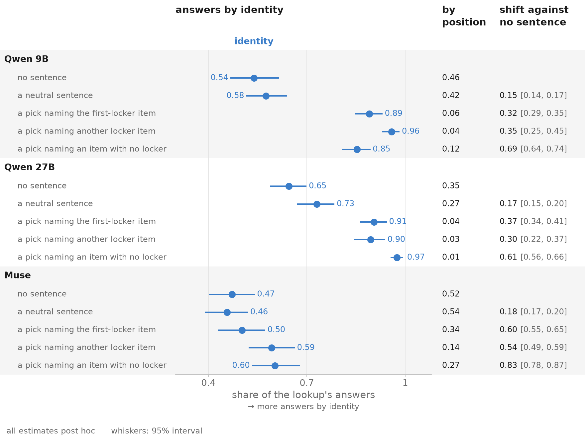</a> | The first locker: per model, lanes for no sentence, a neutral sentence and three kinds of pick sentence; the share of the lookup's answers given by identity (blue, with its 95% interval), the share by position (a number), and the identity code's shift against no sentence with its interval. | all post hoc · UNVERIFIED |
| 24 | <a href="24_formation.png">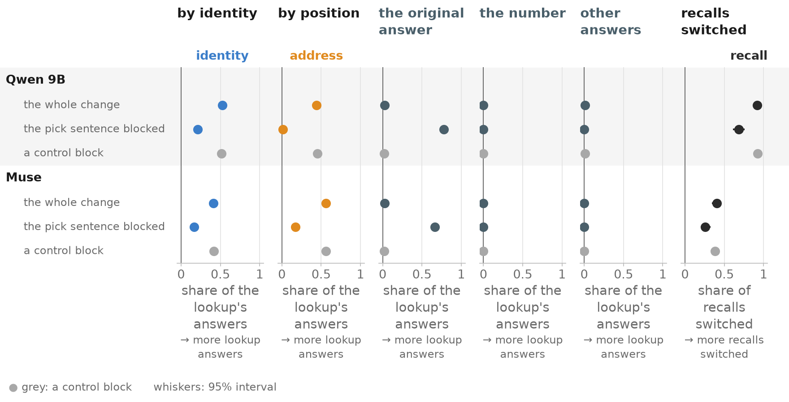</a> | Blocking the pick sentence: per model, lanes for the whole change, the pick sentence blocked and a control block (grey); the share of the lookup's answers by identity (blue), by position (amber), the original answer, the number and other answers (slate), and the share of the recalls switched (black), with 95% intervals. | UNVERIFIED |
| 25 | <a href="25_chain.png">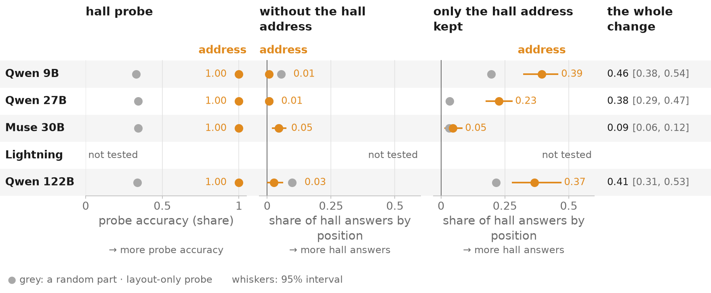</a> | Chained addresses, the hall before the locker: a probe for the hall address (amber) against a random part and a layout-only probe (grey); the hall answers by position without the hall address and with only the hall address kept; the whole change in its own column. | UNVERIFIED |
| 26 | <a href="26_what_is_left.png">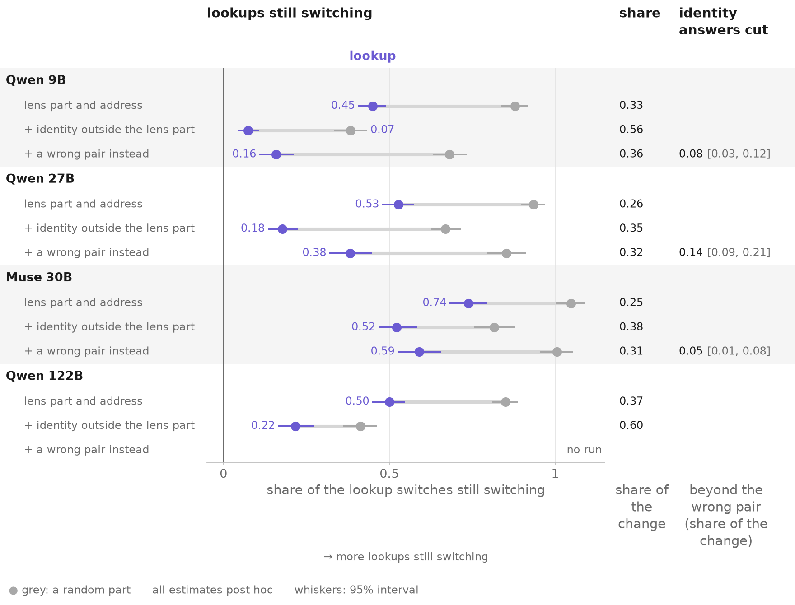</a> | What is left of the route: per model, lanes for the lens part and the address removed, then also identity outside the lens part, then a wrong pair instead; the share of the lookup's switches still switching (violet) against a random part of the same size (grey), joined by a grey connector, with 95% intervals. | all post hoc · UNVERIFIED |
| 27 | <a href="27_enrichment.png">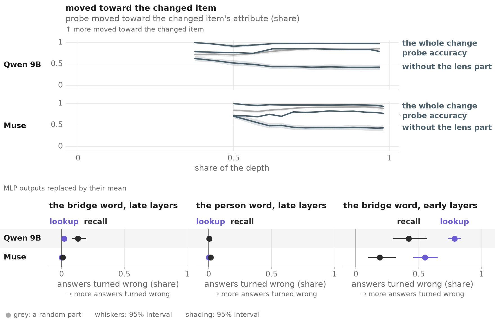</a> | Attribute probes and MLPs. | UNVERIFIED |
| 28 | <a href="28_binding.png">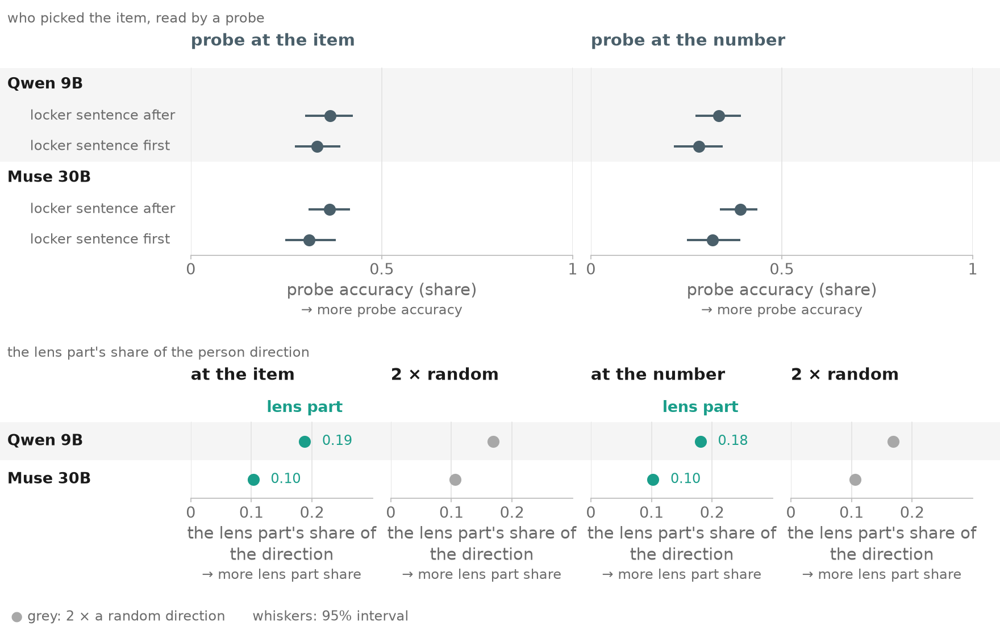</a> | Binding: who picked the item, read by a probe at the item and at the number (slate, probe accuracy with its 95% interval), with the locker sentence after or first (lanes). | UNVERIFIED |
| 29 | <a href="29_binding_added.png">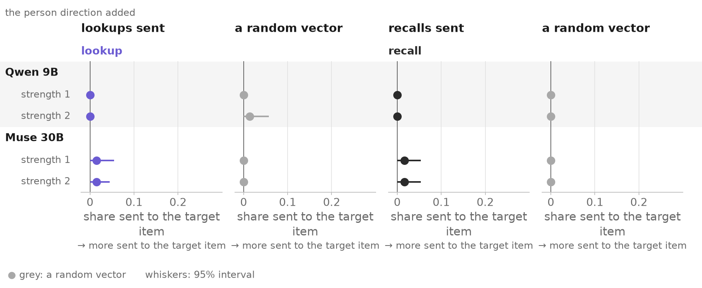</a> | The person direction added at strength 1 and 2 (lanes): the share of lookups (violet) and of recalls (black) sent to the target item, each beside a random vector of the same strength (grey, its own column), with 95% intervals. | UNVERIFIED |
| 30 | <a href="30_heads.png">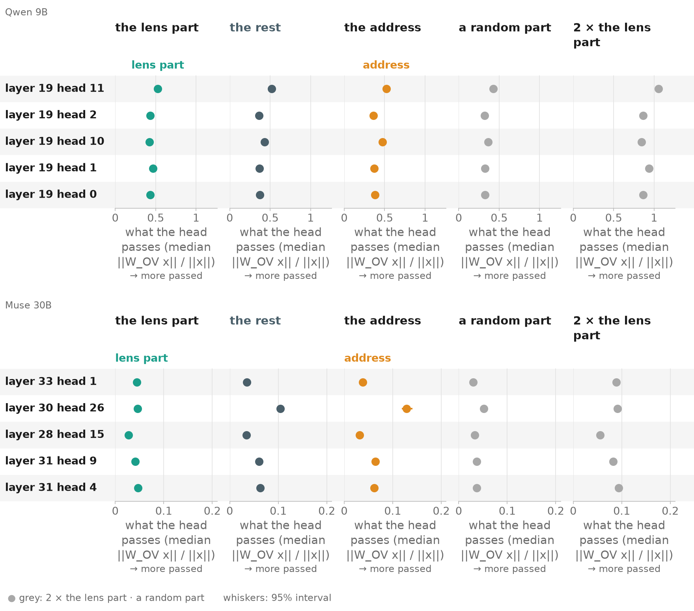</a> | The heads that pass the most of each part under the swap, on the 9B (top) and Muse (bottom), rows read from the run: what each head passes (median ‖W_OV x‖ / ‖x‖) of the lens part (teal), the rest (slate) and the address (amber), against a random part and twice the lens part (grey). | UNVERIFIED |
| 31 | <a href="31_second_route.png">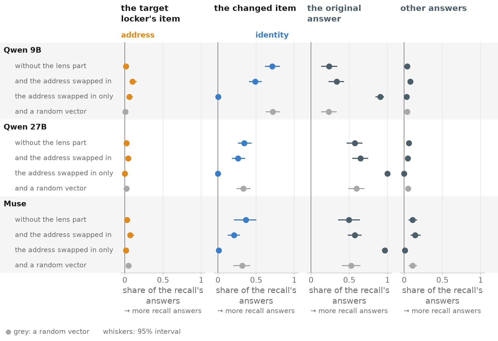</a> | A second route: per model, lanes for the change without the lens part, with the address swapped in as well, the address swapped in only, and a random vector instead (grey); the share of the recall's answers naming the target locker's item (amber, the address), the changed item (blue, identity), the original answer and other answers (slate), with 95% intervals. | UNVERIFIED |
| 32 | <a href="32_attention.png">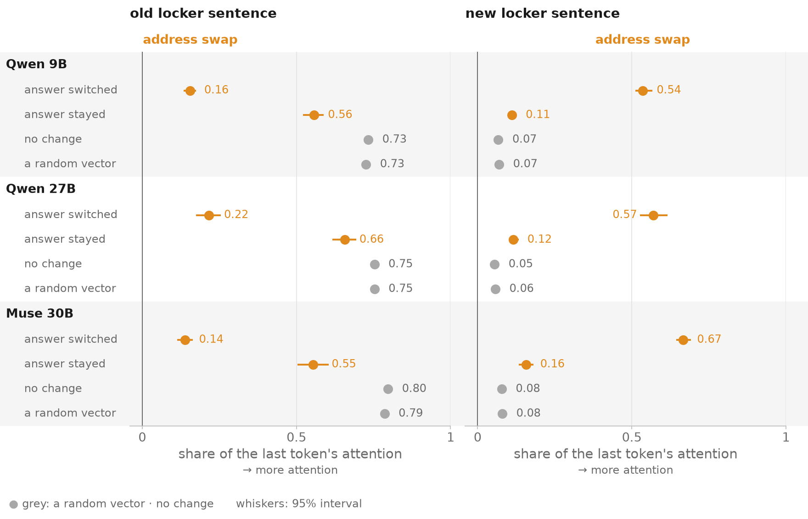</a> | The last token's attention on the old and the new locker sentence under the address swap (amber), on the scenes where the answer switched and where it stayed, against no change and a random vector (grey), per model. | UNVERIFIED |
| 33 | <a href="33_learned.png">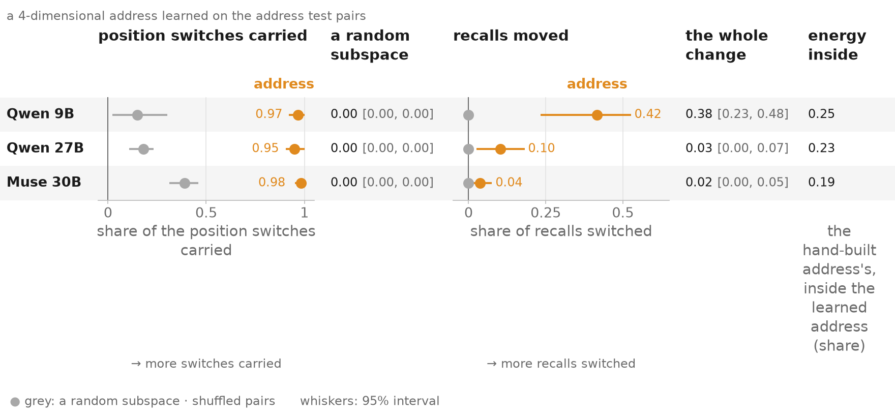</a> | A small address subspace learned on the address test's pairs (its size in the figure's note), on the 9B, the 27B and Muse: the share of position switches it carries (amber) against a random subspace (grey); the recalls it moves; the whole change and the hand-built address's energy inside it in their own columns. | UNVERIFIED |
| 34 | <a href="34_transfer.png">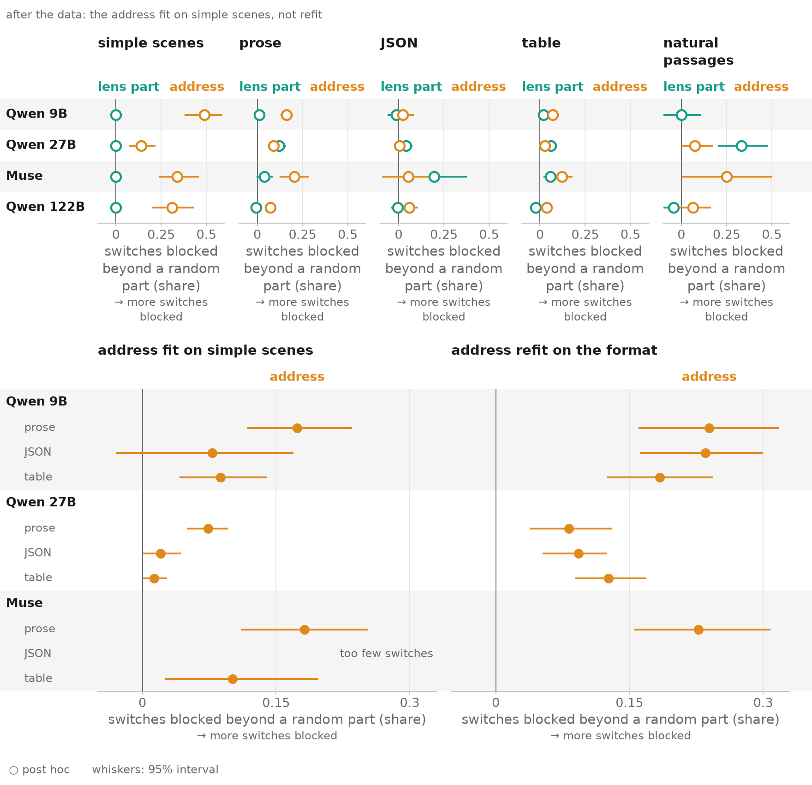</a> | Top, after the data: the switches blocked beyond a random part without the lens part (teal) and without the address fit on simple scenes (orange), per model and setting, all hollow ○. | 4 of 7 cells post hoc · UNVERIFIED |
| 35 | <a href="35_two_codes.png">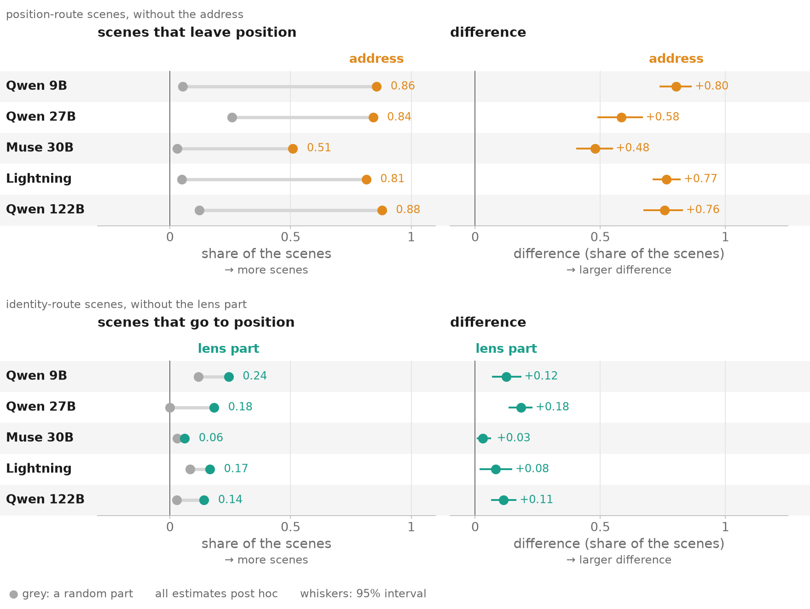</a> | Post hoc, another item moved, lookup, 300 scenes per model: the scenes that leave the position route without the address, and the scenes that go from identity to position without the lens part, each against a random part of the same size, with the paired differences and 95% intervals (bootstrap over the bridge entity). | all post hoc · UNVERIFIED |
| 36 | <a href="36_earlier_mention.png">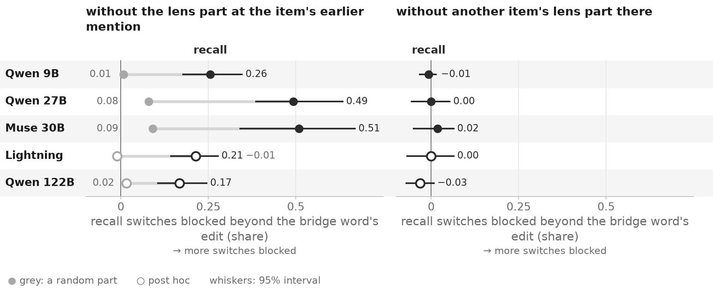</a> | Claim 3: the recall's switches blocked against the change at the bridge word alone (arm 1) when the new item's tokens at its earlier mention also have their own lens part removed (left), and when another item's tokens have theirs removed (right); grey dot, joined to the item's: the same tokens with a random part of the same share removed. | 6 of 15 cells post hoc · UNVERIFIED |
| 37 | <a href="37_address_added_alone.png">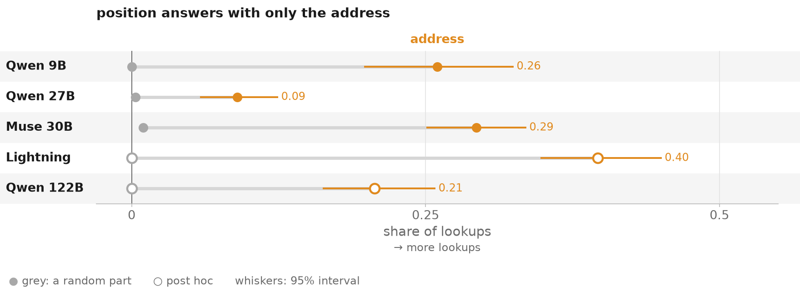</a> | Claim 7, the routes test (another item moved): position answers when only the address is added at the bridge word (orange) against only a random part of its share (grey); whiskers 95% intervals; Lightning hollow ○ (its gate chosen after its pre-check), the 122B hollow ○ (its gate lowered after the data). | 2 of 5 cells post hoc · UNVERIFIED |
| s01 | <a href="s01_split_all_scene_sets.png">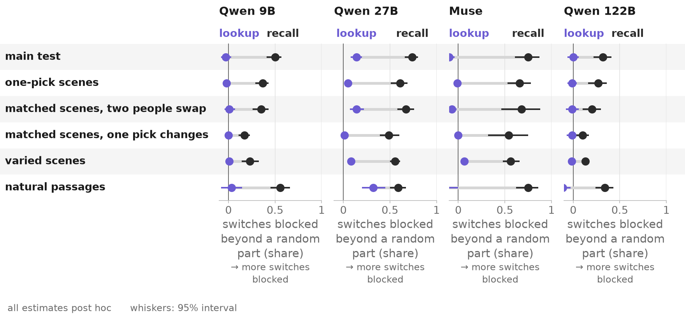</a> | Every scene set, one panel per model (the 9B, the 27B, Muse, the 122B): per set (rows), the switches blocked without the lens part beyond a random part of the same size, lookup (violet) and recall (black), joined in each row. | all post hoc · UNVERIFIED |
| s02 | <a href="s02_parts_all.png">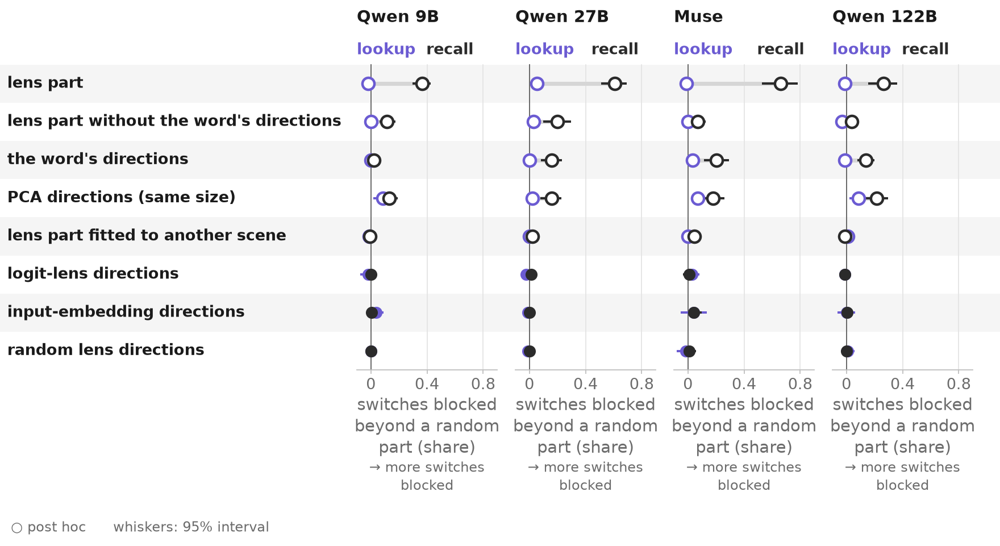</a> | Every part of the change on the main test, one row per part and one column per model: the lookup's (violet) and the recall's (black) switches blocked beyond a random part, a share, with 95% intervals, joined by a grey connector. | 20 of 32 cells post hoc · UNVERIFIED |
| s03 | <a href="s03_order_split.png">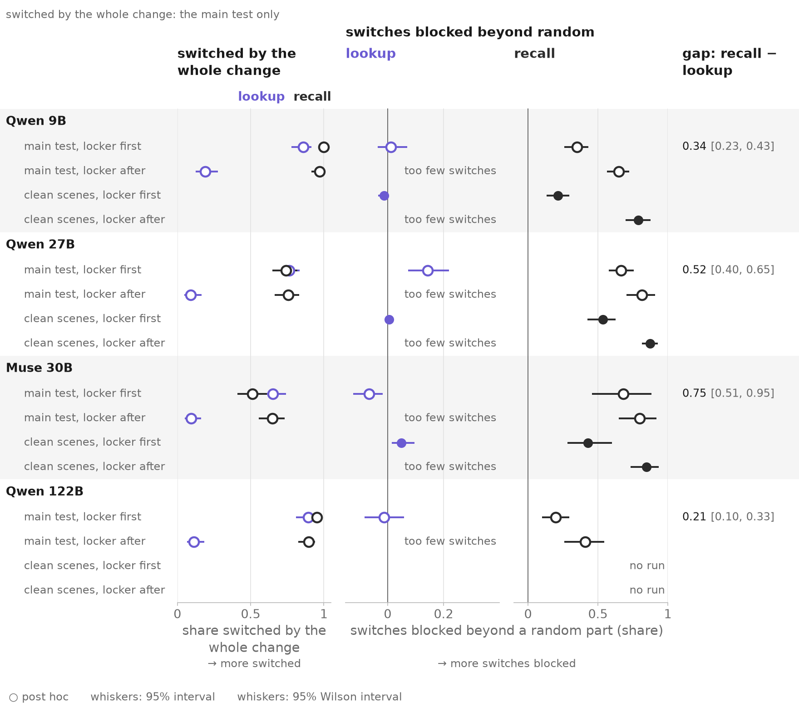</a> | The order split on every model: lanes for the main test and the clean scenes, each with the locker sentence first or after; the share switched by the whole change (lookup violet, recall black), the switches blocked beyond a random part (95% Wilson intervals on the shares, 95% intervals on the blocks), and the gap recall − lookup with its interval. | 8 of 14 cells post hoc · UNVERIFIED |
| s04 | <a href="s04_link_copy_variants.png">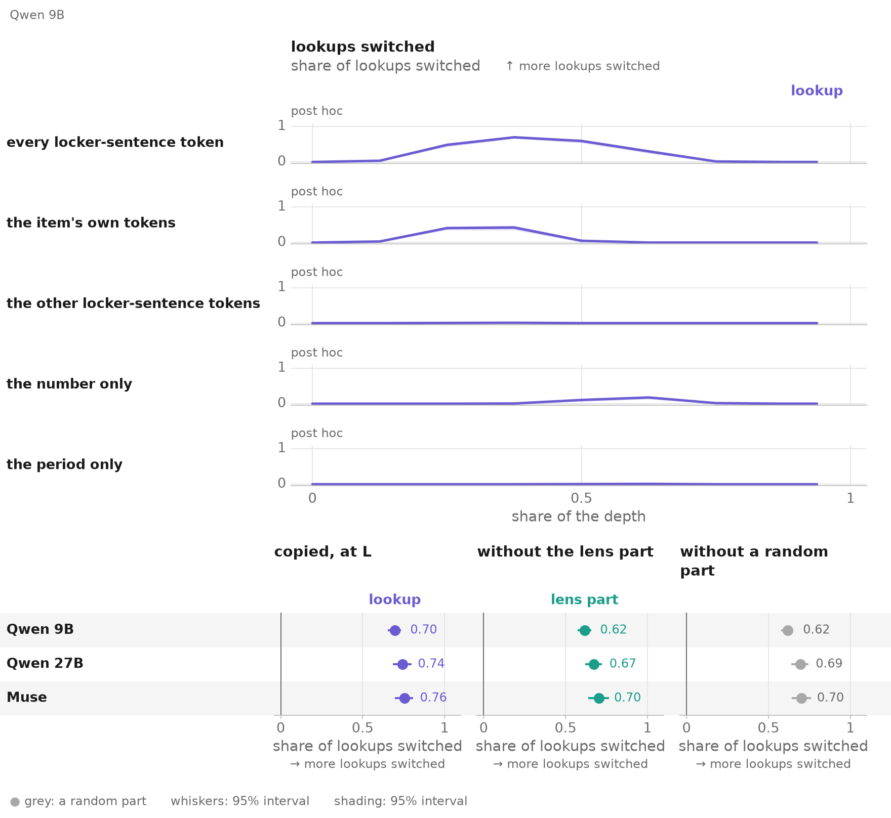</a> | Qwen 9B, the change copied into the locker sentences: per variant (every locker-sentence token, the item's own tokens, the other locker-sentence tokens, the number only, the period only), the share of lookups switched along the depth, with 95% shading; each line's panel says it is post hoc. | 5 of 8 cells post hoc · UNVERIFIED |
| s05 | <a href="s05_link_copy_27b.png">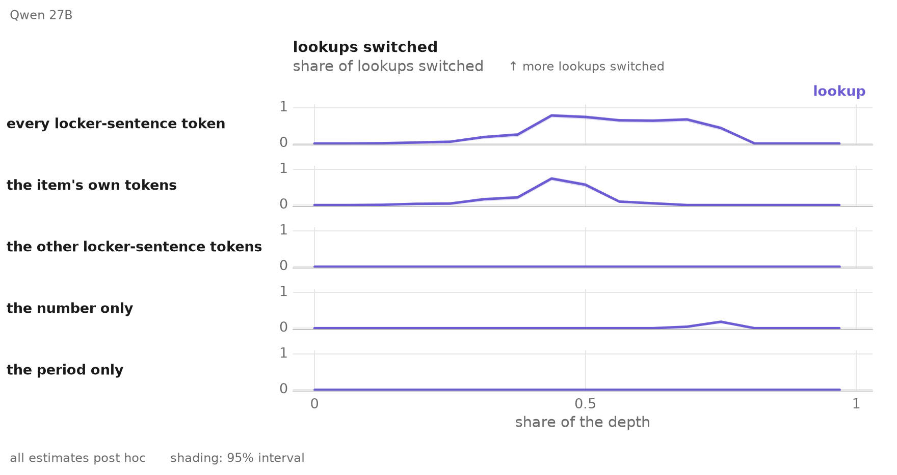</a> | Qwen 27B, the change copied into the locker sentences: per variant (every locker-sentence token, the item's own tokens, the other locker-sentence tokens, the number only, the period only), the share of lookups switched along the depth, with 95% shading. | all post hoc · UNVERIFIED |
| s06 |  | Muse 30B, the change copied into the locker sentences: per variant (every locker-sentence token, the item's own tokens, the other locker-sentence tokens, the number only, the period only), the share of lookups switched along the depth, with 95% shading. | all post hoc · UNVERIFIED |
| s07 | <a href="s07_cumulative.png">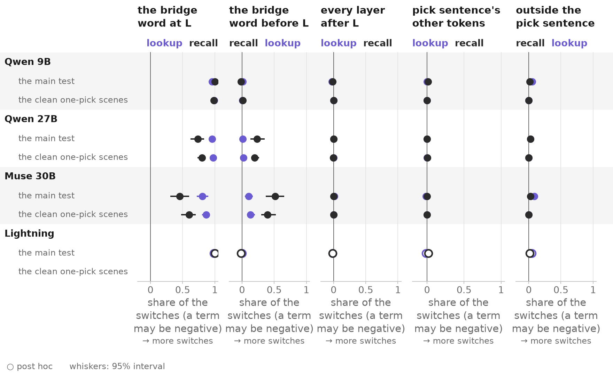</a> | Claim 11: where each reader's switches under the change are carried, as shares of the switches (a term may be negative): the bridge word at L, the bridge word before L, every layer after L, the pick sentence's other tokens, and outside the pick sentence; lookup violet, recall black; the main test and the clean one-pick scenes; whiskers 95% intervals; Lightning hollow ○, its clean one-pick scenes below gate. | 1 of 7 cells post hoc · UNVERIFIED |
| s08 | <a href="s08_recall_follows_swap.png">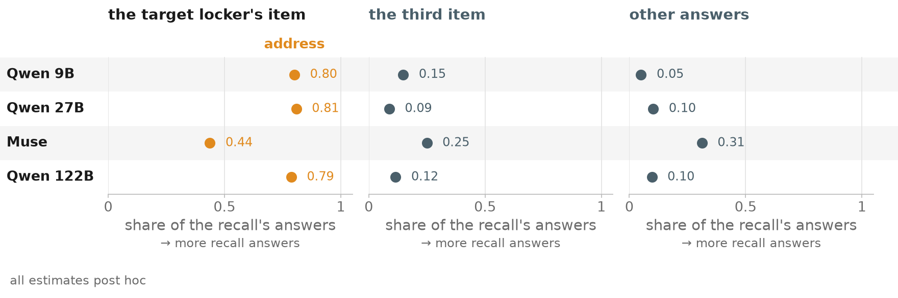</a> | With the address swapped in, what the recall answers: the share of the recall's answers naming the target locker's item (amber, the address), the third item and other answers (slate). | all post hoc · UNVERIFIED |
| s09 | <a href="s09_lens_readout.png">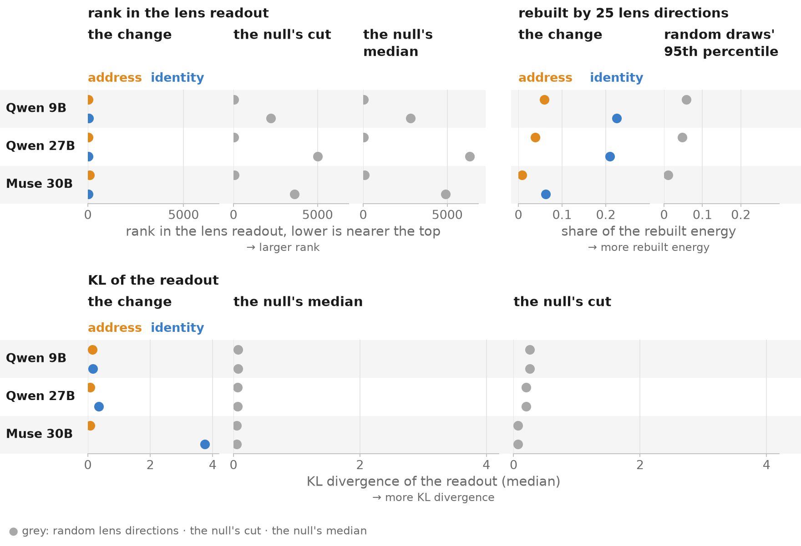</a> | What the lens reads after the address swap (amber) and after a change of item (blue): the best rank of a position word in the lens readout (lower is nearer the top) and the share of the change rebuilt by 25 lens directions, each beside the null of random lens directions (grey: its cut and its median, and the random draws' 95th percentile), and the readout's KL divergence (median) beside the null's median and cut. | UNVERIFIED |
| s10 | <a href="s10_pointer_moves_and_neutral_sentence.png">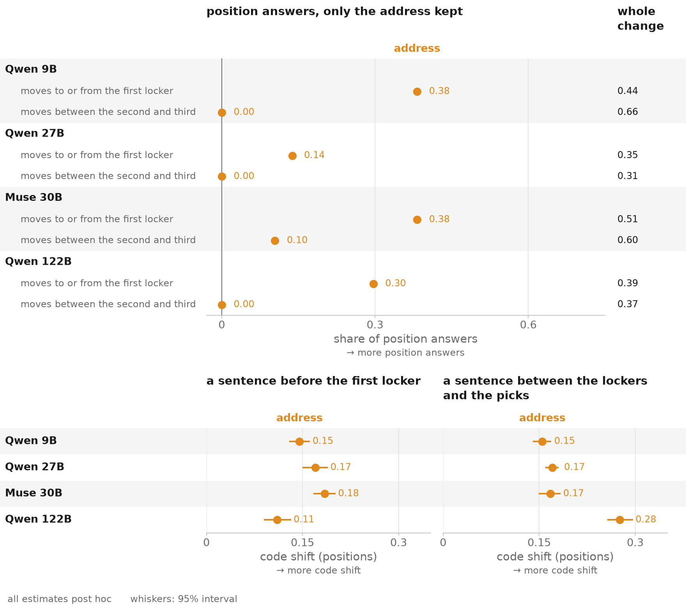</a> | Top: the position answers when only the address is kept, for moves to or from the first locker and between the second and the third (amber), per model, with the whole change's share beside. | all post hoc · UNVERIFIED |
| s11 | <a href="s11_routes_design.png">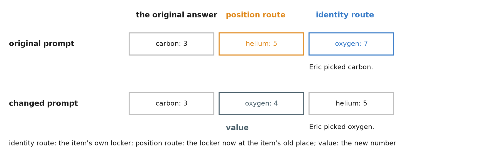</a> | The routes test drawn large: the original prompt and the changed prompt as three lockers each. | UNVERIFIED |
| s12 | <a href="s12_routes_taken_out.png">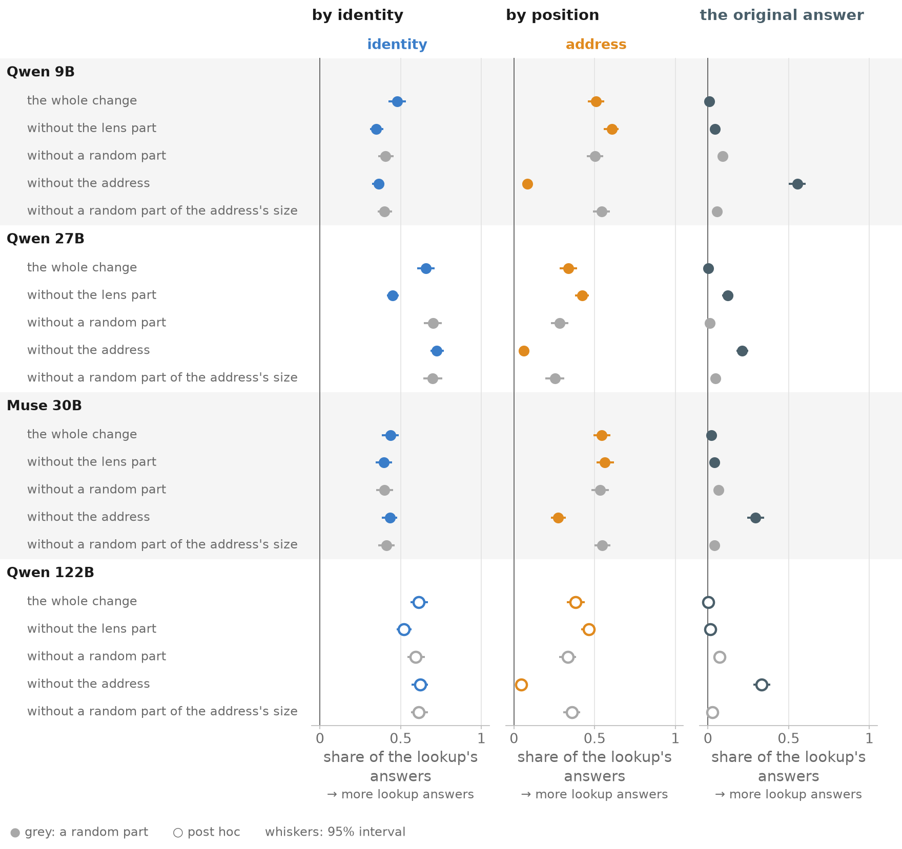</a> | Every routes arm with a part removed: per model, lanes for the whole change, without the lens part, without a random part, without the address, and without a random part of the address's size (grey); the share of the lookup's answers by identity (blue), by position (amber) and the original answer (slate), with 95% intervals. | 5 of 20 cells post hoc · UNVERIFIED |
| s13 | <a href="s13_routes_kept.png">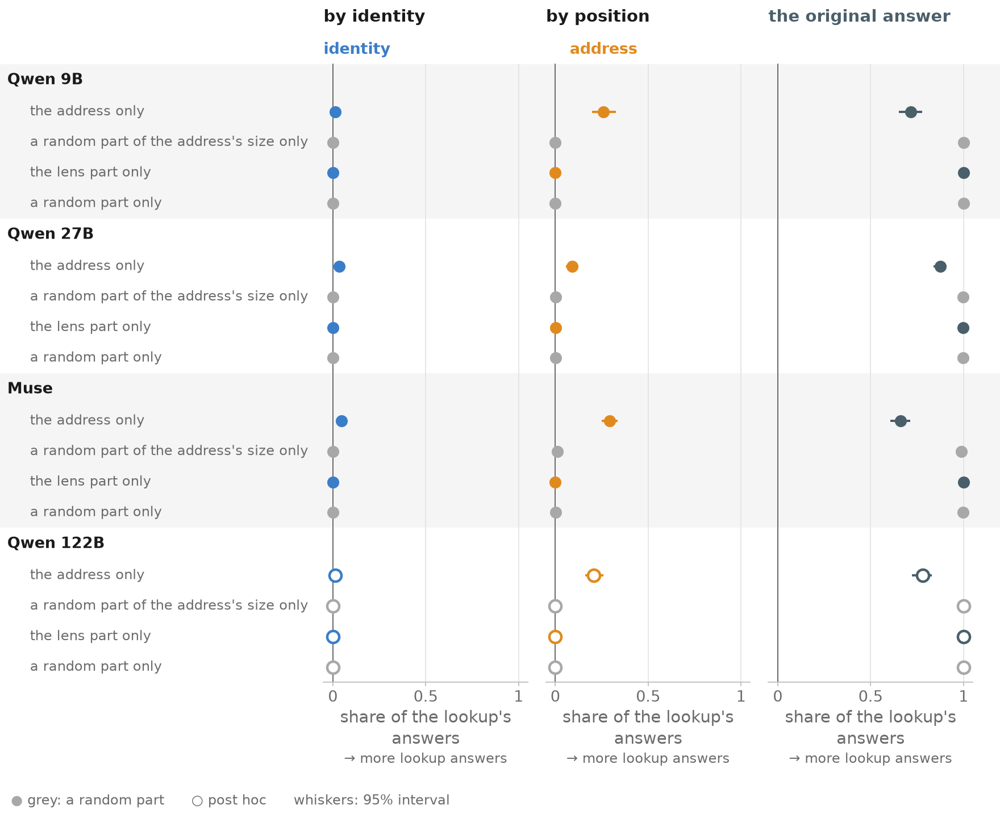</a> | Every routes arm with only one part kept: per model, lanes for the address only, a random part of the address's size only, the lens part only, and a random part only (grey); the share of the lookup's answers by identity (blue), by position (amber) and the original answer (slate), with 95% intervals. | 4 of 16 cells post hoc · UNVERIFIED |
| s14 | <a href="s14_das_muse.png">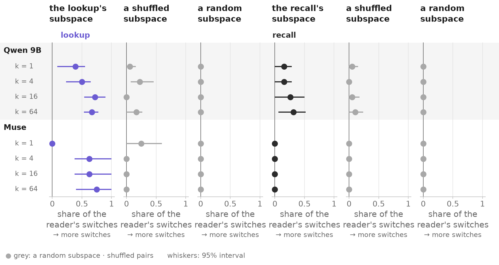</a> | Learned subspaces (DAS) at the bridge word on the 9B and Muse, per subspace size k (rows): the share of each reader's switches carried by its own learned subspace, the lookup's (violet) and the recall's (black), against a shuffled and a random subspace of the same size (grey). | UNVERIFIED |
