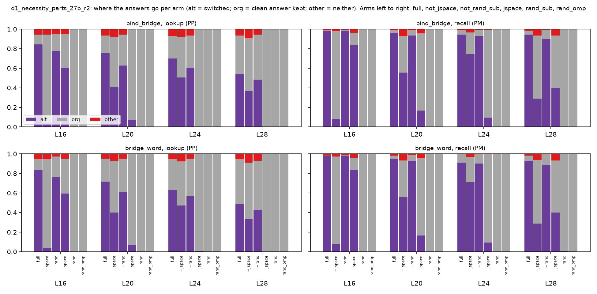
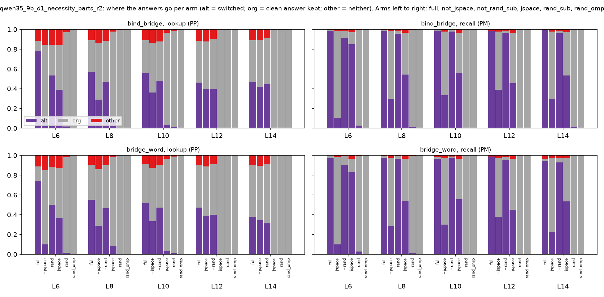
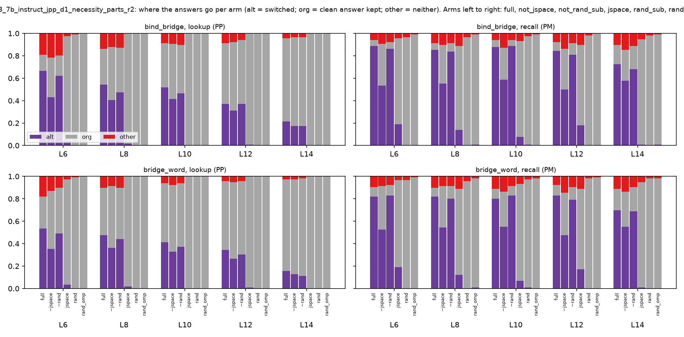

# Where the answers go: role shares per cell and arm (23 Oct necessity rows)

Rows of C's copy (source cf); `null` = the arm's random-direction null. alt = the other bridge's answer (switched), org = the clean answer, other = neither. Descriptive.

## d1_necessity_parts_27b_r2 (outcomes.jsonl sha256 9119d63db76ae99e)

| set | layer | reader | arm | n | alt | org | other |
|---|---|---|---|---|---|---|---|
| bind_bridge | 16 | recall | full | 180 | 0.98 | 0.01 | 0.01 |
| bind_bridge | 16 | recall | jspace | 180 | 0.83 | 0.13 | 0.04 |
| bind_bridge | 16 | recall | not_jspace | 180 | 0.08 | 0.89 | 0.02 |
| bind_bridge | 16 | recall | not_rand_sub | 180 | 0.98 | 0.01 | 0.01 |
| bind_bridge | 16 | recall | rand_omp | 180 | 0.00 | 1.00 | 0.00 |
| bind_bridge | 16 | recall | rand_sub | 180 | 0.00 | 1.00 | 0.00 |
| bind_bridge | 16 | lookup | full | 180 | 0.84 | 0.10 | 0.06 |
| bind_bridge | 16 | lookup | jspace | 180 | 0.61 | 0.34 | 0.05 |
| bind_bridge | 16 | lookup | not_jspace | 180 | 0.04 | 0.91 | 0.06 |
| bind_bridge | 16 | lookup | not_rand_sub | 180 | 0.78 | 0.17 | 0.05 |
| bind_bridge | 16 | lookup | rand_omp | 180 | 0.00 | 1.00 | 0.00 |
| bind_bridge | 16 | lookup | rand_sub | 180 | 0.00 | 1.00 | 0.00 |
| bind_bridge | 20 | recall | full | 180 | 0.96 | 0.03 | 0.01 |
| bind_bridge | 20 | recall | jspace | 180 | 0.17 | 0.79 | 0.04 |
| bind_bridge | 20 | recall | not_jspace | 180 | 0.56 | 0.37 | 0.07 |
| bind_bridge | 20 | recall | not_rand_sub | 180 | 0.93 | 0.06 | 0.01 |
| bind_bridge | 20 | recall | rand_omp | 180 | 0.00 | 1.00 | 0.00 |
| bind_bridge | 20 | recall | rand_sub | 180 | 0.00 | 1.00 | 0.00 |
| bind_bridge | 20 | lookup | full | 180 | 0.76 | 0.18 | 0.07 |
| bind_bridge | 20 | lookup | jspace | 180 | 0.07 | 0.93 | 0.00 |
| bind_bridge | 20 | lookup | not_jspace | 180 | 0.41 | 0.52 | 0.08 |
| bind_bridge | 20 | lookup | not_rand_sub | 180 | 0.63 | 0.32 | 0.06 |
| bind_bridge | 20 | lookup | rand_omp | 180 | 0.00 | 1.00 | 0.00 |
| bind_bridge | 20 | lookup | rand_sub | 180 | 0.00 | 1.00 | 0.00 |
| bind_bridge | 24 | recall | full | 180 | 0.94 | 0.04 | 0.01 |
| bind_bridge | 24 | recall | jspace | 180 | 0.09 | 0.90 | 0.01 |
| bind_bridge | 24 | recall | not_jspace | 180 | 0.74 | 0.22 | 0.03 |
| bind_bridge | 24 | recall | not_rand_sub | 180 | 0.93 | 0.07 | 0.01 |
| bind_bridge | 24 | recall | rand_omp | 180 | 0.00 | 1.00 | 0.00 |
| bind_bridge | 24 | recall | rand_sub | 180 | 0.00 | 1.00 | 0.00 |
| bind_bridge | 24 | lookup | full | 180 | 0.70 | 0.23 | 0.07 |
| bind_bridge | 24 | lookup | jspace | 180 | 0.01 | 0.99 | 0.00 |
| bind_bridge | 24 | lookup | not_jspace | 180 | 0.51 | 0.42 | 0.08 |
| bind_bridge | 24 | lookup | not_rand_sub | 180 | 0.61 | 0.33 | 0.07 |
| bind_bridge | 24 | lookup | rand_omp | 180 | 0.00 | 1.00 | 0.00 |
| bind_bridge | 24 | lookup | rand_sub | 180 | 0.00 | 1.00 | 0.00 |
| bind_bridge | 28 | recall | full | 180 | 0.94 | 0.04 | 0.02 |
| bind_bridge | 28 | recall | jspace | 180 | 0.40 | 0.53 | 0.07 |
| bind_bridge | 28 | recall | not_jspace | 180 | 0.29 | 0.64 | 0.07 |
| bind_bridge | 28 | recall | not_rand_sub | 180 | 0.90 | 0.09 | 0.01 |
| bind_bridge | 28 | recall | rand_omp | 180 | 0.00 | 1.00 | 0.00 |
| bind_bridge | 28 | recall | rand_sub | 180 | 0.01 | 0.99 | 0.00 |
| bind_bridge | 28 | lookup | full | 180 | 0.54 | 0.39 | 0.07 |
| bind_bridge | 28 | lookup | jspace | 180 | 0.00 | 1.00 | 0.00 |
| bind_bridge | 28 | lookup | not_jspace | 180 | 0.37 | 0.53 | 0.09 |
| bind_bridge | 28 | lookup | not_rand_sub | 180 | 0.48 | 0.46 | 0.06 |
| bind_bridge | 28 | lookup | rand_omp | 180 | 0.00 | 1.00 | 0.00 |
| bind_bridge | 28 | lookup | rand_sub | 180 | 0.00 | 1.00 | 0.00 |
| bridge_word | 16 | recall | full | 180 | 0.98 | 0.01 | 0.02 |
| bridge_word | 16 | recall | jspace | 180 | 0.84 | 0.12 | 0.04 |
| bridge_word | 16 | recall | not_jspace | 180 | 0.08 | 0.89 | 0.03 |
| bridge_word | 16 | recall | not_rand_sub | 180 | 0.98 | 0.01 | 0.01 |
| bridge_word | 16 | recall | rand_omp | 180 | 0.00 | 1.00 | 0.00 |
| bridge_word | 16 | recall | rand_sub | 180 | 0.00 | 1.00 | 0.00 |
| bridge_word | 16 | lookup | full | 180 | 0.84 | 0.11 | 0.06 |
| bridge_word | 16 | lookup | jspace | 180 | 0.59 | 0.36 | 0.05 |
| bridge_word | 16 | lookup | not_jspace | 180 | 0.04 | 0.91 | 0.06 |
| bridge_word | 16 | lookup | not_rand_sub | 180 | 0.76 | 0.21 | 0.03 |
| bridge_word | 16 | lookup | rand_omp | 180 | 0.00 | 1.00 | 0.00 |
| bridge_word | 16 | lookup | rand_sub | 180 | 0.00 | 1.00 | 0.00 |
| bridge_word | 20 | recall | full | 180 | 0.95 | 0.03 | 0.02 |
| bridge_word | 20 | recall | jspace | 180 | 0.17 | 0.79 | 0.04 |
| bridge_word | 20 | recall | not_jspace | 180 | 0.56 | 0.38 | 0.07 |
| bridge_word | 20 | recall | not_rand_sub | 180 | 0.93 | 0.06 | 0.01 |
| bridge_word | 20 | recall | rand_omp | 180 | 0.00 | 1.00 | 0.00 |
| bridge_word | 20 | recall | rand_sub | 180 | 0.00 | 1.00 | 0.00 |
| bridge_word | 20 | lookup | full | 180 | 0.72 | 0.23 | 0.05 |
| bridge_word | 20 | lookup | jspace | 180 | 0.07 | 0.93 | 0.00 |
| bridge_word | 20 | lookup | not_jspace | 180 | 0.40 | 0.53 | 0.07 |
| bridge_word | 20 | lookup | not_rand_sub | 180 | 0.61 | 0.34 | 0.05 |
| bridge_word | 20 | lookup | rand_omp | 180 | 0.00 | 1.00 | 0.00 |
| bridge_word | 20 | lookup | rand_sub | 180 | 0.00 | 1.00 | 0.00 |
| bridge_word | 24 | recall | full | 180 | 0.91 | 0.08 | 0.01 |
| bridge_word | 24 | recall | jspace | 180 | 0.09 | 0.90 | 0.01 |
| bridge_word | 24 | recall | not_jspace | 180 | 0.71 | 0.26 | 0.03 |
| bridge_word | 24 | recall | not_rand_sub | 180 | 0.90 | 0.09 | 0.01 |
| bridge_word | 24 | recall | rand_omp | 180 | 0.00 | 1.00 | 0.00 |
| bridge_word | 24 | recall | rand_sub | 180 | 0.00 | 1.00 | 0.00 |
| bridge_word | 24 | lookup | full | 180 | 0.63 | 0.31 | 0.06 |
| bridge_word | 24 | lookup | jspace | 180 | 0.01 | 0.99 | 0.00 |
| bridge_word | 24 | lookup | not_jspace | 180 | 0.47 | 0.45 | 0.08 |
| bridge_word | 24 | lookup | not_rand_sub | 180 | 0.57 | 0.38 | 0.05 |
| bridge_word | 24 | lookup | rand_omp | 180 | 0.00 | 1.00 | 0.00 |
| bridge_word | 24 | lookup | rand_sub | 180 | 0.00 | 1.00 | 0.00 |
| bridge_word | 28 | recall | full | 180 | 0.93 | 0.06 | 0.02 |
| bridge_word | 28 | recall | jspace | 180 | 0.40 | 0.53 | 0.07 |
| bridge_word | 28 | recall | not_jspace | 180 | 0.29 | 0.65 | 0.06 |
| bridge_word | 28 | recall | not_rand_sub | 180 | 0.89 | 0.11 | 0.01 |
| bridge_word | 28 | recall | rand_omp | 180 | 0.00 | 1.00 | 0.00 |
| bridge_word | 28 | recall | rand_sub | 180 | 0.01 | 0.99 | 0.00 |
| bridge_word | 28 | lookup | full | 180 | 0.48 | 0.46 | 0.06 |
| bridge_word | 28 | lookup | jspace | 180 | 0.00 | 1.00 | 0.00 |
| bridge_word | 28 | lookup | not_jspace | 180 | 0.33 | 0.58 | 0.09 |
| bridge_word | 28 | lookup | not_rand_sub | 180 | 0.43 | 0.50 | 0.07 |
| bridge_word | 28 | lookup | rand_omp | 180 | 0.00 | 1.00 | 0.00 |
| bridge_word | 28 | lookup | rand_sub | 180 | 0.00 | 1.00 | 0.00 |

## qwen35_9b_d1_necessity_parts_r2 (outcomes.jsonl sha256 368335fad5a03fa0)

| set | layer | reader | arm | n | alt | org | other |
|---|---|---|---|---|---|---|---|
| bind_bridge | 6 | recall | full | 180 | 0.98 | 0.01 | 0.01 |
| bind_bridge | 6 | recall | jspace | 180 | 0.85 | 0.12 | 0.03 |
| bind_bridge | 6 | recall | not_jspace | 180 | 0.11 | 0.88 | 0.01 |
| bind_bridge | 6 | recall | not_rand_sub | 180 | 0.91 | 0.08 | 0.01 |
| bind_bridge | 6 | recall | rand_omp | 180 | 0.00 | 1.00 | 0.00 |
| bind_bridge | 6 | recall | rand_sub | 180 | 0.03 | 0.97 | 0.01 |
| bind_bridge | 6 | lookup | full | 180 | 0.78 | 0.11 | 0.12 |
| bind_bridge | 6 | lookup | jspace | 180 | 0.39 | 0.45 | 0.16 |
| bind_bridge | 6 | lookup | not_jspace | 180 | 0.10 | 0.74 | 0.16 |
| bind_bridge | 6 | lookup | not_rand_sub | 180 | 0.53 | 0.31 | 0.16 |
| bind_bridge | 6 | lookup | rand_omp | 180 | 0.00 | 1.00 | 0.00 |
| bind_bridge | 6 | lookup | rand_sub | 180 | 0.02 | 0.96 | 0.03 |
| bind_bridge | 8 | recall | full | 180 | 0.98 | 0.01 | 0.01 |
| bind_bridge | 8 | recall | jspace | 180 | 0.54 | 0.42 | 0.03 |
| bind_bridge | 8 | recall | not_jspace | 180 | 0.30 | 0.68 | 0.02 |
| bind_bridge | 8 | recall | not_rand_sub | 180 | 0.96 | 0.03 | 0.01 |
| bind_bridge | 8 | recall | rand_omp | 180 | 0.00 | 1.00 | 0.00 |
| bind_bridge | 8 | recall | rand_sub | 180 | 0.01 | 0.98 | 0.01 |
| bind_bridge | 8 | lookup | full | 180 | 0.57 | 0.32 | 0.11 |
| bind_bridge | 8 | lookup | jspace | 180 | 0.08 | 0.89 | 0.02 |
| bind_bridge | 8 | lookup | not_jspace | 180 | 0.29 | 0.57 | 0.14 |
| bind_bridge | 8 | lookup | not_rand_sub | 180 | 0.47 | 0.41 | 0.12 |
| bind_bridge | 8 | lookup | rand_omp | 180 | 0.00 | 1.00 | 0.00 |
| bind_bridge | 8 | lookup | rand_sub | 180 | 0.01 | 0.99 | 0.01 |
| bind_bridge | 10 | recall | full | 180 | 0.99 | 0.01 | 0.00 |
| bind_bridge | 10 | recall | jspace | 180 | 0.56 | 0.41 | 0.04 |
| bind_bridge | 10 | recall | not_jspace | 180 | 0.33 | 0.64 | 0.02 |
| bind_bridge | 10 | recall | not_rand_sub | 180 | 0.98 | 0.02 | 0.00 |
| bind_bridge | 10 | recall | rand_omp | 180 | 0.00 | 1.00 | 0.00 |
| bind_bridge | 10 | recall | rand_sub | 180 | 0.01 | 0.99 | 0.00 |
| bind_bridge | 10 | lookup | full | 180 | 0.56 | 0.33 | 0.11 |
| bind_bridge | 10 | lookup | jspace | 180 | 0.03 | 0.93 | 0.03 |
| bind_bridge | 10 | lookup | not_jspace | 180 | 0.36 | 0.51 | 0.13 |
| bind_bridge | 10 | lookup | not_rand_sub | 180 | 0.48 | 0.40 | 0.12 |
| bind_bridge | 10 | lookup | rand_omp | 180 | 0.00 | 1.00 | 0.00 |
| bind_bridge | 10 | lookup | rand_sub | 180 | 0.01 | 0.98 | 0.01 |
| bind_bridge | 12 | recall | full | 180 | 0.99 | 0.00 | 0.01 |
| bind_bridge | 12 | recall | jspace | 180 | 0.46 | 0.51 | 0.04 |
| bind_bridge | 12 | recall | not_jspace | 180 | 0.39 | 0.59 | 0.02 |
| bind_bridge | 12 | recall | not_rand_sub | 180 | 0.97 | 0.02 | 0.01 |
| bind_bridge | 12 | recall | rand_omp | 180 | 0.00 | 1.00 | 0.00 |
| bind_bridge | 12 | recall | rand_sub | 180 | 0.01 | 0.99 | 0.00 |
| bind_bridge | 12 | lookup | full | 180 | 0.46 | 0.42 | 0.12 |
| bind_bridge | 12 | lookup | jspace | 180 | 0.00 | 1.00 | 0.00 |
| bind_bridge | 12 | lookup | not_jspace | 180 | 0.39 | 0.48 | 0.12 |
| bind_bridge | 12 | lookup | not_rand_sub | 180 | 0.39 | 0.51 | 0.09 |
| bind_bridge | 12 | lookup | rand_omp | 180 | 0.00 | 1.00 | 0.00 |
| bind_bridge | 12 | lookup | rand_sub | 180 | 0.00 | 1.00 | 0.00 |
| bind_bridge | 14 | recall | full | 180 | 0.99 | 0.00 | 0.01 |
| bind_bridge | 14 | recall | jspace | 180 | 0.53 | 0.44 | 0.03 |
| bind_bridge | 14 | recall | not_jspace | 180 | 0.29 | 0.68 | 0.02 |
| bind_bridge | 14 | recall | not_rand_sub | 180 | 0.96 | 0.03 | 0.01 |
| bind_bridge | 14 | recall | rand_omp | 180 | 0.00 | 1.00 | 0.00 |
| bind_bridge | 14 | recall | rand_sub | 180 | 0.01 | 0.99 | 0.00 |
| bind_bridge | 14 | lookup | full | 180 | 0.47 | 0.42 | 0.11 |
| bind_bridge | 14 | lookup | jspace | 180 | 0.01 | 0.99 | 0.00 |
| bind_bridge | 14 | lookup | not_jspace | 180 | 0.42 | 0.48 | 0.11 |
| bind_bridge | 14 | lookup | not_rand_sub | 180 | 0.44 | 0.47 | 0.09 |
| bind_bridge | 14 | lookup | rand_omp | 180 | 0.00 | 1.00 | 0.00 |
| bind_bridge | 14 | lookup | rand_sub | 180 | 0.00 | 1.00 | 0.00 |
| bridge_word | 6 | recall | full | 180 | 0.97 | 0.03 | 0.00 |
| bridge_word | 6 | recall | jspace | 180 | 0.83 | 0.14 | 0.03 |
| bridge_word | 6 | recall | not_jspace | 180 | 0.10 | 0.88 | 0.02 |
| bridge_word | 6 | recall | not_rand_sub | 180 | 0.91 | 0.09 | 0.01 |
| bridge_word | 6 | recall | rand_omp | 180 | 0.00 | 1.00 | 0.00 |
| bridge_word | 6 | recall | rand_sub | 180 | 0.03 | 0.97 | 0.01 |
| bridge_word | 6 | lookup | full | 180 | 0.74 | 0.14 | 0.11 |
| bridge_word | 6 | lookup | jspace | 180 | 0.37 | 0.51 | 0.13 |
| bridge_word | 6 | lookup | not_jspace | 180 | 0.10 | 0.75 | 0.15 |
| bridge_word | 6 | lookup | not_rand_sub | 180 | 0.50 | 0.38 | 0.12 |
| bridge_word | 6 | lookup | rand_omp | 180 | 0.00 | 1.00 | 0.00 |
| bridge_word | 6 | lookup | rand_sub | 180 | 0.02 | 0.97 | 0.02 |
| bridge_word | 8 | recall | full | 180 | 0.98 | 0.02 | 0.01 |
| bridge_word | 8 | recall | jspace | 180 | 0.54 | 0.43 | 0.03 |
| bridge_word | 8 | recall | not_jspace | 180 | 0.28 | 0.69 | 0.02 |
| bridge_word | 8 | recall | not_rand_sub | 180 | 0.97 | 0.03 | 0.01 |
| bridge_word | 8 | recall | rand_omp | 180 | 0.00 | 1.00 | 0.00 |
| bridge_word | 8 | recall | rand_sub | 180 | 0.01 | 0.98 | 0.01 |
| bridge_word | 8 | lookup | full | 180 | 0.55 | 0.36 | 0.09 |
| bridge_word | 8 | lookup | jspace | 180 | 0.08 | 0.90 | 0.02 |
| bridge_word | 8 | lookup | not_jspace | 180 | 0.29 | 0.57 | 0.14 |
| bridge_word | 8 | lookup | not_rand_sub | 180 | 0.47 | 0.43 | 0.10 |
| bridge_word | 8 | lookup | rand_omp | 180 | 0.00 | 1.00 | 0.00 |
| bridge_word | 8 | lookup | rand_sub | 180 | 0.00 | 1.00 | 0.00 |
| bridge_word | 10 | recall | full | 180 | 0.97 | 0.02 | 0.02 |
| bridge_word | 10 | recall | jspace | 180 | 0.56 | 0.41 | 0.04 |
| bridge_word | 10 | recall | not_jspace | 180 | 0.30 | 0.67 | 0.03 |
| bridge_word | 10 | recall | not_rand_sub | 180 | 0.97 | 0.02 | 0.01 |
| bridge_word | 10 | recall | rand_omp | 180 | 0.00 | 1.00 | 0.00 |
| bridge_word | 10 | recall | rand_sub | 180 | 0.01 | 0.99 | 0.00 |
| bridge_word | 10 | lookup | full | 180 | 0.52 | 0.39 | 0.08 |
| bridge_word | 10 | lookup | jspace | 180 | 0.03 | 0.93 | 0.03 |
| bridge_word | 10 | lookup | not_jspace | 180 | 0.33 | 0.54 | 0.13 |
| bridge_word | 10 | lookup | not_rand_sub | 180 | 0.47 | 0.43 | 0.09 |
| bridge_word | 10 | lookup | rand_omp | 180 | 0.00 | 1.00 | 0.00 |
| bridge_word | 10 | lookup | rand_sub | 180 | 0.01 | 0.98 | 0.01 |
| bridge_word | 12 | recall | full | 180 | 0.99 | 0.00 | 0.01 |
| bridge_word | 12 | recall | jspace | 180 | 0.45 | 0.52 | 0.03 |
| bridge_word | 12 | recall | not_jspace | 180 | 0.38 | 0.59 | 0.03 |
| bridge_word | 12 | recall | not_rand_sub | 180 | 0.96 | 0.03 | 0.02 |
| bridge_word | 12 | recall | rand_omp | 180 | 0.00 | 1.00 | 0.00 |
| bridge_word | 12 | recall | rand_sub | 180 | 0.01 | 0.99 | 0.00 |
| bridge_word | 12 | lookup | full | 180 | 0.47 | 0.43 | 0.09 |
| bridge_word | 12 | lookup | jspace | 180 | 0.00 | 1.00 | 0.00 |
| bridge_word | 12 | lookup | not_jspace | 180 | 0.39 | 0.50 | 0.11 |
| bridge_word | 12 | lookup | not_rand_sub | 180 | 0.40 | 0.51 | 0.09 |
| bridge_word | 12 | lookup | rand_omp | 180 | 0.00 | 1.00 | 0.00 |
| bridge_word | 12 | lookup | rand_sub | 180 | 0.00 | 1.00 | 0.00 |
| bridge_word | 14 | recall | full | 180 | 0.94 | 0.02 | 0.04 |
| bridge_word | 14 | recall | jspace | 180 | 0.53 | 0.44 | 0.03 |
| bridge_word | 14 | recall | not_jspace | 180 | 0.22 | 0.75 | 0.03 |
| bridge_word | 14 | recall | not_rand_sub | 180 | 0.93 | 0.04 | 0.03 |
| bridge_word | 14 | recall | rand_omp | 180 | 0.00 | 1.00 | 0.00 |
| bridge_word | 14 | recall | rand_sub | 180 | 0.01 | 0.99 | 0.00 |
| bridge_word | 14 | lookup | full | 180 | 0.38 | 0.53 | 0.09 |
| bridge_word | 14 | lookup | jspace | 180 | 0.01 | 0.99 | 0.00 |
| bridge_word | 14 | lookup | not_jspace | 180 | 0.34 | 0.55 | 0.11 |
| bridge_word | 14 | lookup | not_rand_sub | 180 | 0.31 | 0.61 | 0.08 |
| bridge_word | 14 | lookup | rand_omp | 180 | 0.00 | 1.00 | 0.00 |
| bridge_word | 14 | lookup | rand_sub | 180 | 0.00 | 1.00 | 0.00 |

## olmo3_7b_instruct_jpp_d1_necessity_parts_r2 (outcomes.jsonl sha256 fc343f40ff1d673f)

| set | layer | reader | arm | n | alt | org | other |
|---|---|---|---|---|---|---|---|
| bind_bridge | 6 | recall | full | 116 | 0.89 | 0.05 | 0.06 |
| bind_bridge | 6 | recall | jspace | 116 | 0.19 | 0.77 | 0.04 |
| bind_bridge | 6 | recall | not_jspace | 116 | 0.53 | 0.37 | 0.09 |
| bind_bridge | 6 | recall | not_rand_sub | 116 | 0.86 | 0.06 | 0.08 |
| bind_bridge | 6 | recall | rand_omp | 116 | 0.00 | 0.99 | 0.01 |
| bind_bridge | 6 | recall | rand_sub | 116 | 0.00 | 0.97 | 0.03 |
| bind_bridge | 6 | lookup | full | 116 | 0.66 | 0.15 | 0.19 |
| bind_bridge | 6 | lookup | jspace | 116 | 0.03 | 0.94 | 0.03 |
| bind_bridge | 6 | lookup | not_jspace | 116 | 0.43 | 0.35 | 0.22 |
| bind_bridge | 6 | lookup | not_rand_sub | 116 | 0.62 | 0.18 | 0.20 |
| bind_bridge | 6 | lookup | rand_omp | 116 | 0.00 | 1.00 | 0.00 |
| bind_bridge | 6 | lookup | rand_sub | 116 | 0.00 | 0.99 | 0.01 |
| bind_bridge | 8 | recall | full | 116 | 0.85 | 0.06 | 0.09 |
| bind_bridge | 8 | recall | jspace | 116 | 0.14 | 0.75 | 0.11 |
| bind_bridge | 8 | recall | not_jspace | 116 | 0.55 | 0.34 | 0.10 |
| bind_bridge | 8 | recall | not_rand_sub | 116 | 0.84 | 0.08 | 0.09 |
| bind_bridge | 8 | recall | rand_omp | 116 | 0.01 | 0.98 | 0.01 |
| bind_bridge | 8 | recall | rand_sub | 116 | 0.00 | 0.97 | 0.03 |
| bind_bridge | 8 | lookup | full | 116 | 0.54 | 0.32 | 0.14 |
| bind_bridge | 8 | lookup | jspace | 116 | 0.02 | 0.98 | 0.00 |
| bind_bridge | 8 | lookup | not_jspace | 116 | 0.41 | 0.47 | 0.12 |
| bind_bridge | 8 | lookup | not_rand_sub | 116 | 0.47 | 0.40 | 0.13 |
| bind_bridge | 8 | lookup | rand_omp | 116 | 0.00 | 1.00 | 0.00 |
| bind_bridge | 8 | lookup | rand_sub | 116 | 0.00 | 1.00 | 0.00 |
| bind_bridge | 10 | recall | full | 116 | 0.88 | 0.06 | 0.06 |
| bind_bridge | 10 | recall | jspace | 116 | 0.08 | 0.85 | 0.07 |
| bind_bridge | 10 | recall | not_jspace | 116 | 0.59 | 0.28 | 0.13 |
| bind_bridge | 10 | recall | not_rand_sub | 116 | 0.89 | 0.05 | 0.06 |
| bind_bridge | 10 | recall | rand_omp | 116 | 0.00 | 0.99 | 0.01 |
| bind_bridge | 10 | recall | rand_sub | 116 | 0.01 | 0.97 | 0.03 |
| bind_bridge | 10 | lookup | full | 116 | 0.52 | 0.40 | 0.09 |
| bind_bridge | 10 | lookup | jspace | 116 | 0.00 | 1.00 | 0.00 |
| bind_bridge | 10 | lookup | not_jspace | 116 | 0.41 | 0.49 | 0.09 |
| bind_bridge | 10 | lookup | not_rand_sub | 116 | 0.47 | 0.43 | 0.10 |
| bind_bridge | 10 | lookup | rand_omp | 116 | 0.00 | 1.00 | 0.00 |
| bind_bridge | 10 | lookup | rand_sub | 116 | 0.00 | 1.00 | 0.00 |
| bind_bridge | 12 | recall | full | 116 | 0.84 | 0.08 | 0.08 |
| bind_bridge | 12 | recall | jspace | 116 | 0.18 | 0.72 | 0.10 |
| bind_bridge | 12 | recall | not_jspace | 116 | 0.50 | 0.36 | 0.14 |
| bind_bridge | 12 | recall | not_rand_sub | 116 | 0.81 | 0.10 | 0.09 |
| bind_bridge | 12 | recall | rand_omp | 116 | 0.00 | 1.00 | 0.00 |
| bind_bridge | 12 | recall | rand_sub | 116 | 0.00 | 0.98 | 0.02 |
| bind_bridge | 12 | lookup | full | 116 | 0.37 | 0.54 | 0.09 |
| bind_bridge | 12 | lookup | jspace | 116 | 0.01 | 0.99 | 0.00 |
| bind_bridge | 12 | lookup | not_jspace | 116 | 0.31 | 0.61 | 0.08 |
| bind_bridge | 12 | lookup | not_rand_sub | 116 | 0.37 | 0.57 | 0.06 |
| bind_bridge | 12 | lookup | rand_omp | 116 | 0.00 | 1.00 | 0.00 |
| bind_bridge | 12 | lookup | rand_sub | 116 | 0.00 | 1.00 | 0.00 |
| bind_bridge | 14 | recall | full | 116 | 0.72 | 0.17 | 0.10 |
| bind_bridge | 14 | recall | jspace | 116 | 0.01 | 0.94 | 0.05 |
| bind_bridge | 14 | recall | not_jspace | 116 | 0.58 | 0.28 | 0.15 |
| bind_bridge | 14 | recall | not_rand_sub | 116 | 0.68 | 0.21 | 0.11 |
| bind_bridge | 14 | recall | rand_omp | 116 | 0.01 | 0.98 | 0.01 |
| bind_bridge | 14 | recall | rand_sub | 116 | 0.00 | 0.98 | 0.02 |
| bind_bridge | 14 | lookup | full | 116 | 0.22 | 0.74 | 0.04 |
| bind_bridge | 14 | lookup | jspace | 116 | 0.00 | 1.00 | 0.00 |
| bind_bridge | 14 | lookup | not_jspace | 116 | 0.17 | 0.79 | 0.03 |
| bind_bridge | 14 | lookup | not_rand_sub | 116 | 0.17 | 0.79 | 0.03 |
| bind_bridge | 14 | lookup | rand_omp | 116 | 0.00 | 1.00 | 0.00 |
| bind_bridge | 14 | lookup | rand_sub | 116 | 0.00 | 1.00 | 0.00 |
| bridge_word | 6 | recall | full | 116 | 0.82 | 0.09 | 0.09 |
| bridge_word | 6 | recall | jspace | 116 | 0.19 | 0.78 | 0.03 |
| bridge_word | 6 | recall | not_jspace | 116 | 0.53 | 0.39 | 0.09 |
| bridge_word | 6 | recall | not_rand_sub | 116 | 0.83 | 0.09 | 0.08 |
| bridge_word | 6 | recall | rand_omp | 116 | 0.00 | 0.99 | 0.01 |
| bridge_word | 6 | recall | rand_sub | 116 | 0.00 | 0.97 | 0.03 |
| bridge_word | 6 | lookup | full | 116 | 0.53 | 0.28 | 0.18 |
| bridge_word | 6 | lookup | jspace | 116 | 0.03 | 0.94 | 0.03 |
| bridge_word | 6 | lookup | not_jspace | 116 | 0.35 | 0.52 | 0.13 |
| bridge_word | 6 | lookup | not_rand_sub | 116 | 0.49 | 0.41 | 0.10 |
| bridge_word | 6 | lookup | rand_omp | 116 | 0.00 | 1.00 | 0.00 |
| bridge_word | 6 | lookup | rand_sub | 116 | 0.00 | 0.99 | 0.01 |
| bridge_word | 8 | recall | full | 116 | 0.82 | 0.08 | 0.10 |
| bridge_word | 8 | recall | jspace | 116 | 0.12 | 0.77 | 0.11 |
| bridge_word | 8 | recall | not_jspace | 116 | 0.54 | 0.37 | 0.09 |
| bridge_word | 8 | recall | not_rand_sub | 116 | 0.80 | 0.11 | 0.09 |
| bridge_word | 8 | recall | rand_omp | 116 | 0.01 | 0.97 | 0.02 |
| bridge_word | 8 | recall | rand_sub | 116 | 0.00 | 0.96 | 0.04 |
| bridge_word | 8 | lookup | full | 116 | 0.47 | 0.42 | 0.10 |
| bridge_word | 8 | lookup | jspace | 116 | 0.02 | 0.98 | 0.00 |
| bridge_word | 8 | lookup | not_jspace | 116 | 0.36 | 0.55 | 0.09 |
| bridge_word | 8 | lookup | not_rand_sub | 116 | 0.44 | 0.46 | 0.10 |
| bridge_word | 8 | lookup | rand_omp | 116 | 0.00 | 1.00 | 0.00 |
| bridge_word | 8 | lookup | rand_sub | 116 | 0.00 | 1.00 | 0.00 |
| bridge_word | 10 | recall | full | 116 | 0.80 | 0.09 | 0.11 |
| bridge_word | 10 | recall | jspace | 116 | 0.07 | 0.86 | 0.07 |
| bridge_word | 10 | recall | not_jspace | 116 | 0.55 | 0.31 | 0.14 |
| bridge_word | 10 | recall | not_rand_sub | 116 | 0.83 | 0.09 | 0.09 |
| bridge_word | 10 | recall | rand_omp | 116 | 0.00 | 0.98 | 0.02 |
| bridge_word | 10 | recall | rand_sub | 116 | 0.01 | 0.97 | 0.03 |
| bridge_word | 10 | lookup | full | 116 | 0.41 | 0.53 | 0.06 |
| bridge_word | 10 | lookup | jspace | 116 | 0.00 | 1.00 | 0.00 |
| bridge_word | 10 | lookup | not_jspace | 116 | 0.33 | 0.59 | 0.08 |
| bridge_word | 10 | lookup | not_rand_sub | 116 | 0.37 | 0.57 | 0.06 |
| bridge_word | 10 | lookup | rand_omp | 116 | 0.00 | 1.00 | 0.00 |
| bridge_word | 10 | lookup | rand_sub | 116 | 0.00 | 1.00 | 0.00 |
| bridge_word | 12 | recall | full | 116 | 0.83 | 0.09 | 0.08 |
| bridge_word | 12 | recall | jspace | 116 | 0.17 | 0.72 | 0.11 |
| bridge_word | 12 | recall | not_jspace | 116 | 0.47 | 0.38 | 0.15 |
| bridge_word | 12 | recall | not_rand_sub | 116 | 0.79 | 0.11 | 0.09 |
| bridge_word | 12 | recall | rand_omp | 116 | 0.00 | 0.99 | 0.01 |
| bridge_word | 12 | recall | rand_sub | 116 | 0.00 | 0.98 | 0.02 |
| bridge_word | 12 | lookup | full | 116 | 0.34 | 0.61 | 0.04 |
| bridge_word | 12 | lookup | jspace | 116 | 0.01 | 0.99 | 0.00 |
| bridge_word | 12 | lookup | not_jspace | 116 | 0.27 | 0.68 | 0.05 |
| bridge_word | 12 | lookup | not_rand_sub | 116 | 0.30 | 0.66 | 0.04 |
| bridge_word | 12 | lookup | rand_omp | 116 | 0.00 | 1.00 | 0.00 |
| bridge_word | 12 | lookup | rand_sub | 116 | 0.00 | 1.00 | 0.00 |
| bridge_word | 14 | recall | full | 116 | 0.70 | 0.19 | 0.11 |
| bridge_word | 14 | recall | jspace | 116 | 0.01 | 0.94 | 0.05 |
| bridge_word | 14 | recall | not_jspace | 116 | 0.55 | 0.31 | 0.14 |
| bridge_word | 14 | recall | not_rand_sub | 116 | 0.69 | 0.22 | 0.09 |
| bridge_word | 14 | recall | rand_omp | 116 | 0.00 | 0.98 | 0.02 |
| bridge_word | 14 | recall | rand_sub | 116 | 0.00 | 0.98 | 0.02 |
| bridge_word | 14 | lookup | full | 116 | 0.16 | 0.82 | 0.03 |
| bridge_word | 14 | lookup | jspace | 116 | 0.00 | 1.00 | 0.00 |
| bridge_word | 14 | lookup | not_jspace | 116 | 0.13 | 0.84 | 0.03 |
| bridge_word | 14 | lookup | not_rand_sub | 116 | 0.11 | 0.87 | 0.02 |
| bridge_word | 14 | lookup | rand_omp | 116 | 0.00 | 1.00 | 0.00 |
| bridge_word | 14 | lookup | rand_sub | 116 | 0.00 | 1.00 | 0.00 |

