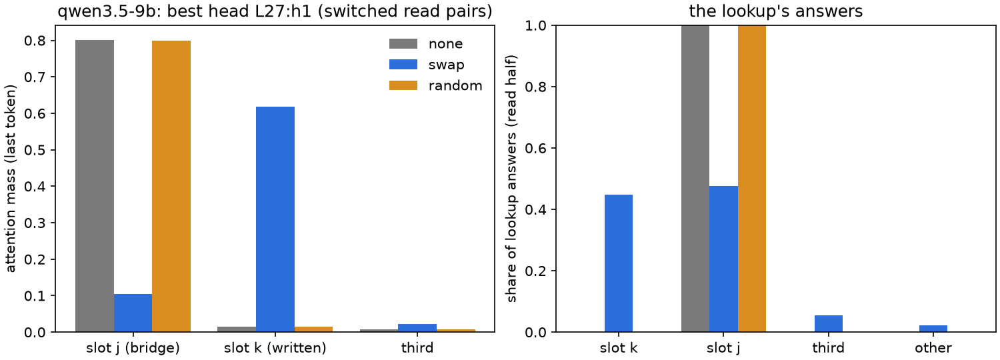
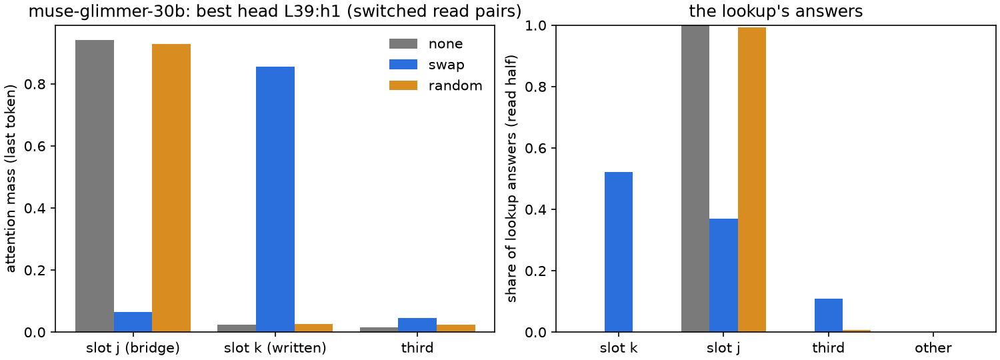
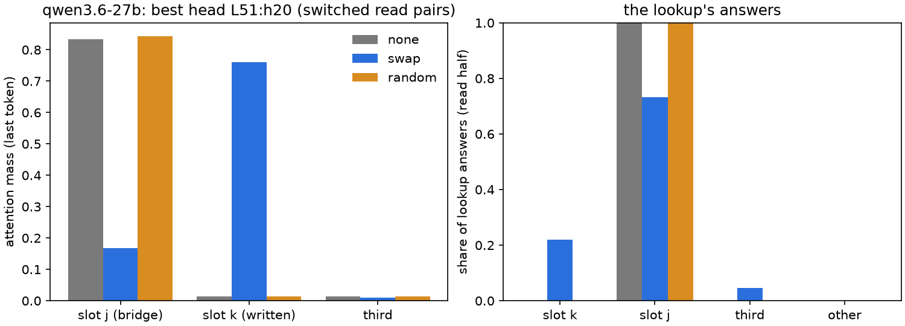

# 49.7: does the question's attention follow the written address?

Batch 49, test 49.7 (jobs/c3/batch49.yaml with amendment 2; Q49.7, Dan: (a) · 60%; (b) · 40%). x8_write's items, the swap s (mu_k - mu_j) at s = 2.0 at the bridge word at L, a random vector of its norm; heads chosen on the fit half, read on the other; decisive site the last token, question tokens beside; cluster bootstrap over bridge entities (10000, seed 0). UNVERIFIED.

Rules (fixed in advance):

- follows: on read-half pairs where the lookup switched to slot k's locker under the swap, >= 1 of the five candidate heads has mean move >= 0.30 (cluster-bootstrap CI excluding 0), its mean move under the random vector on the same pairs <= 0.05, and its mean move on the non-switched swap pairs <= 0.10.
- elsewhere: the lookup switches to slot k on >= 0.3 of the read-half swap pairs and no recorded head (every full-attention layer > L, every head) reaches a mean move of 0.15 on the switched pairs.
- distributed: the summed mean move over the five candidate heads, or over every head of the best head's layer, is >= 0.30 while no single candidate head reaches 0.30 (beside the per-head rule).
- necessity: the best head (chosen on the fit half) carries the position route if, under the swap with its output zeroed at the site, the lookup's switch to slot k falls by >= 0.5 of its swap value while the identity answers (read-half swap pairs answering slot j's locker under the swap) change <= 0.10 and the recall's answer changes <= 0.10 (swap + zero vs swap); per site (last token; question tokens).
- not_in_full_attention: on a model with Gated DeltaNet layers, if 'elsewhere' holds: 'the dereference is not in full attention on this model' (Muse decides).

## qwen3.5-9b (qwen35_9b_x49_7)

**neither**; distributed: no.

L = 12; recorded layers [15, 19, 23, 27, 31]; skipped (Gated DeltaNet) [13, 14, 16, 17, 18, 20, 21, 22, 24, 25, 26, 28, 29, 30]. Read pairs 330, switched 148; switch share 0.448 [0.397, 0.504] (bar 0.3). Largest mean move over every recorded head 1.301 (L27:h1); summed: five 5.228 [4.992, 5.518], best layer 4.939 [4.675, 5.234]; all heads 18.058; mean TV from none over every head: swap 0.227, random 0.027.

| site | head | locker mass (fit, none) | move, switched [CI] | random, same pairs | swap, non-switched | follows |
|---|---|---|---|---|---|---|
| last (decisive) | L23:h9 | 0.870 | 0.893 [0.801, 1.000] | 0.005 [0.000, 0.009] | 0.212 [0.182, 0.248] | no |
| last (decisive) | L27:h13 | 0.827 | 1.261 [1.218, 1.307] | 0.005 [0.002, 0.009] | 0.292 [0.256, 0.334] | no |
| last (decisive) | L19:h12 | 0.816 | 0.791 [0.751, 0.834] | 0.028 [0.022, 0.036] | 0.307 [0.282, 0.335] | no |
| last (decisive) | L27:h1 | 0.811 | 1.301 [1.237, 1.370] | 0.004 [0.000, 0.008] | 0.196 [0.154, 0.247] | no |
| last (decisive) | L23:h0 | 0.808 | 0.981 [0.905, 1.054] | 0.007 [0.002, 0.011] | 0.199 [0.160, 0.240] | no |
| question | L23:h9 | 0.870 | 0.001 [-0.002, 0.005] | 0.000 [-0.000, 0.001] | 0.003 [0.001, 0.005] | no |
| question | L27:h13 | 0.827 | -0.006 [-0.008, -0.005] | -0.000 [-0.000, 0.000] | -0.002 [-0.002, -0.001] | no |
| question | L19:h12 | 0.816 | -0.017 [-0.020, -0.014] | -0.000 [-0.000, 0.000] | -0.005 [-0.007, -0.004] | no |
| question | L27:h1 | 0.811 | -0.007 [-0.009, -0.006] | -0.000 [-0.000, 0.000] | -0.002 [-0.003, -0.001] | no |
| question | L23:h0 | 0.808 | 0.001 [-0.002, 0.003] | 0.001 [0.000, 0.001] | 0.003 [0.001, 0.004] | no |

Best head (fit half): L27:h1 (L + 15; the largest mean move on the fit half's switched pairs (1.2877)).

| arm | mass j / k / third | slot k: item / number / rest | entropy | logit j / k / third |
|---|---|---|---|---|
| none | 0.802 / 0.014 / 0.007 | 0.000 / 0.008 / 0.007 | 1.290 | 8.188 / 6.430 / 6.002 |
| swap | 0.105 / 0.619 / 0.022 | 0.001 / 0.486 / 0.132 | 1.679 | 7.255 / 8.248 / 6.422 |
| random | 0.798 / 0.015 / 0.008 | 0.000 / 0.008 / 0.007 | 1.299 | 8.181 / 6.435 / 6.000 |

Necessity (read half, the best head zeroed; rule: falls >= 0.5 of the swap value, identity answers changed <= 0.10, recall changed <= 0.10):

| zeroed at | n | switch: swap -> zeroed | falls | identity changed (n) | recall changed | clean lookup / recall changed | holds |
|---|---|---|---|---|---|---|---|
| last | 330 | 0.448 -> 0.448 | False | 0.013 (155) | 0.003 | 0.000 / 0.000 | no |
| question | 330 | 0.448 -> 0.448 | False | 0.000 (155) | 0.000 | 0.000 / 0.000 | no |

Weights (descriptive; RoPE and q/k norms left out): S = (W_Q mu^q_k)^T (W_K mu^src_k') = [[170.44, 157.47, 150.22], [144.52, 158.96, 142.15], [140.47, 147.18, 142.32]]; diagonal dominance 1.808 (off-diagonal SDs); items by slot [93, 108, 99].

## muse-glimmer-30b (muse30_x49_7)

**neither**; distributed: no.

L = 26; recorded layers [27, 28, 29, 30, 31, 32, 33, 34, 35, 36, 37, 38, 39, 40, 41, 42, 43, 44, 45, 46, 47, 48, 49, 50, 51]; skipped (Gated DeltaNet) none. Read pairs 286, switched 149; switch share 0.521 [0.483, 0.561] (bar 0.3). Largest mean move over every recorded head 1.710 (L39:h1); summed: five 6.233 [6.029, 6.441], best layer 4.711 [4.308, 5.089]; all heads 23.794; mean TV from none over every head: swap 0.153, random 0.027.

| site | head | locker mass (fit, none) | move, switched [CI] | random, same pairs | swap, non-switched | follows |
|---|---|---|---|---|---|---|
| last (decisive) | L39:h1 | 0.979 | 1.710 [1.670, 1.748] | 0.015 [0.007, 0.021] | 0.409 [0.334, 0.473] | no |
| last (decisive) | L35:h25 | 0.976 | 1.539 [1.476, 1.602] | 0.012 [0.004, 0.020] | 0.440 [0.383, 0.492] | no |
| last (decisive) | L35:h28 | 0.922 | 0.463 [0.427, 0.502] | 0.014 [0.003, 0.027] | 0.213 [0.178, 0.247] | no |
| last (decisive) | L35:h17 | 0.912 | 1.175 [1.127, 1.228] | 0.013 [0.006, 0.020] | 0.341 [0.288, 0.387] | no |
| last (decisive) | L35:h21 | 0.910 | 1.345 [1.294, 1.398] | 0.011 [0.004, 0.018] | 0.403 [0.347, 0.455] | no |
| question | L39:h1 | 0.979 | -0.020 [-0.023, -0.017] | -0.000 [-0.001, 0.000] | -0.010 [-0.012, -0.008] | no |
| question | L35:h25 | 0.976 | -0.033 [-0.036, -0.030] | -0.001 [-0.001, -0.000] | -0.017 [-0.020, -0.014] | no |
| question | L35:h28 | 0.922 | -0.015 [-0.018, -0.013] | -0.000 [-0.001, 0.001] | -0.008 [-0.010, -0.006] | no |
| question | L35:h17 | 0.912 | -0.014 [-0.016, -0.013] | -0.000 [-0.001, -0.000] | -0.007 [-0.009, -0.006] | no |
| question | L35:h21 | 0.910 | -0.030 [-0.033, -0.026] | -0.000 [-0.001, 0.000] | -0.015 [-0.019, -0.012] | no |

Best head (fit half): L39:h1 (L + 13; the largest mean move on the fit half's switched pairs (1.7131)).

| arm | mass j / k / third | slot k: item / number / rest | entropy | logit j / k / third |
|---|---|---|---|---|
| none | 0.942 / 0.024 / 0.015 | 0.000 / 0.016 / 0.008 | 0.543 | 15.120 / 13.196 / 12.773 |
| swap | 0.064 / 0.856 / 0.046 | 0.000 / 0.732 / 0.124 | 0.905 | 13.529 / 14.951 / 13.138 |
| random | 0.930 / 0.026 / 0.024 | 0.000 / 0.018 / 0.009 | 0.584 | 15.099 / 13.212 / 12.792 |

Necessity (read half, the best head zeroed; rule: falls >= 0.5 of the swap value, identity answers changed <= 0.10, recall changed <= 0.10):

| zeroed at | n | switch: swap -> zeroed | falls | identity changed (n) | recall changed | clean lookup / recall changed | holds |
|---|---|---|---|---|---|---|---|
| last | 286 | 0.535 -> 0.517 | False | 0.000 (102) | 0.000 | 0.000 / 0.000 | no |
| question | 286 | 0.535 -> 0.535 | False | 0.000 (102) | 0.000 | 0.000 / 0.000 | no |

Weights (descriptive; RoPE and q/k norms left out): S = (W_Q mu^q_k)^T (W_K mu^src_k') = [[94.21, 76.31, 72.69], [65.95, 62.77, 60.61], [61.88, 58.06, 59.58]]; diagonal dominance 0.952 (off-diagonal SDs); items by slot [99, 101, 100].

## qwen3.6-27b (x49_7_27b)

**neither**; distributed: no.

L = 32; recorded layers [35, 39, 43, 47, 51, 55, 59, 63]; skipped (Gated DeltaNet) [33, 34, 36, 37, 38, 40, 41, 42, 44, 45, 46, 48, 49, 50, 52, 53, 54, 56, 57, 58, 60, 61, 62]. Read pairs 300, switched 66; switch share 0.220 [0.164, 0.288] (bar 0.3). Largest mean move over every recorded head 1.412 (L51:h20); summed: five 5.260 [5.012, 5.549], best layer 5.408 [4.395, 6.584]; all heads 22.640; mean TV from none over every head: swap 0.310, random 0.041.

| site | head | locker mass (fit, none) | move, switched [CI] | random, same pairs | swap, non-switched | follows |
|---|---|---|---|---|---|---|
| last (decisive) | L51:h23 | 0.898 | 1.152 [1.020, 1.276] | -0.013 [-0.021, -0.003] | 0.198 [0.150, 0.249] | no |
| last (decisive) | L51:h20 | 0.895 | 1.412 [1.334, 1.507] | -0.010 [-0.018, -0.000] | 0.183 [0.135, 0.237] | no |
| last (decisive) | L43:h14 | 0.876 | 1.071 [1.003, 1.152] | 0.018 [0.004, 0.038] | 0.365 [0.306, 0.428] | no |
| last (decisive) | L51:h22 | 0.873 | 1.312 [1.229, 1.389] | -0.001 [-0.005, 0.005] | 0.225 [0.182, 0.273] | no |
| last (decisive) | L35:h22 | 0.858 | 0.313 [0.267, 0.365] | 0.018 [0.011, 0.026] | 0.163 [0.141, 0.188] | no |
| question | L51:h23 | 0.898 | -0.001 [-0.002, 0.001] | -0.000 [-0.001, -0.000] | -0.000 [-0.001, 0.000] | no |
| question | L51:h20 | 0.895 | -0.010 [-0.012, -0.008] | -0.000 [-0.001, 0.000] | -0.004 [-0.005, -0.003] | no |
| question | L43:h14 | 0.876 | 0.003 [0.002, 0.004] | -0.000 [-0.000, 0.000] | 0.002 [0.001, 0.002] | no |
| question | L51:h22 | 0.873 | -0.006 [-0.007, -0.005] | -0.000 [-0.001, -0.000] | -0.002 [-0.003, -0.002] | no |
| question | L35:h22 | 0.858 | -0.002 [-0.003, -0.002] | -0.000 [-0.000, -0.000] | -0.001 [-0.002, -0.001] | no |

Best head (fit half): L51:h20 (L + 19; the largest mean move on the fit half's switched pairs (1.3505)).

| arm | mass j / k / third | slot k: item / number / rest | entropy | logit j / k / third |
|---|---|---|---|---|
| none | 0.834 / 0.014 / 0.013 | 0.000 / 0.002 / 0.012 | 1.263 | 11.492 / 8.220 / 8.220 |
| swap | 0.168 / 0.760 / 0.009 | 0.006 / 0.400 / 0.354 | 1.174 | 10.513 / 12.406 / 8.969 |
| random | 0.844 / 0.014 / 0.013 | 0.000 / 0.002 / 0.012 | 1.253 | 11.652 / 8.314 / 8.241 |

Necessity (read half, the best head zeroed; rule: falls >= 0.5 of the swap value, identity answers changed <= 0.10, recall changed <= 0.10):

| zeroed at | n | switch: swap -> zeroed | falls | identity changed (n) | recall changed | clean lookup / recall changed | holds |
|---|---|---|---|---|---|---|---|
| last | 300 | 0.220 -> 0.217 | False | 0.005 (220) | 0.000 | 0.000 / 0.000 | no |
| question | 300 | 0.220 -> 0.220 | False | 0.000 (220) | 0.000 | 0.000 / 0.000 | no |

Weights (descriptive; RoPE and q/k norms left out): S = (W_Q mu^q_k)^T (W_K mu^src_k') = [[202.1, 159.95, 147.63], [125.04, 170.62, 129.52], [110.89, 129.32, 136.26]]; diagonal dominance 2.262 (off-diagonal SDs); items by slot [89, 111, 100].

