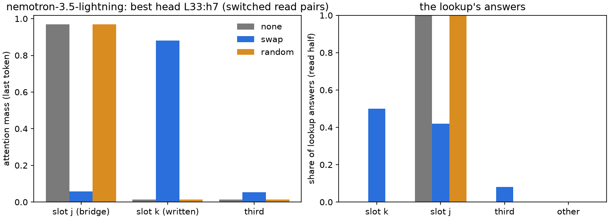

# 49.7: does the question's attention follow the written address?

Batch 49, test 49.7 (jobs/c3/batch49.yaml with amendment 2; batch 52 coverage, no prediction: coverage run on an already-scored rule; rules first scored in results/x49_attn/x49_7-20261028T154511Z). x8_write's items, the swap s (mu_k - mu_j) at s = 2.0 at the bridge word at L, a random vector of its norm; heads chosen on the fit half, read on the other; decisive site the last token, question tokens beside; cluster bootstrap over bridge entities (10000, seed 0). UNVERIFIED.

Rules (fixed in advance):

- follows: on read-half pairs where the lookup switched to slot k's locker under the swap, >= 1 of the five candidate heads has mean move >= 0.30 (cluster-bootstrap CI excluding 0), its mean move under the random vector on the same pairs <= 0.05, and its mean move on the non-switched swap pairs <= 0.10.
- elsewhere: the lookup switches to slot k on >= 0.3 of the read-half swap pairs and no recorded head (every full-attention layer > L, every head) reaches a mean move of 0.15 on the switched pairs.
- distributed: the summed mean move over the five candidate heads, or over every head of the best head's layer, is >= 0.30 while no single candidate head reaches 0.30 (beside the per-head rule).
- necessity: the best head (chosen on the fit half) carries the position route if, under the swap with its output zeroed at the site, the lookup's switch to slot k falls by >= 0.5 of its swap value while the identity answers (read-half swap pairs answering slot j's locker under the swap) change <= 0.10 and the recall's answer changes <= 0.10 (swap + zero vs swap); per site (last token; question tokens).
- not_in_full_attention: on a model with Gated DeltaNet layers, if 'elsewhere' holds: 'the dereference is not in full attention on this model' (Muse decides).

## nemotron-3.5-lightning (nem35l_x52_attn)

**neither**; distributed: no.

L = 14; recorded layers [19, 26, 33, 42]; skipped (Gated DeltaNet) [15, 16, 17, 18, 20, 21, 22, 23, 24, 25, 27, 28, 29, 30, 31, 32, 34, 35, 36, 37, 38, 39, 40, 41, 43, 44, 45, 46, 47, 48, 49, 50, 51]. Read pairs 250, switched 125; switch share 0.500 [0.430, 0.567] (bar 0.3). Largest mean move over every recorded head 1.779 (L33:h7); summed: five 4.553 [4.410, 4.696], best layer 17.271 [16.451, 18.185]; all heads 21.435; mean TV from none over every head: swap 0.214, random 0.033.

| site | head | locker mass (fit, none) | move, switched [CI] | random, same pairs | swap, non-switched | follows |
|---|---|---|---|---|---|---|
| last (decisive) | L33:h7 | 0.994 | 1.779 [1.746, 1.812] | -0.001 [-0.005, 0.003] | 0.312 [0.233, 0.394] | no |
| last (decisive) | L33:h5 | 0.942 | 1.373 [1.321, 1.423] | -0.001 [-0.007, 0.006] | 0.316 [0.243, 0.394] | no |
| last (decisive) | L19:h30 | 0.936 | 0.021 [0.017, 0.024] | -0.001 [-0.003, 0.000] | 0.019 [0.016, 0.022] | no |
| last (decisive) | L33:h0 | 0.935 | 1.358 [1.271, 1.443] | -0.005 [-0.020, 0.009] | 0.294 [0.216, 0.381] | no |
| last (decisive) | L19:h0 | 0.875 | 0.023 [0.019, 0.027] | -0.001 [-0.003, 0.001] | 0.017 [0.014, 0.021] | no |
| question | L33:h7 | 0.994 | -0.014 [-0.021, -0.007] | 0.000 [-0.000, 0.001] | -0.005 [-0.008, -0.003] | no |
| question | L33:h5 | 0.942 | -0.002 [-0.004, 0.000] | -0.000 [-0.000, 0.000] | -0.001 [-0.002, 0.000] | no |
| question | L19:h30 | 0.936 | 0.001 [0.000, 0.002] | 0.000 [-0.000, 0.001] | -0.000 [-0.001, -0.000] | no |
| question | L33:h0 | 0.935 | -0.012 [-0.014, -0.010] | -0.000 [-0.000, 0.000] | -0.004 [-0.005, -0.003] | no |
| question | L19:h0 | 0.875 | -0.001 [-0.002, -0.001] | 0.000 [-0.000, 0.000] | -0.001 [-0.001, -0.001] | no |

Best head (fit half): L33:h7 (L + 19; the largest mean move on the fit half's switched pairs (1.7555)).

| arm | mass j / k / third | slot k: item / number / rest | entropy | logit j / k / third |
|---|---|---|---|---|
| none | 0.969 / 0.013 / 0.014 | 0.000 / 0.008 / 0.005 | 0.403 | 8.951 / 5.033 / 5.178 |
| swap | 0.057 / 0.880 / 0.054 | 0.000 / 0.789 / 0.091 | 0.561 | 5.332 / 8.653 / 5.599 |
| random | 0.970 / 0.013 / 0.013 | 0.000 / 0.007 / 0.006 | 0.403 | 8.979 / 5.061 / 5.202 |

Necessity (read half, the best head zeroed; rule: falls >= 0.5 of the swap value, identity answers changed <= 0.10, recall changed <= 0.10):

| zeroed at | n | switch: swap -> zeroed | falls | identity changed (n) | recall changed | clean lookup / recall changed | holds |
|---|---|---|---|---|---|---|---|
| last | 250 | 0.500 -> 0.516 | False | 0.029 (105) | 0.004 | 0.000 / 0.008 | no |
| question | 250 | 0.500 -> 0.500 | False | 0.000 (105) | 0.000 | 0.000 / 0.000 | no |

Weights (descriptive; RoPE and q/k norms left out): S = (W_Q mu^q_k)^T (W_K mu^src_k') = [[108.51, 71.61, 60.25], [49.05, 85.58, 64.1], [23.78, 40.55, 55.29]]; diagonal dominance 1.975 (off-diagonal SDs); items by slot [104, 90, 106].

