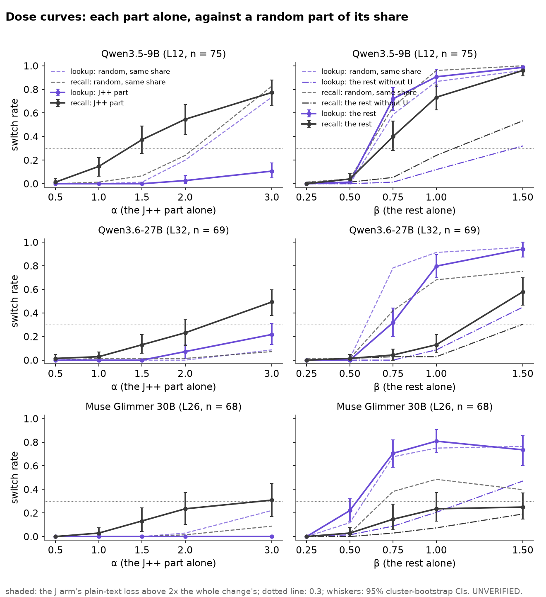

# 51.1: dose curves with a matched random part at every dose

Batch 51, test 51.1 (jobs/c3/batch51.yaml; Q51.1, Dan: (i) yes · 80%; no · 20% | (ii) yes · 70%; no · 30%
Dan (27B): (i) no · 60%; yes · 40% | (ii) yes · 60%; no · 40%
Dan (Muse): (i) yes · 85%; no · 15% | (ii) yes · 60%; no · 40% | (iii) no · 85%; yes · 15%). 49.1's items (main test, locker-first, chat) and parts; at the bridge word at L, one part of the change at a gain, against a random part of the same share at the same gain; switch = the top token is S's answer (X0's chat read). Cluster bootstrap over the bridge items (10000, seed 0). UNVERIFIED.

Rules (fixed in advance):

- (i) "the lookup is blind to the J++ part": switch minus random <= 0.10 at every α whose plain-text loss stays under 2x the whole change's -- on all three.
- (ii) "the recall reads the J++ part above its share": at the first α where the J++ part alone switches >= 0.3, J minus random >= 0.2 -- per model.
- (iii) "together only" (Muse): (1,1) from 49.1 >= 0.8 while the best single-part dose under the loss bar stays <= 0.3.

As computed: the loss bar = the J arm's mean plain-text loss <= 2x J(1,1)'s mean (this run); (i) on the lookup, R(α,0) the random twin, no α under the bar = undecided; (ii) on the recall (the lookup beside), the first α ascending, not conditioned on the loss bar (reported); (iii) on Muse's recall (the lookup and the other models beside), (1,1) = 49.1's stored J(1,1) rate, single parts = J(α,0) and J(0,β) under the bar. Point estimates decide (EPS 1e-9).

**Q51.1 (i)** lookup blind: qwen3.5-9b yes, qwen3.6-27b no, muse-glimmer-30b yes; on all three: **no**. **(ii)** recall above its share: qwen3.5-9b yes, qwen3.6-27b yes, muse-glimmer-30b yes. **(iii)** Muse together only: **no**.

| model | run | n | (i) lookup blind | (ii) recall above share (first α) | (iii) recall / lookup | fit b/a recall | lookup | c needed recall / lookup |
|---|---|---|---|---|---|---|---|---|
| qwen3.5-9b | qwen35_9b_x51_1 | 75 | **yes** | **yes** (1.5) | no / no | 2.24 [1.90, 2.62] | 6.33 [5.41, 7.85] | False / False |
| qwen3.6-27b | x51_1_27b | 69 | **no** | **yes** (3.0) | no / no | 1.71 [1.48, 2.03] | 3.83 [3.43, 4.30] | True / False |
| muse-glimmer-30b | muse30_x51_1 | 68 | **yes** | **yes** (3.0) | no / no | 0.63 [0.30, 1.14] | 155.25 [-735.00, 766.00] | True / False |

## qwen3.5-9b (qwen35_9b_x51_1, L12, n = 75, 32 bridge items)

Loss bar: 0.318 (= 2 x J(1,1)'s mean 0.159).

| arm | lookup | recall | mean loss | ÷ J(1,1) | under bar | top = O's next |
|---|---|---|---|---|---|---|
| J(0,0) | 0.00 [0.00, 0.00] | 0.00 [0.00, 0.00] | 0.13 [0.08, 0.20] | 0.83 [0.71, 0.99] | True | 0.99 |
| J(1,1) | 0.96 [0.91, 1.00] | 1.00 [1.00, 1.00] | 0.16 [0.09, 0.25] | 1.00 [1.00, 1.00] | True | 0.97 |
| J(0.5,0) | 0.00 [0.00, 0.00] | 0.01 [0.00, 0.04] | 0.13 [0.08, 0.20] | 0.82 [0.69, 0.98] | True | 0.99 |
| R(0.5,0) | 0.00 [0.00, 0.00] | 0.00 [0.00, 0.00] | 0.13 [0.08, 0.20] | 0.84 [0.72, 1.00] | True | 0.99 |
| J(1,0) | 0.00 [0.00, 0.00] | 0.15 [0.06, 0.22] | 0.13 [0.07, 0.19] | 0.80 [0.67, 0.95] | True | 0.99 |
| R(1,0) | 0.00 [0.00, 0.00] | 0.01 [0.00, 0.04] | 0.13 [0.08, 0.19] | 0.82 [0.71, 0.97] | True | 1.00 |
| J(1.5,0) | 0.00 [0.00, 0.00] | 0.37 [0.26, 0.49] | 0.13 [0.07, 0.20] | 0.82 [0.68, 0.99] | True | 0.99 |
| R(1.5,0) | 0.01 [0.00, 0.04] | 0.07 [0.02, 0.12] | 0.13 [0.08, 0.19] | 0.81 [0.69, 0.97] | True | 1.00 |
| J(2,0) | 0.03 [0.00, 0.07] | 0.55 [0.42, 0.67] | 0.14 [0.08, 0.22] | 0.86 [0.70, 1.06] | True | 0.99 |
| R(2,0) | 0.20 [0.12, 0.29] | 0.24 [0.14, 0.34] | 0.13 [0.07, 0.19] | 0.79 [0.69, 0.92] | True | 1.00 |
| J(3,0) | 0.11 [0.05, 0.18] | 0.77 [0.66, 0.88] | 0.15 [0.08, 0.23] | 0.92 [0.73, 1.17] | True | 0.99 |
| R(3,0) | 0.73 [0.62, 0.84] | 0.83 [0.73, 0.92] | 0.14 [0.08, 0.21] | 0.85 [0.77, 0.95] | True | 1.00 |
| J(0,0.25) | 0.00 [0.00, 0.00] | 0.00 [0.00, 0.00] | 0.13 [0.08, 0.20] | 0.83 [0.71, 0.99] | True | 0.99 |
| R(0,0.25) | 0.00 [0.00, 0.00] | 0.01 [0.00, 0.04] | 0.13 [0.08, 0.20] | 0.83 [0.71, 0.97] | True | 0.99 |
| J(0,0.5) | 0.01 [0.00, 0.04] | 0.04 [0.00, 0.09] | 0.13 [0.08, 0.19] | 0.82 [0.72, 0.95] | True | 0.99 |
| R(0,0.5) | 0.00 [0.00, 0.00] | 0.04 [0.00, 0.09] | 0.13 [0.07, 0.19] | 0.80 [0.69, 0.93] | True | 0.99 |
| J(0,0.75) | 0.72 [0.62, 0.81] | 0.40 [0.28, 0.53] | 0.14 [0.08, 0.21] | 0.85 [0.79, 0.95] | True | 1.00 |
| R(0,0.75) | 0.59 [0.50, 0.68] | 0.65 [0.53, 0.77] | 0.13 [0.08, 0.21] | 0.85 [0.79, 0.91] | True | 0.97 |
| J(0,1) | 0.91 [0.82, 0.97] | 0.73 [0.62, 0.84] | 0.15 [0.08, 0.23] | 0.92 [0.88, 0.95] | True | 0.99 |
| R(0,1) | 0.87 [0.78, 0.95] | 0.96 [0.91, 1.00] | 0.15 [0.08, 0.23] | 0.95 [0.91, 0.99] | True | 0.97 |
| J(0,1.5) | 0.99 [0.96, 1.00] | 0.96 [0.91, 1.00] | 0.17 [0.09, 0.28] | 1.06 [0.95, 1.14] | True | 0.97 |
| R(0,1.5) | 0.96 [0.90, 1.00] | 1.00 [1.00, 1.00] | 0.17 [0.09, 0.27] | 1.08 [1.03, 1.12] | True | 0.97 |
| J(0,0.25)-U | 0.00 [0.00, 0.00] | 0.01 [0.00, 0.04] | 0.13 [0.08, 0.20] | 0.84 [0.72, 0.99] | True | 0.99 |
| J(0,0.25)-RU | 0.00 [0.00, 0.00] | 0.00 [0.00, 0.00] | 0.13 [0.08, 0.20] | 0.84 [0.72, 0.99] | True | 0.99 |
| J(0,0.5)-U | 0.00 [0.00, 0.00] | 0.01 [0.00, 0.04] | 0.13 [0.08, 0.20] | 0.84 [0.72, 0.98] | True | 0.99 |
| J(0,0.5)-RU | 0.00 [0.00, 0.00] | 0.01 [0.00, 0.04] | 0.13 [0.08, 0.20] | 0.83 [0.71, 0.98] | True | 0.99 |
| J(0,0.75)-U | 0.01 [0.00, 0.04] | 0.05 [0.01, 0.11] | 0.13 [0.08, 0.20] | 0.84 [0.74, 0.96] | True | 0.99 |
| J(0,0.75)-RU | 0.05 [0.01, 0.10] | 0.04 [0.00, 0.09] | 0.13 [0.08, 0.20] | 0.82 [0.72, 0.96] | True | 0.99 |
| J(0,1)-U | 0.12 [0.04, 0.20] | 0.24 [0.16, 0.32] | 0.13 [0.07, 0.20] | 0.83 [0.76, 0.93] | True | 0.99 |
| J(0,1)-RU | 0.56 [0.46, 0.67] | 0.27 [0.17, 0.37] | 0.13 [0.08, 0.20] | 0.85 [0.75, 0.97] | True | 0.99 |
| J(0,1.5)-U | 0.32 [0.21, 0.43] | 0.53 [0.42, 0.65] | 0.14 [0.07, 0.22] | 0.87 [0.81, 0.92] | True | 0.97 |
| J(0,1.5)-RU | 0.96 [0.91, 1.00] | 0.55 [0.42, 0.68] | 0.15 [0.08, 0.23] | 0.94 [0.88, 1.01] | True | 0.97 |

J minus its random twin (paired CIs):

| pair | lookup | recall |
|---|---|---|
| J(0.5,0) - R(0.5,0) | 0.00 [0.00, 0.00] | 0.01 [0.00, 0.04] |
| J(1,0) - R(1,0) | 0.00 [0.00, 0.00] | 0.13 [0.06, 0.20] |
| J(1.5,0) - R(1.5,0) | -0.01 [-0.04, 0.00] | 0.31 [0.20, 0.42] |
| J(2,0) - R(2,0) | -0.17 [-0.25, -0.10] | 0.31 [0.17, 0.45] |
| J(3,0) - R(3,0) | -0.63 [-0.72, -0.52] | -0.05 [-0.16, 0.05] |
| J(0,0.25) - R(0,0.25) | 0.00 [0.00, 0.00] | -0.01 [-0.04, 0.00] |
| J(0,0.5) - R(0,0.5) | 0.01 [0.00, 0.04] | 0.00 [0.00, 0.00] |
| J(0,0.75) - R(0,0.75) | 0.13 [0.07, 0.20] | -0.25 [-0.38, -0.12] |
| J(0,1) - R(0,1) | 0.04 [-0.02, 0.10] | -0.23 [-0.31, -0.14] |
| J(0,1.5) - R(0,1.5) | 0.03 [0.00, 0.06] | -0.04 [-0.09, 0.00] |
| J(0,0.25)-U - J(0,0.25)-RU | 0.00 [0.00, 0.00] | 0.01 [0.00, 0.04] |
| J(0,0.5)-U - J(0,0.5)-RU | 0.00 [0.00, 0.00] | 0.00 [0.00, 0.00] |
| J(0,0.75)-U - J(0,0.75)-RU | -0.04 [-0.09, 0.00] | 0.01 [-0.03, 0.06] |
| J(0,1)-U - J(0,1)-RU | -0.44 [-0.58, -0.31] | -0.03 [-0.12, 0.07] |
| J(0,1.5)-U - J(0,1.5)-RU | -0.64 [-0.75, -0.53] | -0.01 [-0.16, 0.13] |

- (i) {"label": "yes", "alphas_under_bar": [0.5, 1.0, 1.5, 2.0, 3.0], "alphas_failing": [], "diff": {"0.5": 0.0, "1.0": 0.0, "1.5": -0.013333333333333334, "2.0": -0.17333333333333334, "3.0": -0.6266666666666666}}
- (ii) recall {"label": "yes", "first_alpha": 1.5, "first_under_bar": true, "diff": {"0.5": 0.013333333333333334, "1.0": 0.13333333333333333, "1.5": 0.3066666666666667, "2.0": 0.30666666666666664, "3.0": -0.053333333333333344}}; lookup {"label": "no", "why": "the J++ part alone never switches >= 0.3", "first_alpha": null, "diff": {"0.5": 0.0, "1.0": 0.0, "1.5": -0.013333333333333334, "2.0": -0.17333333333333334, "3.0": -0.6266666666666666}}
- (iii) recall {"label": "no", "whole49": 1.0, "best_single": ["J(0,1.5)", 0.96], "whole49_ok": true, "singles_ok": false}; lookup {"label": "no", "whole49": 0.96, "best_single": ["J(0,1.5)", 0.9866666666666667], "whole49_ok": true, "singles_ok": false}

Fit, recall (this run's J cells + 16 of 49.1's grid cells (qwen35_9b_x49_1); 28 cells, 75 items, 32 bridge items, ridge 1): additive a0 -3.62 [-4.68, -2.85], a 1.96 [1.54, 2.57], b 4.37 [3.27, 5.83], b/a 2.24 [1.90, 2.62]; interaction a0 -3.50 [-4.33, -2.98], a 1.85 [1.56, 2.30], b 4.15 [3.53, 5.05], c 0.38 [-0.44, 2.00]; c needed (95% CI excludes 0): False; naive LR 0.04, p 0.836 (reads as independent, anti-conservative).

Fit, lookup (this run's J cells + 16 of 49.1's grid cells (qwen35_9b_x49_1); 28 cells, 75 items, 32 bridge items, ridge 1): additive a0 -3.72 [-5.61, -2.82], a 0.82 [0.49, 1.45], b 5.18 [3.77, 8.12], b/a 6.33 [5.41, 7.85]; interaction a0 -3.79 [-5.17, -3.14], a 0.87 [0.69, 1.16], b 5.31 [4.32, 7.26], c -0.13 [-0.58, 1.23]; c needed (95% CI excludes 0): False; naive LR 1.88, p 0.17 (reads as independent, anti-conservative).
- lookup: J(0,0) reads O's answer on 75 of 75; J(1,1) vs the source run's whole arm: 75 of 75 agree (rerun 72, stored 72)
- recall: J(0,0) reads O's answer on 75 of 75; J(1,1) vs the source run's whole arm: 75 of 75 agree (rerun 75, stored 75)
- lookup vs 49.1 (qwen35_9b_x49_1): J(1,1) 0.96 there; J(1,1) agrees on 75 of 75 items; the 12 shared cells agree on 900 of 900 reads
- recall vs 49.1 (qwen35_9b_x49_1): J(1,1) 1.00 there; J(1,1) agrees on 75 of 75 items; the 12 shared cells agree on 900 of 900 reads
- shares of ||Δ||^2 (median): norm_delta 15.06, share_J 0.2277, share_J_rand 0.2277, share_U 0.2509, share_U_rand 0.2511, share_U_in_J 0.002198; U rank 4 (qwen35_9b_x0_probe_v4)

## qwen3.6-27b (x51_1_27b, L32, n = 69, 34 bridge items)

Loss bar: 6.863 (= 2 x J(1,1)'s mean 3.431).

| arm | lookup | recall | mean loss | ÷ J(1,1) | under bar | top = O's next |
|---|---|---|---|---|---|---|
| J(0,0) | 0.00 [0.00, 0.00] | 0.00 [0.00, 0.00] | 3.92 [3.68, 4.18] | 1.14 [1.09, 1.19] | True | 0.00 |
| J(1,1) | 0.96 [0.91, 1.00] | 0.72 [0.60, 0.83] | 3.43 [3.21, 3.69] | 1.00 [1.00, 1.00] | True | 0.00 |
| J(0.5,0) | 0.00 [0.00, 0.00] | 0.01 [0.00, 0.05] | 3.90 [3.66, 4.17] | 1.14 [1.09, 1.19] | True | 0.00 |
| R(0.5,0) | 0.00 [0.00, 0.00] | 0.00 [0.00, 0.00] | 3.93 [3.69, 4.21] | 1.15 [1.10, 1.20] | True | 0.00 |
| J(1,0) | 0.00 [0.00, 0.00] | 0.03 [0.00, 0.07] | 3.80 [3.54, 4.08] | 1.11 [1.06, 1.15] | True | 0.00 |
| R(1,0) | 0.00 [0.00, 0.00] | 0.01 [0.00, 0.05] | 3.93 [3.68, 4.20] | 1.14 [1.10, 1.20] | True | 0.00 |
| J(1.5,0) | 0.00 [0.00, 0.00] | 0.13 [0.06, 0.22] | 3.67 [3.42, 3.95] | 1.07 [1.03, 1.11] | True | 0.00 |
| R(1.5,0) | 0.00 [0.00, 0.00] | 0.01 [0.00, 0.05] | 3.93 [3.69, 4.21] | 1.14 [1.10, 1.20] | True | 0.00 |
| J(2,0) | 0.07 [0.02, 0.13] | 0.23 [0.13, 0.35] | 3.66 [3.42, 3.93] | 1.07 [1.03, 1.10] | True | 0.00 |
| R(2,0) | 0.00 [0.00, 0.00] | 0.01 [0.00, 0.05] | 3.90 [3.66, 4.18] | 1.14 [1.09, 1.19] | True | 0.00 |
| J(3,0) | 0.22 [0.13, 0.31] | 0.49 [0.38, 0.60] | 3.78 [3.53, 4.06] | 1.10 [1.07, 1.13] | True | 0.00 |
| R(3,0) | 0.09 [0.02, 0.16] | 0.07 [0.01, 0.15] | 3.84 [3.61, 4.10] | 1.12 [1.07, 1.17] | True | 0.00 |
| J(0,0.25) | 0.00 [0.00, 0.00] | 0.00 [0.00, 0.00] | 3.92 [3.68, 4.19] | 1.14 [1.10, 1.19] | True | 0.00 |
| R(0,0.25) | 0.00 [0.00, 0.00] | 0.01 [0.00, 0.05] | 3.92 [3.68, 4.19] | 1.14 [1.10, 1.19] | True | 0.00 |
| J(0,0.5) | 0.00 [0.00, 0.00] | 0.01 [0.00, 0.05] | 3.92 [3.68, 4.19] | 1.14 [1.09, 1.19] | True | 0.00 |
| R(0,0.5) | 0.01 [0.00, 0.05] | 0.01 [0.00, 0.05] | 3.90 [3.63, 4.18] | 1.14 [1.09, 1.18] | True | 0.00 |
| J(0,0.75) | 0.32 [0.20, 0.44] | 0.04 [0.00, 0.09] | 3.83 [3.57, 4.10] | 1.11 [1.07, 1.17] | True | 0.00 |
| R(0,0.75) | 0.78 [0.69, 0.87] | 0.42 [0.31, 0.53] | 3.51 [3.25, 3.77] | 1.02 [0.99, 1.06] | True | 0.00 |
| J(0,1) | 0.80 [0.70, 0.90] | 0.13 [0.06, 0.22] | 3.61 [3.36, 3.87] | 1.05 [1.01, 1.09] | True | 0.00 |
| R(0,1) | 0.91 [0.84, 0.98] | 0.68 [0.57, 0.78] | 3.42 [3.19, 3.67] | 1.00 [0.98, 1.01] | True | 0.00 |
| J(0,1.5) | 0.94 [0.88, 1.00] | 0.58 [0.47, 0.70] | 3.36 [3.13, 3.60] | 0.98 [0.96, 1.00] | True | 0.00 |
| R(0,1.5) | 0.96 [0.91, 1.00] | 0.75 [0.66, 0.84] | 3.47 [3.24, 3.71] | 1.01 [0.99, 1.03] | True | 0.00 |
| J(0,0.25)-U | 0.00 [0.00, 0.00] | 0.00 [0.00, 0.00] | 3.91 [3.66, 4.18] | 1.14 [1.09, 1.19] | True | 0.00 |
| J(0,0.25)-RU | 0.00 [0.00, 0.00] | 0.00 [0.00, 0.00] | 3.93 [3.71, 4.19] | 1.15 [1.10, 1.20] | True | 0.00 |
| J(0,0.5)-U | 0.00 [0.00, 0.00] | 0.01 [0.00, 0.05] | 3.91 [3.65, 4.19] | 1.14 [1.09, 1.19] | True | 0.00 |
| J(0,0.5)-RU | 0.00 [0.00, 0.00] | 0.00 [0.00, 0.00] | 3.92 [3.70, 4.17] | 1.14 [1.09, 1.19] | True | 0.00 |
| J(0,0.75)-U | 0.00 [0.00, 0.00] | 0.03 [0.00, 0.07] | 3.89 [3.63, 4.17] | 1.13 [1.09, 1.18] | True | 0.00 |
| J(0,0.75)-RU | 0.00 [0.00, 0.00] | 0.01 [0.00, 0.05] | 3.92 [3.69, 4.17] | 1.14 [1.09, 1.20] | True | 0.00 |
| J(0,1)-U | 0.09 [0.02, 0.17] | 0.03 [0.00, 0.07] | 3.81 [3.56, 4.10] | 1.11 [1.07, 1.16] | True | 0.00 |
| J(0,1)-RU | 0.12 [0.04, 0.20] | 0.03 [0.00, 0.07] | 3.86 [3.64, 4.11] | 1.13 [1.08, 1.18] | True | 0.00 |
| J(0,1.5)-U | 0.45 [0.34, 0.57] | 0.30 [0.19, 0.44] | 3.55 [3.26, 3.84] | 1.03 [0.99, 1.07] | True | 0.00 |
| J(0,1.5)-RU | 0.58 [0.49, 0.67] | 0.07 [0.02, 0.14] | 3.70 [3.47, 3.94] | 1.08 [1.02, 1.14] | True | 0.00 |

J minus its random twin (paired CIs):

| pair | lookup | recall |
|---|---|---|
| J(0.5,0) - R(0.5,0) | 0.00 [0.00, 0.00] | 0.01 [0.00, 0.05] |
| J(1,0) - R(1,0) | 0.00 [0.00, 0.00] | 0.01 [0.00, 0.05] |
| J(1.5,0) - R(1.5,0) | 0.00 [0.00, 0.00] | 0.12 [0.05, 0.19] |
| J(2,0) - R(2,0) | 0.07 [0.02, 0.13] | 0.22 [0.12, 0.32] |
| J(3,0) - R(3,0) | 0.13 [0.00, 0.26] | 0.42 [0.28, 0.54] |
| J(0,0.25) - R(0,0.25) | 0.00 [0.00, 0.00] | -0.01 [-0.05, 0.00] |
| J(0,0.5) - R(0,0.5) | -0.01 [-0.05, 0.00] | 0.00 [0.00, 0.00] |
| J(0,0.75) - R(0,0.75) | -0.46 [-0.57, -0.36] | -0.38 [-0.48, -0.27] |
| J(0,1) - R(0,1) | -0.12 [-0.19, -0.05] | -0.55 [-0.66, -0.42] |
| J(0,1.5) - R(0,1.5) | -0.01 [-0.08, 0.04] | -0.17 [-0.30, -0.04] |
| J(0,0.25)-U - J(0,0.25)-RU | 0.00 [0.00, 0.00] | 0.00 [0.00, 0.00] |
| J(0,0.5)-U - J(0,0.5)-RU | 0.00 [0.00, 0.00] | 0.01 [0.00, 0.05] |
| J(0,0.75)-U - J(0,0.75)-RU | 0.00 [0.00, 0.00] | 0.01 [0.00, 0.05] |
| J(0,1)-U - J(0,1)-RU | -0.03 [-0.07, 0.00] | 0.00 [0.00, 0.00] |
| J(0,1.5)-U - J(0,1.5)-RU | -0.13 [-0.27, 0.00] | 0.23 [0.10, 0.38] |

- (i) {"label": "no", "alphas_under_bar": [0.5, 1.0, 1.5, 2.0, 3.0], "alphas_failing": [3.0], "diff": {"0.5": 0.0, "1.0": 0.0, "1.5": 0.0, "2.0": 0.07246376811594203, "3.0": 0.13043478260869565}}
- (ii) recall {"label": "yes", "first_alpha": 3.0, "first_under_bar": true, "diff": {"0.5": 0.014492753623188406, "1.0": 0.014492753623188406, "1.5": 0.11594202898550725, "2.0": 0.21739130434782608, "3.0": 0.4202898550724638}}; lookup {"label": "no", "why": "the J++ part alone never switches >= 0.3", "first_alpha": null, "diff": {"0.5": 0.0, "1.0": 0.0, "1.5": 0.0, "2.0": 0.07246376811594203, "3.0": 0.13043478260869565}}
- (iii) recall {"label": "no", "whole49": 0.7246376811594203, "best_single": ["J(0,1.5)", 0.5797101449275363], "whole49_ok": false, "singles_ok": false}; lookup {"label": "no", "whole49": 0.9565217391304348, "best_single": ["J(0,1.5)", 0.9420289855072463], "whole49_ok": true, "singles_ok": false}

Fit, recall (this run's J cells + 16 of 49.1's grid cells (x49_1_27b); 28 cells, 69 items, 34 bridge items, ridge 1): additive a0 -2.96 [-3.40, -2.64], a 1.06 [0.86, 1.30], b 1.82 [1.52, 2.23], b/a 1.71 [1.48, 2.03]; interaction a0 -3.26 [-3.61, -2.95], a 1.29 [1.11, 1.48], b 2.15 [1.88, 2.46], c -0.30 [-0.48, -0.09]; c needed (95% CI excludes 0): True; naive LR 11.08, p 0.000871 (reads as independent, anti-conservative).

Fit, lookup (this run's J cells + 16 of 49.1's grid cells (x49_1_27b); 28 cells, 69 items, 34 bridge items, ridge 1): additive a0 -3.23 [-4.54, -2.59], a 0.95 [0.72, 1.40], b 3.65 [2.78, 5.49], b/a 3.83 [3.43, 4.30]; interaction a0 -3.17 [-4.23, -2.67], a 0.91 [0.74, 1.19], b 3.56 [2.88, 4.88], c 0.10 [-0.18, 0.85]; c needed (95% CI excludes 0): False; naive LR 0.00, p 1 (reads as independent, anti-conservative).
- lookup: J(0,0) reads O's answer on 69 of 69; J(1,1) vs the source run's whole arm: 69 of 69 agree (rerun 66, stored 66)
- recall: J(0,0) reads O's answer on 69 of 69; J(1,1) vs the source run's whole arm: 68 of 69 agree (rerun 50, stored 51)
- lookup vs 49.1 (x49_1_27b): J(1,1) 0.96 there; J(1,1) agrees on 69 of 69 items; the 12 shared cells agree on 828 of 828 reads
- recall vs 49.1 (x49_1_27b): J(1,1) 0.72 there; J(1,1) agrees on 69 of 69 items; the 12 shared cells agree on 828 of 828 reads
- shares of ||Δ||^2 (median): norm_delta 45.25, share_J 0.1383, share_J_rand 0.1382, share_U 0.3167, share_U_rand 0.3168, share_U_in_J 0.001224; U rank 4 (x0_probe_v4_27b)

## muse-glimmer-30b (muse30_x51_1, L26, n = 68, 29 bridge items)

Loss bar: 7.382 (= 2 x J(1,1)'s mean 3.691).

| arm | lookup | recall | mean loss | ÷ J(1,1) | under bar | top = O's next |
|---|---|---|---|---|---|---|
| J(0,0) | 0.00 [0.00, 0.00] | 0.00 [0.00, 0.00] | 3.66 [3.07, 4.40] | 0.99 [0.95, 1.03] | True | 0.43 |
| J(1,1) | 0.81 [0.72, 0.90] | 0.46 [0.31, 0.60] | 3.69 [3.14, 4.36] | 1.00 [1.00, 1.00] | True | 0.38 |
| J(0.5,0) | 0.00 [0.00, 0.00] | 0.00 [0.00, 0.00] | 3.65 [3.06, 4.39] | 0.99 [0.95, 1.03] | True | 0.41 |
| R(0.5,0) | 0.00 [0.00, 0.00] | 0.00 [0.00, 0.00] | 3.68 [3.08, 4.42] | 1.00 [0.95, 1.04] | True | 0.41 |
| J(1,0) | 0.00 [0.00, 0.00] | 0.03 [0.00, 0.08] | 3.63 [3.05, 4.36] | 0.98 [0.95, 1.02] | True | 0.40 |
| R(1,0) | 0.00 [0.00, 0.00] | 0.00 [0.00, 0.00] | 3.67 [3.08, 4.41] | 0.99 [0.95, 1.03] | True | 0.41 |
| J(1.5,0) | 0.00 [0.00, 0.00] | 0.13 [0.04, 0.24] | 3.63 [3.06, 4.33] | 0.98 [0.95, 1.01] | True | 0.40 |
| R(1.5,0) | 0.00 [0.00, 0.00] | 0.00 [0.00, 0.00] | 3.67 [3.08, 4.41] | 0.99 [0.95, 1.03] | True | 0.41 |
| J(2,0) | 0.00 [0.00, 0.00] | 0.24 [0.10, 0.37] | 3.62 [3.06, 4.30] | 0.98 [0.95, 1.00] | True | 0.43 |
| R(2,0) | 0.03 [0.00, 0.08] | 0.01 [0.00, 0.05] | 3.68 [3.09, 4.41] | 1.00 [0.96, 1.03] | True | 0.41 |
| J(3,0) | 0.00 [0.00, 0.00] | 0.31 [0.17, 0.45] | 3.61 [3.05, 4.28] | 0.98 [0.95, 1.01] | True | 0.43 |
| R(3,0) | 0.22 [0.13, 0.32] | 0.09 [0.02, 0.19] | 3.69 [3.10, 4.41] | 1.00 [0.97, 1.03] | True | 0.40 |
| J(0,0.25) | 0.00 [0.00, 0.00] | 0.00 [0.00, 0.00] | 3.67 [3.09, 4.41] | 0.99 [0.95, 1.03] | True | 0.40 |
| R(0,0.25) | 0.00 [0.00, 0.00] | 0.00 [0.00, 0.00] | 3.67 [3.08, 4.41] | 0.99 [0.95, 1.03] | True | 0.40 |
| J(0,0.5) | 0.22 [0.13, 0.32] | 0.03 [0.00, 0.08] | 3.69 [3.12, 4.41] | 1.00 [0.96, 1.03] | True | 0.40 |
| R(0,0.5) | 0.12 [0.06, 0.19] | 0.03 [0.00, 0.08] | 3.65 [3.09, 4.37] | 0.99 [0.95, 1.02] | True | 0.40 |
| J(0,0.75) | 0.71 [0.59, 0.82] | 0.15 [0.06, 0.28] | 3.69 [3.13, 4.39] | 1.00 [0.97, 1.03] | True | 0.40 |
| R(0,0.75) | 0.68 [0.56, 0.79] | 0.38 [0.25, 0.51] | 3.67 [3.11, 4.36] | 0.99 [0.97, 1.01] | True | 0.40 |
| J(0,1) | 0.81 [0.71, 0.91] | 0.24 [0.13, 0.37] | 3.68 [3.14, 4.36] | 1.00 [0.98, 1.02] | True | 0.38 |
| R(0,1) | 0.75 [0.64, 0.85] | 0.49 [0.36, 0.61] | 3.68 [3.13, 4.35] | 1.00 [0.99, 1.01] | True | 0.38 |
| J(0,1.5) | 0.74 [0.60, 0.86] | 0.25 [0.15, 0.37] | 3.67 [3.14, 4.33] | 1.00 [0.98, 1.01] | True | 0.38 |
| R(0,1.5) | 0.76 [0.63, 0.88] | 0.40 [0.28, 0.51] | 3.71 [3.18, 4.35] | 1.00 [0.99, 1.02] | True | 0.38 |
| J(0,0.25)-U | 0.00 [0.00, 0.00] | 0.00 [0.00, 0.00] | 3.67 [3.08, 4.40] | 0.99 [0.95, 1.03] | True | 0.40 |
| J(0,0.25)-RU | 0.00 [0.00, 0.00] | 0.00 [0.00, 0.00] | 3.67 [3.08, 4.41] | 0.99 [0.95, 1.03] | True | 0.40 |
| J(0,0.5)-U | 0.01 [0.00, 0.05] | 0.00 [0.00, 0.00] | 3.66 [3.08, 4.39] | 0.99 [0.95, 1.03] | True | 0.40 |
| J(0,0.5)-RU | 0.01 [0.00, 0.05] | 0.00 [0.00, 0.00] | 3.69 [3.10, 4.42] | 1.00 [0.96, 1.04] | True | 0.40 |
| J(0,0.75)-U | 0.09 [0.02, 0.18] | 0.03 [0.00, 0.08] | 3.65 [3.09, 4.36] | 0.99 [0.96, 1.02] | True | 0.40 |
| J(0,0.75)-RU | 0.29 [0.18, 0.43] | 0.03 [0.00, 0.08] | 3.70 [3.12, 4.42] | 1.00 [0.96, 1.04] | True | 0.40 |
| J(0,1)-U | 0.21 [0.12, 0.31] | 0.07 [0.02, 0.15] | 3.65 [3.10, 4.34] | 0.99 [0.96, 1.01] | True | 0.41 |
| J(0,1)-RU | 0.66 [0.54, 0.79] | 0.10 [0.03, 0.21] | 3.71 [3.15, 4.42] | 1.01 [0.98, 1.04] | True | 0.40 |
| J(0,1.5)-U | 0.47 [0.36, 0.58] | 0.19 [0.10, 0.31] | 3.63 [3.09, 4.28] | 0.98 [0.96, 1.00] | True | 0.40 |
| J(0,1.5)-RU | 0.81 [0.71, 0.89] | 0.15 [0.06, 0.26] | 3.72 [3.18, 4.40] | 1.01 [0.98, 1.03] | True | 0.38 |

J minus its random twin (paired CIs):

| pair | lookup | recall |
|---|---|---|
| J(0.5,0) - R(0.5,0) | 0.00 [0.00, 0.00] | 0.00 [0.00, 0.00] |
| J(1,0) - R(1,0) | 0.00 [0.00, 0.00] | 0.03 [0.00, 0.08] |
| J(1.5,0) - R(1.5,0) | 0.00 [0.00, 0.00] | 0.13 [0.04, 0.24] |
| J(2,0) - R(2,0) | -0.03 [-0.08, 0.00] | 0.22 [0.08, 0.36] |
| J(3,0) - R(3,0) | -0.22 [-0.32, -0.13] | 0.22 [0.07, 0.37] |
| J(0,0.25) - R(0,0.25) | 0.00 [0.00, 0.00] | 0.00 [0.00, 0.00] |
| J(0,0.5) - R(0,0.5) | 0.10 [0.04, 0.18] | 0.00 [-0.04, 0.04] |
| J(0,0.75) - R(0,0.75) | 0.03 [0.00, 0.07] | -0.24 [-0.34, -0.12] |
| J(0,1) - R(0,1) | 0.06 [0.02, 0.11] | -0.25 [-0.38, -0.12] |
| J(0,1.5) - R(0,1.5) | -0.03 [-0.08, 0.03] | -0.15 [-0.21, -0.07] |
| J(0,0.25)-U - J(0,0.25)-RU | 0.00 [0.00, 0.00] | 0.00 [0.00, 0.00] |
| J(0,0.5)-U - J(0,0.5)-RU | 0.00 [-0.04, 0.04] | 0.00 [0.00, 0.00] |
| J(0,0.75)-U - J(0,0.75)-RU | -0.21 [-0.33, -0.09] | 0.00 [-0.04, 0.04] |
| J(0,1)-U - J(0,1)-RU | -0.46 [-0.59, -0.33] | -0.03 [-0.11, 0.04] |
| J(0,1.5)-U - J(0,1.5)-RU | -0.34 [-0.46, -0.20] | 0.04 [-0.03, 0.11] |

- (i) {"label": "yes", "alphas_under_bar": [0.5, 1.0, 1.5, 2.0, 3.0], "alphas_failing": [], "diff": {"0.5": 0.0, "1.0": 0.0, "1.5": 0.0, "2.0": -0.029411764705882353, "3.0": -0.22058823529411764}}
- (ii) recall {"label": "yes", "first_alpha": 3.0, "first_under_bar": true, "diff": {"0.5": 0.0, "1.0": 0.029411764705882353, "1.5": 0.1323529411764706, "2.0": 0.22058823529411764, "3.0": 0.22058823529411764}}; lookup {"label": "no", "why": "the J++ part alone never switches >= 0.3", "first_alpha": null, "diff": {"0.5": 0.0, "1.0": 0.0, "1.5": 0.0, "2.0": -0.029411764705882353, "3.0": -0.22058823529411764}}
- (iii) recall {"label": "no", "whole49": 0.45588235294117646, "best_single": ["J(3,0)", 0.3088235294117647], "whole49_ok": false, "singles_ok": false}; lookup {"label": "no", "whole49": 0.8088235294117647, "best_single": ["J(0,1)", 0.8088235294117647], "whole49_ok": true, "singles_ok": false}

Fit, recall (this run's J cells + 16 of 49.1's grid cells (muse30_x49_1); 28 cells, 68 items, 29 bridge items, ridge 1): additive a0 -2.11 [-2.58, -1.72], a 0.63 [0.47, 0.78], b 0.40 [0.20, 0.63], b/a 0.63 [0.30, 1.14]; interaction a0 -2.39 [-2.81, -2.00], a 0.83 [0.60, 1.05], b 0.71 [0.43, 0.97], c -0.25 [-0.38, -0.10]; c needed (95% CI excludes 0): True; naive LR 8.61, p 0.00335 (reads as independent, anti-conservative).

Fit, lookup (this run's J cells + 16 of 49.1's grid cells (muse30_x49_1); 28 cells, 68 items, 29 bridge items, ridge 1): additive a0 -1.45 [-1.77, -1.16], a 0.01 [-0.04, 0.06], b 1.45 [1.06, 1.92], b/a 155.25 [-735.00, 766.00]; interaction a0 -1.45 [-1.76, -1.16], a 0.01 [-0.06, 0.08], b 1.44 [1.06, 1.92], c 0.01 [-0.07, 0.07]; c needed (95% CI excludes 0): False; naive LR 0.00, p 1 (reads as independent, anti-conservative).
- lookup: J(0,0) reads O's answer on 68 of 68; J(1,1) vs the source run's whole arm: 68 of 68 agree (rerun 55, stored 55)
- recall: J(0,0) reads O's answer on 67 of 68; J(1,1) vs the source run's whole arm: 68 of 68 agree (rerun 31, stored 31)
- lookup vs 49.1 (muse30_x49_1): J(1,1) 0.81 there; J(1,1) agrees on 68 of 68 items; the 12 shared cells agree on 816 of 816 reads
- recall vs 49.1 (muse30_x49_1): J(1,1) 0.46 there; J(1,1) agrees on 68 of 68 items; the 12 shared cells agree on 816 of 816 reads
- shares of ||Δ||^2 (median): norm_delta 156, share_J 0.1377, share_J_rand 0.138, share_U 0.256, share_U_rand 0.2559, share_U_in_J 0.0007015; U rank 4 (muse30b_x0_probe_v4)

Arms: J(α,0) = α P_J Δ, the change's 25-atom signed OMP J++ part alone at gain α; R(α,0) = α R Δ, R Δ a random subspace's part of Δ at P_J Δ's share of ||Δ||^2 (seed 888 + L); J(0,β) = β (Δ - P_J Δ), the rest alone at gain β (with the address); R(0,β) = β (Δ - R Δ), the random complement at the rest's share; J(0,β)-U = β (Δ - P_J Δ - U U^T Δ), the rest without the address (49.1's J(0,2)-U at gain β); J(0,β)-RU = β (Δ - P_J Δ - R_U Δ), R_U Δ a random part at U U^T Δ's share (same random basis); J(1,1) = Δ, the whole change (X0's whole arm; 49.1's J(1,1)); J(0,0) = O unedited.
