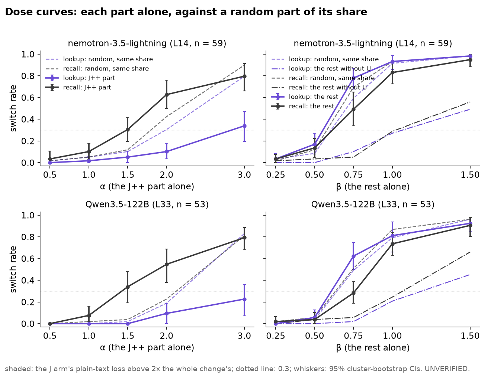

# 51.1: dose curves with a matched random part at every dose

Batch 51, test 51.1 (jobs/c3/batch51.yaml; batch 52 coverage, no prediction: coverage run on an already-scored rule; rules first scored in results/x51_dose/x51_1-20261028T170335Z). 49.1's items (main test, locker-first, chat) and parts; at the bridge word at L, one part of the change at a gain, against a random part of the same share at the same gain; switch = the top token is S's answer (X0's chat read). Cluster bootstrap over the bridge items (10000, seed 0). UNVERIFIED.

Rules (fixed in advance):

- (i) "the lookup is blind to the J++ part": switch minus random <= 0.10 at every α whose plain-text loss stays under 2x the whole change's -- on all three.
- (ii) "the recall reads the J++ part above its share": at the first α where the J++ part alone switches >= 0.3, J minus random >= 0.2 -- per model.
- (iii) "together only" (Muse): (1,1) from 49.1 >= 0.8 while the best single-part dose under the loss bar stays <= 0.3.

As computed: the loss bar = the J arm's mean plain-text loss <= 2x J(1,1)'s mean (this run); (i) on the lookup, R(α,0) the random twin, no α under the bar = undecided; (ii) on the recall (the lookup beside), the first α ascending, not conditioned on the loss bar (reported); (iii) on Muse's recall (the lookup and the other models beside), (1,1) = 49.1's stored J(1,1) rate, single parts = J(α,0) and J(0,β) under the bar. Point estimates decide (EPS 1e-9).

**Q51.1 (i)** lookup blind: nemotron-3.5-lightning yes, qwen3.5-122b-a10b yes; on all three: **yes**. **(ii)** recall above its share: nemotron-3.5-lightning no, qwen3.5-122b-a10b yes. **(iii)** Muse together only: **not this run's model (rule (iii) is Muse's)**.

| model | run | n | (i) lookup blind | (ii) recall above share (first α) | (iii) recall / lookup | fit b/a recall | lookup | c needed recall / lookup |
|---|---|---|---|---|---|---|---|---|
| nemotron-3.5-lightning | nem35l_x52_dose | 59 | **yes** | **no** (1.5) | undecided / undecided | 2.55 [2.19, 2.91] | 5.66 [4.76, 7.52] | True / True |
| qwen3.5-122b-a10b | qwen35_122b_x51_1 | 53 | **yes** | **yes** (1.5) | undecided / undecided | 2.23 [1.92, 2.63] | 5.45 [4.38, 10.97] | True / True |

## nemotron-3.5-lightning (nem35l_x52_dose, L14, n = 59, 30 bridge items)

Loss bar: 7.654 (= 2 x J(1,1)'s mean 3.827).

| arm | lookup | recall | mean loss | ÷ J(1,1) | under bar | top = O's next |
|---|---|---|---|---|---|---|
| J(0,0) | 0.00 [0.00, 0.00] | 0.02 [0.00, 0.05] | 3.79 [2.85, 4.69] | 0.99 [0.97, 1.01] | True | 0.42 |
| J(1,1) | 0.98 [0.94, 1.00] | 1.00 [1.00, 1.00] | 3.83 [2.90, 4.71] | 1.00 [1.00, 1.00] | True | 0.37 |
| J(0.5,0) | 0.00 [0.00, 0.00] | 0.03 [0.00, 0.11] | 3.77 [2.83, 4.67] | 0.99 [0.96, 1.01] | True | 0.42 |
| R(0.5,0) | 0.02 [0.00, 0.06] | 0.02 [0.00, 0.05] | 3.78 [2.84, 4.68] | 0.99 [0.96, 1.01] | True | 0.41 |
| J(1,0) | 0.02 [0.00, 0.06] | 0.10 [0.03, 0.18] | 3.76 [2.82, 4.66] | 0.98 [0.96, 1.01] | True | 0.44 |
| R(1,0) | 0.05 [0.00, 0.11] | 0.05 [0.00, 0.13] | 3.79 [2.85, 4.69] | 0.99 [0.96, 1.01] | True | 0.42 |
| J(1.5,0) | 0.05 [0.00, 0.11] | 0.31 [0.20, 0.42] | 3.77 [2.83, 4.67] | 0.98 [0.96, 1.01] | True | 0.42 |
| R(1.5,0) | 0.10 [0.02, 0.19] | 0.12 [0.03, 0.20] | 3.78 [2.84, 4.68] | 0.99 [0.97, 1.01] | True | 0.44 |
| J(2,0) | 0.10 [0.04, 0.18] | 0.63 [0.50, 0.76] | 3.81 [2.86, 4.71] | 0.99 [0.97, 1.02] | True | 0.42 |
| R(2,0) | 0.31 [0.18, 0.42] | 0.42 [0.32, 0.54] | 3.78 [2.85, 4.69] | 0.99 [0.97, 1.00] | True | 0.44 |
| J(3,0) | 0.34 [0.20, 0.47] | 0.80 [0.66, 0.91] | 3.82 [2.89, 4.70] | 1.00 [0.98, 1.02] | True | 0.41 |
| R(3,0) | 0.80 [0.70, 0.89] | 0.90 [0.83, 0.96] | 3.82 [2.89, 4.70] | 1.00 [0.99, 1.01] | True | 0.37 |
| J(0,0.25) | 0.03 [0.00, 0.08] | 0.03 [0.00, 0.08] | 3.79 [2.85, 4.69] | 0.99 [0.97, 1.01] | True | 0.44 |
| R(0,0.25) | 0.03 [0.00, 0.08] | 0.02 [0.00, 0.05] | 3.79 [2.85, 4.69] | 0.99 [0.97, 1.01] | True | 0.44 |
| J(0,0.5) | 0.17 [0.08, 0.27] | 0.14 [0.05, 0.22] | 3.79 [2.85, 4.68] | 0.99 [0.97, 1.01] | True | 0.42 |
| R(0,0.5) | 0.08 [0.02, 0.17] | 0.12 [0.04, 0.20] | 3.80 [2.86, 4.70] | 0.99 [0.97, 1.01] | True | 0.41 |
| J(0,0.75) | 0.78 [0.68, 0.87] | 0.49 [0.34, 0.65] | 3.83 [2.90, 4.72] | 1.00 [0.99, 1.02] | True | 0.39 |
| R(0,0.75) | 0.59 [0.48, 0.69] | 0.69 [0.56, 0.82] | 3.80 [2.87, 4.68] | 0.99 [0.98, 1.01] | True | 0.41 |
| J(0,1) | 0.93 [0.86, 0.98] | 0.83 [0.73, 0.92] | 3.82 [2.90, 4.70] | 1.00 [0.99, 1.01] | True | 0.36 |
| R(0,1) | 0.92 [0.84, 0.98] | 0.93 [0.83, 1.00] | 3.81 [2.89, 4.69] | 1.00 [0.99, 1.00] | True | 0.37 |
| J(0,1.5) | 0.98 [0.94, 1.00] | 0.95 [0.88, 1.00] | 3.84 [2.91, 4.70] | 1.00 [0.99, 1.01] | True | 0.37 |
| R(0,1.5) | 0.98 [0.94, 1.00] | 0.98 [0.94, 1.00] | 3.83 [2.90, 4.71] | 1.00 [1.00, 1.01] | True | 0.37 |
| J(0,0.25)-U | 0.00 [0.00, 0.00] | 0.02 [0.00, 0.05] | 3.78 [2.84, 4.68] | 0.99 [0.96, 1.01] | True | 0.42 |
| J(0,0.25)-RU | 0.00 [0.00, 0.00] | 0.02 [0.00, 0.05] | 3.78 [2.84, 4.68] | 0.99 [0.97, 1.01] | True | 0.44 |
| J(0,0.5)-U | 0.00 [0.00, 0.00] | 0.03 [0.00, 0.11] | 3.78 [2.85, 4.68] | 0.99 [0.97, 1.01] | True | 0.42 |
| J(0,0.5)-RU | 0.08 [0.02, 0.17] | 0.02 [0.00, 0.05] | 3.80 [2.86, 4.69] | 0.99 [0.97, 1.01] | True | 0.41 |
| J(0,0.75)-U | 0.10 [0.02, 0.19] | 0.05 [0.00, 0.12] | 3.79 [2.85, 4.69] | 0.99 [0.97, 1.01] | True | 0.42 |
| J(0,0.75)-RU | 0.32 [0.20, 0.44] | 0.15 [0.07, 0.25] | 3.81 [2.87, 4.69] | 0.99 [0.98, 1.01] | True | 0.42 |
| J(0,1)-U | 0.27 [0.11, 0.42] | 0.29 [0.15, 0.42] | 3.79 [2.85, 4.68] | 0.99 [0.97, 1.01] | True | 0.42 |
| J(0,1)-RU | 0.69 [0.59, 0.79] | 0.41 [0.24, 0.57] | 3.84 [2.90, 4.72] | 1.00 [0.99, 1.02] | True | 0.41 |
| J(0,1.5)-U | 0.49 [0.35, 0.62] | 0.56 [0.41, 0.69] | 3.81 [2.87, 4.70] | 1.00 [0.98, 1.01] | True | 0.42 |
| J(0,1.5)-RU | 0.95 [0.89, 1.00] | 0.71 [0.56, 0.85] | 3.83 [2.89, 4.71] | 1.00 [0.99, 1.01] | True | 0.41 |

J minus its random twin (paired CIs):

| pair | lookup | recall |
|---|---|---|
| J(0.5,0) - R(0.5,0) | -0.02 [-0.06, 0.00] | 0.02 [0.00, 0.05] |
| J(1,0) - R(1,0) | -0.03 [-0.08, 0.00] | 0.05 [0.00, 0.10] |
| J(1.5,0) - R(1.5,0) | -0.05 [-0.13, 0.00] | 0.19 [0.08, 0.31] |
| J(2,0) - R(2,0) | -0.20 [-0.32, -0.08] | 0.20 [0.07, 0.35] |
| J(3,0) - R(3,0) | -0.46 [-0.64, -0.28] | -0.10 [-0.21, 0.00] |
| J(0,0.25) - R(0,0.25) | 0.00 [0.00, 0.00] | 0.02 [0.00, 0.05] |
| J(0,0.5) - R(0,0.5) | 0.08 [0.02, 0.15] | 0.02 [0.00, 0.06] |
| J(0,0.75) - R(0,0.75) | 0.19 [0.09, 0.29] | -0.20 [-0.31, -0.09] |
| J(0,1) - R(0,1) | 0.02 [0.00, 0.06] | -0.10 [-0.20, -0.02] |
| J(0,1.5) - R(0,1.5) | 0.00 [0.00, 0.00] | -0.03 [-0.09, 0.00] |
| J(0,0.25)-U - J(0,0.25)-RU | 0.00 [0.00, 0.00] | 0.00 [0.00, 0.00] |
| J(0,0.5)-U - J(0,0.5)-RU | -0.08 [-0.17, -0.02] | 0.02 [0.00, 0.05] |
| J(0,0.75)-U - J(0,0.75)-RU | -0.22 [-0.33, -0.12] | -0.10 [-0.19, -0.03] |
| J(0,1)-U - J(0,1)-RU | -0.42 [-0.57, -0.29] | -0.12 [-0.24, -0.01] |
| J(0,1.5)-U - J(0,1.5)-RU | -0.46 [-0.60, -0.32] | -0.15 [-0.30, -0.02] |

- (i) {"label": "yes", "alphas_under_bar": [0.5, 1.0, 1.5, 2.0, 3.0], "alphas_failing": [], "diff": {"0.5": -0.01694915254237288, "1.0": -0.03389830508474577, "1.5": -0.05084745762711865, "2.0": -0.2033898305084746, "3.0": -0.4576271186440678}}
- (ii) recall {"label": "no", "first_alpha": 1.5, "first_under_bar": true, "diff": {"0.5": 0.01694915254237288, "1.0": 0.05084745762711865, "1.5": 0.1864406779661017, "2.0": 0.2033898305084746, "3.0": -0.10169491525423735}}; lookup {"label": "no", "first_alpha": 3.0, "first_under_bar": true, "diff": {"0.5": -0.01694915254237288, "1.0": -0.03389830508474577, "1.5": -0.05084745762711865, "2.0": -0.2033898305084746, "3.0": -0.4576271186440678}}
- (iii) recall {"label": "undecided", "why": "no 49.1 (1,1)", "whole49": null, "best_single": null}; lookup {"label": "undecided", "why": "no 49.1 (1,1)", "whole49": null, "best_single": null}

Fit, recall (this run's J cells; 12 cells, 59 items, 30 bridge items, ridge 1): additive a0 -3.64 [-4.26, -3.09], a 1.84 [1.57, 2.24], b 4.69 [4.11, 5.38], b/a 2.55 [2.19, 2.91]; interaction a0 -3.56 [-4.16, -3.02], a 1.79 [1.51, 2.20], b 4.53 [3.90, 5.28], c 1.15 [0.76, 1.48]; c needed (95% CI excludes 0): True; naive LR 2.92, p 0.0876 (reads as independent, anti-conservative).

Fit, lookup (this run's J cells; 12 cells, 59 items, 30 bridge items, ridge 1): additive a0 -4.16 [-4.79, -3.56], a 1.10 [0.79, 1.39], b 6.25 [5.33, 7.17], b/a 5.66 [4.76, 7.52]; interaction a0 -4.11 [-4.73, -3.51], a 1.08 [0.75, 1.37], b 6.14 [5.23, 7.06], c 0.52 [0.10, 0.99]; c needed (95% CI excludes 0): True; naive LR 0.00, p 1 (reads as independent, anti-conservative).
- lookup: J(0,0) reads O's answer on 59 of 59; J(1,1) vs the source run's whole arm: 59 of 59 agree (rerun 58, stored 58)
- recall: J(0,0) reads O's answer on 58 of 59; J(1,1) vs the source run's whole arm: 59 of 59 agree (rerun 59, stored 59)
- 49.1's run: absent; (iii) undecided, the fit on this run alone
- shares of ||Δ||^2 (median): norm_delta 14.28, share_J 0.2492, share_J_rand 0.2494, share_U 0.1994, share_U_rand 0.1992, share_U_in_J 0.00217; U rank 4 (nem35l_x52_probe)

## qwen3.5-122b-a10b (qwen35_122b_x51_1, L33, n = 53, 27 bridge items)

Loss bar: 0.339 (= 2 x J(1,1)'s mean 0.170).

| arm | lookup | recall | mean loss | ÷ J(1,1) | under bar | top = O's next |
|---|---|---|---|---|---|---|
| J(0,0) | 0.00 [0.00, 0.00] | 0.00 [0.00, 0.00] | 0.12 [0.04, 0.24] | 0.72 [0.53, 1.06] | True | 0.94 |
| J(1,1) | 0.96 [0.90, 1.00] | 1.00 [1.00, 1.00] | 0.17 [0.05, 0.34] | 1.00 [1.00, 1.00] | True | 0.94 |
| J(0.5,0) | 0.00 [0.00, 0.00] | 0.00 [0.00, 0.00] | 0.13 [0.04, 0.25] | 0.75 [0.59, 1.13] | True | 0.94 |
| R(0.5,0) | 0.00 [0.00, 0.00] | 0.00 [0.00, 0.00] | 0.13 [0.04, 0.25] | 0.75 [0.56, 1.17] | True | 0.94 |
| J(1,0) | 0.00 [0.00, 0.00] | 0.08 [0.02, 0.16] | 0.12 [0.04, 0.24] | 0.72 [0.60, 1.04] | True | 0.94 |
| R(1,0) | 0.00 [0.00, 0.00] | 0.02 [0.00, 0.07] | 0.13 [0.04, 0.26] | 0.77 [0.55, 1.27] | True | 0.94 |
| J(1.5,0) | 0.00 [0.00, 0.00] | 0.34 [0.19, 0.48] | 0.13 [0.04, 0.25] | 0.74 [0.63, 1.04] | True | 0.94 |
| R(1.5,0) | 0.02 [0.00, 0.07] | 0.04 [0.00, 0.10] | 0.13 [0.04, 0.26] | 0.77 [0.54, 1.29] | True | 0.94 |
| J(2,0) | 0.09 [0.00, 0.19] | 0.55 [0.38, 0.69] | 0.13 [0.04, 0.25] | 0.74 [0.63, 1.00] | True | 0.96 |
| R(2,0) | 0.19 [0.10, 0.29] | 0.23 [0.14, 0.34] | 0.13 [0.04, 0.27] | 0.78 [0.52, 1.34] | True | 0.96 |
| J(3,0) | 0.23 [0.07, 0.36] | 0.79 [0.68, 0.89] | 0.13 [0.04, 0.26] | 0.78 [0.65, 1.00] | True | 0.96 |
| R(3,0) | 0.83 [0.74, 0.92] | 0.81 [0.68, 0.92] | 0.15 [0.04, 0.29] | 0.87 [0.63, 1.32] | True | 0.94 |
| J(0,0.25) | 0.00 [0.00, 0.00] | 0.02 [0.00, 0.07] | 0.12 [0.04, 0.23] | 0.69 [0.51, 1.02] | True | 0.94 |
| R(0,0.25) | 0.00 [0.00, 0.00] | 0.02 [0.00, 0.07] | 0.12 [0.04, 0.23] | 0.69 [0.53, 1.02] | True | 0.96 |
| J(0,0.5) | 0.06 [0.00, 0.13] | 0.04 [0.00, 0.10] | 0.11 [0.03, 0.22] | 0.66 [0.50, 0.94] | True | 0.96 |
| R(0,0.5) | 0.04 [0.00, 0.09] | 0.06 [0.00, 0.14] | 0.11 [0.04, 0.22] | 0.67 [0.55, 0.87] | True | 0.98 |
| J(0,0.75) | 0.62 [0.50, 0.75] | 0.28 [0.19, 0.39] | 0.12 [0.04, 0.25] | 0.72 [0.57, 0.90] | True | 0.96 |
| R(0,0.75) | 0.49 [0.32, 0.66] | 0.51 [0.35, 0.65] | 0.12 [0.04, 0.24] | 0.72 [0.61, 0.89] | True | 0.98 |
| J(0,1) | 0.81 [0.66, 0.94] | 0.74 [0.62, 0.84] | 0.14 [0.04, 0.28] | 0.84 [0.76, 1.01] | True | 0.94 |
| R(0,1) | 0.79 [0.64, 0.92] | 0.87 [0.78, 0.94] | 0.14 [0.04, 0.29] | 0.85 [0.81, 0.92] | True | 0.94 |
| J(0,1.5) | 0.92 [0.85, 0.98] | 0.91 [0.80, 0.98] | 0.18 [0.05, 0.36] | 1.05 [0.91, 1.18] | True | 0.94 |
| R(0,1.5) | 0.96 [0.90, 1.00] | 0.96 [0.91, 1.00] | 0.18 [0.05, 0.37] | 1.07 [0.90, 1.25] | True | 0.92 |
| J(0,0.25)-U | 0.00 [0.00, 0.00] | 0.00 [0.00, 0.00] | 0.12 [0.04, 0.24] | 0.71 [0.55, 0.94] | True | 0.94 |
| J(0,0.25)-RU | 0.00 [0.00, 0.00] | 0.00 [0.00, 0.00] | 0.12 [0.04, 0.24] | 0.71 [0.53, 1.01] | True | 0.94 |
| J(0,0.5)-U | 0.00 [0.00, 0.00] | 0.04 [0.00, 0.10] | 0.13 [0.04, 0.25] | 0.74 [0.56, 1.03] | True | 0.94 |
| J(0,0.5)-RU | 0.00 [0.00, 0.00] | 0.04 [0.00, 0.10] | 0.11 [0.03, 0.22] | 0.66 [0.52, 0.86] | True | 0.98 |
| J(0,0.75)-U | 0.02 [0.00, 0.07] | 0.06 [0.00, 0.14] | 0.13 [0.04, 0.25] | 0.74 [0.59, 0.95] | True | 0.94 |
| J(0,0.75)-RU | 0.09 [0.03, 0.18] | 0.08 [0.02, 0.17] | 0.11 [0.03, 0.21] | 0.63 [0.49, 0.84] | True | 0.98 |
| J(0,1)-U | 0.21 [0.12, 0.30] | 0.25 [0.16, 0.35] | 0.13 [0.04, 0.25] | 0.74 [0.63, 0.90] | True | 0.96 |
| J(0,1)-RU | 0.40 [0.27, 0.54] | 0.21 [0.11, 0.33] | 0.11 [0.03, 0.22] | 0.65 [0.51, 0.88] | True | 0.98 |
| J(0,1.5)-U | 0.45 [0.33, 0.58] | 0.66 [0.49, 0.79] | 0.15 [0.04, 0.31] | 0.90 [0.77, 1.02] | True | 0.94 |
| J(0,1.5)-RU | 0.91 [0.83, 0.98] | 0.72 [0.60, 0.81] | 0.14 [0.04, 0.29] | 0.85 [0.70, 1.05] | True | 0.94 |

J minus its random twin (paired CIs):

| pair | lookup | recall |
|---|---|---|
| J(0.5,0) - R(0.5,0) | 0.00 [0.00, 0.00] | 0.00 [0.00, 0.00] |
| J(1,0) - R(1,0) | 0.00 [0.00, 0.00] | 0.06 [0.00, 0.13] |
| J(1.5,0) - R(1.5,0) | -0.02 [-0.07, 0.00] | 0.30 [0.15, 0.45] |
| J(2,0) - R(2,0) | -0.09 [-0.22, 0.00] | 0.32 [0.15, 0.45] |
| J(3,0) - R(3,0) | -0.60 [-0.77, -0.47] | -0.02 [-0.13, 0.09] |
| J(0,0.25) - R(0,0.25) | 0.00 [0.00, 0.00] | 0.00 [0.00, 0.00] |
| J(0,0.5) - R(0,0.5) | 0.02 [0.00, 0.07] | -0.02 [-0.07, 0.00] |
| J(0,0.75) - R(0,0.75) | 0.13 [-0.02, 0.31] | -0.23 [-0.36, -0.08] |
| J(0,1) - R(0,1) | 0.02 [-0.04, 0.09] | -0.13 [-0.23, -0.04] |
| J(0,1.5) - R(0,1.5) | -0.04 [-0.10, 0.00] | -0.06 [-0.17, 0.04] |
| J(0,0.25)-U - J(0,0.25)-RU | 0.00 [0.00, 0.00] | 0.00 [0.00, 0.00] |
| J(0,0.5)-U - J(0,0.5)-RU | 0.00 [0.00, 0.00] | 0.00 [0.00, 0.00] |
| J(0,0.75)-U - J(0,0.75)-RU | -0.08 [-0.15, -0.02] | -0.02 [-0.07, 0.00] |
| J(0,1)-U - J(0,1)-RU | -0.19 [-0.30, -0.10] | 0.04 [-0.03, 0.11] |
| J(0,1.5)-U - J(0,1.5)-RU | -0.45 [-0.58, -0.32] | -0.06 [-0.20, 0.07] |

- (i) {"label": "yes", "alphas_under_bar": [0.5, 1.0, 1.5, 2.0, 3.0], "alphas_failing": [], "diff": {"0.5": 0.0, "1.0": 0.0, "1.5": -0.018867924528301886, "2.0": -0.09433962264150944, "3.0": -0.6037735849056605}}
- (ii) recall {"label": "yes", "first_alpha": 1.5, "first_under_bar": true, "diff": {"0.5": 0.0, "1.0": 0.05660377358490566, "1.5": 0.3018867924528302, "2.0": 0.32075471698113206, "3.0": -0.018867924528301883}}; lookup {"label": "no", "why": "the J++ part alone never switches >= 0.3", "first_alpha": null, "diff": {"0.5": 0.0, "1.0": 0.0, "1.5": -0.018867924528301886, "2.0": -0.09433962264150944, "3.0": -0.6037735849056605}}
- (iii) recall {"label": "undecided", "why": "no 49.1 (1,1)", "whole49": null, "best_single": null}; lookup {"label": "undecided", "why": "no 49.1 (1,1)", "whole49": null, "best_single": null}

Fit, recall (this run's J cells; 12 cells, 53 items, 27 bridge items, ridge 1): additive a0 -4.14 [-4.70, -3.55], a 2.03 [1.67, 2.44], b 4.54 [3.90, 5.22], b/a 2.23 [1.92, 2.63]; interaction a0 -4.01 [-4.57, -3.43], a 1.95 [1.58, 2.37], b 4.32 [3.63, 5.04], c 1.37 [1.06, 1.67]; c needed (95% CI excludes 0): True; naive LR 4.80, p 0.0284 (reads as independent, anti-conservative).

Fit, lookup (this run's J cells; 12 cells, 53 items, 27 bridge items, ridge 1): additive a0 -4.40 [-4.88, -3.94], a 1.02 [0.49, 1.35], b 5.55 [4.88, 6.33], b/a 5.45 [4.38, 10.97]; interaction a0 -4.24 [-4.69, -3.76], a 0.93 [0.29, 1.29], b 5.26 [4.51, 6.09], c 0.90 [0.38, 1.62]; c needed (95% CI excludes 0): True; naive LR 0.40, p 0.525 (reads as independent, anti-conservative).
- lookup: J(0,0) reads O's answer on 53 of 53; J(1,1) vs the source run's whole arm: 53 of 53 agree (rerun 51, stored 51)
- recall: J(0,0) reads O's answer on 50 of 53; J(1,1) vs the source run's whole arm: 51 of 53 agree (rerun 53, stored 51)
- 49.1's run: absent; (iii) undecided, the fit on this run alone
- shares of ||Δ||^2 (median): norm_delta 3.243, share_J 0.2353, share_J_rand 0.2353, share_U 0.2314, share_U_rand 0.2314, share_U_in_J 0.002035; U rank 4 (qwen35_122b_x0_probe_v4)

Arms: J(α,0) = α P_J Δ, the change's 25-atom signed OMP J++ part alone at gain α; R(α,0) = α R Δ, R Δ a random subspace's part of Δ at P_J Δ's share of ||Δ||^2 (seed 888 + L); J(0,β) = β (Δ - P_J Δ), the rest alone at gain β (with the address); R(0,β) = β (Δ - R Δ), the random complement at the rest's share; J(0,β)-U = β (Δ - P_J Δ - U U^T Δ), the rest without the address (49.1's J(0,2)-U at gain β); J(0,β)-RU = β (Δ - P_J Δ - R_U Δ), R_U Δ a random part at U U^T Δ's share (same random basis); J(1,1) = Δ, the whole change (X0's whole arm; 49.1's J(1,1)); J(0,0) = O unedited.
