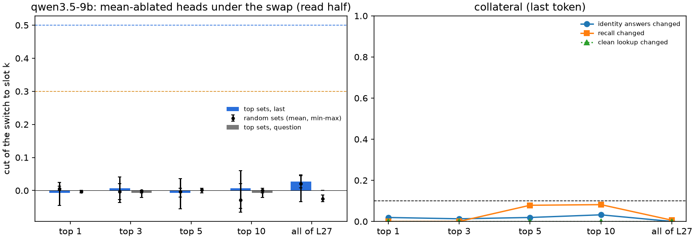
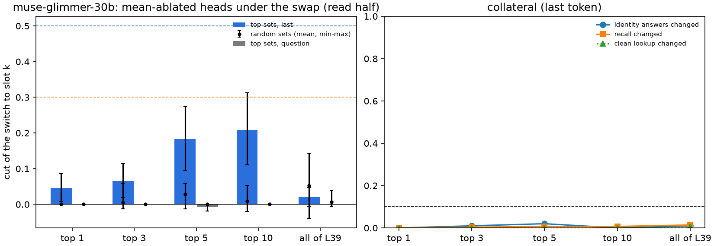
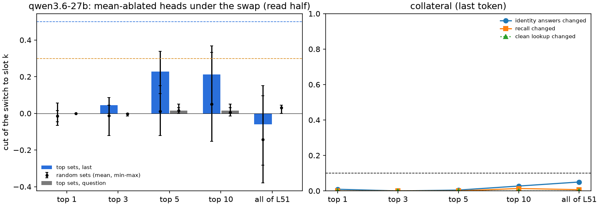

# 51.2: joint head ablation under the address swap

Batch 51, test 51.2 (jobs/c3/batch51.yaml; Q51.2, Dan: (b) · 50%; (c) · 35%; (a) · 15%). 49.7's items and swap (s = 2.0 (mu_k - mu_j) at the bridge word at L); heads ranked by their attention move at the last token on the fit half (49.7's stored attention), mean-ablated on the read half at the last token / the question tokens; random sets of the same size in the same layers (5 draws, seed 512). Decisive site last. Cluster bootstrap over bridge entities (10000, seed 0). UNVERIFIED.

Rules (fixed in advance):

- cut: cut = (switch - switch under the ablation) / switch, switch = the read-half swap pairs' share answering slot k's locker (the lookup's switch to the swapped-in slot), both read in this run (baseline and ablated).
- small_set: some top-k set, k in {1, 3, 5, 10}, cuts >= 0.5 while the identity answers (read pairs answering slot j's locker under the swap) change <= 0.10 and the recall's answer changes <= 0.10 (swap + ablation vs swap), and the matched random sets of k heads (same layers) cut <= 0.15 (mean over the draws).
- distributed: every head of the best layer together cuts < 0.3.
- label: 'small set' if small_set holds, else 'distributed' if distributed holds, else 'neither'; both flags shown.

## qwen3.5-9b (qwen35_9b_x51_2)

**distributed** (last token; small set at k = none; distributed: yes). Question tokens beside: distributed.

L = 12; heads at layers [15, 19, 23, 27, 31]; skipped (Gated DeltaNet) [13, 14, 16, 17, 18, 20, 21, 22, 24, 25, 26, 28, 29, 30]. Read items 165, read pairs 330; switch under the swap (this run, no ablation) 0.448. Best layer L27. Top 10 (fit move): L27:h1 1.29, L27:h13 1.26, L23:h15 1.00, L23:h0 0.99, L23:h9 0.90, L23:h7 0.85, L23:h12 0.84, L23:h4 0.82, L23:h14 0.79, L19:h12 0.75.

### last token (decisive)

| set | heads | switch: swap -> ablated | cut [CI] | identity changed (n) | recall changed | clean lookup / recall changed | random cut mean (SD; min-max) | random identity / recall |
|---|---|---|---|---|---|---|---|---|
| top1 | 1 | 0.448 -> 0.452 | -0.007 [-0.045, 0.025] | 0.019 (155) | 0.000 | 0.000 / 0.012 | 0.005 (0.005; 0.000-0.014) | 0.000 / 0.001 |
| top3 | 3 | 0.448 -> 0.445 | 0.007 [-0.036, 0.041] | 0.013 (155) | 0.000 | 0.000 / 0.006 | -0.003 (0.016; -0.027-0.020) | 0.001 / 0.004 |
| top5 | 5 | 0.448 -> 0.452 | -0.007 [-0.055, 0.036] | 0.019 (155) | 0.079 | 0.000 / 0.042 | -0.003 (0.010; -0.020-0.007) | 0.001 / 0.047 |
| top10 | 10 | 0.448 -> 0.445 | 0.007 [-0.065, 0.060] | 0.032 (155) | 0.082 | 0.000 / 0.055 | -0.028 (0.027; -0.054-0.020) | 0.015 / 0.112 |
| best_layer | 16 | 0.448 -> 0.436 | 0.027 [0.008, 0.044] | 0.000 (155) | 0.006 | 0.000 / 0.012 | 0.020 (0.032; -0.034-0.047) | 0.017 / 0.096 |

### question tokens

| set | heads | switch: swap -> ablated | cut [CI] | identity changed (n) | recall changed | clean lookup / recall changed | random cut mean (SD; min-max) | random identity / recall |
|---|---|---|---|---|---|---|---|---|
| top1 | 1 | 0.448 -> 0.448 | 0.000 [0.000, 0.000] | 0.000 (155) | 0.000 | 0.000 / 0.006 | -0.003 (0.003; -0.007-0.000) | 0.000 / 0.000 |
| top3 | 3 | 0.448 -> 0.452 | -0.007 [-0.021, 0.000] | 0.000 (155) | 0.003 | 0.000 / 0.012 | -0.001 (0.003; -0.007-0.000) | 0.000 / 0.000 |
| top5 | 5 | 0.448 -> 0.448 | 0.000 [0.000, 0.000] | 0.000 (155) | 0.003 | 0.000 / 0.012 | 0.001 (0.005; -0.007-0.007) | 0.000 / 0.002 |
| top10 | 10 | 0.448 -> 0.452 | -0.007 [-0.021, 0.000] | 0.000 (155) | 0.000 | 0.000 / 0.000 | 0.000 (0.004; -0.007-0.007) | 0.000 / 0.000 |
| best_layer | 16 | 0.448 -> 0.448 | 0.000 [0.000, 0.000] | 0.000 (155) | 0.000 | 0.000 / 0.000 | -0.024 (0.009; -0.034--0.014) | 0.061 / 0.105 |

CPU beside (49.7's stored forward; read pairs; summed move at the last token vs switched):

| heads summed | n (switched) | mean move switched / not | AUC [CI] | logistic b per SD (per unit), a |
|---|---|---|---|---|
| all_heads | 330 (148) | 18.058 / 4.902 | 0.964 [0.953, 0.974] | 3.906 (0.488), -0.953 |
| top10 | 330 (148) | 9.453 / 2.052 | 0.972 [0.963, 0.980] | 4.325 (0.981), -1.119 |

## muse-glimmer-30b (muse30_x51_2_r2)

**distributed** (last token; small set at k = none; distributed: yes). Question tokens beside: distributed.

L = 26; heads at layers [27, 28, 29, 30, 31, 32, 33, 34, 35, 36, 37, 38, 39, 40, 41, 42, 43, 44, 45, 46, 47, 48, 49, 50, 51]; skipped (Gated DeltaNet) none. Read items 142, read pairs 284; switch under the swap (this run, no ablation) 0.539. Best layer L39. Top 10 (fit move): L39:h1 1.71, L35:h25 1.58, L35:h21 1.36, L34:h20 1.32, L35:h17 1.18, L43:h4 0.97, L34:h21 0.68, L33:h25 0.66, L35:h31 0.61, L47:h25 0.59.

### last token (decisive)

| set | heads | switch: swap -> ablated | cut [CI] | identity changed (n) | recall changed | clean lookup / recall changed | random cut mean (SD; min-max) | random identity / recall |
|---|---|---|---|---|---|---|---|---|
| top1 | 1 | 0.539 -> 0.514 | 0.046 [0.007, 0.086] | 0.000 (100) | 0.000 | 0.000 / 0.000 | 0.000 (0.000; 0.000-0.000) | 0.000 / 0.000 |
| top3 | 3 | 0.539 -> 0.504 | 0.065 [0.020, 0.115] | 0.010 (100) | 0.004 | 0.000 / 0.000 | 0.005 (0.027; -0.013-0.059) | 0.016 / 0.004 |
| top5 | 5 | 0.539 -> 0.440 | 0.183 [0.095, 0.274] | 0.020 (100) | 0.007 | 0.000 / 0.000 | 0.029 (0.026; -0.013-0.059) | 0.010 / 0.004 |
| top10 | 10 | 0.539 -> 0.426 | 0.209 [0.111, 0.313] | 0.000 (100) | 0.007 | 0.000 / 0.000 | 0.009 (0.026; -0.020-0.052) | 0.020 / 0.015 |
| best_layer | 32 | 0.539 -> 0.528 | 0.020 [-0.007, 0.048] | 0.010 (100) | 0.014 | 0.007 / 0.007 | 0.052 (0.067; -0.039-0.144) | 0.028 / 0.017 |

### question tokens

| set | heads | switch: swap -> ablated | cut [CI] | identity changed (n) | recall changed | clean lookup / recall changed | random cut mean (SD; min-max) | random identity / recall |
|---|---|---|---|---|---|---|---|---|
| top1 | 1 | 0.539 -> 0.539 | 0.000 [0.000, 0.000] | 0.000 (100) | 0.000 | 0.000 / 0.000 | 0.000 (0.000; 0.000-0.000) | 0.000 / 0.000 |
| top3 | 3 | 0.539 -> 0.539 | 0.000 [0.000, 0.000] | 0.000 (100) | 0.000 | 0.000 / 0.000 | 0.000 (0.000; 0.000-0.000) | 0.000 / 0.000 |
| top5 | 5 | 0.539 -> 0.542 | -0.007 [-0.019, 0.000] | 0.010 (100) | 0.000 | 0.000 / 0.000 | 0.000 (0.000; 0.000-0.000) | 0.000 / 0.000 |
| top10 | 10 | 0.539 -> 0.539 | 0.000 [0.000, 0.000] | 0.000 (100) | 0.000 | 0.000 / 0.000 | 0.000 (0.000; 0.000-0.000) | 0.000 / 0.001 |
| best_layer | 32 | 0.539 -> 0.539 | 0.000 [0.000, 0.000] | 0.000 (100) | 0.000 | 0.000 / 0.000 | 0.007 (0.017; -0.007-0.039) | 0.012 / 0.005 |

CPU beside (49.7's stored forward; read pairs; summed move at the last token vs switched):

| heads summed | n (switched) | mean move switched / not | AUC [CI] | logistic b per SD (per unit), a |
|---|---|---|---|---|
| all_heads | 284 (149) | 23.794 / 8.080 | 0.867 [0.827, 0.907] | 1.843 (0.146), 0.223 |
| top10 | 284 (149) | 10.627 / 3.023 | 0.967 [0.952, 0.981] | 3.545 (0.762), -0.264 |

## qwen3.6-27b (x51_2_27b)

**distributed** (last token; small set at k = none; distributed: yes). Question tokens beside: distributed.

L = 32; heads at layers [35, 39, 43, 47, 51, 55, 59, 63]; skipped (Gated DeltaNet) [33, 34, 36, 37, 38, 40, 41, 42, 44, 45, 46, 48, 49, 50, 52, 53, 54, 56, 57, 58, 60, 61, 62]. Read items 150, read pairs 300; switch under the swap (this run, no ablation) 0.220. Best layer L51. Top 10 (fit move): L51:h20 1.35, L51:h22 1.22, L43:h17 1.15, L43:h14 1.08, L59:h21 1.05, L59:h3 1.05, L51:h23 1.00, L39:h2 0.79, L39:h23 0.56, L47:h1 0.54.

### last token (decisive)

| set | heads | switch: swap -> ablated | cut [CI] | identity changed (n) | recall changed | clean lookup / recall changed | random cut mean (SD; min-max) | random identity / recall |
|---|---|---|---|---|---|---|---|---|
| top1 | 1 | 0.220 -> 0.220 | 0.000 [-0.065, 0.056] | 0.009 (220) | 0.000 | 0.000 / 0.000 | -0.015 (0.025; -0.045-0.015) | 0.006 / 0.000 |
| top3 | 3 | 0.220 -> 0.210 | 0.045 [0.000, 0.085] | 0.000 (220) | 0.000 | 0.000 / 0.000 | -0.012 (0.064; -0.121-0.045) | 0.013 / 0.004 |
| top5 | 5 | 0.220 -> 0.170 | 0.227 [0.108, 0.338] | 0.005 (220) | 0.000 | 0.000 / 0.000 | 0.012 (0.089; -0.121-0.152) | 0.015 / 0.000 |
| top10 | 10 | 0.220 -> 0.173 | 0.212 [0.048, 0.368] | 0.027 (220) | 0.013 | 0.000 / 0.007 | 0.052 (0.157; -0.152-0.333) | 0.016 / 0.010 |
| best_layer | 24 | 0.220 -> 0.233 | -0.061 [-0.283, 0.095] | 0.050 (220) | 0.007 | 0.000 / 0.000 | -0.142 (0.170; -0.379-0.152) | 0.094 / 0.021 |

### question tokens

| set | heads | switch: swap -> ablated | cut [CI] | identity changed (n) | recall changed | clean lookup / recall changed | random cut mean (SD; min-max) | random identity / recall |
|---|---|---|---|---|---|---|---|---|
| top1 | 1 | 0.220 -> 0.220 | 0.000 [0.000, 0.000] | 0.000 (220) | 0.000 | 0.000 / 0.000 | 0.000 (0.000; 0.000-0.000) | 0.000 / 0.000 |
| top3 | 3 | 0.220 -> 0.220 | 0.000 [0.000, 0.000] | 0.000 (220) | 0.000 | 0.000 / 0.000 | -0.003 (0.006; -0.015-0.000) | 0.001 / 0.000 |
| top5 | 5 | 0.220 -> 0.217 | 0.015 [0.000, 0.050] | 0.000 (220) | 0.000 | 0.000 / 0.000 | 0.015 (0.010; 0.000-0.030) | 0.000 / 0.000 |
| top10 | 10 | 0.220 -> 0.217 | 0.015 [0.000, 0.050] | 0.000 (220) | 0.000 | 0.000 / 0.000 | 0.006 (0.015; -0.015-0.030) | 0.001 / 0.000 |
| best_layer | 24 | 0.220 -> 0.220 | 0.000 [0.000, 0.000] | 0.000 (220) | 0.000 | 0.000 / 0.000 | 0.030 (0.019; 0.000-0.045) | 0.003 / 0.003 |

CPU beside (49.7's stored forward; read pairs; summed move at the last token vs switched):

| heads summed | n (switched) | mean move switched / not | AUC [CI] | logistic b per SD (per unit), a |
|---|---|---|---|---|
| all_heads | 300 (66) | 22.640 / 6.724 | 0.925 [0.890, 0.954] | 2.273 (0.237), -2.316 |
| top10 | 300 (66) | 10.227 / 2.373 | 0.970 [0.951, 0.986] | 3.335 (0.802), -3.049 |

