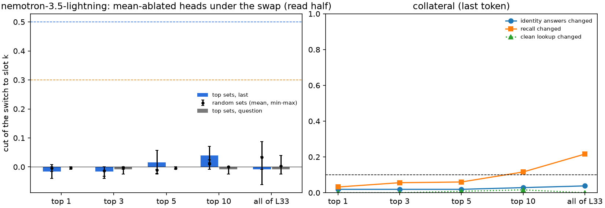

# 51.2: joint head ablation under the address swap

Batch 51, test 51.2 (jobs/c3/batch51.yaml; batch 52 coverage, no prediction: coverage run on an already-scored rule; rules first scored in results/x51_heads/x51_2-20261028T190358Z). 49.7's items and swap (s = 2.0 (mu_k - mu_j) at the bridge word at L); heads ranked by their attention move at the last token on the fit half (49.7's stored attention), mean-ablated on the read half at the last token / the question tokens; random sets of the same size in the same layers (5 draws, seed 512). Decisive site last. Cluster bootstrap over bridge entities (10000, seed 0). UNVERIFIED.

Rules (fixed in advance):

- cut: cut = (switch - switch under the ablation) / switch, switch = the read-half swap pairs' share answering slot k's locker (the lookup's switch to the swapped-in slot), both read in this run (baseline and ablated).
- small_set: some top-k set, k in {1, 3, 5, 10}, cuts >= 0.5 while the identity answers (read pairs answering slot j's locker under the swap) change <= 0.10 and the recall's answer changes <= 0.10 (swap + ablation vs swap), and the matched random sets of k heads (same layers) cut <= 0.15 (mean over the draws).
- distributed: every head of the best layer together cuts < 0.3.
- label: 'small set' if small_set holds, else 'distributed' if distributed holds, else 'neither'; both flags shown.

## nemotron-3.5-lightning (nem35l_x52_heads)

**distributed** (last token; small set at k = none; distributed: yes). Question tokens beside: distributed.

L = 14; heads at layers [19, 26, 33, 42]; skipped (Gated DeltaNet) [15, 16, 17, 18, 20, 21, 22, 23, 24, 25, 27, 28, 29, 30, 31, 32, 34, 35, 36, 37, 38, 39, 40, 41, 43, 44, 45, 46, 47, 48, 49, 50, 51]. Read items 125, read pairs 250; switch under the swap (this run, no ablation) 0.500. Best layer L33. Top 10 (fit move): L33:h7 1.76, L33:h0 1.34, L33:h5 1.32, L33:h19 1.04, L42:h12 0.93, L33:h13 0.90, L33:h22 0.85, L33:h15 0.81, L33:h18 0.76, L33:h1 0.74.

### last token (decisive)

| set | heads | switch: swap -> ablated | cut [CI] | identity changed (n) | recall changed | clean lookup / recall changed | random cut mean (SD; min-max) | random identity / recall |
|---|---|---|---|---|---|---|---|---|
| top1 | 1 | 0.500 -> 0.508 | -0.016 [-0.040, 0.000] | 0.019 (105) | 0.032 | 0.000 / 0.008 | -0.005 (0.011; -0.016-0.008) | 0.011 / 0.010 |
| top3 | 3 | 0.500 -> 0.508 | -0.016 [-0.040, 0.000] | 0.019 (105) | 0.056 | 0.000 / 0.008 | -0.013 (0.013; -0.032-0.000) | 0.015 / 0.025 |
| top5 | 5 | 0.500 -> 0.492 | 0.016 [-0.021, 0.057] | 0.019 (105) | 0.060 | 0.008 / 0.008 | -0.011 (0.006; -0.024--0.008) | 0.015 / 0.034 |
| top10 | 10 | 0.500 -> 0.480 | 0.040 [0.015, 0.071] | 0.029 (105) | 0.116 | 0.016 / 0.008 | 0.011 (0.012; -0.008-0.024) | 0.004 / 0.039 |
| best_layer | 32 | 0.500 -> 0.504 | -0.008 [-0.061, 0.035] | 0.038 (105) | 0.216 | 0.000 / 0.088 | 0.034 (0.042; -0.008-0.088) | 0.008 / 0.055 |

### question tokens

| set | heads | switch: swap -> ablated | cut [CI] | identity changed (n) | recall changed | clean lookup / recall changed | random cut mean (SD; min-max) | random identity / recall |
|---|---|---|---|---|---|---|---|---|
| top1 | 1 | 0.500 -> 0.500 | 0.000 [0.000, 0.000] | 0.000 (105) | 0.004 | 0.000 / 0.000 | -0.003 (0.004; -0.008-0.000) | 0.004 / 0.003 |
| top3 | 3 | 0.500 -> 0.504 | -0.008 [-0.025, 0.000] | 0.010 (105) | 0.004 | 0.000 / 0.000 | -0.002 (0.003; -0.008-0.000) | 0.002 / 0.002 |
| top5 | 5 | 0.500 -> 0.500 | 0.000 [0.000, 0.000] | 0.000 (105) | 0.004 | 0.000 / 0.000 | -0.005 (0.004; -0.008-0.000) | 0.006 / 0.002 |
| top10 | 10 | 0.500 -> 0.504 | -0.008 [-0.025, 0.000] | 0.010 (105) | 0.004 | 0.000 / 0.000 | 0.000 (0.000; 0.000-0.000) | 0.000 / 0.003 |
| best_layer | 32 | 0.500 -> 0.504 | -0.008 [-0.025, 0.000] | 0.010 (105) | 0.004 | 0.000 / 0.000 | 0.003 (0.021; -0.024-0.040) | 0.059 / 0.080 |

CPU beside (49.7's stored forward; read pairs; summed move at the last token vs switched):

| heads summed | n (switched) | mean move switched / not | AUC [CI] | logistic b per SD (per unit), a |
|---|---|---|---|---|
| all_heads | 250 (125) | 21.435 / 5.486 | 0.946 [0.909, 0.972] | 3.068 (0.305), -0.179 |
| top10 | 250 (125) | 10.796 / 2.270 | 0.972 [0.948, 0.988] | 4.190 (0.827), -0.405 |

