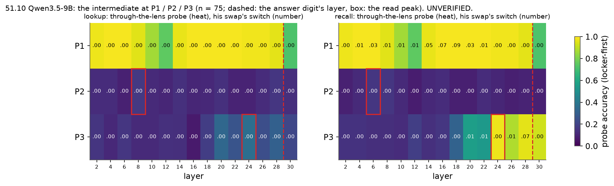
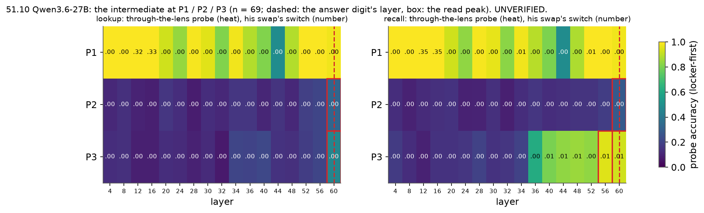
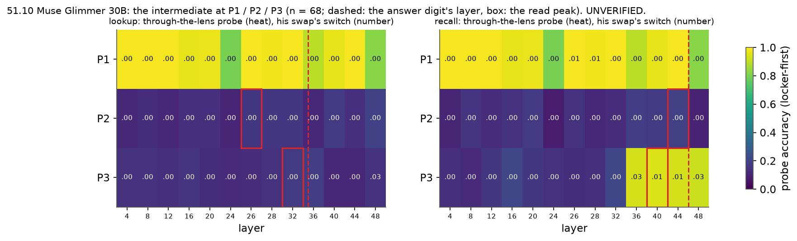

# 51.10: does the intermediate pass through J-space? Read / write per position, per reader

Batch 51, test 51.10 (jobs/c3/batch51.yaml addendum_2; Q51.10, Dan: - At the last token: (a) · 65%; (b) · 60%; (c) · 35%; (d) · 0%
- At the questions pick token: (a) · 60%; (b) · 55%; (c) · 40%; (d) · 0%). Main-test items, chat; read statistics on every item of the run, decided on 49.1's locker-first items (the write and remove arms' items); cluster bootstrap over the bridge items (10000, seed 0). UNVERIFIED.

Rules (fixed in advance):

- read: through-the-lens probe >= 0.8 and lens top-5 >= 0.5 at some layer before the answer digit's layer, while the full-residual probe >= 0.9 there.
- write: at the layer of the read peak, his swap or the J++ part of the change (gain <= 2) switches >= 0.5 of what the whole-state patch switches at that layer, with the random part <= 0.10.
- a: in J-space: read holds and write holds.
- b: readable, not used: read holds, write fails.
- c: routes around J-space: through-the-lens < 0.5 at every layer before the answer while the full residual >= 0.9 at some layer, and write fails.
- d: not represented: the full-residual probe < 0.5 at every layer before the answer.

As computed: the answer layer = per reader the lower median over the locker-first O prompts of the layer from which O's answer is the plain logit lens's top token at P3 through the last layer; 'before' = cached layers strictly below it; lens top-5 = the share of the locker-first O and S rows whose own bridge entity ranks <= 5 among the letter tokens by his lens logits; the probes' accuracy on the locker-first rows (O and S, out of fold, folds by scene); the read peak = the layer before the answer with the highest through-the-lens accuracy (ties: the earliest); write at the read peak (the best layer beside), the passing arm's own random twin <= 0.10; (d) before (a)-(c); P2 uses P3's answer layer. Point estimates decide (EPS 1e-9).

| model | reader | answer layer | P3 first readable | P3 peak: swap / whole | P3 label | P2 first readable | P2 peak: swap / whole | P2 label |
|---|---|---|---|---|---|---|---|---|
| qwen3.5-9b | lookup | answer L29 | None | L24: 0.00 / 0.68 | **(c) routes around J-space** | None | L8: 0.00 / 0.00 | **none of the four** |
| qwen3.5-9b | recall | answer L29 | 24 | L24: 0.00 / 0.95 | **(b) readable, not used** | None | L6: 0.00 / 0.00 | **(d) not represented at this position** |
| qwen3.6-27b | lookup | answer L61 | None | L60: 0.00 / 0.43 | **none of the four** | None | L60: 0.00 / 0.00 | **(c) routes around J-space** |
| qwen3.6-27b | recall | answer L61 | 56 | L56: 0.01 / 0.97 | **(b) readable, not used** | None | L60: 0.00 / 0.00 | **none of the four** |
| muse-glimmer-30b | lookup | answer L35 | None | L32: 0.00 / 0.88 | **none of the four** | None | L26: 0.00 / 0.00 | **(d) not represented at this position** |
| muse-glimmer-30b | recall | answer L46 | 36 | L40: 0.01 / 1.00 | **(b) readable, not used** | None | L44: 0.00 / 0.00 | **none of the four** |

## qwen3.5-9b (qwen35_9b_x51_10, L12, n = 75 locker-first of 200 read)

### lookup: answer layer L29 (quartiles [28.0, 29.0, 30.0]; never settled 0 of 75; S's prompts L29)

- P3: **(c) routes around J-space**; read False, write False (with his rotated control as the swap's twin: False), peak L24, first readable None (before the answer: None); at the peak {"whole": 0.68, "arms": {"swap": {"switch": 0.0, "twin": 0.0, "ratio": 0.0, "ok": false}, "jpp1": {"switch": 0.0, "twin": 0.0, "ratio": 0.0, "ok": false}, "jpp2": {"switch": 0.02666666666666667, "twin": 0.0, "ratio": 0.0392156862745098, "ok": false}}, "holds": false}; best layer L28 {"whole": 0.84, "arms": {"swap": {"switch": 0.0, "twin": 0.0, "ratio": 0.0, "ok": false}, "jpp1": {"switch": 0.0, "twin": 0.0, "ratio": 0.0, "ok": false}, "jpp2": {"switch": 0.09333333333333334, "twin": 0.0, "ratio": 0.11111111111111112, "ok": false}}, "holds": false}
- P2: **none of the four**; read False, write False (with his rotated control as the swap's twin: False), peak L8, first readable None (before the answer: None); at the peak {"whole": 0.0, "arms": {"swap": {"switch": 0.0, "twin": 0.0, "ratio": null, "ok": false}, "jpp1": {"switch": 0.0, "twin": 0.0, "ratio": null, "ok": false}, "jpp2": {"switch": 0.0, "twin": 0.0, "ratio": null, "ok": false}}, "holds": false}; best layer L2 {"whole": 0.0, "arms": {"swap": {"switch": 0.0, "twin": 0.0, "ratio": null, "ok": false}, "jpp1": {"switch": 0.0, "twin": 0.0, "ratio": null, "ok": false}, "jpp2": {"switch": 0.0, "twin": 0.0, "ratio": null, "ok": false}}, "holds": false}

| pos | layer | thru | full | out | chance | top1 | top5 | other top5 | swap | swap_rand | swap_rot | jpp1 | rand1 | jpp2 | rand2 | whole | loss swap / whole |
|---|---|---|---|---|---|---|---|---|---|---|---|---|---|---|---|---|---|
| P1 | 2 | 0.97 [0.94, 0.99] | 0.99 [0.96, 1.00] | 0.99 [0.96, 1.00] | 0.09 | 0.58 | 0.84 | 0.00 | 0.00 | 0.00 | 0.00 | 0.60 | 0.00 | 0.93 | 0.31 | 1.00 | 0.13 / 0.17 |
| P1 | 4 | 0.99 [0.96, 1.00] | 0.99 [0.96, 1.00] | 0.99 [0.96, 1.00] | 0.09 | 0.86 | 0.95 | 0.00 | 0.00 | 0.00 | 0.00 | 0.95 | 0.00 | 0.96 | 0.32 | 1.00 | 0.13 / 0.16 |
| P1 | 6 | 0.99 [0.96, 1.00] | 0.98 [0.95, 1.00] | 0.99 [0.96, 1.00] | 0.09 | 0.73 | 0.93 | 0.00 | 0.00 | 0.00 | 0.00 | 0.88 | 0.08 | 0.97 | 0.93 | 1.00 | 0.14 / 0.16 |
| P1 | 8 | 0.95 [0.92, 0.98] | 0.97 [0.93, 0.99] | 0.97 [0.94, 0.99] | 0.09 | 0.37 | 0.77 | 0.00 | 0.00 | 0.00 | 0.00 | 0.08 | 0.00 | 0.85 | 0.65 | 1.00 | 0.14 / 0.16 |
| P1 | 10 | 0.86 [0.80, 0.91] | 0.94 [0.90, 0.97] | 0.96 [0.92, 0.99] | 0.09 | 0.06 | 0.51 | 0.00 | 0.00 | 0.00 | 0.00 | 0.01 | 0.00 | 0.63 | 0.55 | 1.00 | 0.13 / 0.16 |
| P1 | 12 | 0.75 [0.66, 0.84] | 0.94 [0.90, 0.97] | 0.95 [0.91, 0.98] | 0.09 | 0.01 | 0.30 | 0.00 | 0.00 | 0.00 | 0.00 | 0.00 | 0.00 | 0.03 | 0.20 | 0.96 | 0.13 / 0.16 |
| P1 | 14 | 0.97 [0.93, 0.99] | 0.92 [0.86, 0.97] | 0.95 [0.91, 0.98] | 0.09 | 0.32 | 0.84 | 0.00 | 0.00 | 0.00 | 0.00 | 0.00 | 0.00 | 0.00 | 0.05 | 0.93 | 0.13 / 0.16 |
| P1 | 16 | 0.99 [0.96, 1.00] | 0.91 [0.85, 0.96] | 0.94 [0.89, 0.98] | 0.09 | 0.27 | 0.91 | 0.00 | 0.00 | 0.00 | 0.00 | 0.00 | 0.00 | 0.00 | 0.03 | 0.52 | 0.12 / 0.16 |
| P1 | 18 | 0.99 [0.96, 1.00] | 0.97 [0.93, 0.99] | 0.98 [0.95, 1.00] | 0.09 | 0.33 | 0.89 | 0.00 | 0.00 | 0.00 | 0.00 | 0.00 | 0.00 | 0.00 | 0.07 | 0.11 | 0.13 / 0.16 |
| P1 | 20 | 0.99 [0.96, 1.00] | 0.99 [0.98, 1.00] | 0.99 [0.98, 1.00] | 0.09 | 0.41 | 0.97 | 0.00 | 0.00 | 0.00 | 0.00 | 0.00 | 0.00 | 0.00 | 0.00 | 0.00 | 0.12 / 0.16 |
| P1 | 22 | 0.99 [0.96, 1.00] | 0.99 [0.98, 1.00] | 0.99 [0.98, 1.00] | 0.09 | 0.27 | 0.96 | 0.00 | 0.00 | 0.00 | 0.00 | 0.00 | 0.00 | 0.00 | 0.00 | 0.00 | 0.14 / 0.16 |
| P1 | 24 | 0.98 [0.95, 1.00] | 0.99 [0.96, 1.00] | 0.99 [0.96, 1.00] | 0.09 | 0.27 | 0.99 | 0.00 | 0.00 | 0.00 | 0.00 | 0.00 | 0.00 | 0.00 | 0.00 | 0.00 | 0.14 / 0.16 |
| P1 | 26 | 0.98 [0.95, 1.00] | 0.99 [0.96, 1.00] | 0.99 [0.96, 1.00] | 0.09 | 0.25 | 0.97 | 0.00 | 0.00 | 0.00 | 0.00 | 0.00 | 0.00 | 0.00 | 0.00 | 0.00 | 0.15 / 0.16 |
| P1 | 28 | 0.96 [0.93, 0.99] | 0.99 [0.96, 1.00] | 0.99 [0.96, 1.00] | 0.09 | 0.74 | 0.88 | 0.14 | 0.00 | 0.00 | 0.00 | 0.00 | 0.00 | 0.00 | 0.00 | 0.00 | 0.14 / 0.16 |
| P1 | 30 | 0.72 [0.64, 0.79] | 0.99 [0.96, 1.00] | 0.99 [0.96, 1.00] | 0.09 | 0.13 | 0.43 | 0.04 | 0.00 | 0.00 | 0.00 | 0.00 | 0.00 | 0.00 | 0.00 | 0.00 | 0.15 / 0.16 |
| P2 | 2 | 0.13 [0.06, 0.19] | 0.24 [0.18, 0.29] | 0.23 [0.17, 0.29] | 0.09 | 0.00 | 0.00 | 0.00 | 0.00 | 0.00 | 0.00 | 0.00 | 0.00 | 0.00 | 0.00 | 0.00 | 0.34 / 0.34 |
| P2 | 4 | 0.13 [0.07, 0.18] | 0.27 [0.20, 0.35] | 0.27 [0.21, 0.33] | 0.09 | 0.00 | 0.00 | 0.00 | 0.00 | 0.00 | 0.00 | 0.00 | 0.00 | 0.00 | 0.00 | 0.00 | 0.34 / 0.34 |
| P2 | 6 | 0.09 [0.05, 0.15] | 0.27 [0.19, 0.34] | 0.24 [0.17, 0.31] | 0.09 | 0.00 | 0.00 | 0.00 | 0.00 | 0.00 | 0.00 | 0.00 | 0.00 | 0.00 | 0.00 | 0.00 | 0.34 / 0.34 |
| P2 | 8 | 0.17 [0.11, 0.23] | 0.21 [0.15, 0.28] | 0.22 [0.16, 0.28] | 0.09 | 0.00 | 0.00 | 0.00 | 0.00 | 0.00 | 0.00 | 0.00 | 0.00 | 0.00 | 0.00 | 0.00 | 0.34 / 0.34 |
| P2 | 10 | 0.12 [0.07, 0.17] | 0.33 [0.24, 0.42] | 0.33 [0.23, 0.42] | 0.09 | 0.00 | 0.00 | 0.00 | 0.00 | 0.00 | 0.00 | 0.00 | 0.00 | 0.00 | 0.00 | 0.00 | 0.34 / 0.34 |
| P2 | 12 | 0.11 [0.06, 0.16] | 0.26 [0.18, 0.34] | 0.26 [0.18, 0.34] | 0.09 | 0.00 | 0.00 | 0.00 | 0.00 | 0.00 | 0.00 | 0.00 | 0.00 | 0.00 | 0.00 | 0.00 | 0.34 / 0.34 |
| P2 | 14 | 0.14 [0.08, 0.20] | 0.31 [0.21, 0.41] | 0.32 [0.22, 0.42] | 0.09 | 0.00 | 0.00 | 0.00 | 0.00 | 0.00 | 0.00 | 0.00 | 0.00 | 0.00 | 0.00 | 0.00 | 0.35 / 0.34 |
| P2 | 16 | 0.11 [0.05, 0.16] | 0.29 [0.20, 0.40] | 0.27 [0.17, 0.36] | 0.09 | 0.00 | 0.00 | 0.00 | 0.00 | 0.00 | 0.00 | 0.00 | 0.00 | 0.00 | 0.00 | 0.00 | 0.34 / 0.34 |
| P2 | 18 | 0.11 [0.06, 0.17] | 0.36 [0.25, 0.47] | 0.34 [0.22, 0.45] | 0.09 | 0.00 | 0.00 | 0.00 | 0.00 | 0.00 | 0.00 | 0.00 | 0.00 | 0.00 | 0.00 | 0.00 | 0.34 / 0.34 |
| P2 | 20 | 0.14 [0.09, 0.20] | 0.44 [0.30, 0.57] | 0.44 [0.32, 0.56] | 0.09 | 0.00 | 0.00 | 0.00 | 0.00 | 0.00 | 0.00 | 0.00 | 0.00 | 0.00 | 0.00 | 0.00 | 0.34 / 0.34 |
| P2 | 22 | 0.10 [0.04, 0.17] | 0.44 [0.30, 0.57] | 0.45 [0.32, 0.57] | 0.09 | 0.00 | 0.00 | 0.00 | 0.00 | 0.00 | 0.00 | 0.00 | 0.00 | 0.00 | 0.00 | 0.00 | 0.35 / 0.34 |
| P2 | 24 | 0.10 [0.05, 0.14] | 0.61 [0.51, 0.70] | 0.58 [0.46, 0.69] | 0.09 | 0.00 | 0.00 | 0.00 | 0.00 | 0.00 | 0.00 | 0.00 | 0.00 | 0.00 | 0.00 | 0.00 | 0.34 / 0.34 |
| P2 | 26 | 0.13 [0.08, 0.18] | 0.59 [0.47, 0.69] | 0.59 [0.47, 0.70] | 0.09 | 0.00 | 0.00 | 0.00 | 0.00 | 0.00 | 0.00 | 0.00 | 0.00 | 0.00 | 0.00 | 0.00 | 0.34 / 0.34 |
| P2 | 28 | 0.16 [0.09, 0.24] | 0.66 [0.55, 0.76] | 0.58 [0.47, 0.68] | 0.09 | 0.01 | 0.03 | 0.01 | 0.00 | 0.00 | 0.00 | 0.00 | 0.00 | 0.00 | 0.00 | 0.00 | 0.35 / 0.34 |
| P2 | 30 | 0.13 [0.07, 0.20] | 0.65 [0.54, 0.75] | 0.59 [0.47, 0.70] | 0.09 | 0.00 | 0.03 | 0.02 | 0.00 | 0.00 | 0.00 | 0.00 | 0.00 | 0.00 | 0.00 | 0.00 | 0.34 / 0.34 |
| P3 | 2 | 0.15 [0.08, 0.22] | 0.27 [0.19, 0.34] | 0.28 [0.21, 0.36] | 0.09 | 0.00 | 0.00 | 0.00 | 0.00 | 0.00 | 0.00 | 0.00 | 0.00 | 0.00 | 0.00 | 0.00 | - |
| P3 | 4 | 0.11 [0.06, 0.17] | 0.23 [0.18, 0.29] | 0.21 [0.14, 0.28] | 0.09 | 0.00 | 0.00 | 0.00 | 0.00 | 0.00 | 0.00 | 0.00 | 0.00 | 0.00 | 0.00 | 0.00 | - |
| P3 | 6 | 0.16 [0.09, 0.23] | 0.23 [0.15, 0.32] | 0.21 [0.15, 0.27] | 0.09 | 0.00 | 0.00 | 0.00 | 0.00 | 0.00 | 0.00 | 0.00 | 0.00 | 0.00 | 0.00 | 0.00 | - |
| P3 | 8 | 0.12 [0.07, 0.17] | 0.17 [0.10, 0.25] | 0.19 [0.12, 0.27] | 0.09 | 0.00 | 0.00 | 0.00 | 0.00 | 0.00 | 0.00 | 0.00 | 0.00 | 0.00 | 0.00 | 0.00 | - |
| P3 | 10 | 0.12 [0.06, 0.18] | 0.21 [0.15, 0.28] | 0.19 [0.14, 0.24] | 0.09 | 0.00 | 0.00 | 0.00 | 0.00 | 0.00 | 0.00 | 0.00 | 0.00 | 0.00 | 0.00 | 0.00 | - |
| P3 | 12 | 0.14 [0.08, 0.20] | 0.15 [0.08, 0.22] | 0.17 [0.11, 0.25] | 0.09 | 0.00 | 0.00 | 0.00 | 0.00 | 0.00 | 0.00 | 0.00 | 0.00 | 0.00 | 0.00 | 0.00 | - |
| P3 | 14 | 0.13 [0.07, 0.21] | 0.21 [0.12, 0.29] | 0.21 [0.12, 0.30] | 0.09 | 0.00 | 0.00 | 0.00 | 0.00 | 0.00 | 0.00 | 0.00 | 0.00 | 0.00 | 0.00 | 0.00 | - |
| P3 | 16 | 0.07 [0.03, 0.12] | 0.26 [0.17, 0.34] | 0.26 [0.17, 0.35] | 0.09 | 0.00 | 0.00 | 0.00 | 0.00 | 0.00 | 0.00 | 0.00 | 0.00 | 0.00 | 0.00 | 0.00 | - |
| P3 | 18 | 0.18 [0.09, 0.28] | 0.56 [0.44, 0.68] | 0.57 [0.46, 0.68] | 0.09 | 0.00 | 0.00 | 0.00 | 0.00 | 0.00 | 0.00 | 0.00 | 0.00 | 0.00 | 0.00 | 0.31 | - |
| P3 | 20 | 0.33 [0.20, 0.46] | 0.84 [0.77, 0.90] | 0.83 [0.76, 0.89] | 0.09 | 0.03 | 0.08 | 0.01 | 0.00 | 0.00 | 0.00 | 0.00 | 0.00 | 0.00 | 0.00 | 0.52 | - |
| P3 | 22 | 0.26 [0.16, 0.35] | 0.84 [0.78, 0.90] | 0.81 [0.73, 0.87] | 0.09 | 0.01 | 0.05 | 0.00 | 0.00 | 0.00 | 0.00 | 0.00 | 0.00 | 0.00 | 0.00 | 0.56 | - |
| P3 | 24 | 0.36 [0.23, 0.48] | 0.90 [0.84, 0.95] | 0.85 [0.78, 0.92] | 0.09 | 0.02 | 0.13 | 0.00 | 0.00 | 0.00 | 0.00 | 0.00 | 0.00 | 0.03 | 0.00 | 0.68 | - |
| P3 | 26 | 0.24 [0.15, 0.32] | 0.89 [0.82, 0.94] | 0.87 [0.80, 0.93] | 0.09 | 0.00 | 0.03 | 0.00 | 0.00 | 0.00 | 0.00 | 0.00 | 0.00 | 0.03 | 0.00 | 0.72 | - |
| P3 | 28 | 0.31 [0.22, 0.39] | 0.93 [0.88, 0.97] | 0.91 [0.85, 0.95] | 0.09 | 0.04 | 0.12 | 0.00 | 0.00 | 0.00 | 0.00 | 0.00 | 0.00 | 0.09 | 0.00 | 0.84 | - |
| P3 | 30 | 0.21 [0.14, 0.28] | 0.93 [0.88, 0.97] | 0.90 [0.84, 0.95] | 0.09 | 0.00 | 0.01 | 0.00 | 0.00 | 0.00 | 0.00 | 0.00 | 0.00 | 0.01 | 0.01 | 1.00 | - |
### recall: answer layer L29 (quartiles [29.0, 29.0, 29.0]; never settled 0 of 75; S's prompts L29)

- P3: **(b) readable, not used**; read True, write False (with his rotated control as the swap's twin: False), peak L24, first readable 24 (before the answer: 24); at the peak {"whole": 0.9466666666666667, "arms": {"swap": {"switch": 0.0, "twin": 0.0, "ratio": 0.0, "ok": false}, "jpp1": {"switch": 0.02666666666666667, "twin": 0.0, "ratio": 0.028169014084507043, "ok": false}, "jpp2": {"switch": 0.14666666666666667, "twin": 0.04, "ratio": 0.15492957746478875, "ok": false}}, "holds": false}; best layer L28 {"whole": 0.9466666666666667, "arms": {"swap": {"switch": 0.06666666666666667, "twin": 0.0, "ratio": 0.07042253521126761, "ok": false}, "jpp1": {"switch": 0.14666666666666667, "twin": 0.013333333333333334, "ratio": 0.15492957746478875, "ok": false}, "jpp2": {"switch": 0.6, "twin": 0.013333333333333334, "ratio": 0.6338028169014084, "ok": true}}, "holds": true}
- P2: **(d) not represented at this position**; read False, write False (with his rotated control as the swap's twin: False), peak L6, first readable None (before the answer: None); at the peak {"whole": 0.0, "arms": {"swap": {"switch": 0.0, "twin": 0.0, "ratio": null, "ok": false}, "jpp1": {"switch": 0.0, "twin": 0.0, "ratio": null, "ok": false}, "jpp2": {"switch": 0.0, "twin": 0.0, "ratio": null, "ok": false}}, "holds": false}; best layer L2 {"whole": 0.0, "arms": {"swap": {"switch": 0.0, "twin": 0.0, "ratio": null, "ok": false}, "jpp1": {"switch": 0.0, "twin": 0.0, "ratio": null, "ok": false}, "jpp2": {"switch": 0.0, "twin": 0.0, "ratio": null, "ok": false}}, "holds": false}

| pos | layer | thru | full | out | chance | top1 | top5 | other top5 | swap | swap_rand | swap_rot | jpp1 | rand1 | jpp2 | rand2 | whole | loss swap / whole |
|---|---|---|---|---|---|---|---|---|---|---|---|---|---|---|---|---|---|
| P1 | 2 | 0.97 [0.94, 0.99] | 0.99 [0.96, 1.00] | 0.99 [0.96, 1.00] | 0.09 | 0.58 | 0.84 | 0.00 | 0.00 | 0.00 | 0.00 | 0.69 | 0.00 | 0.99 | 0.44 | 1.00 | 0.13 / 0.17 |
| P1 | 4 | 0.99 [0.96, 1.00] | 0.99 [0.96, 1.00] | 0.99 [0.96, 1.00] | 0.09 | 0.86 | 0.95 | 0.00 | 0.01 | 0.00 | 0.00 | 0.96 | 0.00 | 1.00 | 0.41 | 1.00 | 0.13 / 0.16 |
| P1 | 6 | 0.99 [0.96, 1.00] | 0.98 [0.95, 1.00] | 0.99 [0.96, 1.00] | 0.09 | 0.73 | 0.93 | 0.00 | 0.03 | 0.00 | 0.00 | 0.92 | 0.08 | 1.00 | 0.99 | 1.00 | 0.14 / 0.16 |
| P1 | 8 | 0.95 [0.92, 0.98] | 0.97 [0.93, 0.99] | 0.97 [0.94, 0.99] | 0.09 | 0.37 | 0.77 | 0.00 | 0.01 | 0.00 | 0.00 | 0.41 | 0.01 | 0.99 | 0.77 | 1.00 | 0.14 / 0.16 |
| P1 | 10 | 0.86 [0.80, 0.91] | 0.94 [0.90, 0.97] | 0.96 [0.92, 0.99] | 0.09 | 0.06 | 0.51 | 0.00 | 0.01 | 0.00 | 0.00 | 0.33 | 0.01 | 0.92 | 0.77 | 0.99 | 0.13 / 0.16 |
| P1 | 12 | 0.75 [0.66, 0.84] | 0.94 [0.90, 0.97] | 0.95 [0.91, 0.98] | 0.09 | 0.01 | 0.30 | 0.00 | 0.01 | 0.00 | 0.00 | 0.15 | 0.01 | 0.53 | 0.24 | 1.00 | 0.13 / 0.16 |
| P1 | 14 | 0.97 [0.93, 0.99] | 0.92 [0.86, 0.97] | 0.95 [0.91, 0.98] | 0.09 | 0.32 | 0.84 | 0.00 | 0.05 | 0.00 | 0.00 | 0.19 | 0.01 | 0.49 | 0.19 | 0.97 | 0.13 / 0.16 |
| P1 | 16 | 0.99 [0.96, 1.00] | 0.91 [0.85, 0.96] | 0.94 [0.89, 0.98] | 0.09 | 0.27 | 0.91 | 0.00 | 0.07 | 0.00 | 0.00 | 0.21 | 0.03 | 0.36 | 0.09 | 0.31 | 0.12 / 0.16 |
| P1 | 18 | 0.99 [0.96, 1.00] | 0.97 [0.93, 0.99] | 0.98 [0.95, 1.00] | 0.09 | 0.33 | 0.89 | 0.00 | 0.09 | 0.00 | 0.01 | 0.15 | 0.04 | 0.31 | 0.13 | 0.16 | 0.13 / 0.16 |
| P1 | 20 | 0.99 [0.96, 1.00] | 0.99 [0.98, 1.00] | 0.99 [0.98, 1.00] | 0.09 | 0.41 | 0.97 | 0.00 | 0.03 | 0.00 | 0.00 | 0.03 | 0.00 | 0.08 | 0.01 | 0.01 | 0.12 / 0.16 |
| P1 | 22 | 0.99 [0.96, 1.00] | 0.99 [0.98, 1.00] | 0.99 [0.98, 1.00] | 0.09 | 0.27 | 0.96 | 0.00 | 0.01 | 0.00 | 0.00 | 0.03 | 0.00 | 0.04 | 0.00 | 0.00 | 0.14 / 0.16 |
| P1 | 24 | 0.98 [0.95, 1.00] | 0.99 [0.96, 1.00] | 0.99 [0.96, 1.00] | 0.09 | 0.27 | 0.99 | 0.00 | 0.00 | 0.00 | 0.00 | 0.00 | 0.00 | 0.00 | 0.00 | 0.00 | 0.14 / 0.16 |
| P1 | 26 | 0.98 [0.95, 1.00] | 0.99 [0.96, 1.00] | 0.99 [0.96, 1.00] | 0.09 | 0.25 | 0.97 | 0.00 | 0.00 | 0.00 | 0.00 | 0.00 | 0.00 | 0.00 | 0.00 | 0.00 | 0.15 / 0.16 |
| P1 | 28 | 0.96 [0.93, 0.99] | 0.99 [0.96, 1.00] | 0.99 [0.96, 1.00] | 0.09 | 0.74 | 0.88 | 0.14 | 0.00 | 0.00 | 0.00 | 0.00 | 0.00 | 0.00 | 0.00 | 0.00 | 0.14 / 0.16 |
| P1 | 30 | 0.72 [0.64, 0.79] | 0.99 [0.96, 1.00] | 0.99 [0.96, 1.00] | 0.09 | 0.13 | 0.43 | 0.04 | 0.00 | 0.00 | 0.00 | 0.00 | 0.00 | 0.00 | 0.00 | 0.00 | 0.15 / 0.16 |
| P2 | 2 | 0.09 [0.04, 0.15] | 0.23 [0.16, 0.29] | 0.17 [0.11, 0.24] | 0.09 | 0.00 | 0.00 | 0.00 | 0.00 | 0.00 | 0.00 | 0.00 | 0.00 | 0.00 | 0.00 | 0.00 | 1.09 / 1.09 |
| P2 | 4 | 0.12 [0.06, 0.18] | 0.31 [0.24, 0.39] | 0.27 [0.19, 0.34] | 0.09 | 0.00 | 0.00 | 0.00 | 0.00 | 0.00 | 0.00 | 0.00 | 0.00 | 0.00 | 0.00 | 0.00 | 1.09 / 1.09 |
| P2 | 6 | 0.16 [0.10, 0.23] | 0.19 [0.13, 0.26] | 0.19 [0.12, 0.25] | 0.09 | 0.00 | 0.00 | 0.00 | 0.00 | 0.00 | 0.00 | 0.00 | 0.00 | 0.00 | 0.00 | 0.00 | 1.09 / 1.09 |
| P2 | 8 | 0.16 [0.09, 0.24] | 0.19 [0.12, 0.27] | 0.21 [0.14, 0.28] | 0.09 | 0.00 | 0.00 | 0.00 | 0.00 | 0.00 | 0.00 | 0.00 | 0.00 | 0.00 | 0.00 | 0.00 | 1.09 / 1.09 |
| P2 | 10 | 0.12 [0.07, 0.17] | 0.34 [0.25, 0.42] | 0.35 [0.26, 0.44] | 0.09 | 0.00 | 0.00 | 0.00 | 0.00 | 0.00 | 0.00 | 0.00 | 0.00 | 0.00 | 0.00 | 0.00 | 1.09 / 1.09 |
| P2 | 12 | 0.08 [0.03, 0.14] | 0.27 [0.20, 0.34] | 0.25 [0.18, 0.31] | 0.09 | 0.00 | 0.00 | 0.00 | 0.00 | 0.00 | 0.00 | 0.00 | 0.00 | 0.00 | 0.00 | 0.00 | 1.09 / 1.09 |
| P2 | 14 | 0.11 [0.05, 0.18] | 0.33 [0.24, 0.43] | 0.31 [0.23, 0.39] | 0.09 | 0.00 | 0.00 | 0.00 | 0.00 | 0.00 | 0.00 | 0.00 | 0.00 | 0.00 | 0.00 | 0.00 | 1.09 / 1.09 |
| P2 | 16 | 0.13 [0.06, 0.20] | 0.29 [0.20, 0.38] | 0.25 [0.17, 0.33] | 0.09 | 0.00 | 0.00 | 0.00 | 0.00 | 0.00 | 0.00 | 0.00 | 0.00 | 0.00 | 0.00 | 0.00 | 1.09 / 1.08 |
| P2 | 18 | 0.09 [0.05, 0.13] | 0.35 [0.25, 0.43] | 0.35 [0.25, 0.44] | 0.09 | 0.00 | 0.00 | 0.00 | 0.00 | 0.00 | 0.00 | 0.00 | 0.00 | 0.00 | 0.00 | 0.00 | 1.09 / 1.08 |
| P2 | 20 | 0.09 [0.04, 0.13] | 0.41 [0.28, 0.54] | 0.40 [0.27, 0.52] | 0.09 | 0.00 | 0.00 | 0.00 | 0.00 | 0.00 | 0.00 | 0.00 | 0.00 | 0.00 | 0.00 | 0.00 | 1.09 / 1.08 |
| P2 | 22 | 0.13 [0.07, 0.18] | 0.39 [0.28, 0.49] | 0.38 [0.27, 0.48] | 0.09 | 0.00 | 0.00 | 0.00 | 0.00 | 0.00 | 0.00 | 0.00 | 0.00 | 0.00 | 0.00 | 0.00 | 1.09 / 1.07 |
| P2 | 24 | 0.11 [0.04, 0.18] | 0.45 [0.33, 0.57] | 0.45 [0.33, 0.56] | 0.09 | 0.00 | 0.00 | 0.00 | 0.00 | 0.00 | 0.00 | 0.00 | 0.00 | 0.00 | 0.00 | 0.00 | 1.09 / 1.07 |
| P2 | 26 | 0.09 [0.04, 0.14] | 0.41 [0.31, 0.51] | 0.43 [0.31, 0.54] | 0.09 | 0.00 | 0.00 | 0.00 | 0.00 | 0.00 | 0.00 | 0.00 | 0.00 | 0.00 | 0.00 | 0.00 | 1.09 / 1.07 |
| P2 | 28 | 0.10 [0.06, 0.15] | 0.43 [0.31, 0.55] | 0.41 [0.29, 0.52] | 0.09 | 0.00 | 0.00 | 0.00 | 0.00 | 0.00 | 0.00 | 0.00 | 0.00 | 0.00 | 0.00 | 0.00 | 1.13 / 1.07 |
| P2 | 30 | 0.09 [0.04, 0.15] | 0.46 [0.34, 0.57] | 0.47 [0.36, 0.57] | 0.09 | 0.00 | 0.00 | 0.00 | 0.00 | 0.00 | 0.00 | 0.00 | 0.00 | 0.00 | 0.00 | 0.00 | 1.13 / 1.08 |
| P3 | 2 | 0.15 [0.08, 0.22] | 0.26 [0.19, 0.33] | 0.28 [0.21, 0.36] | 0.09 | 0.00 | 0.00 | 0.00 | 0.00 | 0.00 | 0.00 | 0.00 | 0.00 | 0.00 | 0.00 | 0.00 | - |
| P3 | 4 | 0.15 [0.09, 0.21] | 0.23 [0.16, 0.30] | 0.25 [0.18, 0.33] | 0.09 | 0.00 | 0.00 | 0.00 | 0.00 | 0.00 | 0.00 | 0.00 | 0.00 | 0.00 | 0.00 | 0.00 | - |
| P3 | 6 | 0.13 [0.07, 0.20] | 0.24 [0.17, 0.30] | 0.21 [0.15, 0.27] | 0.09 | 0.00 | 0.00 | 0.00 | 0.00 | 0.00 | 0.00 | 0.00 | 0.00 | 0.00 | 0.00 | 0.00 | - |
| P3 | 8 | 0.13 [0.08, 0.20] | 0.21 [0.16, 0.26] | 0.19 [0.14, 0.23] | 0.09 | 0.00 | 0.00 | 0.00 | 0.00 | 0.00 | 0.00 | 0.00 | 0.00 | 0.00 | 0.00 | 0.00 | - |
| P3 | 10 | 0.13 [0.08, 0.17] | 0.35 [0.24, 0.45] | 0.33 [0.23, 0.44] | 0.09 | 0.00 | 0.00 | 0.00 | 0.00 | 0.00 | 0.00 | 0.00 | 0.00 | 0.00 | 0.00 | 0.00 | - |
| P3 | 12 | 0.19 [0.10, 0.27] | 0.31 [0.16, 0.45] | 0.35 [0.21, 0.49] | 0.09 | 0.00 | 0.00 | 0.00 | 0.00 | 0.00 | 0.00 | 0.00 | 0.00 | 0.00 | 0.00 | 0.00 | - |
| P3 | 14 | 0.14 [0.07, 0.21] | 0.39 [0.25, 0.52] | 0.38 [0.25, 0.51] | 0.09 | 0.00 | 0.00 | 0.00 | 0.00 | 0.00 | 0.00 | 0.00 | 0.00 | 0.00 | 0.00 | 0.00 | - |
| P3 | 16 | 0.16 [0.07, 0.26] | 0.41 [0.27, 0.54] | 0.41 [0.27, 0.55] | 0.09 | 0.00 | 0.00 | 0.00 | 0.00 | 0.00 | 0.00 | 0.00 | 0.00 | 0.00 | 0.00 | 0.00 | - |
| P3 | 18 | 0.31 [0.19, 0.43] | 0.63 [0.51, 0.74] | 0.63 [0.51, 0.74] | 0.09 | 0.01 | 0.06 | 0.01 | 0.00 | 0.00 | 0.00 | 0.00 | 0.00 | 0.00 | 0.00 | 0.44 | - |
| P3 | 20 | 0.56 [0.42, 0.69] | 0.94 [0.88, 0.98] | 0.95 [0.92, 0.98] | 0.09 | 0.13 | 0.25 | 0.03 | 0.01 | 0.00 | 0.00 | 0.01 | 0.00 | 0.03 | 0.03 | 0.76 | - |
| P3 | 22 | 0.54 [0.39, 0.68] | 0.96 [0.92, 0.99] | 0.97 [0.93, 0.99] | 0.09 | 0.00 | 0.15 | 0.00 | 0.01 | 0.00 | 0.00 | 0.01 | 0.00 | 0.04 | 0.00 | 0.85 | - |
| P3 | 24 | 0.97 [0.94, 0.99] | 0.98 [0.95, 1.00] | 0.98 [0.95, 1.00] | 0.09 | 0.23 | 0.87 | 0.00 | 0.00 | 0.00 | 0.00 | 0.03 | 0.00 | 0.15 | 0.04 | 0.95 | - |
| P3 | 26 | 0.88 [0.79, 0.95] | 0.98 [0.95, 1.00] | 0.98 [0.95, 1.00] | 0.09 | 0.07 | 0.57 | 0.00 | 0.01 | 0.00 | 0.00 | 0.03 | 0.00 | 0.28 | 0.01 | 0.95 | - |
| P3 | 28 | 0.96 [0.92, 0.99] | 0.98 [0.95, 1.00] | 0.98 [0.95, 1.00] | 0.09 | 0.30 | 0.63 | 0.00 | 0.07 | 0.00 | 0.00 | 0.15 | 0.01 | 0.60 | 0.01 | 0.95 | - |
| P3 | 30 | 0.93 [0.88, 0.96] | 0.98 [0.95, 1.00] | 0.98 [0.95, 1.00] | 0.09 | 0.00 | 0.05 | 0.00 | 0.00 | 0.00 | 0.00 | 0.00 | 0.01 | 0.04 | 0.03 | 0.99 | - |

Removal at P3 (O; kept = O's answer; cost = kept(random) - kept(removal)):

| reader | peak | band | none | ko | ko_rand | jrm | jrm_rand | cost ko | cost jrm |
|---|---|---|---|---|---|---|---|---|---|
| lookup | L24 | [22, 23, 24, 25, 26] | 1.00 [1.00, 1.00] | 1.00 [1.00, 1.00] | 1.00 [1.00, 1.00] | 1.00 [1.00, 1.00] | 1.00 [1.00, 1.00] | 0.00 [0.00, 0.00] | 0.00 [0.00, 0.00] |
| recall | L24 | [22, 23, 24, 25, 26] | 1.00 [1.00, 1.00] | 0.91 [0.81, 0.98] | 0.95 [0.88, 1.00] | 0.99 [0.95, 1.00] | 0.97 [0.93, 1.00] | 0.04 [-0.03, 0.10] | -0.01 [-0.06, 0.03] |

P1 at L12 beside 49.1 (same items):

- lookup: jpp1 0.00 vs J(1,0) 0.00 (agree 75/75); jpp2 0.03 vs J(2,0) 0.03 (agree 75/75); rand1 0.00 vs R(1,0) 0.00 (agree 75/75); rand2 0.20 vs R(2,0) 0.20 (agree 75/75); whole 0.96 vs J(1,1) 0.96 (agree 75/75)
- recall: jpp1 0.15 vs J(1,0) 0.15 (agree 75/75); jpp2 0.53 vs J(2,0) 0.55 (agree 74/75); rand1 0.01 vs R(1,0) 0.01 (agree 75/75); rand2 0.24 vs R(2,0) 0.24 (agree 75/75); whole 1.00 vs J(1,1) 1.00 (agree 75/75)
- shares of ||Δ||^2 (median per position): {"P1": {"share_J": 0.263006, "share_J_rand": 0.262824, "share_swap": 0.106054, "share_swap_rand": 0.105803}, "P2": {"share_J": 0.08905450000000001, "share_J_rand": 0.08899599999999999, "share_swap": 0.005448, "share_swap_rand": 0.005491}, "P3": {"share_J": 0.079592, "share_J_rand": 0.0796255, "share_swap": 0.0419135, "share_swap_rand": 0.0419765}}; the swap's share capped at 1 for its random twin on 221 of 6750 rows; the read folder's P3 peaks {'lookup': 24, 'recall': 24} (match the run's: True)

## qwen3.6-27b (x51_10_27b, L32, n = 69 locker-first of 200 read)

### lookup: answer layer L61 (quartiles [61.0, 61.0, 61.0]; never settled 0 of 69; S's prompts L61)

- P3: **none of the four**; read False, write False (with his rotated control as the swap's twin: False), peak L60, first readable None (before the answer: None); at the peak {"whole": 0.43478260869565216, "arms": {"swap": {"switch": 0.0, "twin": 0.0, "ratio": 0.0, "ok": false}, "jpp1": {"switch": 0.0, "twin": 0.0, "ratio": 0.0, "ok": false}, "jpp2": {"switch": 0.014492753623188406, "twin": 0.0, "ratio": 0.03333333333333333, "ok": false}}, "holds": false}; best layer L60 {"whole": 0.43478260869565216, "arms": {"swap": {"switch": 0.0, "twin": 0.0, "ratio": 0.0, "ok": false}, "jpp1": {"switch": 0.0, "twin": 0.0, "ratio": 0.0, "ok": false}, "jpp2": {"switch": 0.014492753623188406, "twin": 0.0, "ratio": 0.03333333333333333, "ok": false}}, "holds": false}
- P2: **(c) routes around J-space**; read False, write False (with his rotated control as the swap's twin: False), peak L60, first readable None (before the answer: None); at the peak {"whole": 0.0, "arms": {"swap": {"switch": 0.0, "twin": 0.0, "ratio": null, "ok": false}, "jpp1": {"switch": 0.0, "twin": 0.0, "ratio": null, "ok": false}, "jpp2": {"switch": 0.0, "twin": 0.0, "ratio": null, "ok": false}}, "holds": false}; best layer L4 {"whole": 0.0, "arms": {"swap": {"switch": 0.0, "twin": 0.0, "ratio": null, "ok": false}, "jpp1": {"switch": 0.0, "twin": 0.0, "ratio": null, "ok": false}, "jpp2": {"switch": 0.0, "twin": 0.0, "ratio": null, "ok": false}}, "holds": false}

| pos | layer | thru | full | out | chance | top1 | top5 | other top5 | swap | swap_rand | swap_rot | jpp1 | rand1 | jpp2 | rand2 | whole | loss swap / whole |
|---|---|---|---|---|---|---|---|---|---|---|---|---|---|---|---|---|---|
| P1 | 4 | 0.99 [0.97, 1.00] | 0.99 [0.97, 1.00] | 0.99 [0.97, 1.00] | 0.10 | 0.28 | 0.67 | 0.00 | 0.00 | 0.00 | 0.00 | 0.06 | 0.00 | 0.96 | 0.01 | 1.00 | 3.92 / 3.27 |
| P1 | 8 | 0.99 [0.97, 1.00] | 0.99 [0.97, 1.00] | 0.99 [0.97, 1.00] | 0.10 | 0.44 | 0.79 | 0.00 | 0.00 | 0.00 | 0.00 | 0.45 | 0.00 | 0.99 | 0.13 | 1.00 | 3.92 / 3.30 |
| P1 | 12 | 0.99 [0.97, 1.00] | 0.99 [0.97, 1.00] | 0.99 [0.97, 1.00] | 0.10 | 0.36 | 0.93 | 0.00 | 0.32 | 0.00 | 0.00 | 0.97 | 0.00 | 0.96 | 0.55 | 1.00 | 3.80 / 3.32 |
| P1 | 16 | 0.99 [0.97, 1.00] | 0.99 [0.97, 1.00] | 0.99 [0.97, 1.00] | 0.10 | 0.24 | 0.91 | 0.00 | 0.33 | 0.00 | 0.00 | 0.99 | 0.00 | 0.99 | 0.06 | 1.00 | 3.80 / 3.34 |
| P1 | 20 | 0.93 [0.88, 0.97] | 0.96 [0.93, 0.99] | 0.97 [0.94, 0.99] | 0.10 | 0.30 | 0.54 | 0.00 | 0.00 | 0.00 | 0.00 | 0.09 | 0.00 | 0.94 | 0.22 | 1.00 | 3.91 / 3.35 |
| P1 | 24 | 0.84 [0.75, 0.91] | 0.96 [0.93, 0.99] | 0.96 [0.92, 0.99] | 0.10 | 0.09 | 0.28 | 0.00 | 0.00 | 0.00 | 0.00 | 0.00 | 0.00 | 0.74 | 0.06 | 1.00 | 3.92 / 3.34 |
| P1 | 28 | 0.99 [0.96, 1.00] | 0.93 [0.89, 0.97] | 0.94 [0.90, 0.98] | 0.10 | 0.17 | 0.76 | 0.00 | 0.00 | 0.00 | 0.00 | 0.00 | 0.00 | 0.00 | 0.09 | 1.00 | 3.86 / 3.36 |
| P1 | 30 | 0.96 [0.92, 0.99] | 0.89 [0.81, 0.95] | 0.91 [0.84, 0.96] | 0.10 | 0.04 | 0.69 | 0.00 | 0.00 | 0.00 | 0.00 | 0.00 | 0.00 | 0.00 | 0.01 | 1.00 | 3.88 / 3.35 |
| P1 | 32 | 0.81 [0.74, 0.87] | 0.83 [0.73, 0.91] | 0.83 [0.73, 0.91] | 0.10 | 0.01 | 0.46 | 0.00 | 0.00 | 0.00 | 0.00 | 0.00 | 0.00 | 0.07 | 0.00 | 0.96 | 3.89 / 3.43 |
| P1 | 34 | 0.98 [0.95, 1.00] | 0.84 [0.74, 0.91] | 0.87 [0.79, 0.93] | 0.10 | 0.20 | 0.80 | 0.00 | 0.00 | 0.00 | 0.00 | 0.00 | 0.00 | 0.01 | 0.00 | 0.88 | 3.87 / 3.45 |
| P1 | 36 | 0.88 [0.81, 0.94] | 0.84 [0.74, 0.91] | 0.88 [0.80, 0.93] | 0.10 | 0.04 | 0.51 | 0.00 | 0.00 | 0.00 | 0.00 | 0.00 | 0.00 | 0.00 | 0.00 | 0.51 | 3.89 / 3.47 |
| P1 | 40 | 0.81 [0.73, 0.88] | 0.87 [0.78, 0.93] | 0.87 [0.78, 0.93] | 0.10 | 0.18 | 0.33 | 0.00 | 0.00 | 0.00 | 0.00 | 0.00 | 0.00 | 0.00 | 0.00 | 0.22 | 3.92 / 3.49 |
| P1 | 44 | 0.49 [0.37, 0.58] | 0.89 [0.82, 0.94] | 0.87 [0.79, 0.93] | 0.10 | 0.01 | 0.05 | 0.01 | 0.00 | 0.00 | 0.00 | 0.00 | 0.00 | 0.00 | 0.00 | 0.00 | 3.91 / 3.60 |
| P1 | 48 | 0.88 [0.81, 0.94] | 0.93 [0.88, 0.97] | 0.93 [0.88, 0.97] | 0.10 | 0.42 | 0.73 | 0.00 | 0.00 | 0.00 | 0.00 | 0.00 | 0.00 | 0.00 | 0.00 | 0.00 | 3.92 / 3.76 |
| P1 | 52 | 0.99 [0.97, 1.00] | 0.99 [0.97, 1.00] | 0.99 [0.97, 1.00] | 0.10 | 0.14 | 0.87 | 0.00 | 0.00 | 0.00 | 0.00 | 0.00 | 0.00 | 0.00 | 0.00 | 0.00 | 3.79 / 3.88 |
| P1 | 56 | 0.99 [0.97, 1.00] | 0.99 [0.97, 1.00] | 0.99 [0.97, 1.00] | 0.10 | 0.19 | 0.99 | 0.00 | 0.00 | 0.00 | 0.00 | 0.00 | 0.00 | 0.00 | 0.00 | 0.00 | 3.85 / 3.90 |
| P1 | 60 | 0.98 [0.95, 1.00] | 0.99 [0.97, 1.00] | 0.99 [0.97, 1.00] | 0.10 | 0.70 | 0.97 | 0.01 | 0.00 | 0.00 | 0.00 | 0.00 | 0.00 | 0.00 | 0.00 | 0.00 | 3.90 / 3.96 |
| P2 | 4 | 0.12 [0.07, 0.16] | 0.26 [0.19, 0.34] | 0.27 [0.20, 0.33] | 0.10 | 0.00 | 0.00 | 0.00 | 0.00 | 0.00 | 0.00 | 0.00 | 0.00 | 0.00 | 0.00 | 0.00 | 6.89 / 6.89 |
| P2 | 8 | 0.14 [0.07, 0.20] | 0.22 [0.14, 0.30] | 0.21 [0.14, 0.28] | 0.10 | 0.00 | 0.00 | 0.00 | 0.00 | 0.00 | 0.00 | 0.00 | 0.00 | 0.00 | 0.00 | 0.00 | 6.88 / 6.89 |
| P2 | 12 | 0.10 [0.05, 0.15] | 0.26 [0.19, 0.33] | 0.25 [0.17, 0.32] | 0.10 | 0.00 | 0.00 | 0.00 | 0.00 | 0.00 | 0.00 | 0.00 | 0.00 | 0.00 | 0.00 | 0.00 | 6.88 / 6.89 |
| P2 | 16 | 0.09 [0.04, 0.14] | 0.26 [0.18, 0.35] | 0.22 [0.15, 0.28] | 0.10 | 0.00 | 0.00 | 0.00 | 0.00 | 0.00 | 0.00 | 0.00 | 0.00 | 0.00 | 0.00 | 0.00 | 6.88 / 6.89 |
| P2 | 20 | 0.16 [0.10, 0.22] | 0.29 [0.20, 0.37] | 0.28 [0.19, 0.37] | 0.10 | 0.00 | 0.00 | 0.00 | 0.00 | 0.00 | 0.00 | 0.00 | 0.00 | 0.00 | 0.00 | 0.00 | 6.88 / 6.88 |
| P2 | 24 | 0.13 [0.07, 0.19] | 0.27 [0.20, 0.34] | 0.25 [0.16, 0.32] | 0.10 | 0.00 | 0.00 | 0.00 | 0.00 | 0.00 | 0.00 | 0.00 | 0.00 | 0.00 | 0.00 | 0.00 | 6.88 / 6.88 |
| P2 | 28 | 0.08 [0.04, 0.12] | 0.30 [0.20, 0.41] | 0.27 [0.19, 0.34] | 0.10 | 0.00 | 0.00 | 0.00 | 0.00 | 0.00 | 0.00 | 0.00 | 0.00 | 0.00 | 0.00 | 0.00 | 6.88 / 6.89 |
| P2 | 30 | 0.13 [0.08, 0.18] | 0.36 [0.23, 0.49] | 0.34 [0.22, 0.45] | 0.10 | 0.00 | 0.00 | 0.00 | 0.00 | 0.00 | 0.00 | 0.00 | 0.00 | 0.00 | 0.00 | 0.00 | 6.89 / 6.89 |
| P2 | 32 | 0.12 [0.07, 0.16] | 0.36 [0.25, 0.46] | 0.36 [0.25, 0.46] | 0.10 | 0.00 | 0.00 | 0.00 | 0.00 | 0.00 | 0.00 | 0.00 | 0.00 | 0.00 | 0.00 | 0.00 | 6.89 / 6.88 |
| P2 | 34 | 0.16 [0.09, 0.23] | 0.48 [0.35, 0.58] | 0.46 [0.33, 0.57] | 0.10 | 0.00 | 0.00 | 0.00 | 0.00 | 0.00 | 0.00 | 0.00 | 0.00 | 0.00 | 0.00 | 0.00 | 6.88 / 6.87 |
| P2 | 36 | 0.16 [0.10, 0.22] | 0.50 [0.39, 0.59] | 0.45 [0.33, 0.54] | 0.10 | 0.00 | 0.00 | 0.00 | 0.00 | 0.00 | 0.00 | 0.00 | 0.00 | 0.00 | 0.00 | 0.00 | 6.90 / 6.88 |
| P2 | 40 | 0.11 [0.06, 0.15] | 0.47 [0.34, 0.57] | 0.45 [0.32, 0.56] | 0.10 | 0.00 | 0.00 | 0.00 | 0.00 | 0.00 | 0.00 | 0.00 | 0.00 | 0.00 | 0.00 | 0.00 | 6.88 / 6.87 |
| P2 | 44 | 0.15 [0.09, 0.21] | 0.47 [0.36, 0.57] | 0.45 [0.33, 0.55] | 0.10 | 0.00 | 0.00 | 0.00 | 0.00 | 0.00 | 0.00 | 0.00 | 0.00 | 0.00 | 0.00 | 0.00 | 6.90 / 6.88 |
| P2 | 48 | 0.12 [0.06, 0.16] | 0.54 [0.40, 0.64] | 0.51 [0.36, 0.63] | 0.10 | 0.00 | 0.00 | 0.00 | 0.00 | 0.00 | 0.00 | 0.00 | 0.00 | 0.00 | 0.00 | 0.00 | 6.89 / 6.89 |
| P2 | 52 | 0.19 [0.10, 0.27] | 0.71 [0.57, 0.82] | 0.71 [0.58, 0.81] | 0.10 | 0.00 | 0.00 | 0.00 | 0.00 | 0.00 | 0.00 | 0.00 | 0.00 | 0.00 | 0.00 | 0.00 | 6.88 / 6.91 |
| P2 | 56 | 0.21 [0.15, 0.27] | 0.88 [0.81, 0.94] | 0.87 [0.79, 0.93] | 0.10 | 0.00 | 0.00 | 0.00 | 0.00 | 0.00 | 0.00 | 0.00 | 0.00 | 0.00 | 0.00 | 0.00 | 6.88 / 6.89 |
| P2 | 60 | 0.33 [0.19, 0.44] | 0.95 [0.91, 0.98] | 0.94 [0.90, 0.97] | 0.10 | 0.00 | 0.04 | 0.00 | 0.00 | 0.00 | 0.00 | 0.00 | 0.00 | 0.00 | 0.00 | 0.00 | 6.87 / 6.89 |
| P3 | 4 | 0.13 [0.07, 0.19] | 0.32 [0.25, 0.38] | 0.22 [0.14, 0.29] | 0.10 | 0.00 | 0.00 | 0.00 | 0.00 | 0.00 | 0.00 | 0.00 | 0.00 | 0.00 | 0.00 | 0.00 | - |
| P3 | 8 | 0.14 [0.07, 0.20] | 0.30 [0.23, 0.36] | 0.27 [0.22, 0.32] | 0.10 | 0.00 | 0.00 | 0.00 | 0.00 | 0.00 | 0.00 | 0.00 | 0.00 | 0.00 | 0.00 | 0.00 | - |
| P3 | 12 | 0.09 [0.05, 0.13] | 0.22 [0.17, 0.29] | 0.20 [0.15, 0.24] | 0.10 | 0.00 | 0.00 | 0.00 | 0.00 | 0.00 | 0.00 | 0.00 | 0.00 | 0.00 | 0.00 | 0.00 | - |
| P3 | 16 | 0.09 [0.04, 0.14] | 0.27 [0.19, 0.35] | 0.25 [0.18, 0.32] | 0.10 | 0.00 | 0.00 | 0.00 | 0.00 | 0.00 | 0.00 | 0.00 | 0.00 | 0.00 | 0.00 | 0.00 | - |
| P3 | 20 | 0.13 [0.07, 0.19] | 0.24 [0.14, 0.32] | 0.27 [0.18, 0.35] | 0.10 | 0.00 | 0.00 | 0.00 | 0.00 | 0.00 | 0.00 | 0.00 | 0.00 | 0.00 | 0.00 | 0.00 | - |
| P3 | 24 | 0.12 [0.06, 0.19] | 0.25 [0.17, 0.31] | 0.20 [0.14, 0.26] | 0.10 | 0.00 | 0.00 | 0.00 | 0.00 | 0.00 | 0.00 | 0.00 | 0.00 | 0.00 | 0.00 | 0.00 | - |
| P3 | 28 | 0.09 [0.05, 0.14] | 0.25 [0.16, 0.33] | 0.24 [0.14, 0.33] | 0.10 | 0.00 | 0.00 | 0.00 | 0.00 | 0.00 | 0.00 | 0.00 | 0.00 | 0.00 | 0.00 | 0.00 | - |
| P3 | 30 | 0.12 [0.07, 0.18] | 0.33 [0.22, 0.42] | 0.33 [0.23, 0.43] | 0.10 | 0.00 | 0.00 | 0.00 | 0.00 | 0.00 | 0.00 | 0.00 | 0.00 | 0.00 | 0.00 | 0.00 | - |
| P3 | 32 | 0.07 [0.03, 0.11] | 0.24 [0.14, 0.33] | 0.24 [0.14, 0.33] | 0.10 | 0.00 | 0.00 | 0.00 | 0.00 | 0.00 | 0.00 | 0.00 | 0.00 | 0.00 | 0.00 | 0.00 | - |
| P3 | 34 | 0.21 [0.14, 0.27] | 0.51 [0.37, 0.63] | 0.49 [0.34, 0.60] | 0.10 | 0.00 | 0.00 | 0.00 | 0.00 | 0.00 | 0.00 | 0.00 | 0.00 | 0.00 | 0.00 | 0.01 | - |
| P3 | 36 | 0.20 [0.12, 0.28] | 0.75 [0.63, 0.83] | 0.74 [0.62, 0.83] | 0.10 | 0.00 | 0.00 | 0.00 | 0.00 | 0.00 | 0.00 | 0.00 | 0.00 | 0.00 | 0.00 | 0.00 | - |
| P3 | 40 | 0.22 [0.13, 0.30] | 0.66 [0.54, 0.76] | 0.64 [0.52, 0.75] | 0.10 | 0.00 | 0.01 | 0.00 | 0.00 | 0.00 | 0.00 | 0.00 | 0.00 | 0.00 | 0.00 | 0.03 | - |
| P3 | 44 | 0.14 [0.08, 0.22] | 0.59 [0.45, 0.71] | 0.59 [0.44, 0.71] | 0.10 | 0.00 | 0.00 | 0.00 | 0.00 | 0.00 | 0.00 | 0.00 | 0.00 | 0.00 | 0.00 | 0.22 | - |
| P3 | 48 | 0.14 [0.07, 0.20] | 0.55 [0.40, 0.68] | 0.56 [0.40, 0.69] | 0.10 | 0.00 | 0.00 | 0.00 | 0.00 | 0.00 | 0.00 | 0.00 | 0.00 | 0.00 | 0.00 | 0.17 | - |
| P3 | 52 | 0.18 [0.12, 0.24] | 0.55 [0.41, 0.66] | 0.51 [0.37, 0.63] | 0.10 | 0.00 | 0.00 | 0.00 | 0.00 | 0.00 | 0.00 | 0.00 | 0.00 | 0.00 | 0.00 | 0.19 | - |
| P3 | 56 | 0.21 [0.12, 0.29] | 0.71 [0.58, 0.81] | 0.67 [0.54, 0.78] | 0.10 | 0.00 | 0.07 | 0.00 | 0.00 | 0.00 | 0.00 | 0.00 | 0.00 | 0.00 | 0.00 | 0.28 | - |
| P3 | 60 | 0.46 [0.33, 0.56] | 0.88 [0.81, 0.94] | 0.83 [0.75, 0.90] | 0.10 | 0.01 | 0.17 | 0.00 | 0.00 | 0.00 | 0.00 | 0.00 | 0.00 | 0.01 | 0.00 | 0.43 | - |
### recall: answer layer L61 (quartiles [61.0, 61.0, 61.0]; never settled 0 of 69; S's prompts L61)

- P3: **(b) readable, not used**; read True, write False (with his rotated control as the swap's twin: False), peak L56, first readable 56 (before the answer: 56); at the peak {"whole": 0.9710144927536232, "arms": {"swap": {"switch": 0.014492753623188406, "twin": 0.0, "ratio": 0.014925373134328358, "ok": false}, "jpp1": {"switch": 0.014492753623188406, "twin": 0.0, "ratio": 0.014925373134328358, "ok": false}, "jpp2": {"switch": 0.028985507246376812, "twin": 0.028985507246376812, "ratio": 0.029850746268656716, "ok": false}}, "holds": false}; best layer L60 {"whole": 0.9855072463768116, "arms": {"swap": {"switch": 0.014492753623188406, "twin": 0.014492753623188406, "ratio": 0.014705882352941176, "ok": false}, "jpp1": {"switch": 0.028985507246376812, "twin": 0.014492753623188406, "ratio": 0.029411764705882353, "ok": false}, "jpp2": {"switch": 0.5072463768115942, "twin": 0.014492753623188406, "ratio": 0.5147058823529412, "ok": true}}, "holds": true}
- P2: **none of the four**; read False, write False (with his rotated control as the swap's twin: False), peak L60, first readable None (before the answer: None); at the peak {"whole": 0.0, "arms": {"swap": {"switch": 0.0, "twin": 0.0, "ratio": null, "ok": false}, "jpp1": {"switch": 0.0, "twin": 0.0, "ratio": null, "ok": false}, "jpp2": {"switch": 0.0, "twin": 0.0, "ratio": null, "ok": false}}, "holds": false}; best layer L4 {"whole": 0.0, "arms": {"swap": {"switch": 0.0, "twin": 0.0, "ratio": null, "ok": false}, "jpp1": {"switch": 0.0, "twin": 0.0, "ratio": null, "ok": false}, "jpp2": {"switch": 0.0, "twin": 0.0, "ratio": null, "ok": false}}, "holds": false}

| pos | layer | thru | full | out | chance | top1 | top5 | other top5 | swap | swap_rand | swap_rot | jpp1 | rand1 | jpp2 | rand2 | whole | loss swap / whole |
|---|---|---|---|---|---|---|---|---|---|---|---|---|---|---|---|---|---|
| P1 | 4 | 0.99 [0.97, 1.00] | 0.99 [0.97, 1.00] | 0.99 [0.97, 1.00] | 0.10 | 0.28 | 0.67 | 0.00 | 0.00 | 0.00 | 0.00 | 0.07 | 0.00 | 0.93 | 0.01 | 0.99 | 3.92 / 3.27 |
| P1 | 8 | 0.99 [0.97, 1.00] | 0.99 [0.97, 1.00] | 0.99 [0.97, 1.00] | 0.10 | 0.44 | 0.79 | 0.00 | 0.00 | 0.00 | 0.00 | 0.43 | 0.00 | 0.97 | 0.13 | 0.99 | 3.92 / 3.30 |
| P1 | 12 | 0.99 [0.97, 1.00] | 0.99 [0.97, 1.00] | 0.99 [0.97, 1.00] | 0.10 | 0.36 | 0.93 | 0.00 | 0.35 | 0.00 | 0.00 | 0.96 | 0.01 | 0.99 | 0.51 | 0.99 | 3.80 / 3.32 |
| P1 | 16 | 0.99 [0.97, 1.00] | 0.99 [0.97, 1.00] | 0.99 [0.97, 1.00] | 0.10 | 0.24 | 0.91 | 0.00 | 0.35 | 0.00 | 0.00 | 0.94 | 0.01 | 0.97 | 0.06 | 0.99 | 3.79 / 3.34 |
| P1 | 20 | 0.93 [0.88, 0.97] | 0.96 [0.93, 0.99] | 0.97 [0.94, 0.99] | 0.10 | 0.30 | 0.54 | 0.00 | 0.00 | 0.00 | 0.00 | 0.09 | 0.01 | 0.94 | 0.20 | 0.99 | 3.92 / 3.35 |
| P1 | 24 | 0.83 [0.74, 0.90] | 0.96 [0.93, 0.99] | 0.96 [0.92, 0.99] | 0.10 | 0.09 | 0.28 | 0.00 | 0.00 | 0.00 | 0.00 | 0.03 | 0.01 | 0.75 | 0.06 | 1.00 | 3.93 / 3.34 |
| P1 | 28 | 0.99 [0.96, 1.00] | 0.93 [0.89, 0.97] | 0.93 [0.89, 0.97] | 0.10 | 0.16 | 0.76 | 0.00 | 0.00 | 0.00 | 0.00 | 0.03 | 0.01 | 0.26 | 0.10 | 0.99 | 3.87 / 3.36 |
| P1 | 30 | 0.96 [0.92, 0.99] | 0.89 [0.81, 0.95] | 0.91 [0.84, 0.96] | 0.10 | 0.05 | 0.69 | 0.00 | 0.00 | 0.00 | 0.00 | 0.03 | 0.01 | 0.22 | 0.03 | 0.99 | 3.87 / 3.34 |
| P1 | 32 | 0.83 [0.75, 0.89] | 0.83 [0.73, 0.91] | 0.84 [0.75, 0.91] | 0.10 | 0.01 | 0.46 | 0.00 | 0.00 | 0.00 | 0.00 | 0.03 | 0.01 | 0.25 | 0.01 | 0.74 | 3.90 / 3.43 |
| P1 | 34 | 0.98 [0.95, 1.00] | 0.85 [0.75, 0.92] | 0.88 [0.80, 0.94] | 0.10 | 0.20 | 0.80 | 0.00 | 0.01 | 0.00 | 0.00 | 0.03 | 0.01 | 0.14 | 0.01 | 0.46 | 3.87 / 3.45 |
| P1 | 36 | 0.89 [0.83, 0.94] | 0.84 [0.74, 0.91] | 0.89 [0.82, 0.94] | 0.10 | 0.04 | 0.51 | 0.00 | 0.00 | 0.00 | 0.00 | 0.03 | 0.01 | 0.09 | 0.01 | 0.10 | 3.90 / 3.47 |
| P1 | 40 | 0.80 [0.72, 0.88] | 0.87 [0.78, 0.93] | 0.87 [0.78, 0.93] | 0.10 | 0.18 | 0.33 | 0.00 | 0.00 | 0.00 | 0.00 | 0.01 | 0.00 | 0.03 | 0.01 | 0.06 | 3.92 / 3.49 |
| P1 | 44 | 0.49 [0.38, 0.57] | 0.88 [0.81, 0.94] | 0.86 [0.78, 0.93] | 0.10 | 0.01 | 0.05 | 0.01 | 0.00 | 0.00 | 0.00 | 0.01 | 0.00 | 0.01 | 0.01 | 0.03 | 3.92 / 3.60 |
| P1 | 48 | 0.88 [0.80, 0.94] | 0.93 [0.88, 0.97] | 0.93 [0.88, 0.97] | 0.10 | 0.43 | 0.73 | 0.00 | 0.00 | 0.00 | 0.00 | 0.01 | 0.00 | 0.03 | 0.00 | 0.01 | 3.92 / 3.76 |
| P1 | 52 | 0.99 [0.97, 1.00] | 0.99 [0.97, 1.00] | 0.99 [0.97, 1.00] | 0.10 | 0.14 | 0.87 | 0.00 | 0.01 | 0.00 | 0.00 | 0.01 | 0.00 | 0.03 | 0.00 | 0.00 | 3.78 / 3.88 |
| P1 | 56 | 0.99 [0.97, 1.00] | 0.99 [0.97, 1.00] | 0.99 [0.97, 1.00] | 0.10 | 0.19 | 0.99 | 0.00 | 0.00 | 0.00 | 0.00 | 0.00 | 0.00 | 0.00 | 0.00 | 0.00 | 3.85 / 3.91 |
| P1 | 60 | 0.98 [0.95, 1.00] | 0.99 [0.97, 1.00] | 0.99 [0.97, 1.00] | 0.10 | 0.70 | 0.97 | 0.01 | 0.00 | 0.00 | 0.00 | 0.00 | 0.00 | 0.00 | 0.00 | 0.00 | 3.90 / 3.95 |
| P2 | 4 | 0.13 [0.07, 0.19] | 0.27 [0.20, 0.34] | 0.26 [0.19, 0.33] | 0.10 | 0.00 | 0.00 | 0.00 | 0.00 | 0.00 | 0.00 | 0.00 | 0.00 | 0.00 | 0.00 | 0.00 | 5.71 / 5.71 |
| P2 | 8 | 0.09 [0.04, 0.16] | 0.25 [0.18, 0.33] | 0.22 [0.15, 0.30] | 0.10 | 0.00 | 0.00 | 0.00 | 0.00 | 0.00 | 0.00 | 0.00 | 0.00 | 0.00 | 0.00 | 0.00 | 5.71 / 5.72 |
| P2 | 12 | 0.12 [0.08, 0.17] | 0.31 [0.22, 0.39] | 0.28 [0.21, 0.36] | 0.10 | 0.00 | 0.00 | 0.00 | 0.00 | 0.00 | 0.00 | 0.00 | 0.00 | 0.00 | 0.00 | 0.00 | 5.72 / 5.71 |
| P2 | 16 | 0.14 [0.08, 0.21] | 0.31 [0.24, 0.38] | 0.28 [0.19, 0.36] | 0.10 | 0.00 | 0.00 | 0.00 | 0.00 | 0.00 | 0.00 | 0.00 | 0.00 | 0.00 | 0.00 | 0.00 | 5.71 / 5.72 |
| P2 | 20 | 0.14 [0.09, 0.20] | 0.35 [0.25, 0.44] | 0.37 [0.27, 0.46] | 0.10 | 0.00 | 0.00 | 0.00 | 0.00 | 0.00 | 0.00 | 0.00 | 0.00 | 0.00 | 0.00 | 0.00 | 5.71 / 5.73 |
| P2 | 24 | 0.09 [0.04, 0.15] | 0.36 [0.27, 0.43] | 0.30 [0.21, 0.39] | 0.10 | 0.00 | 0.00 | 0.00 | 0.00 | 0.00 | 0.00 | 0.00 | 0.00 | 0.00 | 0.00 | 0.00 | 5.72 / 5.73 |
| P2 | 28 | 0.10 [0.05, 0.15] | 0.32 [0.22, 0.41] | 0.27 [0.17, 0.37] | 0.10 | 0.00 | 0.00 | 0.00 | 0.00 | 0.00 | 0.00 | 0.00 | 0.00 | 0.00 | 0.00 | 0.00 | 5.71 / 5.72 |
| P2 | 30 | 0.14 [0.06, 0.21] | 0.36 [0.25, 0.46] | 0.37 [0.28, 0.45] | 0.10 | 0.00 | 0.00 | 0.00 | 0.00 | 0.00 | 0.00 | 0.00 | 0.00 | 0.00 | 0.00 | 0.00 | 5.71 / 5.70 |
| P2 | 32 | 0.09 [0.04, 0.14] | 0.33 [0.23, 0.41] | 0.26 [0.18, 0.33] | 0.10 | 0.00 | 0.00 | 0.00 | 0.00 | 0.00 | 0.00 | 0.00 | 0.00 | 0.00 | 0.00 | 0.00 | 5.71 / 5.70 |
| P2 | 34 | 0.13 [0.06, 0.19] | 0.51 [0.38, 0.63] | 0.49 [0.35, 0.61] | 0.10 | 0.00 | 0.00 | 0.00 | 0.00 | 0.00 | 0.00 | 0.00 | 0.00 | 0.00 | 0.00 | 0.00 | 5.71 / 5.70 |
| P2 | 36 | 0.16 [0.09, 0.23] | 0.46 [0.33, 0.58] | 0.51 [0.37, 0.63] | 0.10 | 0.00 | 0.00 | 0.00 | 0.00 | 0.00 | 0.00 | 0.00 | 0.00 | 0.00 | 0.00 | 0.00 | 5.71 / 5.71 |
| P2 | 40 | 0.13 [0.07, 0.19] | 0.51 [0.37, 0.62] | 0.49 [0.34, 0.61] | 0.10 | 0.00 | 0.00 | 0.00 | 0.00 | 0.00 | 0.00 | 0.00 | 0.00 | 0.00 | 0.00 | 0.00 | 5.71 / 5.72 |
| P2 | 44 | 0.14 [0.06, 0.21] | 0.50 [0.37, 0.61] | 0.49 [0.35, 0.60] | 0.10 | 0.00 | 0.00 | 0.00 | 0.00 | 0.00 | 0.00 | 0.00 | 0.00 | 0.00 | 0.00 | 0.00 | 5.72 / 5.70 |
| P2 | 48 | 0.15 [0.08, 0.22] | 0.59 [0.45, 0.70] | 0.59 [0.43, 0.71] | 0.10 | 0.00 | 0.00 | 0.00 | 0.00 | 0.00 | 0.00 | 0.00 | 0.00 | 0.00 | 0.00 | 0.00 | 5.71 / 5.71 |
| P2 | 52 | 0.15 [0.08, 0.22] | 0.64 [0.48, 0.76] | 0.66 [0.51, 0.78] | 0.10 | 0.00 | 0.00 | 0.00 | 0.00 | 0.00 | 0.00 | 0.00 | 0.00 | 0.00 | 0.00 | 0.00 | 5.71 / 5.70 |
| P2 | 56 | 0.18 [0.10, 0.26] | 0.75 [0.60, 0.86] | 0.73 [0.58, 0.85] | 0.10 | 0.00 | 0.00 | 0.00 | 0.00 | 0.00 | 0.00 | 0.00 | 0.00 | 0.00 | 0.00 | 0.00 | 5.72 / 5.70 |
| P2 | 60 | 0.28 [0.17, 0.37] | 0.80 [0.68, 0.89] | 0.75 [0.61, 0.85] | 0.10 | 0.00 | 0.00 | 0.00 | 0.00 | 0.00 | 0.00 | 0.00 | 0.00 | 0.00 | 0.00 | 0.00 | 5.70 / 5.69 |
| P3 | 4 | 0.17 [0.10, 0.25] | 0.28 [0.23, 0.33] | 0.30 [0.24, 0.37] | 0.10 | 0.00 | 0.00 | 0.00 | 0.00 | 0.00 | 0.00 | 0.00 | 0.00 | 0.00 | 0.00 | 0.00 | - |
| P3 | 8 | 0.13 [0.08, 0.18] | 0.30 [0.23, 0.36] | 0.26 [0.21, 0.31] | 0.10 | 0.00 | 0.00 | 0.00 | 0.00 | 0.00 | 0.00 | 0.00 | 0.00 | 0.00 | 0.00 | 0.00 | - |
| P3 | 12 | 0.09 [0.05, 0.15] | 0.26 [0.20, 0.32] | 0.25 [0.19, 0.31] | 0.10 | 0.00 | 0.00 | 0.00 | 0.00 | 0.00 | 0.00 | 0.00 | 0.00 | 0.00 | 0.00 | 0.00 | - |
| P3 | 16 | 0.14 [0.08, 0.21] | 0.33 [0.24, 0.41] | 0.32 [0.24, 0.39] | 0.10 | 0.00 | 0.00 | 0.00 | 0.00 | 0.00 | 0.00 | 0.00 | 0.00 | 0.00 | 0.00 | 0.00 | - |
| P3 | 20 | 0.14 [0.09, 0.20] | 0.44 [0.34, 0.53] | 0.45 [0.35, 0.54] | 0.10 | 0.00 | 0.00 | 0.00 | 0.00 | 0.00 | 0.00 | 0.00 | 0.00 | 0.00 | 0.00 | 0.00 | - |
| P3 | 24 | 0.16 [0.09, 0.23] | 0.41 [0.32, 0.49] | 0.41 [0.31, 0.51] | 0.10 | 0.00 | 0.03 | 0.03 | 0.00 | 0.00 | 0.00 | 0.00 | 0.00 | 0.00 | 0.00 | 0.00 | - |
| P3 | 28 | 0.20 [0.13, 0.26] | 0.46 [0.34, 0.57] | 0.43 [0.31, 0.54] | 0.10 | 0.00 | 0.01 | 0.01 | 0.00 | 0.00 | 0.00 | 0.00 | 0.00 | 0.00 | 0.00 | 0.00 | - |
| P3 | 30 | 0.14 [0.08, 0.21] | 0.46 [0.35, 0.56] | 0.45 [0.31, 0.57] | 0.10 | 0.00 | 0.01 | 0.01 | 0.00 | 0.00 | 0.00 | 0.00 | 0.00 | 0.00 | 0.00 | 0.00 | - |
| P3 | 32 | 0.16 [0.10, 0.22] | 0.43 [0.33, 0.52] | 0.41 [0.30, 0.51] | 0.10 | 0.00 | 0.00 | 0.01 | 0.00 | 0.00 | 0.00 | 0.00 | 0.00 | 0.00 | 0.00 | 0.00 | - |
| P3 | 34 | 0.20 [0.12, 0.27] | 0.63 [0.51, 0.73] | 0.67 [0.56, 0.75] | 0.10 | 0.01 | 0.04 | 0.03 | 0.00 | 0.00 | 0.00 | 0.00 | 0.00 | 0.00 | 0.00 | 0.01 | - |
| P3 | 36 | 0.62 [0.47, 0.73] | 0.96 [0.92, 0.99] | 0.96 [0.92, 0.99] | 0.10 | 0.04 | 0.27 | 0.00 | 0.00 | 0.00 | 0.00 | 0.00 | 0.00 | 0.01 | 0.00 | 0.10 | - |
| P3 | 40 | 0.80 [0.71, 0.87] | 0.99 [0.96, 1.00] | 0.99 [0.96, 1.00] | 0.10 | 0.20 | 0.46 | 0.00 | 0.01 | 0.00 | 0.00 | 0.03 | 0.00 | 0.16 | 0.00 | 0.10 | - |
| P3 | 44 | 0.83 [0.75, 0.90] | 0.98 [0.95, 1.00] | 0.98 [0.95, 1.00] | 0.10 | 0.07 | 0.43 | 0.00 | 0.01 | 0.00 | 0.00 | 0.04 | 0.00 | 0.26 | 0.00 | 0.35 | - |
| P3 | 48 | 0.85 [0.77, 0.92] | 0.99 [0.96, 1.00] | 0.99 [0.96, 1.00] | 0.10 | 0.27 | 0.38 | 0.00 | 0.01 | 0.00 | 0.00 | 0.03 | 0.00 | 0.25 | 0.01 | 0.61 | - |
| P3 | 52 | 0.83 [0.76, 0.89] | 0.99 [0.96, 1.00] | 0.99 [0.96, 1.00] | 0.10 | 0.21 | 0.36 | 0.01 | 0.00 | 0.00 | 0.00 | 0.01 | 0.01 | 0.22 | 0.01 | 0.84 | - |
| P3 | 56 | 0.95 [0.89, 0.99] | 0.99 [0.97, 1.00] | 0.99 [0.97, 1.00] | 0.10 | 0.36 | 0.80 | 0.00 | 0.01 | 0.00 | 0.00 | 0.01 | 0.00 | 0.03 | 0.03 | 0.97 | - |
| P3 | 60 | 0.93 [0.87, 0.97] | 0.99 [0.97, 1.00] | 0.99 [0.97, 1.00] | 0.10 | 0.15 | 0.67 | 0.00 | 0.01 | 0.01 | 0.00 | 0.03 | 0.01 | 0.51 | 0.01 | 0.99 | - |

Removal at P3 (O; kept = O's answer; cost = kept(random) - kept(removal)):

| reader | peak | band | none | ko | ko_rand | jrm | jrm_rand | cost ko | cost jrm |
|---|---|---|---|---|---|---|---|---|---|
| lookup | L60 | [58, 59, 60, 61, 62] | 1.00 [1.00, 1.00] | 1.00 [1.00, 1.00] | 1.00 [1.00, 1.00] | 1.00 [1.00, 1.00] | 1.00 [1.00, 1.00] | 0.00 [0.00, 0.00] | 0.00 [0.00, 0.00] |
| recall | L56 | [54, 55, 56, 57, 58] | 1.00 [1.00, 1.00] | 0.93 [0.83, 1.00] | 0.97 [0.93, 1.00] | 0.97 [0.93, 1.00] | 1.00 [1.00, 1.00] | 0.04 [-0.03, 0.15] | 0.03 [0.00, 0.07] |

P1 at L32 beside 49.1 (same items):

- lookup: jpp1 0.00 vs J(1,0) 0.00 (agree 69/69); jpp2 0.07 vs J(2,0) 0.07 (agree 69/69); rand1 0.00 vs R(1,0) 0.00 (agree 69/69); rand2 0.00 vs R(2,0) 0.00 (agree 69/69); whole 0.96 vs J(1,1) 0.96 (agree 69/69)
- recall: jpp1 0.03 vs J(1,0) 0.03 (agree 69/69); jpp2 0.25 vs J(2,0) 0.23 (agree 68/69); rand1 0.01 vs R(1,0) 0.01 (agree 69/69); rand2 0.01 vs R(2,0) 0.01 (agree 69/69); whole 0.74 vs J(1,1) 0.72 (agree 68/69)
- shares of ||Δ||^2 (median per position): {"P1": {"share_J": 0.173885, "share_J_rand": 0.17398, "share_swap": 0.0566435, "share_swap_rand": 0.056699}, "P2": {"share_J": 0.06347900000000001, "share_J_rand": 0.0635385, "share_swap": 0.004568, "share_swap_rand": 0.004596}, "P3": {"share_J": 0.0634705, "share_J_rand": 0.063524, "share_swap": 0.0207555, "share_swap_rand": 0.0207535}}; the swap's share capped at 1 for its random twin on 203 of 7038 rows; the read folder's P3 peaks {'lookup': 60, 'recall': 56} (match the run's: True)

## muse-glimmer-30b (muse30_x51_10, L26, n = 68 locker-first of 200 read)

### lookup: answer layer L35 (quartiles [35.0, 35.0, 36.0]; never settled 0 of 68; S's prompts L35)

- P3: **none of the four**; read False, write False (with his rotated control as the swap's twin: False), peak L32, first readable None (before the answer: None); at the peak {"whole": 0.8823529411764706, "arms": {"swap": {"switch": 0.0, "twin": 0.0, "ratio": 0.0, "ok": false}, "jpp1": {"switch": 0.0, "twin": 0.0, "ratio": 0.0, "ok": false}, "jpp2": {"switch": 0.0, "twin": 0.0, "ratio": 0.0, "ok": false}}, "holds": false}; best layer L48 {"whole": 1.0, "arms": {"swap": {"switch": 0.029411764705882353, "twin": 0.0, "ratio": 0.029411764705882353, "ok": false}, "jpp1": {"switch": 0.058823529411764705, "twin": 0.0, "ratio": 0.058823529411764705, "ok": false}, "jpp2": {"switch": 0.7205882352941176, "twin": 0.014705882352941176, "ratio": 0.7205882352941176, "ok": true}}, "holds": true}
- P2: **(d) not represented at this position**; read False, write False (with his rotated control as the swap's twin: False), peak L26, first readable None (before the answer: None); at the peak {"whole": 0.0, "arms": {"swap": {"switch": 0.0, "twin": 0.0, "ratio": null, "ok": false}, "jpp1": {"switch": 0.0, "twin": 0.0, "ratio": null, "ok": false}, "jpp2": {"switch": 0.0, "twin": 0.0, "ratio": null, "ok": false}}, "holds": false}; best layer L4 {"whole": 0.0, "arms": {"swap": {"switch": 0.0, "twin": 0.0, "ratio": null, "ok": false}, "jpp1": {"switch": 0.0, "twin": 0.0, "ratio": null, "ok": false}, "jpp2": {"switch": 0.0, "twin": 0.0, "ratio": null, "ok": false}}, "holds": false}

| pos | layer | thru | full | out | chance | top1 | top5 | other top5 | swap | swap_rand | swap_rot | jpp1 | rand1 | jpp2 | rand2 | whole | loss swap / whole |
|---|---|---|---|---|---|---|---|---|---|---|---|---|---|---|---|---|---|
| P1 | 4 | 0.99 [0.96, 1.00] | 0.98 [0.95, 1.00] | 0.98 [0.95, 1.00] | 0.10 | 0.00 | 0.21 | 0.00 | 0.00 | 0.00 | 0.00 | 0.71 | 0.00 | 0.97 | 0.18 | 0.99 | 3.66 / 3.89 |
| P1 | 8 | 0.99 [0.96, 1.00] | 0.99 [0.96, 1.00] | 0.99 [0.96, 1.00] | 0.10 | 0.05 | 0.79 | 0.00 | 0.00 | 0.00 | 0.00 | 0.53 | 0.00 | 0.96 | 0.19 | 1.00 | 3.66 / 3.86 |
| P1 | 12 | 0.99 [0.96, 1.00] | 0.98 [0.95, 1.00] | 0.98 [0.95, 1.00] | 0.10 | 0.07 | 0.76 | 0.00 | 0.00 | 0.00 | 0.00 | 0.32 | 0.00 | 0.87 | 0.51 | 1.00 | 3.66 / 3.83 |
| P1 | 16 | 0.96 [0.93, 0.99] | 0.95 [0.91, 0.98] | 0.96 [0.91, 0.99] | 0.10 | 0.12 | 0.66 | 0.00 | 0.00 | 0.00 | 0.00 | 0.00 | 0.00 | 0.15 | 0.12 | 1.00 | 3.67 / 3.81 |
| P1 | 20 | 0.97 [0.93, 1.00] | 0.89 [0.82, 0.95] | 0.91 [0.85, 0.96] | 0.10 | 0.04 | 0.68 | 0.00 | 0.00 | 0.00 | 0.00 | 0.00 | 0.00 | 0.00 | 0.00 | 1.00 | 3.66 / 3.75 |
| P1 | 24 | 0.79 [0.70, 0.87] | 0.84 [0.75, 0.91] | 0.85 [0.76, 0.93] | 0.10 | 0.02 | 0.24 | 0.00 | 0.00 | 0.00 | 0.00 | 0.00 | 0.00 | 0.00 | 0.00 | 0.87 | 3.67 / 3.71 |
| P1 | 26 | 0.99 [0.96, 1.00] | 0.84 [0.74, 0.91] | 0.89 [0.82, 0.95] | 0.10 | 0.04 | 0.62 | 0.00 | 0.00 | 0.00 | 0.00 | 0.00 | 0.00 | 0.00 | 0.03 | 0.81 | 3.65 / 3.70 |
| P1 | 28 | 0.98 [0.95, 1.00] | 0.88 [0.81, 0.94] | 0.91 [0.85, 0.96] | 0.10 | 0.00 | 0.39 | 0.00 | 0.00 | 0.00 | 0.00 | 0.00 | 0.00 | 0.00 | 0.01 | 0.71 | 3.66 / 3.70 |
| P1 | 32 | 0.99 [0.96, 1.00] | 0.97 [0.94, 0.99] | 0.99 [0.96, 1.00] | 0.10 | 0.01 | 0.45 | 0.00 | 0.00 | 0.00 | 0.00 | 0.00 | 0.00 | 0.00 | 0.00 | 0.00 | 3.65 / 3.69 |
| P1 | 36 | 0.90 [0.82, 0.96] | 0.99 [0.96, 1.00] | 0.99 [0.96, 1.00] | 0.10 | 0.17 | 0.64 | 0.01 | 0.00 | 0.00 | 0.00 | 0.00 | 0.00 | 0.00 | 0.00 | 0.00 | 3.69 / 3.70 |
| P1 | 40 | 0.96 [0.93, 0.99] | 0.99 [0.96, 1.00] | 0.99 [0.96, 1.00] | 0.10 | 0.67 | 0.95 | 0.05 | 0.00 | 0.00 | 0.00 | 0.00 | 0.00 | 0.00 | 0.00 | 0.00 | 3.68 / 3.73 |
| P1 | 44 | 0.99 [0.96, 1.00] | 0.99 [0.96, 1.00] | 0.99 [0.96, 1.00] | 0.10 | 0.06 | 0.98 | 0.07 | 0.00 | 0.00 | 0.00 | 0.00 | 0.00 | 0.00 | 0.00 | 0.00 | 3.69 / 3.74 |
| P1 | 48 | 0.82 [0.72, 0.91] | 0.99 [0.96, 1.00] | 0.99 [0.96, 1.00] | 0.10 | 0.04 | 0.79 | 0.08 | 0.00 | 0.00 | 0.00 | 0.00 | 0.00 | 0.00 | 0.00 | 0.00 | 3.68 / 3.76 |
| P2 | 4 | 0.11 [0.05, 0.16] | 0.20 [0.14, 0.25] | 0.18 [0.12, 0.23] | 0.10 | 0.00 | 0.00 | 0.00 | 0.00 | 0.00 | 0.00 | 0.00 | 0.00 | 0.00 | 0.00 | 0.00 | 0.51 / 0.51 |
| P2 | 8 | 0.13 [0.08, 0.18] | 0.30 [0.21, 0.38] | 0.29 [0.21, 0.36] | 0.10 | 0.00 | 0.00 | 0.00 | 0.00 | 0.00 | 0.00 | 0.00 | 0.00 | 0.00 | 0.00 | 0.00 | 0.51 / 0.52 |
| P2 | 12 | 0.11 [0.05, 0.17] | 0.26 [0.18, 0.34] | 0.27 [0.18, 0.35] | 0.10 | 0.00 | 0.00 | 0.00 | 0.00 | 0.00 | 0.00 | 0.00 | 0.00 | 0.00 | 0.00 | 0.00 | 0.51 / 0.51 |
| P2 | 16 | 0.14 [0.08, 0.20] | 0.32 [0.23, 0.41] | 0.35 [0.23, 0.46] | 0.10 | 0.00 | 0.00 | 0.00 | 0.00 | 0.00 | 0.00 | 0.00 | 0.00 | 0.00 | 0.00 | 0.00 | 0.51 / 0.51 |
| P2 | 20 | 0.14 [0.06, 0.22] | 0.21 [0.13, 0.27] | 0.21 [0.14, 0.26] | 0.10 | 0.00 | 0.00 | 0.00 | 0.00 | 0.00 | 0.00 | 0.00 | 0.00 | 0.00 | 0.00 | 0.00 | 0.52 / 0.51 |
| P2 | 24 | 0.10 [0.06, 0.15] | 0.28 [0.16, 0.38] | 0.24 [0.14, 0.32] | 0.10 | 0.00 | 0.00 | 0.00 | 0.00 | 0.00 | 0.00 | 0.00 | 0.00 | 0.00 | 0.00 | 0.00 | 0.52 / 0.51 |
| P2 | 26 | 0.16 [0.10, 0.22] | 0.35 [0.20, 0.46] | 0.34 [0.21, 0.45] | 0.10 | 0.00 | 0.00 | 0.00 | 0.00 | 0.00 | 0.00 | 0.00 | 0.00 | 0.00 | 0.00 | 0.00 | 0.52 / 0.51 |
| P2 | 28 | 0.16 [0.09, 0.22] | 0.35 [0.20, 0.48] | 0.36 [0.22, 0.49] | 0.10 | 0.00 | 0.00 | 0.00 | 0.00 | 0.00 | 0.00 | 0.00 | 0.00 | 0.00 | 0.00 | 0.00 | 0.51 / 0.51 |
| P2 | 32 | 0.16 [0.09, 0.22] | 0.42 [0.27, 0.54] | 0.40 [0.25, 0.52] | 0.10 | 0.00 | 0.00 | 0.00 | 0.00 | 0.00 | 0.00 | 0.00 | 0.00 | 0.00 | 0.00 | 0.00 | 0.51 / 0.51 |
| P2 | 36 | 0.11 [0.05, 0.17] | 0.61 [0.48, 0.72] | 0.58 [0.45, 0.70] | 0.10 | 0.00 | 0.00 | 0.00 | 0.00 | 0.00 | 0.00 | 0.00 | 0.00 | 0.00 | 0.00 | 0.00 | 0.51 / 0.50 |
| P2 | 40 | 0.17 [0.09, 0.26] | 0.61 [0.48, 0.72] | 0.59 [0.44, 0.72] | 0.10 | 0.00 | 0.00 | 0.00 | 0.00 | 0.00 | 0.00 | 0.00 | 0.00 | 0.00 | 0.00 | 0.00 | 0.52 / 0.51 |
| P2 | 44 | 0.14 [0.09, 0.19] | 0.75 [0.65, 0.84] | 0.72 [0.64, 0.80] | 0.10 | 0.00 | 0.00 | 0.00 | 0.00 | 0.00 | 0.00 | 0.00 | 0.00 | 0.00 | 0.00 | 0.00 | 0.51 / 0.50 |
| P2 | 48 | 0.20 [0.12, 0.27] | 0.76 [0.69, 0.84] | 0.68 [0.60, 0.75] | 0.10 | 0.00 | 0.03 | 0.00 | 0.00 | 0.00 | 0.00 | 0.00 | 0.00 | 0.00 | 0.00 | 0.00 | 0.51 / 0.51 |
| P3 | 4 | 0.15 [0.09, 0.20] | 0.24 [0.19, 0.30] | 0.26 [0.21, 0.31] | 0.10 | 0.00 | 0.00 | 0.00 | 0.00 | 0.00 | 0.00 | 0.00 | 0.00 | 0.00 | 0.00 | 0.00 | - |
| P3 | 8 | 0.15 [0.07, 0.22] | 0.21 [0.14, 0.27] | 0.17 [0.10, 0.23] | 0.10 | 0.00 | 0.00 | 0.00 | 0.00 | 0.00 | 0.00 | 0.00 | 0.00 | 0.00 | 0.00 | 0.00 | - |
| P3 | 12 | 0.14 [0.08, 0.20] | 0.18 [0.11, 0.25] | 0.15 [0.08, 0.20] | 0.10 | 0.00 | 0.00 | 0.00 | 0.00 | 0.00 | 0.00 | 0.00 | 0.00 | 0.00 | 0.00 | 0.00 | - |
| P3 | 16 | 0.15 [0.08, 0.23] | 0.18 [0.11, 0.25] | 0.18 [0.11, 0.25] | 0.10 | 0.00 | 0.00 | 0.00 | 0.00 | 0.00 | 0.00 | 0.00 | 0.00 | 0.00 | 0.00 | 0.00 | - |
| P3 | 20 | 0.13 [0.08, 0.18] | 0.20 [0.12, 0.27] | 0.18 [0.09, 0.27] | 0.10 | 0.00 | 0.00 | 0.00 | 0.00 | 0.00 | 0.00 | 0.00 | 0.00 | 0.00 | 0.00 | 0.00 | - |
| P3 | 24 | 0.12 [0.07, 0.16] | 0.24 [0.13, 0.34] | 0.27 [0.15, 0.38] | 0.10 | 0.00 | 0.00 | 0.00 | 0.00 | 0.00 | 0.00 | 0.00 | 0.00 | 0.00 | 0.00 | 0.00 | - |
| P3 | 26 | 0.12 [0.07, 0.18] | 0.37 [0.23, 0.48] | 0.33 [0.20, 0.43] | 0.10 | 0.00 | 0.00 | 0.00 | 0.00 | 0.00 | 0.00 | 0.00 | 0.00 | 0.00 | 0.00 | 0.01 | - |
| P3 | 28 | 0.15 [0.10, 0.18] | 0.40 [0.25, 0.52] | 0.37 [0.22, 0.49] | 0.10 | 0.00 | 0.00 | 0.00 | 0.00 | 0.00 | 0.00 | 0.00 | 0.00 | 0.00 | 0.00 | 0.01 | - |
| P3 | 32 | 0.17 [0.08, 0.26] | 0.52 [0.39, 0.63] | 0.52 [0.38, 0.64] | 0.10 | 0.00 | 0.00 | 0.00 | 0.00 | 0.00 | 0.00 | 0.00 | 0.00 | 0.00 | 0.00 | 0.88 | - |
| P3 | 36 | 0.18 [0.10, 0.25] | 0.54 [0.38, 0.67] | 0.54 [0.37, 0.68] | 0.10 | 0.00 | 0.00 | 0.00 | 0.00 | 0.00 | 0.00 | 0.00 | 0.00 | 0.03 | 0.00 | 1.00 | - |
| P3 | 40 | 0.11 [0.07, 0.15] | 0.49 [0.34, 0.62] | 0.50 [0.34, 0.64] | 0.10 | 0.00 | 0.00 | 0.00 | 0.00 | 0.00 | 0.00 | 0.01 | 0.00 | 0.44 | 0.06 | 1.00 | - |
| P3 | 44 | 0.11 [0.06, 0.16] | 0.51 [0.35, 0.65] | 0.51 [0.34, 0.65] | 0.10 | 0.00 | 0.00 | 0.00 | 0.00 | 0.00 | 0.00 | 0.06 | 0.00 | 0.69 | 0.09 | 1.00 | - |
| P3 | 48 | 0.15 [0.08, 0.21] | 0.55 [0.39, 0.68] | 0.56 [0.39, 0.70] | 0.10 | 0.00 | 0.00 | 0.00 | 0.03 | 0.00 | 0.00 | 0.06 | 0.00 | 0.72 | 0.01 | 1.00 | - |
### recall: answer layer L46 (quartiles [46.0, 46.0, 47.0]; never settled 0 of 68; S's prompts L46)

- P3: **(b) readable, not used**; read True, write False (with his rotated control as the swap's twin: False), peak L40, first readable 36 (before the answer: 36); at the peak {"whole": 1.0, "arms": {"swap": {"switch": 0.014705882352941176, "twin": 0.0, "ratio": 0.014705882352941176, "ok": false}, "jpp1": {"switch": 0.029411764705882353, "twin": 0.0, "ratio": 0.029411764705882353, "ok": false}, "jpp2": {"switch": 0.38235294117647056, "twin": 0.04411764705882353, "ratio": 0.38235294117647056, "ok": false}}, "holds": false}; best layer L48 {"whole": 1.0, "arms": {"swap": {"switch": 0.029411764705882353, "twin": 0.0, "ratio": 0.029411764705882353, "ok": false}, "jpp1": {"switch": 0.36764705882352944, "twin": 0.0, "ratio": 0.36764705882352944, "ok": false}, "jpp2": {"switch": 0.8529411764705882, "twin": 0.029411764705882353, "ratio": 0.8529411764705882, "ok": true}}, "holds": true}
- P2: **none of the four**; read False, write False (with his rotated control as the swap's twin: False), peak L44, first readable None (before the answer: None); at the peak {"whole": 0.0, "arms": {"swap": {"switch": 0.0, "twin": 0.0, "ratio": null, "ok": false}, "jpp1": {"switch": 0.0, "twin": 0.0, "ratio": null, "ok": false}, "jpp2": {"switch": 0.0, "twin": 0.0, "ratio": null, "ok": false}}, "holds": false}; best layer L4 {"whole": 0.0, "arms": {"swap": {"switch": 0.0, "twin": 0.0, "ratio": null, "ok": false}, "jpp1": {"switch": 0.0, "twin": 0.0, "ratio": null, "ok": false}, "jpp2": {"switch": 0.0, "twin": 0.0, "ratio": null, "ok": false}}, "holds": false}

| pos | layer | thru | full | out | chance | top1 | top5 | other top5 | swap | swap_rand | swap_rot | jpp1 | rand1 | jpp2 | rand2 | whole | loss swap / whole |
|---|---|---|---|---|---|---|---|---|---|---|---|---|---|---|---|---|---|
| P1 | 4 | 0.99 [0.96, 1.00] | 0.98 [0.95, 1.00] | 0.98 [0.95, 1.00] | 0.10 | 0.00 | 0.21 | 0.00 | 0.00 | 0.00 | 0.00 | 0.62 | 0.00 | 0.94 | 0.16 | 0.96 | 3.66 / 3.89 |
| P1 | 8 | 0.99 [0.96, 1.00] | 0.99 [0.96, 1.00] | 0.99 [0.96, 1.00] | 0.10 | 0.05 | 0.79 | 0.00 | 0.00 | 0.00 | 0.00 | 0.56 | 0.00 | 0.97 | 0.18 | 0.97 | 3.66 / 3.86 |
| P1 | 12 | 0.99 [0.96, 1.00] | 0.98 [0.95, 1.00] | 0.98 [0.95, 1.00] | 0.10 | 0.07 | 0.76 | 0.00 | 0.00 | 0.00 | 0.00 | 0.38 | 0.00 | 0.94 | 0.47 | 1.00 | 3.66 / 3.83 |
| P1 | 16 | 0.96 [0.93, 0.99] | 0.95 [0.91, 0.98] | 0.96 [0.91, 0.99] | 0.10 | 0.12 | 0.66 | 0.00 | 0.00 | 0.00 | 0.00 | 0.04 | 0.00 | 0.49 | 0.10 | 0.96 | 3.67 / 3.81 |
| P1 | 20 | 0.97 [0.93, 1.00] | 0.89 [0.82, 0.95] | 0.91 [0.85, 0.96] | 0.10 | 0.04 | 0.68 | 0.00 | 0.00 | 0.00 | 0.00 | 0.03 | 0.00 | 0.44 | 0.01 | 0.96 | 3.66 / 3.75 |
| P1 | 24 | 0.79 [0.70, 0.87] | 0.84 [0.75, 0.91] | 0.85 [0.76, 0.93] | 0.10 | 0.02 | 0.24 | 0.00 | 0.00 | 0.00 | 0.00 | 0.00 | 0.00 | 0.15 | 0.00 | 0.74 | 3.67 / 3.71 |
| P1 | 26 | 0.99 [0.96, 1.00] | 0.84 [0.74, 0.91] | 0.89 [0.82, 0.95] | 0.10 | 0.04 | 0.62 | 0.00 | 0.01 | 0.00 | 0.00 | 0.03 | 0.00 | 0.24 | 0.01 | 0.46 | 3.65 / 3.70 |
| P1 | 28 | 0.98 [0.95, 1.00] | 0.88 [0.81, 0.94] | 0.91 [0.85, 0.96] | 0.10 | 0.00 | 0.39 | 0.00 | 0.01 | 0.00 | 0.00 | 0.01 | 0.00 | 0.21 | 0.01 | 0.34 | 3.66 / 3.70 |
| P1 | 32 | 0.99 [0.96, 1.00] | 0.97 [0.94, 0.99] | 0.99 [0.96, 1.00] | 0.10 | 0.01 | 0.45 | 0.00 | 0.00 | 0.00 | 0.00 | 0.01 | 0.00 | 0.09 | 0.00 | 0.01 | 3.65 / 3.69 |
| P1 | 36 | 0.90 [0.82, 0.96] | 0.99 [0.96, 1.00] | 0.99 [0.96, 1.00] | 0.10 | 0.17 | 0.64 | 0.01 | 0.00 | 0.00 | 0.00 | 0.00 | 0.00 | 0.00 | 0.00 | 0.00 | 3.69 / 3.70 |
| P1 | 40 | 0.96 [0.93, 0.99] | 0.99 [0.96, 1.00] | 0.99 [0.96, 1.00] | 0.10 | 0.67 | 0.95 | 0.05 | 0.00 | 0.00 | 0.00 | 0.00 | 0.00 | 0.00 | 0.00 | 0.00 | 3.68 / 3.73 |
| P1 | 44 | 0.99 [0.96, 1.00] | 0.99 [0.96, 1.00] | 0.99 [0.96, 1.00] | 0.10 | 0.06 | 0.98 | 0.07 | 0.00 | 0.00 | 0.00 | 0.00 | 0.00 | 0.00 | 0.00 | 0.00 | 3.69 / 3.74 |
| P1 | 48 | 0.82 [0.72, 0.91] | 0.99 [0.96, 1.00] | 0.99 [0.96, 1.00] | 0.10 | 0.04 | 0.79 | 0.08 | 0.00 | 0.00 | 0.00 | 0.00 | 0.00 | 0.00 | 0.00 | 0.00 | 3.68 / 3.76 |
| P2 | 4 | 0.10 [0.05, 0.15] | 0.19 [0.13, 0.25] | 0.18 [0.12, 0.25] | 0.10 | 0.00 | 0.00 | 0.00 | 0.00 | 0.00 | 0.00 | 0.00 | 0.00 | 0.00 | 0.00 | 0.00 | 0.38 / 0.38 |
| P2 | 8 | 0.15 [0.08, 0.21] | 0.30 [0.22, 0.37] | 0.27 [0.19, 0.34] | 0.10 | 0.00 | 0.00 | 0.00 | 0.00 | 0.00 | 0.00 | 0.00 | 0.00 | 0.00 | 0.00 | 0.00 | 0.38 / 0.38 |
| P2 | 12 | 0.12 [0.09, 0.16] | 0.29 [0.19, 0.38] | 0.27 [0.17, 0.36] | 0.10 | 0.00 | 0.00 | 0.00 | 0.00 | 0.00 | 0.00 | 0.00 | 0.00 | 0.00 | 0.00 | 0.00 | 0.38 / 0.38 |
| P2 | 16 | 0.15 [0.08, 0.21] | 0.43 [0.33, 0.52] | 0.38 [0.28, 0.46] | 0.10 | 0.00 | 0.00 | 0.00 | 0.00 | 0.00 | 0.00 | 0.00 | 0.00 | 0.00 | 0.00 | 0.00 | 0.38 / 0.38 |
| P2 | 20 | 0.17 [0.09, 0.24] | 0.32 [0.22, 0.40] | 0.32 [0.22, 0.41] | 0.10 | 0.00 | 0.00 | 0.00 | 0.00 | 0.00 | 0.00 | 0.00 | 0.00 | 0.00 | 0.00 | 0.00 | 0.38 / 0.38 |
| P2 | 24 | 0.08 [0.03, 0.13] | 0.29 [0.20, 0.36] | 0.27 [0.17, 0.35] | 0.10 | 0.00 | 0.00 | 0.00 | 0.00 | 0.00 | 0.00 | 0.00 | 0.00 | 0.00 | 0.00 | 0.00 | 0.38 / 0.38 |
| P2 | 26 | 0.15 [0.08, 0.22] | 0.36 [0.22, 0.48] | 0.38 [0.24, 0.49] | 0.10 | 0.00 | 0.00 | 0.00 | 0.00 | 0.00 | 0.00 | 0.00 | 0.00 | 0.00 | 0.00 | 0.00 | 0.38 / 0.38 |
| P2 | 28 | 0.11 [0.06, 0.16] | 0.35 [0.19, 0.48] | 0.35 [0.20, 0.48] | 0.10 | 0.00 | 0.00 | 0.00 | 0.00 | 0.00 | 0.00 | 0.00 | 0.00 | 0.00 | 0.00 | 0.00 | 0.38 / 0.38 |
| P2 | 32 | 0.12 [0.06, 0.19] | 0.48 [0.30, 0.62] | 0.48 [0.31, 0.62] | 0.10 | 0.00 | 0.00 | 0.00 | 0.00 | 0.00 | 0.00 | 0.00 | 0.00 | 0.00 | 0.00 | 0.00 | 0.38 / 0.39 |
| P2 | 36 | 0.18 [0.12, 0.24] | 0.60 [0.47, 0.70] | 0.56 [0.42, 0.66] | 0.10 | 0.00 | 0.00 | 0.00 | 0.00 | 0.00 | 0.00 | 0.00 | 0.00 | 0.00 | 0.00 | 0.00 | 0.39 / 0.39 |
| P2 | 40 | 0.17 [0.11, 0.23] | 0.60 [0.47, 0.69] | 0.52 [0.37, 0.64] | 0.10 | 0.00 | 0.00 | 0.00 | 0.00 | 0.00 | 0.00 | 0.00 | 0.00 | 0.00 | 0.00 | 0.00 | 0.38 / 0.40 |
| P2 | 44 | 0.19 [0.11, 0.27] | 0.62 [0.53, 0.70] | 0.64 [0.56, 0.71] | 0.10 | 0.00 | 0.00 | 0.00 | 0.00 | 0.00 | 0.00 | 0.00 | 0.00 | 0.00 | 0.00 | 0.00 | 0.40 / 0.40 |
| P2 | 48 | 0.10 [0.05, 0.14] | 0.65 [0.57, 0.72] | 0.62 [0.54, 0.71] | 0.10 | 0.00 | 0.00 | 0.00 | 0.00 | 0.00 | 0.00 | 0.00 | 0.00 | 0.00 | 0.00 | 0.00 | 0.39 / 0.40 |
| P3 | 4 | 0.14 [0.08, 0.19] | 0.24 [0.18, 0.30] | 0.24 [0.17, 0.31] | 0.10 | 0.00 | 0.00 | 0.00 | 0.00 | 0.00 | 0.00 | 0.00 | 0.00 | 0.00 | 0.00 | 0.00 | - |
| P3 | 8 | 0.12 [0.06, 0.17] | 0.18 [0.11, 0.26] | 0.18 [0.11, 0.24] | 0.10 | 0.00 | 0.00 | 0.00 | 0.00 | 0.00 | 0.00 | 0.00 | 0.00 | 0.00 | 0.00 | 0.00 | - |
| P3 | 12 | 0.16 [0.11, 0.21] | 0.29 [0.23, 0.35] | 0.30 [0.24, 0.36] | 0.10 | 0.00 | 0.00 | 0.00 | 0.00 | 0.00 | 0.00 | 0.00 | 0.00 | 0.00 | 0.00 | 0.00 | - |
| P3 | 16 | 0.21 [0.12, 0.29] | 0.33 [0.25, 0.40] | 0.32 [0.22, 0.40] | 0.10 | 0.00 | 0.00 | 0.00 | 0.00 | 0.00 | 0.00 | 0.00 | 0.00 | 0.00 | 0.00 | 0.00 | - |
| P3 | 20 | 0.16 [0.09, 0.23] | 0.35 [0.22, 0.46] | 0.35 [0.23, 0.46] | 0.10 | 0.00 | 0.00 | 0.00 | 0.00 | 0.00 | 0.00 | 0.00 | 0.00 | 0.00 | 0.00 | 0.00 | - |
| P3 | 24 | 0.15 [0.08, 0.20] | 0.32 [0.20, 0.42] | 0.33 [0.20, 0.44] | 0.10 | 0.00 | 0.00 | 0.00 | 0.00 | 0.00 | 0.00 | 0.00 | 0.00 | 0.00 | 0.00 | 0.00 | - |
| P3 | 26 | 0.13 [0.06, 0.21] | 0.36 [0.22, 0.48] | 0.37 [0.21, 0.51] | 0.10 | 0.00 | 0.00 | 0.00 | 0.00 | 0.00 | 0.00 | 0.00 | 0.00 | 0.00 | 0.00 | 0.00 | - |
| P3 | 28 | 0.14 [0.08, 0.19] | 0.44 [0.29, 0.57] | 0.43 [0.28, 0.57] | 0.10 | 0.00 | 0.00 | 0.00 | 0.00 | 0.00 | 0.00 | 0.00 | 0.00 | 0.00 | 0.00 | 0.00 | - |
| P3 | 32 | 0.21 [0.12, 0.31] | 0.79 [0.69, 0.88] | 0.76 [0.64, 0.86] | 0.10 | 0.00 | 0.01 | 0.01 | 0.00 | 0.00 | 0.00 | 0.00 | 0.00 | 0.00 | 0.00 | 0.78 | - |
| P3 | 36 | 0.93 [0.88, 0.97] | 0.98 [0.95, 1.00] | 0.98 [0.95, 1.00] | 0.10 | 0.40 | 0.69 | 0.00 | 0.03 | 0.00 | 0.00 | 0.12 | 0.00 | 0.53 | 0.01 | 1.00 | - |
| P3 | 40 | 0.95 [0.91, 0.98] | 0.99 [0.96, 1.00] | 0.99 [0.96, 1.00] | 0.10 | 0.37 | 0.73 | 0.00 | 0.01 | 0.00 | 0.00 | 0.03 | 0.00 | 0.38 | 0.04 | 1.00 | - |
| P3 | 44 | 0.93 [0.88, 0.98] | 0.99 [0.96, 1.00] | 0.99 [0.96, 1.00] | 0.10 | 0.15 | 0.68 | 0.00 | 0.01 | 0.00 | 0.00 | 0.15 | 0.00 | 0.51 | 0.03 | 1.00 | - |
| P3 | 48 | 0.92 [0.85, 0.97] | 0.98 [0.95, 1.00] | 0.99 [0.96, 1.00] | 0.10 | 0.15 | 0.51 | 0.00 | 0.03 | 0.00 | 0.00 | 0.37 | 0.00 | 0.85 | 0.03 | 1.00 | - |

Removal at P3 (O; kept = O's answer; cost = kept(random) - kept(removal)):

| reader | peak | band | none | ko | ko_rand | jrm | jrm_rand | cost ko | cost jrm |
|---|---|---|---|---|---|---|---|---|---|
| lookup | L32 | [30, 31, 32, 33, 34] | 1.00 [1.00, 1.00] | 1.00 [1.00, 1.00] | 1.00 [1.00, 1.00] | 1.00 [1.00, 1.00] | 1.00 [1.00, 1.00] | 0.00 [0.00, 0.00] | 0.00 [0.00, 0.00] |
| recall | L40 | [38, 39, 40, 41, 42] | 0.99 [0.95, 1.00] | 0.93 [0.86, 0.98] | 0.97 [0.93, 1.00] | 0.94 [0.88, 0.99] | 0.99 [0.95, 1.00] | 0.04 [0.00, 0.10] | 0.04 [0.00, 0.10] |

P1 at L26 beside 49.1 (same items):

- lookup: jpp1 0.00 vs J(1,0) 0.00 (agree 68/68); jpp2 0.00 vs J(2,0) 0.00 (agree 68/68); rand1 0.00 vs R(1,0) 0.00 (agree 68/68); rand2 0.03 vs R(2,0) 0.03 (agree 68/68); whole 0.81 vs J(1,1) 0.81 (agree 68/68)
- recall: jpp1 0.03 vs J(1,0) 0.03 (agree 68/68); jpp2 0.24 vs J(2,0) 0.24 (agree 68/68); rand1 0.00 vs R(1,0) 0.00 (agree 68/68); rand2 0.01 vs R(2,0) 0.01 (agree 68/68); whole 0.46 vs J(1,1) 0.46 (agree 68/68)
- shares of ||Δ||^2 (median per position): {"P1": {"share_J": 0.156898, "share_J_rand": 0.1569335, "share_swap": 0.0537965, "share_swap_rand": 0.0537795}, "P2": {"share_J": 0.053511500000000004, "share_J_rand": 0.053497, "share_swap": 0.009514499999999999, "share_swap_rand": 0.0094665}, "P3": {"share_J": 0.050167500000000004, "share_J_rand": 0.0501085, "share_swap": 0.0252585, "share_swap_rand": 0.025284}}; the swap's share capped at 1 for its random twin on 80 of 5304 rows; the read folder's P3 peaks {'lookup': 32, 'recall': 40} (match the run's: True)

Arms: swap = his J-part swap: h_O - J10(h_O) + J10(h_S), J10 the projection on the state's own top-10 lens directions (O's protected rows; jswap's swap); swap_rand = a random part of Δ = h_S - h_O at the swap's share of ||Δ||^2 (capped at 1; seed 888 + layer); swap_rot = his own control (jswap's swap_rot): h_O + (J10(h_S) - J10(h_O)) R^T, R the layer's random orthogonal matrix (seed 888 + layer): the swap's change at its own size in a random direction; jpp1 = h_O + P_J Δ, the change's 25-atom signed OMP J++ part (49.1's J(1,0)); rand1 = h_O + R Δ, X0's random part of Δ at P_J Δ's share (49.1's R(1,0)); jpp2 = h_O + 2 P_J Δ (49.1's J(2,0)); rand2 = h_O + 2 R Δ (49.1's R(2,0)); whole = h_O <- h_S (Δ added; the whole state patched); ko = his knock-out at P3: the top-10 lens span removed at every layer of the band (peak +- 2); ko_rand = a random subspace part of the share his removal takes, at P3, every band layer; jrm = at the peak layer, P3's state minus its projection on Δ's 25 OMP atoms there (47.5's zeroing); jrm_rand = a random subspace of the same share of ||h_O||^2 (47.5's random).
Probe inputs: thru = the projection on his top-10 span (through the lens); full = the full residual (readable at all); out = the residual minus that projection (outside the lens).
